# What a graph is to a computer {#sec-representations}

::: {.callout-note appearance="simple"}
## Prerequisites
None. If you have read the first chapters of the [social network analysis book](https://knapply.github.io/net-books/sna/) you will recognize the five people below, but nothing here depends on it.
:::

::: {.callout-note title="The short version"}
A computer can't look at a drawing of a network. It needs the network written down as lists of numbers, and there is more than one way to do that. This chapter shows five ways to store the same five people: a list of pairs, a short list of friends for each person, two flat lists called compressed sparse rows, a grid, and a grid packed into bits. Each one makes some questions quick and others slow, and each one takes a different amount of memory as the network grows. By the end you will know which to reach for, and why the choice quietly shapes every algorithm in the rest of the book.
:::

::: {.callout-note title="Why you might care"}
The same analysis can finish in a second or run out of memory, depending only on how the network was stored. If you have ever watched a script crawl, or crash with "out of memory" on a network that seemed small, the cause was very likely one of the choices in this chapter. Knowing them also lets you read other people's code, and benchmarks, with a sharper eye.
:::

## A story first: the guest list

Imagine you are planning a dinner party and you want to keep track of who knows whom, so you can seat people sensibly. You could write it down in several ways.

You could keep one long list of friendships, one per line: "Ana and Ben, Ben and Cleo, Ben and Dev..." Adding a new friendship is easy: write one more line. But if someone asks "Who does Ben know?", you have to read the whole list from top to bottom.

You could instead give every guest an index card with their friends written on it. "Who does Ben know?" is now one card. But you need a box of cards, and finding the right card takes a moment.

Or you could draw a big table with every guest down the side and every guest along the top, and put a tick wherever two people are friends. "Do Ana and Dev know each other?" is now a glance at one cell. But the table has a cell for every pair, including all the pairs who will never meet, and with a thousand guests that is a lot of paper.

Each of these is a real way a computer stores a network, and each has the same trade: what it makes quick, and what it costs to keep. This chapter walks through them one at a time, with the same five people each time so you can compare.

## What you'll be able to do

By the end of the chapter you should be able to:

- write down a small network in five different layouts, by hand;
- say which layout answers a given question quickly, and which would be slow;
- estimate how much memory each layout needs for a network of a given size;
- explain why computers number people from zero, and how names are turned into numbers and back;
- see how directed ties and weights fit into the same layouts.

The code in this chapter is described but not written yet. Each code spot below says exactly what it will compute, so it can be filled in later. Everything else works on paper.

## Five people, five ties

We will use one tiny network throughout the book. There are five people: Ana, Ben, Cleo, Dev and Eli. Ana knows Ben. Ben knows Cleo and Dev. Cleo and Dev know each other, and Dev knows Eli. That's five ties. @fig-rep-network shows it.

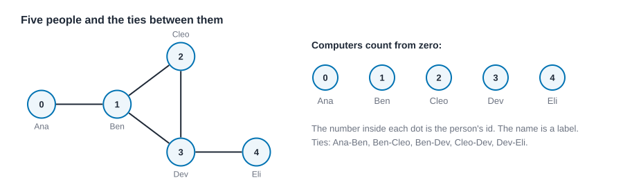{#fig-rep-network fig-alt="A five-person network. Ana (0) is tied to Ben (1). Ben is tied to Cleo (2) and Dev (3), who are tied to each other, and Dev is tied to Eli (4). To the right, the five ids 0 to 4 sit above the names Ana, Ben, Cleo, Dev and Eli."}

Notice the numbers inside the dots. Computers are happiest with numbers, and they like to count from zero, so Ana is 0, Ben is 1, and so on. That number is the person's **id**. The name is just a **label** we keep on the side so humans can read the results. We will come back to this in the section on ids and labels, because it hides a surprising number of bugs.

A word on vocabulary, because the rest of the book leans on it. A **graph** is the mathematician's word for a network: a set of things (the **nodes**, here the people) and a set of connections between them (the **edges**, here the ties). A node's **neighbors** are the nodes it is tied to, and its **degree** is how many neighbors it has. Ben has degree 3. In this chapter, ties are **undirected**, meaning a tie between Ana and Ben is the same as a tie between Ben and Ana. We'll add arrows and weights later.

Let `n` stand for the number of people (here 5) and `m` for the number of ties (here 5). Those two letters appear in almost every cost statement in this book, so it's worth getting comfortable with them. A big network has a large `n` and a large `m`. A **sparse** network is one where `m` is small compared with the number of pairs that could be tied, which describes nearly every real network: a person knows hundreds of people, not millions.

## Five ways to store five people

Here are the five layouts, from the most natural to the most compact. For each one we'll build the five-person network by hand, say what question it answers well, and say what it costs.

### 1. The edge list

The edge list is the layout you get for free. It is the file you downloaded, the spreadsheet you exported, the output of a survey. Each row is one tie, written as a pair of ids.

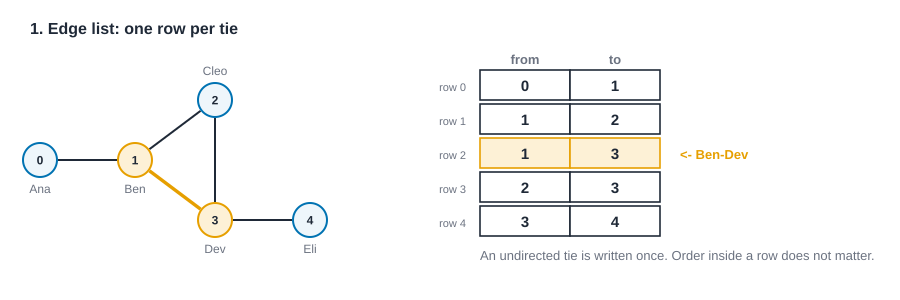{#fig-rep-edge-list fig-alt="The five-person network on the left with the Ben-Dev tie highlighted. On the right, a two-column table of five rows: 0 and 1, 1 and 2, 1 and 3, 2 and 3, 3 and 4. The row 1 and 3 is highlighted and labeled Ben-Dev."}

**The idea in steps.**

1. Give every person an id.
2. Write one row per tie, with the two ids side by side.
3. Write an undirected tie once. The order inside the row doesn't matter.

For the five people the list is: (0, 1), (1, 2), (1, 3), (2, 3), (3, 4). Five rows for five ties.

**What it costs.** To store a number a computer typically uses 4 bytes (a byte is the unit of computer memory; a typical photo is a few million of them). One row is two numbers, so 8 bytes per tie. Double the ties and the memory doubles. That's very compact.

**What it's good at.** Adding a tie (write one more row) and walking through every tie once, which is exactly what you need to count them or to read them into another layout.

**What it's bad at.** Anything about one person. To find Ben's friends you have to read every row, because Ben's ties could be anywhere. That is the "read the whole list" problem from the guest list story. In @fig-cost-count in the next chapter we count exactly how many steps this takes.

### 2. The adjacency list

The adjacency list gives each person a short list of their neighbors. (*Adjacent* just means "next to", so this is "the list of who is next to each person".)

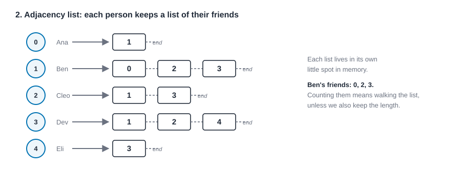{#fig-rep-adjacency-list fig-alt="Five rows, one per person, each with a numbered dot and a name. An arrow leads from each person to a chain of boxes holding the neighbor ids: Ana 1; Ben 0, 2, 3; Cleo 1, 3; Dev 1, 2, 4; Eli 3. Each chain ends with the word end. A note on the right says each list lives in its own spot in memory."}

**The idea in steps.**

1. Make one empty list for each person, numbered 0 to n minus 1.
2. For each tie (a, b), add b to a's list and a to b's list.
3. To find someone's friends, go to their list and read it.

Notice step 2 writes each undirected tie twice, once for each end. The tie between Ben and Dev puts 3 in Ben's list and 1 in Dev's. That doubling is the price of being able to answer "who does Ben know?" from Ben's list alone.

Working it through for the five people: Ana (0) gets [1]. Ben (1) gets [0, 2, 3]. Cleo (2) gets [1, 3]. Dev (3) gets [1, 2, 4]. Eli (4) gets [3]. Add up the lengths: 1 + 3 + 2 + 3 + 1 = 10, which is twice the five ties.

**What it costs.** Each tie is written twice, 4 bytes each time, so 8 bytes per tie, the same as the edge list. But each of the n little lists also carries bookkeeping (where it lives in memory, how long it is), often around 24 bytes per list in common programming languages. So the adjacency list is the edge list plus some overhead per person.

**What it's good at.** "Who does Ben know?" is one jump. "How many friends does Ben have?" is the length of the list, if we keep it. Walking over everyone's neighbors, which is what searches do, is fast.

**What it's bad at.** Because each little list lives in its own spot in memory, a computer that walks through many lists has to jump around. We will see in the next chapter why jumping around memory is slower than it looks. The adjacency list also takes a bit more care to build and to copy.

### 3. Compressed sparse rows

**Compressed sparse rows**, abbreviated CSR, is the adjacency list with the little lists glued end to end into one long flat list, plus a second short list that says where each person's block starts. The name comes from linear algebra, where it is a standard way to store a grid that is mostly empty [@saad2003iterative]; it is the layout most fast graph code uses.

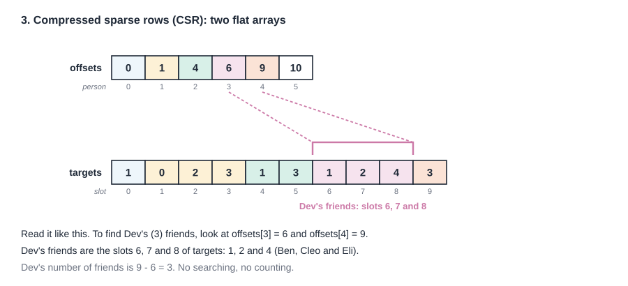{#fig-rep-csr fig-alt="Two rows of numbered boxes. The top row, offsets, holds 0, 1, 4, 6, 9, 10, one box for each person plus a last one. The bottom row, targets, holds 1, 0, 2, 3, 1, 3, 1, 2, 4, 3, shaded in five colors, one color for each person's block of friends. A bracket over slots 6, 7 and 8 is labeled Dev's friends and arrows lead to it from offsets 6 and 9."}

**The idea in steps.**

1. Count each person's friends. (Ana 1, Ben 3, Cleo 2, Dev 3, Eli 1.)
2. Add the counts up as you go, starting from zero. That gives the **offsets**: 0, 1, 4, 6, 9, 10. Person i's friends start at slot offsets[i] and stop just before slot offsets[i + 1].
3. Write every person's friends, one person after another, into one long list called the **targets**: 1, 0, 2, 3, 1, 3, 1, 2, 4, 3.

Check it with Dev, who is person 3. The offsets say Dev's friends begin at slot 6 and stop before slot 9, so they are slots 6, 7 and 8 of the targets: 1, 2, 4. That is Ben, Cleo and Eli, exactly right. Dev's number of friends is 9 minus 6, which is 3. No list to walk, no counting.

Let's watch the three passes happen. Each pass is nothing more than the three steps above, done one piece at a time. Notice that the counting pass visits each tie once, and that the filling pass visits each person once.

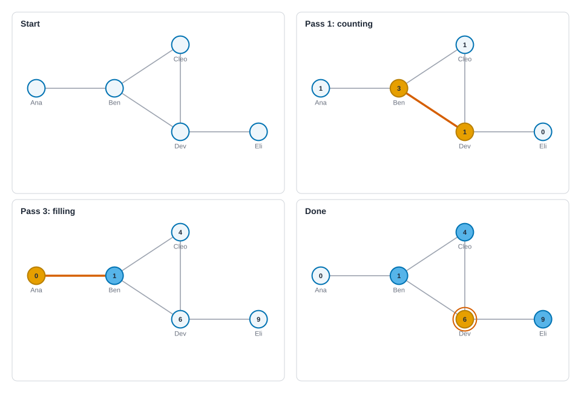{#fig-csr-build-anim fig-alt="Four copies of the five-person network. First: nothing counted yet. Second: after counting some of the ties, with a friend count inside each dot and the Ben-Dev tie highlighted. Third: the filling pass has reached Ana, whose block is written first. Fourth: finished, with each dot showing where its block starts and Dev's block highlighted. When it plays, the counts grow tie by tie, then the running totals appear, then the list of friends fills in one person at a time."}

The numbers in that animation come from knappnet's own rows for the same five people: the picture is checked against what the engine actually stores, and it agrees.

**What it costs.** The targets list holds 2m numbers (every tie twice) and the offsets list holds n + 1 numbers. At 4 bytes each, that is 8m + 4(n + 1) bytes. There is no per-person overhead beyond that one extra number. For the five people: 8 times 5 plus 4 times 6 is 64 bytes.

::: {.callout-tip title="In plain words"}
The memory for CSR is "eight bytes for each tie, plus four for each person (and one more)". The eight comes from storing each tie twice at four bytes a time. In the five-person network that's $8 \cdot 5 + 4 \cdot 6 = 64$ bytes. For a network of a million people with five million ties it's about 44 million bytes, 44 megabytes.
:::

**What it's good at.** Everything the adjacency list does, with two extras. The friends of one person sit side by side in memory, which computers read very quickly. And the whole network is just two arrays, which is easy to save, to send to another machine, or to hand to a graphics card.

**What it's bad at.** Changing it. Adding a tie in the middle means shifting everything after it. CSR is for networks you build once and then ask many questions of, which is most of this book.

### 4. The adjacency matrix

The **adjacency matrix** is the table from the guest list story: one row and one column for each person, with a 1 in the cell where two people are tied and a 0 where they are not.

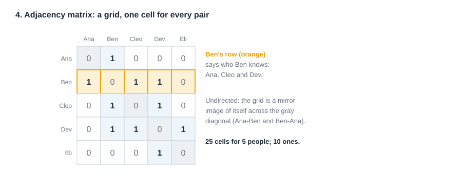{#fig-rep-matrix fig-alt="A five by five grid with the people's names along the top and left. Ones mark the ties; the grid is a mirror image across the diagonal. Ben's row, shaded orange, has ones under Ana, Cleo and Dev. A note counts 25 cells and 10 ones."}

**The idea in steps.**

1. Make an n by n grid of zeros.
2. For each tie (a, b), put a 1 in row a, column b, and another in row b, column a.
3. To ask whether a and b are tied, look at one cell.

Ben's row (row 1) reads 1, 0, 1, 1, 0: tied to Ana, Cleo and Dev. The grid is a mirror image of itself across the diagonal, because ties here are undirected. The diagonal itself holds a person's tie to themself, which is zero for everyone.

**What it costs.** One cell for every ordered pair of people, whether tied or not: n times n cells. If a cell is one byte, that is n squared bytes. For five people, 25 bytes. For a million people, a million times a million: a trillion bytes, a terabyte. No laptop has that.

::: {.callout-tip title="In plain words"}
The matrix needs one cell per pair, so doubling the number of people quadruples the memory. A hundred people need ten thousand cells. A thousand people need a million. A million people need a million million. That square is the whole story of why we don't use matrices for big networks. The matrix's strength is the opposite: checking whether two specific people are tied is a single cell, however large the network.
:::

**What it's good at.** "Are Ana and Dev tied?" in one look. It is also the form linear algebra wants: multiplying the matrix by itself counts walks of length two, and the later chapters on centrality make heavy use of that.

**What it's bad at.** Memory, as just shown, and "list Ben's friends", which means scanning a whole row of n cells to find the few ones.

### 5. Bit rows

A one-byte cell is wasteful when all it records is yes or no. A **bit** is the smallest unit of computer memory, a single 0 or 1, and a byte is eight of them. **Bit rows** store the adjacency matrix with one bit per cell, and pack each row into whole machine words (a **word** is a chunk of 64 bits, the amount a modern processor handles in one step).

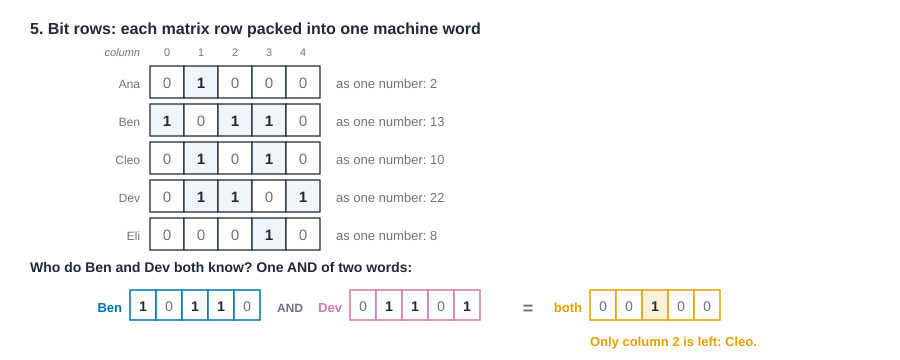{#fig-rep-bitrows fig-alt="A five by five grid of zeros and ones, one row per person, with each row also shown as a single number: 2, 13, 10, 22 and 8. Underneath, the rows for Ben and Dev are placed side by side with the word AND between them and a result row that has a single one, in column 2, which is Cleo."}

**The idea in steps.**

1. Take each row of the matrix and read its 0s and 1s as the digits of one number, with column 0 as the smallest digit. For Ben's row (1, 0, 1, 1, 0) that's 1 + 4 + 8 = 13.
2. Store that number. Up to 64 people fit in one number.
3. To find who two people have in common, combine their numbers with AND, a single operation that keeps a bit only if it is set in both.

The five rows become the numbers 2, 13, 10, 22 and 8. Ben (13) AND Dev (22) is 4, which is the bit for column 2: Cleo, the one friend Ben and Dev share. Knappnet's own bit rows for these five people return exactly those five words.

**What it costs.** One bit per pair, rounded up to whole words per row: about n squared divided by 8 bytes. For a million people that is 125 billion bytes, 125 gigabytes. That is eight times smaller than the byte matrix but still more than a laptop holds. For small and medium networks, which is where bit rows shine, it is tiny: ten thousand people take 12.5 megabytes.

::: {.callout-tip title="In plain words"}
Bit rows pay one eighth of a byte per pair instead of one byte. For five people the rows are padded to a whole 64-bit word, so they take 5 words of 8 bytes: 40 bytes, more than the 25-byte byte-matrix. The saving only appears when there are many people per row. At 640 people each row is ten words and the bit rows are about 51 thousand bytes, against 410 thousand for the byte matrix.
:::

**What it's good at.** Questions about groups of people, because one AND, OR or count handles 64 people at a time. Common friends, shared neighbors and triangles (a triangle is three people who all know each other, which come up again and again later in the book) all become a few word operations.

**What it's bad at.** Very large, very sparse networks, where the n-squared price is out of reach.

## Turning one layout into another

Almost every analysis starts with an edge list (that is how data arrives) and wants CSR (that is what fast code wants). The conversion is short enough to do by hand, and it's worth seeing once, because the same three-pass pattern turns up all over the book.

**The idea in steps.**

1. Go through the ties once and count each person's friends.
2. Add the counts up as you go to get the offsets.
3. Go through the ties a second time and drop each end into its person's block, keeping a little cursor for each person that says which slot is next.

Here is the same thing as short pseudocode.

```text
count = n zeros                          # one counter per person
for each tie (a, b):                     # pass 1: count both ends
    count[a] = count[a] + 1
    count[b] = count[b] + 1
offsets = [0]                            # pass 2: running totals
for each person i, in order:
    offsets.append(offsets[i] + count[i])
cursor = the first n numbers of offsets  # where each person's next friend goes
for each tie (a, b):                     # pass 3: place both ends
    targets[cursor[a]] = b ; cursor[a] = cursor[a] + 1
    targets[cursor[b]] = a ; cursor[b] = cursor[b] + 1
```

::: {.callout-tip title="In plain words"}
First we count how many friends everyone has, so we know how much room to leave each person. Then we add those counts up so each person knows where their room starts. Then we walk through the ties again and drop each friend into the right room. With the five people, the counts are 1, 3, 2, 3, 1, the offsets 0, 1, 4, 6, 9, 10, and the ties (0, 1), (1, 2), (1, 3), (2, 3), (3, 4) fill the rooms in that order. If you sort each room afterwards you get exactly the targets in the figure.
:::

The animation above fills person by person instead of tie by tie. The result is the same once each room is sorted; the person-by-person version is just easier to watch.

**What it costs.** Pass 1 does two small steps per tie, pass 2 does one per person, pass 3 does two per tie. Doubling the ties doubles the work, and so does doubling the people. In round numbers it is about 4m + n steps; for a million people and five million ties that's about twenty-one million simple steps, a small fraction of a second.

::: {.callout-tip title="In plain words"}
Converting is cheap: the work grows in step with the size of the network, with no surprises. It's the cheapest thing you'll see in this book, which is why it is almost always worth converting to the right layout first instead of asking slow questions of the wrong one.
:::

To get a directed network's "who points at me" copy, run the same three passes with the two ends of each tie swapped. That is the whole recipe for the second copy mentioned earlier.

## Common friends, three ways

Here is a question that makes the layouts compete: who do Ben and Dev both know? We know the answer is Cleo. Let's count the steps each layout needs.

**CSR, the plain way.** Ben's friends are 0, 2, 3 (slots 1 to 3 of the targets) and Dev's are 1, 2, 4. For each of Ben's three friends, look through Dev's three. That's up to 3 times 3 = 9 comparisons. For people with a thousand friends each, it's a million.

**CSR with sorted friends, the two-finger way.** If each person's friends are kept in increasing order (as above, and as the engine keeps them), put one finger at the start of each list and move the finger that points at the smaller number.

1. Fingers at 0 (Ben) and 1 (Dev). The smaller is 0: move Ben's finger.
2. Now 2 and 1. The smaller is 1: move Dev's finger.
3. Now 2 and 2. They match: Cleo is a common friend. Move both.
4. Now 3 and 4. Smaller is 3: move Ben's finger. Ben's list has ended, so we stop.

Four steps found the answer, and no finger ever moves backward, so the cost is at most the two list lengths added together (here 3 + 3 = 6), not multiplied.

**Bit rows, the word way.** Ben's row is 13 and Dev's is 22. One AND gives 4: one step, however many people fit in a word.

::: {.callout-tip title="In plain words"}
The same question costs "length times length" the clumsy way, "length plus length" with sorted lists, and "one step per 64 people" with bit rows. In a network of a thousand people where two people know almost everyone, that is about a million steps, about two thousand steps, and sixteen word operations. The data didn't change: only how it was laid out did.
:::

This is the first hint of a theme that runs through the rest of the book: the algorithm often matters less than the layout under it.

## How big is big?

It helps to have a feel for sizes, so the memory formulas don't stay abstract.

- The famous karate club network has 34 people and 78 ties. In CSR that's 8 times 78 plus 4 times 35 = 764 bytes, shorter than this paragraph.
- A company of ten thousand people where everyone knows 30 others has 150,000 ties: about 1.2 megabytes in CSR. A matrix of bytes would be 100 megabytes, still fine; bit rows would be 12.5 megabytes.
- A social platform with a billion people where everyone has 200 friends has 100 billion ties. In CSR that's about 800 gigabytes: a lot, but a single big machine can hold it. A byte matrix would be a billion billion bytes, an exabyte, more than all the hard drives in a large data center.

The point of those three is not the numbers but the shapes. Small networks fit any layout. Medium ones fit anything but a byte matrix, and bit rows are a bargain. Huge ones only fit as lists, and even then you start to care whether your ids need 4 bytes or 8.

## Sparse or dense? One number to compute

We have called networks "sparse" without saying how sparse. The usual number is **density**: the share of all possible pairs that are actually tied.

$$
\text{density} = \frac{m}{n(n-1)/2} = \frac{2m}{n(n-1)}
$$

The bottom of the fraction counts the possible pairs (the count derived in the proof box of @sec-cost): each of $n$ people could be tied to $n - 1$ others, and each pair is counted from both ends, so we divide by 2. The top is the number of ties that exist.

::: {.callout-tip title="In plain words"}
Density asks: of all the pairs of people who *could* be tied, what share are? It is 1 when everyone knows everyone and 0 when no one knows anyone. In the five-person network, there are $5 \cdot 4 / 2 = 10$ possible pairs and 5 ties, so the density is $5/10 = 0.5$. In the karate club, $78 / (34 \cdot 33 / 2) = 78/561 \approx 0.14$.
:::

Here is how density falls as networks grow, using the sizes from before.

| Network | People | Ties | Density |
| --- | --- | --- | --- |
| Five people | 5 | 5 | 0.5 |
| Karate club | 34 | 78 | 0.14 |
| A company, everyone knows 30 | 10,000 | 150,000 | 0.003 |
| A platform, everyone has 200 friends | 1 billion | 100 billion | 0.0000002 |

The pattern is the point. If each person knows about the same number of people however big the network gets, density shrinks as the network grows. A matrix wastes more and more of its cells: in the platform's matrix, only two cells in every ten million are ones. That is the practical meaning of "use a list layout for big networks": when density is tiny, a list stores only the ties that exist, and the matrix stores all the pairs that do not.

When density is high, say above a few percent, the matrix is no longer wasteful, and a bit matrix can be the fastest layout of all. That is why dense, small networks (a team, a classroom, a set of countries) often use bit rows, while huge sparse ones use CSR.

## Ids versus labels

We said computers number people from zero. Real data rarely arrives that way. A file might name people by username, badge number, email address or a long code. Before any of the five layouts can be built, the data needs a translation.

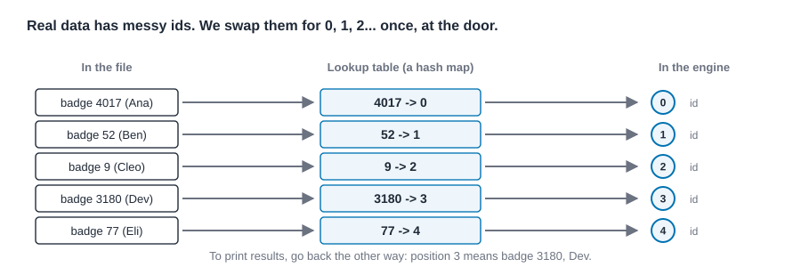{#fig-rep-ids-labels fig-alt="Three columns. On the left, five badge numbers from a file: 4017 for Ana, 52 for Ben, 9 for Cleo, 3180 for Dev and 77 for Eli. In the middle, a lookup table pairing each badge number with a position 0 to 4. On the right, the five positions as numbered dots. Arrows run left to right."}

The standard trick is a **lookup table**: when the file is read, each new name is given the next free number, 0, 1, 2 and so on, and the pair is remembered. (In programming this is called a *hash map* or a *dictionary*, and we'll build one by hand in @sec-building-blocks.) Ties are then rewritten with numbers. When results come out, the table is read backwards to put names back.

Three things go wrong here, and they go wrong often.

**Off by one.** Some tools count from zero and some from one, and your own spreadsheet probably counts from one. If an id means "the third person" in one place and "the fourth" in another, every answer is silently shifted. The fix: decide once, write it down, convert in exactly one place.

**Gaps.** If badge numbers go up to 80,000 but only 5,000 people exist, using the badge number directly as a position wastes memory and tempts you to build a table with 80,000 rows. The lookup table closes the gaps and gives 0 to 4,999.

**Mixing up the two.** An id is a position, not a label. It means nothing outside this one network, and it changes if you load the file in a different order. Never save ids as if they were permanent names; save the labels, and rebuild the ids when you load.

## Names, ages and other facts about people

A network usually comes with facts about the people (a name, an age, a team) and about the ties (a date, a weight). Where do they go?

The trick is the one we used for weights: **keep a separate list for each fact, indexed by id.** The name list has the name of person 0 in slot 0, of person 1 in slot 1, and so on. The age list likewise. To look up Dev's team, go to slot 3 of the team list. No search is needed, because the id *is* the slot number.

| id | name | team | age |
| --- | --- | --- | --- |
| 0 | Ana | Blue | 31 |
| 1 | Ben | Blue | 44 |
| 2 | Cleo | Red | 28 |
| 3 | Dev | Red | 39 |
| 4 | Eli | Red | 52 |

Stored as columns, that table is three lists, each the same length as the number of people. A similar list, the same length as the targets in CSR, holds a fact about each tie. This is why ids must be exactly 0 to n minus 1 with no gaps: it is what lets every fact live in a plain list.

The rule worth remembering: **the network's structure and the facts about the people are separate, joined only by the id.** Keeping them apart means one copy of the structure can be shared by many analyses, each with its own facts.

## From a file to a network, step by step

Putting the pieces of the chapter in order, here is what a tool does when you ask it to load a file of friendships:

1. **Read** the file into an edge list of labels: pairs like (badge 4017, badge 52).
2. **Build the lookup table**: give each new label the next free number, as you meet it.
3. **Rewrite** each tie with ids instead of labels.
4. **Count** each person's friends, **add up** to get offsets, and **fill** the targets (the three passes from the conversion section).
5. **Sort** each person's friends, so that "are they tied?" and common-friend questions can use the fast methods.
6. **Check**: the degrees add up to twice the ties, no id is beyond $n - 1$, and the number of people matches what you expect.
7. **Keep the lookup table** to turn results back into names.

Each step is cheap and each is a place where a mistake can hide, which is why the checks at the end are worth the thirty seconds.

## Directed ties and weights

So far a tie goes both ways. Many networks aren't like that: Ana follows Ben, but Ben doesn't follow Ana. A tie with a direction is called an **arc** (or a directed edge), and a network of arcs is a **directed** network. Many networks also say how strong a tie is: how many messages were sent, how many hours were worked together. A number on a tie is a **weight**.

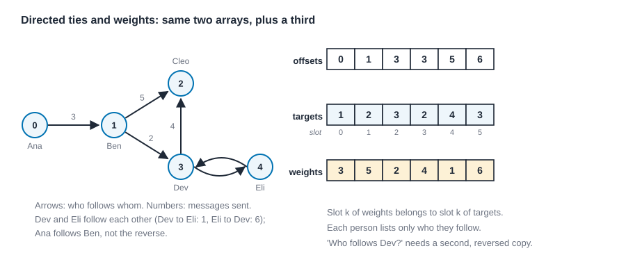{#fig-rep-directed-weighted fig-alt="On the left, the five-person network with arrows and a number on each: Ana to Ben 3, Ben to Cleo 5, Ben to Dev 2, Dev to Cleo 4, Dev and Eli pointing at each other with 1 and 6. On the right, three rows of boxes: offsets 0, 1, 3, 3, 5, 6; targets 1, 2, 3, 2, 4, 3; weights 3, 5, 2, 4, 1, 6. Notes explain that each weight lines up with the target in the same slot."}

Neither change needs a new layout. Look at the figure.

- **Direction.** An undirected tie was stored twice, once for each end. A directed tie is stored once, at the person it starts from. In an edge list, (0, 1) now means "0 points at 1", and (1, 0) is a different tie. In CSR, each person's block holds only the people they point to, so Dev's block is Cleo and Eli. In the matrix the mirror symmetry disappears: row 3 column 4 can be 1 while row 4 column 3 is 0.
- **Weights.** Keep a third list, the same length as the targets, where slot k holds the weight of the tie in slot k of the targets. The two lists stay lined up, so no search is needed to find a tie's weight.

There is one catch with direction. A directed CSR answers "who does Dev point to?" instantly. "Who points at Dev?" is a different question, and answering it requires a second copy of the network with every arrow reversed. Searches and measures that need both directions pay for both copies, which doubles the memory. It's a good example of the theme of this chapter: a layout is a bet about which questions you'll ask.

## What each layout costs in memory

Now we can compare all five. Take a network with n people and m ties. How many bytes does each layout need?

| Layout | Bytes (4-byte ids) | Five people | A million people, 5 million ties |
| --- | --- | --- | --- |
| Edge list | 8m | 40 | 40 million (40 MB) |
| Adjacency list | 8m + about 24n | 160 | about 64 million (64 MB) |
| CSR | 8m + 4(n + 1) | 64 | 44 million (44 MB) |
| Matrix, one byte a cell | n times n | 25 | one trillion (1 TB) |
| Bit rows | n times n over 8, rounded up per row | 40 | 125 billion (125 GB) |

::: {.callout-tip title="In plain words"}
Read the third column first: for five people all five layouts are small and the differences are noise. Now read the fourth column. The first three layouts grow in step with the number of ties, so a thousand times more people needs about a thousand times more memory. The last two grow with the square of the number of people, so a thousand times more people needs a million times more memory. That is the difference between 44 megabytes and a terabyte, from the same network.
:::

The chart in @fig-rep-memory shows the same numbers for every size between a hundred and a million people, on a "log scale" where each gridline is a thousand times the one below. On a log scale a quantity that doubles each step is a straight line; the steeper the line, the faster the growth. Look at where the matrix and bit-row lines cross the dotted line for a laptop's memory.

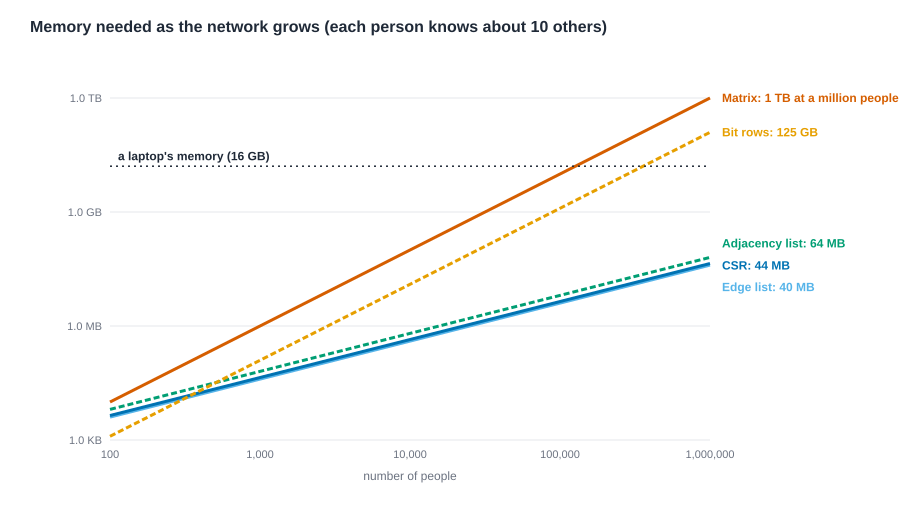{#fig-rep-memory fig-alt="A chart on logarithmic axes, number of people from 100 to 1,000,000 across and memory from 1 kilobyte to 10 terabytes up. Three nearly parallel straight lines for the edge list, adjacency list and CSR end near 40 to 64 megabytes at a million people. Two steeper lines for the matrix and bit rows end at 1 terabyte and 125 gigabytes, crossing a dashed line at 16 gigabytes, a laptop's memory, before a million people."}

Two lessons sit in that picture. For sparse networks, which means nearly every real one, use a list-style layout (edge list, adjacency list or CSR). And a matrix is not ruled out forever: for a few thousand people it is perfectly fine, and bit rows are a bargain up to tens of thousands. The honest question is always "how big is my network, and what do I need to ask?"

Real software often mixes layouts. Knappnet, the network engine this book's examples come from, keeps CSR as its everyday layout and builds bit rows only for some batched searches, and only when the bit matrix is small enough to be worth it: it checks that the bit rows would be at least as compact as the lists and under a fixed size limit before it builds them.

## Which questions each layout answers quickly

Memory is only half the story. The other half is speed, and speed depends on the question. @fig-rep-questions grades each layout on five common questions.

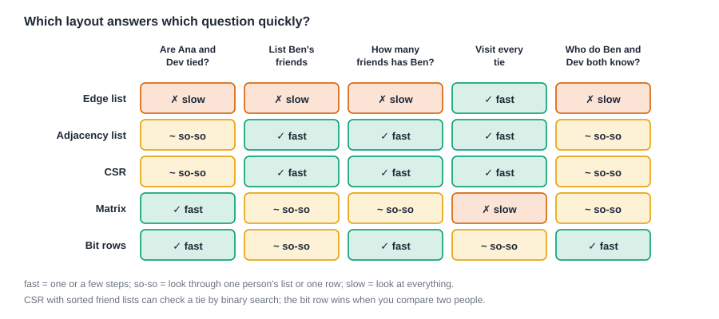{#fig-rep-questions fig-alt="A grid with five rows for the layouts and five columns for questions. Each cell reads fast, so-so or slow with a tick, tilde or cross. The edge list is fast only at visiting every tie. Adjacency list and CSR are fast at listing and counting a person's friends and visiting every tie. The matrix is fast at checking one pair only. Bit rows are fast at checking a pair, counting friends and finding common friends."}

To read the grid, remember what each layout makes cheap:

- The **edge list** makes visiting every tie cheap (just read down the rows) and nothing about a single person.
- The **adjacency list** and **CSR** make everything about one person cheap: their friends, their count of friends. Asking whether two particular people are tied means scanning one person's short list, which is quick unless that person has thousands of friends. If each list is kept in order, a computer can find a number in it by repeatedly halving the search (a *binary search*, which we meet in the next chapter), which is faster still.
- The **matrix** makes "are these two tied?" a single look, and makes visiting every tie slow, because you must read all n squared cells to find the few ones.
- **Bit rows** make comparing two people cheap, because AND and count work on a whole word at once.

The pattern to remember: a layout is fast at the question it was designed around and slow at the opposite. When you design an algorithm, first ask which question it will ask most, and then pick the layout that makes that question cheap.

## At a glance

| Layout | Answers fast | Memory grows with | Use it when | Avoid it when |
| --- | --- | --- | --- | --- |
| Edge list | Visit every tie; add a tie | the ties | Reading files, building other layouts | You need anything about one person |
| Adjacency list | A person's friends | the ties, plus a little per person | The network changes a lot | You will walk everyone's neighbors in a hurry |
| CSR | A person's friends; scan everyone | the ties and the people | Big, fixed networks and most algorithms in this book | The network changes constantly |
| Matrix | Are these two tied? | the square of the people | A few thousand people, linear algebra | Large sparse networks |
| Bit rows | Common friends, group questions | the square of the people, divided by 64 | Up to tens of thousands of people, many comparisons | Very large sparse networks |

## Where it goes wrong

A few mistakes come up again and again.

**Self-loops and repeated ties.** A **self-loop** is a tie from a person to themself; a **repeated tie** (a parallel edge) is the same pair listed twice. Both are legal in an edge list and both quietly change answers: a self-loop adds one or two to a degree depending on the tool, and a repeated tie makes a pair look twice as tied. Decide whether your data should contain them, and check by counting: the number of rows should match the number of distinct pairs.

**Storing an undirected tie once or twice.** If one part of your code writes each tie once and another expects each twice, the network silently loses half its ties or doubles them. The sum of all degrees is a good alarm: it must equal twice the number of ties for an undirected network. For the five people, 1 + 3 + 2 + 3 + 1 = 10 = 2 times 5.

**Numbers too small for the network.** A 4-byte whole number tops out around four billion. A network with more than that many people (large web graphs do) needs 8-byte ids, and the memory table doubles. Offsets in CSR have an even earlier limit: if the network has more than four billion ties, the offsets themselves need 8 bytes.

**Treating ids as names.** Covered above, and worth repeating: an id is a position that lives only as long as one load of the file.

**Choosing the layout by habit.** The matrix is what textbooks draw, so many people start with it, then wonder why a 100,000-person network needs 10 gigabytes just to exist.

**Checks worth running before you trust a new network.**

- Count the people and ties and compare with the source.
- Add up the degrees and check it is twice the ties (undirected).
- Look for ids greater than or equal to n, which means a label slipped through unconverted.
- Look for people with degree zero: they are legal but are often a sign that a name was spelled two ways.

## If you like proofs

::: {.callout-note collapse="true" appearance="simple" title="Why the degrees add up to twice the ties"}
This is the fact behind the "add up the degrees" alarm, and it explains why the targets list in CSR has exactly 2m entries. It is sometimes called the handshake lemma.

Count the number of pairs (person, tie) in which the person is one of the two ends of the tie. There are two ways to count them.

First, go through the people. Each person i is an end of exactly degree(i) ties, so the total is the sum of all the degrees.

Second, go through the ties. Each tie has exactly two ends, so each tie contributes exactly two pairs, and the total is 2 times m.

Both counts are of the same pairs, so they are equal: the sum of the degrees is 2m. For the five people, 1 + 3 + 2 + 3 + 1 = 10 = 2 times 5.

A consequence worth noticing: the sum of the degrees is always even, so the number of people with an odd degree is always even. (Here Ana, Ben, Dev and Eli have odd degrees, and 4 is even.) If a file claims a network with an odd number of odd-degree people, it has an error in it.
:::

## Code

The three blocks below describe, in one sentence each, what the code will compute. They are placeholders until the library interface is final. `python3 tools/pending.py` lists them.

First, build the five-person network in each layout and print how many numbers each one holds. Look for the edge list holding 10 numbers, CSR holding 6 plus 10, and the matrix holding 25.

::: {.panel-tabset group="language"}

## R

```r
# TODO(code, R): build the five-person network as an edge list, adjacency list, CSR (offsets and targets) and matrix, and print how many numbers each holds
```

## Python

```python
# TODO(code, Python): build the five-person network as an edge list, adjacency list, CSR (offsets and targets) and matrix, and print how many numbers each holds
```

## Rust

```rust
// TODO(code, Rust): build the five-person network as an edge list, adjacency list, CSR (offsets and targets) and matrix, and print how many numbers each holds
```

:::

::: {.code-output}
```text
TODO(output)
```
:::

Once the output appears, compare it with the by-hand arrays above: the offsets should read 0, 1, 4, 6, 9, 10 and the targets 1, 0, 2, 3, 1, 3, 1, 2, 4, 3.

Next, ask questions of the CSR layout: list Dev's friends, count them, and check whether Ana and Dev are tied. Look for Dev's friends to be Ben, Cleo and Eli, and for the Ana-Dev check to say no.

::: {.panel-tabset group="language"}

## R

```r
# TODO(code, R): from the CSR arrays, print Dev's friends (slots offsets[3] up to offsets[4]), how many there are, and whether Ana and Dev are tied
```

## Python

```python
# TODO(code, Python): from the CSR arrays, print Dev's friends (slots offsets[3] up to offsets[4]), how many there are, and whether Ana and Dev are tied
```

## Rust

```rust
// TODO(code, Rust): from the CSR arrays, print Dev's friends (slots offsets[3] up to offsets[4]), how many there are, and whether Ana and Dev are tied
```

:::

::: {.code-output}
```text
TODO(output)
```
:::

The first two lines of output should name three friends and the number 3; the last should be a plain "not tied".

Finally, the bit rows: print each person's row as a number and as bits, then the AND of Ben's and Dev's rows. Look for the numbers 2, 13, 10, 22, 8 and an AND of 4, which is Cleo.

::: {.panel-tabset group="language"}

## R

```r
# TODO(code, R): print each person's bit row of the five-person network as a number and as five bits, then the AND of Ben's and Dev's rows and the people it names
```

## Python

```python
# TODO(code, Python): print each person's bit row of the five-person network as a number and as five bits, then the AND of Ben's and Dev's rows and the people it names
```

## Rust

```rust
// TODO(code, Rust): print each person's bit row of the five-person network as a number and as five bits, then the AND of Ben's and Dev's rows and the people it names
```

:::

::: {.code-output}
```text
TODO(output)
```
:::

Last, the memory comparison for a network of a million people and five million ties: print the bytes for each layout and check them against the table above.

::: {.panel-tabset group="language"}

## R

```r
# TODO(code, R): print the bytes needed for an edge list, adjacency list, CSR, byte matrix and bit rows for 1,000,000 people and 5,000,000 ties, using the formulas in this chapter
```

## Python

```python
# TODO(code, Python): print the bytes needed for an edge list, adjacency list, CSR, byte matrix and bit rows for 1,000,000 people and 5,000,000 ties, using the formulas in this chapter
```

## Rust

```rust
// TODO(code, Rust): print the bytes needed for an edge list, adjacency list, CSR, byte matrix and bit rows for 1,000,000 people and 5,000,000 ties, using the formulas in this chapter
```

:::

::: {.code-output}
```text
TODO(output)
```
:::

The five printed sizes should match the last column of the memory table, from 40 megabytes up to a terabyte.

## Exercises

1. **By hand.** A new person, Fay, joins and is tied to Cleo and Eli. Write the new edge list, adjacency list, offsets and targets, and matrix for the six people. How many numbers does each now hold?
2. **By hand.** Using the five-person bit rows, work out who Ana and Cleo have in common by writing their rows and taking the AND. Then check it against the picture.
3. **Think it through.** A friend says "I'll store my 200,000-person network as a matrix, it's the simplest." Using the memory formulas, how much memory is that with one-byte cells? With bits? What would you suggest instead?
4. **Think it through.** You want to find, for every person, the number of friends they have. Which layouts give you this almost for free, and which would make you read everything?
5. **By hand.** Using the five people, do the three passes of the conversion from edge list to CSR on paper: write the counts, the offsets, and the cursor positions as each tie is placed. Do you get the targets from the figure after sorting each room?
6. **Coding, later.** Read an edge list with badge numbers, build the lookup table, convert to ids and CSR, and print each person's friends by name. Check that the sum of the degrees is twice the number of ties.

## Answers

1. The edge list gains two rows, (2, 5) and (4, 5), so it has 7 rows of 2 numbers: 14 numbers. The adjacency list gains Fay's list [2, 4] and the entries 5 in Cleo's list (which becomes [1, 3, 5]) and in Eli's list ([3, 5]): the lengths are 1, 3, 3, 3, 2, 2, adding to 14, which is twice 7. The offsets become 0, 1, 4, 7, 10, 12, 14 (counts 1, 3, 3, 3, 2, 2) and the targets are 1, 0, 2, 3, 1, 3, 5, 1, 2, 4, 3, 5, 2, 4: 14 numbers plus 7 offsets. The matrix is 6 by 6, 36 cells.
2. Ana's row is 0 1 0 0 0 and Cleo's is 0 1 0 1 0. The AND is 0 1 0 0 0: column 1, Ben. Ana and Cleo have exactly one friend in common, Ben, and the picture agrees: Ben is the only person tied to both.
3. With one-byte cells, 200,000 times 200,000 is 40 billion bytes, 40 gigabytes: more than most laptops. With bits it is 5 gigabytes, which might fit but is still wasteful. A list layout, CSR, would need only a few megabytes unless the network is extremely dense: if each person knows 50 others there are 5 million ties and 8 times 5 million plus 4 times 200,001 is about 41 megabytes.
4. CSR and the adjacency list: the number of friends is the difference of two neighboring offsets, or the length of one list. The edge list forces you to read every row and add to a counter for each end. The matrix forces you to add up each row of n cells, and bit rows to count the ones in each row's few words.
5. Pass 1 gives counts 1, 3, 2, 3, 1. Pass 2 gives offsets 0, 1, 4, 6, 9, 10. For pass 3 the cursors start at 0, 1, 4, 6, 9. Tie (0, 1): targets[0] = 1 and targets[1] = 0; cursors become 1, 2, 4, 6, 9. Tie (1, 2): targets[2] = 2 and targets[4] = 1; cursors 1, 3, 5, 6, 9. Tie (1, 3): targets[3] = 3 and targets[6] = 1; cursors 1, 4, 5, 7, 9. Tie (2, 3): targets[5] = 3 and targets[7] = 2; cursors 1, 4, 6, 8, 9. Tie (3, 4): targets[8] = 4 and targets[9] = 3. Reading the targets gives 1, 0, 2, 3, 1, 3, 1, 2, 4, 3, which are already sorted inside each room.
6. The check at the end is the handshake fact from the proof box: if the degrees do not add to twice the number of ties, either a tie was written once and read as twice, or a tie was lost when badges were turned into ids.

## Summary

::: {.callout-tip appearance="simple"}
A network has to be turned into numbers before a computer can use it, and the layout you choose decides which questions are cheap. An edge list is a list of pairs: tiny and easy, but slow for anything about one person. An adjacency list and its flat cousin, compressed sparse rows (CSR), keep each person's friends together, which makes "who does Ben know?" a single step. A matrix has a cell for every pair, so it answers "are these two tied?" instantly but needs memory proportional to the square of the number of people, and bit rows shrink that by 64 per word and make common-friend questions fast. People are numbered from zero, names are kept in a lookup table, and directions and weights ride along in the same arrays. A layout is a bet on which questions you will ask.
:::

## Further reading

The textbook treatments of graph representations are in @cormen2022introduction and @sedgewick2011algorithms; both are readable with no more background than this chapter. CSR comes from sparse linear algebra, where @saad2003iterative is the standard text. For graph algorithms written as operations on the matrix, see @kepner2011graph. The social network analysis book at [knapply.github.io/net-books/sna](https://knapply.github.io/net-books/sna/) uses the same five people to introduce degree and the first measures, and the next chapter in this book counts what these layouts cost in steps.
