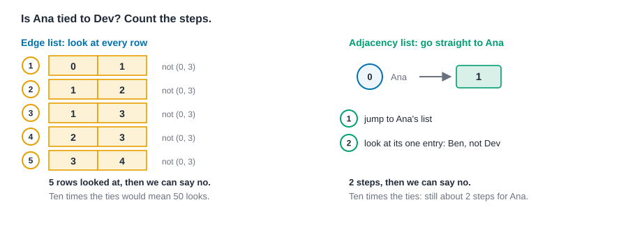
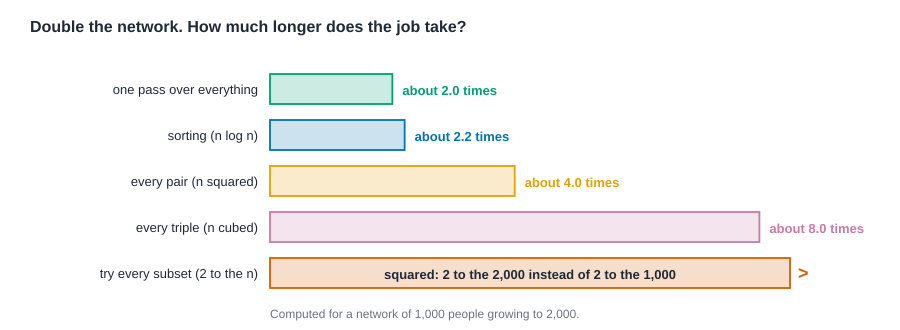
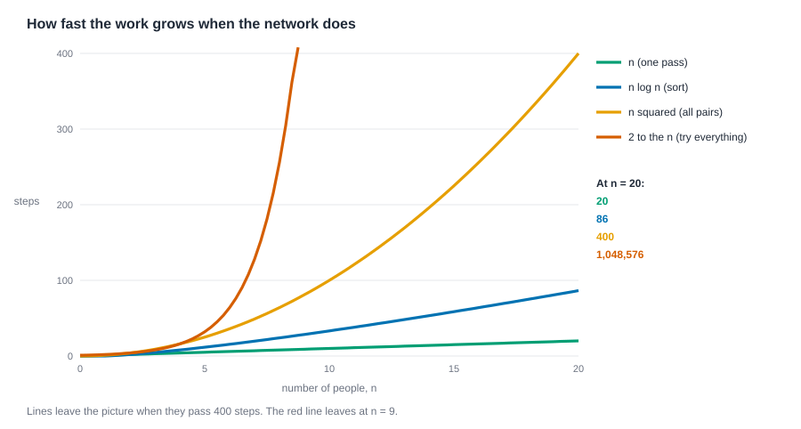
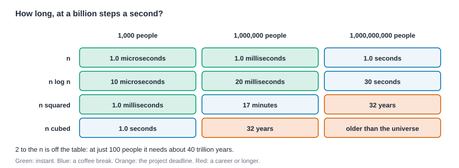
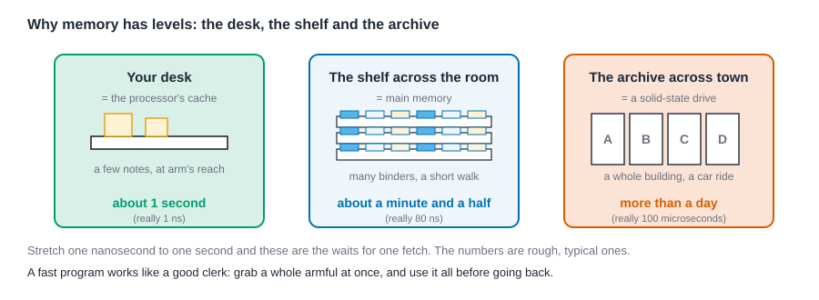
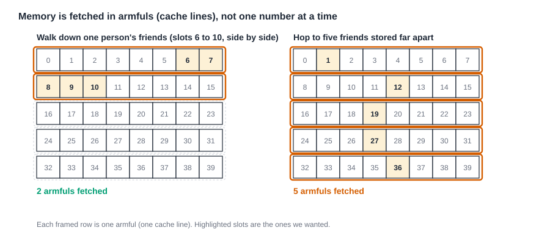
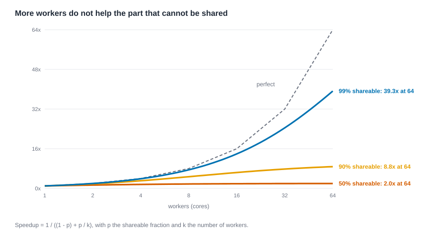
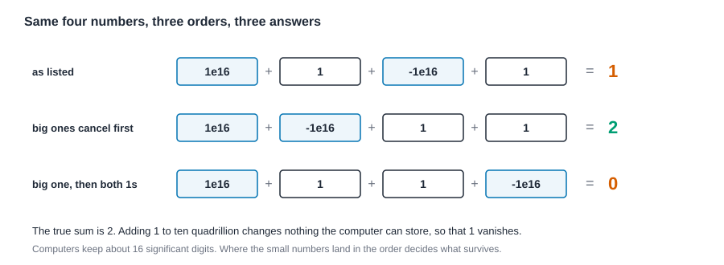
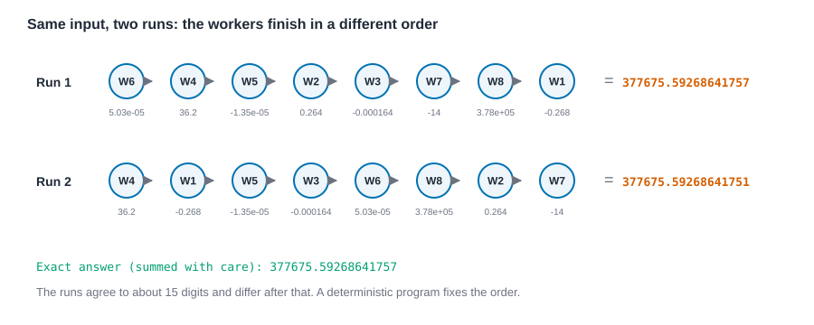

# Cost: time, memory and what really takes long {#sec-cost}

::: {.callout-note appearance="simple"}
## Prerequisites
What a graph is to a computer (@sec-representations). We reuse the five people and the layouts from there.
:::

::: {.callout-note title="The short version"}
"Cost" means how much work a computer has to do, and how much memory it needs, as the network gets bigger. We count the work in steps, by hand at first, and then learn the shorthand people use for it, called Big-O, which only says how the work grows when the network does. Big-O is a good first guide, but it hides things that matter a great deal in practice: how memory is read, how much a second processor really helps, and why adding the same numbers in a different order can change the answer. This chapter explains each of those with a picture and a tiny example.
:::

::: {.callout-note title="Why you might care"}
When someone says "this algorithm is fast" or "this one doesn't scale", they are talking about cost. If you can count steps and read a growth rate, you can predict whether a job will take a second, an hour or a century before you run it, and you can tell when a claim is missing something. And if two runs of the same analysis give slightly different answers, this chapter explains why that can happen without anything being broken.
:::

## A story first: finding a name

You have a printed guest list with a thousand names in no particular order, and you need to check whether "Dev" is on it. The only way is to read from the top until you find the name or reach the end. On average you read about five hundred names; at worst, all thousand. If the list grows to two thousand names, the work about doubles.

Now suppose the list is sorted alphabetically. You open the book in the middle. "Dev" comes before the name you land on, so you throw away the second half and open the first half in the middle. Each look cuts the list in half. After about ten looks you are down to one name, and you know. If the list grows to two thousand names, you need *one* more look, not twice as many.

Same problem, same answer, two very different costs. The difference between "double the work" and "one more look" is the difference between a job that stays comfortable as the network grows and one that doesn't. Cost is about that difference, and this chapter is about how to see it coming.

## What you'll be able to do

By the end you should be able to:

- count the steps an algorithm takes on a tiny example, by hand;
- read and say aloud the common growth rates (constant, logarithmic, linear, "n log n", quadratic and exponential) and recognize them from timings;
- estimate whether a job on a big network is feasible, using a billion steps a second as a rule of thumb;
- explain, with a picture, why memory layout, parallel speedup and the order of additions can matter more than the step count;
- say what it means for an algorithm to be deterministic, and why it can be hard.

## Counting steps by hand

Start with the simplest question from the last chapter: are Ana and Dev tied? We have the five-person network stored as an edge list and as an adjacency list, and we want to count how many **steps** each layout needs. A step is one small, indivisible action, like looking at one row or comparing two numbers. We don't care how long a step takes yet, only how many we need.

{#fig-cost-count fig-alt="Left, the five-row edge list with each row numbered 1 to 5 in order, labeled as five rows looked at. Right, a single arrow from Ana to her list holding just Ben's id, labeled as two steps: jump to Ana's list and look at its one entry."}

**With the edge list.** The ties are (0, 1), (1, 2), (1, 3), (2, 3), (3, 4). To be sure there is no tie between 0 and 3, we have to look at every row, because the tie could be anywhere. Five rows, five steps. If we find it earlier we can stop, but to say "no" we must check them all.

**With the adjacency list.** Ana's list is [1]. We go to Ana's list (one step) and look at its single entry, 1, which is Ben and not Dev (one more step). Two steps, and now we can say "no".

Now what happens as the network grows? Suppose there are a million ties.

- The edge list needs up to a million looks. Ten times the ties, ten times the looks.
- The adjacency list still needs one jump, plus the length of Ana's list. If Ana has 20 friends, that's 21 steps, and it doesn't matter how many millions of ties the rest of the network has.

That contrast is the whole idea. We're not comparing five steps with two. We're comparing a cost that grows with the *whole network* and a cost that grows with *one person's friends*.

The next table counts a few more questions on the five people. The numbers are small enough to check by hand.

| Question | Edge list | Adjacency list | Matrix |
| --- | --- | --- | --- |
| Are Ana and Dev tied? | 5 looks (all rows) | 2 (jump, scan 1 friend) | 1 (one cell) |
| Who does Ben know? | 5 looks (all rows) | 1 jump, then read 3 | 5 cells (his row) |
| How many friends has Ben? | 5 looks | 1 (the list's length) | 5 cells |
| Visit every tie | 5 | 10 (every tie twice) | 25 cells |

Look at the last row. The adjacency list does ten steps for five ties because each tie appears in two lists, and the matrix does twenty-five because it must read every cell. Different questions, different winners. This is the by-hand version of the grid in the previous chapter.

<!-- TODO(animation): needs a step counter exposed by the engine's traversal (how many arcs a search examined), so the growth of work with network size can be drawn from real counts -->

## Big-O in plain words

Counting by hand is exact and exhausting. For big networks we want a short way to say how the count *grows*, ignoring the small details. That's what Big-O does.

### Double the network

The question Big-O answers is: **if the network doubles, what happens to the work?**

- If the work doubles, we say it is **linear**: it grows in step with the size. Reading every row of a list is linear.
- If the work quadruples, it is **quadratic**: it grows with the square. Checking every pair of people is quadratic.
- If the work grows by a fixed amount (say, one more look), it is **logarithmic**. Searching a sorted list by halving it is logarithmic.
- If the work doesn't grow at all, it is **constant**. Looking at one cell of a matrix is constant.

{#fig-cost-doubling fig-alt="Five horizontal bars. One pass over everything is a bar for 2 times. Sorting is slightly longer, about 2.2 times. Every pair is 4 times and every triple 8 times. The last bar, try every subset, runs off the end of the chart with the note that 2 to the 1,000 becomes 2 to the 2,000."}

The picture shows what doubling does to some common growth rates, for a network of a thousand people growing to two thousand. Notice the last bar. "Try every subset" doesn't merely multiply the work, it *squares* it. That is the signature of the rates that nothing can rescue.

### The formal version

Now the shorthand. Write $n$ for the size of the input (people, ties, whatever the algorithm reads) and $T(n)$ for the number of steps the algorithm takes on an input of size $n$. We say

$$
T(n) = O(g(n))
$$

if there are two fixed numbers, $c$ and $n_0$, such that for every size $n$ at least $n_0$, $T(n) \le c \cdot g(n)$.

::: {.callout-tip title="In plain words"}
"$T(n) = O(g(n))$" is read "T of n is big-O of g of n". It says: past some size ($n_0$), the work $T(n)$ never exceeds a fixed multiple ($c$) of the simple function $g(n)$. A worked example: an algorithm that takes $T(n) = 3n + 10$ steps is $O(n)$, because once $n$ is at least 10, $3n + 10 \le 4n$, so we can take $c = 4$ and $n_0 = 10$. The shorthand throws away the "+ 10" and the "3", which don't change how the work grows, and keeps the "n", which does.
:::

Big-O gives an upper limit on growth and ignores constants. That's why $3n + 10$, $100n$ and $n/2$ are all just "$O(n)$": all of them double when the input doubles. It's a statement about shape, not about speed.

### The usual ladder

Here are the rates you will meet, from cheapest to most expensive, each with a plain-words name and a friendly example.

| Big-O | Say it | Example |
| --- | --- | --- |
| $O(1)$ | constant | Read one cell of a matrix; look up a person's offset |
| $O(\log n)$ | logarithmic | Find a name in a sorted list by halving it |
| $O(n)$ | linear | Read every row of an edge list |
| $O(n \log n)$ | "n log n" | Sort a list |
| $O(n^2)$ | quadratic | Compare every pair of people |
| $O(n^3)$ | cubic | Compare every triple |
| $O(2^n)$ | exponential | Try every subset of people |

A **logarithm** (here, base 2) answers: how many times can I cut this in half before nothing is left? For 8 things the answer is 3, for 1,000 it's about 10, for a million about 20, for a billion about 30. It grows so slowly that it is nearly as good as constant. Let's check by hand on a sorted list of eight friends' ids: 2, 5, 9, 13, 17, 21, 30, 34. To find 30, look at the middle-ish number, 13: 30 is bigger, so throw away the left half. Now look in 17, 21, 30, 34 at 21: bigger again, keep 30, 34. Look at 30: found. Three looks for eight numbers. This is the *binary search* promised in the last chapter.

{#fig-cost-growth fig-alt="A line chart of steps against the number of people from 0 to 20. A green straight line reaches 20. A blue line that bends slightly upward reaches about 86. An orange curve reaches 400 at 20 people. A red curve shoots off the top of the chart at about 9 people. A legend lists the four rates and the step counts at 20 people: 20, 86, 400 and 1,048,576."}

The growth chart is where the ladder becomes real. For ten or twenty people the rates look harmless, but they spread apart faster than you expect, and the red curve leaves the page almost at once.

### Two more symbols, briefly

Big-O is an upper limit: "no worse than". Two cousins say the other things. **Big-Omega**, written $\Omega(g(n))$, is a lower limit: "no better than". **Big-Theta**, written $\Theta(g(n))$, says both at once: the work grows exactly like $g(n)$, within constant multiples above and below.

::: {.callout-tip title="In plain words"}
Reading every row of an edge list is $\Theta(m)$: it needs at least $m$ looks (to be sure you saw every tie) and no more than a fixed multiple of $m$ looks. Looking at one matrix cell is $\Theta(1)$. People often say "big-O" when they mean "big-Theta", and in casual talk that is fine. In this book, a bare O is a promise that the work won't grow faster than that.
:::

### What the numbers mean in real time

Rule of thumb: a modern computer does about a billion simple steps a second. That is crude, but it lets you turn a step count into a wait.

{#fig-cost-times fig-alt="A grid of four growth rates by three network sizes (1,000; 1,000,000; 1,000,000,000 people). One pass takes a microsecond, a millisecond and one second. Sorting takes 10 microseconds, 20 milliseconds and 30 seconds. Every pair takes one millisecond, 17 minutes and about 32 years. Every triple takes one second, about 32 years and longer than the universe has existed."}

Read the grid row by row. A single pass over a thousand, a million or a billion people is a blink. Sorting is a bit more but still fine. Checking every pair is comfortable at a thousand people and hopeless at a billion. And the cubic row falls off a cliff at a million.

::: {.callout-tip title="In plain words"}
To estimate a job, count the steps (for example, a million people compared pairwise is a million times a million, a trillion steps) and divide by a billion steps a second. A trillion steps is a thousand seconds, about 17 minutes. If a question needs a quadrillion steps instead, it takes 12 days. Doing this arithmetic before a long run is the cheapest way to find out the plan can't work.
:::

### Two letters for networks

Networks have two sizes, the number of people $n$ and the number of ties $m$, and costs are usually written in both. For example, visiting every person and every tie once costs $O(n + m)$: read each person (that's $n$) and each tie (that's $m$). In a sparse network, $m$ is a small multiple of $n$, so this is about linear in the network. Checking every *pair* of people costs $O(n^2)$ even though most pairs have no tie, which is why dense-matrix thinking falls apart on big networks.

A few more words you will see in cost statements:

- **Worst case**: the most steps over all inputs of a given size. Looking for a name that isn't in an unsorted list is the worst case: you read it all.
- **Average case**: the typical number of steps, if inputs are typical. A name that's on the list is found in about half the list on average.
- **Amortized**: the cost averaged over a whole sequence of operations. A step that is occasionally expensive but usually cheap is amortized cheap. We will meet this in @sec-building-blocks with union-find and growing lists.
- **Memory cost** (or *space*): how many bytes the algorithm needs, which gets the same Big-O treatment. The memory table in @sec-representations was one.

## Costs in a network: three worked examples

Let's put the pieces together on real-sized networks. The question: how long would it take to find everyone's distance from one person (a breadth-first search, which the next chapters cover properly), and how long to do it from *everyone*?

**One search.** A breadth-first search visits each person once and looks along each tie from both ends, so it takes about $n + 2m$ steps. For the five people that is $5 + 10 = 15$ steps: five people visited, ten arc-looks. (Compare with the 125 steps of a method that tries every triple: $5^3$.)

**A search from everyone.** Running one search from each of the $n$ people takes $n$ times as much: $n(n + 2m)$ steps. For the five people: $5 \cdot 15 = 75$ steps.

Now plug in three sizes and divide by a billion steps a second.

| Network | People $n$ | Ties $m$ | One search | A search from everyone |
| --- | --- | --- | --- | --- |
| Karate club | 34 | 78 | 190 steps: instant | 6,460 steps: instant |
| A company | 10,000 | 150,000 | 310,000 steps: 0.3 ms | 3.1 billion steps: about 3 seconds |
| A platform | 1 billion | 100 billion | 201 billion steps: about 3 minutes | $2 \times 10^{20}$ steps: about 6,000 years |

::: {.callout-tip title="In plain words"}
The same method is instant, comfortable and impossible depending only on the size. One search from one person on the biggest network is a coffee break. Doing it from everyone multiplies that by a billion, so it is out of reach. That is exactly the situation where later chapters switch to methods that give approximate answers, or that share work between searches. The table is the reason those chapters exist.
:::

The arithmetic took four lines and no code. This is the most valuable habit in the chapter: before you run something big, write the step count as a formula in $n$ and $m$, put in your numbers, divide by a billion, and see whether the answer is minutes or millennia.

A worksheet for it:

1. Write down $n$ and $m$ for your network.
2. Write the algorithm's step count as a formula in $n$ and $m$.
3. Plug in the numbers.
4. Divide by $10^9$ to get seconds. Multiply by 10 if the data is big enough not to fit in the cache.
5. Check memory the same way: bytes needed, from the formulas in @sec-representations.
6. If the answer is more than you can wait, look for a method with a smaller formula before you look for a bigger machine.

Here is the same worksheet for the most common questions on a CSR network, as a cheat sheet.

| Question on a CSR network | Steps | Comment |
| --- | --- | --- |
| How many friends has one person? | 1 | Subtract two offsets |
| List one person's friends | their degree | They sit side by side |
| Are two people tied? | log of the first person's degree (sorted friends) | Binary search |
| Visit every person and tie once | $n + 2m$ | The base cost of most searches |
| A search from every person | $n(n + 2m)$ | Often the cost that matters |
| Compare every pair of people | $n(n-1)/2$ | Quadratic: keep $n$ small |

## What Big-O hides

Big-O is an excellent first guide, and every cost statement in this book uses it. But it deliberately throws details away, and on real machines the details can matter more than the shape. Here are the four that bite most often.

### The constant factor

$100n$ and $n$ are both $O(n)$, but one is a hundred times slower. If an algorithm reads each tie once and does a little arithmetic on it, versus one that reads each tie and does a hundred different things with it, they both say "linear". Big-O is silent about which you'd rather wait for.

It also works the other way. An $O(n \log n)$ method can beat an $O(n)$ method on smaller inputs if the linear one has a big constant. Real libraries are full of "if small, do the simple thing; if big, do the clever thing" switches for exactly that reason.

### Memory and caches

Here is the surprising part. Reading a number from memory is not a fixed-price step. A processor is a lot faster than the main memory next to it, so between them it keeps small, quick **caches**, which hold copies of recently used data. If the number you want is in the cache, it takes about a nanosecond. If not, the processor waits for main memory, which can be around a hundred times slower.

{#fig-cost-cache-story fig-alt="Three boxes side by side. Left, a desk with a few notes, labeled the processor's cache, about 1 second. Middle, a shelf of binders across the room, labeled main memory, about a minute and a half. Right, a building of filing cabinets across town, labeled a solid-state drive, more than a day."}

An analogy helps. Imagine your desk, a shelf across the room, and an archive across town. Stretch one nanosecond to a second. Grabbing a note off your desk takes a second. A binder from the shelf takes a minute and a half. A file from the archive takes more than a day. A good clerk doesn't fetch one sheet at a time: they grab an armful at once, and use everything in it before going back.

Computers do exactly that. They never fetch one number from main memory; they fetch an "armful" of neighboring numbers called a **cache line**, typically 64 bytes, which is 16 of our 4-byte ids. So the cost of reading memory depends on how many *armfuls* you touch, not how many numbers.

{#fig-cost-cache-lines fig-alt="Two grids of 40 numbered slots, five rows of eight, each row framed as one cache line. On the left, slots 6 to 10 are highlighted and sit in two rows, so two lines are fetched. On the right, slots 1, 12, 19, 27 and 36 are highlighted, one in each row, so five lines are fetched."}

The picture makes the point with forty numbers. Reading five friends that are stored side by side touches two armfuls. Reading five friends scattered around memory touches five. Same number of numbers, two and a half times the trips.

This is the real reason CSR beats an adjacency list of separately stored lists: in CSR a person's friends are side by side, so walking them costs a handful of armfuls. It is also why renumbering people so that friends have nearby ids can speed up a search, with the step count unchanged. The step count didn't change, but the number of trips to the archive did.

::: {.callout-tip title="In plain words"}
Two programs that take the same number of steps can run at very different speeds, because a step that reads memory costs more when the data is far away. Keep what you read together, read it in order, and reuse it before it is evicted from the cache. The precise numbers (a nanosecond for the cache, about eighty for main memory, a hundred thousand for a solid-state drive) are rough, and vary by machine, but the shape does not.
:::

You do not need to remember cache sizes. You need the habit: ask "what am I reading, in what order, and is it side by side?" For deeper reading, @hennessy2017computer is the standard text on how processors and memory fit together.

### Parallel speedup

Modern computers have many processors, called **cores**. If a job can be split so that many cores work on it at once, it should finish sooner. How much sooner?

Not as much as you'd hope, because most jobs have a part that can't be shared: reading the file, combining the results, or a step that needs the previous step's answer. The shareable part speeds up; the rest doesn't. This is called **Amdahl's law** [@amdahl1967validity].

$$
\text{speedup} = \frac{1}{(1 - p) + p / k}
$$

Here $p$ is the fraction of the job that can be shared (between 0 and 1), and $k$ is the number of cores.

::: {.callout-tip title="In plain words"}
Imagine a job that takes ten minutes on one core, and nine of those minutes can be shared out ($p = 0.9$). With four cores, the shared nine minutes become about two and a quarter, and the unshareable minute stays a minute: total about 3.25 minutes, a speedup of 10 / 3.25, a bit over 3. The formula gives $1 / (0.1 + 0.9 / 4) = 1 / 0.325 \approx 3.08$. And no matter how many cores you add, you never beat 10 times, because that one unshareable minute never shrinks.
:::

{#fig-cost-amdahl fig-alt="A line chart of speedup against number of workers from 1 to 64 on a log axis. A dashed diagonal shows perfect speedup. Three curves bend away below it: 50 percent shareable flattens at about 2 times, 90 percent reaches about 8.8 times at 64 workers, and 99 percent reaches about 39 times."}

The curves show it. If only half the job can be shared (red), no number of cores gets you past twice as fast. At 90 percent shareable, 64 cores give about nine times. At 99 percent, about 39. Moral: before buying more cores, find out how much of the job is truly shareable. Real programs also lose some speed to the cost of coordinating cores and to all of them fighting over the same memory, so the real curves bend lower than these.

### Floating-point order

This one surprises almost everyone, so it gets a careful, tiny example.

Computers store numbers with decimals using about 16 significant digits (the technical name is floating point; the classic reference is @goldberg1991what). That's plenty, but it means each addition rounds its result to 16 digits. To see why that matters, shrink the machine to four significant digits and add 1000 + 0.4 + 0.4.

- Adding left to right: 1000 + 0.4 = 1000.4, which rounds to 1000. Then 1000 + 0.4 rounds to 1000 again. Answer: 1000.
- Adding the two small ones first: 0.4 + 0.4 = 0.8. Then 1000 + 0.8 = 1000.8, which rounds to 1001. Answer: 1001.

Same three numbers, two answers, because each addition rounds. A real computer does the same thing at 16 digits. @fig-cost-float-order has four numbers: ten quadrillion, 1, minus ten quadrillion, and 1. The true total is 2, but adding in different orders gives 1, 2 or 0.

{#fig-cost-float-order fig-alt="Three rows, each adding the same four numbers (1e16, 1, minus 1e16 and 1) in a different order. As listed gives 1, letting the big ones cancel first gives 2, and adding the big one and both 1s before the other big one gives 0. A note says the true sum is 2."}

The rule that makes this subtle is that, for exact numbers, adding is *associative*: $(a + b) + c = a + (b + c)$. With rounding, it isn't. So the order of additions is part of the answer.

::: {.callout-tip title="In plain words"}
Because of rounding, the order you add numbers in can change the result by a little. The errors are tiny (usually the last few of those 16 digits) and rarely matter for a score you will round to two decimals. They matter in two places: when a result is compared for exact equality, and when you want two runs to give *identical* answers.
:::

### Determinism

An algorithm is **deterministic** if the same input always gives the same output, bit for bit. That sounds automatic. It stops being automatic the moment work is split across cores.

Suppose eight workers each add up their share of a list of numbers, and then someone adds the eight partial totals together. Which worker finishes first can change from run to run, depending on what else the machine is doing. If the partial totals are added in the order they arrive, then by the floating-point rule above the final answer can differ in its last digits from run to run.

{#fig-cost-determinism fig-alt="Two rows of eight numbered workers joined by arrows in two different orders, the same eight numbers in each. Run 1 ends at 377675.59268641757 and run 2 at 377675.59268641751; underneath, the exact sum is 377675.59268641757."}

Nothing is broken: both runs are right to about 15 digits. But "right to 15 digits" is not "identical", and identical is what you need if you want to compare today's result with yesterday's, or debug a difference between two programs.

The usual fixes are:

1. **Fix the order.** Always combine the partial totals in the same order (worker 1, then 2, then 3...), however they finished.
2. **Fix the shape.** Always split the list into the same pieces and combine them in the same tree shape, whatever the number of cores.
3. **Use whole numbers where you can.** Adding whole numbers is exact, so order doesn't matter; counts of paths or triangles are such numbers.
4. **Say what you promise.** A library should state, for each function, whether the answer is exact or may differ in the last digits. Knappnet's engine documents three things for each function, its complexity, its memory and its determinism, so a reader can see all three costs side by side.

Determinism costs a little speed (fixing the order means waiting), which is why it is a choice, and why this book keeps coming back to it.

## Measuring honestly

Step counts are a prediction. To check the prediction you measure, and measuring is easy to do badly. The classic method is to time the job on networks of size $n$, $2n$, $4n$ and $8n$ and look at the *ratios*.

Here is how to read them, with some made-up times to practice on. Suppose the times in milliseconds are 12, 25, 49 and 101. Each is about twice the one before, so the work doubles when the network doubles: linear. Now suppose the times are 3, 12, 49 and 195. Each is about four times the one before: quadratic. A ratio near 2 means linear, near 4 means quadratic, near 8 means cubic, and a ratio that creeps slowly upward means something like $n \log n$.

A few habits keep the measurements honest:

- **Time only the work.** Reading the file and converting layouts are not the thing you are measuring. Load first, then start the clock.
- **Repeat and take the middle.** Run it several times and report the median, because the first run is slower (cold caches) and some runs are interrupted by other jobs.
- **Warm up.** Run once and throw away the result before timing.
- **Measure memory too.** The peak amount of memory used is often the limit that bites first.
- **Use realistic shapes.** Real networks have a few very popular people and many with a handful of friends. A test on a perfectly even network can hide the slow case.
- **Say where you ran it.** Timings belong to a machine. Quote the processor, memory and whether other work was running.

## Trading memory for time

Cost has two sides, and you can often buy one with the other.

- **Store an answer instead of recomputing it.** The number of friends a person has costs one step in CSR because it is a subtraction of two stored numbers. If you will ask it a million times, keep an array of all degrees and it costs one step with no subtraction. The extra memory is four bytes per person.
- **Build a second copy.** A directed network stored by "who I point to" cannot answer "who points at me" without a full search. Storing the reversed copy as well doubles the memory and makes both questions cheap.
- **Pack things tighter.** Bit rows answer "are these two tied?" in one step for the price of a bit per pair. Whether that's a bargain depends on how many people there are.
- **Do less per step.** A faster way to compare two numbers is a few more bytes of precomputed data.

The trade is not always worth it. If memory is the limit, you go the other way and recompute. The honest question is always: *which resource am I running out of?*

## Reading a speed claim

You will meet claims like "ten times faster than the other tool". Here is a checklist that takes a minute and prevents most disappointments.

1. **Faster at what exactly?** The whole job, or one step of it? Does it include loading and converting the data?
2. **On what network?** A network of a thousand people, or of a hundred million? A small test can flatter a method that scales badly.
3. **On what machine, and with how many cores?** A comparison between one core and sixteen is not a comparison between methods.
4. **Compared with what?** Is the other tool configured fairly, or running its slow default?
5. **Same answer?** Two methods that return different numbers aren't racing at the same task. Check that they agree, to a stated tolerance.
6. **How many runs, and which statistic?** One lucky run proves nothing. Look for medians over several runs.
7. **What about memory?** A method that is twice as fast and needs ten times the memory may simply not run on your network.

The benchmarking chapter (@sec-benchmarking) returns to this at length, with a protocol for measuring honestly.

## At a glance

| Idea | What it tells you | What it hides | Use it to |
| --- | --- | --- | --- |
| Counting steps | Exact work on a tiny example | Everything about big inputs | Check your understanding by hand |
| Big-O | How work grows with size | Constants, memory behavior | Decide what is feasible, compare methods |
| Memory and caches | Why layout matters | Machine-specific numbers | Choose layouts, order data |
| Amdahl's law | The limit on parallel speedup | Coordination costs | Decide whether more cores are worth it |
| Floating-point order | Why sums can differ | Nothing: it is a fact | Know when two runs may differ |
| Determinism | Whether results repeat exactly | The speed price of repeating | State what a program promises |

## Where it goes wrong

**Believing Big-O is speed.** $O(n)$ with a large constant can lose to $O(n \log n)$ on every input you will ever see. Always measure when it matters.

**Forgetting the second letter.** In a network, $n$ and $m$ are different sizes. A method that is "$O(n^2)$" may be fine on a sparse network where $m$ is tiny, or disastrous if it touches every pair.

**Measuring the wrong thing.** Including file reading, mixing in warm-up, or testing on one lucky network gives a number that predicts nothing.

**Trusting a speedup chart.** Ask what happened at one core, and what fraction of the job was shared. A job that goes from 10 to 5 minutes on 8 cores is an improvement of 2, and it tells you only that half the job was shareable.

**Comparing floating-point results with "equals".** Two runs that differ by one in the last digit are not equal. Compare with a small tolerance, or make the order fixed.

**Assuming memory is flat.** Reading data in an unlucky order can cost several times more than reading it in a lucky one, with identical step counts.

## If you like proofs

::: {.callout-note collapse="true" appearance="simple" title="Why checking every pair costs about n squared over 2"}
This is the quick argument behind "all pairs is quadratic", and it uses the same trick as the handshake fact in @sec-representations.

Line the $n$ people up. The first person is paired with the other $n - 1$ people. The second is paired with the remaining $n - 2$ (not the first, whose pair with the second is already counted). The third with $n - 3$, and so on, down to the last, who has no one left to pair with. So the number of pairs is
$$
(n - 1) + (n - 2) + \dots + 1 + 0.
$$
Write this sum twice, once forwards and once backwards, and add them up position by position. Every position adds to $n - 1$, and there are $n$ positions, so twice the sum is $n(n - 1)$. Therefore the number of pairs is $n(n - 1)/2$.

For ten people that's 45 pairs. For a thousand it's 499,500, which is about half a million, close to $n^2/2 = 500{,}000$. For a million people it's about half a trillion. Throw away the "$/2$" and the "$-1$" (the Big-O habit) and you are left with $O(n^2)$.

*Amdahl's law falls out the same way.* Let the whole job take one unit of time on one core. The unshareable part takes $1 - p$ and does not change. The shareable part takes $p$ on one core, so $p / k$ on $k$ cores. Total time is $(1 - p) + p/k$, and the speedup is one divided by that.
:::

## Code

Each block below says what it will compute; the code itself is not written yet.

First, time a plain traversal on networks of growing size, print the times and their ratios, and read the growth from the ratios. Look for ratios near 2, which means linear growth.

::: {.panel-tabset group="language"}

## R

```r
# TODO(code, R): build random networks with 100,000, 200,000, 400,000 and 800,000 people (mean degree 10), time one full breadth-first traversal of each, and print the times and the ratio of each to the one before
```

## Python

```python
# TODO(code, Python): build random networks with 100,000, 200,000, 400,000 and 800,000 people (mean degree 10), time one full breadth-first traversal of each, and print the times and the ratio of each to the one before
```

## Rust

```rust
// TODO(code, Rust): build random networks with 100,000, 200,000, 400,000 and 800,000 people (mean degree 10), time one full breadth-first traversal of each, and print the times and the ratio of each to the one before
```

:::

::: {.code-output}
```text
TODO(output)
```
:::

When this runs, each ratio should sit close to 2 for a linear traversal; a ratio near 4 would point to an accidental quadratic step.

Second, the cache effect: sum the same million numbers in order, and again in shuffled order, and print both times. Look for the shuffled sum to be slower even though it does the same number of additions.

::: {.panel-tabset group="language"}

## R

```r
# TODO(code, R): sum a vector of 10 million numbers in order and then through a shuffled index, time both, and print the two times and their ratio
```

## Python

```python
# TODO(code, Python): sum an array of 10 million numbers in order and then through a shuffled index, time both, and print the two times and their ratio
```

## Rust

```rust
// TODO(code, Rust): sum a Vec of 10 million numbers in order and then through a shuffled index, time both, and print the two times and their ratio
```

:::

::: {.code-output}
```text
TODO(output)
```
:::

The shuffled ratio is the price of fetching scattered armfuls, the effect drawn in the cache-line picture.

Third, floating-point order: add the four numbers from the picture in the three orders and print the three totals, then add a million random numbers forwards and backwards and print how many digits agree.

::: {.panel-tabset group="language"}

## R

```r
# TODO(code, R): add 1e16, 1, -1e16 and 1 in the three orders from the chapter and print the totals 1, 2 and 0; then sum a million random numbers forwards and backwards and print both sums with 17 digits
```

## Python

```python
# TODO(code, Python): add 1e16, 1, -1e16 and 1 in the three orders from the chapter and print the totals 1, 2 and 0; then sum a million random numbers forwards and backwards and print both sums with 17 digits
```

## Rust

```rust
// TODO(code, Rust): add 1e16, 1, -1e16 and 1 in the three orders from the chapter and print the totals 1, 2 and 0; then sum a million random numbers forwards and backwards and print both sums with 17 digits
```

:::

::: {.code-output}
```text
TODO(output)
```
:::

The first line should show three different totals for the same four numbers; the second pair of sums should agree in the first dozen digits or so and differ after that.

## Exercises

1. **By hand.** Using the five people, count the steps to answer "who does Cleo know?" with the edge list and with the adjacency list. Then say how each count changes if the network grows to a million ties with the same Cleo.
2. **By hand.** A sorted list holds 1,000 ids. About how many looks does a binary search need to find one? How about 1,000,000 ids? Explain why this is the reason a sorted list of friends is useful.
3. **Think it through.** You want to run a method that needs about $n^2$ steps on a network of 100,000 people. At a billion steps a second, how long will it take? What if the network has 10 million people?
4. **Think it through.** A colleague says "I used 16 cores and my job only got 4 times faster, so the code must be broken." Use Amdahl's formula to estimate what fraction of the job was shareable. Is the code necessarily broken?
5. **Think it through.** Two runs of your analysis give a score of 0.1234567890123 and 0.1234567890124. Is something wrong? What would you check, and what would you change if you needed identical results?
6. **Coding, later.** Time a traversal on four sizes of network, compute the ratios of consecutive times, and decide whether the growth looks linear or something else. Then repeat after renumbering the people so that friends have nearby ids, and report whether the ratios or the times changed.

## Answers

1. The edge list needs all 5 rows (the tie list is not organized by person). The adjacency list needs one jump to Cleo's list [1, 3] and two reads, so 3 steps. With a million ties, the edge list needs about a million looks; the adjacency list still needs the jump plus however long Cleo's own list is, which has not changed.
2. About 10 for a thousand and about 20 for a million, because $2^{10} = 1024$ and $2^{20} = 1{,}048{,}576$: each look halves what is left. A million-entry list needs only ten more looks than a thousand-entry list. It is the reason sorted friend lists make "are they tied?" cheap in CSR.
3. For 100,000 people, $n^2$ is $10^{10}$ steps; at $10^9$ steps a second that's 10 seconds. For ten million people $n^2$ is $10^{14}$ steps, which is $10^5$ seconds, a bit over a day. A hundred times more people costs ten thousand times more time.
4. If the speedup is 4 on 16 cores, solve $1/((1-p) + p/16) = 4$: $(1 - p) + p/16 = 0.25$, so $1 - 15p/16 = 0.25$ and $p = 0.8$. About 80 percent of the job was shareable. Code with a 20 percent unshareable part is not broken: the best possible speedup with infinitely many cores would be 5.
5. Nothing is necessarily wrong. The two numbers agree to twelve digits and differ in the thirteenth, the typical sign of the same numbers added in a different order. Check whether the work was split across cores and whether partial results were combined in arrival order. To get identical results, fix the order the partial results are combined in, regardless of which core finishes first.
6. Ratios close to 2 mean linear growth; ratios close to 4 would mean quadratic. Renumbering usually leaves the ratios alone and lowers the times, because the step count is unchanged but fewer armfuls of memory are touched; if nothing changes, the network was small enough to fit entirely in the cache.

## Summary

::: {.callout-tip appearance="simple"}
Cost is how much work and memory a job needs as the network grows. We count steps by hand on tiny examples and then use Big-O shorthand, which keeps only the growth rate: constant, logarithmic, linear, "n log n", quadratic or worse. At a billion steps a second, a rate tells you whether a job takes a blink or a lifetime. Big-O hides four things that matter a lot: constant factors, how memory is read (nearby data is much cheaper), how much extra cores really help (only the shareable part speeds up), and the fact that adding numbers in a different order can change the last digits, which is why identical results across runs have to be designed in. The one-line takeaway: count the steps, then ask what the steps are made of.
:::

## Further reading

The standard textbook for counting and comparing algorithms is @cormen2022introduction, with @sedgewick2011algorithms as a gentler companion. @skiena2020algorithm is especially good on estimating whether a plan is feasible. For how processors and memory fit together, see @hennessy2017computer. Amdahl's own short argument is @amdahl1967validity, and the classic account of rounding in floating-point arithmetic is @goldberg1991what. The next chapter, @sec-building-blocks, uses these ideas to look at the small data structures every graph algorithm relies on.
