# Building blocks: queues, heaps, union-find and bitsets {#sec-building-blocks}

::: {.callout-note appearance="simple"}
## Prerequisites
What a graph is to a computer (@sec-representations) and Cost (@sec-cost). We lean on the five people, on CSR, and on "steps" and "log n".
:::

::: {.callout-note title="The short version"}
Almost every network algorithm is built from the same few small tools, and each one is something you already know from daily life. A queue is a line at a cafe, a stack is a pile of plates, a priority queue (kept in a heap) is a to-do list where the smallest number is always on top, and union-find is a way to keep track of which friend groups have merged. A hash map is a coat check, a bitset is a row of switches, and sorting puts things in order. This chapter shows each with a story, a drawn example and its cost, and animates two of them so you can watch them work.
:::

::: {.callout-note title="Why you might care"}
When you read that an algorithm "uses a priority queue" or "uses union-find", you should be able to see the little machine inside it and know what it costs. These tools are also where speed is won and lost: swap a slow one for a fast one and the same algorithm can go a hundred times faster. Knowing them is the difference between using a graph library and understanding why it behaves the way it does.
:::

## Four little stories

Before any definitions, four pictures from everyday life. Each one becomes a tool in this chapter.

**The cafe line.** People join at the back and are served from the front. Whoever has waited longest goes first. That is fair, and it is a *queue*.

**The pile of plates.** You put a clean plate on top, and you take a plate from the top. The last plate on is the first one off. That is a *stack*.

**The to-do list with numbers.** Each task has a number, and you always do the smallest number next, however the tasks arrived. New tasks can be added any time, and the smallest must always be easy to find. That is a *priority queue*, and the clever way to keep one is a *heap*.

**The party that keeps merging.** At the start everyone is alone. Over the evening people discover that they know each other, and their little groups merge. At any moment you want to know: are Ana and Dev in the same group yet? That is *union-find*.

Add three more helpers. A *hash map* is the coat check that turns a name into a hook number so nobody searches the rack. A *bitset* is a row of on/off switches that records yes or no for many people at once. And *sorting* puts things in order, which turns out to make many other questions easy.

## What you'll be able to do

By the end you should be able to:

- say what each tool does, with a drawn example, and what each operation costs;
- work a heap by hand: add a number and take the smallest;
- work union-find by hand: join groups and ask who is in whose group;
- explain why a hash map is usually one step but sometimes more;
- do a radix sort by hand, and say when it beats a comparison sort;
- name the graph algorithms each tool goes into.

## The queue and the stack, by hand

A **queue** is a list with two rules: you add at the back and you take from the front. The technical names are *push* (add) and *pop* (take). A **stack** is a list with one end: you push and pop at the same end, the top.

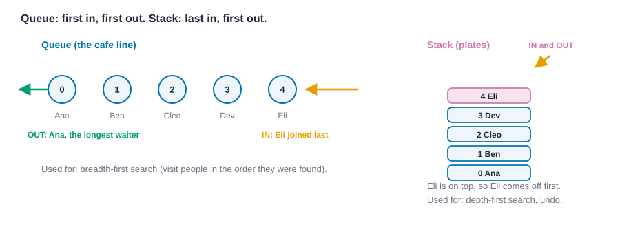{#fig-blocks-queue-stack fig-alt="Left, five numbered people in a line labeled queue, with an arrow marking Ana at the front as OUT and an arrow at the back marking Eli as IN. Right, five plates stacked with Eli on top, labeled stack, with a single arrow at the top for both IN and OUT."}

The same five people go in, in the same order, but they come out differently. Add Ana, Ben and Cleo to each. Take one: the queue gives Ana, the stack gives Cleo. Add Dev, take two more: the queue gives Ben and Cleo, the stack gives Dev and Ben. Add Eli and take the rest: the queue gives Dev and Eli, the stack gives Eli and Ana.

Out of the queue, in order: Ana, Ben, Cleo, Dev, Eli (oldest first). Out of the stack, in order: Cleo, Dev, Ben, Eli, Ana (newest first, with the adds and takes interleaved as above).

**The idea in steps.**

1. A queue keeps the items in a row, plus two markers: where the front is and where the back is.
2. To push, write at the back marker and move it along. To pop, read at the front marker and move it along.
3. A stack keeps one marker, the top. Push writes there and moves it up; pop moves it down and reads.

Notice that nothing needs to *shift*. A naive queue that removes from the front of a plain list and moves everything else along would cost a step per item each time. Moving a marker instead costs one step.

**What it costs.** One step to push and one step to pop, however many items are waiting. Memory is one slot per item.

::: {.callout-tip title="In plain words"}
Adding to a queue or stack and taking from it each cost a single step, even with a million items inside, because only a marker moves. That is what makes them such good building blocks: they never slow down as they fill.
:::

**Where they go in graph algorithms.** A queue is the heart of breadth-first search (@sec-traversal): you visit people in the order you found them, so everyone one step from the start comes before anyone two steps away. A stack is the heart of depth-first search: you chase one friend of a friend of a friend to the end before backing up. The only difference between the two famous searches is whether the waiting list is a queue or a stack.

### A queue at work: finding distances

Let's use a queue for something real, on the five people, starting from Ana. The rule: take the next person from the front; every friend of theirs we haven't met yet gets a distance one more than theirs and joins the back of the queue.

| Step | Take from the front | Newly met, added at the back | Queue afterwards | Distances so far |
| --- | --- | --- | --- | --- |
| 0 | (start) | Ana, distance 0 | Ana | Ana 0 |
| 1 | Ana | Ben, distance 1 | Ben | Ana 0, Ben 1 |
| 2 | Ben | Cleo and Dev, distance 2 | Cleo, Dev | plus Cleo 2, Dev 2 |
| 3 | Cleo | nobody new (Ben and Dev are known) | Dev | |
| 4 | Dev | Eli, distance 3 | Eli | plus Eli 3 |
| 5 | Eli | nobody new | (empty) | done |

The queue makes everyone one step away come out before anyone two steps away, because they went in first. Six rows of bookkeeping gave every distance, and each person was added once and taken once, so the work is about one step per person plus one per tie: the $n + 2m$ from @sec-cost. Swap the queue for a stack and the same table would give a long wandering route instead of shortest distances.

### The stack hiding inside recursion

A stack also hides inside a programming trick called **recursion**, where a method solves a problem by calling itself on a smaller piece. A depth-first search is often written that way: "to explore Ana, explore each of Ana's friends we haven't seen". When one call starts another, the computer must remember where the first one was, so it keeps a stack of unfinished calls, called the *call stack*.

That's convenient, and it has a catch. The call stack has a fixed size. A network that is a long chain (a million people in a line, each knowing the next) makes the stack a million calls deep, and the program stops with a "stack overflow" error. The fix is to do the search with a stack you build yourself, which can grow as large as memory allows. Many serious graph tools do exactly that for this reason, and it is a good example of an invisible tool becoming visible only when it breaks.

## The priority queue and the heap

A queue serves the person who has waited longest. A **priority queue** serves the person with the best *priority*, however long they have waited. A hospital emergency room works this way: the most urgent patient goes first. In our to-do list, "best" means "smallest number".

A priority queue has two operations: *push* an item with a number, and *pop the smallest*. We want both to be fast, however many items are waiting.

Two clumsy ways come to mind. Keep the items in a plain list: push is one step, but popping the smallest means looking at everything, $n$ steps. Or keep them sorted: popping the smallest is instant, but pushing means finding the right place and shifting everything after it, again $n$ steps. Neither is good if you do both millions of times.

The clever middle way is a **heap**.

### What a heap is

A heap is a tree drawn from the top, in which every item sits above two *children*, and one rule holds: **every parent is no bigger than its children.** The consequence is that the smallest item is always at the very top, and it is easy to find, with no search at all.

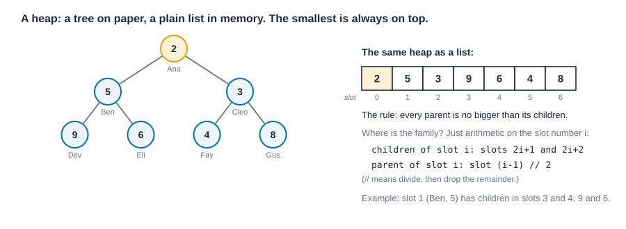{#fig-blocks-heap-tree fig-alt="Left, a tree of seven circles: 2 at the top, then 5 and 3, then 9, 6, 4 and 8, with names Ana, Ben, Cleo, Dev, Eli, Fay and Gus underneath. Right, the same seven numbers as a row of seven boxes numbered 0 to 6, and the slot rules: children of slot i are slots 2i plus 1 and 2i plus 2; the parent is slot (i minus 1) over 2 rounded down."}

The picture is a tree, but nothing in the computer is actually drawn as a tree. The heap is stored as a plain list, filled level by level from the top: the top is slot 0, then its two children in slots 1 and 2, then their four children in slots 3 to 6, and so on. The family relationships are just arithmetic: the children of slot $i$ are slots $2i + 1$ and $2i + 2$, and the parent of slot $i$ is slot $(i - 1)$ divided by 2, rounded down.

Check with the figure: slot 1 holds 5 (Ben), and its children are slots $2 \cdot 1 + 1 = 3$ and $2 \cdot 1 + 2 = 4$, which hold 9 and 6. Slot 4's parent is $(4 - 1) / 2 = 1.5$, rounded down to 1: yes, 6 sits under 5.

### Adding an item

**The idea in steps.**

1. Put the new item in the next free slot at the bottom of the list. The tree stays full, but the rule might now be broken.
2. Compare it with its parent. If it is smaller, swap them.
3. Repeat step 2 from the new position, until the item is not smaller than its parent or reaches the top.

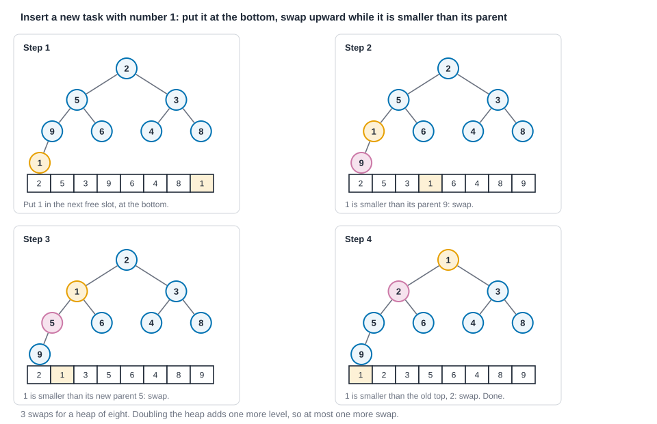{#fig-blocks-heap-insert fig-alt="Four small heaps in a two by two grid, each a tree above a row of boxes. Step 1 places a 1 at the bottom, under 9. Step 2 swaps it with 9. Step 3 swaps it with 5. Step 4 swaps it with 2, leaving 1 at the top. Each panel has a one-line note."}

We add a new task with number 1. It starts at the bottom, under 9. It is smaller than 9, so they swap. Now it is under 5, and smaller, so they swap. Now it is under 2, and smaller, so they swap again. It has reached the top, and the list reads 1, 2, 3, 5, 6, 4, 8, 9. Three swaps for eight items.

Notice how little work this was. We did not look at 3, 6, 4 or 8 at all. We only walked up one path from the bottom to the top.

### Taking the smallest

**The idea in steps.**

1. The smallest is at the top. Take it out; this leaves a hole.
2. Move the *last* item of the list into the hole, so the tree stays full.
3. Compare it with its two children. If either child is smaller, swap it with the *smaller* child.
4. Repeat step 3 from the new position, until it is no bigger than its children or has none.

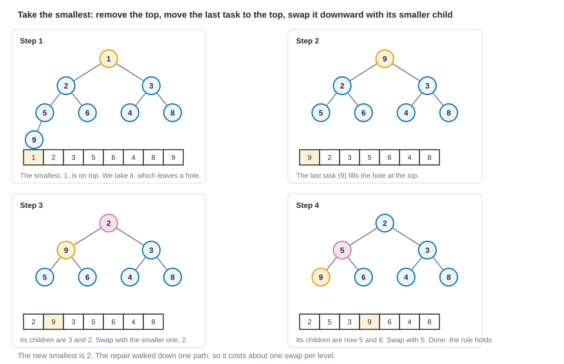{#fig-blocks-heap-pop fig-alt="Four small heaps of seven tasks in a two by two grid. Step 1 shows the last task moved into the top. Steps 2 and 3 show it swapping downward with the smaller child. Step 4 shows the finished heap with the new smallest number on top."}

The figure takes the 1 off the heap we just built. The last item, 9, jumps to the top. Its children are 3 and 2; the smaller is 2, so 9 swaps with 2. Now 9's children are 5 and 6; the smaller is 5, so 9 swaps with 5. At the bottom it has no children, and the list reads 2, 5, 3, 9, 6, 4, 8, which is the heap we started with, minus the 1. Again we only walked one path.

Why swap with the *smaller* child? So the item that moves up is no bigger than its new neighbor. If we swapped with the bigger child, that child would sit above a smaller sibling and break the rule.

### Watching a heap work

Now let's watch a heap do its job with ten people. Each person's number is how many steps they are from Jo in the friendship network (Jo is 0, and Ivo, who knows Jo, is 1, and so on). The heap fills with the ten people, and the people closest to Jo float to the top. Then the closest are taken off one at a time. Watch the numbers float up when someone joins, and watch the person from the bottom sink after the top leaves.

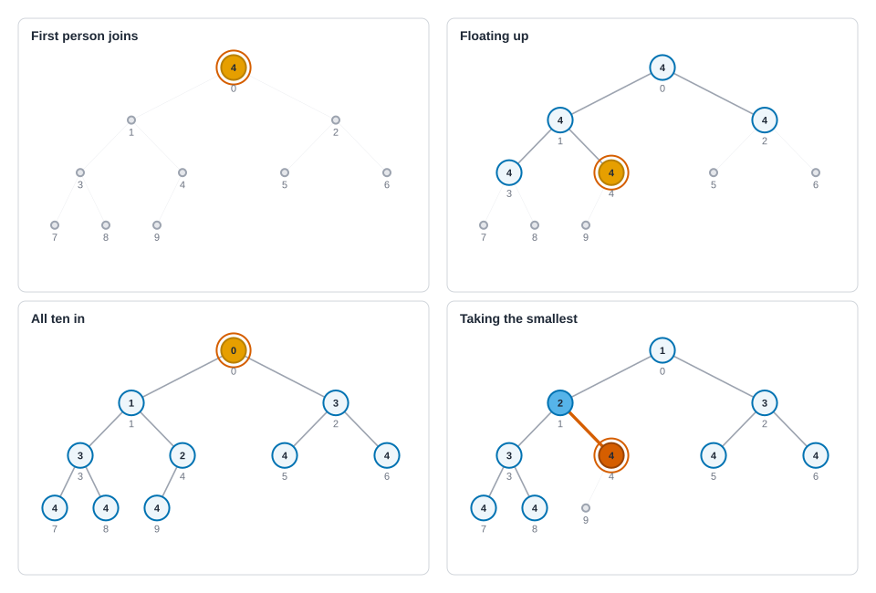{#fig-heap-anim fig-alt="Four copies of a ten-slot tree. First: one person has joined at the top with a number 4. Second: later people have joined and a person with a smaller number is floating up toward the top. Third: all ten are in and Jo, with number 0, is on top. Fourth: Jo has been taken off and the last person has sunk down, the new smallest on top. When it plays, each join is followed by swaps that move the smaller numbers up, then the four first people leave one by one."}

The distances in that animation are knappnet's own breadth-first distances from Jo. The scene checks one thing at the end: taking the smallest ten times gives exactly the engine's distances in sorted order. The heap earned its keep.

### Why not just keep a sorted list?

A fair question. A sorted list also gives you the smallest instantly. The trouble is adding: to insert a new item into the middle of a sorted list, everything after it has to shift along. For a list of a million that is half a million moves on average. A heap needs about twenty. The heap gives up something (it is only *partly* sorted) and in return makes both adding and taking cheap. A good design is rarely "the most sorted"; it is "sorted exactly as much as the questions need".

### What it costs

Both operations walk a single path from the top to the bottom or back. How long is that path? Each level of the tree has twice as many slots as the one above it, so a tree with $n$ items has about $\log_2 n$ levels. That is the same logarithm as the halving search in the last chapter: 3 levels for 7 items, about 10 for a thousand, about 20 for a million.

So push costs at most about $\log_2 n$ swaps, and pop costs at most about $\log_2 n$ swaps. Peeking at the smallest is one step.

::: {.callout-tip title="In plain words"}
A heap with a million items needs at most about twenty swaps to add an item or to take the smallest. A plain unsorted list needs a million looks to find the smallest. Double the heap and you pay one more swap, not twice as many. That is why heaps sit inside shortest-path algorithms (@sec-shortest-paths) and anything that keeps asking "what is the best thing to do next?".
:::

A bonus: if you already have all $n$ items and want them in a heap, you can build it in about $n$ steps in total (not $n \log n$), by fixing the bottom levels first. And if you pop the smallest repeatedly until the heap is empty, the items come out sorted: that is *heapsort* [@williams1964algorithm].

## Union-find

Now the party that keeps merging. We have people, and over time we learn of ties between them. We want to answer, at any moment: *are these two people in the same group?* and *join these two groups*.

A **union-find** structure (also called a disjoint-set structure) does exactly those two jobs, which are called **find** and **union** [@galler1964improved]. The groups never overlap, which is the "disjoint" part.

### The idea: every group has a leader

Give every group a **leader**, one of its members. Everyone else points at someone in their group, and following the pointers eventually leads to the leader. The leader points at themself. Two people are in the same group exactly when following pointers from each ends at the same leader.

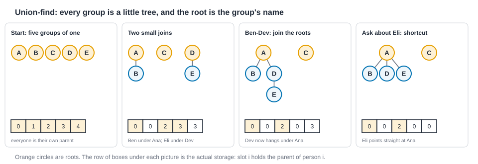{#fig-blocks-unionfind fig-alt="Four panels, each a small forest of circles holding the initials A, B, C, D and E, with a row of five boxes of parent numbers below. Panel 1: five separate roots. Panel 2: Ben hangs under Ana and Eli under Dev. Panel 3: Dev's tree is hung under Ana, so Ana is the root of Ana, Ben, Dev and Eli, with Cleo alone. Panel 4: Eli points directly at Ana."}

The picture works through five people. At the start everyone is their own leader: five groups of one. Then we learn that Ana and Ben are tied, and that Dev and Eli are tied. Each join is one change: Ben's pointer is set to Ana, and Eli's to Dev. Now there are three groups. Next we learn that Ben and Dev are tied. We find Ben's leader (Ana) and Dev's leader (Dev), they differ, so we hang one leader under the other: Dev's pointer is set to Ana. Now Ana leads four people, and Cleo is alone.

The storage is the row of five boxes under each picture: slot $i$ holds the person that person $i$ points to.

**The idea in steps.**

1. **Find** a person's leader: follow the pointers until you reach someone who points at themself.
2. **Are they together?** Find both leaders and compare.
3. **Union** two people: find both leaders. If they are the same, do nothing. Otherwise point one leader at the other.

### Two tricks that keep the trees short

Following pointers is only fast if the chains are short. Two tricks keep them short.

**Trick one: hang the small under the big.** When joining two groups, point the leader of the *smaller* group at the leader of the larger. Then the chain from anyone to their leader grows only when their group at least doubles in size, which can happen only a few times. (The proof box at the end of the chapter makes this exact.) Knappnet uses a simpler rule that gives the same promise of shallow trees in practice: the smaller *id* stays leader, which also means the leader's name is reproducible from run to run.

**Trick two: shortcuts.** Whenever you follow a chain to find a leader, point the people you passed straight at the leader (or, in a cheaper version called *path halving*, at their grandparent). The next time anyone asks, the chain is shorter. The last panel in the figure shows it: after asking about Eli, Eli points straight at Ana.

Let's watch union-find on the ten-person friendship network, reading the 18 ties one at a time. Watch the colors: each group has its own color, groups merge when a tie joins them, and some ties change nothing because the two people are already together.

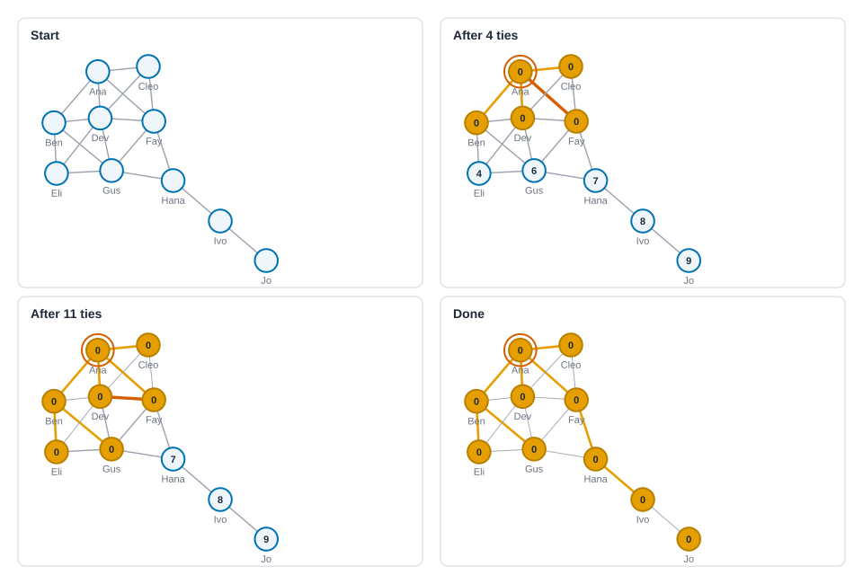{#fig-uf-anim fig-alt="Four copies of the ten-person network. First: all ten are separate, each its own leader. Second: after four ties, a few small colored groups have formed. Third: after eleven ties, most of the people are in one colored group with the same leader. Fourth: after all eighteen ties, everyone has the same leader, so the whole network is one group. When it plays, the colors spread and merge as each tie is read."}

By the end everyone has the same leader: the network is one piece. A few of the ties told us nothing new, because the two people were already in the same group; the animation says which. That is the point of union-find: it answers "are these two connected?" without rediscovering the whole path.

The animation's numbers are knappnet's real union-find: for each tie we asked the engine to join the two people and recorded what it did and who leads whom afterwards. The scene replays the rule and checks it agrees with the engine on every tie.

### What it costs

Each find follows a short chain. With both tricks, the cost of a find or a union, averaged over a long run, grows so slowly that it is practically constant. The textbook result [@tarjan1975efficiency] says it is bounded by a function called the inverse Ackermann function, written $\alpha(n)$, which for any $n$ you could ever store is at most 4.

::: {.callout-tip title="In plain words"}
$\alpha(n)$ (read "alpha of n") answers a strange question: how many times do you have to apply a super-fast-growing function before you get back down to $n$? Because the function grows so fast, the answer is tiny. For a million people $\alpha$ is 4 or less; for more people than there are atoms in the universe it is still 4 or less. So you can treat union-find as "about one step per operation". Knappnet's simpler rules are documented as costing a logarithm per operation on average, which is still very cheap and gives reproducible leaders.
:::

**What it can't do.** It can join groups but not split them. There is no cheap "un-union". If ties come and go over time, you need a different tool (@sec-dynamic-temporal).

**Where it goes in graph algorithms.** Finding connected components (@sec-components): read every tie, union the two ends, and count the leaders at the end. Building a minimum spanning tree with Kruskal's method (@sec-spanning-trees): sort the ties by weight, and add each one only if its ends are not yet together. Grouping anything where "is this the same as that?" is the main question.

### Two tools together: a spanning tree by hand

A **spanning tree** is a set of ties that connects everyone with no loops, using as few ties as possible: for $n$ people, exactly $n - 1$ ties. A *minimum* spanning tree does it at the lowest total weight. A simple recipe, Kruskal's method, uses two of our tools: sorting and union-find. (The full story is in @sec-spanning-trees.)

Say the weights are messages sent between pairs: Ana-Ben 3, Ben-Cleo 5, Ben-Dev 2, Cleo-Dev 4 and Dev-Eli 1. Smaller weight means a cheaper tie, so sort from smallest to largest, then go down the list and keep a tie only if its two ends are not yet in the same group.

| Tie, in sorted order | Weight | Same group already? | Action | Groups afterwards |
| --- | --- | --- | --- | --- |
| Dev-Eli | 1 | no | keep | {Dev, Eli} |
| Ben-Dev | 2 | no | keep | {Ben, Dev, Eli} |
| Ana-Ben | 3 | no | keep | {Ana, Ben, Dev, Eli} |
| Cleo-Dev | 4 | no | keep | everyone |
| Ben-Cleo | 5 | yes | skip | everyone |

Four ties kept, which is $n - 1$, with total weight $1 + 2 + 3 + 4 = 10$. The last tie, Ben-Cleo, would have closed a loop (Ben, Dev and Cleo were already connected), and union-find noticed in a couple of steps without tracing a path. The sort cost $m \log m$ and the union-find checks cost nearly one step each: two small tools, one useful algorithm.

## The hash map

We met the lookup table in the last chapter: turn a name like "badge 3180" into a position like 3. A **hash map** is the standard machine for that, and it is worth knowing how it works, because it is used everywhere.

The idea is a coat check. You hand over your coat, the attendant uses a rule to turn your ticket into a hook number, and hangs the coat on that hook. To get it back, the rule gives the same hook, and you go straight there, without searching the rack.

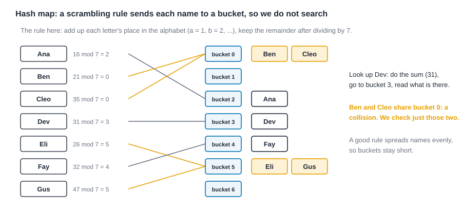{#fig-blocks-hashmap fig-alt="Seven names on the left, each with its alphabet-place sum and remainder after dividing by 7, joined by lines to seven buckets in the middle. Ben and Cleo share bucket 0 and Eli and Gus share bucket 5, drawn in orange. Notes on the right explain the lookup and collisions."}

**The idea in steps.**

1. Pick a **hash function**: a rule that turns a key (a name) into a number, the same number every time. In the picture we add up each letter's place in the alphabet (a is 1, b is 2) and keep the remainder after dividing by 7.
2. The number picks a **bucket**, a small spot where the key and its value are stored.
3. To look something up, run the rule and look only in that bucket.

Check it by hand with Dev: D is 4, E is 5, V is 22, which adds to 31. Dividing 31 by 7 leaves 3, so Dev goes in bucket 3. Now Ben: 2 + 5 + 14 = 21, which leaves 0, bucket 0. Cleo: 3 + 12 + 5 + 15 = 35, which also leaves 0. Two names share bucket 0: that is a **collision**. We handle it by keeping a little list in each bucket and checking just the names in it.

**What it costs.** A good rule spreads names evenly, so every bucket stays short, and a lookup costs about one step on average. If the rule is bad, or the table is too small, buckets get long, and in the worst case everything lands in one bucket and a lookup costs $n$. Real hash maps keep an eye on how full they are and *grow*, re-sorting everything into more buckets, when it gets crowded; that is amortized cheap, the idea from the last chapter.

::: {.callout-tip title="In plain words"}
A hash map turns "search the rack" into "compute a number and go straight to that hook". It costs one step on average, but its worst case is a full search, and the order in which it lists its contents is arbitrary (more on that below).
:::

**Where it goes.** Converting names to ids (@sec-representations), counting how often each thing appears, remembering which pairs of people we have already looked at.

## The bitset

A **bitset** is a row of switches, one per person, each either on (1) or off (0). We met it in the last chapter as a row of the bit matrix. It is the best way to hold a group of people when the people are numbered $0$ to $n - 1$.

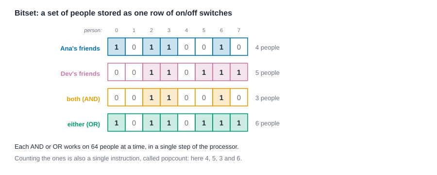{#fig-blocks-bitset fig-alt="Four rows of eight boxes, each 0 or 1, for people 0 to 7. Ana's friends have ones at 0, 2, 3 and 6; Dev's friends at 2, 3, 5, 6 and 7. The AND row has ones at 2, 3 and 6, three people; the OR row has ones at 0, 2, 3, 5, 6 and 7, six people."}

Take eight people. Ana's friends are people 0, 2, 3 and 6, so those four switches are on. Dev's friends are 2, 3, 5, 6 and 7. Now we can do three things in a single step each (per 64 people).

- **AND** keeps a switch on only if it is on in both. Ana's and Dev's rows give switches 2, 3 and 6: three people who know both.
- **OR** keeps a switch on if it is on in either: people 0, 2, 3, 5, 6, 7, which is six people who know at least one.
- **Count the ones** (called *popcount*) gives a group's size in a single machine instruction.

### Where does person 70 live?

A real bitset is a list of 64-bit words, and person $i$ lives in word number $i$ divided by 64 (dropping the remainder), at position $i$ modulo 64 (the remainder) inside that word. Let's check with person 70. Dividing 70 by 64 gives 1 with remainder 6, so person 70 is bit 6 of word 1. Person 5 is bit 5 of word 0. Person 128 is bit 0 of word 2.

::: {.callout-tip title="In plain words"}
Think of a tall building with 64 rooms on every floor. To find room number 70, take the elevator to floor $70 \div 64$, which is floor 1, and walk to room $70 \bmod 64 = 6$. "Mod" just means "the remainder after dividing". Setting, clearing or testing one person is two small calculations and a single bit operation.
:::

The saving is real. A byte per person for a "have I visited this person?" mark costs a gigabyte for a billion people; one bit per person costs 125 megabytes, a factor of eight. It also fits more marks in each armful of memory (the cache lines from @sec-cost), which is why a bitset can be *faster* as well as smaller.

**What it costs.** One bit per person, so $n / 8$ bytes. Setting or reading one person is a single step. Combining two whole groups costs $n / 64$ steps, because the processor handles 64 switches at once.

::: {.callout-tip title="In plain words"}
A bitset holds a million-person group in 125 thousand bytes and combines two such groups in about 16 thousand steps. A plain list of ids would need up to four million bytes for the same group and a slow search to combine. A bitset is a fantastic fit when the group is large compared with the number of people and a poor fit when it is tiny: a bitset of a million people to hold three names is mostly empty.
:::

**Where it goes.** The "have I visited this person?" mark in a search: a billion people need only 125 megabytes of marks, against a gigabyte if each mark is a byte. Common friends and triangle counting (@sec-cores-triangles), where one AND counts the neighbors two people share.

## Sorting, and radix sort

Sorting puts items in order, and it matters because so many questions get cheap once the data is in order: binary search, the two-finger merge from @sec-representations, spotting duplicates, grouping equal things together.

**The comparison sorts.** The classic methods (merge sort, quicksort, heapsort) work by comparing pairs of items. A famous result says that no method that works *only* by comparing can do better, in the worst case, than about $n \log_2 n$ comparisons [@knuth1998art]. For a million items that's about twenty million comparisons: a fraction of a second.

But what if the items are whole numbers in a limited range, such as people's ids? Then we can do better by not comparing at all.

### Radix sort

**Radix sort** sorts numbers digit by digit, the way a post office sorts letters. First sort all the numbers by their last digit. Then, keeping that order for ties, sort by the next digit. Continue to the first digit. After the last pass the list is in order.

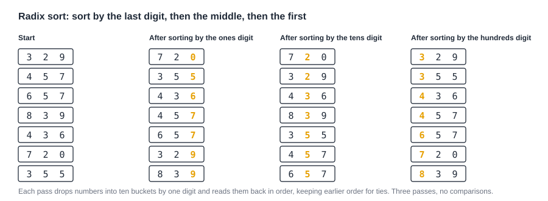{#fig-blocks-sorting fig-alt="Four columns of the same seven three-digit numbers: the start (329, 457, 657, 839, 436, 720, 355), then after sorting by the ones digit, the tens digit and the hundreds digit. The digit used in each pass is orange. The last column reads 329, 355, 436, 457, 657, 720, 839."}

Work it by hand on seven numbers: 329, 457, 657, 839, 436, 720, 355.

1. **Ones digit.** File each number into one of ten buckets, 0 to 9, by its last digit, then read the buckets back from 0 to 9. The last digits are 9, 7, 7, 9, 6, 0, 5, so the order becomes 720, 355, 436, 457, 657, 329, 839.
2. **Tens digit.** Now file by the middle digit, reading each bucket in the order the numbers arrive. The tens digits are 2, 5, 3, 5, 5, 2, 3, so the order becomes 720, 329, 436, 839, 355, 457, 657.
3. **Hundreds digit.** File by the first digit. Now the order is 329, 355, 436, 457, 657, 720, 839: sorted.

Why does this work? The key is the rule "keep earlier order for ties", called being **stable**. When we file by the hundreds digit, numbers that share a hundreds digit stay in the order the previous pass left them, which was already sorted by the lower digits. Each pass finishes a little more of the job, and the last pass finishes it.

**What it costs.** Each pass touches every number once to file it and once to read it back: about $n$ steps, plus the ten buckets. With $k$ digits, the cost is about $k(n + 10)$.

::: {.callout-tip title="In plain words"}
Radix sort costs a few passes over the data, where a comparison sort costs about twenty passes for a million items. For ids stored as 32-bit numbers and read eight bits at a time, there are exactly four passes of 256 buckets each, so sorting a million ids takes roughly four million steps, against twenty million for a comparison sort. The price is that it only works on things that behave like whole numbers, and that it needs extra room for the buckets.
:::

Here is a link worth noticing. The CSR build in @sec-representations (count each person's friends, add up, drop each friend into its room) is *one pass of a radix sort*, filing every tie into the bucket of the person it starts from. Many fast graph tools build CSR this way, and also sort each person's friends, so the two-finger merge works.

## Choosing the tool

When you meet a new job, ask what the question is, and the tool follows.

1. *"What is next, oldest first?"* A queue.
2. *"What is next, newest first?"* A stack.
3. *"What is the best one right now, and things keep arriving?"* A heap.
4. *"Are these two connected yet, and groups keep merging?"* Union-find.
5. *"Where is this key?"* A hash map (or a sorted list and binary search if you also want order).
6. *"Is this person in the group, and I have a whole group to compare?"* A bitset.
7. *"I need everything in order, once."* A sort; radix sort if they are whole numbers.

Most graph algorithms are one of these tools wrapped around a loop over a CSR network. That's worth remembering as you read the rest of the book: when a method looks complicated, find the queue, the heap or the union-find inside it.

## At a glance

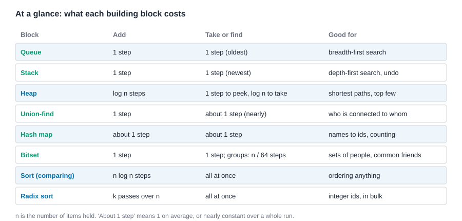{#fig-blocks-costs fig-alt="A table with eight rows and four columns: block, cost to add, cost to take or find, and what it is good for. Queue, stack, union-find, hash map and bitset are one step or close to it. The heap costs log n steps to add and to take. A comparing sort costs n log n and radix sort k passes over n."}

| Tool | Answers | Time per operation | Memory | Use it when | Avoid it when |
| --- | --- | --- | --- | --- | --- |
| Queue | Who is next, oldest first | 1 | one slot per item | Breadth-first search, waiting lists | You need the best, not the oldest |
| Stack | Who is next, newest first | 1 | one slot per item | Depth-first search, undo | You need fairness |
| Heap | What is the smallest right now | $\log n$ | one slot per item | Shortest paths, top few, scheduling | You need to search for arbitrary items |
| Union-find | Are these two together | nearly 1 | one slot per person | Connected components, spanning trees | Groups also need to split |
| Hash map | Where is this key | about 1 | a bit more than the items | Names to ids, counting | You need sorted order or guaranteed worst case |
| Bitset | Is this person in the group | 1; combining groups $n / 64$ | $n / 8$ bytes | Dense groups, visited marks, common friends | Few members among many possible |
| Comparison sort | Put in order | $n \log n$ overall | little extra | Anything | Integers in a small range |
| Radix sort | Put whole numbers in order | $k$ passes of $n$ | extra room for buckets | Ids, bulk sorting | Few items or long, varied keys |

## Where it goes wrong

**Thinking a heap is sorted.** Only the top is guaranteed. In the list 2, 5, 3, 9, 6, 4, 8, the fifth item (6) is larger than the sixth (4), which is fine. To get sorted order you pop repeatedly.

**Stale entries in a heap.** Some algorithms want to *lower* an item's number after it has been pushed. A plain heap cannot find an arbitrary item cheaply. The usual fix is to push a second copy with the new number and ignore the old copy when it surfaces; the other fix is a heap that tracks where each item is. Either way, check which one your tool uses.

**Mixing up queue and stack.** If a search that should find the shortest route returns a long wandering one, a stack may have been used where a queue belongs. The only difference between breadth-first and depth-first search is that choice.

**Union-find cannot undo.** Once two groups merge they stay merged. If a tie might later be removed, union-find answers the wrong question.

**Hash map order.** A hash map lists its contents in an arbitrary order, and in many languages that order differs from run to run on purpose. If your result depends on iteration order, it may not repeat. This is the determinism problem of @sec-cost wearing a different hat. The fix is to sort the keys before you loop over them.

**Bitsets have a fixed size.** A bitset of $n$ people cannot hold person $n$. Check that ids are less than the size, and remember the memory is $n / 8$ bytes regardless of how many switches are on.

**Radix sort and negative or decimal numbers.** The digit-by-digit idea assumes whole, non-negative numbers. Negative numbers and decimals need their bits rearranged first. For ids, which are non-negative whole numbers, it is a perfect fit.

**Collisions in a hash map are normal, not an error.** What matters is that the buckets stay short.

## If you like proofs

::: {.callout-note collapse="true" appearance="simple" title="Why 'hang the small under the big' keeps the trees shallow"}
Here is the short argument for the first trick in union-find. It shows that with this rule, any chain from a person to their leader has at most $\log_2 n$ steps.

Follow one person, Ana. A person's depth (the length of the chain from them to their leader) only changes when their leader gets hung under another leader. By the rule, that only happens when the other group is at least as big as hers. So at the moment her depth goes up by one, the size of her group at least doubles: it joins a group at least as large as itself.

A group can double at most $\log_2 n$ times before it contains all $n$ people. So Ana's depth can go up at most $\log_2 n$ times. The same holds for everyone. Therefore every chain has at most about $\log_2 n$ steps, which is about 20 for a million people. Path shortcuts then make the practical numbers even better.

*Why the heap's cost is a logarithm.* A heap with $n$ items is a tree whose levels are filled in order. Level 0 has 1 slot, level 1 has 2, level 2 has 4, level $j$ has $2^j$. A tree with $L$ full levels holds $2^L - 1$ items, so $n$ items need about $\log_2 (n + 1)$ levels. Adding an item can swap it up through at most all the levels, and taking the smallest can swap the replacement down through at most all the levels, so each costs at most about $\log_2 n$ swaps.
:::

## Code

The blocks below describe what the code will compute; they are placeholders until the interface is final. Each is followed by what to look for in the output.

First, a heap and a union-find on the ten-person network. Push every person with their distance from Jo and pop all ten; then read the 18 ties into a union-find and print the leader of each person after the last tie. Look for the pops to come out in non-decreasing order and for every person to have the same leader.

::: {.panel-tabset group="language"}

## R

```r
# TODO(code, R): push the ten people with their distances from Jo into a priority queue and print the ten pops, then union the 18 friendship ties and print each person's leader
```

## Python

```python
# TODO(code, Python): push the ten people with their distances from Jo into a priority queue and print the ten pops, then union the 18 friendship ties and print each person's leader
```

## Rust

```rust
// TODO(code, Rust): push the ten people with their distances from Jo into a priority queue and print the ten pops, then union the 18 friendship ties and print each person's leader
```

:::

::: {.code-output}
```text
TODO(output)
```
:::

The distances should come out as 0, 1, 2, 3, 3, 4, 4, 4, 4, 4 and the leaders as all the same number, matching the two animations.

Second, a radix sort of ids: sort a list of 100,000 random 32-bit ids with four passes of 256 buckets, check the result against a comparison sort, and print both times. Look for the two results to be identical.

::: {.panel-tabset group="language"}

## R

```r
# TODO(code, R): radix sort 100,000 random 32-bit ids with four passes of 256 buckets, check the result equals the built-in sort, and print how long each took
```

## Python

```python
# TODO(code, Python): radix sort 100,000 random 32-bit ids with four passes of 256 buckets, check the result equals the built-in sort, and print how long each took
```

## Rust

```rust
// TODO(code, Rust): radix sort 100,000 random 32-bit ids with four passes of 256 buckets, check the result equals the built-in sort, and print how long each took
```

:::

::: {.code-output}
```text
TODO(output)
```
:::

The first printed line should say the two results match; the times depend on the machine.

Third, a bitset for a search's visited marks: run a breadth-first search on the ten-person network with a bitset as the visited set and print the order people are found. Look for the order to match the distances from the start person.

::: {.panel-tabset group="language"}

## R

```r
# TODO(code, R): run a breadth-first search from Jo on the ten-person network using a queue and a bit set of visited people, and print the people in the order they were found
```

## Python

```python
# TODO(code, Python): run a breadth-first search from Jo on the ten-person network using a queue and a bit set of visited people, and print the people in the order they were found
```

## Rust

```rust
// TODO(code, Rust): run a breadth-first search from Jo on the ten-person network using a queue and a bit set of visited people, and print the people in the order they were found
```

:::

::: {.code-output}
```text
TODO(output)
```
:::

The first person printed should be Jo, then Ivo, then Hana, in distance order.

## Exercises

1. **By hand.** Add the number 7 to the heap with the list 2, 5, 3, 9, 6, 4, 8. Show each swap and write the final list.
2. **By hand.** Take the smallest from the heap 2, 5, 3, 9, 6, 4, 8. Show where the last item goes first and each swap after it.
3. **By hand.** Start with five groups of one (Ana 0, Ben 1, Cleo 2, Dev 3, Eli 4). Union Ana with Ben, then Cleo with Dev, then Ben with Dev. With the rule "the smaller id stays leader", write the list of leaders (who each person points to) after each union, and find Dev's leader at the end.
4. **By hand.** Radix sort the numbers 41, 23, 5, 17, 8 by hand, one digit at a time, and write the list after each pass.
5. **Think it through.** Use the alphabet rule from the chapter (sum of each letter's place, remainder after dividing by 7) to find the bucket for Eli and for Gus. Do they collide? What would happen to the cost of a lookup if the table had only one bucket?
6. **Think it through.** Why does a bitset need to know in advance how many people there can be, and a hash map does not? Give one job where each is the better tool.
7. **Coding, later.** Build a heap that holds (distance, person) pairs, and use it to print everyone in order of distance from Jo, then use union-find to count the connected pieces of a network with two separate groups.

## Answers

1. The list is positions 0 to 6: 2, 5, 3, 9, 6, 4, 8. Put 7 in slot 7. Its parent is slot 3, which holds 9. Since 7 < 9, swap: slot 3 is 7 and slot 7 is 9. Now its parent is slot 1 (5). Since 7 > 5, stop. The final list is 2, 5, 3, 7, 6, 4, 8, 9. One swap.
2. Take out the 2. The last item, 8, goes to the top: 8, 5, 3, 9, 6, 4. Its children are 5 and 3; the smaller is 3, so swap with it: 3, 5, 8, 9, 6, 4. Now 8 is in slot 2, and its only child is slot 5 (4). Since 4 < 8, swap: 3, 5, 4, 9, 6, 8. Slot 5 has no children, so it is done. The final list is 3, 5, 4, 9, 6, 8.
3. Start: 0, 1, 2, 3, 4. Union Ana and Ben: the smaller id, 0, stays leader and Ben points at it: 0, 0, 2, 3, 4. Union Cleo and Dev: 2 stays leader and Dev points at it: 0, 0, 2, 2, 4. Union Ben and Dev: Ben's leader is 0 and Dev's is 2; the smaller, 0, stays, so leader 2 points at 0: 0, 0, 0, 2, 4. Dev's chain is Dev (3) to 2 to 0, so Dev's leader is 0. (Path halving would also set Dev's pointer to 0 the first time we ask.)
4. Ones digit: 41, 23, 5, 17, 8 become 41 (1), 23 (3), 5 (5), 17 (7), 8 (8): the order stays 41, 23, 5, 17, 8 because it was already in order of last digits. Tens digit (treat 5 and 8 as 05 and 08): the tens digits are 4, 2, 0, 1, 0, so bucket 0 holds 5 then 8 (the order they came), bucket 1 holds 17, bucket 2 holds 23 and bucket 4 holds 41. Final: 5, 8, 17, 23, 41.
5. Eli is 5 + 12 + 9 = 26, which leaves 5 when divided by 7. Gus is 7 + 21 + 19 = 47, which also leaves 5. They collide in bucket 5 (as in the figure), and the lookup checks the two names in that bucket. With only one bucket every key shares it, and a lookup is the full search of $n$ names.
6. A bitset is a fixed row of switches, one place per possible person, so its size must be known to allocate it. A hash map stores only the keys it has, so it can hold keys from an unbounded range and grows as needed. The bitset is better for "visited" marks in a search over ids 0 to $n - 1$; the hash map is better for turning arbitrary badge numbers into ids.
7. In the finished code, the heap's pops should be in non-decreasing order of distance, and the union-find should end with exactly two leaders for a network of two separate groups.

## Summary

::: {.callout-tip appearance="simple"}
A handful of small tools sit inside almost every graph algorithm. A queue serves the oldest first and a stack the newest first, and each costs one step; they are the only difference between breadth-first and depth-first search. A heap keeps the smallest on top, stored as a plain list, and costs about log n swaps to add or take, which is why it sits inside shortest-path methods. Union-find tracks merging groups by giving each a leader and costs nearly one step per operation, which is why it sits inside connected components and spanning trees. A hash map jumps straight to a bucket and costs about one step on average, a bitset holds a group as switches and combines 64 people at a time, and radix sort orders whole numbers in a few passes with no comparisons. The one-line takeaway: pick the tool that makes the question you ask most often a single step.
:::

## Further reading

For a full treatment of these structures, see @cormen2022introduction and @sedgewick2011algorithms; for union-find and its cost, the original analysis is @tarjan1975efficiency and an early version is @galler1964improved. The heap comes from @williams1964algorithm, and sorting (including radix sort) is covered at length in @knuth1998art. The next chapter, @sec-trust, looks at how to know that an algorithm's answer is right, now that we have the tools to build one.
