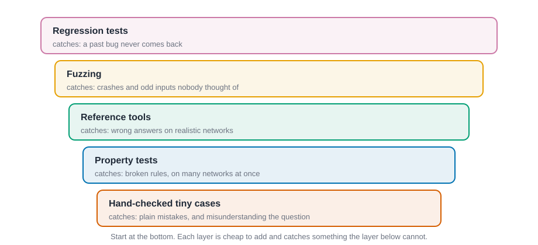
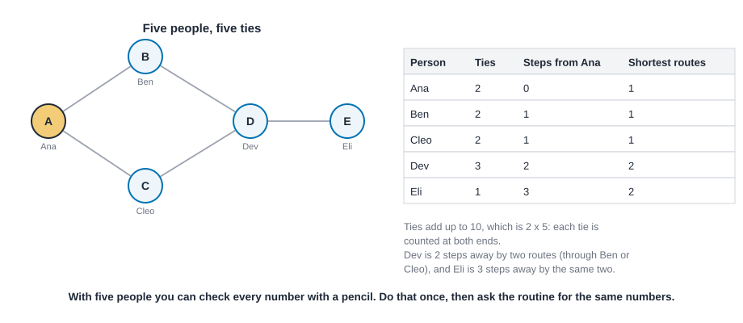
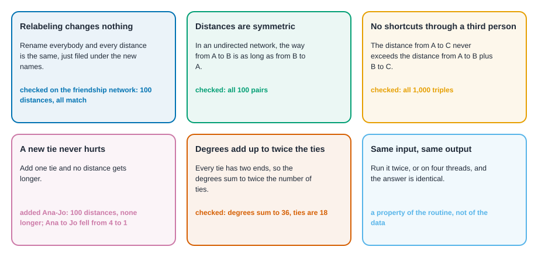
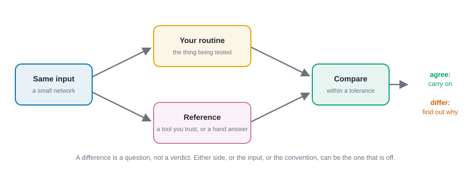
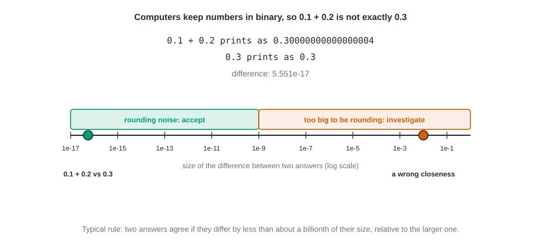
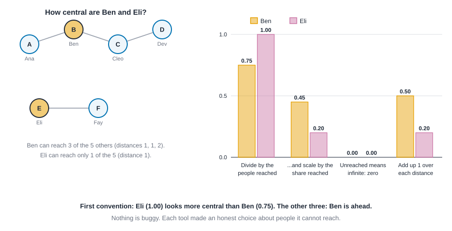
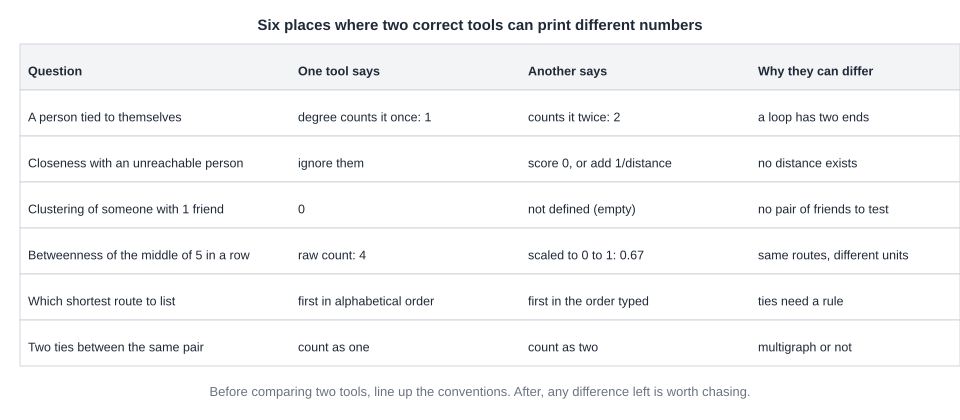

# Trusting an implementation {#sec-trust}

::: {.callout-note appearance="simple"}
## Prerequisites
@sec-building-blocks, mainly for the idea that a routine is a small recipe with inputs and outputs. No programming is needed to follow the chapter.
:::

::: {.callout-note title="The short version"}
A program prints a number with six decimal places and it looks authoritative, but looks prove nothing. This chapter is about how to find out whether a graph routine is right. You check it by hand on tiny networks where you know the answer, you check rules that must always hold, you compare it with another tool you trust, and you feed it odd and random inputs to see if it breaks. And you learn that two careful tools can print different numbers for the same network without either one being wrong, because they made different choices about awkward cases.
:::

::: {.callout-note title="Why you might care"}
Network software rarely crashes when it is wrong. It returns a clean-looking table, and that table goes into a report, a paper or a decision. If you can run five or six quick checks, you will catch most of the errors that matter, and when two tools disagree you will know how to tell a bug from a difference of convention.
:::

## What you'll be able to do

After this chapter you should be able to design a small test for any network measure, build a short list of named tiny networks with known answers, check a result against a second tool and judge whether the difference is rounding or a real discrepancy, and explain, with a concrete example, why "the tools disagree" does not always mean "one of them is broken."

## A story first: the recipe and the calculator

You have just written down a recipe for a cake that serves eight, and you want to know whether it is right before you cook it for a wedding. What do you do?

You could **bake a tiny batch and taste it**. That is a hand-checked case: small enough to inspect completely, and if it fails there is no point scaling up.

You could **check the proportions**: the recipe for sixteen should use exactly double. If doubling the flour does not double the cake, something is off. That is a **property**: a rule that must hold whatever the details.

You could **compare it with your grandmother's recipe** for the same cake. If the two are close, good. If they differ, you do not yet know whose is wrong, but you know where to look. That is a **reference**.

You could **try it in strange kitchens**: a high altitude, an oven that runs hot, no eggs. Most recipes are never tested on the awkward cases, and that is exactly where they fail. That is **fuzzing**.

And you could **keep a notebook** of every cake that went wrong, so a mistake never repeats. That is a **regression test**.

Now replace the cake with a calculator. You have a new calculator and you want to trust it. You type 2 plus 2 (tiny case), you check that adding then subtracting gets you back where you started (property), you compare with a calculator you already trust (reference), you try dividing by zero (fuzzing) and you remember the bug that once made it print 0.1 + 0.2 as 0.30000000000000004 and decide what counts as a mistake (regression and tolerance). Graph routines deserve exactly the same treatment.

{#fig-trust-ladder fig-alt="Five horizontal bands stacked like a pyramid, widest at the bottom. From the bottom: hand-checked tiny cases, property tests, reference tools, fuzzing, and regression tests at the top. Each band names what it catches."}

## Layer one: tiny cases you can check on paper

The cheapest and most powerful test is a network small enough that you can work out the answer with a pencil. Five people is about the limit. @fig-trust-hand-check shows one: Ana is tied to Ben and Cleo, both of them to Dev, and Dev to Eli. By hand we can list, for each person, the number of ties (their **degree**), the number of steps from Ana, and the number of shortest routes from Ana.

{#fig-trust-hand-check fig-alt="A five-person network: Ana is tied to Ben and to Cleo; Ben and Cleo are each tied to Dev; Dev is tied to Eli. A table lists each person's number of ties (2, 2, 2, 3, 1), the steps from Ana (0, 1, 1, 2, 3) and the number of shortest routes from Ana (1, 1, 1, 2, 2)."}

Dev, for instance, is 2 steps from Ana, and there are two shortest routes (through Ben or through Cleo), so Dev gets "2 steps, 2 routes". Eli is 3 steps away and inherits Dev's two routes. Every number in the table can be checked with a finger on the page, and the degrees satisfy a rule we can check without any picture: they add up to 10, twice the number of ties, because each tie has two ends.

It also pays to keep a standing list of **named small networks** whose answers are known in closed form. These are the ones to keep on hand:

| Network | People | Ties | Density | Diameter | Mean distance |
|---|---|---|---|---|---|
| A path of 5 in a row | 5 | 4 | 0.4 | 4 | 2.0 |
| A star: one centre, four others | 5 | 4 | 0.4 | 2 | 1.6 |
| A ring of 6 | 6 | 6 | 0.4 | 3 | 1.8 |
| Everyone tied to everyone (5 people) | 5 | 10 | 1.0 | 1 | 1.0 |
| Two islands (a pair and a triangle) | 5 | 4 | 0.4 | no route between islands | undefined across the gap |
| One person, no ties | 1 | 0 | undefined | 0 | undefined |

The **diameter** is the largest distance between any two people, the **mean distance** is the average distance over all pairs, and the **density** is the share of possible ties that exist. If a routine gets the last three rows wrong, it is likely to fail in practice on networks with islands or very small networks, which real data has plenty of.

::: {.callout-tip title="In plain words"}
Choose test networks the way a teacher chooses exam questions: some typical, some deliberately awkward (no ties, one person, two islands), and all small enough to mark with a pencil. A tool that fails the awkward ones will fail real data.
:::

## Layer two: rules that must always hold

A **property** is a rule that holds for every network, so you can test it on thousands of networks without ever working out an answer by hand. @fig-trust-properties lists six. A few examples with numbers from the ten-person friendship network:

{#fig-trust-properties fig-alt="Six cards in two rows. Relabeling changes nothing; distances are symmetric; no shortcuts through a third person; a new tie never hurts; degrees add up to twice the ties; same input gives the same output. Each carries a note on a check made on the ten-person friendship network."}

- *Degrees add up to twice the ties.* The ten-person network has 18 ties and its degrees sum to 36.
- *Distances are symmetric.* The distance from Ana to Jo equals the distance from Jo to Ana (both 4).
- *Relabeling changes nothing.* Rename everyone and every distance is the same, filed under the new names.
- *A new tie never hurts.* Add one tie between Ana and Jo and Ana-to-Jo falls from 4 to 1, and no other distance gets longer.

Property tests have two big advantages. They need no hand-worked answer, and they run on **random** networks, so they find cases you would never think of. They also have a clever extra: when a random test fails, good testing tools **shrink** the failing network, repeatedly removing people and ties while it still fails, until you are left with the smallest network that breaks the rule. Instead of a failure on a 400-person network, you get a failure on three people that you can reason about. The idea was popularized in the testing tool QuickCheck [@claessen2000quickcheck].

## Layer three: comparing with a tool you trust

A **reference** is a second, independent source of the answer. It might be a mature program, a different language's library, or a slow, obvious version of the routine that you write in ten lines so that you can see it is right. @fig-trust-recipe shows the move: same input, two routines, compare.

{#fig-trust-recipe fig-alt="Four boxes joined by arrows. A blue box, Same input, sends arrows to an orange box, Your routine, and a purple box, Reference. Both of those send arrows to a green box, Compare, which leads to two outcomes: agree, carry on; differ, find out why."}

Two details make this work or fail.

**Independence.** A reference only helps if it can be wrong in a different way from the thing you are testing. Two programs written from the same misunderstanding agree on the wrong answer. If the reference is yours, write it the dullest way you can: for shortest distances, a plain breadth-first search from every person is better than a clever method.

**Tolerance.** Computers store most numbers in binary, so even correct code can differ in the last few digits, depending on the order of additions and similar details [@goldberg1991floating]. In most languages, 0.1 + 0.2 is not exactly 0.3. So "equal" must mean "close enough", and the usual definition mixes an absolute and a relative allowance:

$$
|a - b| \;\le\; \text{atol} + \text{rtol} \times \max(|a|, |b|).
$$

::: {.callout-tip title="In plain words"}
$a$ and $b$ are the two answers; $|a - b|$ is how far apart they are, ignoring sign. The right-hand side is the allowance: a small fixed amount (atol, "absolute tolerance", say $10^{-12}$) so that two answers that are both nearly zero count as equal, plus a share of the answers' size (rtol, "relative tolerance", say $10^{-9}$, a billionth) so that big answers are allowed bigger wobbles. For 0.1 + 0.2 against 0.3, the difference is about $5.6 \times 10^{-17}$, and the allowance is about $10^{-12} + 3 \times 10^{-10}$, so they agree by a huge margin. A closeness score that is off by 0.01 is millions of times bigger than the allowance, and the check fails, as it should.
:::

{#fig-trust-tolerance fig-alt="A horizontal line from 1e-17 to 1 on a log scale. A green zone on the left, up to a billionth, is labeled rounding noise: accept. A red zone on the right is labeled too big to be rounding. A green dot sits far left for 0.1 plus 0.2 versus 0.3; a red dot sits at 0.01 for a wrong closeness score."}

A tolerance is a judgement call, and it can fail either way. Too tight, and correct code raises false alarms on rounding noise. Too loose, and it hides a genuine error such as a wrong convention. A good habit is to start strict, look at the differences that fail, and loosen only for a reason you can state.

### Rules for measures that are hard to check by hand

For some measures, such as betweenness or PageRank, no one wants to work out the answer on paper even for ten people. But even these obey rules that tie the answer to something simpler. They are some of the best tests you can write, because the routine cannot satisfy them by accident.

| Measure | A rule that must hold | On the ten-person network |
|---|---|---|
| Betweenness (every pair counted once) | The scores of all people add up to the sum over all pairs of (distance minus 1), because a route of $d$ steps passes through $d - 1$ people | Distances sum to 89 over 45 pairs, so $89 - 45 = 44$; the ten scores add to 44.0 |
| PageRank | The scores of all people add up to 1 | Ten scores that add to 1 |
| Triangles | Each triangle is counted once, so the count equals the number of closed three-step walks divided by 6 | 11 triangles |
| Components | The number of islands equals the number of times 0 appears as a value of the network's Laplacian (a table built from the degrees and ties) | 1 island, so 0 appears once |
| Average degree | Equals twice the ties divided by the people | $2 \times 18 / 10 = 3.6$ |

::: {.callout-tip title="In plain words"}
Even when you cannot say what a score should be, you can often say what the scores must add up to, or how they must relate to a simpler count. The betweenness rule says that every shortest route spreads exactly its inner people's worth of credit around. On the ten-person network the credit comes to 44, and a routine whose scores add to 43.7 is wrong somewhere, even if every individual score looks plausible.
:::

### Checking a large network when there is no answer key

Nobody has a hand-worked answer for a network of a million people. Three habits cover most of the gap.

1. **Check a sample against a slow, certain method.** Pick a thousand random people, run the dull reference on only those, and compare with the fast routine's scores for the same people. The reference may take minutes, which is fine for a sample.
2. **Check the rules.** The totals and relationships above scale to any size and cost nothing to evaluate.
3. **Check the shape against a smaller copy.** Run the routine on a sample or an earlier version of the same network, one-hundredth the size, where the reference can handle it. A routine that is right on the small copy and wrong on the big one usually has a size-related fault: running out of room, a number that overflows, or a loop that stops too soon.

## Layer four: fuzzing

**Fuzzing** means feeding a routine large numbers of random and deliberately strange inputs, and watching for crashes, hangs and wrong answers. The name comes from a famous study that fed random characters to common UNIX programs and found that a startling share of them crashed [@miller1990empirical]. For graph routines the interesting random inputs are tiny networks with awkward features: no ties at all, one person, a person with no friends, separate islands, a person tied to themselves, the same tie listed twice.

The trap is that an ordinary random generator never produces some of those. @fig-trust-fuzz counts how often 4,000 random tiny networks contain each awkward feature. A typical generator that picks distinct pairs never produces a self-tie or a repeated tie, so a fuzz test built on it never exercises the code that handles them. Tell your generator to add those features on purpose.

{#fig-trust-fuzz fig-alt="Six pairs of horizontal bars, one pair per feature: no ties at all, someone with no friends, two or more islands, a person tied to themselves, the same tie listed twice, and all of those at once. The blue bars for the typical generator are empty for self-ties, repeated ties and all of those at once (0 percent each), and the orange bars for deliberate generation are long."}

The strongest form is **differential fuzzing**: run the same random network through two implementations and compare answers (layer three), over and over, on thousands of inputs. It combines the reach of fuzzing with the judgement of a reference.

## Layer five: regression tests

When you find a bug, keep the network that exposed it as a permanent test. It costs nothing to run, and it stops the same mistake from coming back when someone edits the code in a year. The notebook of past failures is the cheapest layer and arguably the most valuable one in a long-lived tool.

## Look at the picture

Numbers can pass every test and still be wrong in a way a picture shows at once. Before you trust a result, plot it. A histogram of closeness scores should not have one giant spike at exactly zero unless there really are many isolated people. Scores that are *exactly* the same for everyone in a network with a clear centre suggest a routine that ignored the ties. A plot of one tool's scores against another's should hug a straight line: if it forms two lines, one of them is probably a different convention, such as scaled and unscaled scores for the people on different islands.

These are not proofs. They are fast, and they have caught more embarrassing errors than any formal test, because they show you what the numbers are doing, not only whether they match.

## Why careful tools still disagree

Suppose you do all of the above and two well-made tools still print different numbers for the same network. Before you search for a bug, check whether they were even asked the same question. Many measures have an awkward corner where more than one answer is defensible, and tools choose differently.

@fig-trust-two-answers is the clearest example. Take a network with two islands, a path of four people and a separate pair, and ask how close each person is to everyone else. That is **closeness**, usually a person's number of reachable people divided by the sum of their distances to them. But Ben cannot reach Eli and Fay at all. What should the formula do about people it cannot reach?

{#fig-trust-two-answers fig-alt="On the left, a path of four people (Ana, Ben, Cleo, Dev) and a separate pair (Eli, Fay). On the right, a bar chart with four groups of two bars, for Ben and Eli. First group, Ben 0.75 and Eli 1.00. Second group, Ben 0.45 and Eli 0.20. Third group, both 0.00. Fourth group, Ben 0.50 and Eli 0.20."}

Four defensible conventions give four answers for Ben (0.75, 0.45, 0.00, 0.50) and for Eli (1.00, 0.20, 0.00, 0.20). The first convention divides only by the people a person can reach, so Eli, who reaches just one neighbour at distance 1, scores a perfect 1.00 and beats Ben. The second scales that score down by the share of the network the person reaches, which fixes Eli's unfair advantage. The third declares unreachable people infinitely far, so everyone in a network with two islands scores 0. The fourth adds up the reciprocal distances, which handles unreachable people gracefully by contributing zero. None of them is buggy. Each is in real use somewhere. They answer slightly different questions.

The same trap catches an even simpler number, the mean distance. On the same two-island network there are 15 pairs of people, but only 7 of them can reach each other: the path of four has 6 pairs, at distances 1, 1, 1, 2, 2 and 3, adding to 10, and the separate pair has 1 pair at distance 1. So one defensible answer, averaging over the pairs that can reach each other, is $11 / 7 \approx 1.57$. Another tool might count the other eight pairs as distance 0 and report $11 / 15 \approx 0.73$, which says the network is *tighter* than it is. A third refuses to answer, because some distances are infinite. Same network, three numbers, and the middle one is the most misleading of all.

Closeness is not special. @fig-trust-conventions lists six places where careful tools commonly differ: how a self-tie adds to a degree, what to do with people who cannot be reached, how to score the clustering of someone with a single friend, whether betweenness is a raw count or scaled to a 0-to-1 range, which of several equal shortest routes to report, and whether two ties between the same pair count as one or two. For instance, in a row of five people, the person in the middle lies on 4 shortest routes between others, so a tool that reports raw counts says 4 while one that scales by the number of possible pairs of the others says $4 / 6 \approx 0.67$.

{#fig-trust-conventions fig-alt="A table with six rows and four columns: the question, what one tool says, what another says, and why they can differ. Rows cover self-ties, closeness with unreachable people, clustering for a person with one friend, betweenness raw or scaled, the choice among tied shortest routes, and repeated ties between a pair."}

When two tools disagree, go through these questions in order.

1. **Same input?** Do both read the same ties, with the same direction, the same handling of repeats and loops, and the same node order?
2. **Same question?** Check the documentation for the unreachable-people, scaling and tie-breaking rules. Test on one of the tiny networks where the conventions diverge, such as the two-island network, and see which convention each tool matches.
3. **Same tolerance?** Is the difference rounding noise, or something bigger?
4. **Only then, a bug.** Reduce the input to the smallest network that still shows the difference, and work it by hand.

Good tools document their choices and sometimes let you switch between conventions to match another program. When you publish a result, say which convention you used.

## A worked investigation

Here is the whole routine at work, on a made-up but realistic afternoon. Ana is checking a new closeness routine against the one she has used for years. She runs both on the two-island network from the figure above, the one with a path of four people and a separate pair. The old tool says Ben's closeness is 0.45. The new one says 0.75.

She does not reach for the debugger. She asks the four questions in order.

**Same input?** She prints the ties each tool read. Both see four ties among six people. Same directions (none), no repeated ties, no self-ties. Yes, the same.

**Same question?** She reads the documentation for both. The old tool says closeness is scaled by the share of people it can reach. The new one says closeness is the number of reachable people divided by the sum of their distances, with no scaling. Those are two of the four conventions in the figure. Ben reaches 3 of the 5 others at distances 1, 1 and 2. Unscaled: $3 / 4 = 0.75$. Scaled by $3 / 5$: $0.75 \times 0.6 = 0.45$. Both tools reproduce their documented formula exactly.

**Same tolerance?** The differences between her hand calculation and each tool's number are zero to the last printed digit, so rounding is not involved.

**A bug?** No. Nothing is wrong. The two tools are answering different questions, and the real decision is which question she wants answered. For a network with islands, she decides the scaled version is fairer, since it does not reward Eli, who reaches only one neighbour, with a perfect score. She writes that choice into her report so that nobody reruns it with the other tool and wonders why the numbers moved.

Notice what made this quick: a six-person network small enough to do by hand, a list of conventions to check, and a habit of writing down the choice. Without them the same disagreement can eat a week.

## Shrinking a failure by hand

Now a case where there is a bug. Suppose a fuzz test finds that a routine for counting islands disagrees with a reference on a random network of nine people and eleven ties. Staring at eleven ties is not productive. Shrinking is the habit of removing things while the failure persists.

Try removing one tie at a time and rerunning. If the routine still disagrees with the reference, keep the removal; if the failure disappears, put the tie back. Then try removing people with no ties, then people one at a time. After a few dozen steps (a computer does this in a blink) the failing network has shrunk to three people: Ana tied to Ben, and Cleo with no ties at all. The reference says two islands, the routine says one. Now the bug is obvious: the routine forgot about the person who has no friends.

This is the real value of keeping the random seed. The failure is repeatable, the shrunken network goes into the regression tests, and the explanation fits on a napkin.

## How much testing is enough?

There is no number. A useful way to decide is to ask what a wrong answer would cost, and how hard the answer is to eyeball.

A closeness score on a slide that nobody will act on needs the first three layers: a hand-checked case, the rules and a reference run. A routine that sits inside a tool other people use for their research deserves all five layers, a record of conventions, and a test for every bug ever reported. A routine that decides something with consequences, such as who is flagged in a network of suspected fraud, deserves the whole list plus a person who did not write it reading the result.

Two signs that you have tested enough: every kind of awkward input you can name has a test, and every difference between two tools is explained, not merely tolerated. Two signs that you have not: the only networks in your tests are ones you drew yourself, and "it matches the other tool" is the only reason you believe the answer.

## What it costs, in plain words

Testing has costs too, and they decide how you can test. A comparison with a reference costs the time of both routines. A property test costs the time of one routine times the number of random networks. Fuzzing and exhaustive checks multiply that by thousands. So most of the checks above run on tiny networks, where each run takes microseconds, and you can afford a hundred thousand of them.

The deliberately dull reference is the place where cost bites. A simple way to get the distance between every pair of people checks, for each possible middle person, whether going through them shortens each pair's route, which takes about $n \times n \times n$ small steps.

$$
\text{work} \;\approx\; n^3.
$$

::: {.callout-tip title="In plain words"}
$n^3$ means $n$ times $n$ times $n$: the work grows with the cube of the number of people. Ten people need about 1,000 steps, which is instant. Two hundred people need 8 million steps, still well under a second. A hundred thousand people need $10^{15}$ steps, which would take weeks. So brute-force references belong on small networks, and for large ones you compare the fast routine against a good tool or against a sample of pairs.
:::

There is a smaller, friendlier cost worth knowing, shown in the box below: checking *everything* on tiny networks is cheaper than most people expect.

## At a glance

| Check | What it catches | What it misses | Cost |
|---|---|---|---|
| Hand-checked tiny case | Plain mistakes; misunderstanding the question | Anything that only shows up at scale | A pencil and ten minutes |
| Property tests | Broken rules, on many random networks | Wrong but self-consistent answers | Cheap, thousands of runs |
| Reference tool | Wrong answers on realistic networks | A shared mistake; differences of convention | Time of both tools |
| Fuzzing | Crashes, hangs and odd inputs | Silent wrong answers on normal inputs | Cheap, and needs a good generator |
| Regression tests | A fixed bug coming back | New kinds of bug | Nearly free |
| Convention check | Disagreements that are not bugs | Real bugs hiding behind a convention | A tiny network and the documentation |

## Where it goes wrong

**Testing the tool against itself.** Calling the same routine twice and comparing the results proves nothing about correctness, though it does check determinism. Use an independent route.

**A shared mistake.** If your reference and your routine come from the same misunderstanding, both pass. This is why a hand-worked answer on a tiny network, derived from the definition and not from code, matters.

**A tolerance that hides a bug.** An allowance of 0.01 will wave through a wrong convention that changes scores in the second decimal. Say why each tolerance is the size it is.

**Only nice networks.** Tests on connected, simple, medium-sized networks pass code that fails on islands, singletons and repeated ties. Real data has all of them.

**Comparing orders that are only choices.** Two correct programs can list tied shortest routes, or visit friends, in different orders. Compare sets, or fix the order first (see @sec-traversal).

**Green does not mean covered.** A hundred passing tests that never touch the awkward corner are a hundred reasons to feel safe and none to be so.

**Unseeded randomness.** A random test that fails once and cannot be repeated is useless. Always record the seed (the starting number of the random generator) so any failure can be rerun.

**Forgetting to say which convention.** When you report a result, name the conventions used. Without them, nobody can reproduce it, including you in six months.

## A checklist you can keep

When you pick up a network tool, or a result someone else computed, run down this list. It takes about ten minutes the first time and almost nothing after that.

1. Does it get a five-person network right, with every number checked by hand?
2. Does it handle the awkward tiny cases (no ties, one person, two islands, a self-tie, a repeated tie) without crashing and with answers you can defend?
3. Do the always-true rules hold on a few hundred random networks: symmetry, degree sum, relabeling?
4. Does it agree with a second, independent tool on a realistic network, within a stated tolerance?
5. Do you know which convention it uses for unreachable people, scaling and tied routes, and have you written it down?
6. If two tools disagree, have you checked input, question and tolerance before blaming either?
7. Is every random test seeded, so a failure can be rerun?
8. Have you kept the network behind every past bug?
9. Does the documentation say what the tool does with weights, directions and loops?
10. Does the result you report say which tool, which version and which conventions produced it?

## If you like proofs

::: {.callout-note collapse="true" title="Why checking every tiny network is affordable"}
This box is optional and is a counting argument. Many bugs show up on very small networks, so one strong test is to run the routine on *every* network with up to a few people and compare it with a reference.

How many are there? With $n$ labeled people there are $n(n-1)/2$ possible pairs, and each pair either has a tie or does not, so there are $2^{n(n-1)/2}$ networks. For 1 to 7 people that is 1, 2, 8, 64, 1,024, 32,768 and 2,097,152. Checking all networks with up to 6 people means $1 + 2 + 8 + 64 + 1{,}024 + 32{,}768 = 33{,}867$ runs, which takes a fraction of a second. Going up to 7 adds two million, which still takes seconds.

This does not prove the routine correct for all sizes. But it gives a strong guarantee that no bug can hide behind a small pattern, such as an island, a pair, a triangle or a person with no friends, because every such pattern appears in this list. Experience with testing suggests that most bugs are exposed by small inputs, which is why this is such good value.
:::

::: {.callout-note title="Words used in this chapter"}
- **Reference:** a second source for the answer, such as a mature tool, an independent implementation or a hand-worked case.
- **Property:** a rule that holds for every network, such as "degrees add up to twice the ties".
- **Tolerance:** how far apart two answers may be and still count as equal.
- **Fuzzing:** testing with many random and deliberately odd inputs.
- **Shrinking:** repeatedly simplifying a failing input until it is as small as possible.
- **Regression test:** a test kept because it once caught a bug.
- **Convention:** a defensible choice about an awkward case, such as how to treat people who cannot be reached.
- **Seed:** the starting number of a random generator, recorded so a random test can be repeated exactly.
:::

## Code

The code blocks use the five-person network of @fig-trust-hand-check, the two-island network of @fig-trust-two-answers and the ten-person friendship network. The tab text is a placeholder until the library interface is final: each line says exactly what the code will compute and print.

A hand-checked case. It will compute degrees, distances from Ana and shortest-route counts for the five-person network and print them next to the hand-worked values; look for all fifteen numbers matching.

::: {.panel-tabset group="language"}

## R

```r
# TODO(code, R): compute degrees, steps from Ana and shortest-route counts on the five-person network and print them beside the hand-worked table, with TRUE or FALSE for each match
```

## Python

```python
# TODO(code, Python): compute degrees, steps from Ana and shortest-route counts on the five-person network and print them beside the hand-worked table, with True or False for each match
```

## Rust

```rust
// TODO(code, Rust): compute degrees, steps from Ana and shortest-route counts on the five-person network and print them beside the hand-worked table, with true or false for each match
```

:::

::: {.code-output}
```text
TODO(output): a table of five people with computed and hand-worked degree, steps and routes, all matching
```
:::

Reading the result: any False would be a mistake in either the routine or the pencil work, and the awkward person to look at first is Dev.

Properties on random networks. It will generate a thousand random small networks and check symmetry, the degree sum and the effect of adding a tie, then print how many passed; look for 1000 of 1000 on each rule.

::: {.panel-tabset group="language"}

## R

```r
# TODO(code, R): generate 1,000 random networks of 2 to 8 people, check that distances are symmetric, that degrees sum to twice the ties and that adding a tie never lengthens a distance, and print how many networks passed each rule
```

## Python

```python
# TODO(code, Python): generate 1,000 random networks of 2 to 8 people, check that distances are symmetric, that degrees sum to twice the ties and that adding a tie never lengthens a distance, and print how many networks passed each rule
```

## Rust

```rust
// TODO(code, Rust): generate 1,000 random networks of 2 to 8 people, check that distances are symmetric, that degrees sum to twice the ties and that adding a tie never lengthens a distance, and print how many networks passed each rule
```

:::

::: {.code-output}
```text
TODO(output): three lines, one per rule, each reporting 1000 of 1000 passed
```
:::

Reading the result: all three pass on every network, which is what we expect of a correct routine; a failure would be followed by shrinking to a smaller failing network.

Against a reference, with a tolerance. It will compute closeness for the ten-person network with the library routine and with a short reference, and report the largest difference and whether it is within the tolerance of the formula above; look for a tiny difference and a pass.

::: {.panel-tabset group="language"}

## R

```r
# TODO(code, R): compute closeness for every person in the ten-person network with the library and with a plain reference routine, and print the largest absolute difference and whether every pair passes the absolute plus relative tolerance test
```

## Python

```python
# TODO(code, Python): compute closeness for every person in the ten-person network with the library and with a plain reference routine, and print the largest absolute difference and whether every pair passes the absolute plus relative tolerance test
```

## Rust

```rust
// TODO(code, Rust): compute closeness for every person in the ten-person network with the library and with a plain reference routine, and print the largest absolute difference and whether every pair passes the absolute plus relative tolerance test
```

:::

::: {.code-output}
```text
TODO(output): the largest difference (around 1e-16) and a pass for all ten people
```
:::

Reading the result: a difference near $10^{-16}$ is rounding, many orders of magnitude inside the allowance.

The same question, two answers. It will compute Ben's and Eli's closeness on the two-island network under four conventions and print a table; look for 0.75, 0.45, 0.00 and 0.50 for Ben.

::: {.panel-tabset group="language"}

## R

```r
# TODO(code, R): compute closeness for Ben and Eli on the two-island network under four conventions (reachable only, scaled by share reached, unreachable as infinite, harmonic) and print a two-by-four table
```

## Python

```python
# TODO(code, Python): compute closeness for Ben and Eli on the two-island network under four conventions (reachable only, scaled by share reached, unreachable as infinite, harmonic) and print a two-by-four table
```

## Rust

```rust
// TODO(code, Rust): compute closeness for Ben and Eli on the two-island network under four conventions (reachable only, scaled by share reached, unreachable as infinite, harmonic) and print a two-by-four table
```

:::

::: {.code-output}
```text
TODO(output): Ben 0.75, 0.45, 0.00, 0.50 and Eli 1.00, 0.20, 0.00, 0.20
```
:::

Reading the result: the numbers are the bars of @fig-trust-two-answers, and the first column is the one under which Eli looks more central than Ben.

Every small network. It will run a routine and a reference on every network of up to 6 people and print how many networks were compared and how many differed; look for 33,867 compared and 0 differences.

::: {.panel-tabset group="language"}

## R

```r
# TODO(code, R): enumerate every labeled network with 1 to 6 people (33,867 in all), compute the number of islands with the library and with a reference, and print how many networks were compared and how many differed
```

## Python

```python
# TODO(code, Python): enumerate every labeled network with 1 to 6 people (33,867 in all), compute the number of islands with the library and with a reference, and print how many networks were compared and how many differed
```

## Rust

```rust
// TODO(code, Rust): enumerate every labeled network with 1 to 6 people (33,867 in all), compute the number of islands with the library and with a reference, and print how many networks were compared and how many differed
```

:::

::: {.code-output}
```text
TODO(output): "33867 networks compared, 0 differed"
```
:::

Reading the result: zero differences over every pattern of up to six people means no bug is hiding behind a small island, pair or lone person.

Differential fuzzing with shrinking. It will run a routine and a reference on 5,000 random small networks that include self-ties and repeated ties, and if they differ, shrink the first failing network and print it; look for no failures on a correct routine.

::: {.panel-tabset group="language"}

## R

```r
# TODO(code, R): run the library's island count and a reference island count on 5,000 seeded random networks of 1 to 8 people that include self-ties and repeated ties, and print the number that differ and, if any, the smallest failing network as a list of ties
```

## Python

```python
# TODO(code, Python): run the library's island count and a reference island count on 5,000 seeded random networks of 1 to 8 people that include self-ties and repeated ties, and print the number that differ and, if any, the smallest failing network as a list of ties
```

## Rust

```rust
// TODO(code, Rust): run the library's island count and a reference island count on 5,000 seeded random networks of 1 to 8 people that include self-ties and repeated ties, and print the number that differ and, if any, the smallest failing network as a list of ties
```

:::

::: {.code-output}
```text
TODO(output): "5000 networks, 0 differed" for a correct routine, or the shrunken failing network
```
:::

Reading the result: zero differences on inputs that include the awkward cases is much stronger evidence than zero differences on tidy ones.

## Exercises

1. **By hand.** On the two-island network of @fig-trust-two-answers, compute Ben's closeness under the first two conventions. Ben reaches 3 of the 5 other people, at distances 1, 1 and 2. Then compute the harmonic version, the sum of 1 over each distance divided by 5.
2. **By hand.** For a ring of 6 people, list the number of ties, the degree of each person, the diameter and the mean distance. Which entries of the table of named networks can you now confirm?
3. **Think it through.** You test a new shortest-distance routine against a reference you wrote yourself, using breadth-first search from every person, on 1,000 random networks, and every test passes. List two reasons you might still not trust it on a real data file.
4. **Think it through.** Why does a fuzzer that only builds networks without self-ties never test the code for self-ties? What should you change?
5. **Coding.** Write a property test that checks that relabeling the people of the ten-person network by a random shuffle leaves the sorted list of degrees unchanged. Then break your routine on purpose (make it ignore the last person) and see which test notices first.
6. **Interpretation.** Two tools give betweenness scores for the middle person of a path of five people: one says 4 and the other 0.67. Is either broken? What would you check next?

::: {.callout-note collapse="true"}
## Answers

1. First convention: Ben reaches 3 people with distances adding to $1 + 1 + 2 = 4$, so closeness is $3/4 = 0.75$. Second: scale by the share reached, $3/5$: $0.75 \times 0.6 = 0.45$. Harmonic: $(1/1 + 1/1 + 1/2)/5 = 2.5/5 = 0.50$. The third convention (unreachable means infinite) gives 0.
2. A ring of 6 has 6 ties and every person has degree 2. The farthest person is 3 steps away, so the diameter is 3. From any person the distances to the other five are 1, 1, 2, 2 and 3, adding to 9, so the mean distance is $9/5 = 1.8$. That confirms the ring row of the table, including density $2 \times 6 / (6 \times 5) = 0.4$.
3. First, your reference may share a misunderstanding with the routine, for instance about unreachable people, since both were written by the same person. Second, 1,000 random networks may all be connected and simple, whereas a real file may have islands, repeated ties and self-ties. Others: the real network is much bigger, so a slow reference cannot be run on it, and real weights may be negative or strengths.
4. The generator never creates the input that would take the self-tie branch of the code, so that branch is never run. Change the generator to add self-ties and repeated ties deliberately, in a share of the cases, as in the orange bars of @fig-trust-fuzz.
5. Shuffle with a recorded seed, recompute the degrees of the relabeled network and compare sorted lists. The degree-sum test and this test should both catch a routine that ignores the last person, since the degrees will no longer add up to twice the ties, whereas a test that only checks symmetry of distances would still pass.
6. Neither is broken: 4 is the raw count of shortest routes through the middle person, and 0.67 is that count divided by the number of pairs among the other four people, $4/6$. Check each tool's documentation for its normalization, then make one match the other before comparing any larger network.
:::

## Summary

::: {.callout-tip appearance="simple"}
To trust a graph routine, check it in layers. Tiny hand-worked networks catch plain mistakes, property tests check rules that must always hold, a reference tool catches wrong answers on realistic data, fuzzing finds crashes and awkward inputs, and regression tests stop old bugs returning. Compare numbers with a stated tolerance, not an equals sign, and make sure your random inputs include the awkward cases. When two careful tools disagree, check input, question, tolerance and convention before suspecting a bug, because many measures have more than one defensible answer for unreachable people, loops, scaling and ties. One-line takeaway: a number you have not checked is a guess with decimals.
:::

## Further reading

The idea of generating many random inputs and shrinking failures is described in @claessen2000quickcheck, and the original study of random input testing is @miller1990empirical. For why computers add 0.1 and 0.2 the way they do and how to compare numbers sensibly, see @goldberg1991floating. For two widely used network libraries whose documentation spells out many of their conventions, see NetworkX [@hagberg2008exploring] and igraph [@csardi2006igraph]. The chapters that follow lean on this one: @sec-traversal shows a case where two correct tools can differ in order, and @sec-shortest-paths shows weights whose meaning (strength or distance) changes the answer.
