# Breadth-first and depth-first search {#sec-traversal}

::: {.callout-note appearance="simple"}
## Prerequisites
@sec-representations (a graph as a list of friend lists) and @sec-building-blocks (a queue and a stack). If you skipped those, the two-paragraph recap in the story below is enough.
:::

::: {.callout-note title="The short version"}
To find out who can be reached from one person, you walk the network. There are two natural ways to walk it. Breadth-first search spreads out like a ripple: everyone one step away, then everyone two steps away, and so on. Depth-first search goes as far as it can down one trail, then backs up and tries the next. The only real difference between them is how you keep your list of people still to visit: a waiting line for the ripple, a stack of plates for the trail. Either one visits each person and each tie a fixed number of times, so the work grows in step with the size of the network.
:::

::: {.callout-note title="Why you might care"}
Almost every question about a network starts with a walk. How far apart are two people? Is everyone connected, or are there islands? Is there a loop? Who is within two steps of whom? The answers to all of these fall out of one of the two searches in this chapter, often as a free by-product. If you understand them well, later chapters (shortest paths, components, connectivity, betweenness) will feel like variations on a theme.
:::

## What you'll be able to do

By the end of the chapter you should be able to run both searches by hand on a small network, say what each one leaves behind (distances, a tree of routes, an order), explain why the breadth-first distances are always the shortest ones, and say, in plain words, how much work a search does. You will also know where searches quietly go wrong: forgetting who has already been met, trusting an order that depends on an arbitrary choice, and running out of room on a very long chain.

## A story first: looking for your keys

You have lost your keys somewhere in a house. The rooms are joined by doors, and you can't see through walls. There are two sensible ways to search.

The first is to be thorough about distance. Look in your room. Then look in every room one door away. Then every room two doors away, and so on. You will always find the keys by the shortest number of doors, because you checked every closer room before any farther one. That is **breadth-first search**: it spreads out evenly, like the ripple from a stone dropped in a pond.

The second is to commit. Pick a door, walk through, pick another door, keep going until you reach a dead end, then back up one room and try a different door. You might find the keys quickly, or after a long wander through the far side of the house first. That is **depth-first search**: it goes as deep as it can before it ever tries a second option.

Both searches need a way to remember which rooms are still waiting to be visited. That memory is where the whole difference lives, and it comes in two shapes.

- A **queue** is a waiting line. New arrivals join the back, and the next person served is the one at the front, so whoever has waited longest goes first. Think of a cafe.
- A **stack** is a pile. New arrivals go on top, and the next one taken is the one on top, so whoever arrived last goes first. Think of a stack of plates.

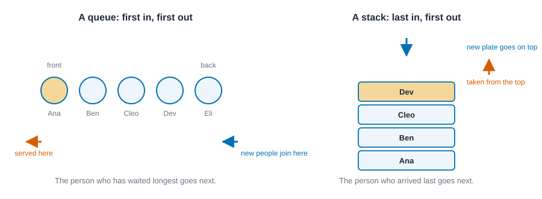{#fig-traversal-lines fig-alt="Left: five circles in a row labeled Ana, Ben, Cleo, Dev and Eli, with Ana at the front, an arrow showing service at the front and another showing new people joining at the back. Right: four plates labeled Ana, Ben, Cleo and Dev stacked with Dev on top, with an arrow putting a new plate on top and another taking one off the top."}

Use a queue for the waiting list and you get breadth-first search. Use a stack and you get depth-first search. Nothing else changes. That is the entire idea, and the rest of this chapter is about seeing what it buys you.

::: {.callout-tip appearance="simple"}
## Why a queue gives a ripple
In a queue, the people already waiting are all served before anyone who joins later. The friends of Ana join the line behind Ana's earlier friends, so everyone one step away gets their turn before anyone two steps away. The ripple is the queue's fairness, made visible.
:::

## The tiny example, by hand

We use the ten-person friendship network again: Ana, Ben, Cleo, Dev, Eli, Fay, Gus, Hana, Ivo and Jo, with 18 ties between them. If it is new to you, the SNA book introduces it [in its centrality chapter](https://knapply.github.io/net-books/sna/). Two small rules keep every walk in this chapter repeatable. First, we mark someone as **met** the moment they join the waiting list, so nobody ever joins twice. Second, when someone has several friends to visit, we take them in alphabetical order, which for this network is the same as the order of their numbers. The order is a choice; we will come back to why that matters.

### Breadth-first from Ana

Ana's friends are Ben, Cleo, Dev and Fay. Here is the whole search as a table. Each row is one turn: take the person at the front of the line, look at their friends, and add anyone not yet met to the back.

| Turn | Taken from the front | Newly met (joins the back) | The line after the turn |
|---|---|---|---|
| 0 | | Ana (the start) | Ana |
| 1 | Ana | Ben, Cleo, Dev, Fay | Ben, Cleo, Dev, Fay |
| 2 | Ben | Eli, Gus | Cleo, Dev, Fay, Eli, Gus |
| 3 | Cleo | nobody (all her friends are met) | Dev, Fay, Eli, Gus |
| 4 | Dev | nobody | Fay, Eli, Gus |
| 5 | Fay | Hana | Eli, Gus, Hana |
| 6 | Eli | nobody | Gus, Hana |
| 7 | Gus | nobody | Hana |
| 8 | Hana | Ivo | Ivo |
| 9 | Ivo | Jo | Jo |
| 10 | Jo | nobody | (empty) |

When the line is empty, the search is over. Everyone Ana can reach has been met, in the order Ana, Ben, Cleo, Dev, Fay, Eli, Gus, Hana, Ivo, Jo.

Look at *when* each person was met. Ben, Cleo, Dev and Fay were met while Ana was being served, so they are one step from Ana. Eli and Gus were met while Ben was served, so they are two steps away. Hana, met while Fay was served, is also two steps away. Ivo is three steps away and Jo is four. @fig-traversal-bfs-levels redraws the network with everyone in the column of their distance from Ana. Every tie goes to the same column or the next, never further. That one fact is the reason the search finds shortest routes, and the proof box later in the chapter makes it precise.

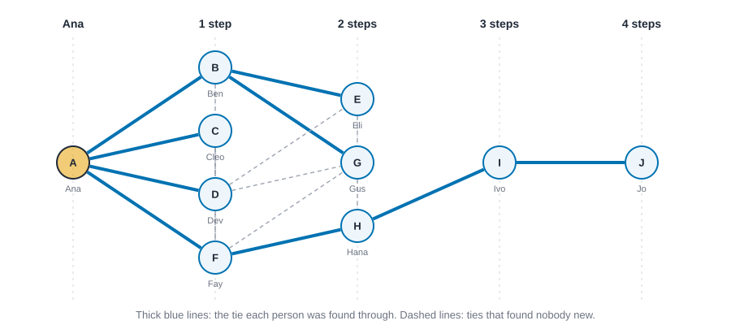{#fig-traversal-bfs-levels fig-alt="Five columns headed Ana, 1 step, 2 steps, 3 steps and 4 steps. Ana is alone in the first. Ben, Cleo, Dev and Fay are in the second; Eli, Gus and Hana in the third; Ivo in the fourth; Jo in the fifth. Thick blue lines mark the tie that found each person and dashed grey lines mark the other ties."}

### Depth-first from Ana

Now the same network with a stack. The rule: from wherever you are, step to the first friend you have not met; if there is none, back up to where you came from. The stack is simply the trail from Ana to where you stand now.

Start at Ana. Her first unmet friend is Ben, so step to Ben. Ben's first unmet friend is Dev (Ana is met), so step to Dev. Dev's first unmet friend is Cleo, then Cleo's is Fay, and Fay's is Gus. Gus's first unmet friend is Eli, so step to Eli. Eli's friends are Ben, Dev and Gus, all met: a dead end. Back up to Gus. Gus's remaining unmet friend is Hana, then Ivo, then Jo. Jo is a dead end, so back up to Ivo, to Hana, and eventually all the way to Ana. The order people were first met is Ana, Ben, Dev, Cleo, Fay, Gus, Eli, Hana, Ivo, Jo.

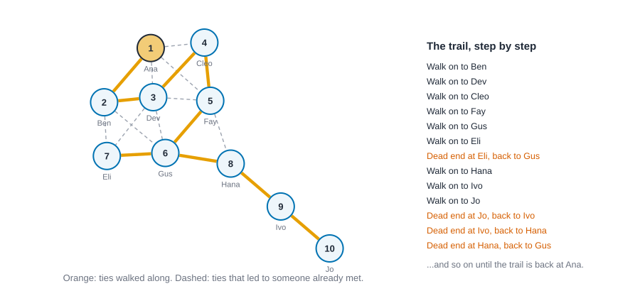{#fig-traversal-dfs-trail fig-alt="The ten-person network. Each person has a number from 1 to 10. Ana is 1, Ben 2, Dev 3, Cleo 4, Fay 5, Gus 6, Eli 7, Hana 8, Ivo 9 and Jo 10. Nine ties are drawn thick orange and the other nine are thin dashed grey. A list on the right narrates the first steps, including the places the search hits a dead end and backs up."}

Compare the two orders. Breadth-first met Jo last because Jo is farthest from Ana. Depth-first also met Jo last, but for a different reason: it happened to reach the chain at the far end of the network late, after wandering through the crowded middle. In a network this small the two orders look similar, which is why the grid in @fig-traversal-grid-shapes is worth a look. On a grid of streets the difference is dramatic: breadth-first fills in rings around the start, and depth-first snakes.

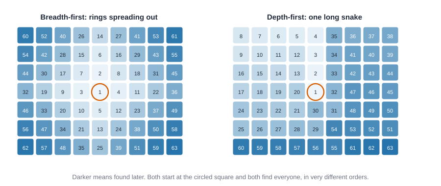{#fig-traversal-grid-shapes fig-alt="Two grids of nine columns by seven rows, each square numbered from 1 to 63 by the order of discovery and shaded from light to dark. On the left the numbers grow outward from the circled middle square in diamond-shaped rings. On the right the numbers follow one long winding path that sweeps up and across the grid before coming back for the squares it skipped."}

## Watching it happen

The next picture shows breadth-first search with its waiting line. Watch the line under the network: people join at the back and leave from the front, and the numbers in the dots say in which order each person was met. Use Pause and Next to go one turn at a time.

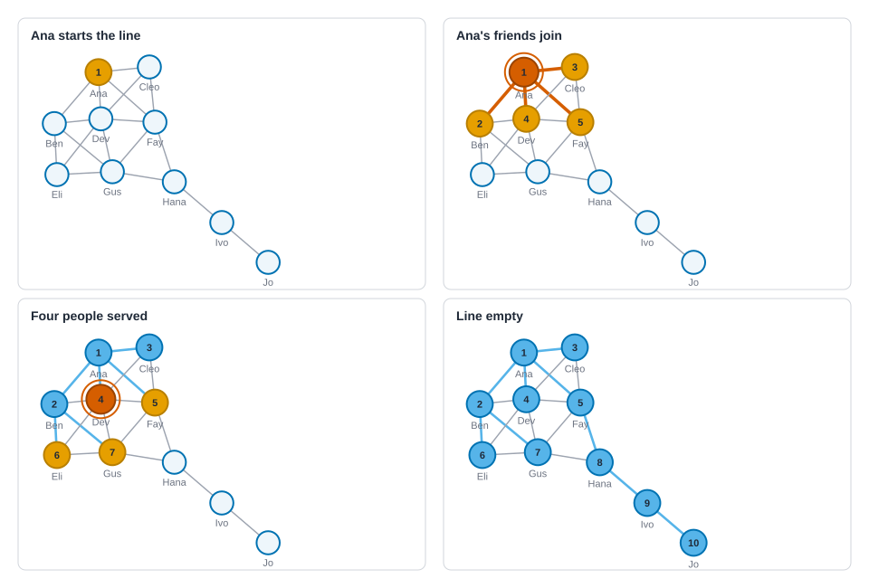{#fig-bfs-queue fig-alt="Four copies of the ten-person friendship network. First: only Ana is marked, numbered 1. Second: after Ana is served, Ben, Cleo, Dev and Fay are numbered 2 to 5 and wait in orange. Third: four people have been served and Eli, Gus and Hana have been met. Fourth: everyone is blue and numbered 1 to 10. When it plays, the colored area spreads outward from Ana, and a line of text under the network lists who is waiting and who is finished."}

Now depth-first search with its stack. This time the text under the network lists the trail from Ana to the person you are standing on. Watch how the trail grows by one person when we walk on, and shrinks by one when we hit a dead end.

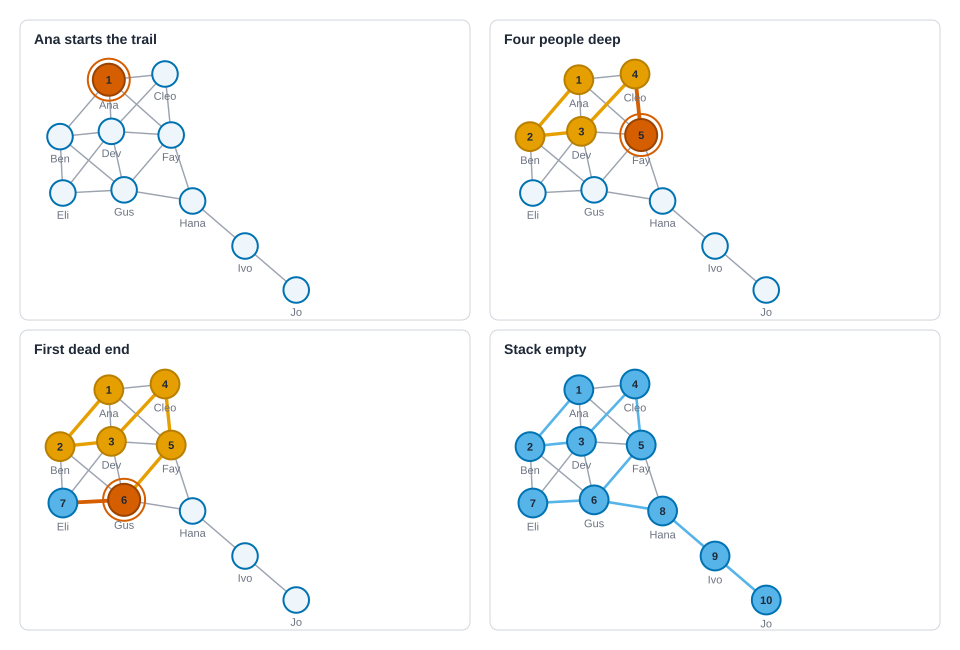{#fig-dfs-stack fig-alt="Four copies of the ten-person friendship network. First: only Ana is marked. Second: a trail of four people runs from Ana through Ben and Dev to Cleo. Third: the first dead end, at Eli, with a trail of six people behind it. Fourth: everyone is blue and numbered 1 to 10. When it plays, one orange trail winds through the network and retreats at each dead end."}

Finally, both at once. The two pictures take the same number of steps to meet everyone, but they meet people in different orders. Look for the moment they first disagree.

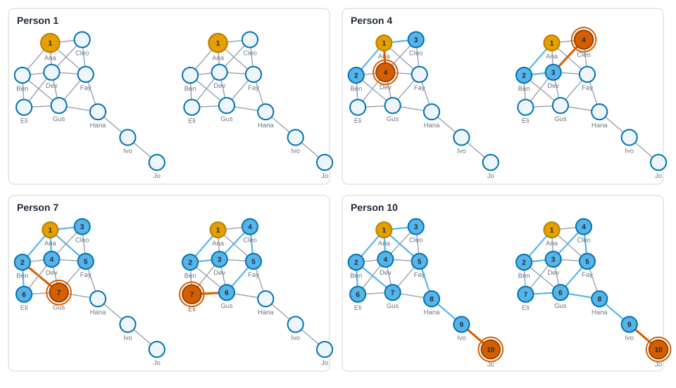{#fig-bfs-dfs-side fig-alt="Four rows of two copies of the ten-person network, breadth-first on the left of each pair and depth-first on the right. After 1 person both show only Ana. After 4 people, the left has met Ana's four friends while the right has dived down to Cleo. After 7 people the left has reached Gus and Hana and the right has reached Eli. After 10 people both have met everyone but in different orders."}

## The idea in steps

Here is the whole algorithm in plain words, with the one switch that changes it.

1. Make an empty waiting list and an empty "met" record.
2. Put the starting person on the list and mark them met.
3. Take one person off the list. For a queue, take the one at the front. For a stack, take the one on top.
4. Look at that person's friends. Each friend who is not yet met gets marked met and added to the list.
5. If the list still has people on it, go back to step 3. Otherwise, stop: everyone reachable has been met.

The same idea as short pseudocode, with each line explained:

```text
met[start] = true                    # mark the start person as met
list.add(start)                      # put the start person on the waiting list
while list is not empty:             # keep going until nobody is waiting
    person = list.take()             # front of the line (queue) or top of the pile (stack)
    for friend in friends(person):   # look at each friend, in a fixed order
        if not met[friend]:          # only if we have not met them before
            met[friend] = true       # mark them now, so nobody joins twice
            list.add(friend)         # and give them a place in the waiting list
```

::: {.callout-tip title="In plain words"}
Keep a list of people to visit. Take one, say hello to all their friends who are new to you, and put those new friends on the list. Repeat until the list is empty. If the list is a line, you get breadth-first search. If it is a pile, you get depth-first search (with one small caveat, below).
:::

There is one honest wrinkle. The loop above, with a pile, is a perfectly good search, but it does not visit people in quite the same order as the "walk on, back up" description earlier. The pile version marks everyone on the spot when they are added, so a person can be sitting under a pile of plates for a while, already marked, before anyone gets to them. The "walk on, back up" version, which is what most textbooks and most tools actually mean by depth-first search, marks people only when it arrives at them. The two find the same set of people but can differ in order. The animation and the numbers in this chapter use the trail version, with the stack being the trail itself, because it is the one with the nice properties below.

## What you get for free

A search is not only a way to find people. It leaves useful things behind, without any extra work.

**Distances.** In breadth-first search, the turn on which someone is met is their distance from the start: how many ties on the shortest route. This is the first thing most people use it for. The paths and cohesion chapter of the [SNA book](https://knapply.github.io/net-books/sna/) uses exactly these distances to define the diameter and the mean distance.

**A tree of routes.** Every person except the start was met through exactly one friend: the person being served when they were added. Record that friend, call it their **parent**, and you have drawn a tree rooted at the start. To find a shortest route from the start to anyone, follow parents backwards until you reach the start, then flip the list. @fig-traversal-free-gifts shows the table for Ana. Jo's route is Ana, Fay, Hana, Ivo, Jo, read straight off the "found by" column.

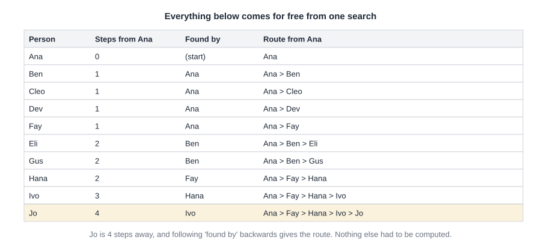{#fig-traversal-free-gifts fig-alt="A table with columns Person, Steps from Ana, Found by and Route from Ana, with ten rows in the order people were found. Ana has 0 steps. Ben, Cleo, Dev and Fay have 1 step, all found by Ana. Eli, Gus and Hana have 2 steps, found by Ben, Ben and Fay. Ivo has 3 steps found by Hana. Jo has 4 steps, found by Ivo, with route Ana to Fay to Hana to Ivo to Jo."}

**An order.** The order people are met in is itself a useful list. For breadth-first search it goes outward by distance. For depth-first search it follows the trail, and a close cousin, the order people are *finished* with (backed out of), has a beautiful use when tasks depend on each other: later chapters on directed acyclic graphs (DAGs) use it to put tasks in a workable order.

**Islands.** If you start a search from one person and it stops before everyone is met, you have found one **component**: a maximal group where everyone can reach everyone else. Start again from the first person not yet met, and you find the next island. Counting how many searches you needed counts the islands. @fig-traversal-islands shows it on twelve people.

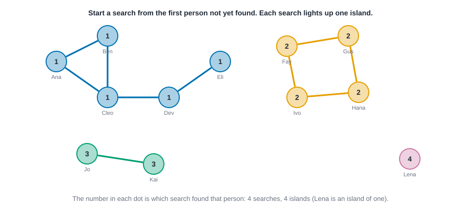{#fig-traversal-islands fig-alt="Twelve circles in four groups. Ana, Ben, Cleo, Dev and Eli form a blue group numbered 1. Fay, Gus, Hana and Ivo form an orange group numbered 2. Jo and Kai form a green group numbered 3. Lena sits alone in a purple group numbered 4."}

**Loops.** In an undirected network, if a depth-first search finds a friend who is already met and is not the person it just came from, it has found a loop: there are now two different routes between those people. Spotting that is how many programs test whether a network is a tree or has cycles.

All of this comes from the same walk. That is why the two searches are so central.

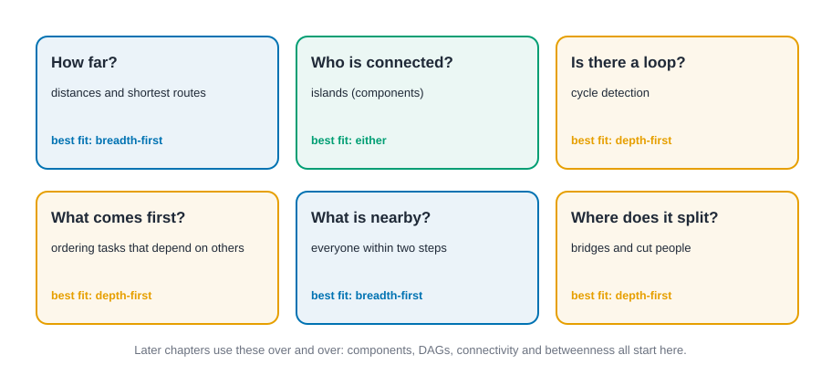{#fig-traversal-uses fig-alt="Six rounded cards in two rows of three. Blue cards for breadth-first: How far (distances and shortest routes) and What is nearby (everyone within two steps). A green card for either: Who is connected (islands). Orange cards for depth-first: Is there a loop, What comes first (ordering tasks), and Where does it split (bridges and cut people)."}

## How far is far? Searching only a few steps out

Often you do not want the whole network, just the neighbourhood. Stop the search after a fixed number of steps and you have everyone within that many steps. Because breadth-first search meets people in order of distance, "stop after $k$ steps" is simply "stop when the next person off the line is more than $k$ steps away".

From Ana in the ten-person network, the numbers of people met at each distance are 4, 3, 1 and 1, so the running totals of people within each distance, counting Ana herself, go like this:

| Steps from Ana | People met at exactly that distance | Total so far, counting Ana |
|---|---|---|
| 0 | 1 (Ana) | 1 |
| 1 | 4 (Ben, Cleo, Dev, Fay) | 5 |
| 2 | 3 (Eli, Gus, Hana) | 8 |
| 3 | 1 (Ivo) | 9 |
| 4 | 1 (Jo) | 10 |

The network is small and well connected near Ana, so half of everyone is within one step and 8 of 10 are within two. In a large social network the same table would show the numbers multiplying at first and then thinning out as the edge of the network is reached. This "everyone within $k$ steps" set is the heart of an **ego network**, the picture of one person's surroundings that the SNA book draws in its chapter on ego networks.

Stopping early is also how big-network tools stay fast: the work is only the people within $k$ steps and their ties, which can be a tiny part of a huge network.

## Following arrows: directed networks

Everything so far treated a tie as two-way. Many ties are not: who follows whom, who reports to whom, who sent a message to whom. In a **directed** network a search from a person follows arrows in their direction only. That makes three useful searches.

- **Forward:** who can Ana reach by following arrows out of her? This is the set she can influence, inform or infect.
- **Backward:** who can reach Ana, following arrows into her? This is the set that can influence her.
- **Either way:** ignore the direction and treat every arrow as a two-way tie. This tells you whether the network holds together at all, ignoring direction (a *weakly* connected network).

A small example shows why this matters. Suppose Ana tells Ben, Ben tells Cleo, and Cleo tells nobody. Searching forward from Ana finds Ben and Cleo. Searching backward from Cleo finds Ben and Ana. Searching forward from Cleo finds nobody at all. Ignoring direction, all three form one group. Which of these is "the" answer depends on the question, which is why a careful tool asks you to say which direction you mean.

## Loops, finishing order and where it splits

Depth-first search has a quiet extra ability: it can notice when the trail loops back on itself. Walk from person to person, and if you reach someone who is already on your current trail, not merely met earlier but still on the stack, you have found a loop. In the ten-person network that happens at once: Ana, Ben, Dev, and Ana is Dev's friend too, so the trail Ana, Ben, Dev closes on itself.

A second thing depth-first search records is when each person was *finished*, meaning when the search backed out of them for the last time. In our run, Eli is finished first, then Jo, Ivo, Hana, Gus, Fay, Cleo, Dev, Ben and Ana last. The order people are finished in has a surprising use. In a network of tasks where an arrow means "this must happen before that", finishing order read backwards is a valid schedule: a task is finished only after everything that depends on it is finished, so listing tasks from last finished to first finished never puts a task before something it needs. Chapter @sec-connectivity-dags uses exactly this idea.

Finally, depth-first search can find the places where a network splits. A **bridge** is a tie whose removal leaves some people unreachable from others, and a **cut person** is a person whose removal does. The trail tells you: if nobody beneath a person on the trail has any tie back above that person, that person holds the trail together. Again, the details wait for a later chapter; the point here is that the same simple walk, with a little more bookkeeping, finds them.

## What it costs, in plain words

Every person is put on the list once and taken off once. Every tie is looked at from each end, once, when the person at that end is taken off. So the total work is roughly the number of people plus twice the number of ties. Double the network and the work doubles. It does not matter whether you use a queue or a stack, because both cost the same to add to and take from.

Written with symbols, with $n$ for the number of people and $m$ for the number of ties:

$$
\text{work} \;\approx\; n + 2m, \qquad\text{which we write as } O(n + m).
$$

::: {.callout-tip title="In plain words"}
"Work" is a count of small steps: putting someone on the list, taking them off, glancing at one friend. The $n$ counts the first two (one per person) and the $2m$ counts the glances (each tie is glanced at from both ends). The "$O(n + m)$" is shorthand for "grows in step with $n + m$, ignoring small fixed factors". In the ten-person network, $n = 10$ and $m = 18$, so the search takes about $10 + 36 = 46$ small steps. A network with a million people and ten million ties takes about 21 million steps, which a modern computer finishes in a fraction of a second.
:::

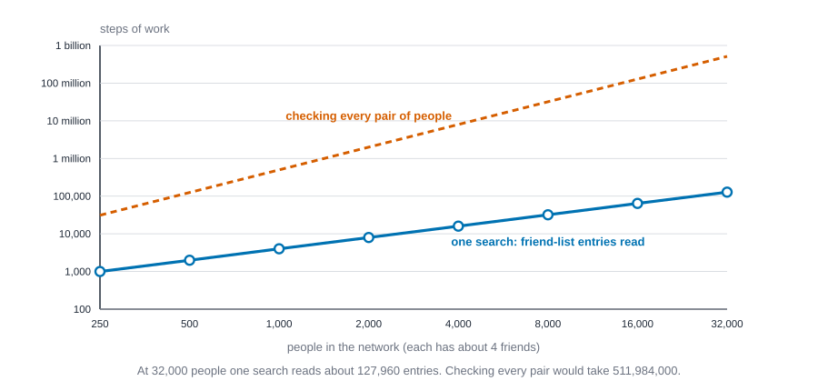{#fig-traversal-cost fig-alt="A chart with the number of people from 250 to 32,000 along the bottom on a log scale and steps of work up the side on a log scale. A solid blue line with circles rises gently from about 1,000 to about 128,000. A dashed red line rises much more steeply from about 31,000 to about 512 million."}

The chart shows the real count, not a promise: the number of friend-list entries read by one search on random networks where everyone has about four friends. The line is almost perfectly straight on a log scale with a slope of one, which is what "doubling the size doubles the work" looks like. The dashed line is what you would pay if, instead, you checked every pair of people. At 32,000 people that is about four thousand times more work.

**Memory.** The waiting list can never hold more than everyone, so memory grows in step with $n$ (plus the met record). But *how full* the list gets depends on the shape of the network. Breadth-first search in a very wide network can hold a huge ring of people at once: after a few steps in a social network, the line can contain a large share of everyone. Depth-first search holds only the current trail, which in most networks is short, but on a very long chain it can be as long as the whole network. We come back to that in "Where it goes wrong".

## At a glance

| | Breadth-first search | Depth-first search |
|---|---|---|
| **Waiting list** | Queue (first in, first out) | Stack (last in, first out) |
| **Finds people in order of** | Distance from the start | Depth along a trail |
| **Distances and shortest routes** | Yes, for free (unweighted ties) | No: the trail it takes can be very long |
| **Components (islands)** | Yes | Yes |
| **Loops** | Yes | Yes, and the natural tool |
| **Ordering dependent tasks, bridges** | Not suited | Yes (finishing order) |
| **Time** | About $n + m$ | About $n + m$ |
| **Memory** | The widest ring of people at once | The longest trail |
| **Use when** | You want distances or "who is nearby" | You want structure: loops, order, where it splits |
| **Do not use when** | Ties have different costs (use @sec-shortest-paths) | You need shortest routes |

## Which one should I use?

Ask these questions in order and stop at the first that applies.

1. **Do you need distances, shortest routes or "everyone within $k$ steps"?** Use breadth-first search.
2. **Do you need to find islands, or only whether two people are connected?** Either works. Breadth-first is a fine default.
3. **Do you need to find loops, order dependent tasks, or find bridges and cut people?** Use depth-first search.
4. **Will the search go very deep (a long chain) or very wide (a huge number of friends)?** Breadth-first can hold a very wide ring in memory, and a depth-first written with a function that calls itself can run out of room on a very long chain. Pick a version that keeps its own stack or queue and the memory is no longer a surprise.
5. **Do the ties cost different amounts?** Neither. Use the next chapter.

## Where it goes wrong

These are the mistakes that quietly produce wrong answers or slow programs.

**Forgetting who has been met.** Without the "met" record, a search in a network with a loop walks around it forever. Everyone is checked once only because we mark them. Two small variants matter: mark people when you add them to the list (the version here), not when you take them off, or the same person can join the list several times and the work balloons.

**Trusting an order that is only a choice.** Both searches ask "who is next among this person's friends?", and the network itself doesn't say. We used alphabetical order. Another tool might use the order the ties were typed in. The set of people found is the same either way, and so are the breadth-first distances, but the depth-first order, and the tree of routes, can differ. If you compare two programs on "the tree" or "the order", you must make them use the same neighbour order first. This is one of the favourite ways for two correct tools to disagree, and @sec-trust is about exactly that.

**Using breadth-first search when ties cost different amounts.** Breadth-first counts steps, not minutes or kilometres. If some ties are long and some short, the route with the fewest steps is not the cheapest. That is the subject of @sec-shortest-paths.

**Running out of room on a long chain.** The most natural way to write depth-first search is a function that calls itself for each new friend. On a very long chain (a path of a hundred thousand people), that means a hundred thousand calls waiting on each other, and many languages stop you well before that. The fix is to keep the trail yourself in a stack, as we did. Careful libraries do this for you; when you write your own, remember it.

**Directed ties.** If ties have a direction, a search should follow them only the right way. "Who can reach me" and "whom can I reach" are different searches, and a network can be perfectly connected one way and not the other. Say which you mean.

**Disconnected networks.** A single search only finds one island. If you wanted distances between all pairs, or the number of islands, you need to start again from each person not yet met. Report unreachable people as unreachable, not as distance zero or a huge number you forgot to filter out.

**Self-ties and repeated ties.** A person tied to themselves, or two ties between the same pair, do no harm to a search that keeps a "met" record, but they do inflate any count you compute from the number of ties, such as $m$. Decide up front whether they count.

## If you like proofs

::: {.callout-note collapse="true" title="Why breadth-first search finds shortest routes"}
This box is optional. If you would rather trust it, skip to the code. The claim: the turn on which breadth-first search meets someone is their distance from the start.

Say a person is at distance $d$ if the shortest route to them has $d$ ties. Here is the key observation, in three steps.

1. *The line is sorted by distance.* At every moment, the people in the line have distances that never go down from front to back, and the last person's distance is at most one more than the first person's. At the start the line holds only the start, at distance 0, so this is true.
2. *It stays true.* Take the person at the front, at distance $d$. Their newly met friends are at distance at most $d + 1$ (one tie further), and they join at the back, after people at distance $d$ or $d + 1$. So the line is still sorted, with a spread of at most one.
3. *Nobody is met too late or too early.* Suppose a person is at distance $d + 1$. Their shortest route goes through a friend at distance $d$, who is met earlier. By step 1, everyone at distance $d$ is served before anyone at distance $d + 1$, so when that friend is served, our person is met if nobody had met them yet, and nobody could have met them sooner because that would give a shorter route.

So everyone is met on the turn that equals their distance, and following parents backward gives a route of exactly that length. Depth-first search has no such sorted line, which is why it cannot promise shortest routes.
:::

## Code

All the code blocks in this chapter use the same small network and the same alphabetical order, so the output is the same everywhere. The tab text is a placeholder until the library interface is final: each line says exactly what the code will compute and print.

Breadth-first from Ana. It will print each person's distance from Ana and the order in which they are met; look for Jo at distance 4 and the order Ana, Ben, Cleo, Dev, Fay, Eli, Gus, Hana, Ivo, Jo.

::: {.panel-tabset group="language"}

## R

```r
# TODO(code, R): run breadth-first search from Ana on the ten-person network with neighbours in index order, and print a table of each person's distance from Ana and the order in which they were met
```

## Python

```python
# TODO(code, Python): run breadth-first search from Ana on the ten-person network with neighbours in index order, and print a table of each person's distance from Ana and the order in which they were met
```

## Rust

```rust
// TODO(code, Rust): run breadth-first search from Ana on the ten-person network with neighbours in index order, and print a table of each person's distance from Ana and the order in which they were met
```

:::

::: {.code-output}
```text
TODO(output): one line per person with name, distance from Ana (0 to 4) and position in the order met (1 to 10)
```
:::

Reading the result: the distances match the columns of @fig-traversal-bfs-levels, and the order is the order of the table above.

Depth-first from Ana. It will print the order people are first met and the tree edges walked; look for Ana, Ben, Dev, Cleo, Fay, Gus, Eli, Hana, Ivo, Jo.

::: {.panel-tabset group="language"}

## R

```r
# TODO(code, R): run depth-first search from Ana on the ten-person network with neighbours in index order, and print the order in which people were first met and the nine tree ties as pairs of names
```

## Python

```python
# TODO(code, Python): run depth-first search from Ana on the ten-person network with neighbours in index order, and print the order in which people were first met and the nine tree ties as pairs of names
```

## Rust

```rust
// TODO(code, Rust): run depth-first search from Ana on the ten-person network with neighbours in index order, and print the order in which people were first met and the nine tree ties as pairs of names
```

:::

::: {.code-output}
```text
TODO(output): the ten names in depth-first order, then the nine (parent, child) pairs
```
:::

Reading the result: the order is the one in @fig-traversal-dfs-trail, and the nine pairs are the orange ties.

Shortest routes from the tree. It will follow parents backwards from Jo to Ana and print the route; look for Ana, Fay, Hana, Ivo, Jo.

::: {.panel-tabset group="language"}

## R

```r
# TODO(code, R): from the breadth-first parents, trace the route from Ana to Jo and print it as four ties and the total number of steps
```

## Python

```python
# TODO(code, Python): from the breadth-first parents, trace the route from Ana to Jo and print it as four ties and the total number of steps
```

## Rust

```rust
// TODO(code, Rust): from the breadth-first parents, trace the route from Ana to Jo and print it as four ties and the total number of steps
```

:::

::: {.code-output}
```text
TODO(output): the route Ana, Fay, Hana, Ivo, Jo and its length, 4
```
:::

Reading the result: this is the "found by" column of @fig-traversal-free-gifts read from the bottom row up.

Counting islands. It will run repeated searches on the twelve-person network of @fig-traversal-islands and print the island number of each person; look for four islands.

::: {.panel-tabset group="language"}

## R

```r
# TODO(code, R): find the connected components of the twelve-person network from the islands figure and print each person's component number and the number of components
```

## Python

```python
# TODO(code, Python): find the connected components of the twelve-person network from the islands figure and print each person's component number and the number of components
```

## Rust

```rust
// TODO(code, Rust): find the connected components of the twelve-person network from the islands figure and print each person's component number and the number of components
```

:::

::: {.code-output}
```text
TODO(output): each of the twelve people with a component number from 1 to 4, then "4 components"
```
:::

Reading the result: Ana, Ben, Cleo, Dev and Eli share a number, Fay, Gus, Hana and Ivo share another, Jo and Kai a third, and Lena is alone.

Counting the work. It will time a search on random networks of 1,000, 10,000 and 100,000 people with about four friends each and print the number of friend-list entries read; look for the count growing by about ten each time.

::: {.panel-tabset group="language"}

## R

```r
# TODO(code, R): build random networks of 1,000, 10,000 and 100,000 people with mean degree 4, run one breadth-first search from person 1 on each, and print the number of people reached and the number of friend-list entries read
```

## Python

```python
# TODO(code, Python): build random networks of 1,000, 10,000 and 100,000 people with mean degree 4, run one breadth-first search from person 1 on each, and print the number of people reached and the number of friend-list entries read
```

## Rust

```rust
// TODO(code, Rust): build random networks of 1,000, 10,000 and 100,000 people with mean degree 4, run one breadth-first search from person 1 on each, and print the number of people reached and the number of friend-list entries read
```

:::

::: {.code-output}
```text
TODO(output): three lines with n, people reached and entries read, each about ten times the one before
```
:::

Reading the result: the counts grow in step with the network, matching the straight line in @fig-traversal-cost.

Everyone within two steps. It will run breadth-first search from Ana but stop after distance 2, and print the people found at each distance; look for four at distance 1 and three at distance 2.

::: {.panel-tabset group="language"}

## R

```r
# TODO(code, R): run breadth-first search from Ana on the ten-person network, stopping after distance 2, and print the names found at distance 1 and at distance 2
```

## Python

```python
# TODO(code, Python): run breadth-first search from Ana on the ten-person network, stopping after distance 2, and print the names found at distance 1 and at distance 2
```

## Rust

```rust
// TODO(code, Rust): run breadth-first search from Ana on the ten-person network, stopping after distance 2, and print the names found at distance 1 and at distance 2
```

:::

::: {.code-output}
```text
TODO(output): distance 1: Ben, Cleo, Dev, Fay; distance 2: Eli, Gus, Hana
```
:::

Reading the result: seven people, which matches the running total in the table in the section on stopping early, minus Ana herself.

Following arrows. It will build the three-person directed network (Ana to Ben, Ben to Cleo), search forward from Ana, backward from Cleo and in either direction, and print the three sets; look for Ben and Cleo, Ben and Ana, and all three.

::: {.panel-tabset group="language"}

## R

```r
# TODO(code, R): build the directed network Ana to Ben and Ben to Cleo, run breadth-first search forward from Ana, backward from Cleo and ignoring direction from Ana, and print the people reached by each
```

## Python

```python
# TODO(code, Python): build the directed network Ana to Ben and Ben to Cleo, run breadth-first search forward from Ana, backward from Cleo and ignoring direction from Ana, and print the people reached by each
```

## Rust

```rust
// TODO(code, Rust): build the directed network Ana to Ben and Ben to Cleo, run breadth-first search forward from Ana, backward from Cleo and ignoring direction from Ana, and print the people reached by each
```

:::

::: {.code-output}
```text
TODO(output): forward from Ana: Ben, Cleo; backward from Cleo: Ben, Ana; ignoring direction: Ben, Cleo
```
:::

Reading the result: the three searches answer three different questions on the same three ties.

## Exercises

1. **By hand.** Run breadth-first search from Jo on the ten-person network, taking friends in alphabetical order. Write the table (turn, taken, newly met, line). In what order are people met, and what is Ana's distance from Jo?
2. **By hand.** Run depth-first search from Jo with the trail method. In what order are people first met? How many times does the search have to back up?
3. **Think it through.** Why does marking someone as met *when they are added* to the list, rather than when they are taken off, keep the work low? What could happen otherwise on the ten-person network?
4. **Think it through.** A network has 50 people split into three islands. You run breadth-first search once from one person and it reaches 20 people. What do you know about the other 30? How many more searches do you need, at most, to find all the islands?
5. **Coding.** Write a function that, given a network and a start person, returns every person within two steps (not counting the start). Test it on the ten-person network from Ana and check it against @fig-traversal-bfs-levels.
6. **Interpretation.** A colleague says "I ran depth-first search on our network and the first person it found after Ana was Zoe, so Zoe must be Ana's closest contact." Is that a good conclusion? What would you run instead?

::: {.callout-note collapse="true"}
## Answers

1. From Jo: Jo is alone, so turn 1 takes Jo and meets Ivo. Turn 2 takes Ivo and meets Hana. Turn 3 takes Hana and meets Fay and Gus. Turn 4 takes Fay and meets Ana, Cleo and Dev. Turn 5 takes Gus and meets Ben and Eli. Everyone left (Ana, Cleo, Dev, Ben, Eli) has no new friends to meet. The order met is Jo, Ivo, Hana, Fay, Gus, Ana, Cleo, Dev, Ben, Eli, and Ana's distance from Jo is 4, the same as Jo's from Ana, as it must be in an undirected network.
2. From Jo: Jo, Ivo, Hana, Fay, Ana, Ben, Dev, Cleo (Dev's first unmet friend after Ana and Ben), then Eli, then Gus. The order is Jo, Ivo, Hana, Fay, Ana, Ben, Dev, Cleo, Eli, Gus. Counting the dead ends, the search backs up once for each person except Jo (each person is left exactly once when it finishes), so nine backward steps in total, although several happen in a row at the end.
3. If someone is marked only when taken off, they can be added by several friends before their turn comes. On the ten-person network, Dev is a friend of Ana, Ben, Cleo, Eli, Fay and Gus, so Dev could join the line up to six times, and each copy would later be taken off and have all its friends checked. Marking at the moment of adding means each person joins exactly once, so the work stays at about $n + 2m$.
4. You know nothing about the other 30 except that none of them is connected to anyone among the first 20. They form the other two islands, possibly one or both of them containing a single person. At most two more searches are needed: one from any person not yet met, and then one from any person still not met after that.
5. Run breadth-first search but stop expanding once you reach distance 2. From Ana that returns Ben, Cleo, Dev, Fay (distance 1) and Eli, Gus, Hana (distance 2), seven people, which matches the first three columns of the figure. This "everyone within k steps" idea is the heart of an ego network.
6. No. Depth-first search takes the first friend in whatever order the tool lists them, then goes deep. Zoe was first only because of the neighbour order, not because of closeness. For the closest contacts, run breadth-first search: the people met on turn 1 are the ones one tie away, and with weighted ties, use a shortest-path algorithm from @sec-shortest-paths.
:::

## Summary

::: {.callout-tip appearance="simple"}
Breadth-first search and depth-first search both walk a network one person at a time, keeping a list of people still to visit and a record of who has been met. Keep the list as a queue and you get breadth-first search: it spreads outward by distance and leaves behind distances, shortest routes and a tree. Keep it as a stack and you get depth-first search: it dives along trails and is the natural tool for loops, ordering and finding where a network splits. Either one does work in proportion to the number of people plus ties, so doubling the network doubles the work. Take care with the met record, the neighbour order and very long chains. One-line takeaway: a search is a walk plus a waiting list, and the shape of the waiting list decides what you learn.
:::

## Further reading

The breadth-first idea goes back to a maze-solving paper by @moore1959shortest, and its use for shortest routes is standard in every textbook, for example @cormen2022introduction and @sedgewick2011algorithms. Depth-first search was developed into a general tool for connected pieces, loops and splits by @tarjan1972depth and @hopcroft1973algorithm; the second is a good place to see how much one simple walk can do. For the way these searches appear in network science, with plenty of pictures, see the paths and cohesion chapter of the [SNA book](https://knapply.github.io/net-books/sna/). The next chapter, @sec-shortest-paths, replaces "fewest steps" with "least cost", and the queue with a smarter waiting list.
