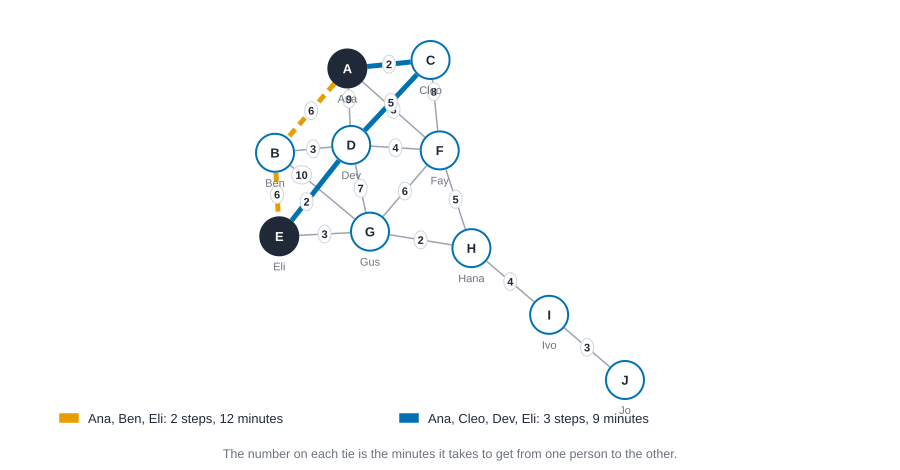
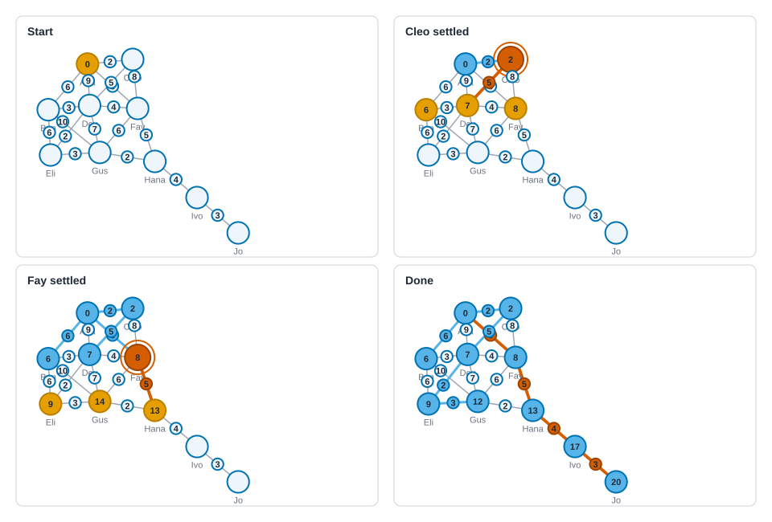
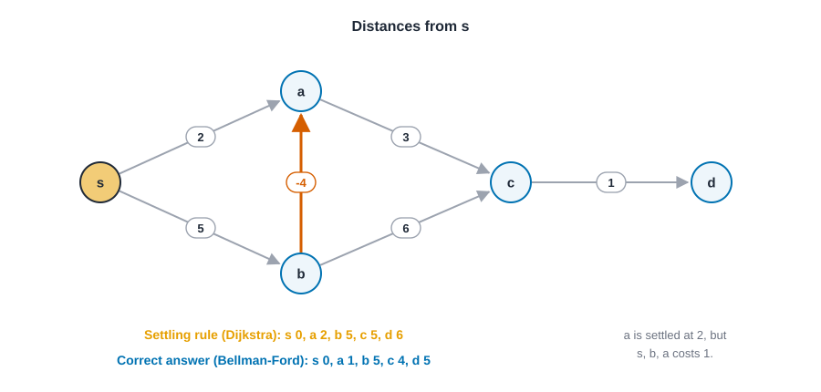
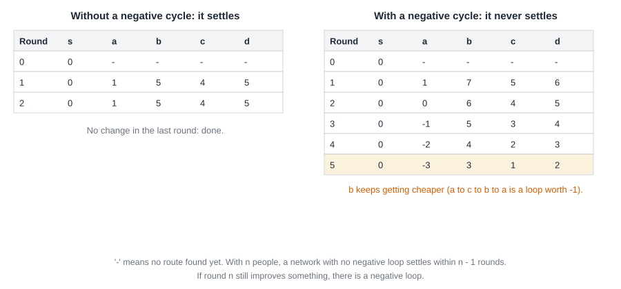
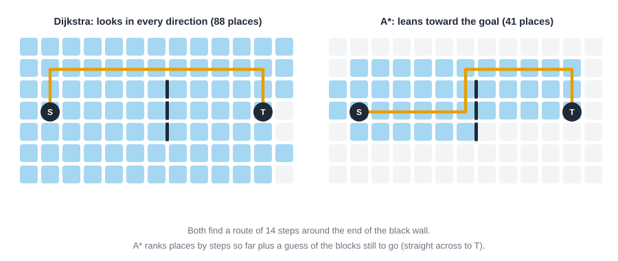
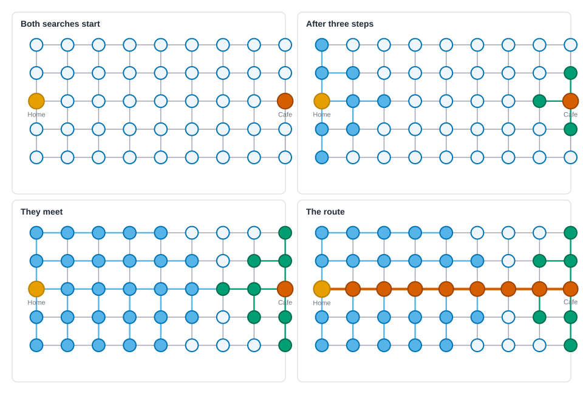
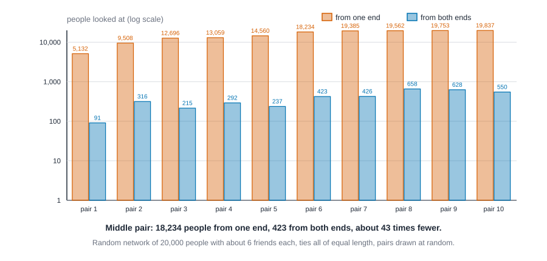
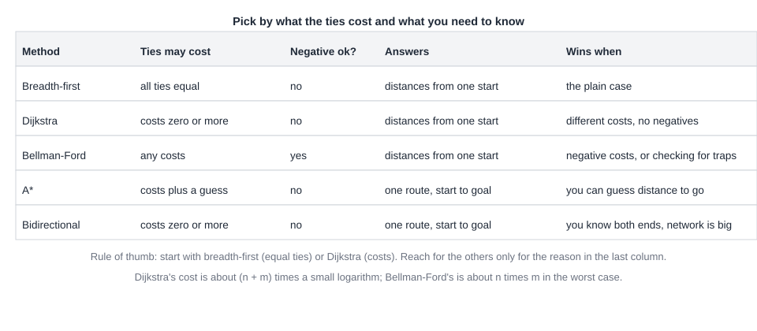

# Shortest paths {#sec-shortest-paths}

::: {.callout-note appearance="simple"}
## Prerequisites
@sec-traversal (breadth-first search and its waiting line) and @sec-building-blocks (a heap, which is a waiting list that always hands you the smallest item first).
:::

::: {.callout-note title="The short version"}
Sometimes the best route is not the one with the fewest steps, because some ties cost more than others: a long drive, a slow handoff, a weak relationship. Dijkstra's algorithm finds the cheapest route by always settling the nearest person not yet settled, and it is correct as long as no tie has a negative cost. Bellman-Ford handles negative costs too, at the price of more work. A* speeds up a search for one route by guessing how far is left, and searching from both ends at once makes the same search touch far fewer people. Each one is a small change to the waiting-list idea from the last chapter.
:::

::: {.callout-note title="Why you might care"}
Every satnav, every "fastest introduction" tool, every supply-chain routing report is one of these algorithms underneath. And in network analysis, distance-based measures such as closeness and betweenness are built from shortest paths, so a mistake here (for instance, counting steps when the ties are meant to carry costs) flows into everything above it.
:::

## What you'll be able to do

By the end of the chapter you should be able to find the cheapest route through a small network by hand, explain why settling the nearest person first is safe, say what goes wrong when a cost is negative and what to use instead, and choose among the four methods for a given job. You will also know the quiet mistakes that give plausible but wrong distances: treating a strength as a distance, forgetting about unreachable people, and using a guess that is too optimistic.

## A story first: running errands

You need to get from home to the pharmacy. A map shows five different ways to go. One is only two streets long, but it crosses a bridge that is always jammed. Another is four streets long and takes half the time. The route with the fewest turns is not the quickest, because the streets are not all alike. Some cost more time than others.

That is the whole problem of this chapter. Every tie gets a number, its **cost** (also called its **weight** or **length**): minutes of travel, dollars of shipping, hours of delay. The cost of a route is the sum of the costs of the ties along it. A **shortest path** is a route with the smallest total cost, even if it uses more ties. Breadth-first search, from the last chapter, finds routes with the fewest ties, which is the same thing only when all costs are equal.

## The cheapest route, by hand

We reuse the ten-person friendship network, now with a number on each tie: the minutes it takes to get from one friend's place to the other's. @fig-sp-hops-vs-minutes shows it.

{#fig-sp-hops-vs-minutes fig-alt="The ten-person network with the minutes written on each tie. A dashed orange route runs Ana, Ben, Eli and is labeled 2 steps, 12 minutes. A solid blue route runs Ana, Cleo, Dev, Eli and is labeled 3 steps, 9 minutes."}

Look at the route from Ana to Eli. Going Ana, Ben, Eli has the fewest steps (2) but takes 6 + 6 = 12 minutes. Going Ana, Cleo, Dev, Eli takes 3 steps but only 2 + 5 + 2 = 9 minutes. Breadth-first search would pick the first, because it counts ties and not minutes.

Here is how to find the cheapest route from Ana to everyone, in the way Edsger Dijkstra proposed in 1959 [@dijkstra1959note]. Give everyone a **guess** of how many minutes they are from Ana. At the start, Ana's guess is 0 and everyone else has no guess yet. Then repeat this:

- Among the people not yet **settled**, pick the one with the smallest guess. Their guess is now final: that person is settled.
- Look at each of that person's friends who are not yet settled. If going through the person gives the friend a smaller total than the friend's current guess, update the friend's guess.

Do this until everyone is settled. @fig-sp-dijkstra-table is the whole run on our network.

{#fig-sp-dijkstra-table fig-alt="A table of ten turns. Turn 1 settles Ana at 0 and sets guesses for Ben 6, Cleo 2, Dev 9 and Fay 8. Turn 2 settles Cleo at 2 and improves Dev from 9 to 7. Turn 3 settles Ben at 6. Turn 4 settles Dev at 7 and improves Eli to 9. Later turns settle Fay at 8, Eli at 9, Gus at 12, Hana at 13, Ivo at 17 and Jo at 20."}

Walk through the first few rows with the table beside you.

1. **Ana is settled at 0.** Her friends get guesses from their direct ties: Ben 6, Cleo 2, Dev 9, Fay 8.
2. **Cleo has the smallest guess (2), so she is settled.** From Cleo, Dev would cost 2 + 5 = 7, which beats Dev's guess of 9, so Dev's guess drops to 7. Fay through Cleo would cost 2 + 8 = 10, worse than 8, so Fay stays at 8.
3. **Ben (6) is next.** Dev through Ben would be 9, worse than 7, so no change. But Ben's other friends are new: Eli 12 and Gus 16.
4. **Dev (7) is settled.** Eli through Dev costs 7 + 2 = 9, improving 12. Gus through Dev costs 14, improving 16.

Keep going and everyone is settled in the order Ana, Cleo, Ben, Dev, Fay, Eli, Gus, Hana, Ivo, Jo. Jo ends at 20 minutes, reached through Ana, Fay, Hana, Ivo, Jo. Two things are worth noticing. First, Dev's guess changed from 9 to 7 before he was settled, so guesses are only promises until the person is settled. Second, the person with the smallest guess is always safe to settle, and the next section explains why.

## Watching it happen

The waiting list lives in the text under the network: the people who have a guess but are not settled yet, smallest first. Orange dots are waiting with a guess inside, blue dots are settled with their final minutes inside. The small dots on the ties carry the minutes. Watch the guess on Dev drop from 9 to 7.

{#fig-dijkstra-queue fig-alt="Four copies of the ten-person network with a small numbered dot on every tie. First: only Ana is marked, with 0. Second: Ana and Cleo are settled and Ben, Dev and Fay carry guesses. Third: Fay is settled with 8 and Eli, Gus and Hana carry guesses. Fourth: everyone is settled with final minutes, the largest being Jo at 20. When it plays, the blue area grows outward from Ana in order of minutes."}

## The idea in steps

1. Give every person a guess of infinity (no route known yet), except the start, who gets 0.
2. Keep a waiting list of people who have a guess, always able to hand you the smallest guess first.
3. Take the person with the smallest guess off the list. Their guess is final: they are settled.
4. For each friend not yet settled, work out the cost of reaching the friend through this person. If it beats the friend's guess, update the guess and put the friend on the list (or move them up).
5. Repeat from step 3 until the list is empty.

As short pseudocode:

```text
guess[everyone] = infinity; guess[start] = 0       # no routes known yet, except the start itself
waiting.add(start, 0)                              # a list that gives back the smallest guess first
while waiting is not empty:                        # until nobody is left to settle
    person = waiting.take_smallest()               # the nearest person not yet settled
    if person is settled: continue                 # skip stale entries (a person may be listed twice)
    mark person settled                            # their guess is now final
    for (friend, cost) in friends(person):         # each tie out of this person
        if guess[person] + cost < guess[friend]:   # a cheaper way to reach the friend
            guess[friend] = guess[person] + cost   # improve the guess
            parent[friend] = person                # remember how we got there
            waiting.add(friend, guess[friend])     # (re)list the friend with the new guess
```

::: {.callout-tip title="In plain words"}
Keep a best guess for everyone. Repeatedly take the nearest person you have not settled, lock in their guess, and see whether going through them gives any friend a better guess. It is breadth-first search with two changes: the waiting list is ordered by guess instead of by arrival, and a person's guess can improve while they wait. If every cost is 1, it is exactly breadth-first search.
:::

The "waiting list that gives back the smallest first" is a **priority queue**, and the usual way to build one is a **heap**, from @sec-building-blocks. A heap keeps its items partly sorted so that adding one and taking the smallest each cost only about as much as a handful of comparisons, even with millions of items. Fancier heaps exist, such as the Fibonacci heap [@fredman1987fibonacci], which improve the worst case on paper, but a plain binary heap is what most real tools use.

## Why settling the nearest person is safe

The fence picture in @fig-sp-fence is the whole argument. Settled people are inside. Waiting people, with guesses, form a ring just outside. Everyone else is beyond that ring. Any route from the start to someone outside has to cross the waiting ring somewhere, and the person where it crosses already has a guess that is at least as large as the smallest guess in the ring. Since no tie has a negative cost, the rest of that route can only add to the cost. So no route through the outside can beat the smallest guess in the ring, and that person's guess is the true distance.

{#fig-sp-fence fig-alt="Three nested circles. The innermost, in blue, holds settled people around a start marked 0. A middle ring in orange holds the waiting people. The outer dashed circle holds people not yet met. A legend on the right explains the three groups."}

The phrase "since no tie has a negative cost" is where this argument can break. We turn to that now.

## When a tie has a negative cost

Negative costs are not exotic. A tie can mean a discount, a refund, a favour owed, or a gain. In a currency exchange network, taking the logarithm of exchange rates turns multiplications into additions and makes some "costs" negative. In a team handoff network, a shortcut may save time that a previous step spent.

Here is the problem in miniature, in @fig-sp-negative. Starting at $s$, the cheapest guess for $a$ is 2, from the tie $s$ to $a$. Dijkstra's rule settles $a$ at 2 because it is the smallest guess. But the route $s$ to $b$ (5) and then $b$ to $a$ ($-4$) costs just 1. The settled value was wrong, because the fence argument assumed that nothing outside could pull the total back down, and a negative tie does exactly that.

{#fig-sp-negative fig-alt="A directed network of five people s, a, b, c, d. Ties: s to a costs 2, s to b costs 5, b to a costs -4 (drawn in red), a to c costs 3, b to c costs 6 and c to d costs 1. Below it, the settling rule gives distances [0, 2, 5, 5, 6] and the correct answer is [0, 1, 5, 4, 5]."}

The fix is to never call a guess final. **Bellman-Ford** [@bellman1958routing; @ford1956network] works in rounds. In each round, try every tie once: if going along the tie improves the guess at its far end, update it. Repeat. After the first round, every guess is at least as good as the best route with one tie; after the second, as good as the best route with at most two; and so on. A route never needs more than $n - 1$ ties (a person never appears twice on a cheapest route), so after $n - 1$ rounds nothing can improve any more.

{#fig-sp-rounds fig-alt="Two tables of distances for five people s, a, b, c, d, one row per round. The left table fills in over three rounds and then stops changing. In the right table, the numbers for a, b and c keep decreasing in every round shown, with the later rows shaded."}

That last sentence is also how Bellman-Ford spots a trap. If a loop of ties adds up to less than zero, a **negative cycle**, then going around it again always makes the total smaller, and no cheapest route exists. In the right-hand table of @fig-sp-rounds the loop $a$, $c$, $b$, $a$ costs $3 + 2 - 6 = -1$ each lap, so the numbers keep falling. If round $n$ still improves anything, there is a negative cycle, and the honest answer is "no shortest path", not a number.

::: {.callout-note title="Negative costs in an undirected network"}
A negative tie that can be walked in both directions is itself a negative cycle: step along it and back and you are $2 \times |\text{cost}|$ better off, forever. Negative costs only make sense for directed ties, one way at a time.
:::

## Searching with a guess: A*

Dijkstra looks equally in every direction, like a ripple. If you only want the route to one particular person, that is wasteful: you are settling people in the opposite direction of where you are going. **A\*** (read "A star") [@hart1968formal] adds one idea. For each person, you supply an optimistic **guess of how much is left** to the goal: for streets, the straight-line distance is a classic. Then you settle the waiting person with the smallest value of "cost so far plus guess of what is left". People who are heading toward the goal look better than those who are heading away.

{#fig-sp-astar-explored fig-alt="Two grids of thirteen columns by seven rows with a short vertical black wall in the middle, covering the third to fifth rows. A start S sits in the middle row near the left edge and a target T in the middle row near the right edge. On the left, 88 squares are shaded, almost the whole grid. On the right, 41 squares are shaded, a narrower band between S and T. An orange route runs from S, bends around the end of the wall and reaches T, in both."}

The picture runs both on a grid of streets with a short wall. Both find a route of 14 steps, but A* looked at 41 places and Dijkstra at 88. The saving depends entirely on how good the guess is. With a useless guess (always 0) A* becomes Dijkstra. With a perfect guess it walks straight to the goal. The guess must also never be **too optimistic in the wrong direction**: it must never claim more is left than really is. A guess that never overestimates is called **admissible**, and with one, the route A* returns is a true shortest route. With a guess that overestimates, A* may return a route that is not the shortest, quickly.

A* needs a meaningful guess, so it fits maps, grids and game worlds, where distance has a geometry. For most social networks there is no natural "straight line", and A* has nothing to lean on.

## Searching from both ends

If you know both people, search from both. Start one breadth-first (or Dijkstra) search at each end and grow them toward each other. When they meet, join the two halves. The point is how fast the number of people grows with each step out. In a network where everyone has about six friends, one step out reaches about 6 people, two steps about 36, three about 216. A route of length 6 found from one end touches on the order of $6^6 \approx 47{,}000$ people. Searching from both ends, each search only has to go 3 steps, touching about $2 \times 216 = 432$ people. The cost of one big ball becomes the cost of two small ones.

Watch it on a grid of streets. One search spreads out from Home (in blue) and one from Cafe (in green). Each turn, the side with the shorter frontier takes one more step out.

{#fig-bidirectional-meet fig-alt="Four copies of a nine by five grid. First: only Home on the left and Cafe on the right are marked. Second: after three steps, a small blue patch around Home and a green one around Cafe. Third: the blue and green patches have just touched in the middle. Fourth: the route from Home to Cafe is drawn as a thick red line across the grid. When it plays, the two patches grow toward each other until they meet."}

On a flat grid the saving is modest, because the number of places reached only grows with the square of the distance. In networks that fan out, the saving is large, as @fig-sp-ball-sizes shows on a random network of 20,000 people.

{#fig-sp-ball-sizes fig-alt="A bar chart on a log scale with ten pairs of bars. Each pair has a red bar for a one-sided search and a blue bar, much shorter, for a two-sided search. The one-sided bars run from about 5,132 to 19,837 people; the two-sided bars run from about 91 to 658."}

Bidirectional search in a network with different costs is a bit subtler: it must keep going until it can prove that no cheaper meeting point exists, not just stop when the two searches first touch. The library routines handle that for you. What you need to know is that it requires you to know both ends, and that in directed networks the backward search has to follow arrows in reverse.

## Many starts, many goals

So far we asked for one start and, usually, every goal at once. Real questions come in a few shapes, and each has a standard answer.

- **One start, one goal.** Run Dijkstra and stop the moment the goal is settled. Everyone still waiting on the list is simply never examined. This stopping rule is safe for the same reason the main idea is: once the goal is the nearest unsettled person, no later route can beat it.
- **One start, everyone.** Run Dijkstra to the end. You get the whole tree of cheapest routes, and every goal is a walk up the parent trail.
- **Everyone to everyone.** Run a one-start search from each person in turn. With 10 people that is 10 searches; with a million people it is a million, which is usually far too much, so for large networks people ask smaller questions (the cheapest routes among a few hundred landmarks, say).
- **Many starts, one goal.** Flip every tie around and run one search from the goal. The cheapest route *to* the goal from anyone is the cheapest route *from* the goal in the flipped network. In a network where every tie is two-way this changes nothing at all.

The first bullet is why a map app answers quickly even for a huge country: it never settles the whole country, only the part around the trip, and the guess and two-ended tricks later in this chapter make that part smaller still.

## Ties, ties everywhere: when two routes cost the same

Sometimes two different routes cost exactly the same. From Ana to Dev the route through Cleo costs 2 + 5 = 7 minutes and no other route matches it, so there is one answer. In other networks two routes may tie exactly, and the algorithm has to pick one. Different careful tools pick differently: one keeps the first route it found, another keeps the last, another prefers fewer steps. All of them are right about the *cost*, and they may disagree about the *route*. That is the same lesson as the trust chapter: when a number depends only on the question (the cost), tools agree, and when it depends on a choice the question left open (which tied route), they may not. If you need the same route every time, decide a rule, such as "on a tie, prefer the person who sits earlier in the list", and write it down.

## Costs that are not minutes

Everything here works for any cost you can add up along a route, as long as no tie has a negative cost for Dijkstra. A few ways the "minutes" change:

| What the cost means | A route's cost is | Cheapest route means |
|---|---|---|
| Travel time | Minutes added up | Fastest trip |
| Money | Fares added up | Cheapest trip |
| Distrust | Distrust added up | Most trusted path (low total distrust) |
| Chance of passing a message on | **Multiply** the chances | Most likely path |

The last row looks different, but there is a classic trick. A chance of passing something on, such as 0.9 for each hop, is *multiplied* along a route. Take the negative logarithm of each chance (a number $-\log p$ that is zero for a certain hop and larger for a shakier one) and multiplying chances becomes adding costs. The route with the smallest total cost is the route with the largest product of chances, and Dijkstra applies. Because chances are at most 1, every cost $-\log p$ is zero or more, so the no-negative-ties rule is satisfied automatically.

## Where the real work goes: the waiting list

Dijkstra's speed depends on how the waiting list is kept. Scanning the whole list for the nearest person each time is simple, and with $n$ people that costs about $n$ looks per pick, so about $n^2$ in total. Keeping the list as a **priority queue** (a structure that always hands back its smallest entry quickly) makes each pick and each update take about $\log n$ steps, so the total is about $(n + m) \log n$ for $m$ ties. The animation shows the list; the choice of structure only changes how fast the list is kept, never what it holds. A road network with millions of intersections is exactly where the faster list pays for itself.

## What it costs, in plain words

Dijkstra settles each person once, and each tie is looked at once from each end. The extra cost over breadth-first search is the waiting list: adding a person and taking the smallest each cost a few comparisons that grow slowly with the size of the list. So the work is a bit more than doubling when you double the network, and the "bit more" is a small logarithm.

With $n$ people, $m$ ties, and a binary heap:

$$
\text{work} \;\approx\; (n + m)\,\log_2 n, \qquad\text{written } O\big((n + m)\log n\big).
$$

::: {.callout-tip title="In plain words"}
$n + m$ is the same count as for breadth-first search: one visit per person and one glance per tie end. The $\log_2 n$ is the price of the sorted waiting list: for a list of $n$ people, "log base 2 of $n$" is about how many times you can halve $n$ before you reach 1, and it is about how many comparisons a heap needs per insertion. For the ten-person network that factor is about 3. For a million people it is about 20, so a million people and ten million ties cost on the order of $(1{,}000{,}000 + 10{,}000{,}000) \times 20 = 220$ million small steps: a few seconds on a modern computer, not hours.
:::

Bellman-Ford pays for never trusting a guess. In each of up to $n - 1$ rounds it tries every one of the $m$ ties, so the work is about $n \times m$ in the worst case: for a million people and ten million ties, ten trillion steps, which is the difference between seconds and days. In practice it usually stops long before $n - 1$ rounds (in the example in @fig-sp-rounds it stopped after 2), and clever versions skip ties that cannot have changed, as surveyed by @cherkassky1996shortest. But the worst case is real, so use Bellman-Ford when you need negative costs and not by default.

A* costs the same as Dijkstra in the worst case and much less with a good guess. Bidirectional search costs about two searches of half the radius, which in a fanning network is a few hundred times less work than one search of the full radius.

Memory is the same for all of them: a guess and a parent for each person, plus the waiting list.

## At a glance

{#fig-sp-which-wins fig-alt="A table with five rows: breadth-first, Dijkstra, Bellman-Ford, A star and bidirectional. Columns give what the ties may cost, whether negative costs are allowed (only Bellman-Ford), what each answers (distances from one start, or one route from start to goal), and when it wins."}

| | Breadth-first | Dijkstra | Bellman-Ford | A* | Bidirectional |
|---|---|---|---|---|---|
| **Ties may cost** | all equal | zero or more | any, even negative | zero or more | zero or more |
| **Answers** | distances from one start | distances from one start | distances from one start | one route | one route |
| **Time** | about $n + m$ | about $(n + m)\log n$ | up to $n \times m$ | like Dijkstra, often far less | far less than one-sided in fanning networks |
| **Memory** | $n$ | $n$ | $n$ | $n$ | $n$ |
| **Spots a negative cycle** | no | no | yes | no | no |
| **Use when** | counting steps | costs differ | negative costs, or checking | a good guess exists | both ends known |
| **Do not use when** | costs differ | a cost is negative | speed matters and costs are non-negative | no good guess | you need distances to everyone |

## Where it goes wrong

**A negative cost slipped in.** Dijkstra does not announce the problem. It returns plausible numbers that can be wrong, as the figure above shows. Check the weights: if any is negative, use Bellman-Ford. A good tool will refuse or warn.

**Strength used as a distance.** In social networks, a weight is often a *strength*: messages exchanged, hours together. A big number means a close tie. Dijkstra reads big numbers as long and far, so it finds the *weakest* route. To find the strongest route, turn strengths into costs first, for example 1 divided by the strength, or minus the logarithm of a probability. Two tools can give opposite answers on the same file because they made different assumptions about what a weight means. This is one of the commonest silent errors in applied network analysis.

**Zero costs and ties.** Zero-cost ties are fine for Dijkstra but they make many routes tie for shortest. If you want "the" shortest route, the library has to break the tie by some rule, and different libraries break it differently. The distance is the same; the route can differ.

**Unreachable people.** If someone cannot be reached, their distance is not a large number: it is "no route". Mixing it with real distances (an average that includes a stand-in like 9,999) ruins the result. Keep "unreachable" separate.

**Rounding.** With costs like 0.1 and 0.2, two routes that should tie can differ in the sixteenth decimal place, and which one "wins" is then an accident. Compare with a tolerance, not with an equals sign. @sec-trust discusses this at length.

**An over-optimistic guess in A\*.** If the guess ever claims more is left than there really is, A* can return a route that is not the shortest, with no warning. For streets, straight-line distance is safe; "number of blocks times 2" is not, if some blocks are short.

**Bidirectional search in directed networks.** The backward search must follow arrows backward. If it follows them forward by mistake it will rarely meet the forward search, or will meet it at a wrong place.

**Many equal shortest routes.** If you need all of them, not one, that is a different algorithm (@sec-path-enumeration). A single-route answer hides how many ties there were.

## If you like proofs

::: {.callout-note collapse="true" title="Why Dijkstra's algorithm gives the true distances"}
This box is optional. Claim: when a person is settled, their guess equals their true distance from the start, provided no cost is negative.

The proof is by contradiction, one settling at a time. Suppose the claim is true for everyone settled so far, and the next person to be settled, $p$, has a guess larger than their true distance. Take a truly cheapest route from the start to $p$. It begins inside the settled group (at the start) and ends at $p$, who is outside, so there is a first person $q$ on the route who is not settled. The person just before $q$ on the route is settled, and by the earlier steps of the algorithm, when that person was settled $q$'s guess was updated to at most the true cost of the route up to $q$. So $q$'s guess is at most the true distance to $q$, and since the true distance to $q$ is at most the true distance to $p$ (the rest of the route has non-negative cost), $q$'s guess is at most $p$'s true distance, which is less than $p$'s guess. But then $q$ has a smaller guess than $p$, so the algorithm would have taken $q$ before $p$. That contradicts the choice of $p$.

Notice where non-negative costs were used: in saying that the true distance to $q$ is at most the true distance to $p$. With a negative cost, the rest of the route could bring the total down, and the argument collapses, as it does in the example above.
:::

## Code

Every block uses the ten-person network with the minutes of @fig-sp-hops-vs-minutes, neighbours in index order. The tab text is a placeholder until the library interface is final: each line says exactly what the code will compute and print.

Dijkstra from Ana. It will print each person's minutes from Ana and the order they were settled; look for Jo at 20 and Dev at 7, not 9.

::: {.panel-tabset group="language"}

## R

```r
# TODO(code, R): run Dijkstra from Ana on the ten-person network with the travel times as weights and print each person's minutes from Ana and the order they were settled
```

## Python

```python
# TODO(code, Python): run Dijkstra from Ana on the ten-person network with the travel times as weights and print each person's minutes from Ana and the order they were settled
```

## Rust

```rust
// TODO(code, Rust): run Dijkstra from Ana on the ten-person network with the travel times as weights and print each person's minutes from Ana and the order they were settled
```

:::

::: {.code-output}
```text
TODO(output): one line per person with minutes from Ana (Cleo 2, Ben 6, Dev 7, Fay 8, Eli 9, Gus 12, Hana 13, Ivo 17, Jo 20) in settling order
```
:::

Reading the result: the settling order is the order of the rows in @fig-sp-dijkstra-table and each distance is the number in its Settled column.

The cheapest route to Jo. It will follow parents back from Jo and print the route and its total; look for Ana, Fay, Hana, Ivo, Jo and 20 minutes.

::: {.panel-tabset group="language"}

## R

```r
# TODO(code, R): from the Dijkstra parents, trace the cheapest route from Ana to Jo and print it as names with the total minutes
```

## Python

```python
# TODO(code, Python): from the Dijkstra parents, trace the cheapest route from Ana to Jo and print it as names with the total minutes
```

## Rust

```rust
// TODO(code, Rust): from the Dijkstra parents, trace the cheapest route from Ana to Jo and print it as names with the total minutes
```

:::

::: {.code-output}
```text
TODO(output): the route Ana, Fay, Hana, Ivo, Jo and the total, 20
```
:::

Reading the result: the same route breadth-first search found in the last chapter, because here the chain at the end of the network leaves no choice.

Three ways, compared. It will find the route from Ana to Eli with breadth-first search, with Dijkstra and with Bellman-Ford, and print each one's route, its total minutes and how many people it settled or how many rounds it ran; look for breadth-first choosing the 12-minute route and the other two choosing the 9-minute one.

::: {.panel-tabset group="language"}

## R

```r
# TODO(code, R): find the route from Ana to Eli three ways (breadth-first on step counts, Dijkstra and Bellman-Ford on minutes) and print each route, its total minutes and the work done (people settled, or rounds)
```

## Python

```python
# TODO(code, Python): find the route from Ana to Eli three ways (breadth-first on step counts, Dijkstra and Bellman-Ford on minutes) and print each route, its total minutes and the work done (people settled, or rounds)
```

## Rust

```rust
// TODO(code, Rust): find the route from Ana to Eli three ways (breadth-first on step counts, Dijkstra and Bellman-Ford on minutes) and print each route, its total minutes and the work done (people settled, or rounds)
```

:::

::: {.code-output}
```text
TODO(output): three lines: breadth-first Ana, Ben, Eli at 12 minutes; Dijkstra and Bellman-Ford Ana, Cleo, Dev, Eli at 9 minutes, with their work counts
```
:::

Reading the result: only the ranking by steps and the ranking by minutes disagree, and the table shows which question each method answers.

A negative tie. It will run Bellman-Ford on the five-person network of @fig-sp-negative and print the distances and whether a negative cycle was found; look for a at 1 rather than 2.

::: {.panel-tabset group="language"}

## R

```r
# TODO(code, R): run Bellman-Ford from s on the five-person directed network with a negative tie and print each person's distance, then add the tie that makes a negative loop and print the loop it reports
```

## Python

```python
# TODO(code, Python): run Bellman-Ford from s on the five-person directed network with a negative tie and print each person's distance, then add the tie that makes a negative loop and print the loop it reports
```

## Rust

```rust
// TODO(code, Rust): run Bellman-Ford from s on the five-person directed network with a negative tie and print each person's distance, then add the tie that makes a negative loop and print the loop it reports
```

:::

::: {.code-output}
```text
TODO(output): distances s 0, a 1, b 5, c 4, d 5; then the negative cycle through a, c and b
```
:::

Reading the result: the correct answers match the Bellman-Ford line of the figure, and the second call refuses to give distances because none exist.

A* and bidirectional search. It will find the route across the grid with a wall using A* with a straight-line guess, and the route across the nine by five grid with bidirectional search; look for 14 steps and 8 steps.

::: {.panel-tabset group="language"}

## R

```r
# TODO(code, R): find the route from S to T on the 13 by 7 grid with a wall using A* with a Manhattan-distance guess, and the route on the 9 by 5 grid with bidirectional search, and print each route length
```

## Python

```python
# TODO(code, Python): find the route from S to T on the 13 by 7 grid with a wall using A* with a Manhattan-distance guess, and the route on the 9 by 5 grid with bidirectional search, and print each route length
```

## Rust

```rust
// TODO(code, Rust): find the route from S to T on the 13 by 7 grid with a wall using A* with a Manhattan-distance guess, and the route on the 9 by 5 grid with bidirectional search, and print each route length
```

:::

::: {.code-output}
```text
TODO(output): two lines: A* route length 14 and bidirectional route length 8
```
:::

Reading the result: both methods give true shortest routes. What differs is how many places each looked at, which the library can report as a count.

## Exercises

1. **By hand.** Run Dijkstra by hand from A on this undirected network: A to B 4, A to C 1, C to B 2, B to D 5, C to D 8, D to E 3. Write each person's final distance and the order they are settled. Which tie is never used by any cheapest route?
2. **By hand.** Take the five-person network of @fig-sp-negative and change the tie from $b$ to $a$ from $-4$ to $-6$. Run Bellman-Ford from $s$ by hand and give the distances. What would the settling rule have given?
3. **Think it through.** A network has one negative tie that nobody can reach from the start. Does it break Dijkstra for a search from that start? Why or why not?
4. **Think it through.** Your colleague has a network where each weight is the number of messages two people exchanged, and wants "the most connected route" from Ana to Jo. They run Dijkstra on the raw counts and get a route through the pairs who exchanged the fewest messages. What went wrong, and what two fixes would you offer?
5. **Coding.** Implement Dijkstra twice on the ten-person network, once with the waiting list as an unsorted list you scan for the smallest each time and once with a heap. Check that they agree, then time both on a random network of 20,000 people. Which one grows faster as the network grows, and roughly how?
6. **Interpretation.** A routing tool returns a route that is 5% longer than the true shortest route and says it used A*. Name the most likely cause and how you would test for it.

::: {.callout-note collapse="true"}
## Answers

1. A is at 0, C at 1, B at 3 (through C, not the direct 4), D at 8 (through B: 3 + 5, beating C then D at 9) and E at 11. They are settled in the order A, C, B, D, E. The tie from C to D (cost 8) is never used, and neither is the direct tie from A to B (cost 4): both lose to a cheaper alternative.
2. The rounds give: round 1, $a$ is $-1$, $b$ is 5, $c$ is 2, $d$ is 3; round 2 changes nothing. So the distances are $s$ 0, $a$ $-1$, $b$ 5, $c$ 2, $d$ 3. The settling rule would settle $a$ at 2, then $c$ at 5 and $d$ at 6, all too large except $b$, because it settles $a$ before it sees that the route through $b$ is cheaper.
3. No. A negative tie that cannot be reached from the start never gets looked at, so it cannot change any guess. The rule "settled means final" only breaks when a negative tie is on a route the search actually follows. (A tool may still refuse the whole network, because it checks all weights up front.)
4. Dijkstra treats a big number as a long distance, so it finds the route with the smallest total message count, which is the weakest route, not the most connected. Two fixes: convert strengths to costs first (1 divided by the message count, so a busy tie is short), or turn the problem into maximizing a product (for instance, fraction of each person's messages going to the next person) and use minus the logarithm of the fraction as the cost, which makes the cost of a route the sum of those logarithms.
5. The scan version looks through the whole waiting list each time to find the smallest, so each of the $n$ settlings costs about $n$ steps: total about $n^2$, growing fourfold when the network doubles. The heap version grows only a little faster than doubling, about $(n + m)\log n$. At 20,000 people, $n^2$ is 400 million steps against a heap's few million, so the scan version should be hundreds of times slower.
6. The most likely cause is a guess that sometimes overestimates the true remaining cost (an inadmissible guess), for example a guess in minutes computed from a speed that is slower than the real roads. To test it, run Dijkstra on the same pair: if it returns a shorter route, the guess is the culprit. Then check, on a sample of pairs, that the guess never exceeds the true cheapest remaining cost.
:::

## Summary

::: {.callout-tip appearance="simple"}
When ties cost different amounts, the route with the fewest ties is not the cheapest. Dijkstra's algorithm finds cheapest routes from one start by always settling the nearest person not yet settled; it is correct because anything beyond the waiting ring can only be farther, as long as no cost is negative. Bellman-Ford drops that assumption by never trusting a guess, handling negative ties and spotting negative cycles, at up to $n \times m$ work. A* adds an optimistic guess of what is left to search toward one goal, and searching from both ends makes one big search into two small ones. Check what a weight means before you use it (strength is not distance), and compare numbers with a tolerance. One-line takeaway: shortest paths are breadth-first search with a smarter waiting list, and the smarter the list the more you must know about the costs.
:::

## Further reading

The settle-the-nearest rule is from @dijkstra1959note, and the round-by-round alternative from @bellman1958routing and @ford1956network. A* was introduced by @hart1968formal and bidirectional search by @nicholson1966finding. For the data structure behind the fast version, see @fredman1987fibonacci, and for a careful experimental comparison of more than a dozen shortest-path methods, @cherkassky1996shortest; for detecting negative cycles, @cherkassky1999negative. Textbook treatments are in @cormen2022introduction and @sedgewick2011algorithms. The earlier chapter @sec-traversal is the unweighted special case, and @sec-all-pairs asks for the distances between every pair at once.
