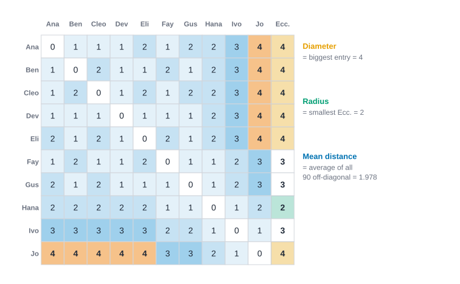
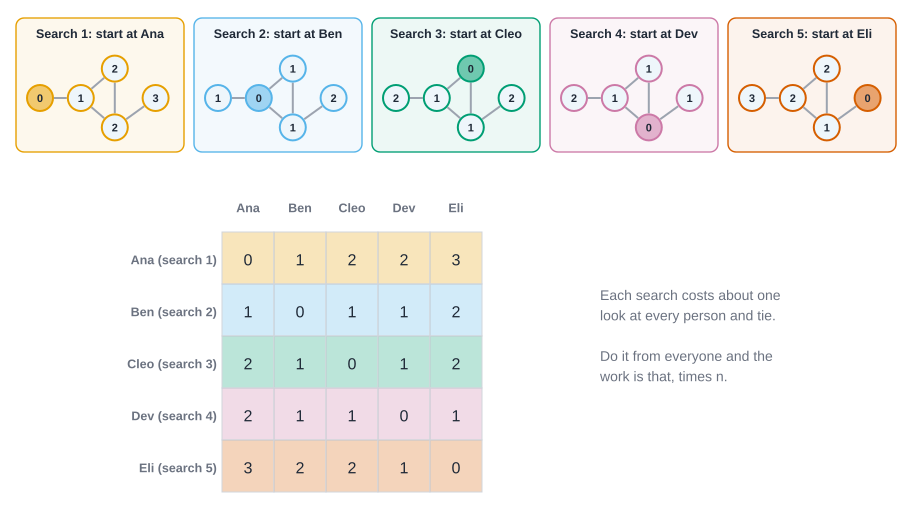
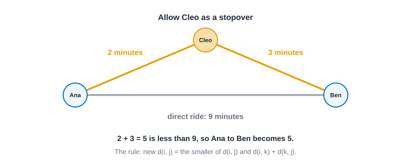
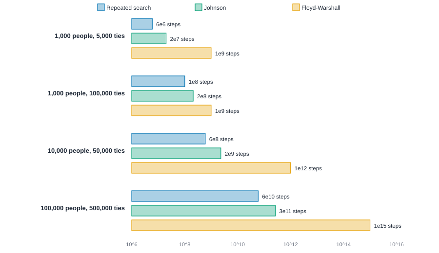
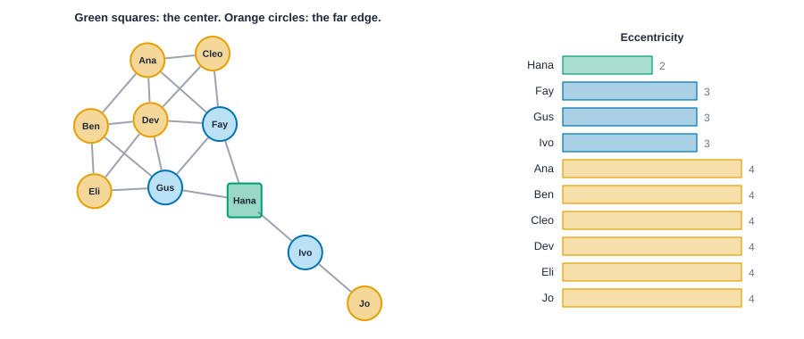
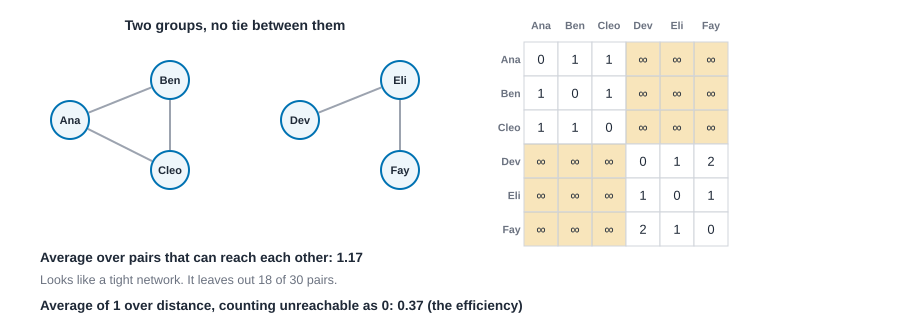
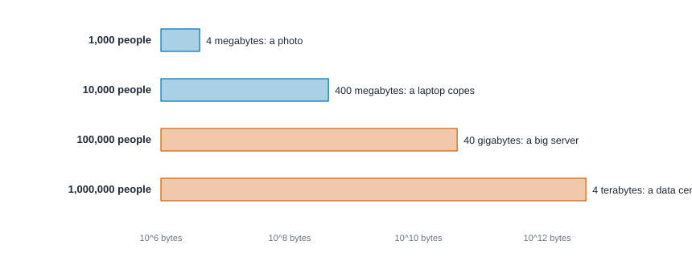

# All pairs and distance statistics {#sec-all-pairs}

::: {.callout-note appearance="simple"}
## Prerequisites
@sec-traversal (breadth-first search) and @sec-shortest-paths (how to find the cheapest route from one person). Nothing else. If you can follow "start here, look at everyone one step away, then two steps away", you have what you need.
:::

::: {.callout-note title="The short version"}
Sometimes you don't want the distance from one person to one other person. You want every distance, from everyone to everyone, written down in one table. There are three ways to fill that table: ask the one-person question again from every starting point, build the table up by allowing one more stopover at a time (Floyd-Warshall), or fix awkward costs first and then repeat the one-person question (Johnson). Which is best depends on how many ties there are and whether any costs are negative. Once the table exists, a handful of famous summaries drop out of it: eccentricity, radius, diameter and mean distance. They are only as honest as the table, and the table is huge when the network is.
:::

::: {.callout-note title="Why you might care"}
"Everyone is six steps from everyone" is a claim about this table. So is "the company's two offices are far apart", "this person is closest to everybody" and "the network is getting more tightly knit". If you know how the table is built, you know what it costs, when it can't be built at all, and which of its summaries to trust.
:::

## One question, asked of everyone

@sec-shortest-paths answered a question about one person: how far is everyone else from *Ana*? This chapter asks the same question about everybody at once.

Think of a small office with a shared kitchen, a print room, a stairwell and a few meeting rooms. A new hire wants a cheat sheet: for every pair of places, the quickest walk in minutes. Not "how do I get from the kitchen to the print room" but the whole grid, so she can glance down a row and see how far anywhere is from anywhere.

That grid is a **distance table** (many books call it a distance matrix). It has one row and one column for every person, and the entry where row *i* meets column *j* is the length of the shortest route from *i* to *j*. The diagonal is zero, because you're zero steps from yourself.

@fig-all-pairs-table is the table for the ten-person friendship network from the Social Network Analysis book (the same cast, in the same order). Spend a minute with it. Find Jo's row. Notice that Jo is four steps from five people and three from two more, and that Hana's whole row never goes above two.

{#fig-all-pairs-table fig-alt="A ten by ten table of distances between the ten friends. The diagonal is zero, and every entry is between 1 and 4. The entries equal to 4 are shaded orange and sit in the rows and columns of Jo and of Ana, Ben, Cleo, Dev and Eli. A right-hand column lists each person's largest distance."}

### What you'll be able to do

By the end of this chapter you should be able to:

- choose between repeated search, Floyd-Warshall and Johnson's method, and say why in one sentence;
- fill in a Floyd-Warshall table by hand for five people;
- read eccentricity, radius, diameter and mean distance off a distance table, and say what each one means;
- tell when a "mean distance" is quietly leaving people out, and when the table is too big to build.

## The tiny example, by hand

Start with five people so we can do everything on paper. Ana is tied to Ben. Ben, Cleo and Dev are all tied to each other (a triangle). Dev is tied to Eli.

Nobody here has a "cost" on their ties. A tie is one step. Here is the table, filled in by looking at the picture:

| | Ana | Ben | Cleo | Dev | Eli |
| --- | --- | --- | --- | --- | --- |
| **Ana** | 0 | 1 | 2 | 2 | 3 |
| **Ben** | 1 | 0 | 1 | 1 | 2 |
| **Cleo** | 2 | 1 | 0 | 1 | 2 |
| **Dev** | 2 | 1 | 1 | 0 | 1 |
| **Eli** | 3 | 2 | 2 | 1 | 0 |

Three things to notice before any algorithm.

- **It is symmetric.** Ana to Eli is 3 and Eli to Ana is 3. (That holds because ties here go both ways. With one-way ties, the table can be lopsided, and we'll meet that below.)
- **It's redundant.** Half of it is a mirror image of the other half, so an honest program could store only the top triangle.
- **Every summary we care about is in it.** The biggest number is 3. Each row's biggest number is that person's farthest friend. Average the ten distinct pairs and you get 1.6.

Those three named summaries have names, and we'll define them properly in a moment. First, the real question: how does a computer fill this in without a human eyeballing a picture?

## Way 1: just search again, from everyone

You already know how to find the distances from one person: a breadth-first search (@sec-traversal). It fans out one step at a time, and the step on which it finds someone is that person's distance.

So here's the laziest possible plan. Run that search once from Ana, and you have Ana's row. Run it from Ben, and you have Ben's row. Keep going until every person has had a turn.

{#fig-repeated-search fig-alt="Five small copies of the five-person network. In each, a different person is the starting point and every dot shows its distance from that person. Below, a five by five table whose rows are colored to match the five searches that produced them."}

### One row, by hand

To see exactly what a "row" costs, build Jo's row in the ten-friend network of @fig-all-pairs-table. Jo knows only Ivo.

1. **Step 0.** Jo is at distance 0.
2. **Step 1.** Everyone Jo knows: Ivo. Ivo is at distance 1.
3. **Step 2.** Everyone Ivo knows who hasn't been found: Hana. Distance 2.
4. **Step 3.** Everyone Hana knows who hasn't been found: Fay and Gus. Distance 3.
5. **Step 4.** Everyone Fay and Gus know who hasn't been found: Ana, Ben, Cleo, Dev and Eli. Distance 4.
6. **Step 5.** Nobody new. Stop.

Jo's row reads 4, 4, 4, 4, 4, 3, 3, 2, 1, 0, which is exactly the bottom row of the table. Each person was looked at once, and each tie was looked at from both ends. That is the "one look at every person and every tie" the cost estimates below are counting.

This is a perfectly good method, and for the networks people actually study it is often the best one. Its virtues:

- It needs nothing new. Whatever you wrote for one person, you reuse.
- The searches don't depend on each other, so you can hand different starting people to different processor cores and they never get in each other's way.
- You don't have to keep the whole table. If all you want is the diameter or the mean distance, you can run a search, fold its row into a running total, throw the row away and move on.

Its limit: breadth-first search treats every tie as "one step". If ties carry costs (minutes, kilometers, dollars), the plain search is wrong. Swap in the cost-aware version from @sec-shortest-paths (Dijkstra's method) and the same plan works, as long as no cost is negative.

::: {.callout-tip title="In plain words"}
Repeated search says: the table is just *n* separate one-person questions, where *n* is the number of people. If a one-person question costs about "one look at every person and every tie", then the whole table costs about *n* times that.
:::

## Way 2: allow one more stopover at a time (Floyd-Warshall)

The second method is stranger, shorter to write, and pleasingly different. It doesn't search at all. It starts from what you know for sure (the direct ties) and improves it.

### A story first: errands

Suppose five meeting places (we'll keep using Ana, Ben, Cleo, Dev and Eli as names for them) are connected by direct bike rides, with travel times in minutes:

| Ride | Minutes |
| --- | --- |
| Ana and Ben | 9 |
| Ana and Cleo | 2 |
| Cleo and Dev | 3 |
| Dev and Ben | 1 |
| Dev and Eli | 6 |
| Ben and Eli | 8 |

The direct ride from Ana to Ben is 9 minutes. But Ana to Cleo is 2, Cleo to Dev is 3 and Dev to Ben is 1, which is 6 minutes in total. The detour beats the direct road.

Here's the question that gives the method its shape: *if I'm only allowed to stop at certain places on the way, what's the quickest trip?*

- If you may stop nowhere, the answer is the direct ride, or "can't" (infinity) if there isn't one.
- If you may stop at Ana only, you can improve any pair whose best trip is "go to Ana, then go on".
- Allow Ben as well, and some trips improve again.
- Keep adding places one at a time. When everyone is allowed, you have the true shortest trips.

### The one move

Every improvement in the whole method is the same small check. Take a pair, say Ana and Ben, and one allowed stopover, say Cleo. Compare two numbers:

- the best you currently know for Ana to Ben, and
- the best you know for Ana to Cleo plus the best you know for Cleo to Ben.

Keep the smaller.

{#fig-fw-rule fig-alt="Three dots in a triangle: Ana at the left, Ben at the right and Cleo above between them. A gray line from Ana to Ben is labeled 9 minutes. Two orange lines, Ana to Cleo at 2 minutes and Cleo to Ben at 3 minutes, are the detour. The text says 2 plus 3 is 5, which beats 9."}

In symbols, with *d*(*i*, *j*) for the best-known trip from *i* to *j* and *k* for the stopover being allowed:

$$
d(i,j) \leftarrow \min\bigl(d(i,j),\; d(i,k) + d(k,j)\bigr).
$$

::: {.callout-tip title="In plain words"}
The arrow means "replace the old number with". $d(i,j)$ is the entry in row *i*, column *j* of the table. $\min$ means "the smaller of". So the line says: the new Ana-to-Ben number is the smaller of the old Ana-to-Ben number and (Ana to Cleo) plus (Cleo to Ben). In the picture, the old number is 9, the detour is 2 + 3 = 5, so 5 wins. If either half of the detour is infinity (there's no way to get there), the sum is infinity and nothing changes.
:::

### The whole method, in steps

1. Write the table of direct rides. Put 0 on the diagonal and infinity wherever there is no direct ride.
2. Pick the first person to allow as a stopover. For *every* pair of people, apply the one move with that person as the stopover.
3. Pick the next person and do it again, using the improved table.
4. After every person has had a turn as the stopover, you're done.

That's it. In ordinary words: *for each possible stopover, for each starting person, for each ending person, check the detour*. Here it is as three nested loops, annotated line by line:

```text
for each person k (the stopover):               # "may I stop at k?"
    for each person i (where we start):         # every row
        for each person j (where we end):       # every column
            if d[i][k] + d[k][j] < d[i][j]:     # is the detour shorter?
                d[i][j] = d[i][k] + d[k][j]     # then take it
```

::: {.callout-tip title="In plain words"}
Three loops, one inside the other, doing one tiny comparison at the center. The outer loop picks who is allowed as a stopover (that order is not optional: it has to be the outermost loop, and the proof box below says why). The two inner loops visit every cell of the table. With 5 people the comparison runs 5 × 5 × 5 = 125 times. With 1,000 people it runs a billion times.
:::

### Watch it work

@fig-fw-stopovers shows the full run for the five places above. Each little table is the whole table after one more stopover has been allowed. Orange cells are the ones that just improved. The blue row and column belong to the person who was just added as a stopover: those are the only numbers the check looks at.

{#fig-fw-stopovers fig-alt="Six five by five tables of travel minutes. The first holds only the direct rides, with infinity where there is no direct ride. Each next table allows one more stopover, in the order Ana, Ben, Cleo, Dev, Eli, and highlights cells that got smaller. The last table has no infinity left and every entry is a shortest travel time."}

Walk through the interesting steps once, slowly.

- **Ana allowed.** The only new trips are "to Ana, then on from Ana". Ben to Cleo had no ride at all (infinity). Now Ben to Ana to Cleo is 9 + 2 = 11. Two cells improve, one on each side of the diagonal, because the table mirrors itself.
- **Ben allowed.** Six cells improve, and several are still bad. Ana to Eli is now 17 (Ana to Ben is 9, Ben to Eli is 8). That's silly, since a better trip exists. It's only silly *because we haven't allowed Dev or Cleo yet*. Floyd-Warshall never claims its in-progress numbers are final.
- **Cleo allowed.** Ana to Dev drops from 10 to 5 (2 + 3).
- **Dev allowed.** The big one: ten cells improve. Ana to Ben is now 6 (Ana to Cleo to Dev to Ben is 2 + 3 + 1), beating the direct ride of 9. Ana to Eli becomes 11, the detour finally beating the silly 17.
- **Eli allowed.** Nothing improves: nobody's best trip needs to pass through Eli.

The final table: Ana to Ben is 6, Ana to Eli is 11, Cleo to Eli is 9, and Ben to Cleo is 4.

::: {.callout-tip appearance="simple"}
## You may feel lost here
It is normal to feel the method is "too simple to work". The surprise is the order: the stopover is the *outer* loop. After step *k*, every number in the table is exactly the best trip that only uses stopovers from the first *k* people. Nothing is ever claimed that isn't true for the stopovers allowed so far, and at the end "the first *k*" is everybody. The proof box near the end spells this out, and you can skip it.
:::

### What it costs

Three loops over *n* people each means about *n* × *n* × *n* checks. Double the number of people and the work goes up eight times. It doesn't matter how many ties there are: a network of 1,000 people with 1,200 ties and a network of 1,000 people with 400,000 ties both cost a billion checks.

Formally, the running time is $\Theta(n^3)$ and the memory is $\Theta(n^2)$ for the table.

::: {.callout-tip title="In plain words"}
$\Theta(n^3)$ (read "theta of n cubed") means "grows like n times n times n, up to a constant factor, no better and no worse". With *n* = 1,000 people that's a billion checks; with *n* = 10,000 it's a trillion. The table needs one cell per pair, so *n* × *n* cells: a million cells for a thousand people, a hundred million for ten thousand.
:::

Floyd-Warshall earns its place in two situations. When the network is small or dense (many of the possible ties exist), a billion simple, predictable checks is fast, because the three loops are tight and walk through memory in order. And when costs can be negative, it just works, as long as there's no loop whose total cost is negative (more on that below). Floyd [@floyd1962algorithm] published the three-loop form, building on Warshall's yes-or-no version, which only asks "is there any trip at all?" [@warshall1962theorem]. Textbooks such as @cormen2022introduction and @sedgewick2011algorithms present it in full.

## Way 3: fix the costs, then repeat (Johnson)

Repeated search is cheap but breaks when a cost is negative. Floyd-Warshall handles negative costs but pays for *every* triple of people. Can we have both?

Donald Johnson's answer [@johnson1977efficient] is a two-stage trick: repair the costs so that none is negative, then use the cheap method.

### Why would a cost be negative?

Ties with negative cost are rarer in social networks than in logistics, but they appear: a favor that earns credit, a trade that nets a profit, a route that pays a rebate. The cost-aware search from @sec-shortest-paths (Dijkstra's method) relies on one promise: once it has reached someone by the cheapest route it knows, no later route can be cheaper. A negative cost breaks that promise, because a longer route might end with a rebate.

### The repair

Give each person a **score**. Then change every cost like this:

> new cost = old cost + (score of where the tie starts) − (score of where it ends)

If the scores are chosen well, every new cost is zero or more. And here's the part that makes it legal: any complete route from *i* to *j* has its in-between scores cancel out, so every route between the same two people shifts by exactly the same amount, namely *score(i)* − *score(j)*. The cheapest route stays the cheapest route. After the cheap search finishes, you shift the answers back.

{#fig-johnson-reweight fig-alt="Two copies of a four-person directed network. On the left the tie from Ben to Cleo costs minus 2 and is drawn in red. On the right every cost has been adjusted using scores of 0, 0, minus 2 and 0 for Ana, Ben, Cleo and Dev, so all costs are zero or more."}

Where do good scores come from? Invent a helper who is tied to everyone at cost 0. Each person's score is the cheapest way to reach them from the helper. One run of the slower, negative-friendly search (Bellman-Ford [@bellman1958routing]) finds them. That run is the price of the trick, and it is paid *once*, not once per person.

In the picture, Cleo's score is −2 (helper to Ben at 0, then Ben to Cleo at −2). The costs on the right are:

- Ana to Ben: 4 + 0 − 0 = 4
- Ana to Cleo: 5 + 0 − (−2) = 7
- Ben to Cleo: −2 + 0 − (−2) = 0
- Cleo to Dev: 3 + (−2) − 0 = 1
- Ben to Dev: 6 + 0 − 0 = 6

All zero or more. Check that the shift is the same for every route from Ana to Dev. Ana, Ben, Cleo, Dev costs 4 + (−2) + 3 = 5 before and 4 + 0 + 1 = 5 after (Ana and Dev both have score 0, so the shift is zero). Ana, Ben, Dev costs 4 + 6 = 10 either way. Ana, Cleo, Dev costs 5 + 3 = 8 before and 7 + 1 = 8 after. Same shift, same winner (5).

### The steps

1. Add a helper person tied to everyone at cost 0.
2. Run the negative-tolerant search from the helper. Each person's answer is their score. If this search detects a loop of negative total cost, stop: there are no meaningful shortest routes.
3. Replace every cost using the formula. All are now zero or more.
4. From each person, run the cheap cost-aware search (Dijkstra) on the new costs.
5. Shift each answer back: true distance = new distance − score(start) + score(end).

::: {.callout-tip title="In plain words"}
Johnson's method is "one slow search to fix the costs, then n fast searches". It is repeated search with a repair step in front. Nothing about the cost-aware searches themselves had to change.
:::

## What each method costs, side by side

Now put numbers on it. Counting "basic steps" (a look at a person or a tie, or one comparison), a back-of-the-envelope version is:

- **Repeated breadth-first search:** about *n* × (*n* + *m*), where *m* is the number of ties.
- **Johnson:** about *n* × *m* for the one repair search, plus *n* × (*m* + *n* log *n*) for the repeated cost-aware searches.
- **Floyd-Warshall:** exactly *n*³.

("log *n*" means roughly "how many times you can halve *n* before reaching 1"; for 1,000 it's about 10. It appears because the cost-aware search keeps its candidates in a structure that takes that long to keep tidy.)

::: {.callout-tip title="In plain words"}
Search-based methods pay for the ties you actually have. Floyd-Warshall pays for every possible trio of people, whether or not there's a tie anywhere near them. When the network is sparse (most people know few others, as in nearly all real networks), the gap is enormous. When it is dense, the gap closes.
:::

{#fig-apsp-costs fig-alt="Four groups of three horizontal bars on a log scale, one group per network size. In every group the Floyd-Warshall bar is longest. For the sparse networks the other two bars are two to three powers of ten shorter. For the 1,000 person network with 100,000 ties the three bars are closer together."}

The bars are counts of steps, not seconds. Real running time also depends on how the data is laid out in memory, and Floyd-Warshall's regular sweeps are friendlier to a processor than a search's hopping around. The honest way to pick is to measure on your own network (we'll see how in @sec-cost), but the step counts tell you which direction to bet.

## At a glance

| | Repeated search | Johnson | Floyd-Warshall |
| --- | --- | --- | --- |
| **Handles** | Unweighted (BFS) or non-negative costs (Dijkstra) | Any costs, if no negative loop | Any costs, if no negative loop |
| **Time** | about *n*(*n* + *m*) | about *n*(*m* + *n* log *n*) | *n*³ |
| **Memory** | table, or just one row at a time | table, or one row at a time | the table, *n*² |
| **Best when** | Sparse and unweighted (most social networks) | Sparse with some negative costs | Small or dense, or you want the simplest code |
| **Awkward when** | A cost is negative | Everything is non-negative (extra work for nothing) | Large and sparse |
| **Parallel?** | Trivially: each start is separate | Same, after the repair step | Possible, but the stopover order limits it |

## The summaries built from the table

With the table in hand, the famous distance statistics are one-line questions. Here are the definitions, in order of how often you'll see them.

- **Eccentricity** of a person: the largest number in that person's row. How far they are from whoever is farthest from them.
- **Diameter** of the network: the largest eccentricity, which is the largest number anywhere in the table. The farthest apart any two people get.
- **Radius**: the *smallest* eccentricity. How close to everyone the best-placed person is.
- **Center**: the people whose eccentricity equals the radius. **Periphery**: the people whose eccentricity equals the diameter.
- **Mean distance** (the average path length): the average of all the off-diagonal entries.

@fig-eccentricity-center colors the ten friends by eccentricity. Hana, with eccentricity 2, is the only center: no one is more than two steps from Hana. Jo, tucked on the far end of a short chain, is tied for the edge.

{#fig-eccentricity-center fig-alt="On the left, the ten-person network. Hana, with eccentricity 2, is the one green square. Ana, Ben, Cleo, Dev, Eli and Jo, with eccentricity 4, are orange circles; Fay, Gus and Ivo, at 3, are blue circles. On the right, ten horizontal bars sorted by eccentricity."}

In symbols, with *d*(*i*, *j*) for the distance between *i* and *j*, and *n* people:

$$
\varepsilon(i) = \max_j d(i,j), \qquad
D = \max_i \varepsilon(i), \qquad
r = \min_i \varepsilon(i), \qquad
L = \frac{1}{n(n-1)} \sum_{i \neq j} d(i,j).
$$

::: {.callout-tip title="In plain words"}
$\varepsilon(i)$ (epsilon of *i*) is person *i*'s eccentricity: look along row *i* and take the biggest entry. $D$ is the diameter: the biggest eccentricity. $r$ is the radius: the smallest. $L$ is the mean distance: add up every entry that isn't on the diagonal, and divide by the number of such entries, which is *n* times *n* − 1. For the ten friends, the 90 off-diagonal entries add to 178, so $L = 178/90 \approx 1.978$. Hana's eccentricity is 2, so $r = 2$; five people have eccentricity 4 and so does Jo, so $D = 4$.
:::

You can check the five-person example the same way. Eccentricities are 3, 2, 2, 2, 3, so the radius is 2 and the diameter is 3. The inequality $r \le D \le 2r$ holds (2 ≤ 3 ≤ 4), as it does in any connected, undirected network. The SNA book walks through why, and @harary1969graph covers the formal side.

### Why the summaries are only as good as the table

A table with a hole in it gives an infinite eccentricity. A table you built by only searching from a few people gives an *estimate*, not a diameter. We'll come back to estimates in @sec-closeness-at-scale. For now, hold on to this: the table is the ground truth, and every summary is a way of squeezing it down to one number.

### A table of the table

Before you collapse the table into one number, it often pays to count how many pairs sit at each distance. For the ten friends the 90 off-diagonal entries break down like this:

| Distance | Pairs | Share of all pairs |
| --- | --- | --- |
| 1 | 36 | 40% |
| 2 | 30 | 33% |
| 3 | 14 | 16% |
| 4 | 10 | 11% |

Each tie is counted from both ends, so the 18 ties give 36 pairs at distance 1. Now the three headline numbers read differently. The mean, (36 + 60 + 42 + 40) / 90 = 178 / 90, is 1.978. The diameter, 4, is real but describes only one pair in nine. And the middle of the story, that nearly three-quarters of all pairs are one or two steps apart, is a statement none of the three summaries makes on its own. When you report distances, a count like this is worth a line.

### The summaries at a glance

| Summary | Plain meaning | Good for | Misleads when |
| --- | --- | --- | --- |
| Eccentricity | How far a person is from their farthest contact | Spotting who is on the edge | One distant straggler dominates it |
| Radius | The best-placed person's eccentricity | "How compact can this network be?" | The network has pieces |
| Diameter | The farthest any two people get | Worst-case message delay | One long tail (like Jo) sets it for everyone |
| Mean distance | The typical gap between two people | Comparing networks of the same kind and size | Pieces, or networks of very different size |
| Efficiency | Average of 1 over distance, with unreachable counted as 0 | Networks with pieces | Readers expect a distance, not a score between 0 and 1 |

Notice what the diameter does with Jo. Take Jo away and the diameter of the other nine people drops from 4 to 3. A single person at the end of a short chain changed the "farthest apart" number for the whole network. That's not wrong, but it means the diameter is a statement about the most unusual pair, and the mean distance is the better statement about the typical one.

### Checking a table before you trust it

A distance table has a few properties you can test in seconds, and they catch most mistakes.

- **The diagonal is all zeros.** If not, something was stored as a tie to oneself.
- **If ties go both ways, the table is a mirror image.** Compare each cell with its mirror.
- **No entry is bigger than a detour.** For any three people, the distance from *i* to *j* can never exceed the distance from *i* to *k* plus the distance from *k* to *j*. (If it did, the trip through *k* would be a shorter route, and the table would not be finished.) This is called the **triangle inequality**, and it is the same statement Floyd-Warshall enforces. A table that fails it has not been fully improved.
- **Two methods agree.** The strongest check is to fill the same table with two of the three methods and compare every cell. For small networks the cost of doing this is nothing, and it is the habit @sec-trust builds on.

### One-way ties give a lopsided table

Everything so far used ties that work both ways. Many networks don't: who messaged whom, who follows whom, which road is one-way. The table still has a row and a column for everyone, but the entry for Ana to Ben need not equal the entry for Ben to Ana.

The smallest example is a ring of four people where every tie points one way: Ana to Ben, Ben to Cleo, Cleo to Dev, Dev back to Ana.

| | Ana | Ben | Cleo | Dev |
| --- | --- | --- | --- | --- |
| **Ana** | 0 | 1 | 2 | 3 |
| **Ben** | 3 | 0 | 1 | 2 |
| **Cleo** | 2 | 3 | 0 | 1 |
| **Dev** | 1 | 2 | 3 | 0 |

Ben is one step ahead of Ana in the ring, yet Ana is three steps ahead of Ben. Read across a row to see how far each person can send a message; read down a column to see how far each person can *receive* one from. Here every row and column reads 0, 1, 2, 3 in some rotation, so every eccentricity is 3. In the ring, "farthest you can send to" and "farthest that can send to you" happen to match. In most real directed networks they don't, and a person with a tiny out-eccentricity and a huge in-eccentricity is someone who reaches everyone quickly but can't be reached.

All three methods work unchanged on one-way ties. The only difference is that you don't copy each tie in both directions when you build the starting table. If the one-way network is not strongly connected (@sec-components), some entries will be infinity even though the network "looks" tied together, and the earlier warnings apply twice over.

### Which method will a library pick?

You rarely choose. A good library looks at the network and decides for you. A reasonable rule is:

1. If there are no costs, use repeated breadth-first search.
2. If there are costs and none are negative, use repeated Dijkstra.
3. If there are negative costs and the network is sparse, use Johnson.
4. If the network is small, or dense enough that the ties are a good fraction of all possible pairs, Floyd-Warshall is competitive, and it's the simplest code to get right.

What you *do* choose is whether you want the table or only a summary. A function that returns the table can't be used on a big network. A function that returns the diameter or the mean distance can fold each row away as it goes. When you read a library's documentation, look for which of these it gives you.

## Where it goes wrong

Every one of these has fooled someone, usually someone careful.

**Some people can't reach each other.** If the network is in pieces, the distance between pieces is infinite. The eccentricity of everyone is infinite, and so is the diameter. The mean distance is infinite too, unless you quietly average only over the pairs that *can* reach each other. That's what @fig-unreachable-trap warns about.

{#fig-unreachable-trap fig-alt="Two groups of three people each, tied within the group and not between groups. Beside them, a six by six table of distances: the two three by three blocks along the diagonal hold 0, 1 and 2 (the first group is all 1s), and the rest is infinity, shaded orange. Below, two averages: 1.17 over reachable pairs, and 0.37 when unreachable pairs count as zero efficiency."}

The fix is not one number. Say how many pairs are cut off (18 of 30 here), report the diameter *of each piece* (see @sec-components), or use the **efficiency**: average the *reciprocals* of the distances, with $1/\infty$ counted as 0. A person two steps away contributes a half, a person one step away contributes a whole, and a person who can't be reached contributes nothing at all.

**One-way ties.** If ties have direction, the table is no longer a mirror image. Ana may reach Ben in one step while Ben needs four to reach Ana, or can't at all. Eccentricity splits into "farthest you can send a message" and "farthest a message can come from you". Say which you computed.

**Negative loops.** Suppose a loop of rides, taken once around, has a *negative* total cost. Then going around again is even cheaper, and again, and there is no shortest route: the cost can be pushed down forever. Both Floyd-Warshall and Johnson's first search can detect this (a person ends up with a negative distance to themself, or a score keeps improving after *n* rounds). When they do, stop and report it. Note that a single negative cost on an *undirected* tie is already a negative loop: walk across it and back.

**"Infinity" as a number.** Programs often store "no route" as a very large number rather than a true infinity. In Floyd-Warshall, the check adds two entries together. If both are "very large", the sum can overflow a fixed-size integer and wrap around to something small and wrong. The safe habits are to skip the check whenever either half is infinite, or to use numbers where infinity is a real value.

**Weights that aren't distances.** Many network weights are strengths, not costs: more messages means a *closer* tie. If you feed strengths straight to a shortest-path method, "shortest" will mean "weakest links". Convert (for instance, to 1 divided by strength) before computing distances, and say so.

**Ties for shortest.** The table records the *length* of the shortest route, not how many routes tie. Counting routes is a different problem, with its own chapter (@sec-path-enumeration).

**The table is the cost.** For very large networks the problem isn't the arithmetic. It's the size of the table (@fig-apsp-memory).

{#fig-apsp-memory fig-alt="Four horizontal bars on a log scale. Each is a hundred times longer than the one above: 4 megabytes for a thousand people, 400 megabytes for ten thousand, 40 gigabytes for a hundred thousand and 4 terabytes for a million. The last two are drawn in red."}

A million people means a trillion cells. Nobody writes that down. Instead, a good program runs one search per starting person, folds each row into a running tally (the biggest value so far, the sum so far, a count of how many people sit at each distance) and discards the row. That is exactly how Way 1 earns its keep, and it is how the mean distance of a very large network is computed at all. When even *n* searches are too many, programs search from a random sample of people and report an estimate, saying how many they sampled.

### What to do when even the rows are too many

Say the network has ten million people. One search per person is ten million searches. That might still be possible on a big machine over a weekend, but often nobody needs the exact answer.

Two honest shortcuts are common.

- **Sample the starting people.** Pick, say, a thousand people at random, run the search from each, and average. The result estimates the mean distance, and the more people you sample the tighter the estimate. The honest report says how many were sampled and gives a plausible range, not one bare number.
- **Bound the diameter.** Search from any person, find the person farthest away, and search again from *them*. The biggest distance you see is a **lower bound** on the diameter: the true diameter is at least that large. It is usually very close, often exactly right, and it costs two searches instead of ten million. The honest wording is "at least 23", never "the diameter is 23", unless you have also shown that it can't be larger.

We'll build both of these properly in @sec-closeness-at-scale, where closeness (a close cousin of the distance table) gets the same treatment.

::: {.callout-note title="If you like proofs: why Floyd-Warshall is right"}
This is optional. You will not need it for anything else in the chapter.

Say a trip is **allowed up to *k*** if every stop it makes in between (not counting the start and end) belongs to the first *k* people in your list. Let $d_k(i,j)$ be the length of the shortest trip from *i* to *j* that is allowed up to *k*. We want to show that after step *k*, the table holds exactly $d_k$.

*Start.* With *k* = 0 no stops are allowed, so the only trips are direct ties. That is the table you began with.

*Step.* Suppose the table holds $d_{k-1}$. Take the best trip from *i* to *j* allowed up to *k*. There are two cases.

- It never stops at person *k*. Then it is allowed up to *k* − 1, and its length is $d_{k-1}(i,j)$.
- It does stop at person *k*, exactly once (a shortest trip never repeats a person, as long as no loop is negative). Cut it at *k*: the first half goes from *i* to *k*, and the second from *k* to *j*, and neither stops at *k* again, so both are allowed up to *k* − 1. Their best lengths are $d_{k-1}(i,k)$ and $d_{k-1}(k,j)$.

So the best trip allowed up to *k* is the smaller of the two cases: $d_k(i,j) = \min\bigl(d_{k-1}(i,j),\, d_{k-1}(i,k) + d_{k-1}(k,j)\bigr)$. That's exactly the one move.

*End.* When *k* = *n* every person is allowed, so $d_n$ is the true distance.

One detail answers a question people often ask: why can the program overwrite the table in place, instead of keeping a copy for each step? Because in step *k*, row *k* and column *k* don't change (the move for the pair *k*, *j* compares $d(k,j)$ with $d(k,k) + d(k,j)$, and $d(k,k)$ is 0). So the numbers the move reads are never numbers it just changed.
:::

::: {.callout-note title="If you like proofs: why Johnson's reweighting is safe"}
Write $h(v)$ for person *v*'s score and $w'(u,v) = w(u,v) + h(u) - h(v)$ for the new cost. Take any route $i = v_0, v_1, \dots, v_\ell = j$. Its new total is

$$
\sum_{t=1}^{\ell} w'(v_{t-1}, v_t) = \sum_{t=1}^{\ell} w(v_{t-1}, v_t) + h(v_0) - h(v_\ell).
$$

Each middle person's score is subtracted once, when you arrive, and added back once, when you leave, so those terms cancel and only the first and last scores survive. Every route from *i* to *j* shifts by the same $h(i) - h(j)$, so the cheapest one doesn't change. The new costs are never negative because of how the scores are made: $h(v) \le h(u) + w(u,v)$ for every tie, which is exactly $w'(u,v) \ge 0$.
:::

::: {.callout-tip title="In plain words"}
The middle terms cancel like a row of dominoes: each person's score is subtracted when you arrive and added when you leave. Only the score where you start and the score where you finish are left over, and those are the same no matter which route you took.
:::

## Code

A reminder about the code blocks: they are stubs for now. Each one says what it will compute, so it can be written later without guessing.

The first block builds the five-person network and prints its distance table, then each person's eccentricity, the radius, the diameter and the mean distance. Look for the table matching the one in "The tiny example, by hand" and for a diameter of 3.

::: {.panel-tabset group="language"}

## R

```r
# TODO(code, R): build the five-person network (Ana-Ben, Ben-Cleo, Ben-Dev, Cleo-Dev, Dev-Eli), print its 5 by 5 distance table, then eccentricity per person, radius, diameter and mean distance (expected 3, 2, 2, 2, 3; 2; 3; 1.6)
```

## Python

```python
# TODO(code, Python): build the five-person network (Ana-Ben, Ben-Cleo, Ben-Dev, Cleo-Dev, Dev-Eli), print its 5 by 5 distance table, then eccentricity per person, radius, diameter and mean distance (expected 3, 2, 2, 2, 3; 2; 3; 1.6)
```

## Rust

```rust
// TODO(code, Rust): build the five-person network (Ana-Ben, Ben-Cleo, Ben-Dev, Cleo-Dev, Dev-Eli), print its 5 by 5 distance table, then eccentricity per person, radius, diameter and mean distance (expected 3, 2, 2, 2, 3; 2; 3; 1.6)
```

:::

::: {.code-output}
TODO(output): the distance table and the five summaries for the five-person network.
:::

The second block fills the table for the travel-minutes example three ways (repeated cost-aware search, Floyd-Warshall, Johnson) and checks that the three tables are identical. Look for the shared last table, with Ana to Eli at 11 minutes.

::: {.panel-tabset group="language"}

## R

```r
# TODO(code, R): fill the 5 by 5 travel-minutes table for the six rides (Ana-Ben 9, Ana-Cleo 2, Cleo-Dev 3, Dev-Ben 1, Dev-Eli 6, Ben-Eli 8) by repeated Dijkstra, by Floyd-Warshall and by Johnson, print one table and TRUE if all three agree
```

## Python

```python
# TODO(code, Python): fill the 5 by 5 travel-minutes table for the six rides (Ana-Ben 9, Ana-Cleo 2, Cleo-Dev 3, Dev-Ben 1, Dev-Eli 6, Ben-Eli 8) by repeated Dijkstra, by Floyd-Warshall and by Johnson, print one table and True if all three agree
```

## Rust

```rust
// TODO(code, Rust): fill the 5 by 5 travel-minutes table for the six rides (Ana-Ben 9, Ana-Cleo 2, Cleo-Dev 3, Dev-Ben 1, Dev-Eli 6, Ben-Eli 8) by repeated Dijkstra, by Floyd-Warshall and by Johnson, print one table and true if all three agree
```

:::

::: {.code-output}
TODO(output): the shared travel-minutes table and the agreement check.
:::

The third block turns to the ten-person friendship network and prints its diameter, radius, mean distance, center and periphery. Look for 4, 2, 1.978 and Hana as the only person in the center.

::: {.panel-tabset group="language"}

## R

```r
# TODO(code, R): on the ten-person friendship network print the diameter, radius, mean distance and the names of the center and the periphery (expected 4; 2; 1.978; Hana; Ana, Ben, Cleo, Dev, Eli, Jo)
```

## Python

```python
# TODO(code, Python): on the ten-person friendship network print the diameter, radius, mean distance and the names of the center and the periphery (expected 4; 2; 1.978; Hana; Ana, Ben, Cleo, Dev, Eli, Jo)
```

## Rust

```rust
// TODO(code, Rust): on the ten-person friendship network print the diameter, radius, mean distance and the names of the center and the periphery (expected 4; 2; 1.978; Hana; Ana, Ben, Cleo, Dev, Eli, Jo)
```

:::

::: {.code-output}
TODO(output): the four summaries and the two lists of names.
:::

The last block shows the unreachable trap: it builds the two-group network from @fig-unreachable-trap and prints the mean over reachable pairs, the number of cut-off pairs and the efficiency. Look for 1.17, 18 and 0.37.

::: {.panel-tabset group="language"}

## R

```r
# TODO(code, R): build the six-person two-group network (Ana-Ben-Cleo triangle; Dev-Eli, Eli-Fay) and print the mean distance over reachable pairs, the count of unreachable ordered pairs and the efficiency (expected 1.17; 18; 0.37)
```

## Python

```python
# TODO(code, Python): build the six-person two-group network (Ana-Ben-Cleo triangle; Dev-Eli, Eli-Fay) and print the mean distance over reachable pairs, the count of unreachable ordered pairs and the efficiency (expected 1.17; 18; 0.37)
```

## Rust

```rust
// TODO(code, Rust): build the six-person two-group network (Ana-Ben-Cleo triangle; Dev-Eli, Eli-Fay) and print the mean distance over reachable pairs, the count of unreachable ordered pairs and the efficiency (expected 1.17; 18; 0.37)
```

:::

::: {.code-output}
TODO(output): the three numbers for the two-group network.
:::

## Animations

<!-- TODO(animation): needs knappnet to expose Floyd-Warshall's table after each stopover (the engine's compute_all_pairs and compute_floyd_warshall_tree_nx return only the final table), so the five-place example can play "allow one more stopover" frame by frame; a reference routine can then assert its last table equals the engine's -->

<!-- TODO(animation): needs a per-source row result from the engine's repeated breadth-first search (compute_bfs_levels called from each person in turn) so the table can fill one row per search, with the five rows checked against compute_all_pairs -->

## Exercises

1. **By hand: one more stopover.** Four people are in a row: Ana to Ben takes 3 minutes, Ben to Cleo 4, Cleo to Dev 2, and there are no other rides. Write the starting table (0 on the diagonal, ∞ where there is no direct ride). Then allow Ana, Ben, Cleo and Dev as stopovers in that order, writing the table after each. What is Ana to Dev at the end, and after which stopover did it first become finite?

2. **Think it through: which method?** A friendship network has 20,000 people and 100,000 ties, all counted as one step. You need the diameter and the mean distance. Which of the three methods would you use, roughly how many steps would it take, and would you store the table?

3. **Coding (when the code exists):** On Zachary's karate club (see the datasets appendix), compute the diameter, the radius, the mean distance and the center. Then compare the time of repeated search against Floyd-Warshall and see which one wins on 34 people.

4. **Interpretation: the friendly mean.** A report says "the mean distance in our partner network is 2.1, so everyone is about two steps from everyone". You open the data and find that the network is in 40 pieces and the largest holds 30 percent of the people. What would you ask the author, and what two numbers would you want next to the 2.1?

5. **Negative costs.** Four people: Ana to Ben costs 2, Ben to Cleo costs −1, Cleo to Dev costs 2, Ana to Dev costs 4, all one-way. (a) Find the scores by running the "helper" search by hand. (b) Write the four new costs. (c) What is the true cheapest cost from Ana to Dev?

6. **Spot the bug.** Someone writes Floyd-Warshall with the loops in the order "for each start *i*, for each end *j*, for each stopover *k*". Explain, using the five places, why this can leave some cells too large.

## Answers to the exercises

1. The starting table has Ana-Ben 3, Ben-Cleo 4, Cleo-Dev 2 and every other off-diagonal cell ∞ (the mirrored cells repeat). Allow Ana: nothing improves, because Ana has only one tie. Allow Ben: Ana to Cleo becomes 3 + 4 = 7 (and Cleo to Ana too). Allow Cleo: Ana to Dev becomes 7 + 2 = 9, and Ben to Dev becomes 4 + 2 = 6. Allow Dev: nothing improves. So Ana to Dev is 9, and it first became finite when Cleo was allowed. (A useful sanity check: 3 + 4 + 2 = 9, the whole row of rides.)

2. Use repeated breadth-first search. It takes about *n* × (*n* + *m*) = 20,000 × 120,000 = 2.4 billion basic steps, seconds to a minute on an ordinary machine. Floyd-Warshall would take 20,000³ = 8 trillion, about 3,000 times more. A full table would be 20,000² = 400 million cells, about 1.6 gigabytes at 4 bytes each: possible, but unnecessary. Don't store it: after each search, add the row to a running sum, keep the largest value seen, and discard the row.

3. For Zachary's karate club the diameter is 5 and the mean distance is about 2.41 (the 34 people have 78 ties). On 34 people both methods take well under a second; Floyd-Warshall's 34³ is about 39,000 checks, which is nothing. The difference only shows up on networks of thousands of people.

4. First ask: how was the 2.1 computed, over all pairs or only the pairs that can reach each other? With 40 pieces and a largest piece holding 30 percent of people, most pairs can't reach each other at all, so a mean over *reachable* pairs describes a minority. Ask for the number of unreachable pairs (or the share of pairs that can reach each other), and either the efficiency (counting unreachable pairs as zero) or the mean distance *inside the largest piece*, with its size. The first number says how much the 2.1 leaves out; the second says what is being claimed.

5. (a) A helper tied to everyone at cost 0 gives score 0 to Ana and Ben (Ana to Ben costs 2, which doesn't beat 0). Cleo: 0 or Ben's 0 + (−1) = −1, so Cleo's score is −1. Dev: 0, Cleo's −1 + 2 = 1, Ana's 0 + 4 = 4, so Dev's score is 0. (b) New cost = cost + score(start) − score(end). Ana to Ben: 2 + 0 − 0 = 2. Ben to Cleo: −1 + 0 − (−1) = 0. Cleo to Dev: 2 + (−1) − 0 = 1. Ana to Dev: 4 + 0 − 0 = 4. All are zero or more. (c) Ana, Ben, Cleo, Dev costs 2 + (−1) + 2 = 3 on the original costs, and 2 + 0 + 1 = 3 on the new ones (Ana and Dev both have score 0, so no shift). The direct tie costs 4. The true cheapest cost is 3.

6. The stopover has to be the *outer* loop. After the outer loop's step *k*, a cell is exact for the stopovers allowed so far. If the stopover is innermost, each cell gets exactly one look at each stopover, using whatever the other cells hold at that moment, and the cells it depends on haven't finished improving. Run on the five places, one pass in that order leaves Ana to Ben at 9, although the true answer is 6 (Ana, Cleo, Dev, Ben): when Ana to Ben is checked, Ana to Dev is still infinity. The nested order is what makes "the table after step *k* is exact for the first *k* stopovers" true.

## Summary

::: {.callout-tip appearance="simple"}
The table of every distance can be filled three ways. Repeated search runs the one-person search from everyone and shines on sparse networks. Floyd-Warshall allows one more stopover at a time, costs *n* cubed whatever the ties, and shines on small or dense networks and negative costs. Johnson repairs the costs first and then repeats the cheap search. The diameter, the radius, each person's eccentricity and the mean distance all come from that table, but only if every pair can reach each other: otherwise report how many pairs can't, or use efficiency. For very large networks, never keep the table: keep a running tally and discard each row.

**One line:** choose the method by how many ties you have and whether any cost is negative, and always say how many pairs the average leaves out.
:::

## What comes next

This chapter gave you the length of the shortest route between every pair. It deliberately said nothing about *how many* shortest routes tie, or about the routes that aren't shortest. That's the next chapter (@sec-path-enumeration): counting shortest routes, listing every route, and why some of those questions explode. After that, @sec-components asks the question that this chapter kept tripping over: which people can reach each other at all?

## Further reading

- Floyd's original three-loop method [@floyd1962algorithm] and Warshall's yes-or-no version [@warshall1962theorem].
- Johnson's method for sparse networks with negative costs [@johnson1977efficient], and the negative-cost search it relies on [@bellman1958routing].
- The cost-aware single-source search used in repeated search [@dijkstra1959note].
- A gentle, well-illustrated treatment of shortest paths in a short book [@dasgupta2008algorithms].
- A full textbook treatment of all three, with proofs [@cormen2022introduction], and a friendlier one with code in a classroom style [@sedgewick2011algorithms].
- The Social Network Analysis book's chapter on paths and cohesion, at <https://knapply.github.io/net-books/sna/>, covers distances, diameter and mean distance from the point of view of what they say about people.
