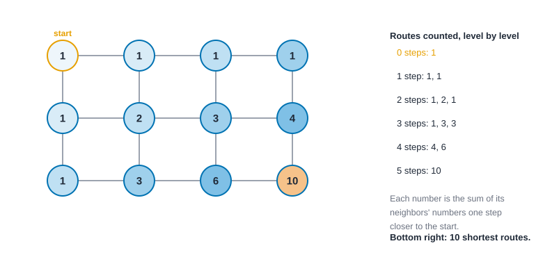
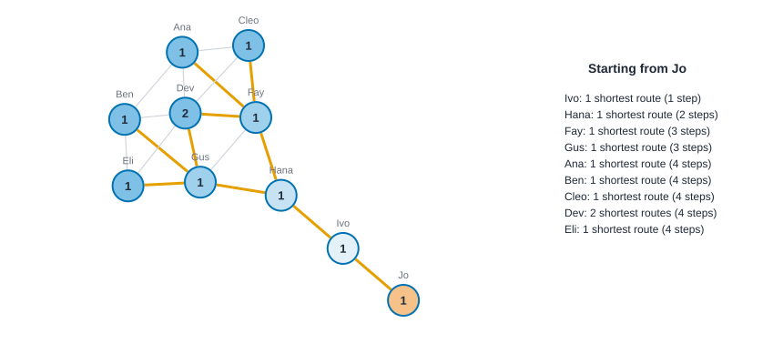
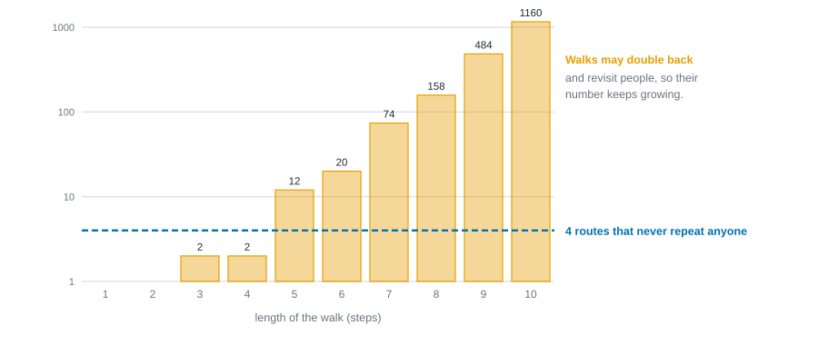
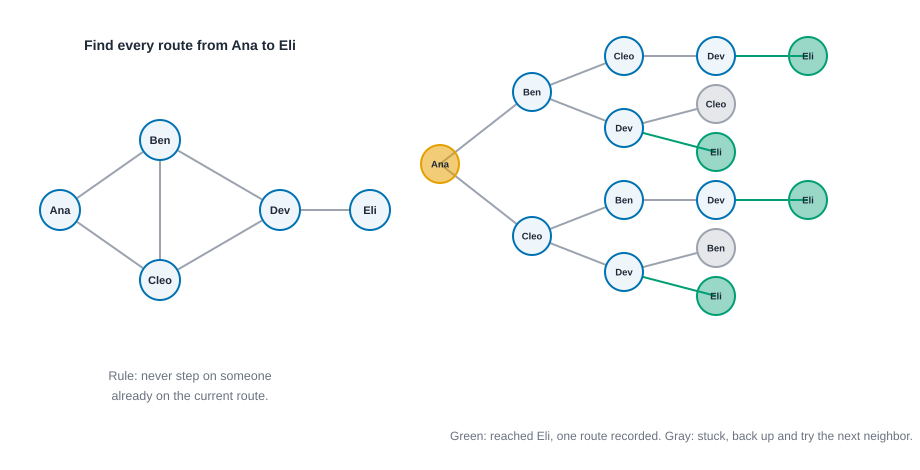
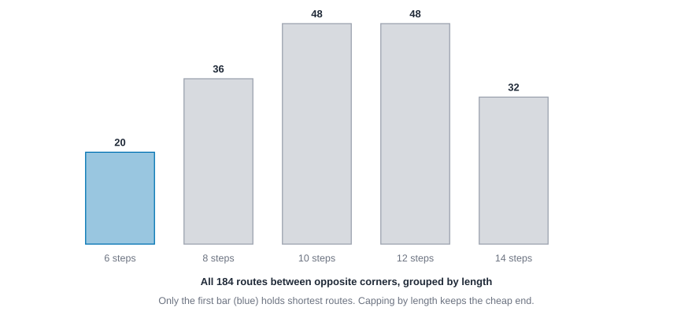
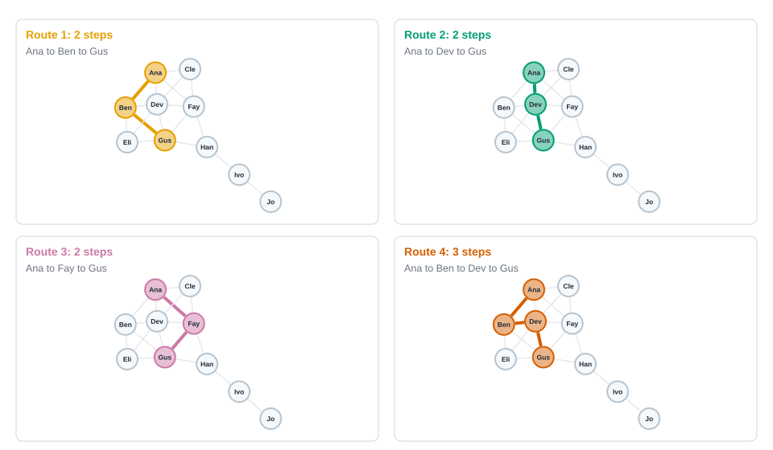
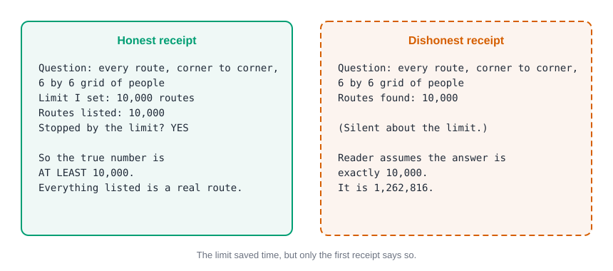

# Counting and listing paths {#sec-path-enumeration}

::: {.callout-note appearance="simple"}
## Prerequisites
@sec-traversal (breadth-first and depth-first search) and @sec-shortest-paths (finding the shortest route). @sec-all-pairs helps but isn't required: it explains the table of distances that this chapter keeps referring to.
:::

::: {.callout-note title="The short version"}
So far we asked how long the shortest route is. This chapter asks three follow-ups. How many shortest routes are there? What are all the routes, shortest or not, that never go through the same person twice? And what are the best few routes, in order? The first question is cheap: one search answers it for everyone. The second explodes: on a plain square grid, adding one person to each side multiplies the number of routes by more than the last time. The third sits in between. The skill that matters is knowing which question you're asking, and saying out loud when you stopped early.
:::

::: {.callout-note title="Why you might care"}
"How many ways are there to get from here to there?" sounds like a simple question, and the answers decide a lot: how robust a supply chain is, how much of a person's importance comes from sitting on many routes (the idea behind betweenness), how many backup plans a message has. If you ask the wrong version of the question, a computer can spend years on it, or quietly hand you a number that is only the first piece.
:::

## Three questions that sound alike

Imagine your phone's map app. You ask for directions from home to a friend's house. It shows a route. Then three different things could happen next.

1. It says "2 other routes take the same time". That's a **count** of shortest routes.
2. You ask for *every* way to get there without passing the same corner twice. That's **listing all routes**.
3. You tap "show alternatives" and get the best three: the fastest, the second fastest, the third. That's **the k best routes** (here *k* is 3).

These are three different problems with three very different costs. Before we meet them, let's pin down some words, because the words are slippery. @sec-all-pairs gave the plain definitions of walk and path, and here they matter:

- A **walk** is any trip where each person is tied to the next. It can double back and revisit people.
- A **path** (also called a **simple path**) never visits the same person twice.
- A **shortest path** is a path with the fewest steps (or the smallest total cost, if ties carry costs).

Notice the *same* phrase "number of paths" can mean three different counts: walks, simple paths or shortest paths. Libraries and papers use the word "path" differently, so say which you mean. We'll count all three below.

The table below is the one to keep nearby. It matches each everyday question with what it is called and what it is going to cost you.

| You ask | It is called | Answer looks like | Cost |
| --- | --- | --- | --- |
| "How many fastest ways?" | Counting shortest paths | A number per person | One search |
| "What are the fastest ways?" | Listing shortest paths | A list, usually short | One search, plus the list |
| "What are all the ways without crossing myself?" | Listing simple paths | A list, possibly astronomical | Exponential |
| "What are the best three ways?" | k shortest paths | *k* routes, in order | About *k* searches' worth |
| "How many back-and-forth trips of exactly L steps?" | Counting walks | A number per pair | Table multiplication |

## A tiny example, by hand

Here are five people with six ties. Ana knows Ben and Cleo. Ben and Cleo know each other. Ben and Cleo both know Dev. Dev knows Eli.

Let's list every route from Ana to Eli that never repeats a person. By hand, in order, trying neighbors alphabetically:

- Ana, Ben, Cleo, Dev, Eli (five people, four steps)
- Ana, Ben, Dev, Eli (three steps)
- Ana, Cleo, Ben, Dev, Eli (four steps)
- Ana, Cleo, Dev, Eli (three steps)

Four routes. Two of them are the shortest, three steps each. So the answers to our three questions are:

- **How many shortest routes?** Two.
- **List every route that never repeats someone:** the four above.
- **The best three, in order:** the two three-step routes, then one of the two four-step routes.

Now we'll build the machinery for each question, starting with the cheap one.

## Counting shortest routes with one search

### The story: passing a count down the line

Think of the number of ways to reach a place as something that gets handed down. The starting person, Ana, has exactly one way to get to herself: stay put. Anyone one step away (Ben and Cleo) can be reached in exactly one way each, directly from Ana. Dev is two steps away. He can be reached shortest-wise from Ben, and from Cleo. Each of those has one way, so Dev has 1 + 1 = 2 shortest routes. Eli is one more step, reached only from Dev, so he inherits Dev's 2.

The rule: *the number of shortest routes to a person is the sum of the numbers of the people one step closer who are tied to them.*

{#fig-count-layers fig-alt="A grid of twelve people in three rows and four columns. The top-left dot is 1. The first row reads 1, 1, 1, 1, the second 1, 2, 3, 4 and the third 1, 3, 6, 10. Darker shading marks people farther from the start. The bottom-right dot shows 10."}

The grid in @fig-count-layers shows it on twelve people. The whole top row and the whole left column have 1 (only one way to walk straight along an edge). The dot in row 2, column 2 has 2, because it can be reached from its left neighbor (1) or from the neighbor above (1). Row 2, column 3 has 3 = 2 + 1. And the far corner, bottom right, has 10 = 4 + 6.

### The steps

This is breadth-first search from @sec-traversal with one extra column of bookkeeping.

1. Give the start person distance 0 and a count of 1. Everyone else has no distance yet and a count of 0.
2. Take people off the front of the queue one at a time, as in an ordinary breadth-first search.
3. For each tie from that person to someone, *v*:
    - if *v* has never been seen, record its distance (one more than this person's) and put it in the queue;
    - if *v*'s distance is exactly one more than this person's, add this person's count to *v*'s count.
4. When the queue is empty, every count is final.

::: {.callout-tip title="In plain words"}
It's a normal breadth-first search that also keeps a tally. The only new line is the one that adds. Anyone found later through a different route at the *same* distance gets that route's count added to theirs. Anyone reached by a longer way (a tie to someone at the same level, or farther back) adds nothing. That's why the extra work is a tiny bit of arithmetic per tie.
:::

As a formula, write $\sigma_s(v)$ for the number of shortest routes from the starting person *s* to *v* (the Greek letter sigma), and $d_s(v)$ for the distance:

$$
\sigma_s(v) = \sum_{u \,:\, \{u,v\} \text{ is a tie},\; d_s(u) + 1 = d_s(v)} \sigma_s(u), \qquad \sigma_s(s) = 1.
$$

::: {.callout-tip title="In plain words"}
This says what we just did, in symbols. The big sigma means "add up". It adds $\sigma_s(u)$ over every person *u* who is tied to *v* and sits exactly one step closer to *s*. The last piece, $\sigma_s(s) = 1$, is the "one way to stay put" that starts everything off. In the grid, the bottom-right dot has two such neighbors, with counts 4 and 6, so its own count is 4 + 6 = 10.
:::

### A real network

@fig-shortest-dag does it on the ten friends, starting from Jo. Orange ties are the ones that lie on at least one shortest route from Jo.

{#fig-shortest-dag fig-alt="The ten-person network with each dot showing a count from Jo. Jo shows 1, Ivo 1, Hana 1, Fay 1, Gus 1, then Ana 1, Ben 1, Cleo 1, Dev 2 and Eli 1. Ties that lie on a shortest route from Jo are orange and thick; the others are thin and gray."}

Notice something about the picture. The orange ties form a one-way flow outward from Jo with no loops: it's a tidy "highway system" where everything points away from the start. It's called the **shortest-path graph** (or DAG, short for directed acyclic graph) from Jo, and it carries all the information about every shortest route. We'll meet DAGs properly in @sec-connectivity-dags.

### What it costs

The count adds one tiny step to a search that already looks at every person and every tie once. So the cost is the same as one breadth-first search: about the number of people plus the number of ties. Double the network, double the work.

::: {.callout-tip title="In plain words"}
Counting shortest routes from one person to everyone is essentially free once you've done the search. Counting them from *everyone* to everyone is one search per person: about *n* times as much. The all-pairs chapter's cost estimates apply here word for word.
:::

This count is a quiet workhorse. Betweenness centrality, the score of how often a person sits on other people's shortest routes (@sec-betweenness), is built straight from these counts. Brandes' fast method for betweenness [@brandes2001faster] is exactly this search plus a second pass that works backward through the orange ties.

### Listing the shortest routes themselves

Once the counts are in hand, you can also *list* the shortest routes, and you get them from the same search. Keep, for each person, the list of people one step closer who are tied to them (their **predecessors**). Those lists are exactly the orange ties in @fig-shortest-dag, read backward.

To list the shortest routes from Ana to Gus on the ten friends, start at Gus and walk backward:

1. Gus's predecessors are Ben, Dev and Fay (each one step from Ana, and each tied to Gus).
2. Each of those has Ana as its only predecessor.
3. Read each backward walk forward: Ana, Ben, Gus; Ana, Dev, Gus; Ana, Fay, Gus.

Three routes, as the count promised. The work is the search plus the size of the output. If the count is 3, that's nothing. If it's the 10 on the little grid, still nothing. If it's $2^{30}$, you have a list you can't hold, and the count alone told you so before you started. That is the main reason to count *first*: the count is cheap, and it tells you whether listing is sane.

### Counting is a promise about listing

Because counting is nearly free, make it a habit to count before you list. A simple routine:

- Count the shortest routes first.
- If the count is under a number you can live with (say, a few thousand), list them.
- If it is larger, decide what you really need: a sample, the first few in a stated order, or only the count.

You wouldn't open a file without checking its size. Same idea.

### Betweenness, by hand

Counts of shortest routes are the raw material for betweenness, so it's worth seeing one small calculation. Take the five-person network and ask: *what share of Ana's shortest routes to Eli pass through Ben?*

There are two shortest routes from Ana to Eli: Ana, Ben, Dev, Eli and Ana, Cleo, Dev, Eli. One of the two goes through Ben, so the share is 1 of 2, a half. The share through Dev is 2 of 2, a whole: no shortest route avoids him. Dev is a **gatekeeper** for this pair. Do the same for every pair and add up the shares, and you have each person's betweenness.

The point for this chapter is the arithmetic: each share is *a count of shortest routes through a person divided by a count of shortest routes in all*. Both counts come from the search above, which is why a fast counting search is the engine under every betweenness calculation.

### From counts to shares on the ten friends

Do the same on the ten-person network, for Ana to Gus. There are three shortest routes (through Ben, through Dev and through Fay), so each of those three people carries one third of the shortest routes between Ana and Gus. Nobody else carries any. Run the same calculation for every other pair, add each person's shares, and you have the full list of betweenness scores for the network.

| Person | Share of Ana's shortest routes to Gus |
| --- | --- |
| Ben | 1/3 |
| Dev | 1/3 |
| Fay | 1/3 |
| Everyone else | 0 |

The three shares add up to 1 because every shortest route passes through exactly one of the three middle people. That's a good sanity check on any betweenness-style calculation: for one pair, the shares of the middle people add up to however many middle steps the routes have.

### When the counts are enormous

A count can be huge even in a small network. Draw a diamond: a start person, two people in the middle, an end person. There are two shortest routes from start to end. Glue another diamond onto the end, and there are 2 × 2 = 4. Glue on 30 diamonds and there are $2^{30}$, over a billion. That's a chain of only 91 people.

Computers store integers in a fixed number of bits. The biggest whole number that fits in the usual 64 bits is a little under 18.4 quintillion, which is $2^{64}$ minus one. A chain of 64 diamonds (193 people) has exactly $2^{64}$ shortest routes: one too many. The tally silently wraps around to 0.

The honest fixes are to count with floating-point numbers (which lose exactness but never wrap), to use arbitrary-size integers (slower), or to check for overflow and report it. What you must not do is let a counter wrap and then divide by it.

### One-way ties and counting

Everything here works when ties have a direction, with one change: when you pass a count along, you may only pass it along a tie in its direction. Take four people: Ana to Ben, Ana to Cleo, Ben to Dev, Cleo to Dev, Dev to Ana. From Ana, Ben and Cleo each have 1 shortest route, and Dev has 2. Dev's tie back to Ana adds nothing: Ana is already at distance 0, not one step farther than Dev. Starting from Dev, though, Ana has 1 route and Ben and Cleo each have 1 (through Ana), while the count for Dev himself is 1 (the route of length zero). The counts change with the starting person, just as distances do.

## Counting walks is easy, and a different question

A tangent that confuses people: you can count *walks* of a given length with a little arithmetic on the table of ties. Write the tie table with a 1 where two people are tied and a 0 where they aren't. Multiply that table by itself and the entry for Ana and Eli counts the walks of length 2 between them. Multiply again for length 3, and so on.

For the five-person network above, here are the numbers of walks from Ana to Eli of each length:

| Length | 1 | 2 | 3 | 4 | 5 | 6 | 7 | 8 | 9 | 10 |
| --- | --- | --- | --- | --- | --- | --- | --- | --- | --- | --- |
| Walks | 0 | 0 | 2 | 2 | 12 | 20 | 74 | 158 | 484 | 1160 |

The two walks of length 3 are the two shortest routes. At length 4 there are two more: Ana, Ben, Cleo, Dev, Eli and Ana, Cleo, Ben, Dev, Eli. After that the counts fill up with walks that wander back and forth along ties.

{#fig-walks-vs-paths fig-alt="A bar chart on a log scale of the number of walks from Ana to Eli of each length from 1 to 10. There are none for lengths 1 and 2, then 2, 2, and so on, growing steadily to 1160. A dashed blue line at 4 marks the routes that never repeat anyone."}

The bars climb forever, because a walk can go back and forth along a tie as many times as it likes. The dashed line is the number of routes that never repeat anyone: 4, and it can't grow. That's a clean way to see why "number of paths" needs a qualifier.

::: {.callout-tip title="In plain words"}
Walk counts come from multiplying the table of ties by itself: easy, regular, and fast on a computer. Simple-path counts can't be got that way. Anything that forbids repeating a person has to remember who has already been visited on *this* route, and that memory is what makes the next section expensive.
:::

## Listing every route that never repeats a person

### The story: a maze with a ball of string

Imagine walking a maze with a ball of string tied to the entrance. At each junction you pick a hallway you haven't tried from this junction. If you come to a junction already on your string (you'd be crossing yourself), you back up. If you reach the exit, you write down the route, then back up and try the next unexplored hallway. When you've backed all the way to the start with nothing left to try, you've written down every route.

That's called **backtracking**. It's depth-first search (@sec-traversal), with one rule that ordinary depth-first search *doesn't* have: when you back out of a person, you mark them as *not visited* again, so a different route can use them.

### The steps

1. Start at the start person, who is the whole route so far.
2. Look at each neighbor of the last person on the route, one at a time.
3. If the neighbor is already on the route, skip them.
4. If the neighbor is the destination, write down the route plus the destination.
5. Otherwise add the neighbor to the end of the route and repeat from step 2 for them.
6. When you finish a person's neighbors, take that person off the end of the route and go back to the one before.

::: {.callout-tip title="In plain words"}
It's "try everything, undo when stuck". The route so far is a stack of people (the string). Every time the search steps forward it adds a person to the stack, and every time it backs up it removes one. Nothing is remembered across routes except the list of finished ones.
:::

@fig-backtrack-tree draws everything the search does on the five-person example. Each box is a person added to the route. The branches are the choices. Green ends are the four routes to Eli. Gray ends are dead ends: someone whose neighbors are all on the route already, so the search backs up.

{#fig-backtrack-tree fig-alt="On the left, a network of Ana, Ben, Cleo, Dev and Eli. On the right, a tree that starts at Ana and branches into every route the search tries. Four branches end at Eli and are drawn green. Other branches end at someone who has no unvisited neighbor and are drawn gray."}

### Why it explodes

### A gentle warm-up: the ladder

Before the grid, try the friendliest shape that still blows up: a ladder. Two rows of people, *n* in each row, every person tied to the one beside them and to the one across the rung. Start at the top left and finish at the bottom right.

| People per row | 2 | 3 | 4 | 5 | 6 | 7 | 8 |
| --- | --- | --- | --- | --- | --- | --- | --- |
| Shortest routes | 2 | 3 | 4 | 5 | 6 | 7 | 8 |
| Routes that never repeat a person | 2 | 4 | 8 | 16 | 32 | 64 | 128 |

The shortest routes grow by one each time: you choose which rung to cross, so there are *n* choices. The routes that never repeat anyone *double*: at every rung you decide "cross here or keep going", and you can't cross back, so the choices multiply. That's $2^{n-1}$ routes. Add a hundred rungs to the ladder and the count has thirty digits, from a network of two hundred people.

Doubling feels mild, and it isn't. Grids are worse, because there you can cross *and* come back.

Five people, a few branches. Now try a bigger picture: a square grid of people where each is tied to the one above, below, left and right. Fix the start at the top-left corner and the destination at the bottom-right.

On a 3 by 3 grid (nine people) there are 12 routes that never repeat someone. On 4 by 4 there are 184. On 5 by 5, 8,512. On 6 by 6, 1,262,816. @fig-grid-explosion plots them next to the shortest-route counts on the same grids.

{#fig-grid-explosion fig-alt="A line chart on a log scale. The blue line for shortest routes climbs from 2 on a 2 by 2 grid to 924 on a 7 by 7 grid. The red dashed line for all routes that never repeat a person climbs much faster: 2, 12, 184, 8,512, then 1,262,816 for the 6 by 6 grid, where it stops. A table at the right lists the same numbers."}

The blue line (shortest routes only) rises politely: 2, 6, 20, 70, 252, 924. That's still counting, and the count-passing trick from the last section does it in one search. The red line is what happens when you allow every winding route. Each extra person per side multiplies the count by 15, then by 46, then by 148: the growth *itself* accelerates. By the next size up, the search would have to write down hundreds of millions of routes.

Nothing is wrong with the algorithm. It's doing exactly what you asked, and what you asked for is that large.

Where do all these routes come from? Mostly from length. @fig-length-histogram splits the 184 routes on a 4 by 4 grid by how many steps they take.

{#fig-length-histogram fig-alt="A bar chart with one bar for each route length from 6 to 14 steps. The first bar, in blue, is 20. The bars grow to a peak and shrink again. The bars add up to 184."}

Only 20 of the 184 are shortest. The most common routes take 10 or 12 steps, almost double the shortest, because there are many more ways to wander than to go straight. This is why "just list them all" is a trap on real networks, and why a length limit (below) is such a natural way to keep the work in check.

### Putting a clock on it

Suppose your machine can write down a million routes a second, which is generous for a search that also has to explore dead ends. The 5 by 5 grid, with 8,512 routes, finishes in a few thousandths of a second. The 6 by 6 grid, with 1,262,816 routes, takes about a second and a quarter. Each extra person per side has so far multiplied the count by more than the last time (15, 46, 148), so the 7 by 7 grid probably takes more than 148 times as long: over three minutes. The 8 by 8 grid is likely hours, and the 10 by 10 grid, a network of only a hundred people, is not going to finish in your lifetime.

A hundred people is a *small* network. That is the point worth taking away.

### What it costs, in plain words

The cost of backtracking is roughly the number of routes it writes down times how long they are, *plus* the dead ends it explores along the way. The dead ends can dominate: the search might spend most of its time on branches that never reach the destination.

A formal statement is awkward, and that is the point. The running time depends on the answer's size, which can be exponential in the number of people. Counting simple routes is known to be **#P-complete** [@valiant1979complexity]. In plain terms, nobody knows a method for it that avoids the blowup, and the field strongly suspects there isn't one.

::: {.callout-tip title="In plain words"}
"Exponential" means each extra person multiplies the work, rather than adding to it. "#P-complete" (read "sharp-P complete") is a label computer scientists give to counting problems that are as hard as any in a big family of hard ones. You don't need to remember the label. You need to remember the consequence: *you cannot count all simple routes on a big, well-connected network by being cleverer with the same idea.* You have to change the question.
:::

## The k best routes, in order

### The story: alternatives

Your map app doesn't list a million routes. It shows the fastest, then a second, then a third. If a road is closed, you take the next. That's **k shortest paths**: the shortest route, the second shortest, and so on up to the *k*-th.

@fig-k-shortest shows the first four routes from Ana to Gus in the ten-friend network.

{#fig-k-shortest fig-alt="Four copies of the ten-person network. In each, one route from Ana to Gus is drawn thickly. The first three routes have 2 steps and go through Ben, through Dev and through Fay. The fourth route has 3 steps."}

Three routes tie for first place. After them there are nine routes with three steps, so "the fourth best" is a *choice* among nine equally good routes. A good tool tells you how it breaks ties (here, alphabetical order of the people along the route), because otherwise two runs could print different "fourth routes" and nobody could tell if something was broken.

### How it works, in plain words

The cleverest part of one standard method, due to Yen [@yen1971finding], is how it finds the next best route without searching through all the routes.

1. Find the shortest route. Call it route 1.
2. To find the *next* best, consider every way of *deviating* from the routes you have so far. Pick a place along route 1 where you could branch off, keep everything before that place exactly as in route 1, then forbid the next step that route 1 took from that place, and search for the shortest way onward from there. That gives one candidate for each branching place.
3. Put the candidates in a waiting list. The shortest one on the list is route 2.
4. For route 3, do the same trick from route 2 (and any others), adding new candidates to the list.
5. Repeat until you have *k* routes.

::: {.callout-tip title="In plain words"}
Every route other than the best one has to leave the best one at *some* point. So the method asks, for each possible leaving point, "what's the best way onward, if I'm not allowed to repeat the step the best route took here?" The winners of those little questions form the next candidates. Each round only does a handful of ordinary shortest-path searches, never an exhaustive tour.
:::

The cost is about *k* rounds, each doing roughly as many shortest-path searches as the routes are long. That's far cheaper than listing everything, and it grows steadily with *k*. Eppstein [@eppstein1998finding] gave a method that is faster still when you want the best routes in which people may be revisited (walks), and works in time close to one search plus a small amount per extra route. Which version you want matters: for "alternatives for a trip" you usually want routes that don't revisit anyone; for some counting problems, walks are fine.

### Questions about the routes you might actually want

Real questions are rarely "list everything". They're closer to these, and each can be answered without the blowup:

- **"Is there a route at all?"** One search. The answer is yes or no, and it stops the moment it finds one.
- **"Is there a route that avoids this person?"** Remove them, search again. This is the idea behind "what if this person left?", and it is cheap.
- **"Is there a route of at most *L* steps?"** A breadth-first search that stops after *L* levels.
- **"How many routes of exactly *L* steps?"** For walks, multiply the tie table by itself *L* times. For routes that never repeat, there's no shortcut.
- **"Which people appear on *every* shortest route?"** The gatekeepers: those whose share is a whole. They come out of the counts, no listing needed.

If your question is on this list, use the cheap tool. Listing all simple routes is the answer to a much rarer question than people expect.

### The costs, in symbols

Write *n* for the number of people, *m* for the number of ties and *k* for how many routes you want. With those, the costs of this chapter are:

- Counting shortest routes from one person: $O(n + m)$.
- Counting them from everyone: $O\bigl(n(n + m)\bigr)$.
- Listing the shortest routes from one person to another: $O(n + m)$ for the search, plus the total length of the routes written down.
- Listing all simple routes: no bound better than "the size of the answer times the length of a route, plus the dead ends", and the answer can be exponential in *n*.
- The *k* shortest loopless routes with Yen's method: about $O\bigl(k \cdot n \cdot (m + n \log n)\bigr)$, since each of the *k* rounds runs up to *n* shortest-path searches.

::: {.callout-tip title="In plain words"}
$O(\cdot)$ (read "big-oh") means "the work grows at most this fast as the network grows, ignoring constant factors". So $O(n + m)$ is "proportional to people plus ties". Plug in a network of 1,000 people and 5,000 ties: counting from one person is about 6,000 steps, from everyone about 6 million. Asking for the 10 best routes with Yen's method costs about 10 × 1,000 × (5,000 + 1,000 × 10) = 150 million steps in the worst case, still comfortable. Listing every simple route on the same network has no such number: it could be a billion routes or ten to the thirtieth.
:::

The worst case for Yen's method is rarely reached. Real implementations only re-search from the places where a new route could actually differ, and they reuse work, so in practice ten routes cost a small multiple of one.

## Capping the work honestly

Sometimes you really do want a list, and the full list is too big. You then have to stop early. That's fine, if you do it in the open. There are three natural ways to stop.

- **Stop at a count.** "Give me the first 10,000 routes."
- **Stop at a length.** "Only routes of at most 8 steps." For a shortest-biased question this is the best one: it keeps the cheap, useful end of @fig-length-histogram and throws away the long, winding bulk.
- **Stop at a time limit.** "Run for five seconds." The least reproducible: the answer depends on how fast the machine is today.

Whichever you choose, a capped answer needs to say it was capped. @fig-cap-receipt shows two ways to report the same result.

{#fig-cap-receipt fig-alt="Two cards. The left one, green, reports a limit of 10,000 routes, 10,000 listed, stopped by the limit, so at least 10,000. The right one, red and dashed, reports 10,000 routes found and says nothing about the limit, leaving the reader to think that is the total, when the true total is 1,262,816."}

The honest receipt says three things: the limit you set, whether the search was stopped by it, and what that means for the answer ("at least 10,000"). The dishonest one gives a round number that looks like a measurement. A reader who sees "10,000 routes" has no way to know it's the limit talking.

A length cap deserves a worked example. On the 4 by 4 grid of @fig-length-histogram, the routes of at most 8 steps are the 20 six-step routes plus the 36 eight-step routes: 56 in all, out of 184. Everything on that list is a complete, correct route, and the statement "these are all the routes of at most 8 steps" is true, not a guess. Raise the cap to 10 and 48 more appear. You've traded work for completeness in a way you can describe in one sentence.

A good habit before committing to a long run is to *watch the growth*. Ask for the number of routes up to length *L* for *L* = shortest, shortest + 2, shortest + 4. If each step multiplies the count by a small number, you can push on. If the count is multiplying by 10 or more each time, the full list is out of reach, and you've learned that in seconds instead of hours.

A few rules of thumb:

1. A capped count is a **lower bound**. Say "at least".
2. A capped *list* is a **sample**, but not a fair one: routes come out in the order the search found them, which is rarely random. Don't compute averages from it and call them typical.
3. A length cap is cleaner than a count cap, because it is a statement about the routes, not about the search: "every route of at most 8 steps is here".
4. Always return the flag. A function that stops early should say so in its result, not only in its documentation.

## Reading a library's path functions

You will probably not write these routines yourself. You will call someone else's. Before you trust a function with "paths" in its name, check six things in its documentation. If you can't find them, run it on the five-person example and see.

1. **Walks or simple paths?** Does it allow revisiting a person?
2. **Shortest or all?** Does it return only the minimum-length routes?
3. **Length of what?** Is "length" counted in ties, in people or in total cost?
4. **Cap and flag.** Is there a limit, and does the result tell you if it was hit?
5. **Ties and order.** In what order do routes come out, and is it stable between runs?
6. **Numbers.** Are counts exact integers, big integers or floating point, and what happens past the limit?

Run the five-person network through it: Ana to Eli should give 2 shortest routes, 4 simple routes, and (for walks) 2 of length 3 and 2 of length 4. A tool that returns a different number is answering a different question, and now you know which one.

## What these counts are used for

A few places the counts earn their keep, and what to remember in each:

- **Redundancy.** "How many different routes connect these two offices?" The honest version counts routes that share no person in the middle (a different problem, taken up in @sec-flow-cuts). Counting *all* routes inflates the answer with near-duplicates.
- **Betweenness and gatekeepers.** Shares of shortest routes through a person, as in the by-hand example above. Here the exact shortest-route counts matter, and they are cheap.
- **Backup plans.** The *k* best routes, in order. Useful for a message, a shipment or a trip, and cheap for small *k*.
- **Motif-style questions.** "How many routes of exactly three steps join friends?" are walk or small-pattern counts, not a list of everything.

## Before you publish a route count

A short checklist, because a wrong count is easy to publish and hard to retract.

- Did you say *which* count: shortest, simple, or walks?
- If the counts are big, are they still exact? Say so, or say they are approximate.
- If there was a limit, did you report it, and did you call the number a lower bound?
- If you listed routes, did you say in what order they came, and what breaks ties?
- If ties carry costs, did you compare sums with a tolerance, or use whole numbers?
- Did you test the tool on the five-person example, where you know the answers (2 shortest, 4 simple)?

Six yeses and you are in good shape. A single "no" is usually where the surprise is hiding.

## At a glance

| Question | What you get | Cost | Use it when | Don't use it when |
| --- | --- | --- | --- | --- |
| Count shortest routes | One number per person | One search | You need betweenness-style counts or a sense of backup routes | You need the routes themselves for a huge count |
| List all shortest routes | Every route of the minimum length | One search plus the size of the output | The count is small enough to read | The count is astronomical (diamond chains) |
| Count walks of a length | One number per pair | Multiply the tie table by itself | Walks (back-and-forth allowed) are what you mean | You need routes that never repeat |
| List all simple routes | Every route that never repeats a person | Exponential in general | Tiny networks, or with a length cap | Anything bigger, uncapped |
| k shortest routes | The best *k*, in order | About *k* shortest-path rounds | You need alternatives | You need *every* route |

## Where it goes wrong

**Counter overflow.** Covered above: a chain of 64 diamonds has $2^{64}$ shortest routes, one more than fits in an unsigned 64-bit counter. Use floating point, large integers or an overflow check.

**Ties with money on the ties.** If ties carry costs (minutes, dollars), "shortest" means "lowest total", and counting needs to know when two totals are *equal*. Computers add decimals with tiny rounding errors, so 0.1 + 0.2 isn't exactly 0.3. A count that uses "equal" on decimals can miss real ties or invent fake ones. The fixes are to use whole numbers (cents, seconds), or to compare with a small tolerance and say which.

**Different words for the same thing.** In some tools "path" means a walk, in some it means a simple path. In some, the "length" of a route is its number of steps (ties), in others its number of people. A route of "length 3" might have 3 ties or 3 people. Check the definition before you compare two tools' answers.

**One-way ties.** Everything in this chapter works when ties have a direction. Just remember that counts from Ana to Eli and from Eli to Ana can differ, and that one of them can be zero.

**Memory, not just time.** Listing a million routes of ten people each stores ten million entries. It's easy to run out of memory before you run out of patience. Prefer a method that hands you each route as it's found, so you can count it, check it, and forget it.

**Order is an accident.** The order in which a search finds routes depends on how neighbors are listed. If you need a reproducible answer, sort, or fix a tie-breaking rule and write it down.

**Betweenness shortcuts.** Many results about "how often is this person on a route?" use shortest routes only. They say nothing about the long, winding routes that exist but would rarely be used. Check that the claim you're making matches the count you're using.

**Sampling is not listing.** When the full list is out of reach, some methods draw random routes and use them to estimate the total. That can be a reasonable thing to do, but it is an estimate, with a margin of error, and it needs a sample that is fair. A cap that simply stops the search after the first 10,000 routes found is not that: those routes all start the same way.

**Approximate counts need a label.** If a tool returns "about 10^30 routes", ask how it got there and how wrong it could be. An estimate that comes with a range is useful. One without a range is a guess wearing a number.

A last note on the examples in this chapter. We kept returning to the same two small networks, the five people and the ten friends, on purpose. When a path function surprises you, shrink the problem until it fits on a page, work out the answer by hand, and compare. Every bug in this area, an overflow, a swapped definition, a hidden limit, shows itself on five people if you look for it. Most of them are invisible on five thousand.

## If you like proofs

::: {.callout-note title="If you like proofs: why the counting rule is right"}
This is optional.

Take any shortest route from the start *s* to a person *v* at distance *d*. Look at its last step: it comes from some person *u* tied to *v*. The part of the route up to *u* has *d* − 1 steps, and it must itself be a shortest route to *u* (if there were a shorter one, swap it in and the whole route to *v* would be shorter than *d*, a contradiction). So *u* is at distance exactly *d* − 1.

Conversely, take any person *u* at distance *d* − 1 who is tied to *v*, and any shortest route to *u*. Add the step from *u* to *v*: you get a route of *d* steps to *v*, which is shortest.

That gives a one-to-one match: shortest routes to *v* correspond to pairs (a person *u* one step closer and tied to *v*, a shortest route to *u*). Group them by *u* and add up, and you have exactly the sum in the formula.
:::

::: {.callout-note title="If you like proofs: why diamond chains explode"}
Say a chain has *m* diamonds. Every shortest route from the first start to the last end has to pass through the end of each diamond (the only way on), and inside each diamond it has two equally short choices. The choices in different diamonds don't affect each other, so the total number of shortest routes is $2 \times 2 \times \cdots \times 2 = 2^m$. With 91 people (*m* = 30) that is already over a billion routes; with 193 (*m* = 64), $2^{64}$.
:::

::: {.callout-tip title="In plain words"}
Two proofs, two ideas. First: any shortest route to someone has a last step, and the part before that last step is also shortest, so you can build the count out of the counts one level back. Second: independent choices multiply, so a chain of two-way choices grows by doubling, which is exactly what "exponential" means.
:::

## Code

These blocks are stubs for now, each saying exactly what it will compute.

The first counts shortest routes on the five-person network and prints each person's count from Ana. Look for 1, 1, 1, 2, 2, with Eli at 2.

::: {.panel-tabset group="language"}

## R

```r
# TODO(code, R): on the five-person network (Ana-Ben, Ana-Cleo, Ben-Cleo, Ben-Dev, Cleo-Dev, Dev-Eli) print each person's distance and number of shortest routes from Ana (expected counts 1, 1, 1, 2, 2)
```

## Python

```python
# TODO(code, Python): on the five-person network (Ana-Ben, Ana-Cleo, Ben-Cleo, Ben-Dev, Cleo-Dev, Dev-Eli) print each person's distance and number of shortest routes from Ana (expected counts 1, 1, 1, 2, 2)
```

## Rust

```rust
// TODO(code, Rust): on the five-person network (Ana-Ben, Ana-Cleo, Ben-Cleo, Ben-Dev, Cleo-Dev, Dev-Eli) print each person's distance and number of shortest routes from Ana (expected counts 1, 1, 1, 2, 2)
```

:::

::: {.code-output}
TODO(output): the distances and counts from Ana.
:::

The second lists every route that never repeats a person from Ana to Eli, and then from Ana to Gus on the ten-person network. Look for 4 routes in the first case and 48 in the second, with 3 of them tied for shortest.

::: {.panel-tabset group="language"}

## R

```r
# TODO(code, R): list every route that never repeats a person from Ana to Eli on the five-person network (expected 4 routes), then count them from Ana to Gus on the ten-person friendship network by length (expected 3, 9, 15, 13, 7, 1 routes of 2 to 7 steps, 48 in all)
```

## Python

```python
# TODO(code, Python): list every route that never repeats a person from Ana to Eli on the five-person network (expected 4 routes), then count them from Ana to Gus on the ten-person friendship network by length (expected 3, 9, 15, 13, 7, 1 routes of 2 to 7 steps, 48 in all)
```

## Rust

```rust
// TODO(code, Rust): list every route that never repeats a person from Ana to Eli on the five-person network (expected 4 routes), then count them from Ana to Gus on the ten-person friendship network by length (expected 3, 9, 15, 13, 7, 1 routes of 2 to 7 steps, 48 in all)
```

:::

::: {.code-output}
TODO(output): the four routes and the table of counts by length.
:::

The third asks for the first four shortest routes from Ana to Gus and prints each with its length. Look for three routes of 2 steps and then one of 3, and for a note saying how ties were broken.

::: {.panel-tabset group="language"}

## R

```r
# TODO(code, R): print the first 4 shortest routes from Ana to Gus on the ten-person friendship network with their lengths and the tie-breaking rule used (expected three of length 2, then one of length 3)
```

## Python

```python
# TODO(code, Python): print the first 4 shortest routes from Ana to Gus on the ten-person friendship network with their lengths and the tie-breaking rule used (expected three of length 2, then one of length 3)
```

## Rust

```rust
// TODO(code, Rust): print the first 4 shortest routes from Ana to Gus on the ten-person friendship network with their lengths and the tie-breaking rule used (expected three of length 2, then one of length 3)
```

:::

::: {.code-output}
TODO(output): four routes with lengths and the tie-breaking rule.
:::

The last block shows an honest cap. It lists routes between opposite corners of a 6 by 6 grid with a limit of 10,000 and prints how many it found and whether the limit stopped it. Look for 10,000 and "stopped by the limit: yes".

::: {.panel-tabset group="language"}

## R

```r
# TODO(code, R): on a 6 by 6 grid of people list routes from corner to opposite corner with a limit of 10000 and print the number found and whether the limit stopped the search (expected 10000, yes)
```

## Python

```python
# TODO(code, Python): on a 6 by 6 grid of people list routes from corner to opposite corner with a limit of 10000 and print the number found and whether the limit stopped the search (expected 10000, yes)
```

## Rust

```rust
// TODO(code, Rust): on a 6 by 6 grid of people list routes from corner to opposite corner with a limit of 10000 and print the number found and whether the limit stopped the search (expected 10000, yes)
```

:::

::: {.code-output}
TODO(output): the number found and the stopped-by-the-limit flag.
:::

## Animations

<!-- TODO(animation): needs knappnet to expose the shortest-route counts the engine's betweenness code already computes (the per-source counts and distances from compute_betweenness_from_sources) so the count can be passed down the grid level by level, with the final counts checked against the engine -->

<!-- TODO(animation): needs an engine routine that lists simple paths with a cap and reports whether the cap was hit, so the grid counts (2, 12, 184, 8512, 1262816) can be replayed as a path being drawn, with the counts checked against the engine -->

## Exercises

1. **By hand: counting.** On the five-person network from the tiny example, write the distance and the number of shortest routes from Ana to each person. Do it level by level using the passing-down rule.

2. **By hand: listing.** On the same network, list every route that never repeats a person from Cleo to Eli. Draw the backtracking tree first, with dead ends.

3. **Diamonds.** A chain of *m* diamonds has $2^m$ shortest routes from end to end. How many diamonds do you need before the count tops one billion, and how many people is that? At what point does an unsigned 64-bit counter overflow?

4. **Think it through: how to break ties.** In @fig-k-shortest the first three routes tie for shortest, and the fourth route is one of several with three steps. Why is a stated tie-breaking rule important? Suggest a rule that is easy to explain.

5. **Interpretation.** A report says "there are 10,000 routes between these two offices, so the network is very redundant". You find the tool had a limit of 10,000. What can you say about the redundancy, and what would you ask for?

6. **Coding (when the code exists).** Count the simple routes between opposite corners of a grid for sizes 2 by 2 up to 5 by 5. Compare with 2, 12, 184 and 8,512. Time each one, and draw time against grid size. By what factor does the time grow from one size to the next?

## Answers to the exercises

1. Ana is at distance 0 with 1 route (herself). Ben and Cleo are at distance 1, each with 1 route (straight from Ana). Dev is at distance 2: he is tied to Ben and to Cleo, each at distance 1, so his count is 1 + 1 = 2. Eli is at distance 3, tied only to Dev (distance 2), so his count is Dev's 2. Counts: 1, 1, 1, 2, 2; distances 0, 1, 1, 2, 3. The tie between Ben and Cleo adds nothing, because they are at the same distance.

2. Cleo's neighbors are Ana, Ben and Dev. Through Dev: Cleo, Dev, Eli is a route. From Dev the search can also step to Ben, then to Ana, but Ana's other neighbors (Ben, Cleo) are already on the route, so that branch is a dead end. Through Ben: Cleo, Ben, Dev, Eli is a route; Cleo, Ben, Ana is a dead end. Through Ana: Cleo, Ana, Ben, Dev, Eli is a route. So there are three routes: Cleo-Dev-Eli (2 steps), Cleo-Ben-Dev-Eli (3 steps) and Cleo-Ana-Ben-Dev-Eli (4 steps).

3. 2^29 is 536,870,912 and 2^30 is 1,073,741,824, so 30 diamonds. Each diamond adds three people (two in the middle, one at the end) to the one at the start, so 1 + 3 × 30 = 91 people. An unsigned 64-bit counter holds up to $2^{64} - 1$, so it overflows at 64 diamonds (193 people), whose $2^{64}$ routes are one too many. A signed 64-bit counter overflows one diamond earlier, at 63, because its largest value is $2^{63} - 1$.

4. If the rule is left unsaid, two runs, two machines or two versions of a tool can return different "fourth routes", and nobody can tell a bug from a coincidence. A simple rule: among routes of equal length, compare them person by person from the start and prefer the one whose first difference has the alphabetically earlier name (or, in a network of numbered people, the smaller number). With that rule the fourth route in the figure is always the same.

5. You can say only that there are *at least* 10,000, so the network has at least that many routes between the offices, and no more. The number is a property of the limit, not of the network. Ask for the count with the limit raised, or for the number of shortest routes (which a counting search gives exactly and cheaply), or for the number of routes up to a length that matters to the question. Also ask how many of the 10,000 are near-duplicates: routes that differ only by a tiny detour inflate "redundancy" without adding resilience.

6. Expected counts: 2, 12, 184 and 8,512. The time grows by a factor of roughly the same size as the count (tens to hundreds per step), because the search spends time in proportion to the routes and the dead ends it explores. So a 6 by 6 grid takes on the order of a hundred times longer than 5 by 5, and 7 by 7 is out of reach for a simple search. (The true count for 6 by 6 is 1,262,816.)

## Summary

::: {.callout-tip appearance="simple"}
"How many routes?" is three questions. The number of shortest routes comes almost for free: one breadth-first search with a tally that passes counts down the levels. The number of routes that never repeat a person explodes, and no cleverness removes the blowup, so tiny networks or length limits are the only honest way to list them all. The best *k* routes in order is a middle path: a handful of shortest-path searches per route. Counters can overflow, ties need a stated rule, and a capped answer must say it was capped.

**One line:** count shortest routes freely, list all routes rarely, ask for the best few when you need alternatives, and always say when you stopped early.
:::

## Further reading

- Valiant's proof that counting simple paths is as hard as it looks [@valiant1979complexity].
- Yen's method for the k shortest loop-free routes [@yen1971finding] and Eppstein's faster method for routes that may revisit people [@eppstein1998finding].
- Brandes' use of shortest-route counts for betweenness [@brandes2001faster], which is where these counts show up most.
- A textbook treatment of search and backtracking with worked examples [@cormen2022introduction; @dasgupta2008algorithms].
- The Social Network Analysis book, at <https://knapply.github.io/net-books/sna/>, uses these counts when it explains betweenness and why a person on many routes matters.
- For the next chapter's question, which people can reach each other at all, see @sec-components.
- For routes that share no people in the middle, the right tool is not enumeration but flow (@sec-flow-cuts).
- To see how a library's counts behave, repeat the five-person test from "Reading a library's path functions" on every tool you use.
