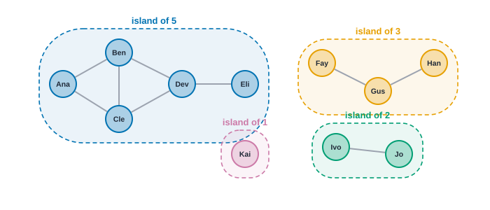
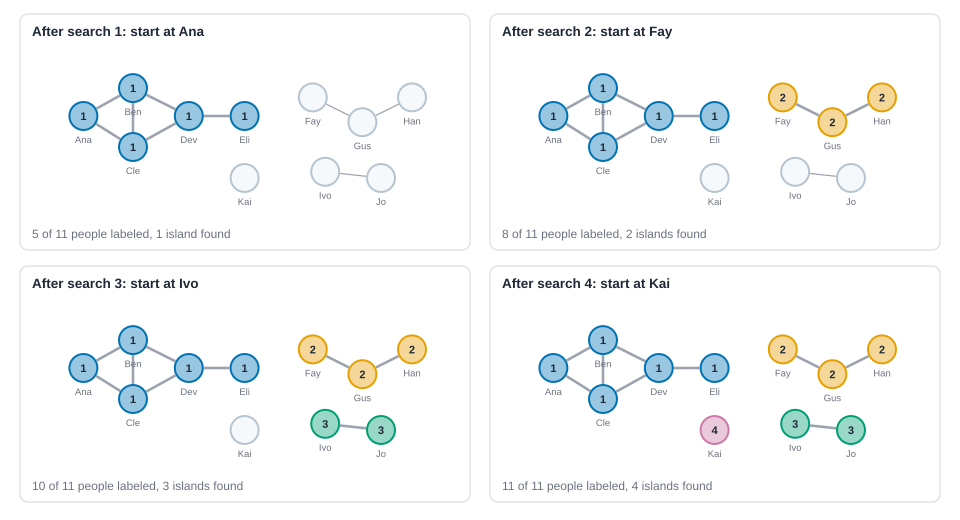
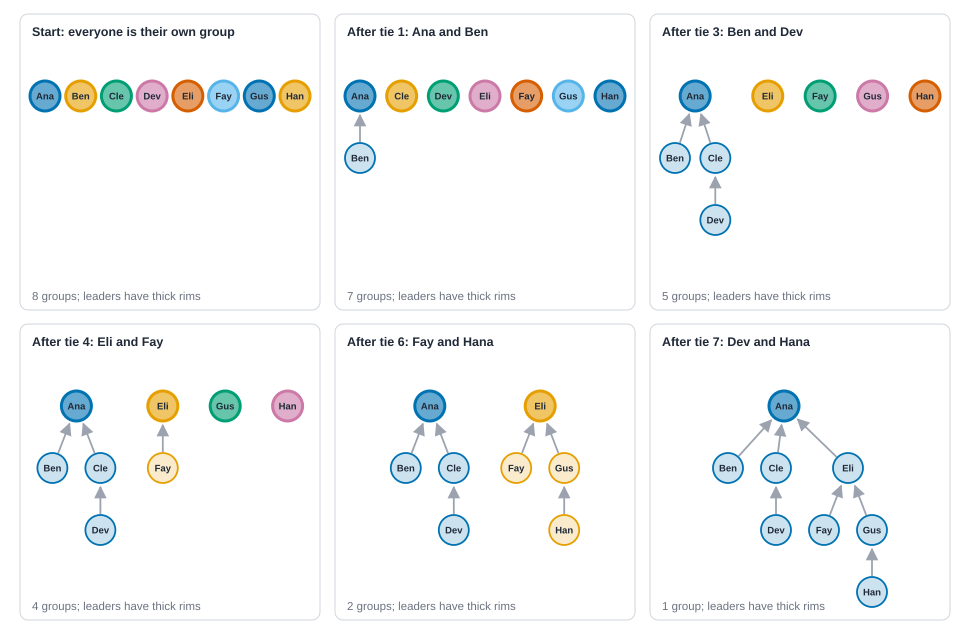
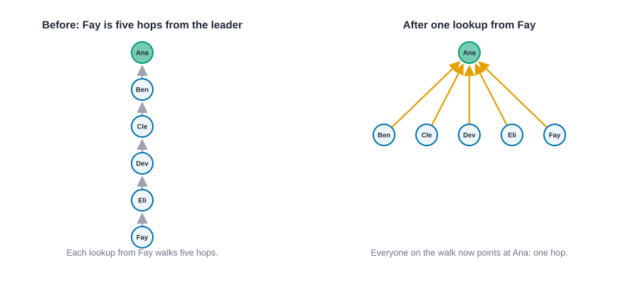
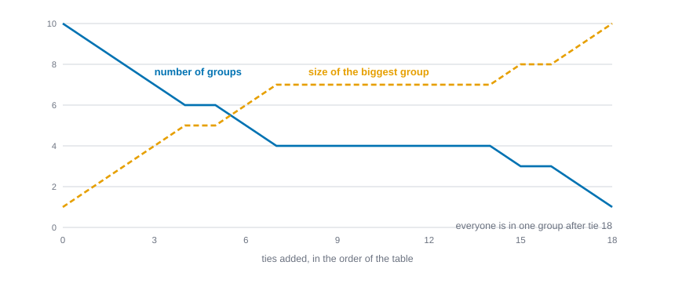
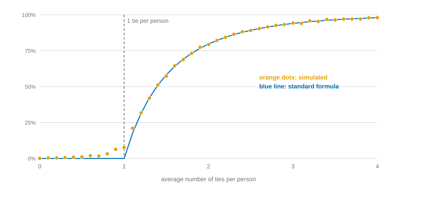
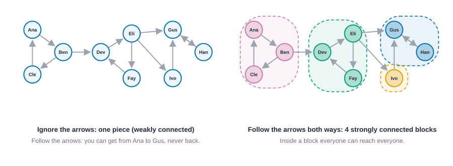
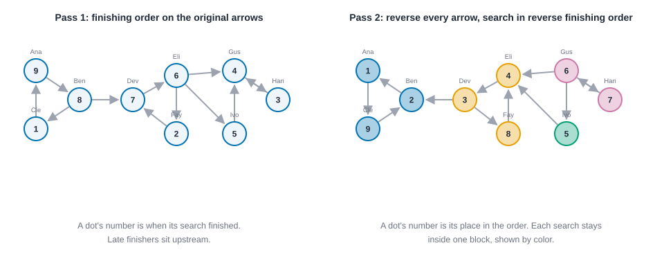
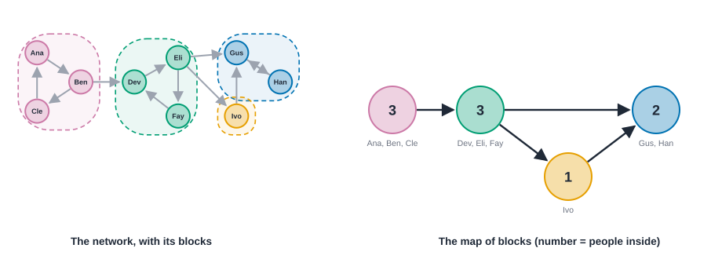

# Components {#sec-components}

::: {.callout-note appearance="simple"}
## Prerequisites
@sec-traversal (breadth-first and depth-first search) and a first look at union-find from @sec-building-blocks. If "start somewhere and visit everyone you can reach" and "keep each person's group leader" both ring a bell, you're ready. Chapter 8 isn't needed, though it set up the question of which people can reach each other at all.
:::

::: {.callout-note title="The short version"}
A network that looks like one thing is often several. A component is a group of people who can all reach each other, with no way across to anyone outside. In a network where ties go both ways, you can find the components by searching outward from someone, marking everyone you reach, and starting again from someone unmarked. A cleverer method, union-find, handles ties arriving one at a time and always knows the current groups. When ties are one-way, things split in two: you can be reachable *from* someone without being able to reach them *back*. The groups where everyone reaches everyone are strongly connected components, and two classic methods find them in a single pass over the network. Collapse each one to a dot and the result is a one-way map of blocks.
:::

::: {.callout-note title="Why you might care"}
Almost every measure in network analysis quietly assumes one connected piece. Distances become infinite across a gap (@sec-all-pairs). A "mean distance" or a "most central person" can describe only the biggest island. Before you compute anything, find the islands. When ties have direction (who follows whom, which page links where, which job feeds which), the strongly connected blocks are where influence can circle back, and the map of blocks tells you who is upstream of whom.
:::

## Islands

Picture a lake with islands and ferries. Each ferry runs between two islands and carries people both ways. If you're on one island, which other islands can you reach? Everyone you can reach by some chain of ferries is in the same **connected component** as you: a **component** is a maximal set of people, any two of whom can reach each other. "Maximal" means you can't add anyone else and keep that true.

Two things follow straight away. Every person belongs to exactly one component, so the components cut the network into non-overlapping pieces. And a person with no ties at all, an **isolate**, is a component of size one. @fig-islands has all the cases.

{#fig-islands fig-alt="Eleven people drawn in four dashed boxes. The largest box holds Ana, Ben, Cleo, Dev and Eli, tied together. Next, Fay, Gus and Hana in a chain. Then Ivo and Jo, tied to each other. Kai sits alone in the fourth box. There are no ties between boxes."}

### What you'll be able to do

By the end of this chapter you should be able to:

- find the components of a network by search, and by union-find, and say when to prefer each;
- explain, in a sentence each, why union-find is nearly instant per tie;
- tell weakly connected from strongly connected, and say which question each answers;
- follow Tarjan's and Kosaraju's methods on a nine-person example;
- collapse a one-way network into its map of blocks.

## A tiny example, by hand

Take the eleven people of @fig-islands. The ties are Ana-Ben, Ana-Cleo, Ben-Cleo, Ben-Dev, Cleo-Dev, Dev-Eli, Fay-Gus, Gus-Hana and Ivo-Jo. Kai has none.

To find the components by hand, pick the first person on the list and follow ties as far as you can.

- Start at Ana. She knows Ben and Cleo. Ben knows Dev. Dev knows Eli. Nobody new turns up after Eli. The first island: Ana, Ben, Cleo, Dev, Eli (five people).
- The next unmarked person is Fay. Fay knows Gus, Gus knows Hana. Nobody else. Second island: Fay, Gus, Hana (three).
- The next unmarked is Ivo, who knows Jo. Third island: Ivo, Jo (two).
- The last unmarked person is Kai. Fourth island: Kai (one).

Four components, with sizes 5, 3, 2 and 1. The biggest holds 5 of 11 people, which is 45 percent. A network with the same 11 people and the same 9 ties could look quite different, but "how many islands and how big is the biggest" is the first honest summary of any network.

## Finding components by search

That by-hand procedure *is* the algorithm. It's a loop around the searches you already know.

### The steps

1. Give every person a blank label. Set a counter to 1.
2. Go through the people in order. When you meet someone with a blank label, search outward from them (breadth-first or depth-first, it makes no difference to the result) and give everyone you reach the current counter as their label.
3. Add one to the counter and keep going down the list.
4. When you've passed the last person, every label is set. People with the same label are in the same component, and the final counter minus one is the number of components.

{#fig-sweep-labels fig-alt="Four copies of the eleven-person network. In the first, only the five-person island is labeled 1. In the second, the three-person island is added, labeled 2. In the third, the two-person island is labeled 3. In the fourth, Kai is labeled 4 and every person has a label."}

Look at @fig-sweep-labels. The search from Ana colors five people. The loop then walks past Ben, Cleo, Dev and Eli (already labeled), and stops at Fay, the first blank. Each search stays on its own island, because no tie leads off one.

::: {.callout-tip title="In plain words"}
The outer loop is "find the next person I haven't placed". The inner search is "everyone I can reach from them". Because every person gets labeled once, and each tie is looked at from each end at most once overall, the whole thing is only a little more work than one search.
:::

### What it costs

Every person is labeled once and every tie is examined once or twice. Double the network and the work doubles. In symbols, with *n* people and *m* ties, the cost is $O(n + m)$ and the memory is one label per person.

::: {.callout-tip title="In plain words"}
$O(n + m)$ means "proportional to the number of people plus the number of ties". A network of a million people and five million ties costs a few million steps, the time it takes to read the file. Components are, in effect, free once you've paid to load the network.
:::

This is the method nearly every library uses when you hand it a finished network and ask for its components. Its limit shows up when the network is *changing*: add a tie and you'd have to search again. That's where the next method comes in.

## Union-find: groups that merge as ties arrive

### The story: clubs and leaders

Imagine a school where friendship clubs merge. Each club has a **leader**. To find out whether Ana and Dev are in the same club, you don't search the whole school. You ask each of them "who is your leader?" and compare. If the leaders are the same person, same club. When a tie shows up between two people in different clubs, you merge the clubs by making one leader answer to the other.

That's the whole idea of **union-find** (also called a disjoint-set structure). It supports two moves:

- **find(*x*):** who is the leader of *x*'s group?
- **union(*a*, *b*):** merge the groups of *a* and *b*.

### How people point at leaders

To make this concrete, give every person one note: the name of someone in their group, or their own name if they are the leader. Follow the notes from anyone and you arrive at the leader (people pointing at people pointing at people, like a family tree turned upside down). @fig-uf-forest draws this for eight people as ties arrive.

{#fig-uf-forest fig-alt="Six snapshots of eight people. At the start there are eight separate groups. After one tie, Ana and Ben form a group. After three ties there is a group of four and two singletons. After four, five, and seven ties the groups merge until, after tie seven, all eight people hang under one leader in a short tree."}

### The steps

To handle a tie between *a* and *b*:

1. Find *a*'s leader, and *b*'s leader (follow the notes).
2. If they're the same person, the two are already in one group. Do nothing.
3. Otherwise, make the leader of the smaller group point at the leader of the bigger group. Update the bigger group's size.

To ask "are *a* and *b* in the same group?": find both leaders and compare.

::: {.callout-tip title="In plain words"}
A tie either confirms something you already knew (same leader) or it merges two groups with one tiny edit (one note changes). Nothing is ever searched. Reading a million ties costs a million little lookups, not a million searches.
:::

Notice rule 3: **smaller under bigger**. If you always do that, no one can end up very far from their leader. A person's distance from their leader grows by one only when their group joins a group at least as big, so it can double in size at most as often as you can double a number before hitting *n*. That is about log *n* steps: ten, for a thousand people. This rule is called **union by size**.

### A shortcut for next time

There's one more trick. When you follow notes from *x* up to the leader, the walk can be long. Suppose Fay is five hops from her leader (@fig-uf-compress). After finding the leader, walk the same path again and make *everyone you passed* point straight at the leader. The next lookup from any of them is one hop.

{#fig-uf-compress fig-alt="Left: six people stacked in a chain, each pointing at the one above, Ana at the top, so Fay is five hops below. Right: Ana at the top with the other five people in a row below her, each pointing directly at Ana with an orange arrow."}

This is **path compression**. The work you do is the work you were already doing, plus one extra pass over the same short list, and every future lookup gets cheaper.

### What it costs

With union by size alone, a lookup takes at most about log *n* hops. With path compression too, Tarjan [@tarjan1975efficiency] showed that the cost per operation grows more slowly than any function you would ever meet: it is the **inverse Ackermann function**, which is at most 4 or 5 for any network that could fit in the observable universe. Earlier, Galler and Fischer [@galler1964improved] introduced the structure of notes and leaders.

::: {.callout-tip title="In plain words"}
In practice, each union or find costs a handful of steps, no matter how big the network is. A billion ties cost a few billion steps, about the same as reading them. That is why union-find is the standard tool for "ties arrive one at a time, tell me the groups".
:::

### Watching the groups form

@fig-ties-arrive tracks the ten-person friendship network from the Social Network Analysis book as its eighteen ties arrive in the order of the table. Union-find answers "how many groups now, and how big is the biggest?" after every tie, for free.

{#fig-ties-arrive fig-alt="A line chart over eighteen ties. The solid blue line, number of groups, falls from 10 and reaches 1 after tie 18. The dashed orange line, size of the biggest group, rises from 1 to 10 over the same ties."}

Notice the last step. Seventeen ties get the first nine people tied together, and the 18th tie, Ivo to Jo, brings in Jo. Until Jo's single tie arrives, Jo is an island of one. A single missing tie is the difference between "one component" and "two".

### The cost in symbols

Write *n* for the number of people and *m* for the number of operations (ties read, or questions asked). With union by size and path compression together, the total work for all *m* operations is

$$
O\bigl(m \cdot \alpha(n)\bigr),
$$

where $\alpha$ (the Greek letter alpha) is the inverse Ackermann function [@tarjan1975efficiency].

::: {.callout-tip title="In plain words"}
$\alpha(n)$ is a function that grows so slowly it is hard to say out loud: it is 1 for tiny *n*, 4 for any *n* you could write down with every atom in the universe as a digit. So $O(m \cdot \alpha(n))$ means "about *m* times a number no bigger than 4 or 5". A billion ties cost about five billion small steps at the very worst, and in practice a bit more than one per tie.
:::

### Search or union-find?

Both give the same components. Which should you pick?

| | Search from each unlabeled person | Union-find |
| --- | --- | --- |
| **Cost** | About *n* + *m* | About *m* tiny steps |
| **Works on** | A network you already have | A stream of ties, or a network that keeps changing |
| **Gives you** | Components, plus distances and routes if you want them | Components only |
| **Memory** | The network, plus labels | One note and one size per person |
| **Use it when** | You'll search anyway | You only need the groups, or ties keep coming |

Neither one is faster in a way you will notice on a finished network. Pick by what else you need.

### Reporting components well

A single number ("the network has 4 components") is the least useful way to report them. A short table is better, and it takes a few lines to produce:

| Component | People | Share of everyone |
| --- | --- | --- |
| 1 | 5 | 45% |
| 2 | 3 | 27% |
| 3 | 2 | 18% |
| 4 | 1 | 9% |

Three habits make a components report honest. Give the size of the biggest one as a share of everyone. Say how many isolates there are separately (they are components, but a different kind of fact). And say which people fall outside the biggest island if the question is about them.

### A small preview: what happens if someone leaves?

Components also answer a "what if" question. Take Hana out of the ten-person friendship network of @sec-all-pairs. Ivo and Jo have only Hana (and each other) as a way into the rest of the network, so the network falls into two components: Ivo and Jo, and the other seven. Hana is a **cut point**, someone whose removal splits a component. Finding all such people in one pass is the subject of @sec-connectivity-dags, and the method is a cousin of Tarjan's low numbers.

### What union-find cannot do

Union-find is wonderful at joining groups and hopeless at splitting them. If a tie *disappears*, nothing in the notes remembers which merge it caused. Networks that gain and lose ties over time need other methods (@sec-dynamic-temporal). The usual workarounds are to rebuild from scratch now and then, or to keep ties along with the time they appear and disappear and ask for the groups at a chosen moment.

### Components as a data check

A number worth looking at before any analysis: how many components, and what sizes? A network that *should* be one connected group but shows up as ten thousand components is usually a data problem, not a discovery. The most common cause is names that don't match. "Ben Smith" in one file and "Benjamin Smith" in another become two people, and every tie that should join them is lost. Another is a tie file that drops one side of a pair.

So treat the component table as a smoke test. A giant island with a long tail of tiny islands of size one or two often means a handful of people appear under several spellings. Look at the smallest components first: they are where mismatched names hide.

## When a giant island appears

Components have a famous pattern that is worth seeing once. Build a network by adding random ties between people, and watch the biggest island. For a long time it's tiny. Then, just as the average person reaches one tie, a **giant component** appears and quickly swallows most of the network [@erdos1960evolution].

{#fig-giant-component fig-alt="A curve rising from near zero at an average of one tie per person to about 80 percent at two and 98 percent at four. Orange dots from simulated networks of a thousand people sit on a blue formula curve. A dashed vertical line marks one tie per person."}

The dots in @fig-giant-component are simulations: a thousand people, ties chosen at random, five repeats per point, components found with union-find. At an average of 2 ties per person the biggest island holds about 80 percent of the people. At 3, about 94 percent. Below 1, it's a handful.

The practical lesson is that real networks sit on the "mostly one giant island, plus a few stragglers" side of this curve. When someone reports "the network has 40 components", the first thing to ask is how big the biggest is, and how big the next one is.

### Components of a very large network

Nothing in the search method is slow. The trouble with a network of a billion ties is that one search at a time can't use all the processor cores. Two ideas are common.

- **Many searches at once.** Several searches start from different people and meet in the middle, each noting which group the others belong to when they collide. The notes are exactly a union-find, shared between the searches.
- **Look at a few ties first.** Take just two or three ties per person, find the groups they make (a giant island appears almost immediately, as in @fig-giant-component), and then only examine the remaining ties of people *not* in the giant island. Most of the network is in the giant island, so most ties never need to be looked at in detail.

Either way, what is computed is the same partition of people into components. The speed-ups change *how long it takes*, not the answer, and a good test of such a program is that its components match a plain search on a network small enough to check.

## One-way ties: weak and strong

### The story: one-way streets

Components were simple because ties went both ways. A ferry that runs both directions means "I can reach you" and "you can reach me" are the same statement.

Now make the streets one-way. From Ana's house you can drive to Gus's, but there's no road back. Are Ana and Gus "connected"? It depends on what you mean, and there are two honest answers.

- **Weakly connected:** if you ignore the arrows, you can get from one to the other. The network is in one piece as a map.
- **Strongly connected:** you can get from Ana to Gus *and* from Gus back to Ana, following the arrows. Two people are strongly connected only if each can reach the other.

A **strongly connected component** (often abbreviated SCC) is a maximal group in which everyone can reach everyone, following the arrows. It's the directed version of an island, and it's the one that matters when the question is "can a message circle back?"

{#fig-one-way fig-alt="Two copies of a nine-person network with arrows. On the left they form one connected picture. On the right they are grouped into four boxes: Ana, Ben and Cleo; Dev, Eli and Fay; Gus and Hana; and Ivo alone. Arrows between boxes only point one way, from left to right."}

@fig-one-way shows nine people. Ana, Ben and Cleo go in a circle: Ana to Ben, Ben to Cleo, Cleo back to Ana. They form a strongly connected block. Dev, Eli and Fay form another circle. Gus and Hana point at each other. And Ivo, who has an arrow in from Eli and an arrow out to Gus, is a block all alone: you can reach Ivo, and leave, but no path returns to Ivo from where he sends you.

Notice that arrows between blocks only point one way: from the left block to the right ones. That's not a coincidence. If an arrow went back, the two blocks would merge into one. We'll use that fact in a moment.

### A smaller case by hand

Before the nine-person network, try Tarjan's method on four people with arrows Ana to Ben, Ben to Cleo, Cleo to Ben and Cleo to Dev. Number as you go.

- Visit Ana: visit number 0, low 0. Stack: Ana.
- Ana points at Ben. Visit Ben: 1, low 1. Stack: Ana, Ben.
- Ben points at Cleo. Visit Cleo: 2, low 2. Stack: Ana, Ben, Cleo.
- Cleo points at Ben, who is on the stack. Cleo's low drops to Ben's visit number, 1.
- Cleo points at Dev. Visit Dev: 3, low 3. Stack: Ana, Ben, Cleo, Dev. Dev points at nobody. Dev's low equals his visit number, so Dev is a leader: pop Dev. **Block 1: Dev.**
- Back at Cleo: low is 1, visit is 2. Not a leader. Back at Ben: Cleo's low was 1, so Ben's low stays 1, and 1 equals Ben's visit number, so Ben is a leader. Pop down to Ben: Cleo and Ben. **Block 2: Ben, Cleo.**
- Back at Ana: her low is 0, equal to her visit number. Pop Ana. **Block 3: Ana.**

Three blocks, found in the order sink first: Dev, then Ben and Cleo, then Ana. That's the same order the nine-person example comes out in.

## Tarjan's method: one pass, two numbers

Robert Tarjan found a way to list every strongly connected component in a single depth-first search [@tarjan1972depth]. It looks strange at first, so let's go slowly.

### The story: breadcrumbs

Walk through the network leaving breadcrumbs. Number each person the moment you first arrive, 0, 1, 2 and so on: that's their **visit number**. Also keep a pile of everyone you've visited and not yet put in a group, like a stack of coats at a party.

As you explore, track one more thing for each person: the **low number**, which is the smallest visit number you can get *back to* from them by following arrows (including the ones you find while exploring beyond them). If you can circle back to someone who was visited earlier, your low number is that earlier number. If you can't, your low number is just your own visit number.

Here's the key fact: **a person whose low number equals their visit number is the leader of a block**: they can't get back to anyone earlier, so they are the earliest member of their group. At that moment, pop coats off the stack until you reach them. Everyone you pop is in their block.

### The steps

1. Pick an unvisited person. Visit them: give them the next visit number, set their low number equal to it, and push them on the stack.
2. Look at each person they point to.
   - If that person is unvisited, visit them (step 1, recursively). When you come back, lower this person's low number if the other person's was smaller.
   - If that person is on the stack (visited, not yet placed in a block), lower this person's low number to that person's visit number if it's smaller.
   - If that person is already in a finished block, ignore them.
3. After looking at everyone, if this person's low number equals their visit number, pop the stack down to and including them. Those people are one block.
4. Repeat from step 1 for any person still unvisited.

{#fig-tarjan-trace fig-alt="The nine-person directed network with each dot labeled with two numbers. Below, a table of the first steps of the search with the stack contents, and a list of the 4 blocks in the order the method finds them: Gus, Hana; Ivo; Dev, Eli, Fay; Ana, Ben, Cleo."}

Read @fig-tarjan-trace from the table. Steps 1 to 3 visit Ana, Ben and Cleo, who get visit numbers 0, 1, 2. Cleo points back at Ana, who is still on the stack, so Cleo's low number drops to 0, and when the search backs up, so does Ben's. The search keeps going from Ben to Dev (visit 3), Eli (4) and Fay (5). Fay points back at Dev, so Fay's low and Eli's low drop to 3. At steps 7 and 8 the search reaches Gus (6) and Hana (7). They point at each other, so Hana's low is 6 and Gus is the leader, and at step 9 Gus and Hana pop off the stack as the first block. Ivo (8) is next and is his own leader. Then Dev (low 3 = visit 3) pops Dev, Eli and Fay. Finally Ana (low 0 = visit 0) pops Ana, Ben and Cleo.

::: {.callout-tip title="In plain words"}
Number people as you meet them, and for each person note the earliest-met person they can circle back to. Anyone who can't get back past themselves is the founding member of a block, and everyone met after them and still waiting is in the block. The stack is just the list of "met, but not yet placed in a block".
:::

### What it costs

Every person is visited once and every arrow is looked at once. Double the network and the work doubles: $O(n + m)$ time, with memory for the visit numbers, low numbers and the stack: one pass, no copy of the network.

A hidden cost: depth-first search is naturally recursive, and a long chain of people (a million people in a line) means a million recursive calls waiting. Many programs run out of room for that and crash. A careful implementation keeps its own stack in memory instead of relying on recursion, and that is how a library handles a very long chain.

## Kosaraju's method: forward, then backward

Kosaraju's method finds the same blocks with two ordinary searches, which makes it easier to explain at the cost of building a reversed copy of the network. (It was found by Rao Kosaraju in the 1970s and published by Sharir [@sharir1981strong].)

### The idea in words

Two facts do all the work.

1. *If you search from a person in the right block, the search stays inside that block, plus whatever lies downstream.* The trouble is knowing which block to start in.
2. *If you reverse every arrow, the blocks are the same, but "downstream" and "upstream" swap.*

So the plan is: first, use a search on the original network to find an order that puts upstream blocks first. Then reverse all arrows and search in that order. Each search now starts in the most upstream block remaining, and in the reversed network it can only reach *its own block*, because everything downstream has become unreachable.

### The steps

1. Do a depth-first search on the whole network. Note each person at the moment their search *finishes* (when all their neighbors have been explored). That gives a **finishing order**.
2. Reverse every arrow.
3. Take people in *reverse finishing order* (latest finisher first). For each person not yet in a block, search from them in the reversed network. Everyone that search reaches is one block.

{#fig-kosaraju-passes fig-alt="Two copies of the nine-person network. On the left, each person is labeled with the order in which their search finished. On the right, every arrow is reversed, each person is labeled with their place in the reverse order, and they are colored by block: Ana, Ben, Cleo; Dev, Eli, Fay; Gus, Hana; Ivo."}

In @fig-kosaraju-passes, Ana finishes last (9), because her search began at the start and could only finish after everything else under her did. So in pass 2, Ana goes first. In the reversed network Ana's search reaches only Cleo and Ben, the other members of her block, and stops, because the arrow from Ben to Dev now points the other way, back at Ben. Next, Dev (place 3) starts a search that reaches Eli and Fay and nobody else. Then Ivo, then Gus, who reaches Hana.

::: {.callout-tip title="In plain words"}
Pass 1 asks "who finishes last?" and the answer is someone in the most upstream block. Pass 2 flips the arrows so that block can only reach itself, peels it off, and moves on to the next most upstream. Two searches, one reversed copy of the arrows.
:::

### Tarjan or Kosaraju?

| | Tarjan | Kosaraju |
| --- | --- | --- |
| **Passes** | One | Two |
| **Extra memory** | Visit and low numbers, one stack | A reversed copy of the arrows, finishing order |
| **Easiest to explain** | Harder | Easier |
| **Order blocks come out** | Sinks first (downstream blocks first) | Sources first (upstream blocks first) |
| **Cost** | About *n* + *m* | About 2(*n* + *m*) |

Both are linear. Libraries differ. Many use Tarjan, but good ones also guard against deep recursion.

## Condensation: a map of blocks

Here's the payoff. Replace each strongly connected block by a single dot, keep the arrows that run *between* blocks, and throw away the arrows inside. This is called the **condensation** of the network.

{#fig-condensation fig-alt="On the left, the nine-person network with four boxes around the blocks. On the right, four dots sized by block, with arrows between them: the block of Ana, Ben and Cleo leads to the block of Dev, Eli and Fay, which leads both to Ivo and to the block of Gus and Hana, and Ivo leads to Gus and Hana. There are no arrows back."}

The result has a wonderful property: **it has no loops**. If there were a loop among blocks, everyone on the loop could reach everyone else, and they'd have been one block already. A network with no loops (a **directed acyclic graph**, or DAG) can always be laid out so that every arrow points the same way. That's why @fig-condensation reads left to right. The next chapter (@sec-connectivity-dags) is about what you can do with such a map.

Reading the map tells you things the raw network hides:

- A block with no arrows coming in is a **source**: nothing upstream of it. Here, Ana's block.
- A block with no arrows going out is a **sink**: once you're in, you don't leave. Here, Gus and Hana.
- Blocks in between are *transit*: they receive and pass things on.
- Anything that starts at a source can reach every block downstream of it. Nothing at a sink reaches anyone outside.

If a rumor starts in Ana's block, it can reach all nine people. If it starts in Gus and Hana's block, it reaches two.

## Reading a library's component functions

You will usually call a library, not write these routines. Before you trust one, run it on the eleven-person network and the nine-person network and check:

1. **Weak or strong?** For a directed network, which one does the default mean? Does it say?
2. **Isolates.** Is Kai counted as a component of size one, or silently dropped?
3. **Self-loops and repeated ties.** Does an extra copy of a tie change anything? It shouldn't.
4. **Labels.** Are labels numbered from 0 or 1, and in what order? Never compare label numbers across tools. Compare the partitions.
5. **Sizes.** Can you get the size of each component without counting yourself?
6. **Block order.** For strong components, does the tool give blocks sources first or sinks first, or in no promised order?

The expected answers are on the pages above: four components of sizes 5, 3, 2 and 1, and four strong blocks of sizes 3, 3, 2 and 1.

## Which tool for which question

| You want to know | Use |
| --- | --- |
| Is the network one piece? | Components by search, or union-find |
| How big is the biggest island? | Component sizes |
| Are Ana and Dev in the same group right now, as ties keep coming? | Union-find |
| Is a rumor started anywhere able to reach everyone (one-way ties)? | Strong components, then condensation |
| Where does a message started at Ana end up? | A search from Ana (distances, @sec-traversal) |
| Who is upstream of whom? | Condensation, then read sources and sinks |
| Who splits the network if they leave? | Cut points (@sec-connectivity-dags) |

## At a glance

| Question | Method | Time | Memory | Use it when |
| --- | --- | --- | --- | --- |
| Components, finished network | Search with a label sweep | About *n* + *m* | One label per person | You have the network |
| Components, ties arriving | Union-find | Nearly constant per tie | A note and a size per person | Stream of ties, or live updates |
| Weak components (directed) | Same, ignoring direction | About *n* + *m* | One label per person | "Is it one piece as a map?" |
| Strong components | Tarjan | About *n* + *m* | Numbers and a stack | One pass preferred |
| Strong components | Kosaraju | About 2(*n* + *m*) | A reversed copy | Simplest to explain and check |
| Map of blocks | Condensation | After the components | One small network | "Who is upstream of whom?" |

## Where it goes wrong

**Isolates count.** A person with no ties is a component of size one. A network of a thousand people where nine hundred have no ties has 901 components, and the biggest may hold a hundred. "Number of components" is not the same as "number of pieces that matter". Always report the size of the biggest, and of the next few.

**Weak versus strong.** A one-way network can be weakly connected and still have every pair of people unable to reach each other both ways. "The network is connected" in a paper about a directed network usually means weakly. Check, because the claim about *reaching* someone is a strong-connection claim.

**Self-loops and repeated ties.** A person tied to themselves, or the same tie listed twice, doesn't change components. Union-find sees "same leader" and does nothing. Just don't count those as extra ties when you divide.

**Recursion depth.** A depth-first search on a very long chain can use up the program's call stack and crash, which looks like a mysterious failure on large, sparse networks. Use a method with its own stack.

**Comparing parents instead of leaders.** The classic union-find bug: checking whether two people point at the *same note* rather than the *same leader*. Two people in one group can point at different people. Always follow the notes all the way up before comparing.

**Stale leaders.** After a union, leaders change. A leader you looked up before the union may point at someone else now. Look up again.

**Labels are arbitrary.** Which island is "component 1" depends on the order you visit people, on how neighbors are listed, and on which method you used. Two correct programs can number components differently. Compare partitions, not label numbers.

**A sample of the network may fragment.** If you take a random subset of ties or people, components can split that were joined in the full network. A component count from a sample describes the sample.

**One component isn't one community.** Being in the same component only means "reachable". A single bridge tie can connect two very different groups into one component, and community structure (@sec-modularity-louvain-leiden) is a separate question.

## If you like proofs

::: {.callout-note title="If you like proofs: why union by size keeps trees short"}
This is optional.

Follow one person, *x*. Their distance to their leader increases by one only when their group's leader is made to point at another leader, which happens only if their group is the smaller of the two (or tied). So after that union, *x*'s group is at least twice as big as it was before. A group can double at most log₂ *n* times before it holds all *n* people. So *x* is at most about log₂ *n* hops from the leader, whatever order the ties arrive in.
:::

::: {.callout-note title="If you like proofs: why a low number marks the leader"}
This is optional.

In Tarjan's method, suppose person *v* has low number equal to visit number. Everyone on the stack above *v* was visited after *v* and is reachable from *v* (they are inside the part of the search that started at *v*). None of them can get back before *v*, or *v*'s low number would be smaller, so every one of them can reach *v* (through the people who point back to something on the stack, ultimately to *v* or beyond, and since nothing reaches beyond *v*, to *v*). So they and *v* can all reach each other: a block. And no one outside is in it: anyone who could reach *v* and be reached from *v* would have been on the stack too, or in an earlier block (and then *v* would be reachable *from* that block but could not reach back).

If *v*'s low number is smaller than its visit number, then *v* can reach an earlier person *u* who is still on the stack. And *u* can reach *v* (the search got from *u* to *v* along tree arrows). So *v* is in a block with *u*, and *v* is not that block's leader.
:::

::: {.callout-note title="If you like proofs: why Kosaraju's second pass stays inside a block"}
This is optional.

The key fact: among two blocks *A* and *B* with an arrow from *A* to *B*, the person who finishes last in pass 1 within *A* finishes after everyone in *B*. (If the search enters *A* first, it reaches *B* through the arrow and finishes everything in *B* before it can finish the first-entered person in *A*. If it enters *B* first, it can never reach *A* from *B*, so it finishes *B* before it even visits *A*.) So the person who finishes latest overall is in a source block. In the reversed network, no arrow leaves that block to any other block (they all point into it now), so a search from that person stays inside the block. Remove it and repeat: the next latest finisher is in a source block of what remains.
:::

::: {.callout-tip title="In plain words"}
Three proofs, three ideas. In union by size, every time a person's leader is demoted, their group at least doubles, which can only happen a few times. In Tarjan's method, "can't get back before me" means "I started this block". In Kosaraju's method, the person who finishes last is upstream of everyone, so when the arrows are reversed their block is walled in.
:::

## Words to keep

| Word | Plain meaning |
| --- | --- |
| Component | A maximal group in which any two people can reach each other |
| Isolate | A person with no ties, a component of size one |
| Giant component | A component holding a large share of everyone |
| Weakly connected | One piece if you ignore arrow directions |
| Strongly connected | Everyone can reach everyone, following the arrows |
| Strongly connected component (SCC, "block") | A maximal strongly connected group |
| Condensation | The network with each block collapsed to one dot |
| Directed acyclic graph (DAG) | A one-way network with no way to loop back |
| Source, sink | A block with no arrows in, or none out |
| Cut point | A person whose removal splits a component |
| Union-find | Notes that point to group leaders, so groups can merge cheaply |

## Putting it together

Here is the whole chapter in one line of thought. Ask first whether ties go both ways. If they do, components are islands, and either a search or union-find finds them. If they don't, ask whether you mean "one piece on the map" (weak) or "everyone can reach everyone" (strong). The strong question is answered in one pass by Tarjan's method or in two by Kosaraju's, and the answer, once each block is collapsed to a dot, is a map that only flows one way, with sources at the start and sinks at the end.

Every one of those methods costs about as much as reading the network once. That is the reason components are the first thing to compute: they are nearly free, and everything else you measure depends on them.

## Code

These blocks are stubs for now, each saying exactly what it will compute.

The first block builds the eleven-person network of @fig-islands and prints the component label of each person and the sizes of the components. Look for four components of sizes 5, 3, 2 and 1.

::: {.panel-tabset group="language"}

## R

```r
# TODO(code, R): build the eleven-person network (Ana-Ben, Ana-Cleo, Ben-Cleo, Ben-Dev, Cleo-Dev, Dev-Eli, Fay-Gus, Gus-Hana, Ivo-Jo, Kai alone) and print each person's component label and the component sizes (expected 4 components of sizes 5, 3, 2, 1)
```

## Python

```python
# TODO(code, Python): build the eleven-person network (Ana-Ben, Ana-Cleo, Ben-Cleo, Ben-Dev, Cleo-Dev, Dev-Eli, Fay-Gus, Gus-Hana, Ivo-Jo, Kai alone) and print each person's component label and the component sizes (expected 4 components of sizes 5, 3, 2, 1)
```

## Rust

```rust
// TODO(code, Rust): build the eleven-person network (Ana-Ben, Ana-Cleo, Ben-Cleo, Ben-Dev, Cleo-Dev, Dev-Eli, Fay-Gus, Gus-Hana, Ivo-Jo, Kai alone) and print each person's component label and the component sizes (expected 4 components of sizes 5, 3, 2, 1)
```

:::

::: {.code-output}
TODO(output): the labels and sizes.
:::

The second block feeds the ten friends' eighteen ties to union-find one at a time and prints the number of groups and the size of the biggest group after each tie. Look for 10 groups at the start and 1 group after tie 18.

::: {.panel-tabset group="language"}

## R

```r
# TODO(code, R): add the eighteen ties of the ten-person friendship network one at a time to union-find and print the number of groups and the biggest group size after each (expected groups 9, 8, 7, 6, 6, 5, 4, 4, 4, 4, 4, 4, 4, 4, 3, 3, 2, 1)
```

## Python

```python
# TODO(code, Python): add the eighteen ties of the ten-person friendship network one at a time to union-find and print the number of groups and the biggest group size after each (expected groups 9, 8, 7, 6, 6, 5, 4, 4, 4, 4, 4, 4, 4, 4, 3, 3, 2, 1)
```

## Rust

```rust
// TODO(code, Rust): add the eighteen ties of the ten-person friendship network one at a time to union-find and print the number of groups and the biggest group size after each (expected groups 9, 8, 7, 6, 6, 5, 4, 4, 4, 4, 4, 4, 4, 4, 3, 3, 2, 1)
```

:::

::: {.code-output}
TODO(output): groups and biggest group after each tie.
:::

The third block finds the strongly connected blocks of the nine-person one-way network by both Tarjan's and Kosaraju's method and checks that they agree. Look for four blocks: Ana, Ben and Cleo; Dev, Eli and Fay; Gus and Hana; Ivo.

::: {.panel-tabset group="language"}

## R

```r
# TODO(code, R): build the nine-person one-way network (Ana>Ben, Ben>Cleo, Cleo>Ana, Ben>Dev, Dev>Eli, Eli>Fay, Fay>Dev, Eli>Gus, Gus>Hana, Hana>Gus, Eli>Ivo, Ivo>Gus), print its strongly connected blocks from Tarjan and from Kosaraju, and TRUE if they agree (expected 4 blocks of sizes 3, 3, 2, 1)
```

## Python

```python
# TODO(code, Python): build the nine-person one-way network (Ana>Ben, Ben>Cleo, Cleo>Ana, Ben>Dev, Dev>Eli, Eli>Fay, Fay>Dev, Eli>Gus, Gus>Hana, Hana>Gus, Eli>Ivo, Ivo>Gus), print its strongly connected blocks from Tarjan and from Kosaraju, and True if they agree (expected 4 blocks of sizes 3, 3, 2, 1)
```

## Rust

```rust
// TODO(code, Rust): build the nine-person one-way network (Ana>Ben, Ben>Cleo, Cleo>Ana, Ben>Dev, Dev>Eli, Eli>Fay, Fay>Dev, Eli>Gus, Gus>Hana, Hana>Gus, Eli>Ivo, Ivo>Gus), print its strongly connected blocks from Tarjan and from Kosaraju, and true if they agree (expected 4 blocks of sizes 3, 3, 2, 1)
```

:::

::: {.code-output}
TODO(output): the blocks from both methods and the agreement check.
:::

The last block collapses those blocks into the map of @fig-condensation and prints its arrows, its sources and its sinks. Look for Ana's block as the only source and Gus and Hana's block as the only sink.

::: {.panel-tabset group="language"}

## R

```r
# TODO(code, R): condense the nine-person one-way network and print the four blocks, the arrows between blocks, the source block and the sink block (expected source Ana, Ben, Cleo; sink Gus, Hana; 4 arrows between blocks)
```

## Python

```python
# TODO(code, Python): condense the nine-person one-way network and print the four blocks, the arrows between blocks, the source block and the sink block (expected source Ana, Ben, Cleo; sink Gus, Hana; 4 arrows between blocks)
```

## Rust

```rust
// TODO(code, Rust): condense the nine-person one-way network and print the four blocks, the arrows between blocks, the source block and the sink block (expected source Ana, Ben, Cleo; sink Gus, Hana; 4 arrows between blocks)
```

:::

::: {.code-output}
TODO(output): blocks, arrows, source and sink.
:::

## Animations

<!-- TODO(animation): needs the engine's union-find results frame by frame on the eight-person example: after each tie, the leader of every person and whether the tie merged two groups (the engine's UnionFind has union and find_roots; the chapter 3 program tools/anim_data/src/bin/union-find.rs already writes this for the ten-person network), so the leaders can move as groups merge and the final groups can be checked against the engine's components -->

<!-- TODO(animation): needs the engine's strongly connected components (compute_condensation and compute_condensation_arcs) plus a step trace of Tarjan's visit numbers, low numbers and stack for the nine-person network, so the search can walk through the network, build the stack and pop blocks, with the final blocks checked against the engine's answer -->

## Exercises

1. **By hand: components.** Seven people have ties Ana-Ben, Cleo-Dev, Eli-Fay, Fay-Gus and Gus-Eli. How many components are there, and what are their sizes? If one more tie, Ben-Cleo, is added, what changes?

2. **By hand: union-find.** Six people (Ana, Ben, Cleo, Dev, Eli, Fay) start as separate groups. Ties arrive in this order: Ana-Ben, Cleo-Dev, Eli-Fay, Ben-Cleo, Fay-Dev. Use "smaller under bigger, and on a tie the first leader stays on top". Draw the notes after each tie, and say who the final leader is.

3. **By hand: weak versus strong.** Four people have one-way ties Ana to Ben, Ben to Cleo, Cleo to Ana, and Cleo to Dev. How many weakly connected components are there? How many strongly connected ones, and what are they?

4. **Think it through: the giant.** A researcher builds random networks of a thousand people, and reports that "with an average of 0.8 ties per person, the biggest component holds 4 percent of people, and with 1.5 ties it holds about 58 percent". Does that fit @fig-giant-component? What would you expect at 3 ties per person?

5. **Interpretation.** A report on a one-way email network says "the network is connected, so a rumor started anywhere reaches everyone". What are they probably measuring, and what should they check instead?

6. **Spot the bug.** A student writes union-find where the test "are *a* and *b* in the same group?" is "is the note of *a* the same as the note of *b*?" (without following notes up). Using the final picture from exercise 2, give a pair that gets the wrong answer.

## Answers to the exercises

1. Three components: Ana and Ben (size 2); Cleo and Dev (size 2); Eli, Fay and Gus (size 3). Adding Ben-Cleo joins the first two into one component of size 4, leaving two components, of sizes 4 and 3.

2. After Ana-Ben: Ana leads, Ben points at Ana (group size 2). After Cleo-Dev: Cleo leads, Dev points at Cleo. After Eli-Fay: Eli leads, Fay points at Eli. Ben-Cleo: leaders are Ana and Cleo, both of size 2, so on the tie the first leader (Ana) stays on top and Cleo points at Ana. Now Ana's group has size 4. Fay-Dev: Fay's leader is Eli (size 2), Dev's leader is Ana (size 4). The smaller group goes under the bigger, so Eli points at Ana. Final leader: Ana. The final picture: Ana at the top, Ben, Cleo and Eli pointing at her, Dev pointing at Cleo, Fay pointing at Eli. The deepest person is two hops from Ana.

3. Ignoring direction the four people are tied into a single chain-and-loop, so there is 1 weakly connected component. Following the arrows, Ana, Ben and Cleo go in a circle and so form one strongly connected component. Dev can be reached from Cleo but has no arrow out, so Dev is a block alone. That makes 2 strongly connected components: {Ana, Ben, Cleo} and {Dev}.

4. Yes, it fits. Below 1 tie per person the figure shows almost nothing in the biggest island (a few percent in a finite network is expected), and at 1.5 the standard formula gives about 58 percent. At 3 ties per person the formula gives about 94 percent, and the figure's simulation points sit on it.

5. They are probably saying the network is *weakly* connected: as a map, ignoring who sent to whom, everything is in one piece. A rumor travels along arrows, so the relevant question is who can reach whom following them. Check the strongly connected components, or at least, from the person where the rumor starts, how many people can be reached by following the arrows. The condensation shows which blocks are upstream of which: a rumor started in a sink block never leaves it.

6. In the final picture from exercise 2, Ben points at Ana and Cleo also points at Ana, so the test says "same group", which is right. But Dev points at Cleo and Ben points at Ana, so the test says Dev and Ben are in *different* groups, though both are in Ana's group. A test that follows each person's notes up to the leader (Ana in both cases) gets it right.

## Summary

::: {.callout-tip appearance="simple"}
A connected component is an island of people who can all reach each other. On a finished network, a labeling sweep with an ordinary search finds all of them in time proportional to the network. Union-find does the same when ties arrive one at a time, with a few tiny steps per tie. When ties are one-way, "reach each other" has to hold in both directions: strongly connected components, found in one pass by Tarjan's method or in two by Kosaraju's. Collapse each block to a dot and the result is a map with no loops, whose sources and sinks tell you who is upstream. Always report the size of the biggest component, not just how many there are.

**One line:** find the islands before you measure anything else, and for one-way ties ask whether you mean "in one piece" or "can all reach each other".
:::

## Further reading

- Tarjan's depth-first search and strongly connected components [@tarjan1972depth], and Sharir's version of the two-pass method [@sharir1981strong].
- Union-find: the original structure [@galler1964improved] and the analysis of its cost [@tarjan1975efficiency].
- The random-network model [@erdos1959random], the appearance of the giant component in it [@erdos1960evolution], and a general condition for when it appears [@molloy1995critical].
- Textbook treatments with proofs [@cormen2022introduction; @dasgupta2008algorithms].
- Next chapter: bridges, articulation points and directed acyclic graphs (@sec-connectivity-dags), which pick up exactly where condensation leaves off.
- The Social Network Analysis book at <https://knapply.github.io/net-books/sna/> uses components when it discusses cohesion and why a single tie can matter.
