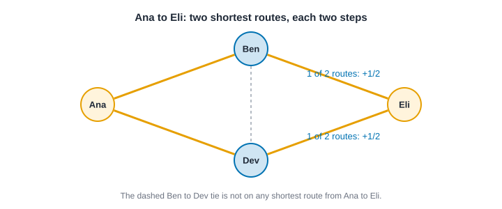
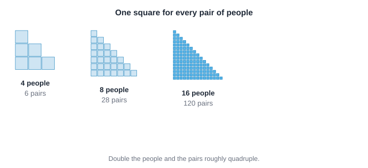
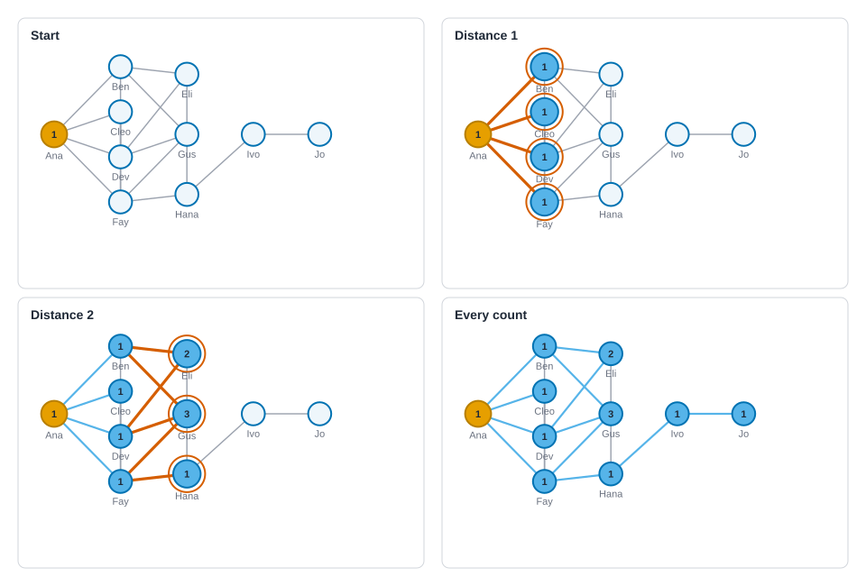
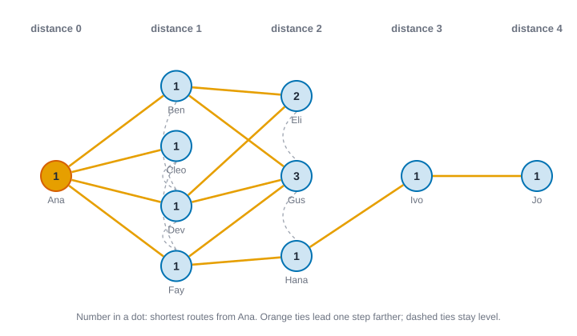
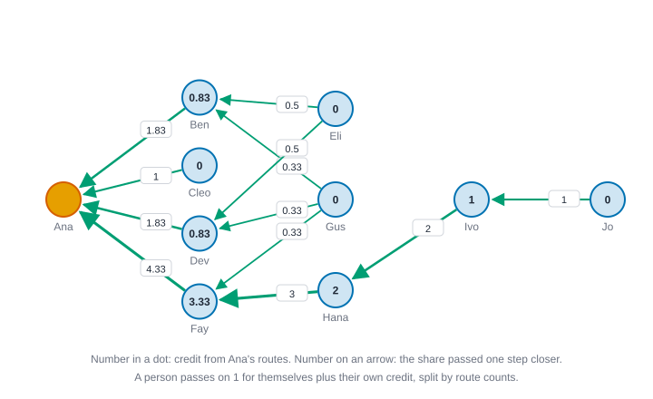
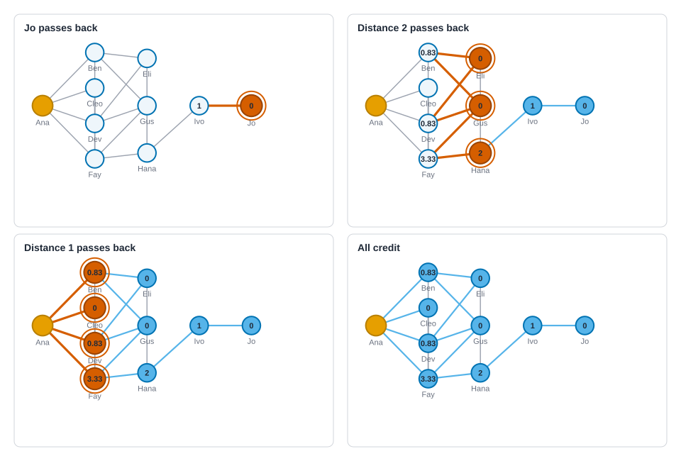
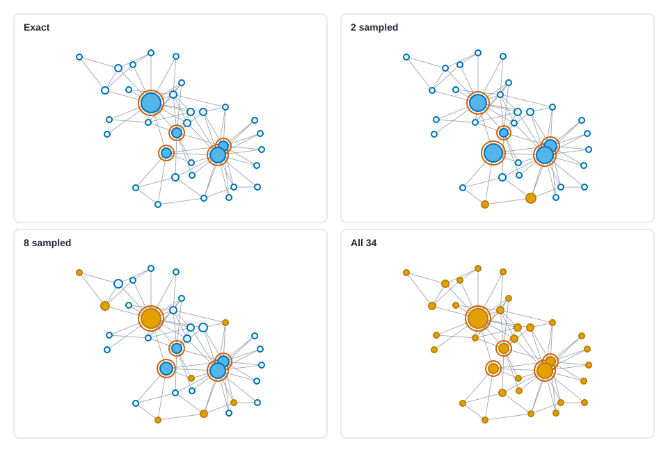
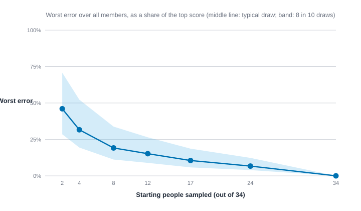
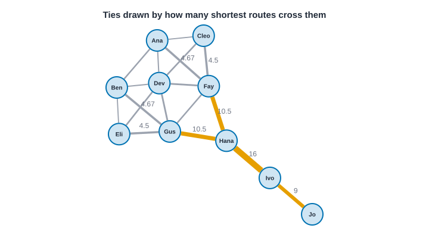

# Betweenness, exactly and approximately {#sec-betweenness}

::: {.callout-note appearance="simple"}
## Prerequisites
Shortest paths (breadth-first search, and what a distance is). If you have read the betweenness section of chapter 6 of the [SNA book](https://knapply.github.io/net-books/sna/), you already know what the number means; this chapter is about how to compute it.
:::

::: {.callout-note title="The short version"}
Betweenness counts how often a person sits on the shortest routes between other people. Doing that pair by pair is hopeless on anything but a tiny network, because the number of pairs explodes. Ulrik Brandes found a way to get every person's score with one search per starting person: a forward sweep that counts routes, then a backward sweep that passes credit from the far end back toward the start. On networks too big even for that, you can run the searches from a random sample of starting people and scale up, and the answer is close for the people who matter most.
:::

::: {.callout-note title="Why you might care"}
Betweenness is the measure people reach for when they ask "who are the brokers?", "which road closure hurts most?" or "where does information get stuck?". Every serious network tool computes it with the method in this chapter, and every one of them offers a sampled version for big data. Knowing how both work tells you how long to wait, how much to trust a sampled score, and why two tools can print numbers that differ by exactly a factor of two.
:::

::: {.callout-note title="A note on the math"}
There are a few formulas here. Each one is followed by a box called "In plain words" that reads it aloud and plugs in numbers from the ten-person network. If a formula looks scary, read the box and move on.
:::

## Counting routes through a node

### A story first: the parcel depot

Picture a small town of ten households. Every household sends one parcel to every other household, every parcel travels by a shortest route, and every household along the way handles it for a moment. At the end of the year, the town asks a simple question: which households handled the most parcels that were neither theirs to send nor theirs to receive?

That count is **betweenness**. A household that sits on a lot of shortest routes handles a lot of other people's parcels. If it closes, parcels get slower; if it gossips, it hears a lot. Linton Freeman wrote the number down in 1977 [@freeman1977set] as a measure of control over communication, and it has been one of the most used numbers in network analysis ever since.

There's one wrinkle in the story. Sometimes two routes are equally short. The town's rule is fair: the parcel is split evenly between them, so each route carries half a parcel's worth of credit. That's why betweenness scores can be fractions.

We'll use the town you may already know from the SNA book: ten friends, Ana to Jo, eighteen ties. In that book Hana came out on top with a betweenness of 14, because she holds the only road out to Ivo and Jo. This chapter is about how a computer gets to that 14 without doing anything silly.

### The definition

For a person $v$, betweenness adds up, over every pair of *other* people $s$ and $t$, the share of shortest routes from $s$ to $t$ that pass through $v$:

$$
\text{betweenness}(v) = \sum_{s \neq v \neq t} \frac{\sigma_{st}(v)}{\sigma_{st}}.
$$

::: {.callout-tip title="In plain words"}
Read $\sigma$ as "sigma", the number of shortest routes. $\sigma_{st}$ is how many shortest routes run from $s$ to $t$, and $\sigma_{st}(v)$ is how many of those pass through $v$. The fraction is $v$'s share of the parcel from $s$ to $t$. The big sum, $\sum_{s \neq v \neq t}$, says "add this share up over every pair of people other than $v$". Example: Ana and Eli are two steps apart, and there are two shortest routes, one through Ben and one through Dev. So $\sigma_{\text{Ana},\text{Eli}} = 2$, $\sigma_{\text{Ana},\text{Eli}}(\text{Ben}) = 1$, and that pair adds $1/2$ to Ben's score (and $1/2$ to Dev's).
:::

{#fig-alg-bt-shared-credit fig-alt="Four dots: Ana on the left, Eli on the right, Ben above and Dev below the middle. Thick orange ties run Ana to Ben to Eli and Ana to Dev to Eli. A dashed gray tie joins Ben and Dev. Labels say each middle person gets one half."}

One more convention matters a lot in practice. In a network where ties have no direction, the pair (Ana, Eli) and the pair (Eli, Ana) are the same pair. Some formulas count each pair once; some count it twice, once from each end. igraph and NetworkX count each pair once, so their scores are half of what you'd get by summing over ordered pairs. Keep that factor of two in mind; it will come back.

## Why the naive way is hopeless

The definition reads like a recipe: for every pair, find all the shortest routes, and for every route, give credit to everyone in the middle. Let's see why nobody does it that way.

First, count the pairs. With $n$ people there are $n(n-1)/2$ pairs. That number grows like the square of $n$: double the people and the pairs roughly quadruple (@fig-alg-bt-pairs-grow).

{#fig-alg-bt-pairs-grow fig-alt="Three staircase-shaped triangles made of small blue squares. The first, for 4 people, has 6 squares; the second, for 8 people, has 28; the third, for 16 people, has 120 tiny squares."}

Second, for each pair, the number of shortest routes can itself be huge. In a grid, the number of shortest routes between opposite corners grows faster than any power of the grid's size. Listing them one at a time is out of the question.

The standard fix before 2001 was to avoid listing routes and count them instead. You first compute, for every pair, the distance and the number of shortest routes (that takes work proportional to $n^3$, "n cubed", with a method like the one in the all-pairs chapter). Then you use a neat fact: $v$ is on a shortest route from $s$ to $t$ exactly when

$$
d(s, v) + d(v, t) = d(s, t),
$$

and in that case the number of such routes through $v$ is $\sigma_{sv} \cdot \sigma_{vt}$.

::: {.callout-tip title="In plain words"}
$d(s, v)$ is the distance from $s$ to $v$. The equation says: going from $s$ to $v$ and then on to $t$ costs no more than the best route from $s$ to $t$, so $v$ lies on some best route. If there are $\sigma_{sv}$ ways to get from $s$ to $v$ and $\sigma_{vt}$ ways onward, every combination is a shortest route through $v$. Example: from Ana to Hana is 2 steps, Ana to Fay is 1 and Fay to Hana is 1, and $1 + 1 = 2$, so Fay is on a best route. There is $1$ way to each half, so $1 \times 1 = 1$ of Ana's routes to Hana passes through Fay (and it's the only one, so Fay gets the whole parcel).
:::

That's correct, but now you have to check every person $v$ against every pair $(s, t)$: about $n \times n^2 / 2$ checks. That's $n^3$ again, and it needs a table of $n^2$ distances in memory. For 100,000 people the table alone is ten billion entries.

## Brandes' idea: count forward, credit backward

In 2001 Ulrik Brandes showed that you never need the pair-by-pair table [@brandes2001faster]. Fix one starting person $s$. Everything $s$'s parcels contribute to everyone else can be computed in one forward sweep and one backward sweep through the network. Do that for every starting person, add up the results, and you have betweenness.

### The forward sweep: counting routes

Start at Ana. Run a breadth-first search, the spreading search from the traversal chapter: first everyone one step away, then everyone two steps away, and so on. As each person is found, write down how many shortest routes from Ana reach them. The rule is the one thing to remember from this chapter:

> A person's count is the sum of the counts of their neighbors who are one step closer to the start.

Ana has 1 (the empty route to herself). Ben, Cleo, Dev and Fay are one step away, each reached only from Ana, so each has 1. Eli is two steps away and has two neighbors one step closer (Ben and Dev), so Eli has $1 + 1 = 2$. Gus has three such neighbors (Ben, Dev and Fay), so Gus has 3. Hana is reached only from Fay, so 1. Ivo from Hana, 1. Jo from Ivo, 1.

If you'd like to see exactly what the computer does, here is the forward sweep as a log. The **queue** is the line of people waiting to have their friends looked at: people join at the back and leave from the front, like a queue at a cafe. Each row takes one person from the front, looks at their friends, and either adds a newly found friend to the back of the queue or, if the friend is exactly one step farther, adds the person's count to the friend's.

| Step | Take from the front | Friends one step farther | Counts after this step | Queue after this step |
|---|---|---|---|---|
| 0 | (start) | | Ana 1 | Ana |
| 1 | Ana | Ben, Cleo, Dev, Fay | Ben 1, Cleo 1, Dev 1, Fay 1 | Ben, Cleo, Dev, Fay |
| 2 | Ben | Eli, Gus | Eli 1, Gus 1 | Cleo, Dev, Fay, Eli, Gus |
| 3 | Cleo | (none: Dev and Fay are at the same distance) | | Dev, Fay, Eli, Gus |
| 4 | Dev | Eli, Gus | Eli 2, Gus 2 | Fay, Eli, Gus |
| 5 | Fay | Gus, Hana | Gus 3, Hana 1 | Eli, Gus, Hana |
| 6 | Eli | (none) | | Gus, Hana |
| 7 | Gus | (none: Hana is at the same distance) | | Hana |
| 8 | Hana | Ivo | Ivo 1 | Ivo |
| 9 | Ivo | Jo | Jo 1 | Jo |
| 10 | Jo | (none) | | (empty) |

Notice row 4: Dev finds Eli and Gus *again*. They're already in the queue, so they don't join it a second time, but Dev's route count still gets added, because Dev is one step closer. That single extra line is the whole difference between ordinary breadth-first search and Brandes' forward sweep. Also notice the order people left the queue: Ana, Ben, Cleo, Dev, Fay, Eli, Gus, Hana, Ivo, Jo. We'll walk that list backward in a moment.

Watch the counts fill in, one distance at a time. The number in each dot is that person's count of shortest routes from Ana.

{#fig-brandes-forward-anim fig-alt="Four copies of the ten-person network arranged in columns by distance from Ana. In the first only Ana is lit, with a 1. In the second the four people one step away light up with 1 each. In the third Eli gets 2, Gus 3 and Hana 1, with the ties leading to them highlighted. The last shows every count: 1 for everyone except Eli with 2 and Gus with 3."}

@fig-alg-bt-forward-levels shows the finished forward sweep as a still picture, with the ties that lead one step farther drawn in orange. Ties between two people at the same distance, like Ben and Dev, are dashed: no shortest route from Ana uses them.

{#fig-alg-bt-forward-levels fig-alt="The ten people arranged in five columns by distance from Ana: Ana alone at distance 0; Ben, Cleo, Dev and Fay at 1; Eli, Gus and Hana at 2; Ivo at 3; Jo at 4. The route counts in the dots are: Eli 2, Gus 3, Hana 1, and 1 for everyone else. Orange ties join neighbouring columns; dashed gray ties join people in the same column."}

### The backward sweep: passing credit back

Now the clever part. We want to know how much of Ana's parcels each person handles. Brandes calls this the **dependency** of Ana on that person, written $\delta_s(v)$ ("delta s of v"). Think of it as credit.

Work backward from the people farthest from Ana. Each person $w$ hands back to the people one step closer an amount equal to

> 1 for $w$ themselves (the parcel addressed to $w$), plus all the credit $w$ has collected from farther out,

and splits it among those closer neighbors in proportion to their route counts. A neighbor with more of the routes into $w$ gets a bigger share.

Let's do it by hand, from the far end:

1. **Jo** (distance 4) has collected nothing. Jo hands back $1 + 0 = 1$ to Ivo, the only neighbor one step closer.
2. **Ivo** now has credit 1. Ivo hands back $1 + 1 = 2$ to Hana.
3. **Hana** has credit 2. She hands $1 + 2 = 3$ to Fay.
4. **Eli** (distance 2, credit 0) hands back $1 + 0 = 1$, split between Ben and Dev. Each has 1 of Eli's 2 routes, so each gets $1/2$.
5. **Gus** (credit 0) hands back $1$, split three ways among Ben, Dev and Fay, a third each.
6. Now the distance-1 people are done collecting. **Fay** has $3 + 1/3 = 3.33$. **Ben** has $1/2 + 1/3 = 0.83$, and so does **Dev**. **Cleo** has 0. They would pass credit on to Ana, but Ana is the start, and the start never counts as being "in between".

{#fig-alg-bt-backward-split fig-alt="The ten people in columns by distance from Ana, with green arrows pointing back toward Ana. Jo passes 1 to Ivo, Ivo passes 2 to Hana, Hana passes 3 to Fay. Eli passes a half each to Ben and Dev, and Gus passes a third each to Ben, Dev and Fay. The credits in the dots are Fay 3.33, Hana 2, Ivo 1, Ben 0.83, Dev 0.83, and 0 for Cleo, Eli, Gus and Jo."}

Here is the same sweep in motion. Watch the credit pile up as it flows back toward Ana, one column at a time.

{#fig-brandes-backward-anim fig-alt="Four copies of the ten-person network in columns by distance from Ana. First, Jo passes credit to Ivo. Next, the people at distance two pass back and Fay, Ben and Dev start collecting. Then the people at distance one finish. The last copy shows the final credits: Fay 3.33, Hana 2, Ivo 1, Ben and Dev 0.83, the rest 0."}

Does this give the right answer? Check Hana. Which of Ana's parcels pass through Hana? The ones to Ivo and to Jo, and each has only one shortest route. So Hana handles 2 of Ana's parcels, and the backward sweep gave her exactly 2. Check Fay: Ana's parcels to Hana, Ivo and Jo all go through Fay (3), plus a third of the parcel to Gus. That's $3.33$. It works.

The backward sweep as a log, walking the forward sweep's order from the end. Each row finishes one person: their credit is final, and they pass $1 + \text{credit}$ back.

| Step | Finish | Credit (final) | Passes back | To whom (share) |
|---|---|---|---|---|
| 1 | Jo | 0 | 1 | Ivo (all) |
| 2 | Ivo | 1 | 2 | Hana (all) |
| 3 | Hana | 2 | 3 | Fay (all) |
| 4 | Gus | 0 | 1 | Ben, Dev, Fay (1/3 each) |
| 5 | Eli | 0 | 1 | Ben, Dev (1/2 each) |
| 6 | Fay | 3.33 | | Ana (the start: ignored) |
| 7 | Dev | 0.83 | | Ana (ignored) |
| 8 | Cleo | 0 | | Ana (ignored) |
| 9 | Ben | 0.83 | | Ana (ignored) |

Walking the list backward is what makes this safe. By the time a person is finished, everyone farther from Ana has already passed their credit back, so nothing arrives late.

### The rule as a formula

The backward rule, written out, is

$$
\delta_s(v) = \sum_{w \,:\, v \text{ is one step before } w} \frac{\sigma_{sv}}{\sigma_{sw}} \bigl(1 + \delta_s(w)\bigr).
$$

::: {.callout-tip title="In plain words"}
$\delta_s(v)$ is the credit $v$ collects from routes starting at $s$. The sum runs over every neighbor $w$ that is one step farther from $s$ than $v$ and reached through $v$. Each such $w$ passes back $1 + \delta_s(w)$ (one for $w$ itself, plus what $w$ collected), and $v$'s share of that is $\sigma_{sv} / \sigma_{sw}$, the fraction of $w$'s shortest routes that come through $v$. For Ben from Ana: Ben's farther neighbors are Eli ($\sigma = 2$) and Gus ($\sigma = 3$), so $\delta(\text{Ben}) = \tfrac{1}{2}(1 + 0) + \tfrac{1}{3}(1 + 0) = 0.83$.
:::

### Adding up the starting people

Repeat both sweeps from every person and add up the credits. Each starting person adds one row of numbers; betweenness is the column totals (@fig-alg-bt-source-grid). The figure shows each row already halved, because in this undirected network every pair is seen twice, once from each end, and the convention (igraph's and NetworkX's) is to count each pair once.

{#fig-alg-bt-source-grid fig-alt="A grid of numbers with ten rows (starting people Ana to Jo) and ten columns (people scored). Most cells are empty; the darker cells are in the columns for Fay, Gus, Hana and Ivo. The bottom row gives the totals: Ana 0.83, Ben 0.83, Cleo 0, Dev 3.67, Eli 0, Fay 8.33, Gus 8.33, Hana 14, Ivo 8, Jo 0."}

The totals are Hana 14, Fay 8.33, Gus 8.33, Ivo 8, Dev 3.67, Ana 0.83, Ben 0.83, and 0 for Cleo, Eli and Jo: the same numbers as in chapter 6 of the SNA book. The animation of the same sum, one starting person at a time, is in that chapter too.

::: {.callout-important title="Did you notice?"}
We never built a table of all pairs. Each starting person needed one search's worth of memory, which we threw away before moving to the next. That is half of why Brandes' method wins: the memory stays small.
:::

## Words we've picked up

Before we write the method down, here are the new words in one place. You can come back to this table whenever a term slips.

| Word | What it means here |
|---|---|
| shortest route | a way from one person to another using as few ties as possible |
| route count, $\sigma$ | how many different shortest routes there are |
| breadth-first search | the spreading search: everyone 1 step away, then 2, then 3 |
| queue | the line of people waiting to be looked at; join at the back, leave from the front |
| forward sweep | the breadth-first search from one starting person, counting routes as it goes |
| backward sweep | walking the same people in reverse order, passing credit toward the start |
| credit, or dependency, $\delta$ | how many of one starting person's parcels a person handles |
| sample | a set of starting people chosen at random |
| unbiased | right on average over all possible samples |

## The idea in steps

For every starting person $s$:

1. **Search forward.** Run a breadth-first search from $s$. Record each person's distance, and as you go, keep a running count of shortest routes: when you step from $u$ to a neighbor $v$ that is exactly one step farther, add $u$'s count to $v$'s.
2. **Remember the order.** Keep a list of people in the order the search finished with them. The far end of the search is at the end of the list.
3. **Sweep back.** Go through that list backward. For each person $w$, and each neighbor $v$ one step closer to $s$, add $\frac{\sigma_v}{\sigma_w}(1 + \delta_w)$ to $v$'s credit.
4. **Bank it.** Add every person's credit (except $s$'s own) to their running betweenness total.

At the end, halve the totals if ties have no direction.

In a compact form you can follow line by line:

```text
for each person s:
    dist[s] = 0; routes[s] = 1; everyone else unseen   # start fresh
    queue = [s]; order = []
    while queue is not empty:                          # forward sweep
        u = take from the front of queue; add u to order
        for each neighbor v of u:
            if v is unseen: dist[v] = dist[u] + 1; put v at the back of queue
            if dist[v] == dist[u] + 1: routes[v] += routes[u]
    credit = 0 for everyone
    for w in order, from last to first:                # backward sweep
        for each neighbor v of w with dist[v] == dist[w] - 1:
            credit[v] += routes[v] / routes[w] * (1 + credit[w])
        if w != s: betweenness[w] += credit[w]
halve betweenness if the ties have no direction
```

::: {.callout-tip title="In plain words"}
The top half is ordinary breadth-first search with one extra line: whenever you find a step that goes one level farther, pass your route count forward. The bottom half walks the same people in reverse order, which guarantees that everyone farther out has finished collecting before they pass credit back. Nothing in the loop looks at pairs; it only ever looks at one person and their neighbors.
:::

Two practical notes. Many fast versions don't store a list of "predecessors" (the closer neighbors) for each person; they recheck `dist[v] == dist[w] - 1` on the way back, which saves memory [@brandes2008variants]. And with weighted ties (lengths), the forward sweep uses Dijkstra's algorithm instead of breadth-first search, and "one step closer" becomes "the tie is on a shortest route"; everything else is the same.

## What it costs, in plain words

One search from one starting person reads every tie a constant number of times: once forward, once backward. So the work for one starting person grows with the size of the network. Double the ties and one search takes about twice as long. Then we do this for every person. Double the people (and their ties) and the total work roughly quadruples. That sounds bad, but compare: the pair-by-pair way grows eight times when you double the people.

Formally, with $n$ people and $m$ ties:

$$
\text{time} = O(n \cdot m) \text{ without weights}, \qquad O(n \cdot m + n^2 \log n) \text{ with weights}, \qquad \text{memory} = O(n + m).
$$

::: {.callout-tip title="In plain words"}
$O(\cdot)$, read "order of", means "grows like, ignoring constant factors". $n \cdot m$ is the number of people times the number of ties: one search of size $m$ for each of $n$ starting people. With weights, each search uses a priority queue, which adds a $\log n$ factor (the number of times you can halve $n$) per person. Memory is just the network plus a few numbers per person. For the ten-person network, $n \cdot m = 10 \times 18 = 180$ basic steps (times a small constant). For a million people with ten million ties, it's $10^{13}$: around three hours at a billion simple steps a second.
:::

@fig-alg-bt-cost-bars puts rough times on both approaches. These are back-of-the-envelope numbers (a billion simple steps a second, ten ties per person), not measurements, but the gap is so large that the constants don't matter.

{#fig-alg-bt-cost-bars fig-alt="A bar chart with a logarithmic time axis from a millisecond to beyond a year. For 1,000, 10,000, 100,000 and 1,000,000 people, a red bar shows the pair-by-pair time (1 second, 17 minutes, 12 days, 32 years) and a blue bar shows Brandes' time (10 milliseconds, 1 second, 100 seconds, 2.8 hours)."}

The searches from different starting people don't depend on each other, so they split cleanly across processor cores: eight cores, roughly eight times faster. The only care needed is in the final sum. Adding decimals in a different order can change the last digit, so careful libraries add the per-person rows in a fixed order, which makes the result the same on any number of cores.

Three hours is still a long time to wait, and $n \cdot m$ keeps growing: a network of ten million people would take weeks. That's where sampling comes in.

## Big networks: sample the starting people

Look again at @fig-alg-bt-source-grid. Betweenness is a sum of $n$ rows, one per starting person. If we only computed some of the rows, chosen at random, and scaled the sum up, we'd get an estimate. That is exactly the idea of Brandes and Pich [@brandes2007centrality] (and, with an adaptive twist, Bader and colleagues [@bader2007approximating]):

$$
\widehat{\text{betweenness}}(v) = \frac{n}{k} \sum_{s \in S} \tfrac{1}{2}\,\delta_s(v),
$$

where $S$ is a random set of $k$ starting people.

::: {.callout-tip title="In plain words"}
The hat on top means "estimate". Pick $k$ starting people at random, do both sweeps from each, add up their (halved) credits, and multiply by $n / k$ to make up for the rows you skipped. If you sample 17 of the 34 karate club members, you multiply by $34 / 17 = 2$. On average over all possible samples, this gives exactly the true betweenness: statisticians call such an estimate **unbiased**. Any single sample is off a bit, high for some people and low for others.
:::

The cost is now $k$ searches instead of $n$, so $O(k \cdot m)$. With $k = 1{,}000$ starting people, a ten-million-person network takes about as long as an exact run on ten thousand people.

Here's what that looks like on Zachary's karate club, 34 members and 78 ties. The ringed members are the five with the highest exact betweenness. Watch the dots settle toward their true sizes as more starting people (orange) are added.

{#fig-betweenness-sampling-anim fig-alt="Four copies of the karate club with dots sized by betweenness. The first shows the exact scores, with five ringed top members. The second, from two sampled starting people, has some dots far too big and others too small. The third, from eight, is closer. The last, with all 34 members as starting people, matches the exact scores."}

### A sample by hand

Let's estimate the ten-person network from just two starting people, Ana and Jo. We already have both rows: Ana's credits (halved) are Ben 0.42, Dev 0.42, Fay 1.67, Hana 1, Ivo 0.5; Jo's (from the exercises at the end, halved) are Fay 1.25, Gus 1.25, Hana 3.5, Ivo 4. Add them and multiply by $n / k = 10 / 2 = 5$:

| Person | From Ana | From Jo | Sum x 5 (estimate) | Exact |
|---|---|---|---|---|
| Ben | 0.42 | 0 | 2.08 | 0.83 |
| Dev | 0.42 | 0 | 2.08 | 3.67 |
| Fay | 1.67 | 1.25 | 14.58 | 8.33 |
| Gus | 0 | 1.25 | 6.25 | 8.33 |
| Hana | 1 | 3.5 | 22.5 | 14 |
| Ivo | 0.5 | 4 | 22.5 | 8 |
| everyone else | 0 | 0 | 0 | 0 to 0.83 |

Two starting people out of ten is a tiny sample, and it shows. Jo sits at the end of a long chain, so every one of Jo's parcels runs through Ivo and Hana, and scaling that up by 5 makes Ivo look as important as Hana. The ranking at the very top (Hana first) survives; the rest is noisy. A different pair, say Cleo and Gus, would be noisy in a different direction. Averaged over all possible pairs, the noise cancels out.

### How accurate is it?

The honest answer: good for the people with big scores, rougher for the rest, and it gets better slowly. @fig-alg-bt-sampling-error repeats the experiment 400 times for each sample size and records the worst error over all 34 members, as a share of the top score.

{#fig-alg-bt-sampling-error fig-alt="A falling line with a shaded band around it. The horizontal axis is the number of sampled starting people, from 2 to 34; the vertical axis is the worst error over all members as a percentage of the top score. At 2 the typical worst error is 46 percent; at 4 it is 32 percent; at 8, 19 percent; at 12, 15 percent; at 17, 11 percent; at 24, 7 percent; at 34, 0 percent."}

The rule of thumb behind the curve is the one for any average of random draws: the typical error shrinks like one over the square root of $k$. To halve the error, you need four times as many starting people. That's why sampling shines on very large networks: there, $k = 1{,}000$ is a tiny fraction of $n$, and an error proportional to $1/\sqrt{1000}$, about 3 percent of the scale of the scores, is often good enough to rank the top brokers. Riondato and Kornaropoulos [@riondato2016fast] give sample sizes that guarantee every estimate is within a chosen error with a chosen probability, if you need a promise rather than a rule of thumb.

::: {.callout-warning title="Small scores are the hard part"}
The percentages above are relative to the *top* score. A person with a small score can be off by many times their own value. Sampled betweenness is very good at answering "who are the top ten brokers?" and poor at answering "is this person's score 3 or 6?".
:::

There are refinements. Geisberger, Sanders and Schultes [@geisberger2008better] noticed that people close to a sampled start get too much credit, and weighted the credit by distance to fix it. Bader and colleagues [@bader2007approximating] stop sampling early once one person's score is clearly large. All of them reuse Brandes' two sweeps as the inner step.

## The same sweeps, other questions

Brandes' two sweeps are a small engine that many other measures reuse. Three variations come up often.

### Credit on ties: edge betweenness

Instead of asking which *people* handle the most parcels, ask which *ties* carry the most. In the backward sweep, the amount that crosses the tie from $w$ back to $v$ is exactly $\frac{\sigma_{sv}}{\sigma_{sw}}(1 + \delta_s(w))$: the number we write on the arrows in @fig-alg-bt-backward-split. Add those up over all starting people (and halve, for undirected ties) and you get **edge betweenness**. On the ten-person network the busiest ties are:

| Tie | Edge betweenness |
|---|---|
| Hana and Ivo | 16 |
| Fay and Hana | 10.5 |
| Gus and Hana | 10.5 |
| Ivo and Jo | 9 |
| Ana and Fay | 4.67 |
| Ben and Gus | 4.67 |

{#fig-alg-bt-edge-credit fig-alt="The ten-person network with ties of varying thickness. The thickest, in orange, are Hana to Ivo (16), Fay to Hana and Gus to Hana (10.5 each) and Ivo to Jo (9). Ties inside the tight group on the left are thin, most carrying under 4."}

The tie between Hana and Ivo carries every parcel between the eight people on one side and Ivo and Jo on the other ($8 \times 2 = 16$). Girvan and Newman [@girvan2002community] used exactly this to find communities: remove the busiest tie, recompute, repeat, and the network falls apart along its natural seams. Each repeat is a full run of Brandes, so that method is expensive, but the inner step is the one you now know.

### Ties with a direction

If ties have a direction (Ana follows Ben, but Ben doesn't follow Ana), the forward sweep only steps along ties in their direction, and the backward sweep walks the same ties in reverse. Nothing else changes, except that each ordered pair is now a different parcel, so the result is *not* halved. A tool that halves directed scores is making a mistake, and one that doesn't halve undirected scores is using the other convention.

### Ties with lengths

If ties have lengths (minutes of travel, say), the forward sweep can't use a plain queue, because the next-closest person is no longer simply "the next in line". It uses Dijkstra's algorithm from the shortest-paths chapter: a priority queue that always hands back the nearest unfinished person. A route through $u$ to $v$ counts when $\text{dist}(u) + \text{length}(u, v) = \text{dist}(v)$, and the backward sweep walks the people in order of decreasing distance. The priority queue is where the extra $n^2 \log n$ in the cost comes from.

Here's a tiny weighted example to make it concrete. Four people, with travel times in minutes on the ties: Ana to Ben 1, Ana to Cleo 2, Ben to Cleo 1, Cleo to Dev 1, Ben to Dev 3. Start at Ana.

| Step | Nearest unfinished | Its distance | Its route count | Why |
|---|---|---|---|---|
| 1 | Ana | 0 | 1 | the start |
| 2 | Ben | 1 | 1 | only via Ana (1 minute) |
| 3 | Cleo | 2 | 2 | via Ana directly (2) and via Ben (1 + 1 = 2): a tie, so $1 + 1$ |
| 4 | Dev | 3 | 2 | via Cleo (2 + 1 = 3) beats via Ben (1 + 3 = 4), so Dev inherits Cleo's 2 |

Backward, from Dev: Dev passes $1$ to Cleo (all of Dev's routes come through Cleo). Cleo now has credit 1 and passes $1 + 1 = 2$ back, split between Ana and Ben by their route counts into Cleo (1 each), so Ben gets 1. Ben's credit from Ana is 1: half of the two routes to Cleo, and half of the two routes to Dev. Equal lengths are the whole reason fractions appear, which is why comparing decimal lengths needs a little tolerance.

When the lengths are small whole numbers (1, 2, 3 minutes), there's a cheaper option: a "bucket queue" that keeps one bucket per distance, which is as fast as breadth-first search. Good libraries pick for you.

## Shortcuts that keep the answer exact

Sampling trades exactness for speed. There are also shortcuts that give the *exact* answer faster, by noticing that some people need no search of their own.

- **Leaves.** A person with exactly one tie (Jo, tied only to Ivo) is never in between anybody: every route through Jo would have to come in and go out on the same tie. Jo's betweenness is 0, always. Better still, Jo's routes to everyone are Ivo's routes with one extra step, so Jo's whole row of credit can be worked out from Ivo's search, and Jo's search can be skipped.
- **Look-alikes.** Two people with exactly the same friends (and not tied to each other) are interchangeable: their rows of credit are the same, so one search does for both.
- **Cut points.** If removing one person splits the network in two (Hana, here), every route between the two sides goes through that person. The network can be cut there, each side computed separately, and the cross-side credit added by counting people on each side.

Sariyuce and colleagues [@sariyuce2013shattering] combine all three ("shattering and compressing" the network) and report large savings on real networks, which tend to have many leaves and look-alikes. The next chapter uses the same leaf and look-alike tricks for closeness, where they combine especially well with searching many starting people at once.

## Running it on many cores

Every starting person's two sweeps are independent of every other's. That makes betweenness one of the easiest measures to spread over a computer's cores: hand each core its own list of starting people, let each keep its own running totals, and add the totals at the end.

Three practical details decide how well that works:

1. **Each core needs its own workspace.** Distances, route counts, credits and the order list: a few numbers per person, per core. On a network of ten million people that's a few hundred megabytes per core, which is why libraries sometimes use fewer cores than you have on huge networks.
2. **The network itself is shared.** Cores only read it, so one copy serves everyone.
3. **Add in a fixed order.** Adding decimals in a different order can change the last digit of the result. If each core's totals are added in an order that depends on which core finished first, you can get slightly different numbers from run to run. Careful libraries add per-person rows in fixed groups, in a fixed order, so the answer is the same bit for bit on one core or sixty-four.

Route counts can get astronomically large on big, grid-like networks (they multiply at every level). They're stored as decimals (floating-point numbers), which hold whole numbers exactly up to about nine thousand million million ($2^{53}$) and approximately beyond. Only the ratios $\sigma_{sv}/\sigma_{sw}$ are ever used, so the tiny rounding in huge counts doesn't matter in practice.

## Checking your work

When you write or test an implementation, these small networks have answers you can work out on paper (pairs counted once):

| Network | Betweenness | Why |
|---|---|---|
| A path of 5 people, A to E | 0, 3, 4, 3, 0 | C is on every route between {A, B} and {D, E} (4 pairs); B is on A's routes to C, D, E (3) |
| A star, one center and 5 others | center 10, others 0 | every one of the $5 \times 4 / 2 = 10$ pairs of others goes through the center |
| Everyone tied to everyone (5 people) | all 0 | every pair is one step apart; nobody is in between |
| A ring of 5 | all 1 | five pairs are two steps apart, each with one route through one middle person |
| A ring of 6 | all 2 | three pairs are three steps apart with two routes each; the shares add up to 2 per person |
| The ten-person network | Hana 14, Fay and Gus 8.33, Ivo 8, Dev 3.67, Ana and Ben 0.83, others 0 | this chapter |

Two more checks catch most bugs. First, the scores of all people add up to a known total: every pair of people at distance $d$ contributes $d - 1$ (one per person in the middle of each route, shared across routes), so the sum of all betweenness scores is the sum over pairs of (distance minus 1). For the ten-person network that's 44.0. Second, people with identical friends (the same neighbors) must get identical scores.

## At a glance

| | Pair by pair | Brandes, exact | Brandes, sampled |
|---|---|---|---|
| Answers | betweenness of everyone | betweenness of everyone | an estimate for everyone |
| Time | $O(n^3)$ | $O(nm)$; $O(nm + n^2\log n)$ weighted | $O(km)$ for $k$ starting people |
| Memory | $O(n^2)$, a table of all pairs | $O(n + m)$, plus one workspace per core | $O(n + m)$ |
| Use it when | never, except to check a tiny example | up to a few hundred thousand ties, or when exact numbers matter | millions of ties, when the ranking of the top people is what you need |
| Avoid it when | always | waiting hours is not acceptable | you need small scores to be precise |

## Where it goes wrong

- **The factor of two.** Undirected networks: some tools count each pair once (igraph, NetworkX), some twice (sum over ordered pairs). If two tools disagree by exactly 2, this is why. Check which convention a paper used before comparing numbers.
- **Normalization.** Many tools offer a normalized score, dividing by the number of pairs not involving the person, $(n-1)(n-2)/2$ undirected or $(n-1)(n-2)$ directed. Others divide by the largest score. Say which one you used.
- **Endpoints.** Freeman's definition leaves the start and the end of a route out. Some tools have an option to include them, which adds a constant to everyone; it changes values but not much else.
- **Ties of equal length with weights.** With decimal weights, two routes that "should" be equally long can differ in the 15th digit, and one of them silently stops counting. Good implementations compare lengths with a small tolerance. If your weights are whole numbers, you avoid the problem entirely.
- **Weights that mean strength.** Shortest routes need lengths. If your weights say "how close" (more is stronger), convert them, for example to $1/w$, before computing betweenness. Feeding strengths in as lengths makes the strongest ties the longest roads.
- **Disconnected networks.** Pairs that can't reach each other contribute nothing. That is usually fine, but scores from different components aren't comparable without thought.
- **Sampling the wrong thing.** Sample starting people uniformly at random. Sampling only well-connected people, or only one region, biases the estimate. And report the sample size with the numbers.
- **Sorting by a sampled score.** Two people whose estimates differ by less than the sampling error are tied for practical purposes. Don't report a sampled ranking to more precision than the sample supports.
- **Comparing networks of different sizes.** Raw betweenness grows roughly with the number of pairs. Normalize before comparing a 100-person network with a 10,000-person one.
- **Forgetting that a leaf is 0.** If your implementation gives a degree-1 person a positive score, something is wrong: a leaf is never in between.
- **Memory per core.** Each parallel worker needs its own few-numbers-per-person workspace. On a machine with many cores and a huge network, that adds up; the network itself is shared.

::: {.callout-note title="If you like proofs"}
Why does the backward rule give the right credit? Fix the start $s$. The credit $v$ should get is $\delta_s(v) = \sum_t \sigma_{st}(v)/\sigma_{st}$, summed over every end $t$. Split the routes from $s$ to $t$ through $v$ by the person $w$ that comes right after $v$ on the route. Every such route reaches $w$ by passing through $v$, and $v$ handles a fraction $\sigma_{sv}/\sigma_{sw}$ of all shortest routes into $w$. So for $t = w$ the share is $\sigma_{sv}/\sigma_{sw}$, and for $t$ beyond $w$ it is $\sigma_{sv}/\sigma_{sw}$ times $w$'s own share of the routes to $t$. Adding up over all $t$ gives $\frac{\sigma_{sv}}{\sigma_{sw}}\bigl(1 + \delta_s(w)\bigr)$ for each next person $w$, which is the rule. Processing people from farthest to nearest makes sure $\delta_s(w)$ is complete before it is used. Brandes' paper [@brandes2001faster] has the careful version.

Why is the sampled estimate unbiased? Each person $s$ is in the sample with probability $k/n$. The estimate counts $s$'s row times $n/k$ when it is sampled and $0$ otherwise, so on average it counts $s$'s row exactly once. Adding over all $s$ gives the true betweenness on average.
:::

## Code

The code below will compute betweenness on the karate club exactly, then estimate it from 10 randomly sampled starting people, and print both for the five members with the highest exact score. Look for the top member's estimate landing near its exact value, and for smaller scores wandering more.

::: {.panel-tabset group="language"}

## R

```r
# TODO(code, R): load the karate club, compute exact betweenness (unnormalized, pairs counted once) and a sampled estimate from 10 starting people chosen with seed 1, and print a data.frame of member, exact and estimate for the five members with the highest exact score
```

## Python

```python
# TODO(code, Python): load the karate club, compute exact betweenness (unnormalized, pairs counted once) and a sampled estimate from 10 starting people chosen with seed 1, and print member, exact and estimate for the five members with the highest exact score
```

## Rust

```rust
// TODO(code, Rust): load the karate club, compute exact betweenness with compute_betweenness and the sum over 10 starting people chosen with seed 1 with compute_betweenness_from_sources scaled by 34 / 10, and print member, exact and estimate for the five members with the highest exact score
```

:::

::: {.code-output}
TODO(output): the printed result of the code above, once it runs.
:::

Once it runs, the table will show how far a ten-person sample is from the truth for the people who matter most.

The second block will check the hand calculation in this chapter: the per-person credit from Ana's routes.

::: {.panel-tabset group="language"}

## R

```r
# TODO(code, R): on the ten-person friendship network, print each person's betweenness contribution from the single starting person Ana (pairs counted once), which should be 0.42 for Ben and Dev, 1.67 for Fay, 1 for Hana, 0.5 for Ivo and 0 for the rest
```

## Python

```python
# TODO(code, Python): on the ten-person friendship network, print each person's betweenness contribution from the single starting person Ana (pairs counted once), which should be 0.42 for Ben and Dev, 1.67 for Fay, 1 for Hana, 0.5 for Ivo and 0 for the rest
```

## Rust

```rust
// TODO(code, Rust): on the ten-person friendship network, print each person's contribution from compute_betweenness_from_sources with sources = [Ana] (pairs counted once): half of the hand-computed credits 0.83, 0.83, 3.33, 2 and 1 for Ben, Dev, Fay, Hana and Ivo
```

:::

::: {.code-output}
TODO(output): the printed result of the code above, once it runs.
:::

The numbers will be half of the credits we computed by hand, because the library counts each pair once.

## Exercises

1. **By hand.** Do the forward sweep from Jo on the ten-person network. What are the route counts? (Hint: the search goes Jo, Ivo, Hana, then Fay and Gus.)
2. **By hand.** Using your counts from exercise 1, do the backward sweep from Jo. Which person collects the most credit, and how much?
3. **Think it through.** In a star network (one center tied to $n - 1$ others, who have no other ties), what is the center's betweenness, counting each pair once? How many starting people would you need to sample to estimate it exactly, and why?
4. **Think it through.** You have a network with 2 million people and 30 million ties, and a laptop that does roughly a billion simple steps a second. Estimate the time for exact betweenness, and for a sample of 2,000 starting people. Which would you run first?
5. **By hand.** On the ten-person network, explain why the tie between Ivo and Jo has edge betweenness exactly 9. Then explain why the tie between Hana and Ivo has 16.
6. **Coding.** Once the code above runs, repeat the sampled estimate on the karate club with 5, 10 and 20 starting people and ten different seeds each. For the top member, how does the spread of the estimates change as the sample doubles?

## Answers

1. Jo 1; Ivo 1; Hana 1; Fay 1 and Gus 1 (each reached only from Hana); then distance 4: Ana 1 (from Fay), Cleo 1 (from Fay), Ben 1 (from Gus), Eli 1 (from Gus), Dev $1 + 1 = 2$ (from Fay and Gus).
2. Backward: the distance-4 people (Ana, Ben, Cleo, Dev, Eli) each pass back 1. Ana and Cleo go to Fay; Ben and Eli go to Gus; Dev splits $1/2$ and $1/2$. So Fay and Gus each collect $2.5$. They each pass $1 + 2.5 = 3.5$ to Hana, who collects 7. Hana passes $8$ to Ivo, who collects 8. Ivo is the top with 8 from Jo's routes alone (4 when pairs are counted once).
3. Every pair of leaves has exactly one shortest route, through the center, so the center's score is the number of leaf pairs, $(n-1)(n-2)/2$. As a start, each leaf gives the center $(n-2)/2$ (pairs counted once), and the center gives itself 0. So a sample of $k$ leaves estimates $\frac{n}{k} \cdot k \cdot \frac{n-2}{2} = n(n-2)/2$, a bit too high, and a sample that includes the center comes out a bit too low. Only sampling everyone is exact every time; any smaller sample is right only on average. That's a good picture of what "unbiased" does and doesn't promise.
4. Exact: $n \cdot m \approx 2 \times 10^6 \times 3 \times 10^7 = 6 \times 10^{13}$ steps, about 17 hours (times a small constant). Sampled: $2{,}000 \times 3 \times 10^7 = 6 \times 10^{10}$, about a minute. Run the sample first, look at the top of the ranking, and decide if you need the exact run.
5. Every route from Jo to the other nine people starts with the Ivo and Jo tie, and no other pair uses it: 9 pairs. The Hana and Ivo tie carries every route between Ivo or Jo (2 people) and the 8 people on Hana's side: $2 \times 8 = 16$.
6. The spread should shrink by roughly $1/\sqrt{2} \approx 0.71$ each time the sample doubles: from 5 to 20, about halving.

## Summary

::: {.callout-tip appearance="simple"}
Betweenness asks how many other people's shortest routes pass through you. Computing it pair by pair costs work that grows like $n^3$ and memory like $n^2$. Brandes' method does it with one forward sweep (counting routes) and one backward sweep (passing credit from the far end back) per starting person: $O(nm)$ time and memory proportional to the network. On networks too big even for that, sample starting people at random and scale up: the estimate is right on average, the error shrinks like one over the square root of the sample, and the top brokers come out reliably.

**The one-line takeaway:** count forward, credit backward, and when the network is huge, sample the starting people.
:::

## A short history

Freeman defined betweenness in 1977 and pointed out that it was expensive to compute; for the next twenty-odd years, studies used it on networks of tens or hundreds of people, because the $n^3$ methods were all there was. Brandes' 2001 paper changed that almost overnight: networks with hundreds of thousands of people became routine. Sampling followed within a few years, as web-scale networks arrived, and today a typical library offers exact betweenness for moderate networks and sampled betweenness for big ones, both built on the same two sweeps.

## Further reading

- Freeman [@freeman1977set] defines betweenness and explains the idea of control.
- Brandes [@brandes2001faster] is short and readable; the backward rule is on the first few pages. Brandes [@brandes2008variants] covers variants: edges, endpoints, groups and more.
- Brandes and Pich [@brandes2007centrality] study how to choose starting people for estimates, and Bader and colleagues [@bader2007approximating] give an adaptive version. Geisberger, Sanders and Schultes [@geisberger2008better] reduce the bias near sampled starts. Riondato and Kornaropoulos [@riondato2016fast] give sample sizes with guarantees.
- For what betweenness means and how to interpret it, chapter 6 of the [SNA book](https://knapply.github.io/net-books/sna/).
