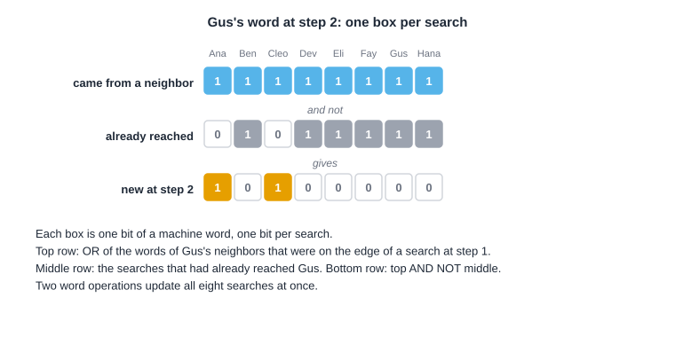
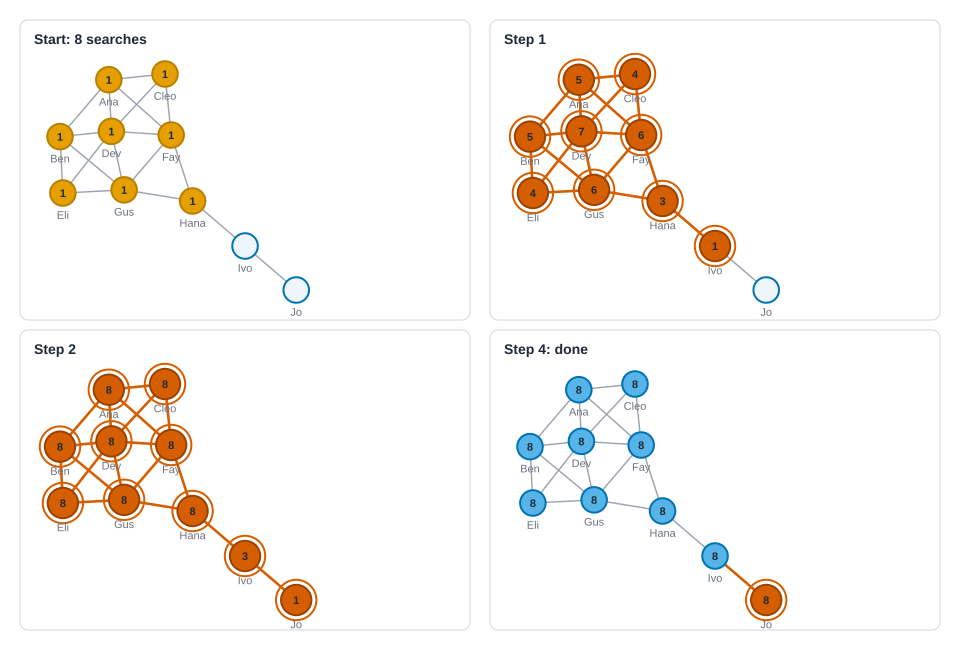
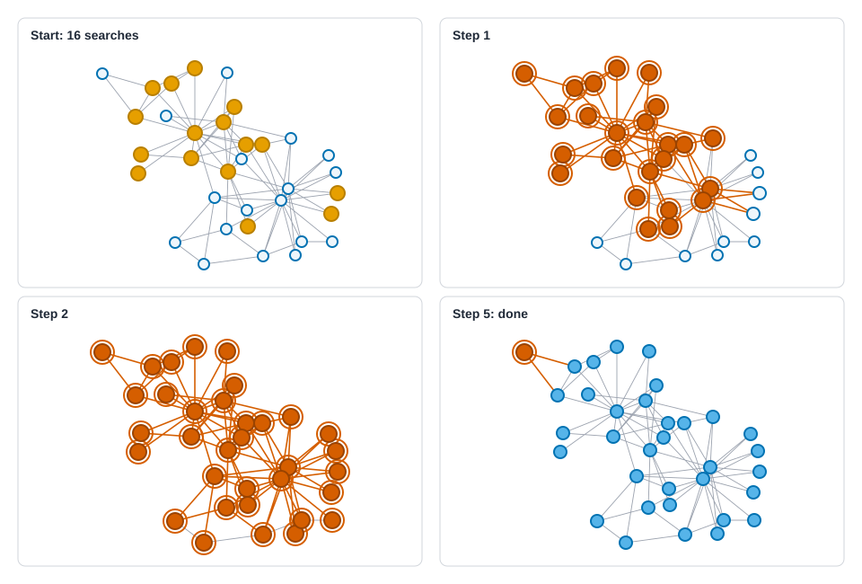
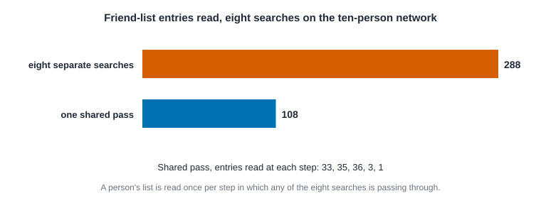
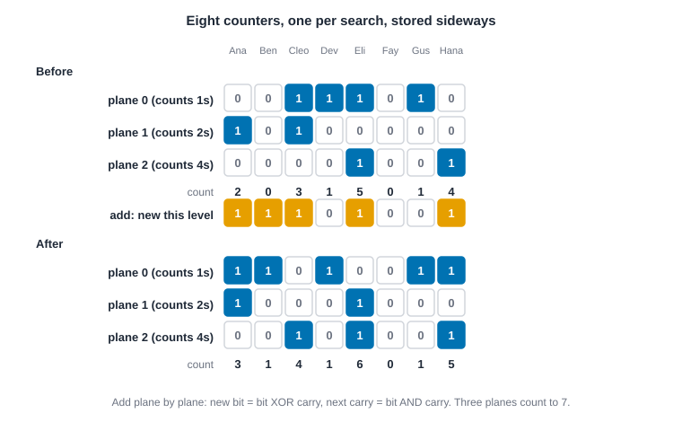
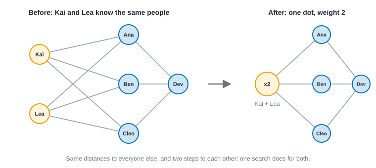
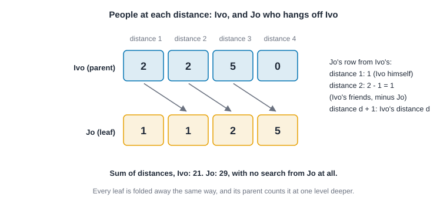
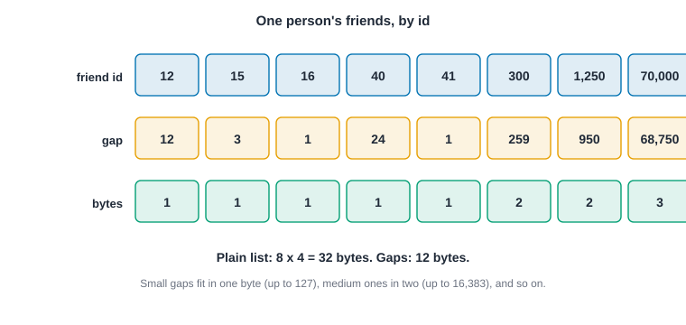

# Closeness and harmonic centrality on millions of ties {#sec-closeness-at-scale}

::: {.callout-note appearance="simple"}
## Prerequisites
Breadth-first and depth-first search; Cost. It helps to have met closeness and harmonic centrality in chapter 6 of the [SNA book](https://knapply.github.io/net-books/sna/), but we recap both below.
:::

::: {.callout-note title="The short version"}
Closeness needs every person's distance to every other person. The plain way runs one full search per person, and on a network with millions of ties that takes hours. This chapter collects five tricks that give the *exact same answer* much faster: run many searches together, one bit each, in a single pass over the network; keep each search's running counts in a clever sideways layout; notice that look-alike people and people with a single tie don't need searches of their own; start searches together that are near each other; and store the network's friend lists compactly. Each trick is simple once you see it, and each comes with a picture.
:::

::: {.callout-note title="Why you might care"}
Closeness and its cousin harmonic centrality are among the most requested numbers in network analysis, and they're the ones people most often give up on for big data, settling for estimates. On many real networks you don't have to: the tricks here turn a job of hours into one of minutes on an ordinary laptop, with every digit exact. They're also a friendly introduction to a style of speed-up, doing many small jobs in the bits of one machine word, that shows up all over fast computing.
:::

::: {.callout-note title="A note on the math and the machine"}
A few formulas appear, each followed by "In plain words". A few ideas need one fact about computers: a **machine word** is a row of 64 on-off switches (**bits**) that the processor handles in one go, and it can combine two whole words, switch by switch, in a single step. Newer processors also have wide "vector" registers that hold 512 bits at once. That's all the hardware you need for this chapter.
:::

## What we're computing

**Closeness** asks how near a person is to everyone else. Add up the distances from a person to all the others (the **farness**) and flip it, so near means high:

$$
\text{closeness}(i) = \frac{n - 1}{\sum_{j \neq i} d(i, j)}.
$$

::: {.callout-tip title="In plain words"}
$d(i, j)$ is the number of steps on a shortest route from $i$ to $j$. The sum adds it up over every other person $j$: that's the farness. With $n$ people, $n - 1$ is the smallest farness possible (one step to everybody), so the score runs from 0 to 1. On the ten-person network, Ana is 1 step from four people, 2 from three, 3 from one and 4 from one: $4 + 6 + 3 + 4 = 17$, so her closeness is $9 / 17 = 0.53$. Fay and Gus have the smallest farness, 14, and the highest closeness, $9/14 = 0.64$.
:::

**Harmonic centrality** adds up the reciprocals instead, so that people you can't reach at all simply count 0 [@marchiori2000harmony; @boldi2014axioms]:

$$
\text{harmonic}(i) = \sum_{j \neq i} \frac{1}{d(i, j)}.
$$

::: {.callout-tip title="In plain words"}
Each person at distance 1 counts 1, each at distance 2 counts a half, at distance 3 a third, and so on. Ana: $4 \times 1 + 3 \times \tfrac12 + 1 \times \tfrac13 + 1 \times \tfrac14 = 6.08$. Someone in a different, unconnected piece of the network has $d = \infty$ and $1/\infty = 0$, so harmonic centrality never breaks.
:::

Notice something that will matter a lot: both measures only need, for each person, **how many people are at each distance**. Ana's "level counts" are 4 at distance 1, 3 at distance 2, 1 at 3, 1 at 4. From those four numbers you get her farness ($1 \cdot 4 + 2 \cdot 3 + 3 + 4 = 17$), the number of people she reaches (9) and her harmonic score. We never need to know *which* people are at distance 2, only how many. Every trick in this chapter leans on that.

Here are the level counts for all ten people, with the three numbers we build from them. Every method in this chapter must reproduce this table exactly.

| Person | People at distance 1, 2, 3, 4 | Farness | Closeness | Harmonic |
|---|---|---|---|---|
| Ana | 4, 3, 1, 1 | 17 | 0.53 | 6.08 |
| Ben | 4, 3, 1, 1 | 17 | 0.53 | 6.08 |
| Cleo | 3, 4, 1, 1 | 18 | 0.50 | 5.58 |
| Dev | 6, 1, 1, 1 | 15 | 0.60 | 7.08 |
| Eli | 3, 4, 1, 1 | 18 | 0.50 | 5.58 |
| Fay | 5, 3, 1 | 14 | 0.64 | 6.83 |
| Gus | 5, 3, 1 | 14 | 0.64 | 6.83 |
| Hana | 3, 6 | 15 | 0.60 | 6.00 |
| Ivo | 2, 2, 5 | 21 | 0.43 | 4.67 |
| Jo | 1, 1, 2, 5 | 29 | 0.31 | 3.42 |

Notice that Dev has the highest harmonic score (7.08: six friends at distance 1 count for a lot) but not the highest closeness (Fay and Gus, with the smallest farness). The two measures weigh near and far people differently; that's a question for the SNA book. Here we only care about getting the counts fast.

## Words we'll use

| Word | What it means here |
|---|---|
| level counts | for one person, how many people are at distance 1, 2, 3, ... |
| search | a breadth-first search from one starting person |
| batch | a group of starting people whose searches run together |
| bit, word | an on-off switch; a row of 64 (or 512) of them handled in one step |
| OR, AND, AND NOT, XOR | combining two words switch by switch: either on, both on, on in the first but not the second, exactly one on |
| bit planes | counters stored sideways: one word for every counter's ones digit, one for the twos digit, ... |
| twins | two people with exactly the same friends who aren't friends with each other |
| leaf, parent | a person with a single tie, and the one person they're tied to |
| weight, pendant count | how many people a folded dot stands for, and how many leaves hang off it |

## Why one search per person is too slow

The textbook way gets each person's level counts with a breadth-first search from that person: everyone 1 step away, then 2, then 3, counting as you go. One search reads every friend list once. Then you do it again from the next person, and the next (@fig-alg-cl-repeat-searches).

{#fig-alg-cl-repeat-searches fig-alt="Four small copies of the ten-person network in a two by two grid. In each, the numbers in the dots are distances from one starting person: Ana, Dev, Hana and Jo. The distance sums are 17, 15, 15 and 29. Orange ties lead one step farther from the start."}

### Push or pull: which way to pass the words

There are two ways to run step 2 of the shared search, and the choice is a classic in fast breadth-first search.

- **Push**: every person on the edge of some search sends their frontier word to each friend. The work is proportional to the friend lists of the people on the edge. When the edge is small, this is cheap.
- **Pull**: every person who hasn't yet been reached by all the searches asks each friend for their frontier word, and can stop asking as soon as every search has arrived. When the edge is huge (it often covers most of a social network by step 2 or 3), this can skip a lot of reading.

The story version: push is a town crier walking the streets with news; pull is every household that's still missing news sending someone out to ask the neighbors. Early on, with little news, the crier wins. When news is everywhere, households that already know everything stop asking, and pulling wins.

Beamer, Asanovic and Patterson [@beamer2012direction] showed that switching from push to pull at the right moment speeds up single searches a lot. With 512 searches per pass the picture is murkier, because a person is "finished" only once all 512 have arrived, which is late. In the lab of chapter 33, pushing alone beat both pulling and switching. Other setups can come out the other way, which is why good libraries measure before choosing.

## What the library does today

This chapter's tricks are general techniques, not one program's features. For the record, as of this writing knappnet's own closeness and harmonic centrality already run unweighted searches in batches, one bit per search, and its developer notes describe wider batches with bit-plane counters and a shrunk working graph with twins and leaves folded. The case study in chapter 33 measures a separate, standalone lab program; its numbers are not the library's, and the library's own measurements are its own.

## What it costs, in plain words

One search reads every friend list once, so its work grows with the number of ties. Doing one per person multiplies that by the number of people. Double the network and the job takes four times as long. Formally, for $n$ people and $m$ ties, the work is

$$
O(n \cdot m),
$$

::: {.callout-tip title="In plain words"}
"Order of $n$ times $m$": one search of about $m$ steps for each of $n$ people. On the ten-person network that's $10 \times 18 = 180$, nothing. On a network with half a million people and two million ties it's $10^{12}$ friend-list entries read, each a trip to memory. In the case study (chapter 33) that baseline would take over two hours on a laptop with two cores.
:::

The searches are independent, so you can split them over cores. That helps by the number of cores, which is a constant. The tricks below change *how much reading each search does*, which is a much bigger lever.

## Trick 1: many searches in one pass

### The story: carpooling

Imagine sixty-four households in a town that each want to know how far every other household is. The plain way is sixty-four cars, each driving the whole town. But most of those cars spend most of their time on the same roads. What if one bus drove the roads instead, with a seat for each household, and at every corner simply noted which of its passengers were seeing that corner for the first time?

That's the idea of the **multi-source breadth-first search** of Then and colleagues [@then2014more]: run up to 64 searches at once, give each one a bit in a machine word, and let every person carry a word that says which searches have reached them. One pass over the friend lists moves all 64 searches forward by one step.

### The tiny example, by hand

Take eight searches on the ten-person network, from Ana, Ben, Cleo, Dev, Eli, Fay, Gus and Hana. Each person carries three 8-bit words:

- **seen**: which searches have already reached this person,
- **frontier**: which searches reached this person at the step just finished (they're on the edge of those searches),
- **arrived**: which searches are arriving now from a neighbor.

One step works like this. Every person on the edge of *any* search passes their frontier word to all their friends: each friend combines it into their arrived word with an OR ("on if either is on"). Then every person keeps only the arrivals they haven't seen before: new = arrived AND NOT seen. Those new bits are the searches for which this person is at the current distance.

@fig-alg-cl-word-lights shows Gus at step 2. All eight searches arrive at Gus from some friend (top row). Six of them had already reached Gus (middle row): Gus himself, and Ben, Dev, Eli, Fay and Hana, who are his friends. What's left (bottom row) is Ana and Cleo: Gus is at distance 2 from both. Two word operations did the work of eight separate checks.

{#fig-alg-cl-word-lights fig-alt="Three rows of eight boxes labelled Ana to Hana. Top row, came from a neighbor: all eight ones. Middle row, already reached: 0 1 0 1 1 1 1 1. Bottom row, new at step 2: 1 0 1 0 0 0 0 0. Shaded boxes are ones, white boxes zeros."}

To see the bookkeeping on something small enough to follow, here is a shared search with just three bits, for Ana, Dev and Jo, in that order. Each row lists the people who got new bits at that step and which bits they got (1 means that search is new here).

| Step | New arrivals (bits for Ana, Dev, Jo) |
|---|---|
| 0 | Ana 100, Dev 010, Jo 001 (the starts) |
| 1 | Ana 010, Ben 110, Cleo 110, Dev 100, Eli 010, Fay 110, Gus 010, Ivo 001 |
| 2 | Eli 100, Gus 100, Hana 111 |
| 3 | Fay 001, Gus 001, Ivo 110 |
| 4 | Ana 001, Ben 001, Cleo 001, Dev 001, Eli 001, Jo 110 |

Read a column of bits down the steps and you have one ordinary search. Ana's bit (the first) appears at Ben, Cleo, Dev and Fay at step 1: four people at distance 1, as in the table above. Hana gets all three bits at once at step 2: she is exactly two steps from Ana, from Dev and from Jo, and one look at her friend list served all three searches. Jo's searches and Ana's run in opposite directions along the chain through Hana, and still share every pass.

Here are those eight searches spreading together. The number in each dot is how many of the eight searches have reached that person; red dots got new arrivals at this step. The bars on the right track each search separately, and every one of them finishes after four passes.

{#fig-msbfs-kite-anim fig-alt="Four copies of the ten-person network. At the start, the eight starting people are orange, each with a 1. After step 1, most people have been reached by several searches, with counts like 5, 7 and 6. After step 2 almost everyone shows 8. At step 4 everyone shows 8: all eight searches have reached all ten people."}

The same thing on Zachary's karate club, with sixteen searches at once. The searches overlap heavily, which is what makes the shared pass pay off: by step 2, most members have been reached by most of the sixteen.

{#fig-msbfs-karate-anim fig-alt="Four copies of the karate club. At the start, sixteen members are orange. After step 1, red dots show members newly reached by some search, covering much of the club. After step 2 nearly every member is red or reached. In the last copy every search has reached all 34 members."}

### How much reading it saves

@fig-alg-cl-shared-work counts friend-list entries read. Eight separate searches each read every friend list once: $8 \times 36 = 288$ entries (each of the 18 ties appears in two lists). The shared pass reads a person's list once per step in which *any* search is passing through them: 108 entries in total.

{#fig-alg-cl-shared-work fig-alt="Two horizontal bars. Eight separate searches: 288 entries read. One shared pass: 108. Below, the shared pass's reads per step: 33, 35, 36, 3, 1."}

On ten people the saving is under three times. On a big network with 64 searches per word, it approaches 64 times, because a person far from all 64 starting points tends to be reached by most of them at the same step.

### The idea in steps

For each batch of up to 64 starting people:

1. Give starting person $k$ bit $k$. Set their seen and frontier words to that bit.
2. **Push.** For every person whose frontier word isn't zero, OR it into the arrived word of each friend.
3. **Settle.** For every person whose arrived word isn't zero: new = arrived AND NOT seen. Add new to seen. New becomes their frontier word for the next step. Clear arrived.
4. **Count.** For each search whose bit is in new, add 1 to that search's count at the current distance.
5. If no frontier word is nonzero, stop. Otherwise go to step 2 with the distance one higher.

```text
for k, s in enumerate(batch): seen[s] |= bit k; frontier[s] |= bit k
d = 0
while any frontier word is nonzero:
    d = d + 1
    for each person u with frontier[u] != 0:       # push: one read of u's list
        for each friend v of u: arrived[v] |= frontier[u]
    for each person v: frontier[v] = 0
    for each person v with arrived[v] != 0:        # settle
        new = arrived[v] & ~seen[v]
        seen[v] |= new; frontier[v] = new; arrived[v] = 0
        for each bit k set in new: count[k][d] += 1     # step 4: see trick 2
```

::: {.callout-tip title="In plain words"}
`|=` means "switch on whatever is on in the right-hand word", `&` keeps switches on in both, and `~` flips every switch. The push loop reads each active person's friend list once for all 64 searches. The settle loop finds, for each person, exactly which searches are meeting them for the first time. The last line is the one we'll speed up next: as written, it visits every new bit one by one.
:::

A refinement for big steps: when the edge of the searches covers most of the network, it can be cheaper to "pull", letting each person not yet reached by everyone look at their friends' frontier words, than to push from every active person [@beamer2012direction]. Which wins depends on the network and the hardware; in the closeness lab of chapter 33, pushing alone was faster at every width.

### Wider words

There's nothing special about 64. Modern processors can OR two 512-bit vectors in one instruction, so each person can carry eight 64-bit words and the same pass runs 512 searches. Each friend-list entry read now serves 512 searches. In the lab, going from 64 to 512 searches per pass made the whole computation about 1.5 times faster, not 8 times: past a point, the time goes into the per-person words rather than into reading friend lists.

## Trick 2: keep the counters sideways

### The problem

Step 4 above says: for each search whose bit is set in new, add 1 to that search's count at this distance. With 512 searches per pass, a person reached by many searches at once means hundreds of little additions, each one finding a set bit and bumping a counter. On big networks this bookkeeping can take as long as the search itself.

### The story: an abacus with one rod per search

Think of keeping score for eight teams with an abacus that has one column of beads per team. Adding "1 point for teams A, C and E" means touching three columns. Now turn the abacus sideways: keep all eight teams' ones digits in one row, all their twos digits in the next row, the fours in a third. Adding "1 point for A, C and E" is now ordinary schoolbook addition, done for all eight teams at once: add a row of 1s and 0s to the ones row, carry into the twos row, carry into the fours.

Each row is a machine word. Computer people call this layout **bit planes** or **bit-sliced counters**, and the operation of adding a word into them, and later reading the totals out, is a cousin of the **positional population count** [@klarqvist2019faster; @clausecker2024faster].

### The tiny example, by hand

Eight searches have counts 2, 0, 3, 1, 5, 0, 1, 4 so far at the current distance. In bit planes:

| Plane | Ana | Ben | Cleo | Dev | Eli | Fay | Gus | Hana |
|---|---|---|---|---|---|---|---|---|
| ones | 0 | 0 | 1 | 1 | 1 | 0 | 1 | 0 |
| twos | 1 | 0 | 1 | 0 | 0 | 0 | 0 | 0 |
| fours | 0 | 0 | 0 | 0 | 1 | 0 | 0 | 1 |
| count | 2 | 0 | 3 | 1 | 5 | 0 | 1 | 4 |

A person is newly reached by the searches from Ana, Ben, Cleo, Eli and Hana: new = 1 1 1 0 1 0 0 1. Add it:

1. **Ones plane:** new ones = ones XOR new ("on if exactly one is on") = 1 1 0 1 0 0 1 1. Carry = ones AND new = 0 0 1 0 1 0 0 0.
2. **Twos plane:** new twos = twos XOR carry = 1 0 0 0 1 0 0 0. Carry = twos AND carry = 0 0 1 0 0 0 0 0.
3. **Fours plane:** new fours = fours XOR carry = 0 0 1 0 1 0 0 1. Carry = 0, so we stop.

Read down the columns: 3, 1, 4, 1, 6, 0, 1, 5. Every search that was in new went up by one, using six word operations instead of five separate additions. With 512 searches per word, it's still six word operations.

{#fig-alg-cl-bit-planes fig-alt="Two blocks of three rows of eight bits, before and after, with an orange row of bits being added between them. Read down each column, the counts before are 2, 0, 3, 1, 5, 0, 1, 4; the orange row adds 1, 1, 1, 0, 1, 0, 0, 1; the counts after are 3, 1, 4, 1, 6, 0, 1, 5."}

The rule, written out, for plane $b$ with carry $c_b$ (starting with $c_0 = \text{new}$):

$$
\text{plane}_b \leftarrow \text{plane}_b \oplus c_b, \qquad c_{b+1} = \text{plane}_b^{\text{old}} \wedge c_b.
$$

::: {.callout-tip title="In plain words"}
$\oplus$ is XOR (on if exactly one of the two is on) and $\wedge$ is AND (on if both are on). For each plane in turn: flip the bits where a carry arrives, and pass a carry up wherever a 1 was already sitting. It's the way you add 1 to 199 by hand, done for every search's counter in parallel. The loop stops as soon as the carry word is all zeros, usually after one or two planes.
:::

Two practical details. A few planes only count so high (three planes reach 7, eight planes reach 255), so before a count can overflow, the planes are emptied into ordinary counters and reset; emptying them happens once per distance, which is rare compared with the additions. And to add a number other than 1 (we'll need that for look-alike people, next), start the carry at the plane for each 1 bit of that number: adding 2 starts at the twos plane.

In the lab of chapter 33, replacing the one-bit-at-a-time counting with bit planes made the whole computation about twice as fast on every test graph.

## Trick 3: look-alike people need only one search

### The story: two interns

Kai and Lea are interns who started the same week and were introduced to exactly the same three people: Ana, Ben and Cleo. They don't know each other yet. From the network's point of view they are interchangeable: any route that leaves Kai goes through Ana, Ben or Cleo, and so does any route that leaves Lea.

Such people are called **false twins**: same friends, not tied to each other. Two facts follow:

- For anyone else, $z$, Kai and Lea are the same distance away: $d(\text{Kai}, z) = d(\text{Lea}, z)$.
- Kai and Lea are exactly 2 steps apart (through any shared friend).

So Lea's level counts are Kai's, and one search does for both. Better: fold them into one dot with a **weight** of 2 (@fig-alg-cl-twins). When a search reaches that dot at distance $d$, it adds 2 people at distance $d$ instead of 1, which is where bit-plane addition of a number other than 1 comes in. When the twin dot is itself a starting person, its own search adds its weight minus one (its twins) at distance 2.

{#fig-alg-cl-twins fig-alt="Left: six dots. Kai and Lea, in orange, are each tied to Ana, Ben and Cleo, who are all tied to Dev. Right: Kai and Lea have become one larger orange dot marked x2, tied to Ana, Ben and Cleo; the rest is unchanged."}

### A worked example

Add Kai and Lea to the ten-person network, both tied to Ana and to Ben. They're twins: same friends, not tied to each other. A search from Kai finds 2 people at distance 1 (Ana and Ben), 6 at distance 2 (Cleo, Dev, Fay, Eli, Gus, and Lea), then 1, 1 and 1 at distances 3, 4 and 5 (Hana, Ivo, Jo). Farness 26. A search from Lea finds exactly the same counts, with Kai in Lea's distance-2 group.

After folding, there's one dot "Kai+Lea" with weight 2. The folded search from that dot finds Ana and Ben at distance 1 and the same five people at distance 2, then adds weight minus one, $2 - 1 = 1$, at distance 2 for the twin it stands in for: 6 again. And a search from Ana now reaches the folded dot at distance 1 and adds its weight, 2, so Ana has 6 people at distance 1 instead of 4. Twelve people, eleven searches, identical answers.

### Why it matters on real networks

On the ten-person network there are no twins. But real networks are full of them: in a social network, many people have just one or two friends, often the same ones; in a web graph, many pages link to exactly the same handful of pages. Folding a class of fifty twins saves forty-nine searches *and* makes every other search cheaper, because the folded network has fewer people and ties.

Finding twins is a sorting job: give each person a fingerprint of their sorted friend list, sort by fingerprint, and check neighbors in the sorted order for exact equality. That costs about as much as reading the network once or twice.

## Trick 4: dangling leaves fold onto their parent

### The story: the end of the line

Jo has one friend, Ivo. Every route from Jo to anyone else starts with the step to Ivo. So Jo's distance to anyone except Ivo is Ivo's distance plus one. People with a single tie are called **leaves**, and their one friend is their **parent**.

That means Jo's level counts can be read off Ivo's, without a search of Jo's own:

$$
\text{count}_{\text{Jo}}(1) = 1, \qquad \text{count}_{\text{Jo}}(2) = \text{count}_{\text{Ivo}}(1) - 1, \qquad \text{count}_{\text{Jo}}(d + 1) = \text{count}_{\text{Ivo}}(d) \text{ for } d \geq 2.
$$

::: {.callout-tip title="In plain words"}
At distance 1 Jo has exactly one person: Ivo. At distance 2 Jo has Ivo's friends, minus Jo himself, who is one of them. From there on, Jo's count at distance $d+1$ is Ivo's count at distance $d$: everything is one step farther. Ivo has 2 people at distance 1 (Hana and Jo), 2 at distance 2 and 5 at distance 3. So Jo has 1, then $2 - 1 = 1$, then 2, then 5. Jo's farness is $1 + 2 + 6 + 20 = 29$, which matches a direct search.
:::

{#fig-alg-cl-leaf-fold fig-alt="Two rows of four boxes. Ivo's row holds the number of people at distance 1 to 4: 2, 2, 5, 0. Jo's row holds 1, 1, 2, 5. Diagonal arrows show each of Ivo's counts moving one box to the right in Jo's row. The sums of distances are 21 for Ivo and 29 for Jo."}

Folding goes further than skipping Jo's search. We can remove Jo from the network altogether and write a **pendant count** of 1 on Ivo. When any search reaches Ivo at distance $d$, it adds Ivo's weight at $d$ and Ivo's pendant count at $d + 1$. Every search is now a little shorter, and nobody needs to visit Jo.

One caution: fold a leaf only when its parent has at least one other friend. In a network that is just a pair of people, or a star whose center has nothing but leaves, folding would leave nothing to search from.

Look-alikes and leaves together are the "shattering and compressing" ideas of Sariyuce and colleagues [@sariyuce2013shattering], first used to speed up betweenness. Fitting them inside the many-searches-per-pass search of trick 1, with weights going into bit-plane counters, is what makes them combine so well here.

## Trick 5: start searches together that are near each other

A batch of 64 searches shares work only where their paths overlap. If the 64 starting people are scattered all over a huge network, their searches won't meet for several steps, and the early steps pay for 64 separate edges.

The fix is cheap. Number people from the best-connected down (so the busiest people's words sit next to each other in memory), then fill batches in breadth-first order: a hub, its friends, their friends. A batch's searches then start next to each other and merge within a step or two. In the lab this gave 1.2 to 1.4 times on top of everything else. Batching heuristics like this are discussed in the multi-source search papers themselves [@then2014more].

## Trick 6: squeeze the friend lists

### The story: house numbers on one street

A network is stored as friend lists: for each person, the id numbers of their friends, usually 4 bytes each. If the lists are sorted, the ids climb, and the *gaps* between neighbors are usually small numbers, the way consecutive house numbers on a street are close together. Small numbers fit in fewer bytes.

The usual trick is a **variable-length integer** (varint): use 7 bits of each byte for the number and the eighth bit to say "more bytes follow". A gap below 128 takes 1 byte, below 16,384 takes 2, and so on.

{#fig-alg-cl-gap-varint fig-alt="Three rows of eight boxes. Friend ids: 12, 15, 16, 40, 41, 300, 1,250, 70,000. Gaps: 12, 3, 1, 24, 1, 259, 950, 68,750. Bytes per gap: 1, 1, 1, 1, 1, 2, 2, 3, 12 in all, against 32 for the plain list."}

### Why it barely slows the search

Decoding a varint takes a few more steps than reading a plain 4-byte number, and that usually makes compressed graphs slower to search. Here it hardly matters: each decoded friend serves *all 512 searches* in the batch at once, so the decoding cost is spread over 512 times as much useful work. In the lab, gap-coded lists took 1.3 to 2.2 bytes per entry instead of 4, at a cost of 0 to 16 percent in time.

### Where the memory actually goes

Here's the surprise: on these searches, the friend lists are *not* the main memory cost. Each person carries three words of search state (seen, frontier, arrived), each 512 bits (64 bytes) wide, for every thread. That's $3 \times 64 = 192$ bytes per person per thread, against a handful of bytes per person for the compressed lists. Compressing the lists helps most when the network is huge and threads are few.

## How the tricks fit together

The order matters, and so does doing them all:

1. **Shrink the network** once: fold twins into weighted people, fold leaves into pendant counts on their parents, renumber people by connections.
2. **Form batches** of up to 512 starting people in breadth-first order of the shrunk network.
3. **Search each batch** in one shared pass, pushing frontier words along the (optionally compressed) friend lists.
4. **Count** arrivals with weighted additions into bit-plane counters, emptying them once per distance.
5. **Expand** the answer back to everyone: twins copy their class's counts, leaves get their parent's counts shifted by one.
6. **Score**: farness, reach and harmonic sum from each person's level counts.

Every step changes how the work is done, never what is computed. The case study in chapter 33 runs this pipeline on graphs with up to four million ties and checks every answer against the plain one-search-per-person method.

## What it costs, in plain words

The shared search reads each active person's friend list once per step for the whole batch, instead of once per search. If the 512 searches in a batch overlap well, the reading drops by close to 512 times. The bookkeeping per person per step is a few word operations on 512-bit words, which modern processors do in one or a few instructions.

Formally, for $n$ people, $m$ ties, $W$ searches per pass and $L$ steps (the largest distance a batch needs):

$$
\text{time} = O\!\left(\frac{n}{W} \cdot L \cdot (n + m)\right) \text{ at worst}, \qquad \text{memory} = O(m) + O(n \cdot W) \text{ bits per thread}.
$$

::: {.callout-tip title="In plain words"}
There are $n / W$ batches. Each batch takes at most $L$ steps, and a step reads at most every person and every friend list once. In the worst case that's no better than $n \cdot m$, because $L$ can be large. In practice, social and web-like networks have small $L$ (often under 10), and most steps only touch part of the network, so the real cost is close to $n \cdot m / W$. With $W = 512$, a job that would take 512 hours one search at a time could take as little as an hour, before twins and leaves shrink it further. The memory term says each person needs $W$ bits of state per thread, times three words.
:::

On networks with long, thin shapes, like road maps, the searches from a batch don't overlap much and $L$ is in the hundreds. There the shared pass gains little, and a good library falls back to one search per person.

## Checking your work

Exact speed-ups make exact checks possible: the answer must match the plain method digit for digit. A few identities catch most bugs before you even run the comparison.

- **Counts add up to reach.** A person's level counts must add up to the number of people they can reach (everyone else, in a connected network: 9 for each of the ten).
- **Leaves.** A leaf's farness is its parent's farness plus $n - 2$: everyone except the leaf and the parent is one step farther. Jo: $21 + 8 = 29$.
- **Twins.** Twins have identical level counts, and so identical scores.
- **Symmetry.** In an undirected network, $d(i, j) = d(j, i)$, so the sum of everyone's farness is twice the sum of distances over all pairs. For the ten-person network the farness column adds up to 178, so the pairs add up to 89.
- **Bit for bit.** Compare level counts and farness as whole numbers, and the harmonic sum only after adding level counts in increasing distance in both methods. Then "equal" means equal, not "close".

## At a glance

| Trick | What it saves | Costs | Use when | Skip when |
|---|---|---|---|---|
| Many searches per pass | reading friend lists, up to $W$ times | $3W$ bits per person per thread | social, web, collaboration networks | road-like networks with little overlap |
| Bit-plane counters | per-search counting work | a few words per batch | always with many searches per pass | one search at a time |
| Fold look-alikes | whole searches, plus smaller network | a sort to find them | many people share identical friend lists | directed or weighted networks (rules differ) |
| Fold leaves | whole searches, plus smaller network | one pass | many people with a single tie | the parent has no other friends |
| Batch by nearness | early steps of each batch | a renumbering | always | |
| Compress friend lists | memory for the network, 2 to 3 times | 0 to 16 percent time in the lab | the network barely fits in memory | memory is plentiful |

## Where it goes wrong

- **Directed networks.** The twin rule needs care: two people are interchangeable for outgoing distances if they have the same *out*-friends, for incoming if the same *in*-friends. The leaf rule changes too. The safe choice is to apply the folding tricks only to undirected networks.
- **Weighted ties.** Bits can only say "reached at this step". With lengths on ties, distances aren't step counts, and the shared breadth-first pass doesn't apply. (If every tie has the same length, multiply the step counts by it.)
- **Disconnected networks.** Closeness has several rules for people who can't reach everyone (the SNA book lists them). The level counts don't change; only the final formula does. Harmonic centrality needs no rule.
- **Counter overflow.** Bit planes count only up to $2^{\text{planes}} - 1$. Empty them before a count could overflow, and send large weights (big twin classes) straight to ordinary counters.
- **Exact means the same order.** The harmonic sum is a sum of fractions, and adding fractions in a different order can change the last digit. To get bit-for-bit the same answer as the plain method, add the level counts in increasing distance order, in both.
- **A leaf whose parent has no other friend.** Folding it would leave the parent alone; skip that case.
- **Self-loops and repeated ties.** A tie from a person to themselves, or two copies of the same tie, never changes a distance. Drop them before looking for twins, or two people who are really twins will look different.
- **Memory per thread.** $3 \times 64$ bytes per person per thread adds up: ten million people on eight threads is about 15 GB of search state. Use fewer threads or narrower words on huge networks.

::: {.callout-note title="If you like proofs"}
*Shared search equals separate searches.* Bit $k$ of a person's frontier word is on exactly when that person is at the current distance from starting person $k$. The push step turns bit $k$ on in every friend of such a person, and the settle step keeps it only where search $k$ hadn't been before. That is the rule of a single breadth-first search, applied to bit $k$; the other bits never affect bit $k$. So each bit follows its own search exactly.

*Twins are equidistant.* If Kai and Lea have the same set of friends $F$ and aren't tied, any shortest route from Kai to someone $z$ other than Lea starts with a step into $F$; replacing Kai by Lea at the start gives a route of the same length from Lea. So $d(\text{Kai}, z) \le d(\text{Lea}, z)$ and, by symmetry, equal. They're 2 apart because they share a friend and aren't tied.

*Leaves shift by one.* Any route from the leaf Jo to $z \ne$ Jo starts with the tie to Ivo, so $d(\text{Jo}, z) = 1 + d(\text{Ivo}, z)$. The people at distance $d + 1$ from Jo are exactly those at distance $d$ from Ivo, except Jo himself, who is at distance 1 from Ivo and 0 from Jo; that is the "minus one" at distance 2.
:::

## Code

The first block will compute closeness and harmonic centrality on the karate club twice, once one search per person and once with batched searches, and confirm the answers are identical. Look for "identical: TRUE" and two timing lines.

::: {.panel-tabset group="language"}

## R

```r
# TODO(code, R): on the karate club, compute closeness and harmonic centrality with one search per person and with batched searches, and print whether the two results are identical and the time each took
```

## Python

```python
# TODO(code, Python): on the karate club, compute closeness and harmonic centrality with one search per person and with batched searches, and print whether the two results are identical and the time each took
```

## Rust

```rust
// TODO(code, Rust): on the karate club, compute harmonic centrality with set_search_mode(Single) and with set_search_mode(Batched), and print whether the two vectors are bit-for-bit equal and the time each took
```

:::

::: {.code-output}
TODO(output): the printed result of the code above, once it runs.
:::

On a network this small the times will be tiny; the point is the identical answers.

The second block will rebuild Jo's level counts from Ivo's, the leaf rule from trick 4, and compare them with a direct search.

::: {.panel-tabset group="language"}

## R

```r
# TODO(code, R): on the ten-person friendship network, print the number of people at each distance from Ivo and from Jo (1 1 2 5), and Jo's counts rebuilt from Ivo's by the leaf rule, which should match
```

## Python

```python
# TODO(code, Python): on the ten-person friendship network, print the number of people at each distance from Ivo and from Jo (1 1 2 5), and Jo's counts rebuilt from Ivo's by the leaf rule, which should match
```

## Rust

```rust
// TODO(code, Rust): on the ten-person friendship network, print the number of people at each distance from Ivo and from Jo using compute_bfs_levels, and Jo's counts rebuilt from Ivo's by the leaf rule, which should match
```

:::

::: {.code-output}
TODO(output): the printed result of the code above, once it runs.
:::

If the rebuilt row and the searched row agree, you've just skipped a search without losing a digit.

## Exercises

1. **By hand.** Run the shared search from Ivo and Jo together (bit 0 for Ivo, bit 1 for Jo) on the ten-person network. Write each person's seen word after step 1 and after step 2.
2. **By hand.** Eight bit-plane counters hold 7, 1, 0, 3, 2, 6, 5, 4 (three planes). Add new = 0 1 1 1 0 1 0 0. Which plane does each carry stop at, and what are the new counts? Would any counter overflow three planes?
3. **Think it through.** In a star with one center and 999 leaves, how many searches does the plain method run? How many after folding twins? After folding leaves? (Careful: are the leaves twins of each other?)
4. **Think it through.** Why does compressing friend lists cost much less time with 512 searches per pass than with one search at a time?
5. **By hand.** In the example with Kai and Lea added (both tied to Ana and Ben), what are Ben's level counts? Check your answer against the twins rule.
6. **Coding.** Once the code above runs, time the two methods on a larger network from the appendix and work out the ratio. Then read the case study in chapter 33 and compare your ratio with the lab's.

## Answers

1. Start: Ivo's word has bit 0 (01, written with Jo's bit on the left), Jo's has bit 1 (10). Step 1: Ivo pushes 01 to Hana and Jo; Jo pushes 10 to Ivo. Settled: Hana 01, Jo 10 | 01 = 11, Ivo 01 | 10 = 11. Step 2: frontiers are Hana 01, Jo 01 (new for Jo), Ivo 10 (new for Ivo). Hana pushes 01 to Fay, Gus and Ivo; Ivo pushes 10 to Hana and Jo. Settled: Fay 01, Gus 01, Hana 11; Ivo and Jo already had 11. So after step 2: Fay 01, Gus 01, Hana 11, Ivo 11, Jo 11, everyone else 00.
2. Counts after: 7, 2, 1, 4, 2, 7, 5, 4. For the second counter (1 + 1) the carry goes into the twos plane and stops there; for the third (0 + 1) it stops in the ones plane; for the fourth (3 + 1) it runs to the fours plane; for the sixth (6 + 1) it stops in the ones plane. No overflow, but the first and sixth counters are now at 7, the most three planes can hold; one more addition there must empty the planes first.
3. Plain: 1,000 searches. The 999 leaves all have the same single friend (the center) and aren't tied to each other, so they're twins: fold them into one weighted person, and two searches remain (the center and the folded class). Folding the class as a leaf is not allowed, because its parent, the center, has no other friend.
4. Decoding a friend list costs the same whether one search or 512 use the result. With one search, the decoding is pure overhead on every entry read; with 512, it's spread over 512 searches' worth of work, so it disappears in the noise.
5. Ben, like Ana, now reaches Kai and Lea at distance 1: his friends are Ana, Dev, Eli, Gus, Kai and Lea, so 6 at distance 1. Then Cleo, Fay and Hana at distance 2 (3), Ivo at 3, Jo at 4. Counts 6, 3, 1, 1, the same as Ana's, as you'd expect: Ana and Ben aren't twins (they're tied), but the folded dot adds weight 2 at distance 1 to both.
6. Your ratio will depend on your machine and network. Expect much larger gains on networks with many leaves and twins, and little or none on road-like networks.

## Summary

::: {.callout-tip appearance="simple"}
Closeness and harmonic centrality only need, for each person, how many people sit at each distance. The plain method gets those counts with one search per person, $O(nm)$ work. Six tricks keep the answers exact and make it far faster: run up to 512 searches in one pass, one bit each; count arrivals in bit planes; fold look-alike people into weighted ones and leaves into counts on their parents; batch searches that start near each other; and compress the friend lists, which costs almost nothing when every decoded friend serves 512 searches. Memory goes mainly to the per-thread search state, not the network.

**The one-line takeaway:** don't search from everyone separately; search from many at once, and skip the people whose answers you can work out from someone else's.
:::

## Further reading

- Then and colleagues [@then2014more] introduced multi-source breadth-first search with one bit per search, including batching and the push and pull choices. Beamer, Asanovic and Patterson [@beamer2012direction] describe switching between pushing and pulling.
- Klarqvist, Mula and Lemire [@klarqvist2019faster] and Clausecker, Lemire and Schintke [@clausecker2024faster] cover positional population counts, the bit-plane counting idea, with fast vector code.
- Sariyuce and colleagues [@sariyuce2013shattering] fold leaves and look-alikes to speed up betweenness.
- Eppstein and Wang [@eppstein2004fast] estimate closeness from a sample of starting people, the sampling route when exact answers aren't needed.
- Boldi and Vigna [@boldi2014axioms] argue for harmonic centrality over closeness; chapter 6 of the [SNA book](https://knapply.github.io/net-books/sna/) shows both on small networks.
- Chapter 33 of this book is the case study: the whole pipeline, measured.
