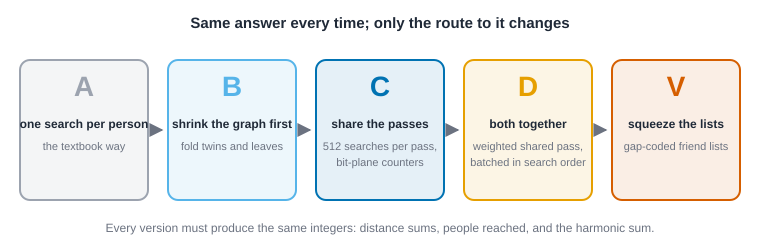
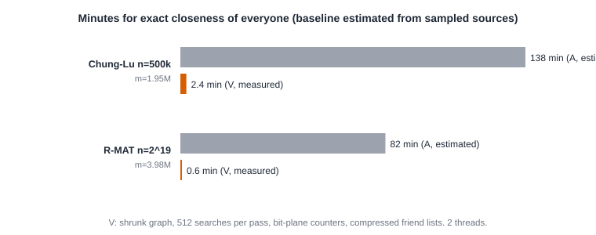

# Case study: closeness on a four-million-tie graph {#sec-case-closeness}

::: {.callout-note appearance="simple"}
## Prerequisites
Closeness and harmonic centrality on millions of ties (chapter 19). The cost and benchmarking chapters help with reading the numbers.
:::

::: {.callout-note title="The short version"}
This chapter follows one computation, exact closeness and harmonic centrality for every person, through five versions on five test graphs, from a plain one-search-per-person baseline to a version that combines every trick of chapter 19. On a graph with half a million people the baseline would need over two hours; the fastest version took under two and a half minutes, 58 times faster, and on an R-MAT graph with four million ties it was about 130 times faster, with every answer identical to the baseline's. All the numbers come from a small standalone lab program, and every one is reported with the setup it was measured on.
:::

::: {.callout-note title="Why you might care"}
Speed-up claims are easy to make and hard to trust. This chapter shows what an honest one looks like: a stated baseline, one change at a time, an exactness check on every run, memory measured as well as time, and a plain list of what could make the numbers mislead. If you ever need to decide whether "exact closeness on my big network" is a five-minute job or an overnight one, the numbers here are a reasonable first guide, and the method is one you can copy.
:::

::: {.callout-important title="Where these numbers come from"}
Every timing in this chapter was measured in a **standalone lab program**: a few hundred lines of Rust with no dependencies, written to try these ideas one at a time. It is not the library's code, and none of these timings are library timings. Some of the ideas have since been adapted into the library, where they are tuned and measured separately on different hardware; those numbers are not reported here. The lab ran on a **workspace with 2 processor cores that support 512-bit vector instructions (AVX-512)**, with **2 threads** and **512 searches per pass** unless a section says otherwise. The test graphs are **synthetic**: generated by well-known random models, not collected from real people.
:::

## The story: one question, five ways

Suppose someone hands you a network with half a million people and two million ties, and asks for everyone's exact closeness by tomorrow. You know the textbook method: one breadth-first search per person. You also know, from chapter 19, a list of tricks that should make it faster without changing a single digit of the answer. How much faster? Which tricks matter? What does it cost in memory? And how do you convince a skeptical colleague that the fast answer is the right one?

That's the whole case study. We'll treat it like a careful kitchen experiment: same ingredients each time, change one thing, taste, write it down.

## The five versions

@fig-alg-cc-pipeline lays out the five versions. Each changes one thing about *how* the work is done; none changes *what* is computed.

{#fig-alg-cc-pipeline fig-alt="Five rounded boxes left to right with arrows between them: A, one search per person; B, shrink the graph first; C, share the passes, 512 searches per pass with bit-plane counters; D, both together; V, squeeze the lists with gap-coded friend lists."}

| Version | What it does | Chapter 19 tricks used |
|---|---|---|
| **A** | one breadth-first search per person on the original graph, spread over the threads; this is how most libraries do it | none |
| **B** | the same, on a shrunk graph: look-alike people (twins) folded into weighted dots, one round of leaves folded into counts on their parents | 3, 4 |
| **C** | 512 searches per pass on the original graph, with bit-plane counters | 1, 2 |
| **D** | 512 searches per pass on the shrunk, weighted graph, batched by nearness, with weighted bit-plane counters | 1, 2, 3, 4, 5 |
| **V** | D, with gap-coded friend lists | all six |

A is the yardstick. Every other version is measured against it, and every other version's answers are compared with it.

## The test graphs

Five graphs, chosen to cover different shapes. They're all made by random models, which you can think of as recipes for networks with a given flavor:

- **Chung-Lu** [@chung2002average]: give every person a target number of ties drawn from a heavy-tailed spread (a few hubs, many people with one or two ties), then tie pairs at random in proportion to their targets. Lots of leaves and some twins, like many social networks.
- **R-MAT** [@chakrabarti2004rmat]: place ties by repeatedly choosing a quadrant of the adjacency matrix with unequal odds. Produces hubs, many low-degree people and many twins, like web and communication graphs. Sizes are powers of two: $2^{16} = 65{,}536$ and $2^{19} = 524{,}288$ people.
- **Barabási-Albert** [@barabasi1999emergence]: people arrive one at a time and tie to existing people in proportion to their ties. Everyone gets at least a few ties, so there are **no leaves and no twins**. It's the case where shrinking the graph can't help, a deliberate worst case for versions B, D and V.

| Graph | People ($n$) | Ties ($m$) | Leaves and twins |
|---|---|---|---|
| Chung-Lu, small | 50,000 | 192,000 | many |
| R-MAT, small | 65,536 ($2^{16}$) | 478,000 | many |
| Barabási-Albert | 50,000 | 200,000 | none |
| Chung-Lu, big | 500,000 | 1,950,000 | many |
| R-MAT, big | 524,288 ($2^{19}$) | 3,980,000 | many |

The last one is the "four-million-tie graph" of the chapter title.

## The tiny example: what "exact" means

Before any timing, decide what counts as the same answer. For each person, every version must produce:

1. the **level counts**: how many people at distance 1, 2, 3, and so on;
2. the **farness** (sum of distances) and the **reach** (number of people reached), both whole numbers;
3. the **harmonic sum**, a decimal, added up level by level in increasing distance.

The whole numbers are compared exactly. The harmonic sum is also compared exactly, bit for bit, which works only because every version adds the same level counts in the same order (count at distance 1 divided by 1, plus count at distance 2 divided by 2, and so on). Closeness is computed from farness and reach by one division, so it matches automatically.

@fig-alg-cc-exactness shows the check on the ten-person network. On the big graphs it's the same table with half a million rows.

{#fig-alg-cc-exactness fig-alt="A ten-row table, one row per person in the ten-person network, with columns for people at each distance, distance sum, number reached and harmonic sum. For example Ana: 4 3 1 1, sum 17, reached 9, harmonic 6.0833; Jo: 1 1 2 5, sum 29, reached 9, harmonic 3.4167."}

::: {.callout-tip title="In plain words"}
"Exact" here is strict: not "within one part in a million", but the same bits in memory. That's a stronger promise than most speed-up claims make, and it's checkable: if any person's numbers differ in any digit, the version is wrong.
:::

## The steps of the experiment

1. **Generate** each test graph once, with a fixed seed, and save it.
2. **Run A** on each graph and save every person's level counts, farness, reach and harmonic sum. On the two big graphs, run A from a random sample of 2,000 starting people only (explained below).
3. **Run B, C, D and V** on the same graphs, same thread count, same machine.
4. **Compare** every version's numbers with A's, person by person. Any difference is a bug, not a result.
5. **Time** each run from start to finish, including the graph shrinking for B, D and V (it's part of the cost).
6. **Measure memory** as the peak resident memory of the process (the most physical memory it held at once).
7. **Change one thing at a time** when asking "what did this trick buy?".

### Estimating the baseline on the big graphs

Running A to completion on the big graphs would take hours per run. Instead, A was run from 2,000 starting people, and the time scaled up by the ratio of people to sampled people: for the Chung-Lu graph, $500{,}000 / 2{,}000 = 250$. That gives "about 2.3 hours" for Chung-Lu and "about 82 minutes" for R-MAT. These two baseline numbers are **estimates**, and the chapter always says so.

On those two graphs the exactness check covers the sampled starting people: their numbers from A are compared with the same people's numbers from V.

## The results

### The small graphs, step by step

Start with the small Chung-Lu graph, where every version was run (@fig-alg-cc-ladder).

{#fig-alg-cc-ladder fig-alt="Five horizontal bars on a logarithmic seconds axis: A, one search per person, 51.3 seconds; B, the same on the shrunk graph, 36.8; C counting bits one by one, 3.75; C with bit-plane counters, 1.86; D, shrunk graph plus shared pass, 0.87."}

Reading the ladder from the top:

- **A, 51.3 seconds.** The textbook method, two threads.
- **B, 36.8 seconds (1.4 times faster).** Shrinking the graph saves whole searches, but each remaining search is still one at a time. A modest gain.
- **C without bit-plane counters, 3.75 seconds (14 times faster).** The shared pass is the big step. Most of the reading of friend lists disappears.
- **C, 1.86 seconds (28 times faster).** Counting arrivals with bit planes instead of one bit at a time halves the time again. The counting had become as expensive as the search.
- **D, 0.87 seconds (59 times faster).** Shrinking the graph *and* sharing passes. Notice that the shrinking bought only 1.4 times on its own (A to B) but 2.1 times on top of the shared pass (C to D). The two tricks help each other: fewer, weighted people means fewer words to push and fewer counters to update in every pass.

::: {.callout-tip title="How to read a log scale"}
Several pictures in this chapter use a **log scale**: each grid line is a fixed *multiple* of the one before (1, 2, 5, 10, 20, 50, ...) instead of a fixed step. That lets 0.87 seconds and 51.3 seconds sit on one picture without the small bar vanishing. The thing to read is distance: equal gaps mean equal ratios. The gap from A to C on the ladder is about as wide as from 1 second to 28 seconds, because C is about 28 times faster.
:::

### Every graph, every version

@fig-alg-cc-speedup-bars shows every speed-up on one log scale.

{#fig-alg-cc-speedup-bars fig-alt="Horizontal bars on a logarithmic scale from 1x to 200x, grouped by graph. Chung-Lu 50k: B 1.4x, C 28x, D 59x. R-MAT 2 to the 16: B 1.8x, C 35x, D 95x. Barabasi-Albert 50k: D 24x. Chung-Lu 500k: V 58x. R-MAT 2 to the 19: V 130x."}

The full table, with every number tied to its graph:

| Graph | A (baseline) | B | C | D | V | Best speed-up |
|---|---|---|---|---|---|---|
| Chung-Lu, $n$ = 50k, $m$ = 192k | 51.3 s | 36.8 s | 1.86 s | 0.87 s | | 59x (D) |
| R-MAT, $n = 2^{16}$, $m$ = 478k | 53.4 s | 30.2 s | 1.51 s | 0.56 s | | 95x (D) |
| Barabási-Albert, $n$ = 50k, $m$ = 200k | 53.8 s | | | 2.2 s | | 24x (D) |
| Chung-Lu, $n$ = 500k, $m$ = 1.95M | about 2.3 h (estimated) | | | | 143 s | 58x (V) |
| R-MAT, $n = 2^{19}$, $m$ = 3.98M | about 82 min (estimated) | | | | 38 s | 130x (V) |

Empty cells were not measured. All runs: 2 threads, 512 searches per pass, the 2-core AVX-512 lab workspace.

::: {.callout-tip title="In plain words"}
"59x" means the fast version took one fifty-ninth of the baseline's time: 51.3 seconds became 0.87. On the R-MAT graph with four million ties, a job that would take most of an hour and a half took 38 seconds. On the Barabási-Albert graph, with nothing to shrink, the gain is the smallest (24x), and nearly all of it comes from sharing passes.
:::

### The two big graphs

@fig-alg-cc-big-graphs puts the big-graph numbers in minutes, the unit you'd plan your day around.

{#fig-alg-cc-big-graphs fig-alt="Two pairs of horizontal bars in minutes. Chung-Lu with 500,000 people and 1.95 million ties: baseline about 138 minutes (estimated), fastest version 2.4 minutes. R-MAT with 2 to the 19 people and 3.98 million ties: baseline about 82 minutes (estimated), fastest version 0.6 minutes."}

R-MAT gains more than Chung-Lu even though it has twice the ties. A likely reason is that R-MAT's recipe produces many people with identical small friend lists, so its shrunk graph is relatively smaller; the lab notes don't record how many twins and leaves each graph had, so treat that as an explanation to test rather than a finding. In general, how much a network gains depends mostly on how many leaves and twins it has, and on how much its searches overlap.

### The smaller tricks

Not every idea was a big win, and some lost. From the lab notes:

- **Batching by nearness** (numbering people by connections and filling batches in breadth-first order) gave 1.2 to 1.4 times on top of everything else.
- **Wider words**: going from 64 to 512 searches per pass gave about 1.5 times, not 8 times. Past a point, the time goes into each person's state words rather than into reading friend lists.
- **Push or pull**: pushing frontier words out from active people beat pulling them in at every width tried, and an automatic switch between the two was *slower* than always pushing on these graphs and this machine.
- **Compressed friend lists** cost 0 to 16 percent in time, and shrank the lists to 1.3 to 2.2 bytes per entry from 4.

The push-versus-pull result is a good example of why numbers need their setup attached. Switching direction is a well-established win for single searches on many machines [@beamer2012direction]; here, with 512 searches per pass on 2 cores, it wasn't. On another machine or another graph the answer may flip.

## Memory

The biggest graph run (Chung-Lu, 500k people, version V) peaked at 317 MB of memory; the R-MAT run peaked at 262 MB. Where does it go? @fig-alg-cc-memory compares the measured peak with simple arithmetic for the parts.

{#fig-alg-cc-memory fig-alt="Four horizontal bars in megabytes. Peak memory, measured: 317. Search state for two threads, upper bound by arithmetic: 192. Friend lists at 4 bytes per entry: 15.6. Friend lists gap-coded: 5.1 to 8.6."}

The arithmetic:

$$
\text{search state} = 3 \times n \times 64 \text{ bytes} \times \text{threads} = 3 \times 500{,}000 \times 64 \times 2 = 192 \text{ MB},
$$

::: {.callout-tip title="In plain words"}
Each person carries three words of search state (seen, frontier, arrived), each 512 bits, which is 64 bytes. Every thread needs its own copy. With half a million people and two threads that's 192 million bytes. It's an upper bound, because the shrunk graph has fewer people than the original. The friend lists, by contrast, hold $2m$ entries (each tie appears in two lists): $2 \times 1{,}950{,}000 \times 4 = 15.6$ MB plain, and 5.1 to 8.6 MB at 1.3 to 2.2 bytes per entry.
:::

So for this kind of search, compressing the network saves only a little of the total. The state arrays are the thing to watch: they grow with people times threads times search width, and on a machine with many cores you might choose fewer threads or narrower words to fit.

## What it costs, in plain words

The baseline's work grows like people times ties: double the graph and the time roughly quadruples. The fast versions grow the same way in the worst case, but divided by how much the 512 searches of a batch overlap and by how much the graph shrinks. On these five graphs that divisor was between 24 and 130.

Another way to read the table is as a rate: how many (person, person) distances each version settled per second. That's a handy unit for planning, as long as you remember it belongs to these graphs and this machine.

::: {.callout-tip title="In plain words"}
For the small Chung-Lu graph, D answered $50{,}000^2 = 2.5 \times 10^9$ pairs in 0.87 seconds, about 2.9 billion pairs a second. The baseline did the same pairs in 51.3 seconds, about 49 million a second. That's the 59x. For the big R-MAT graph, V answered $524{,}288^2 \approx 2.7 \times 10^{11}$ pairs in 38 seconds, about 7 billion a second, even higher, because every folded twin answers many pairs at once.
:::

## What's new here, and what isn't

Most of the pieces are well known: multi-source bit-parallel search [@then2014more], positional population counts [@klarqvist2019faster; @clausecker2024faster], twin and leaf folding for centrality [@sariyuce2013shattering], batching starting people that are near each other, and gap-coded adjacency lists. Two combinations are less familiar. As far as I know, I have not seen positional population counting (bit-plane counters) used inside a multi-source breadth-first search reported, and I have not seen twin and leaf folding combined with batched bit-parallel search, with weights carried into the counters, reported either. If you know of earlier work on either, I'd like to hear about it, and I'll cite it here.

## Doing a study like this yourself

The checklist that kept this case study honest, in the order I'd follow it again:

1. **Write down the question** in one sentence, with the exact output: "every person's level counts, farness, reach and harmonic sum".
2. **Pick a baseline people actually use**, and run it fairly: same threads, same machine, best settings you can find.
3. **Pick test graphs that disagree with each other**, including one built to defeat your favorite trick (here, Barabási-Albert, with nothing to fold).
4. **Change one thing at a time**, and keep every intermediate version runnable, so you can say what each trick bought.
5. **Check exactness on every run**, automatically, before looking at a single timing.
6. **Measure memory** as well as time. A version that's twice as fast and needs ten times the memory may be no good to anyone.
7. **Write the setup next to every number**: graph, size, version, threads, width, machine. A number without its setup is a rumor.
8. **Say what you didn't measure**: here, the spread across repeated runs, twin and leaf counts, and real-world graphs.

## What I'd do next

The lab answered "can this be much faster and still exact?" with a clear yes on these graphs. It left several questions open, and they're the obvious next steps:

- Repeat every run several times and report the spread, not one number.
- Run on real networks (social, web, collaboration, road) and record how many leaves and twins each has, so the gains can be predicted from the graph.
- Run on machines with more cores and without 512-bit vector instructions.
- Measure the library's own implementation the same way, with its own defaults, and report it separately.

## At a glance

| | A: one search each | D/V: everything combined |
|---|---|---|
| Answers | exact level counts, farness, reach, harmonic | the same, bit for bit |
| Time, 50k Chung-Lu | 51.3 s | 0.87 s |
| Time, 4M-tie R-MAT | about 82 min (estimated) | 38 s |
| Memory | network plus a few numbers per person per thread | network plus 192 bytes per person per thread |
| Use it when | small networks, weighted ties, directed networks | big undirected unweighted networks, especially with many leaves and twins |
| Avoid it when | the network has millions of ties and you can't wait | road-like networks with little overlap between searches |

## Where it goes wrong

These numbers can mislead in specific ways. Here's the list I'd want from anyone else's speed-up claim.

- **Synthetic graphs.** Chung-Lu, R-MAT and Barabási-Albert graphs are tidy versions of real shapes. A real network with fewer twins gains less; one with more leaves (a follower network, say) may gain more.
- **A small machine.** Two cores. On a 64-core server the baseline could speed up by as much as 32 times from more threads, while the fast versions may run out of memory bandwidth sooner, so the ratio could shrink.
- **Special hardware.** The 512-searches-per-pass versions rely on 512-bit vector instructions. On a processor without them, the same words take several instructions each, and the gains are smaller.
- **Estimated baselines.** On the two big graphs, A's time is a scaled-up sample. Searches from different people take different times (from a hub versus from a leaf), so a sample of 2,000 has some error; the true baseline might be somewhat faster or slower.
- **One time per setup.** The lab notes record one time per graph and version; no spread across repeated runs was recorded. Differences of a few percent shouldn't be read as real.
- **Shrinking is undirected-only.** The twin and leaf rules as used here hold for undirected, unweighted graphs. They don't carry over unchanged to directed or weighted ones.
- **Not the library.** The lab is not the library's code. If you run the library, measure it yourself; its defaults (search width, thread count, when to shrink) were chosen separately.

::: {.callout-note title="If you like proofs"}
*Why scaling a sample estimates the baseline fairly.* The baseline's total time is the sum of the times of $n$ independent searches. A uniformly random sample of $k$ starting people has an average search time that, on average over samples, equals the average over everyone. Multiplying the sample's total by $n / k$ therefore estimates the full total without bias, with an error that shrinks like $1/\sqrt{k}$ (as for the sampled betweenness of chapter 18).

*Why the fast versions can match to the last bit.* Each version computes, for each person, the same list of level counts, which are whole numbers and so have no rounding at all. The harmonic sum is then $\sum_d \text{count}_d / d$ in increasing $d$, the same operations in the same order in every version, so the floating-point rounding is identical too. Exact equality is a consequence of computing the same thing the same way, not luck.
:::

## Code

The lab program isn't part of the library, so these stubs describe what the library-based version of the experiment will do once its interface is final. The first block will time the baseline and the fastest method on one large generated graph and confirm the answers match.

::: {.panel-tabset group="language"}

## R

```r
# TODO(code, R): generate an R-MAT graph with 2^16 people and about 478,000 ties (seed 1), compute harmonic centrality with one search per person and with the batched search, and print the two times, their ratio and whether the results are identical
```

## Python

```python
# TODO(code, Python): generate an R-MAT graph with 2^16 people and about 478,000 ties (seed 1), compute harmonic centrality with one search per person and with the batched search, and print the two times, their ratio and whether the results are identical
```

## Rust

```rust
// TODO(code, Rust): generate an R-MAT graph with 2^16 people and about 478,000 ties (seed 1), run compute_harmonic_centrality under set_search_mode(Single) and under set_search_mode(Batched), and print the two times, their ratio and whether the vectors are bit-for-bit equal
```

:::

::: {.code-output}
TODO(output): the printed result of the code above, once it runs.
:::

The ratio you see will depend on your machine and on the library's own settings; the identical results shouldn't.

The second block will reproduce the estimated-baseline trick: time 2,000 sampled searches and scale up.

::: {.panel-tabset group="language"}

## R

```r
# TODO(code, R): on the same graph, time closeness from 2,000 randomly chosen starting people (seed 1) with one search each, and print that time multiplied by n / 2,000 as the estimated full baseline, next to the measured full batched time
```

## Python

```python
# TODO(code, Python): on the same graph, time closeness from 2,000 randomly chosen starting people (seed 1) with one search each, and print that time multiplied by n / 2,000 as the estimated full baseline, next to the measured full batched time
```

## Rust

```rust
// TODO(code, Rust): on the same graph, time compute_bfs_levels from 2,000 randomly chosen starting people (seed 1), and print that time multiplied by n / 2,000 as the estimated full baseline, next to the measured time of compute_closeness with the batched search
```

:::

::: {.code-output}
TODO(output): the printed result of the code above, once it runs.
:::

If the estimate and a full baseline run (on a graph small enough to wait for) agree within a few percent, you can trust the estimate on bigger graphs.

## Exercises

1. **Arithmetic.** From the table, how much did the bit-plane counters alone save on the small Chung-Lu graph, in seconds and as a ratio? And the graph shrinking on top of the shared pass?
2. **Arithmetic.** The R-MAT graph with $2^{19}$ people was sampled with 2,000 starting people. By what factor was the sampled time scaled up? If the 2,000 searches had taken 18.8 seconds, what baseline estimate would you get, in minutes?
3. **Think it through.** Why did the Barabási-Albert graph gain the least? What would you expect for B (shrinking alone) on it?
4. **Think it through.** You move the experiment to a 32-core server. List two reasons the best speed-up over A could shrink, and one reason it could grow.
5. **Design.** A colleague reports "our method is 100x faster than NetworkX". Write the five questions you'd ask before believing it, using this chapter's checklist.

## Answers

1. C without counters took 3.75 s and with counters 1.86 s: 1.89 s saved, about 2.0 times. Shrinking on top of the shared pass: C 1.86 s to D 0.87 s, about 2.1 times.
2. $524{,}288 / 2{,}000 \approx 262$. Then $18.8 \times 262 \approx 4{,}926$ seconds, about 82 minutes, the size of the chapter's estimate.
3. It has no leaves or twins, so the shrinking finds nothing to fold; all of D's gain there comes from sharing passes and batching. B on it would be no faster than A (slightly slower, since the shrinking step itself takes a little time).
4. Shrink: the baseline scales well with cores (more threads, nearly proportional speed-up), while the wide shared search may hit memory bandwidth first; and the state arrays grow with the thread count, so memory may force fewer threads. Grow: more cores means more batches in flight, and server processors may have more memory bandwidth per core than the lab workspace.
5. For example: Which version and settings of NetworkX, and on what machine? Same thread count for both? Which graphs, real or generated, and how many leaves and twins do they have? Are the answers identical, or "close", and how was that checked? How was time measured (one run or several, including setup or not), and what about memory?

## Summary

::: {.callout-tip appearance="simple"}
In a standalone lab on a 2-core AVX-512 workspace, exact closeness and harmonic centrality for every person ran 24 to 130 times faster than one search per person, with identical answers, by combining 512 searches per pass, bit-plane counters, twin and leaf folding, batching by nearness and gap-coded friend lists. Sharing passes is the big step; bit-plane counters double it; shrinking the graph matters most when combined with the shared pass. Memory goes to per-thread search state, not the network: 317 MB peak for half a million people. Every number here belongs to its setup: synthetic graphs, two threads, one machine, and estimated baselines on the two big graphs.

**The one-line takeaway:** a speed-up is a claim about a setup; state the baseline, change one thing at a time, check every answer exactly, and measure memory too.
:::

## Further reading

- Then and colleagues [@then2014more] on multi-source bit-parallel search, including batching and how to measure it.
- Klarqvist, Mula and Lemire [@klarqvist2019faster] and Clausecker, Lemire and Schintke [@clausecker2024faster] on positional population counts.
- Sariyuce and colleagues [@sariyuce2013shattering] on shrinking graphs for centrality.
- Chung and Lu [@chung2002average], Chakrabarti, Zhan and Faloutsos [@chakrabarti2004rmat] and Barabási and Albert [@barabasi1999emergence] for the random-graph recipes behind the test graphs.
- Chapter 19 for every trick, step by step, and the benchmarking chapter for how to time things fairly.
