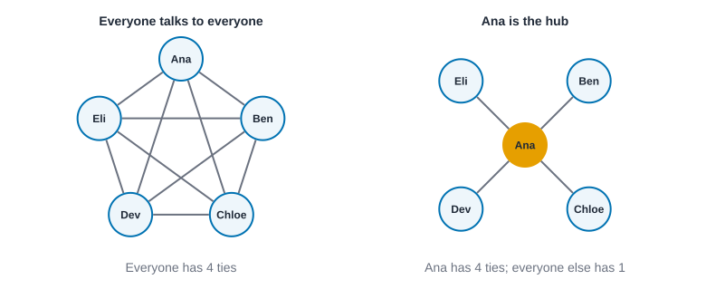
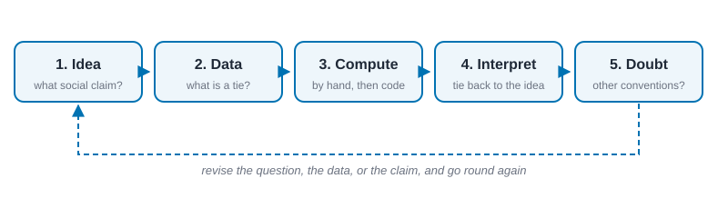
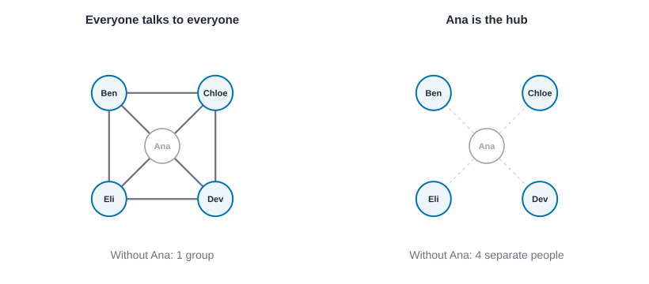
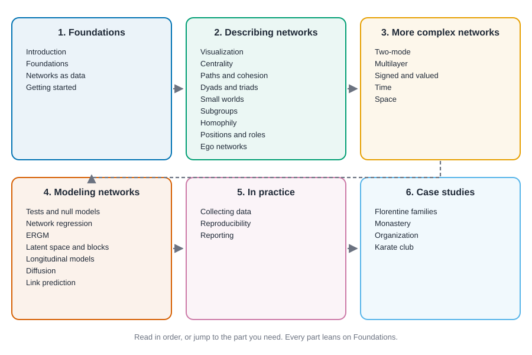

# Introduction {#sec-introduction}

::: {.callout-note appearance="simple"}
## Prerequisites
None. You don't need any network analysis background, and you don't need to be comfortable in all three languages. Pick the one you know best and follow along in it. If you can read a few lines of code and guess what they do, you're ready.
:::

## Two groups, one table

Here is a small puzzle. Five people work on the same project: Ana, Ben, Chloe, Dev and Eli. A survey tells us their ages, their job titles, and how long they've been at the company. Now suppose I hand you two different versions of "who actually talks to whom on this project," and the attribute table is identical in both.

{#fig-two-teams fig-alt="Two network diagrams of the same five people. On the left every person is connected to every other person. On the right, Ana is in the center connected to the four others, who are not connected to each other."}

In the first version, everyone talks to everyone. In the second, Ana sits in the middle and is the only person who talks to all the others, while Ben, Chloe, Dev and Eli only talk to her.

Same people. Same ages, same titles, same tenures. And yet if the project hits a crisis, these two teams will behave nothing alike. In the second team, a bad week for Ana is a bad week for everyone, because she is the only road between the others. Information moves differently. Rumors move differently. Who gets credit, who gets blamed, who finds out first: all of it depends on a thing the attribute table never recorded.

That thing is the **network**: the pattern of who is connected to whom. This book is about learning to see it, measure it, and make sense of it, and about doing that carefully enough that you can defend what you say.

## What a network is

A network, at its simplest, is two ingredients:

- a set of **nodes** (the people, organizations, countries, accounts, genes, or whatever you're studying), and
- a set of **ties** between them (friendship, advice, trade, citation, co-membership, whatever kind of relationship matters for your question).

That's it. The rest of the book is about being thoughtful with those two ingredients.

Different fields use different words for the same things. Mathematicians say *vertices* and *edges*. Computer scientists say *nodes* and *links*. Sociologists often say *actors* and *ties*. Physicists say *sites* and *bonds*. In this book we'll use **node** and **tie** (and **arc** when a tie has a direction), and we'll point out other names when you're likely to meet them in the wild. Mathematicians also call the whole object a **graph**, and write it $G = (V, E)$: $V$ is the set of nodes, $E$ is the set of ties, and we'll write $n$ for the number of nodes and $m$ for the number of ties. @sec-foundations makes all of that precise. For now, a network is a list of who is in it and a list of who is tied to whom.

Notice how little that is. A network is not a picture (the picture is one way of drawing it), and it is not a program or a file format. It's a claim about the world: *these are the things I'm counting, and these are the connections between them that I'm counting.* Change either list and you've changed the claim, and every number you compute afterwards inherits the change. We'll keep coming back to that.

### The same two ingredients in six settings

Everything in this book depends on being able to say, in one line each, what the nodes are and what the ties are. @tbl-settings does it for six settings you will meet again.

| Setting | Nodes | A tie means | A question it supports |
| --- | --- | --- | --- |
| Marriage among leading families | Families | Two families were joined by marriage | Which family sat between the others? |
| Advice in an office | Employees | One goes to the other for advice | Who do people really rely on, and who is relied on too much? |
| A university club | Members | Two members interacted outside the club | Where would the group split, if it split? |
| An online platform | Accounts | One follows, replies to or mentions the other | Who reaches many people, and through whom? |
| Roads, flights or supply routes | Places or firms | There is a direct link between them | What breaks if one place goes down? |
| Co-authorship | Researchers | They wrote a paper together | Who connects separate research communities? |

: Nodes, ties and questions in six settings. The same pair of lists can describe all of them, and the same measures can be computed on all of them. What changes is what the numbers mean. {#tbl-settings}

Notice the last column. The same measure can answer very different questions in different rows, and the same row can be asked many different questions. The table is a reminder that the measure is never the question. It's a tool for answering one.

## Four real questions

Here are four questions that people really asked, each of which turns out to need a network to answer. None is exotic. I've picked them because they come from four very different settings, and because each of them is a question you could be asked at work.

**Why did one family rise?** In early fifteenth-century Florence, the Medici went from one wealthy banking family among many to the family that dominated the city. Padgett and Ansell studied how, using the marriage, business and other ties among leading families rather than just their wealth [@padgett1993robust]. The data are a list of who married into whom. We'll use the marriage part, 15 families and 20 marriages, as a running example, because you can hold the whole thing in your head.

**Who do people go to for advice?** An organization has a chart that says who reports to whom, and it has the real pattern, which is who people actually ask. David Krackhardt asked 21 managers of a small manufacturing firm "to whom do you go for advice?" and "who is your friend?", and then set the answers beside the formal reporting lines [@krackhardt1987cognitive]. The chart and the advice network are not the same picture, and the differences are the interesting part.

**Who holds a group together, and what happens when it breaks?** Wayne Zachary spent three years studying a university karate club that eventually split in two after a quarrel, and recorded who interacted with whom outside class [@zachary1977information]. Could anyone have predicted who would go with which side from the ties alone? That question is the subject of @sec-case-karate.

**How does something spread?** An illness, a rumor, a piece of news or a new habit can travel along ties. Whether it reaches a few people or everyone, and how fast, depends on the shape of the network it travels on, a point we'll make with numbers in @sec-diffusion.

Each question has a different kind of node (families, managers, club members, anyone) and a different kind of tie (marriage, asking for advice, interacting, contact). What they share is the form of the question: *what does the pattern of ties tell us that a list of individuals does not?*

## Where the ties come from

Before any measure, ask where the ties came from, because it decides what they can be trusted for. There are three common sources.

**People are asked.** A survey asks "who are your friends?" or "to whom do you go for advice?" and each answer is a tie. This is how the Krackhardt managers were measured. It captures what people *say*, which is not always what they do, and it can be shaped by the question (if each person may name at most three others, nobody can have more than three out-ties, however many friends they have).

**Something is recorded.** Email logs, phone records, co-authorship lists, marriage registers and platform follows record what happened, without anyone being asked. These data can be huge and cheap, and what they miss is whatever happened somewhere else: a phone call is not an email, and a friendship that lives in conversation leaves no log.

**Someone watches.** An observer notes who is seen with whom, as Zachary did for the karate club. It's rich and careful, and it's limited to what the observer could see and what they chose to count.

None of the three is best. Each has a typical blind spot, and a good analysis names it. @sec-networks-as-data walks through what counts as a tie, and @sec-collecting-data covers boundaries, sampling and missing data.

## Why networks need their own statistics

There is one more reason this is a book and not a chapter of a statistics text. Most of ordinary statistics assumes your rows are independent: one person's answer tells you nothing about the next person's. Network data breaks that, and it breaks it by construction.

Count it for the five-person team. Five people make $10$ possible pairs, and each pair is one "row" of a table of ties: tied or not. Now take two of those rows at random. How often do they involve a person in common? There are $\binom{10}{2} = 45$ ways to choose two pairs. Two pairs share *no* person only if they use four different people, and there are $5$ ways to choose the four and $3$ ways to split four people into two pairs, so $15$ ways. That leaves $45 - 15 = 30$ of the $45$: two out of every three pairs of rows share a person. If Ana is unusually chatty, then Ana–Ben, Ana–Chloe, Ana–Dev and Ana–Eli all tilt in the same direction at once. They are not four independent pieces of evidence about the team, and they are one fact about Ana.

That's why a standard test run on a table of ties tends to be too confident, and why network analysis builds its own comparisons: permutation tests, random networks with fixed degrees, and models that allow ties to depend on each other. @sec-tests-and-null-models explains the idea and @sec-ergm builds on it. For now, keep the picture: *ties share people, so ties are not independent*.

## What makes this a way of thinking, not just a toolbox

If you've used a network library, you may think of network analysis as a pile of functions: compute this centrality, run that community detection. Those functions are real and useful, and we'll use them throughout. But the field's historian, Linton Freeman, argues that social network analysis is defined by something more than its tools. In his account, the approach rests on four features: a guiding intuition that the *structure* of ties among actors matters, a commitment to systematic empirical data, heavy use of graphic images, and the use of mathematical or computational models [@freeman2004development]. Intuition, data, pictures, models. If you only collect the models, you get number-crunching with nothing to say. If you only keep the intuition, you get a nice story you can't check.

Barry Wellman put the intuition in a way that's worth carrying around. A structural approach, he argued, explains what people do by looking at the patterns of relations they are embedded in, instead of (only) by the attributes or inner motives of the individuals [@wellman1983network]. Notice what that doesn't say. It doesn't say attributes don't matter. It says that two people with identical attributes can face very different opportunities and constraints, depending on where they sit.

And the idea has traveled a long way. A review of network research across the social sciences found the same basic move at work in sociology, organizational research, economics, political science, and beyond [@borgatti2009network]. Once you start looking for networks, you see them everywhere.

## The questions networks help you answer

It helps to sort network questions into a few families. Most real projects touch more than one.

**Description.** What does this network look like? Is it dense or sparse? Is it one big connected cluster or several islands? Who is at the center, and who is on the edge? (@sec-visualization, @sec-centrality and @sec-paths-and-cohesion.)

**Explanation.** Why do ties form where they do? Do people tend to connect to those similar to them? Do friends of friends become friends? Do ties come in reciprocal pairs? (@sec-homophily, @sec-ergm and @sec-latent-space.)

**Consequences.** What does position in a network do for the people (or organizations) in it? Does it shape who hears about a job, who gets promoted, who adopts a new practice, who falls sick? (@sec-ego-networks, @sec-positions-and-roles and @sec-diffusion.)

**Change.** How does the network evolve? Which ties persist, which fade, and how does the structure at one moment set up the structure at the next? (@sec-time and @sec-dynamics.)

Notice that the third family, consequences, is where network analysis is most often asked to earn its keep. "This person has high betweenness" is a number. "This person holds a position that lets them control what others hear, and here is what that does to their team" is an interpretation. Getting from the first sentence to the second is the skill this book cares about most, and it is also the step where it is easiest to say something the data cannot support. A good half of this book is about where the line sits.

::: {.callout-warning appearance="simple"}
## Two kinds of question that people mix up
A **descriptive** question, "who has the most ties?", has an answer that sits in the data you collected. An **explanatory** or **causal** question, "does having many ties make people more successful?", needs far more than the data in a single network can give you. A network measurement can be perfectly correct and still not answer the question you care about. When someone shows you a number, ask which kind of question it answers.
:::

## What this book promises

This book tries to be a reference you can trust, for two kinds of reader: people who want to understand a network, and programs that compute network measures and then have to explain them to someone. Both need the same thing, which is not more formulas. It's the habit of saying, every time, *what a number is, what it is not, and how you would know if it were wrong.*

So every measure and model in the book gets the same treatment. @tbl-chapter-anatomy lists it.

| Piece | The question it answers |
| --- | --- |
| The idea, in plain words | What is this measure trying to capture, and why would anyone care? |
| A tiny example, by hand | Can I get the answer on paper, with three to six people, and see where the number comes from? |
| The definition | What exactly is computed? Every symbol is explained. |
| Where it comes from | Who proposed it, in answer to which problem? (With a citation to the source.) |
| The code | How do I get it in R, Python and Rust? What does each print? |
| When it breaks | What must the data look like? What happens if it doesn't? One failure, shown with numbers. |
| Several readings | What does high or low mean in a marriage network, an office, a supply chain, an online platform? What does it *not* show? |
| A real dataset | Does it still make sense on real data? What does a figure show? |
| A stress check | If I drop a few ties, or compare with a random network, does the result survive? |
| Two sentences | One that I can defend, and one that over-claims. |
| Disagreements | Where do different software packages give different answers, and why? |
| Exercises | Eight or more, graded from by-hand to interpretation, with short worked answers. |
| A card | A short, checked summary of all of the above for programs and for quick reference. |

: What each chapter gives you for each measure or model. {#tbl-chapter-anatomy}

You won't find every row in every chapter. The first few chapters are mostly vocabulary, and some measures are so simple that a stress check would be silly. But the pattern is the promise, and it's the thing to hold the book to.

### The habit

Behind the table is a rhythm of five steps. Learn it now, and the rest of the chapters will feel familiar.

{#fig-habit fig-alt="A left-to-right flow of five labeled boxes: Idea, Data, Compute, Interpret, Doubt. A dashed arrow runs from the last box back to the first."}

1. **Start with the idea.** What social or psychological claim is this measure trying to capture? Where did the claim come from, and who first made it? (That's the job of @sec-foundations.)
2. **Decide what the data have to look like.** What counts as a node, what counts as a tie, and who is left out? (@sec-networks-as-data.)
3. **Compute the measure**, by hand on a tiny example first, then in code.
4. **Interpret it**, tying the number back to the idea from step one. What does a high value mean? What does it not mean?
5. **Doubt it a little.** How might missing data, a different definition of a tie, or a different convention change the answer?

Step five matters more than it sounds. Two software packages can compute "the same" measure and return different numbers, because they chose different conventions. Learning to spot that, and to say which convention you used, is part of doing honest network analysis. We'll come back to it in @sec-reproducibility and in @sec-conventions.

## A first network

Let's build the smallest possible example, using the team from the start of the chapter. Here are the two versions as edge lists, one row per tie.

**Everyone talks to everyone** (ten ties):

| from | to |
| --- | --- |
| Ana | Ben |
| Ana | Chloe |
| Ana | Dev |
| Ana | Eli |
| Ben | Chloe |
| Ben | Dev |
| Ben | Eli |
| Chloe | Dev |
| Chloe | Eli |
| Dev | Eli |

**Ana is the hub** (four ties):

| from | to |
| --- | --- |
| Ana | Ben |
| Ana | Chloe |
| Ana | Dev |
| Ana | Eli |

Now try something you can do without a computer. For each person, count how many ties they have. In the first team, everyone has four. In the second, Ana has four and everyone else has one. That count is the simplest thing you can say about a node, and it already tells the two teams apart, even though the attribute table couldn't. (It's called **degree**, and @sec-centrality starts with it.)

Next, two more things you can check by hand. First, **density**: the share of all possible pairs that are actually tied. Five people make $5 \times 4 / 2 = 10$ possible pairs. The first team uses all ten, so its density is $10/10 = 1$. The hub team uses four, so its density is $4/10 = 0.4$. Second, a crisis test. Suppose Ana is unavailable, so every tie that involves her is gone. In the first team the other four are still all tied to each other: one group. In the second, Ben, Chloe, Dev and Eli were only ever tied to Ana, so each is now alone: four groups. (A piece of a network in which everyone can reach everyone else is called a **component**, and we'll count them properly in @sec-foundations.)

{#fig-crisis-test fig-alt="Two panels, each with Ana's node faded and dashed. On the left, the four remaining people are still joined to each other by six solid lines. On the right, the four remaining people are drawn with no lines between them."}

Now the same steps in code. The tabs below hold the same steps in R, Python and Rust. Pick your language once and every example in the book will follow your choice on the website. (In the printed book, the versions appear one after another.)

::: {.panel-tabset group="language"}

## R

```r
library(knappnet)

people <- c("Ana", "Ben", "Chloe", "Dev", "Eli")
nodes <- data.frame(id = people)

# Team 1: everyone talks to everyone (all ten pairs). Team 2: Ana is the hub.
pairs <- t(combn(people, 2))
teams <- list(
  `everyone talks` = net_frame(data.frame(source = pairs[, 1], target = pairs[, 2]), nodes = nodes, directed = FALSE),
  `Ana is the hub` = net_frame(data.frame(source = "Ana", target = people[-1]), nodes = nodes, directed = FALSE)
)

# One row per team: ties, density, and how many groups are left once Ana is gone.
data.frame(
  ties = sapply(teams, \(g) nrow(g$edges)),
  density = sapply(teams, net_density),
  groups_without_ana = sapply(teams, \(g) net_components(net_subnetwork(g, people[-1]))$no)
)

# Each person's degree, one column per team.
degrees <- sapply(teams, net_degree)
rownames(degrees) <- people
degrees
```

::: {.code-output}
```text
               ties density groups_without_ana
everyone talks   10     1.0                  1
Ana is the hub    4     0.4                  4
      everyone talks Ana is the hub
Ana                4              4
Ben                4              1
Chloe              4              1
Dev                4              1
Eli                4              1
```
:::

## Python

```python
import networkx as nx

people = ["Ana", "Ben", "Chloe", "Dev", "Eli"]

# Team 1: everyone talks to everyone (all ten pairs). Team 2: Ana is the hub.
everyone = [(a, b) for i, a in enumerate(people) for b in people[i + 1:]]
hub = [("Ana", p) for p in people[1:]]

for label, ties in [("everyone talks", everyone), ("Ana is the hub", hub)]:
    team = nx.Graph()
    team.add_nodes_from(people)
    team.add_edges_from(ties)
    print(f"{label}: {team.number_of_edges()} ties, density {nx.density(team):.2f}")
    print("  degrees:", ", ".join(f"{p} {d}" for p, d in team.degree()))
    # A bad week for Ana: take her out and count the groups among the other four.
    team.remove_node("Ana")
    print(f"  without Ana: {nx.number_connected_components(team)} group(s) among the other four")
```

::: {.code-output}
```text
everyone talks: 10 ties, density 1.00
  degrees: Ana 4, Ben 4, Chloe 4, Dev 4, Eli 4
  without Ana: 1 group(s) among the other four
Ana is the hub: 4 ties, density 0.40
  degrees: Ana 4, Ben 1, Chloe 1, Dev 1, Eli 1
  without Ana: 4 group(s) among the other four
```
:::

## Rust

```rust
use knappnet::metrics::topography::{compute_density, find_components, ComponentKind};
use knappnet::{compute_degree, DegreeMode, Graph};

// People are numbered from zero: Ana is 0, Ben 1, Chloe 2, Dev 3, Eli 4.
let people = ["Ana", "Ben", "Chloe", "Dev", "Eli"];

// Team 1: everyone talks to everyone (all ten pairs). Team 2: Ana is the hub.
let everyone: Vec<(i64, i64)> = (0..5).flat_map(|a| (a + 1..5).map(move |b| (a, b))).collect();
let hub: Vec<(i64, i64)> = (1..5).map(|b| (0, b)).collect();

for (label, ties) in [("everyone talks", &everyone), ("Ana is the hub", &hub)] {
    let from: Vec<i64> = ties.iter().map(|t| t.0).collect();
    let to: Vec<i64> = ties.iter().map(|t| t.1).collect();
    let team = Graph::from_edges(5, &from, &to, None, false)?;
    println!("{label}: {} ties, density {:.2}", team.edge_count(), compute_density(&team, false));
    let degrees = compute_degree(&team, DegreeMode::All, true);
    let shown: Vec<String> = people.iter().zip(&degrees).map(|(p, d)| format!("{p} {d}")).collect();
    println!("  degrees: {}", shown.join(", "));

    // A bad week for Ana: keep only the ties that don't involve her, renumbered 0 to 3.
    let kept: Vec<&(i64, i64)> = ties.iter().filter(|t| t.0 != 0 && t.1 != 0).collect();
    let from: Vec<i64> = kept.iter().map(|t| t.0 - 1).collect();
    let to: Vec<i64> = kept.iter().map(|t| t.1 - 1).collect();
    let rest = Graph::from_edges(4, &from, &to, None, false)?;
    let groups = find_components(&rest, ComponentKind::Weak).count();
    println!("  without Ana: {groups} group(s) among the other four");
}
```

::: {.code-output}
```text
everyone talks: 10 ties, density 1.00
  degrees: Ana 4, Ben 4, Chloe 4, Dev 4, Eli 4
  without Ana: 1 group(s) among the other four
Ana is the hub: 4 ties, density 0.40
  degrees: Ana 4, Ben 1, Chloe 1, Dev 1, Eli 1
  without Ana: 4 group(s) among the other four
```
:::

:::

Read the output against what you worked out by hand. The densities are 1 and 0.4, the degrees are four each in the first team and four, one, one, one, one in the second, and the crisis leaves one group in the first team and four in the second. If any of those had come out differently, the right move would be to stop and find the typo, not to trust the machine. That habit, *checking a result you can verify before trusting one you can't*, is worth more than any single function in this book.

The crisis test asks about one person at a time. Run it for everyone and you get a profile of which people the team can't do without. By hand, for a third team, a **chain** (Ana talks to Ben, Ben to Chloe, Chloe to Dev, Dev to Eli): remove either end and the other four are still one chain; remove anyone in the middle and the chain breaks into two pieces. In the hub team, only Ana matters, and she breaks it into four. In the everyone-talks team, nobody matters, because the other four are still tied to each other whoever leaves. Here are all three at once.

::: {.panel-tabset group="language"}

## R

```r
# A third team: a chain, Ana-Ben-Chloe-Dev-Eli.
chain <- net_frame(data.frame(source = people[-5], target = people[-1]), nodes = nodes, directed = FALSE)
teams <- c(teams, list(`a chain` = chain))

# Rows: the team. Columns: who goes. Cells: how many groups are left among the other four.
t(sapply(teams, \(g) sapply(people, \(p) net_components(net_subnetwork(g, setdiff(people, p)))$no)))
```

::: {.code-output}
```text
               Ana Ben Chloe Dev Eli
everyone talks   1   1     1   1   1
Ana is the hub   4   1     1   1   1
a chain          1   2     2   2   1
```
:::

## Python

```python
chain = [(people[i], people[i + 1]) for i in range(4)]

# For each team and each person: how many groups are left among the other four if that person goes.
for label, ties in [("everyone talks", everyone), ("Ana is the hub", hub), ("a chain", chain)]:
    team = nx.Graph()
    team.add_nodes_from(people)
    team.add_edges_from(ties)
    left = {p: nx.number_connected_components(team.subgraph([q for q in people if q != p])) for p in people}
    print(f"{label:<15}", left)
```

::: {.code-output}
```text
everyone talks  {'Ana': 1, 'Ben': 1, 'Chloe': 1, 'Dev': 1, 'Eli': 1}
Ana is the hub  {'Ana': 4, 'Ben': 1, 'Chloe': 1, 'Dev': 1, 'Eli': 1}
a chain         {'Ana': 1, 'Ben': 2, 'Chloe': 2, 'Dev': 2, 'Eli': 1}
```
:::

## Rust

```rust
// A third team: a chain, Ana-Ben-Chloe-Dev-Eli.
let chain: Vec<(i64, i64)> = (0..4).map(|a| (a, a + 1)).collect();

// For each team and each person: how many groups are left among the other four if that person goes.
for (label, ties) in [("everyone talks", &everyone), ("Ana is the hub", &hub), ("a chain", &chain)] {
    let groups = (0..5)
        .map(|gone| -> Result<usize, knappnet::Error> {
            // Keep the ties that don't involve the person who is gone, and renumber the other four from 0 to 3.
            let kept: Vec<&(i64, i64)> = ties.iter().filter(|t| t.0 != gone && t.1 != gone).collect();
            let renumber = |p: i64| if p > gone { p - 1 } else { p };
            let from: Vec<i64> = kept.iter().map(|t| renumber(t.0)).collect();
            let to: Vec<i64> = kept.iter().map(|t| renumber(t.1)).collect();
            let rest = Graph::from_edges(4, &from, &to, None, false)?;
            Ok(find_components(&rest, ComponentKind::Weak).count())
        })
        .collect::<Result<Vec<_>, _>>()?;
    println!("{label:<15} {groups:?}");
}
```

::: {.code-output}
```text
everyone talks  [1, 1, 1, 1, 1]
Ana is the hub  [4, 1, 1, 1, 1]
a chain         [1, 2, 2, 2, 1]
```
:::

:::

The table says what the hand count said. In the everyone-talks team no one's absence splits anything, in the hub team Ana's leaves four people on their own, and in the chain the two ends can leave without harm while each of the three in the middle splits it in two. A person whose removal splits a network into pieces is called a **cut point**, and @sec-paths-and-cohesion shows how to find them.

Two caveats before we leave this example. First, "tied" here means "talks to", and that is a choice. If the tie meant "reports to", the hub team would be an ordinary manager with four direct reports and nobody would be alarmed about Ana's bad week. Second, nothing in the computation says which team is *better*. The all-connected team has no weak point, and it also has ten conversations to keep up, which for a bigger team becomes impossible. Which structure is good depends on what the team has to do, and the numbers cannot tell you that.

## A first real network

Toy examples are for learning the vocabulary. The test is a real network, so let's look at one. The 15 Florentine families we met above are bundled with the book in `data/florentine`. Each row of the file is one marriage between two families. Here is a first look: how many families and marriages, how dense, how many marriages the average family has, and who has the most.

::: {.panel-tabset group="language"}

## R

```r
florence <- net_frame(read.csv("data/florentine/edges.csv"), directed = FALSE)

# The size of the network and how many of the possible pairs are married.
c(families = nrow(florence$nodes), marriages = nrow(florence$edges),
  density = net_density(florence), mean_degree = net_avg_degree(florence))

# The three families with the most marriages (ties broken by name).
degree <- setNames(net_degree(florence), florence$nodes$id)
degree[order(-degree, names(degree))][1:3]
```

::: {.code-output}
```text
   families   marriages     density mean_degree 
 15.0000000  20.0000000   0.1904762   2.6666667 
  Medici Guadagni  Strozzi 
       6        4        4 
```
:::

## Python

```python
import csv

with open("data/florentine/edges.csv") as f:
    florence = nx.Graph([(r["source"], r["target"]) for r in csv.DictReader(f)])

n, m = florence.number_of_nodes(), florence.number_of_edges()
print(f"{n} families, {m} marriages, density {nx.density(florence):.3f}, mean degree {2 * m / n:.2f}")

# The three families with the most marriages (ties broken by name).
top = sorted(florence.degree(), key=lambda t: (-t[1], t[0]))[:3]
print("most marriages: " + ", ".join(f"{name} {d}" for name, d in top))
```

::: {.code-output}
```text
15 families, 20 marriages, density 0.190, mean degree 2.67
most marriages: Medici 6, Guadagni 4, Strozzi 4
```
:::

## Rust

```rust
// Florentine families around 1430: a tie means two families were joined by marriage.
let text = std::fs::read_to_string("data/florentine/edges.csv")?;
let rows: Vec<(&str, &str)> = text.lines().skip(1).map(|line| line.split_once(',').unwrap()).collect();
let mut families: Vec<&str> = Vec::new();
for &(a, b) in &rows {
    for family in [a, b] {
        if !families.contains(&family) {
            families.push(family);
        }
    }
}
let position = |family: &str| families.iter().position(|f| *f == family).unwrap() as i64;
let from: Vec<i64> = rows.iter().map(|row| position(row.0)).collect();
let to: Vec<i64> = rows.iter().map(|row| position(row.1)).collect();
let florence = Graph::from_edges(families.len(), &from, &to, None, false)?;

let (n, m) = (florence.node_count(), florence.edge_count());
println!(
    "{n} families, {m} marriages, density {:.3}, mean degree {:.2}",
    compute_density(&florence, false),
    2.0 * m as f64 / n as f64
);

// The three families with the most marriages (ties broken by name).
let degrees = compute_degree(&florence, DegreeMode::All, true);
let mut ranked: Vec<(&str, f64)> = families.iter().copied().zip(degrees.iter().copied()).collect();
ranked.sort_by(|a, b| b.1.partial_cmp(&a.1).unwrap().then(a.0.cmp(b.0)));
let top: Vec<String> = ranked.iter().take(3).map(|(name, d)| format!("{name} {d}")).collect();
println!("most marriages: {}", top.join(", "));
```

::: {.code-output}
```text
15 families, 20 marriages, density 0.190, mean degree 2.67
most marriages: Medici 6, Guadagni 4, Strozzi 4
```
:::

:::

Fifteen families and twenty marriages make a density of 0.190: about one pair in five is married. The average family has 2.67 marriages, and the Medici have six, more than twice the average and half again as many as the next two families, Guadagni and Strozzi, who have four each.

Here is where the habit of this book earns its keep. Consider two sentences you could write about that result.

> **A defensible sentence.** "In this marriage network of 15 families, the Medici have the most marriage ties (6, against a mean of 2.67), so they are the most directly connected family in these data."

> **An over-claiming sentence.** "The Medici were the most powerful family in Florence because they had the most marriages."

The first sentence reports what was computed and where. The second jumps three gaps. It treats a count of marriages as power. It says "in Florence" about a network of 15 families that someone chose to include. And it says "because", which a single snapshot of ties cannot support. Notice that the data may well be consistent with the second sentence; the point is that *this number* doesn't establish it. Padgett and Ansell's argument rested on much more than this one count [@padgett1993robust], and @sec-case-florentine takes the same data from a first look all the way to a claim you can defend.

### From a card to a sentence

Here is how a number gets from the computer to a sentence you can defend, using the card for degree. Its report template has gaps to fill: the kind of tie, the number of people, who, which direction, the value, the share of the possible, the rank, and how stable the top place is. The first four numbers come from the code above. The last, the stability, comes from the stress check in @sec-foundations, where we drop every single marriage in turn and every pair of marriages. Filled in, it reads:

> In this marriage network of 15 families, the Medici have degree 6 (6 of the 14 possible, or 0.43; rank 1 of 15). Degree counts direct contacts and says nothing about who they are. The top place is stable when any one marriage is dropped, and a tie for first is the worst case if any two are.

Everything in that paragraph was computed, nothing was added from memory, and the limit (it counts contacts, not who they are) travels with the number. That's the standard this book holds itself to, and it's one that software can meet as easily as a person.

### Before you compute anything: six questions

Whatever the measure, run through these first. They are the questions the cards are built from.

1. **Who is in the network, and who is left out?** The boundary of the data is a claim.
2. **What does a tie mean, and how was it recorded?** Asked, recorded or observed?
3. **Is the tie directed, weighted or signed**, and does the measure respect that?
4. **Is the network in one piece?** Many measures quietly assume it is.
5. **Compared with what?** A number needs a baseline of the same size, density or degrees.
6. **What would change my mind?** If nothing would, you're decorating, not analyzing.

## Reading this book as a person

You can read front to back, and I hope you will. But the chapters are written so you can also dip in: every chapter opens with what it assumes, closes with a summary and exercises, and points to the sources it draws on. Here are three ways in.

| If you are... | Start here | Then |
| --- | --- | --- |
| New to networks | This chapter, then @sec-foundations, @sec-networks-as-data and @sec-getting-started | @sec-visualization, @sec-centrality and @sec-paths-and-cohesion, then the case study @sec-case-florentine |
| Handed a result and asked what it means | The measure's chapter, and in it the sections called "readings" and "pitfalls" | @sec-reporting for how to write the claim down |
| Planning a study | @sec-collecting-data and @sec-networks-as-data | @sec-tests-and-null-models, then the modeling chapters |

: Three starting points. {#tbl-routes}

If you teach, the exercises are graded on purpose. The by-hand ones check understanding and need only pencil and paper. The coding ones check that you can use the tool. The interpretation ones are the ones to discuss in class, because there's rarely a single right answer, only more and less defensible ones. Each chapter ends with short worked answers, folded away so you can try first.

If you learn best by doing, run every example and change something: drop a tie, flip a direction, rename a person. Ask yourself what you expect to happen *before* you run it. The number of times your expectation is wrong is a good measure of how much you are learning.

## Reading this book as a program

More and more, network measures are computed by software on someone's behalf, and the person who gets the number never sees the code. A tool that runs betweenness on a team's email data and reports "Ana is the key connector" has done something useful and also something risky. The measure, the data and the claim all need to line up, and nothing in the number tells you whether they do.

This book is built so that such software, and the people who build and check it, can use it directly. Three things help.

**Plain text for every chapter.** The same sources that produce the website and the printed book are exported as plain Markdown and as structured JSON (the chapter list, each chapter's purpose and prerequisites, and its sections), so a program can read the book without picking apart web pages.

**A card for every measure and model.** A card is a short file, one per measure, that holds the guidance that should travel with a number. The fields are the same on every card: what question the measure answers, what the data must look like, what has to hold for it to mean what it seems to, how to read high and low values in different settings, common mistakes, checks to run before trusting it, conclusions the number cannot support, and a template for reporting it. Cards are checked by the book's own checker, which also makes sure that every source a card cites exists, and they are exported as `cards.json`. Here is an excerpt from the card for degree:

```text
answers = "Who has the most direct contacts, and in a directed network, who
  reaches out the most and who is sought out the most?"
do_not_claim = [
  "That a high-degree node is powerful, influential or well liked, without
    evidence about what the ties do.",
  "That raw degrees from networks of different size or density can be compared.",
]
report_template = "In this {tie_meaning} network of {n} {node_type}, {node} has
  {direction} degree {value} ... Degree counts direct contacts and says nothing
  about who they are. ..."
```

**Rules for programs, which are also good rules for people.** If you are writing software that runs a measure and reports on it, then: say which network the number was computed on and which convention was used; run the checks the card lists, not only the computation; report the number with the card's template, not as a bare score; and never state a conclusion the card lists under "do not claim". These are not special rules for machines. They're the rules a careful analyst follows, written down in a form a program can read.

## How this book is organized

The book has six parts, and the table of contents is deliberately in the order a project tends to go.

{#fig-book-map fig-alt="Six labeled bands from left to right: Foundations, Describing networks, More complex networks, Modeling networks, In practice, and Case studies. Each band lists the chapters it contains. Arrows show that describing comes before modeling and that every case study draws on earlier parts."}

**Foundations** (this part) gives you the vocabulary (@sec-foundations), a way to write a network down (@sec-networks-as-data), and a first working session with the software (@sec-getting-started).

**Describing networks** covers pictures (@sec-visualization), centrality (@sec-centrality), paths and cohesion (@sec-paths-and-cohesion), the smallest building blocks of structure (@sec-triads-and-motifs), random baselines and small worlds (@sec-small-worlds), subgroups (@sec-subgroups), homophily (@sec-homophily), positions and roles (@sec-positions-and-roles), and ego networks (@sec-ego-networks). These are the workhorse tools of network analysis, and each comes tied to the idea it was built to capture.

**More complex networks** relaxes the simplest picture of one kind of node, one kind of tie, at one moment, in no place: two-mode networks (@sec-two-mode), several kinds of tie at once (@sec-multilayer), signed and valued ties (@sec-signed-and-valued), time (@sec-time) and space (@sec-space).

**Modeling networks** moves from description to inference: permutation tests and null models (@sec-tests-and-null-models), network regression (@sec-network-regression), exponential random graph models (@sec-ergm), latent space and block models (@sec-latent-space), longitudinal models (@sec-dynamics), diffusion (@sec-diffusion), and link prediction (@sec-prediction).

**In practice** covers collecting network data responsibly (@sec-collecting-data), keeping your work reproducible, including how to handle the large graphs that make hand calculation impossible (@sec-reproducibility), and writing up a result so that it can be defended (@sec-reporting).

**Case studies** take four classic networks from a first look to a defensible claim: the Florentine marriages (@sec-case-florentine), a monastery over three waves (@sec-case-sampson), an organization seen three ways (@sec-case-krackhardt), and the karate club that split (@sec-case-karate).

There are three appendices: a mathematical review (@sec-math-review), a list of the bundled datasets (@sec-datasets), and a table of the places where tools disagree (@sec-conventions).

## How to use the code

Every example in the book appears in R, Python and Rust. They aren't three ways of doing network analysis. They're three doors into the same room: the R and Rust versions call the same engine, knappnet, and the Python versions use NetworkX and NumPy, which are widely used and give you an independent check. Where the three don't print the same thing, we say why.

A few habits are worth knowing before you start.

- **Each tab owns its output.** The block under each tab is what that language printed when the code was run, not a copy of one language's output pasted under the others. If two tabs differ, the difference is real and the text will explain it.
- **Numbers in the text come from code that ran.** Every number you read in prose was printed by an example somewhere in the chapter, or is an arithmetic step you can do on paper. When a number is a hand calculation, the text says so.
- **Randomness gets a seed.** Where a computation uses random numbers, we fix the seed and say so, so you can get the same answer. Seeds can still give different results in different languages, and @sec-reproducibility says why.
- **Data lives in `data/`.** The datasets are small and bundled, and the examples read them with a relative path such as `data/florentine/edges.csv`. @sec-datasets lists them with their sources and licenses.
- **Check the small case first.** If you adapt an example to your own data, run it first on a handful of nodes whose answer you can verify.

## What this book does not do

A few honest limits, so you can decide what else you need.

- **It doesn't teach R, Python or Rust from scratch.** It assumes you can read a short script. If you can't yet, @sec-getting-started goes slowly, and the further reading lists friendlier starts.
- **It doesn't replace the study of the people.** A network measurement is evidence about a pattern of ties. Why the ties are there, and what they mean to the people who made them, takes fieldwork, interviews or context that no measure supplies.
- **It doesn't cover everything.** It teaches the measures and models that most projects need, in enough depth to use and defend them, and points to the literature for the rest.
- **It doesn't promise that one number settles a question.** Where several measures or conventions are defensible, it shows them side by side, because the honest answer is often "it depends, and here is on what".

## A short glossary

Words used from here on, in plain language, with the chapter that defines each one carefully.

| Word | Plain meaning | Where |
| --- | --- | --- |
| Node | One of the things in the network: a person, family, account, place | @sec-foundations |
| Tie, arc | A connection between two nodes; an arc has a direction | @sec-foundations |
| Isolate | A node with no ties | @sec-foundations |
| Degree | The number of ties a node has (in and out, if directed) | @sec-foundations, @sec-centrality |
| Dyad, triad | A pair of nodes, a triple of nodes, and the patterns of ties among them | @sec-foundations, @sec-triads-and-motifs |
| Path, distance | A route that never repeats a node; the number of steps on the shortest one | @sec-foundations, @sec-paths-and-cohesion |
| Component | A piece of the network in which everyone can reach everyone | @sec-foundations, @sec-paths-and-cohesion |
| Density | The share of all possible ties that are present | @sec-foundations |
| Centrality | A family of scores for how well placed a node is, each answering a different question | @sec-centrality |
| Boundary | The rule that decides who is in the network | @sec-collecting-data |
| Ego network | One person's ties and the ties among those contacts | @sec-ego-networks |
| Two-mode network | Two kinds of node, with ties only between the kinds, such as people and events | @sec-two-mode |
| Null model | A rule for drawing random networks to compare with the real one | @sec-tests-and-null-models |

: A glossary of the first words you need. {#tbl-glossary}

## Five misconceptions to drop early

These come up so often that it's worth naming them now.

1. **"A network is a picture."** The picture is one view. Two layouts of the same network can look very different, and a layout can suggest structure that isn't there. The network is the lists of nodes and ties (@sec-visualization).
2. **"The most central person is the most important."** Centrality measures count different things, such as contacts, closeness to others, or position between others, and none of them measures importance in general. Which one matters depends on what flows over the ties (@sec-centrality).
3. **"A tie is a friendship."** A tie is whatever you decided to count. Emailing, being named in a survey, sharing an employer and being married are all ties and mean very different things (@sec-networks-as-data).
4. **"More data means a better network."** More data can mean a bigger boundary, a different boundary or more noise. The people you left out can change the answer, sometimes a lot (@sec-collecting-data).
5. **"If the software gave a number, it is the number."** Packages differ on loops, repeated ties, direction, weights and normalization. Two correct programs can disagree (@sec-conventions).

## A note on the people in the data

Behind every node in this book is, or was, a person, a family, an organization or a place. A network of who talks to whom can reveal things that no individual chose to tell you, and removing the names does not always protect them, because the pattern of ties can identify a person. The datasets in this book are published, classic and small, but your own data may not be. @sec-collecting-data covers consent, sharing and what to do before you publish a network, and the card `network-data-ethics` summarizes it. If you take only one thing from this note: decide what the network could reveal about each person in it *before* you build it, not after.

## A note on credit

Network analysis is a field built by people who shared their ideas generously, and I want this book to reflect that. Throughout, I cite the original source for an idea whenever I can trace it, and I link to that source when a stable link exists. The reference list at the end gathers everything, with links where available. If you want to go deeper on a topic, follow the citations: the people who wrote those papers and books are the best teachers the field has, and they deserve the readers.

A few books will come up again and again, and they are worth knowing now. Wasserman and Faust's *Social Network Analysis: Methods and Applications* is the field's classic reference [@wasserman1994social]. Kadushin's *Understanding Social Networks* is a gentle, theory-rich introduction [@kadushin2012understanding]. Scott's *Social Network Analysis* is a short, clear account of the concepts and the history [@scott2017social], and Robins's *Doing Social Network Research* is about designing a study so that the network question can be answered [@robins2015doing]. Hanneman and Riddle's free online textbook is a patient walk through the basic measures [@hanneman2005introduction]. Borgatti, Everett, Johnson and Agneessens wrote a hands-on guide in R [@borgatti2022analyzing], as did Rawlings, Smith, Moody and McFarland [@rawlings2023network] and Luke [@luke2015user]. For the physics and computer science side of the story, Newman's *Networks* [@newman2018networks] and Easley and Kleinberg's *Networks, Crowds, and Markets* [@easley2010networks] are excellent companions. For the statistics of network data, Kolaczyk's *Statistical Analysis of Network Data* [@kolaczyk2009statistical] and its R companion with Csárdi [@kolaczyk2014statistical] are the places to go. Two more books deserve a mention because they show network analysis doing hard, high-stakes work. Sean Everton's *Disrupting Dark Networks* [@everton2012disrupting] and Cunningham, Everton and Murphy's *Understanding Dark Networks* [@cunningham2016understanding] apply the field's tools to covert and illicit groups, where data are scarce and the consequences of misreading a measure are real. We'll meet their ideas in several later chapters.

If you learn best by running code, Phil Murphy has shared a large collection of R tutorials on network analysis, covering the same ground as this book's chapters, and I'll point to the matching ones as we go. A good one to start with is his introduction to R and igraph [@murphyrpubs523135].

This book tries to complement all of these, not replace them.

## Exercises

1. **By hand.** Draw the "Ana is the hub" team as a picture: dots for people, lines for ties. Now remove Ana. What happens to the picture? Write one sentence about what that means for the team.
2. **By hand.** Invent a third version of the five-person team where Ana and Ben each have three ties and the other three people have two. Is there more than one way to do it? (Hint: try listing the ties first and then counting.)
3. **By hand.** The all-connected team has ten ties and the hub team has four. How many ties would a six-person all-connected team have? A ten-person one? Write the pattern as a formula in the number of people $n$.
4. **By hand.** Make a third five-person team, a *chain*: Ana talks to Ben, Ben to Chloe, Chloe to Dev, Dev to Eli. What is each person's degree? What is the density? Which single person, if removed, splits the team into the most pieces? How many?
5. **Coding.** Add a fourth team to the crisis-test code: a **ring**, where Ana talks to Ben, Ben to Chloe, Chloe to Dev, Dev to Eli, and Eli to Ana. Predict the groups left when each person goes, then check.
6. **Coding.** In the Florentine network, find the family with the fewest marriages. How many families share that smallest value? What could that tell you, and what couldn't it tell you, about those families?
7. **Coding.** Here is a puzzle that surprises most people. In the Florentine network, for each family, find the average number of marriages among its marriage partners. Then compare the average of those averages with the plain average degree of 2.67. Which is larger? Try the hub team first: what is the average number of ties among Ana's partners, and among Ben's?
8. **Interpretation.** Think of a group you belong to (a class, a team, a family, a group chat). Name one question about it that is about *attributes* and one that is about *ties*. Which one is harder to answer from a spreadsheet of the members' details?
9. **Interpretation.** A colleague runs your team's email log through a network tool and reports: "Ana has the most connections, so she is the team's most valuable member." Using the two sentences about the Medici as a model, rewrite her claim into one you could defend, and list three things you would want to know before accepting the original.

::: {.callout-note collapse="true"}
## Answers

1. Without Ana the four others are dots with no lines between them: four separate people. For the team it means that all communication was passing through her, so nothing moves without her.
2. The degrees add up to $3 + 3 + 2 + 2 + 2 = 12$, which is twice the number of ties, so there must be six ties. There is more than one way. One: Ana–Ben, Ana–Chloe, Ana–Dev, Ben–Chloe, Ben–Eli and Dev–Eli, which gives Ana 3, Ben 3, Chloe 2, Dev 2, Eli 2. Another: Ana–Ben, Ana–Chloe, Ana–Eli, Ben–Dev, Ben–Eli and Chloe–Dev, which gives the same degrees from different ties. Counting degrees first and building ties second is how you check the answer.
3. A pair can be tied or not, and a team of $n$ people has $n(n-1)/2$ pairs, so the all-connected team has that many ties: 15 for six people and 45 for ten. The formula is the same one we use for density: $n(n-1)/2$ possible ties.
4. Degrees are 1, 2, 2, 2 and 1, which add to 8, twice the four ties. The density is $4/10 = 0.4$, the same as the hub team, even though the two look nothing alike: density can't tell a hub from a chain. Removing Chloe, in the middle, leaves two pieces (Ana and Ben, Dev and Eli). Removing Ben or Dev also leaves two pieces (one person, and three). Removing Ana or Eli at the ends leaves one piece. So no single person splits the chain into more than two pieces, whereas Ana in the hub team splits the others into four.
5. In a ring, removing anyone leaves the other four joined in a chain, so the answer is one group for every person: 1, 1, 1, 1, 1. A ring has no single point of failure, which a chain does.
6. Four families have a single marriage each: Acciaiuoli, Ginori, Lamberteschi and Pazzi. With so few marriages in the data they have the smallest direct reach. It does not tell you that they were unimportant or isolated socially, since this network only records marriages among these 15 families, not other ties and not ties to anyone outside the list.
7. The average over families of their partners' average degree is 3.54, larger than the plain average degree of 2.67, and 11 of the 15 families have partners who are on average busier than they are themselves. This is the "friendship paradox": a partner is more likely to be someone with many ties, because people with many ties appear in many families' lists [@feld1991friends]. In the hub team, Ana's partners each have 1 tie, while each of the others has Ana, with 4 ties, as their only partner: four of five people have partners busier than themselves.
8. Attribute questions are things like "how old are the members?" Tie questions are things like "who is friends with whom?" The tie question is harder from a spreadsheet of details, because the answer isn't in any one row. It lives between rows.
9. A defensible version: "In the email log for this period, Ana has the most direct contacts (give the number and the mean)." Questions before accepting the original: what does an email stand for (information, or a mailing list)? Are there people or channels missing from the log (phone, meetings, chat)? Does "most connections" mean most valuable, or most replies, or the person who sends the most group emails? What did the team need from Ana?
:::

## Summary

::: {.callout-tip appearance="simple"}
A network is a set of nodes and the ties between them. Network analysis asks how the pattern of those ties shapes what happens to the people or things inside it, and it combines a structural intuition, real data, pictures and models to answer. Degree, density and components are the first three numbers to compute, and you can check each by hand on five people. This book teaches measures and models, and also how to tie each result back to the social idea behind it, how to doubt it a little, and how to write it down as a sentence you can defend. Every measure has a card of checked guidance, so that people and programs read numbers the same careful way.
:::

## Further reading

For the history and defining features of the field, start with @freeman2004development. For the structural intuition, read @wellman1983network. For a short, wide-angle view of network research across the social sciences, see @borgatti2009network. For the Florentine families, see @padgett1993robust, and for the friendship paradox, @feld1991friends. Book-length introductions are listed in the credit note above. For a gentle first session in R, try @murphyrpubs523135.
