# Foundations: graphs and the ideas behind them {#sec-foundations}

::: {.callout-note appearance="simple"}
## Prerequisites
@sec-introduction. No math beyond counting. Where a formula appears, we work a five-person example first and say what each symbol means.
:::

## Why a chapter on foundations

You could skip straight to the measures. Plenty of people do, and it works fine until someone asks what a number *means*. Then you discover two things. The first is that every measure is built from a handful of simple pieces: who is tied to whom, in which direction, how strongly, and how many steps apart people are. If those are fuzzy, nothing built on them is solid. The second is that each measure is a compressed argument that some person, usually a sociologist, anthropologist or psychologist, made about how social life works. The formula is the argument's footprint.

So this chapter has two halves, and they belong together.

**The first half is the vocabulary.** We define a network precisely, and then walk through the handful of ideas everything else is built from: directed and undirected ties, degree, weighted ties, the adjacency matrix, paths and distance, components and density. Each gets a tiny example you can check on paper, the same example in code, and a plain statement of when it goes wrong.

**The second half is the history of the ideas.** For each classic argument we ask three questions: what was the claim, who made it, and what would the claim look like as a pattern of ties? Once you have the vocabulary from the first half, that last question has an answer you can write down.

By the end you should be able to:

- say exactly what a graph is, and write a small one as a list of ties, as a table of who goes to whom, and as an adjacency matrix;
- tell undirected, directed and weighted ties apart, and count the degree, in-degree, out-degree and strength of anyone in a tiny network by hand;
- count walks with the adjacency matrix, and use that to count triangles;
- find distances, components and the density of a network, and say what each does and does not tell you;
- explain why density falls as networks grow, and why turning arrows into plain ties is a choice with consequences;
- read the classic ideas, from Simmel to the small world, as claims about patterns of ties.

Storing and loading a network in practice is the job of @sec-networks-as-data, and the careful treatment of paths, cohesion and connectivity is @sec-paths-and-cohesion. This chapter is the short, plain version of both, so that the rest of the book has something to stand on.

## Nodes, ties and graphs

A network has two ingredients, and mathematicians have a tidy way of writing them down. A **graph** is a pair $G = (V, E)$. $V$ is the set of **nodes** (also called vertices or actors). $E$ is the set of **ties** (also called edges, links or arcs): each tie joins two nodes. We write $n$ for the number of nodes and $m$ for the number of ties.

That is the whole definition. All the structure is in which pairs of nodes are joined. Here is a small network we'll use for the next few sections. Five coworkers answered the question "who do you go to for advice?", and a tie runs from the person who asks to the person who is asked.

| Tie | From | To |
| --- | --- | --- |
| 1 | Ana | Ben |
| 2 | Ana | Chloe |
| 3 | Ben | Chloe |
| 4 | Chloe | Ana |
| 5 | Dev | Ana |
| 6 | Dev | Chloe |
| 7 | Eli | Chloe |

So $V = \{\text{Ana}, \text{Ben}, \text{Chloe}, \text{Dev}, \text{Eli}\}$, $n = 5$ and $m = 7$. Those two lists are the network. (@sec-networks-as-data shows the same network as a matrix and as lists of neighbors, and how to keep the people's attributes beside it.)

Two small decisions are hiding in that definition, and it's worth bringing them out now.

**Who is in $V$.** A person who nobody mentions and who mentions nobody still counts, if they are in the group you're studying. They're an **isolate**: a node with no ties. If you build the node list only from the people who show up in the tie list, you will quietly lose them, and the number of nodes will be wrong. The count of nodes is a claim about who you are studying, so it has to come from the group and not from the ties.

**What counts as a tie, and how many times.** In a **simple** graph a pair of nodes is joined at most once, and no node is joined to itself. Real data is often not simple: the same pair can appear twice in a log of emails, and a person can appear to "talk to themselves" when a record is mis-keyed. A tie from a node to itself is a **loop**, and several ties between the same pair are **repeated** (or parallel) ties. Different tools treat these differently, and that matters for counts such as degree and density, so it's worth deciding on purpose, and saying what you decided. We return to this in @sec-reproducibility, which runs one small example three ways.

Two nodes that are joined by a tie are **neighbors** (or *adjacent*). A **subgraph** is what you get by keeping some of the nodes and some of the ties; if you keep a set of nodes and *all* the ties among them, that's the **induced** subgraph on those nodes. "The network among the managers who report to Dev" is an induced subgraph. We'll use induced subgraphs all the time, mostly without saying so.

## Undirected and directed ties

Some ties are mutual by nature. "Works in the same office as" can't run one way. We call a network of such ties **undirected**, and draw its ties as plain lines. A tie is an unordered pair $\{i, j\}$, and there are at most $n(n-1)/2$ of them, because each of the $n$ people could be tied to each of the other $n - 1$, and that counts every pair twice.

Other ties have a direction. Ana can go to Ben for advice without Ben going to Ana. We call these **directed** ties, or **arcs**, and draw them as arrows. A tie is an ordered pair $(i, j)$, from $i$ to $j$, so there are at most $n(n-1)$ of them. Direction matters for *meaning*: in a directed network "who has the most ties" splits into two questions, who *sends* the most and who *receives* the most, and they usually have different answers.

### Dyads: three possible states

When ties are directed, the smallest unit of structure is a pair of people, called a **dyad**, and a dyad can be in one of three states (@fig-dyad-states):

- **Mutual:** each goes to the other (a tie both ways).
- **Asymmetric:** one goes to the other, but not back.
- **Null:** neither goes to the other.

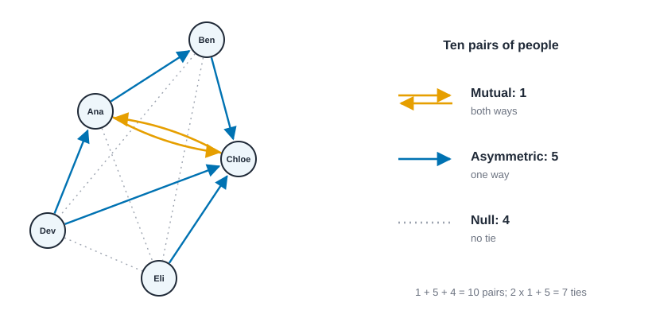{#fig-dyad-states fig-alt="The five-person advice network drawn with arrows. The pair Ana and Chloe has arrows in both directions and is labeled mutual. Five pairs, such as Ana and Ben, have an arrow one way and are labeled asymmetric. Four pairs, such as Ben and Dev, have no arrow and are labeled null. A tally box shows 1 mutual, 5 asymmetric and 4 null."}

Every pair falls in exactly one state, so if $M$, $A$ and $N$ are the numbers of mutual, asymmetric and null dyads, then $M + A + N = n(n-1)/2$. And since a mutual dyad holds two ties and an asymmetric one holds one, the number of ties is $m = 2M + A$.

Check it on the advice network. There are $5 \cdot 4 / 2 = 10$ pairs. Ana and Chloe go to each other, so $M = 1$. The pairs with exactly one arrow are Ana–Ben, Ben–Chloe, Dev–Ana, Dev–Chloe and Eli–Chloe, so $A = 5$. The remaining pairs, Ana–Eli, Ben–Dev, Ben–Eli and Dev–Eli, are null, so $N = 4$. And $1 + 5 + 4 = 10$ and $2 \cdot 1 + 5 = 7$. The bookkeeping works.

The dyad idea comes from Simmel's pair (we meet him below) and was turned into a counting scheme by Holland and Leinhardt, who counted the dyad and triad types in a network [@holland1970method]; Wasserman and Faust give the dyad census and reciprocity a full treatment [@wasserman1994social].

### Reciprocity: how many ties are returned

The most natural summary of the dyad counts is **reciprocity**: of all the ties, what share are returned? A tie is returned when it sits in a mutual dyad, and there are $2M$ such ties. So

$$ r = \frac{2M}{2M + A} = \frac{2M}{m}, $$

where $M$ and $A$ are the mutual and asymmetric dyad counts and $m$ is the number of ties. For the advice network, $r = 2/7 = 0.286$: just over a quarter of the advice ties are returned.

Is 0.286 high or low? That depends on what you'd expect by chance, and on what the tie means. With seven ties among 20 possible arcs, the density is $7/20 = 0.35$, so if ties were handed out at random, about 35% of them would happen to have a return tie. The observed 0.286 is no higher than chance. (With five people, "chance" is a noisy yardstick. The logic is what matters, and @sec-paths-and-cohesion makes it exact.) In an advice network a low value is normal and often reflects hierarchy and expertise: people go to those who know more. In a friendship network a low value would be surprising, and would suggest that people name friends who don't name them back. The number alone settles neither, and there are several conventions for "reciprocity", so always say which you used.

::: {.panel-tabset group="language"}

## R

```r
library(knappnet)
library(dplyr)
library(purrr)

people <- c("Ana", "Ben", "Chloe", "Dev", "Eli")

# The advice network: one row per tie, from the person who asks to the person asked.
ties <- tibble(
  source = c("Ana", "Ana", "Ben", "Chloe", "Dev", "Dev", "Eli"),
  target = c("Ben", "Chloe", "Chloe", "Ana", "Ana", "Chloe", "Chloe")
)
advice <- net_frame(ties, nodes = tibble(id = people), directed = TRUE)

# How many people each person goes to (out) and how many go to them (in).
degrees <- tibble(
  person = people,
  out = net_degree(advice, mode = "out"),
  `in` = net_degree(advice, mode = "in")
)
degrees
degrees |> summarise(sum_out = sum(out), sum_in = sum(`in`), ties = nrow(ties))

# The dyad census. Pair people up (alphabetically, so Ana-Chloe and Chloe-Ana are one pair):
# a pair that appears twice is mutual, once is asymmetric, and a pair that never appears is null.
dyads <- ties |>
  mutate(a = pmin(source, target), b = pmax(source, target)) |>
  count(a, b)
tibble(
  mutual = sum(dyads$n == 2),
  asymmetric = sum(dyads$n == 1),
  null = choose(length(people), 2) - nrow(dyads),
  reciprocity = net_reciprocity(advice),
  density = net_density(advice)
)
```

::: {.code-output}
```text
# A tibble: 5 × 3
  person   out  `in`
  <chr>  <dbl> <dbl>
1 Ana        2     2
2 Ben        1     1
3 Chloe      1     4
4 Dev        2     0
5 Eli        1     0
# A tibble: 1 × 3
  sum_out sum_in  ties
    <dbl>  <dbl> <int>
1       7      7     7
# A tibble: 1 × 5
  mutual asymmetric  null reciprocity density
   <int>      <int> <dbl>       <dbl>   <dbl>
1      1          5     4       0.286    0.35
```
:::

## Python

```python
import networkx as nx

people = ["Ana", "Ben", "Chloe", "Dev", "Eli"]

# The advice network: one tie per pair, from the person who asks to the person asked.
ties = [("Ana", "Ben"), ("Ana", "Chloe"), ("Ben", "Chloe"), ("Chloe", "Ana"),
        ("Dev", "Ana"), ("Dev", "Chloe"), ("Eli", "Chloe")]
advice = nx.DiGraph()
advice.add_nodes_from(people)
advice.add_edges_from(ties)

# How many people each person goes to (out) and how many go to them (in).
for p in people:
    print(f"{p:<6} out {advice.out_degree(p)}  in {advice.in_degree(p)}")
total_out = sum(d for _, d in advice.out_degree())
total_in = sum(d for _, d in advice.in_degree())
print(f"sum of out {total_out}  sum of in {total_in}  ties {advice.number_of_edges()}")

# The dyad census: mutual (both ways), asymmetric (one way), null (neither).
mutual = sum(1 for a, b in advice.edges if a < b and advice.has_edge(b, a))
asymmetric = sum(1 for a, b in advice.edges if not advice.has_edge(b, a))
null = len(people) * (len(people) - 1) // 2 - mutual - asymmetric
print(f"mutual {mutual}  asymmetric {asymmetric}  null {null}")
print(f"reciprocity {nx.reciprocity(advice):.3f}  density {nx.density(advice):.3f}")
```

::: {.code-output}
```text
Ana    out 2  in 2
Ben    out 1  in 1
Chloe  out 1  in 4
Dev    out 2  in 0
Eli    out 1  in 0
sum of out 7  sum of in 7  ties 7
mutual 1  asymmetric 5  null 4
reciprocity 0.286  density 0.350
```
:::

## Rust

```rust
use knappnet::metrics::descriptive::{compute_reciprocity, ReciprocityMode};
use knappnet::metrics::topography::{compute_density, find_components, ComponentKind};
use knappnet::{compute_degree, DegreeMode, Graph};
use std::collections::BTreeMap;

// The advice network: from[i] goes to to[i]. Ana is 0, Ben 1, Chloe 2, Dev 3, Eli 4.
let people = ["Ana", "Ben", "Chloe", "Dev", "Eli"];
let from = [0, 0, 1, 2, 3, 3, 4];
let to = [1, 2, 2, 0, 0, 2, 2];
let advice = Graph::from_edges(5, &from, &to, None, true)?;

// How many people each person goes to (out) and how many go to them (in).
let out = compute_degree(&advice, DegreeMode::Out, true);
let inn = compute_degree(&advice, DegreeMode::In, true);
for (i, name) in people.iter().enumerate() {
    println!("{name:<6} out {}  in {}", out[i], inn[i]);
}
println!("sum of out {}  sum of in {}  ties {}", out.iter().sum::<f64>(), inn.iter().sum::<f64>(), advice.edge_count());

// The dyad census. Count how many ties each pair of people has between them:
// two is mutual, one is asymmetric, and a pair that never appears is null.
let mut pairs: BTreeMap<(i64, i64), usize> = BTreeMap::new();
for (&a, &b) in from.iter().zip(&to) {
    *pairs.entry((a.min(b), a.max(b))).or_default() += 1;
}
let mutual = pairs.values().filter(|&&c| c == 2).count();
let asymmetric = pairs.values().filter(|&&c| c == 1).count();
let null = people.len() * (people.len() - 1) / 2 - mutual - asymmetric;
println!("mutual {mutual}  asymmetric {asymmetric}  null {null}");
println!(
    "reciprocity {:.3}  density {:.3}",
    compute_reciprocity(&advice, ReciprocityMode::Default),
    compute_density(&advice, false)
);
```

::: {.code-output}
```text
Ana    out 2  in 2
Ben    out 1  in 1
Chloe  out 1  in 4
Dev    out 2  in 0
Eli    out 1  in 0
sum of out 7  sum of in 7  ties 7
mutual 1  asymmetric 5  null 4
reciprocity 0.286  density 0.350
```
:::

:::

The out- and in-degrees match what we counted from the table, the dyad census is 1, 5 and 4, and the reciprocity of 0.286 and density of 0.350 agree with the arithmetic above. All three agree because they are counting the same thing, but be careful about the word "reciprocity": it has several definitions in use (the share of ties returned, the share of non-empty dyads that are mutual, a correlation that corrects for density), and @sec-paths-and-cohesion shows all four on this very network, with four different numbers. The card `reciprocity` lists them.

## Degree: counting ties

The simplest thing to ask about a person in a network is how many ties they have. That count is their **degree**, written $d_i$ for person $i$. If the network is undirected, it's the number of neighbors. If it's directed, there are two counts: the **out-degree** $d_i^{\text{out}}$ (ties from $i$) and the **in-degree** $d_i^{\text{in}}$ (ties to $i$).

For the advice network, here they are, read off the table.

| | Ana | Ben | Chloe | Dev | Eli |
| --- | --- | --- | --- | --- | --- |
| Out-degree (goes to) | 2 | 1 | 1 | 2 | 1 |
| In-degree (comes to them) | 2 | 1 | 4 | 0 | 0 |

Chloe is the one everybody turns to: four of the other four people come to her. Dev and Eli are the opposite: they ask, but nobody asks them. Same network, two completely different stories, which is why in a directed network you should never report one number called "degree" without saying which direction.

Counting gives a check you can run on any network. Every tie has two ends, so if you add up everyone's degree you count every tie twice. In an undirected network,

$$ \sum_{i} d_i = 2m. $$

(This is called the **handshake lemma**, after the party where each handshake involves two hands.) In a directed network, every tie leaves exactly one person and arrives at exactly one person, so the out-degrees add up to $m$, and so do the in-degrees:

$$ \sum_i d_i^{\text{out}} = \sum_i d_i^{\text{in}} = m. $$

For the advice network, out-degrees add to $2 + 1 + 1 + 2 + 1 = 7$ and in-degrees to $2 + 1 + 4 + 0 + 0 = 7$, and $m = 7$. Use this check on every real dataset: if the degrees don't add up to what they should, something was entered or read wrongly. It's the cheapest data-quality test there is.

Dividing by the number of people gives the **mean degree**: $2m/n$ for an undirected network, and $m/n$ for each of in and out in a directed one. The advice network has a mean of $7/5 = 1.4$ in each direction. The list of everyone's degrees, sorted, is the **degree sequence**, and the shape of that list (even, or a few big values and many small ones) tells you a lot about a network. @sec-small-worlds is about that shape.

What does a high or low degree mean? It depends entirely on what the tie stands for, and the number never says.

| Setting | Many ties | Few ties |
| --- | --- | --- |
| Marriages among families | Many partners: wide access, and many obligations. Not necessarily a powerful family. | Few partners. One marriage can still be a very useful one. |
| Advice in an office (in-degree) | Sought out by many: an expert, or simply visible. | Not asked. Perhaps new, or perhaps not needed. |
| Transport or supply | A busy hub. Disruption there spreads to many places. | A terminal or a spur. |
| An online platform | A popular, or very active, account. It could also be a bot or an organization. | A typical, quiet or new account. |

: How to read degree in four settings. In every case degree counts contacts, not what they do or who they are. {#tbl-degree-readings}

Degree has been central since Moreno's sociograms, where the people who got many choices were the "stars" and those who got none were isolates [@moreno1934who]. @sec-centrality gives it the careful treatment it deserves and the card `degree` records what it can and cannot support.

## Weighted ties, and what a threshold hides

So far a tie was either there or not. Often it comes with a size: the number of emails, the minutes talking, the amount of money, the closeness someone reports. A tie with a number attached is a **weighted** (or *valued*) tie, with weight $w_{ij}$ for the tie between $i$ and $j$. The weighted version of degree is **strength**:

$$ s_i = \sum_j w_{ij}, $$

the total weight of $i$'s ties. Degree counts how many contacts you have; strength adds up how much you do with them. They can disagree, and the disagreement is informative.

Here is a small example. Five people, and the weights are messages sent per week between them. Ana has four contacts, but only one of them is a real conversation; Ben has three, all of them real.

| Pair | Ana–Ben | Ana–Chloe | Ana–Dev | Ana–Eli | Ben–Chloe | Ben–Dev |
| --- | --- | --- | --- | --- | --- | --- |
| Messages | 10 | 1 | 1 | 1 | 6 | 6 |

By degree, Ana has 4 contacts and Ben has 3. By strength, Ana has $10 + 1 + 1 + 1 = 13$ and Ben has $10 + 6 + 6 = 22$. Ben goes from second to first. Who is "most connected" depends on which you meant.

Many classic measures were designed for yes-or-no ties, so people often turn a weighted network into a plain one by **thresholding**: keep the ties with weight at least some cutoff and call them ties. It's a modeling choice, and it can change the answer a lot (@fig-weighted-threshold). Keep every tie ($w \ge 1$) and the network has 6 ties, density 0.6 and one piece. Keep $w \ge 2$ and three ties survive: Ana–Ben, Ben–Chloe and Ben–Dev. Now Ben is the hub and Eli is cut off, so there are two pieces. Keep $w \ge 7$ and only Ana–Ben remains, and there are four pieces. No cutoff is wrong, but each describes a different network, so report the one you used and, better, report a few.

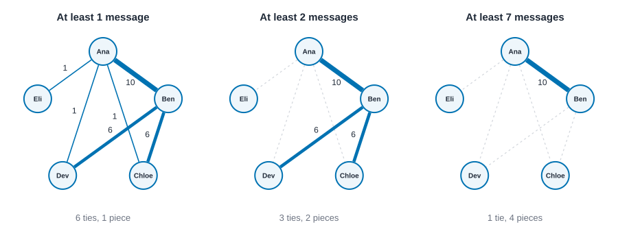{#fig-weighted-threshold fig-alt="Three drawings of the same five people. With every tie kept, six lines join them and Ana and Ben are drawn with a thick line. With a cutoff of two, three lines remain and Ben is joined to Ana, Chloe and Dev while Eli stands alone. With a cutoff of seven, only the Ana and Ben line remains and three people stand alone."}

::: {.panel-tabset group="language"}

## R

```r
# Messages per week between five people.
messages <- tibble(
  source = c("Ana", "Ana", "Ana", "Ana", "Ben", "Ben"),
  target = c("Ben", "Chloe", "Dev", "Eli", "Chloe", "Dev"),
  messages = c(10, 1, 1, 1, 6, 6)
)
talk <- net_frame(messages, nodes = tibble(id = people), directed = FALSE, weight = "messages", weight_type = "strength")

# Degree counts contacts; strength adds up the messages.
tibble(person = people, degree = net_degree(talk), strength = net_strength(talk))

# The same network at three cutoffs: keep only ties with at least this many messages.
c(1, 2, 7) |>
  map(\(cutoff) {
    kept <- net_frame(filter(messages, messages >= cutoff), nodes = tibble(id = people), directed = FALSE)
    tibble(cutoff = cutoff, ties = nrow(kept$edges), density = net_density(kept), pieces = net_components(kept)$no)
  }) |>
  list_rbind()
```

::: {.code-output}
```text
# A tibble: 5 × 3
  person degree strength
  <chr>   <dbl>    <dbl>
1 Ana         4       13
2 Ben         3       22
3 Chloe       2        7
4 Dev         2        7
5 Eli         1        1
# A tibble: 3 × 4
  cutoff  ties density pieces
   <dbl> <int>   <dbl>  <int>
1      1     6     0.6      1
2      2     3     0.3      2
3      7     1     0.1      4
```
:::

## Python

```python
# Messages per week between five people.
messages = [("Ana", "Ben", 10), ("Ana", "Chloe", 1), ("Ana", "Dev", 1), ("Ana", "Eli", 1),
            ("Ben", "Chloe", 6), ("Ben", "Dev", 6)]
talk = nx.Graph()
talk.add_nodes_from(people)
talk.add_weighted_edges_from(messages)

# Degree counts contacts; strength adds up the messages.
for p in people:
    print(f"{p:<6} degree {talk.degree(p)}  strength {talk.degree(p, weight='weight')}")

# The same network at three cutoffs: keep only ties with at least this many messages.
for cutoff in (1, 2, 7):
    kept = nx.Graph()
    kept.add_nodes_from(people)
    kept.add_edges_from((a, b) for a, b, w in messages if w >= cutoff)
    print(f"cutoff {cutoff}: ties {kept.number_of_edges()}, density {nx.density(kept):.2f}, "
          f"pieces {nx.number_connected_components(kept)}")
```

::: {.code-output}
```text
Ana    degree 4  strength 13
Ben    degree 3  strength 22
Chloe  degree 2  strength 7
Dev    degree 2  strength 7
Eli    degree 1  strength 1
cutoff 1: ties 6, density 0.60, pieces 1
cutoff 2: ties 3, density 0.30, pieces 2
cutoff 7: ties 1, density 0.10, pieces 4
```
:::

## Rust

```rust
use knappnet::compute_strength;

// Messages per week between five people: ties[i] joins from[i] and to[i] with weight weights[i].
let from = [0, 0, 0, 0, 1, 1];
let to = [1, 2, 3, 4, 2, 3];
let weights = [10.0, 1.0, 1.0, 1.0, 6.0, 6.0];
let talk = Graph::from_edges(5, &from, &to, Some(&weights), false)?;

// Degree counts contacts; strength adds up the messages.
let degree = compute_degree(&talk, DegreeMode::All, true);
let strength = compute_strength(&talk, DegreeMode::All, true)?;
for (i, name) in people.iter().enumerate() {
    println!("{name:<6} degree {}  strength {}", degree[i], strength[i]);
}

// The same network at three cutoffs: keep only ties with at least this many messages.
for cutoff in [1.0, 2.0, 7.0] {
    let keep: Vec<usize> = (0..from.len()).filter(|&k| weights[k] >= cutoff).collect();
    let a: Vec<i64> = keep.iter().map(|&k| from[k]).collect();
    let b: Vec<i64> = keep.iter().map(|&k| to[k]).collect();
    let kept = Graph::from_edges(5, &a, &b, None, false)?;
    println!(
        "cutoff {cutoff}: ties {}, density {:.2}, pieces {}",
        kept.edge_count(),
        compute_density(&kept, false),
        find_components(&kept, ComponentKind::Weak).count()
    );
}
```

::: {.code-output}
```text
Ana    degree 4  strength 13
Ben    degree 3  strength 22
Chloe  degree 2  strength 7
Dev    degree 2  strength 7
Eli    degree 1  strength 1
cutoff 1: ties 6, density 0.60, pieces 1
cutoff 2: ties 3, density 0.30, pieces 2
cutoff 7: ties 1, density 0.10, pieces 4
```
:::

:::

The ranking flips between degree and strength, exactly as the arithmetic said, and the cutoff changes the density from 0.60 to 0.30 to 0.10 and the number of pieces from one to two to four. If you ever see a network analysis that says "we kept ties above a threshold" and doesn't say which one, or how the result changes with it, treat the result as unfinished. The card `thresholding` lists what to report, and `weighted-degree` covers strength.

## The adjacency matrix, and counting walks

There is a third way to write a network, and it's the one that makes a lot of the mathematics easy: a grid. The **adjacency matrix** $A$ has one row and one column for each person, and the entry $A_{ij}$ is 1 if $i$ is tied to $j$ and 0 if not (or the weight $w_{ij}$, if the network is weighted). For an undirected network, $A$ is symmetric: $A_{ij} = A_{ji}$. For a directed one it needn't be, and reading across a row tells you who that person goes to. Row sums are out-degrees, column sums are in-degrees. The diagonal is 0 unless there are loops.

Let's use a new small network, undirected this time: a triangle with a tail.

> Ana is tied to Ben and Chloe. Ben is tied to Chloe. Chloe is tied to Dev. Dev is tied to Eli.

That's five ties. Ordering the people Ana, Ben, Chloe, Dev, Eli, the matrix is

$$
A = \begin{pmatrix}
0 & 1 & 1 & 0 & 0 \\
1 & 0 & 1 & 0 & 0 \\
1 & 1 & 0 & 1 & 0 \\
0 & 0 & 1 & 0 & 1 \\
0 & 0 & 0 & 1 & 0
\end{pmatrix}.
$$

Row sums are the degrees: 2, 2, 3, 2, 1. They add to 10, twice the number of ties, as the handshake lemma promised.

The reason to care about the matrix is what happens when you multiply it by itself. A **walk** of length $k$ is a sequence of $k+1$ people where each is tied to the next; it may revisit people. The number of walks of length 2 from $i$ to $j$ is the number of people tied to both, and that is exactly $(A^2)_{ij}$, the entry of the matrix $A$ multiplied by itself. In general,

$$ (A^k)_{ij} = \text{the number of walks of length } k \text{ from } i \text{ to } j. $$

Try it on Ana and Dev. There is one walk of length 2 from Ana to Dev (through Chloe), so $(A^2)_{\text{Ana},\text{Dev}} = 1$. And the diagonal of $A^2$ counts walks that go out and come straight back: one for each neighbor, so $(A^2)_{ii} = d_i$, the degree. That's a nice link between the matrix and the counts above.

Now the cube. A walk of length 3 from a person back to themselves is, if it never repeats a person in the middle, a triangle: Ana to Ben to Chloe and back to Ana. Each triangle gives such a walk starting at each of its three corners, and in each of two directions around it, so six closed walks of length 3 per triangle. Therefore, in an undirected network with no loops,

$$ \text{number of triangles} = \frac{\operatorname{tr}(A^3)}{6}, $$

where $\operatorname{tr}$, the **trace**, is the sum of the diagonal entries. For our network, the diagonal of $A^3$ is 2, 2, 2, 0, 0, which sums to 6, so there is exactly one triangle (Ana, Ben and Chloe), as the picture shows. This is how software counts triangles and why the clustering measures of @sec-paths-and-cohesion are cheap to compute.

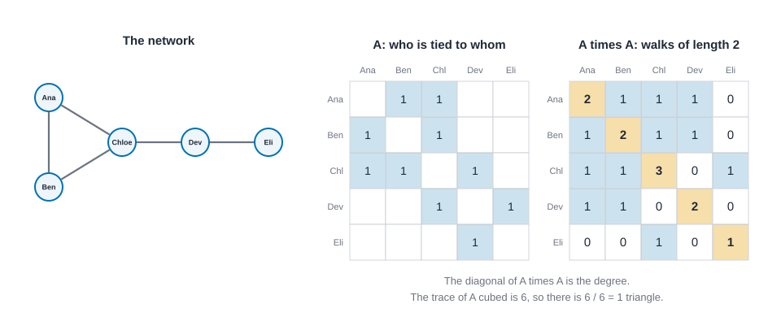{#fig-adjacency-walks fig-alt="Left: a five by five grid for Ana, Ben, Chloe, Dev and Eli with ten shaded cells, symmetric across the diagonal, drawn beside a small network of a triangle with a two-person tail. Right: a five by five grid of numbers whose diagonal reads 2, 2, 3, 2, 1 and whose other entries are 0 or 1."}

::: {.callout-warning appearance="simple"}
## Walks are not paths
A walk can revisit people, so $A^k$ counts more than the routes you'd draw on a map. The walks of length 3 from Ana to Ben include Ana, Chloe, Ana, Ben (back and forth). That's fine for triangles and for the powers of $A$ that show up in some centrality measures, but if you want the number of different routes that never repeat a person, you need a different tool (@sec-paths-and-cohesion).
:::

::: {.panel-tabset group="language"}

## R

```r
# A triangle with a tail: Ana-Ben, Ana-Chloe, Ben-Chloe, Chloe-Dev, Dev-Eli.
office <- tibble(
  source = c("Ana", "Ana", "Ben", "Chloe", "Dev"),
  target = c("Ben", "Chloe", "Chloe", "Dev", "Eli")
)
net <- net_frame(office, nodes = tibble(id = people), directed = FALSE)
tibble(person = people, degree = net_degree(net))

# The adjacency matrix: put a 1 at each tie's row and column, then mirror it.
a <- matrix(0, 5, 5, dimnames = list(people, people))
a[cbind(match(office$source, people), match(office$target, people))] <- 1
a <- a + t(a)

a                 # who is tied to whom
a %*% a           # walks of length 2; the diagonal is the degree
tibble(trace_of_cube = sum(diag(a %*% a %*% a)), triangles = trace_of_cube / 6)
```

::: {.code-output}
```text
# A tibble: 5 × 2
  person degree
  <chr>   <dbl>
1 Ana         2
2 Ben         2
3 Chloe       3
4 Dev         2
5 Eli         1
      Ana Ben Chloe Dev Eli
Ana     0   1     1   0   0
Ben     1   0     1   0   0
Chloe   1   1     0   1   0
Dev     0   0     1   0   1
Eli     0   0     0   1   0
      Ana Ben Chloe Dev Eli
Ana     2   1     1   1   0
Ben     1   2     1   1   0
Chloe   1   1     3   0   1
Dev     1   1     0   2   0
Eli     0   0     1   0   1
# A tibble: 1 × 2
  trace_of_cube triangles
          <dbl>     <dbl>
1             6         1
```
:::

## Python

```python
import numpy as np

# A triangle with a tail: Ana-Ben, Ana-Chloe, Ben-Chloe, Chloe-Dev, Dev-Eli.
net = nx.Graph([("Ana", "Ben"), ("Ana", "Chloe"), ("Ben", "Chloe"), ("Chloe", "Dev"), ("Dev", "Eli")])
print("degrees", dict(net.degree(people)))

# The adjacency matrix, with people in the order Ana, Ben, Chloe, Dev, Eli.
a = nx.to_numpy_array(net, nodelist=people, dtype=int)
print("A\n", a, sep="")
print("A squared (walks of length 2; the diagonal is the degree)\n", a @ a, sep="")
cube = a @ a @ a
print(f"trace of A cubed {np.trace(cube)}, so triangles = {np.trace(cube) // 6}")
```

::: {.code-output}
```text
degrees {'Ana': 2, 'Ben': 2, 'Chloe': 3, 'Dev': 2, 'Eli': 1}
A
[[0 1 1 0 0]
 [1 0 1 0 0]
 [1 1 0 1 0]
 [0 0 1 0 1]
 [0 0 0 1 0]]
A squared (walks of length 2; the diagonal is the degree)
[[2 1 1 1 0]
 [1 2 1 1 0]
 [1 1 3 0 1]
 [1 1 0 2 0]
 [0 0 1 0 1]]
trace of A cubed 6, so triangles = 1
```
:::

## Rust

```rust
use knappnet::metrics::graph_matrices::build_adjacency_matrix;

// A triangle with a tail: Ana-Ben, Ana-Chloe, Ben-Chloe, Chloe-Dev, Dev-Eli.
let net = Graph::from_edges(5, &[0, 0, 1, 2, 3], &[1, 2, 2, 3, 4], None, false)?;
let degrees: Vec<i64> = compute_degree(&net, DegreeMode::All, true).iter().map(|d| *d as i64).collect();
println!("degrees {degrees:?}");

// The adjacency matrix as a row-major list of 25 numbers. Multiplying matrices is not part of
// the engine, so we write the five-by-five product by hand: row r of x times column c of y.
let a = build_adjacency_matrix(&net, false, &[0, 1, 2, 3, 4])?.to_dense_rows();
let times = |x: &[f64], y: &[f64]| -> Vec<f64> {
    (0..25).map(|k| (0..5).map(|j| x[(k / 5) * 5 + j] * y[j * 5 + k % 5]).sum()).collect()
};
let square = times(&a, &a);
let cube = times(&square, &a);
let show = |name: &str, m: &[f64]| {
    println!("{name}");
    for row in m.chunks(5) {
        println!("  {:?}", row.iter().map(|v| *v as i64).collect::<Vec<_>>());
    }
};
show("A", &a);
show("A squared (walks of length 2; the diagonal is the degree)", &square);
let trace: f64 = (0..5).map(|i| cube[i * 6]).sum();
println!("trace of A cubed {trace}, so triangles = {}", trace / 6.0);
```

::: {.code-output}
```text
degrees [2, 2, 3, 2, 1]
A
  [0, 1, 1, 0, 0]
  [1, 0, 1, 0, 0]
  [1, 1, 0, 1, 0]
  [0, 0, 1, 0, 1]
  [0, 0, 0, 1, 0]
A squared (walks of length 2; the diagonal is the degree)
  [2, 1, 1, 1, 0]
  [1, 2, 1, 1, 0]
  [1, 1, 3, 0, 1]
  [1, 1, 0, 2, 0]
  [0, 0, 1, 0, 1]
trace of A cubed 6, so triangles = 1
```
:::

:::

The diagonal of $A^2$ reads 2, 2, 3, 2, 1, the degrees; the single walk of length 2 from Ana to Dev shows as a 1 in the first row; and the trace of $A^3$ is 6, so one triangle. If you run the same on a network with a loop or a repeated tie, the triangle formula stops being true, which is a good reason to check that your network is simple before you use it. The knappnet engine has no matrix-product function, which is why the Rust tab multiplies by hand. For a five-person example that's fine; for large networks you'd use sparse matrix tools (@sec-reproducibility). The card `adjacency-walks` lists the conditions.

## Paths, distance and being connected

The next idea is what makes a network more than a list of pairs: you can get from one person to another through intermediaries. A **path** is a walk that never repeats a person. The **distance** between two people is the number of steps on a *shortest* path between them (a **geodesic**), and it's infinite if no path exists. In the triangle-with-a-tail network, Ana to Eli takes three steps (Ana, Chloe, Dev, Eli), and there's no shorter way, so the distance is 3.

From the distance table come three summaries. A person's **eccentricity** is their largest distance to anyone. The **diameter** is the largest eccentricity, the farthest apart any two people are. The **mean distance** is the average over pairs. For our network, the eccentricities are 3, 3, 2, 2, 3 (Ana, Ben, Chloe, Dev, Eli), so the diameter is 3, and the ten pairs have distances adding to 17, which makes the mean distance $17/10 = 1.7$. (@sec-paths-and-cohesion is the full treatment and @fig-walks-paths there draws the difference between walks, paths and geodesics.)

Whether distance is defined at all depends on whether the network is in one piece. A **component** is a maximal group of people who can all reach each other. If every pair can reach each other the network is **connected** and has one component; otherwise it has several, and every pair of people in different components is at infinite distance. In a directed network there are two natural versions (see @fig-components in @sec-paths-and-cohesion). A **weak** component lets you travel along arrows in either direction. A **strong** component demands you can go from each person to each other *following the arrows*.

Back to the advice network. Ignoring direction, everyone is connected to Chloe or to Ana, so there's one weak component. Following arrows, Ana, Ben and Chloe can all reach each other (Ana to Chloe directly, Chloe back to Ana, and Ben to Chloe to Ana to Ben), so they form a strong component. Dev and Eli ask but nobody asks them, so no arrow leads back to either, and each is a strong component of one. That's one weak component and three strong ones, and it's the kind of count that is worth knowing before you compute anything that depends on reaching people, because many measures silently assume the network is in one piece.

::: {.panel-tabset group="language"}

## R

```r
# Distances in the triangle-with-a-tail network (one row per person).
net_distances(net)

tibble(
  person = people,
  eccentricity = net_eccentricity(net)
)
tibble(diameter = net_diameter(net), mean_distance = net_mean_distance(net))

# Components of the advice network: weak (ignore arrows) and strong (follow them).
tibble(
  kind = c("weak", "strong"),
  pieces = map_int(kind, \(k) net_components(advice, mode = k)$no),
  sizes = map_chr(kind, \(k) paste(sort(net_components(advice, mode = k)$csize, decreasing = TRUE), collapse = " "))
)
```

::: {.code-output}
```text
      Ana Ben Chloe Dev Eli
Ana     0   1     1   2   3
Ben     1   0     1   2   3
Chloe   1   1     0   1   2
Dev     2   2     1   0   1
Eli     3   3     2   1   0
# A tibble: 5 × 2
  person eccentricity
  <chr>         <dbl>
1 Ana               3
2 Ben               3
3 Chloe             2
4 Dev               2
5 Eli               3
# A tibble: 1 × 2
  diameter mean_distance
     <dbl>         <dbl>
1        3           1.7
# A tibble: 2 × 3
  kind   pieces sizes
  <chr>   <int> <chr>
1 weak        1 5    
2 strong      3 3 1 1
```
:::

## Python

```python
# Distances in the triangle-with-a-tail network (one row per person).
dist = dict(nx.all_pairs_shortest_path_length(net))
for p in people:
    print(f"{p:<6}", [dist[p][q] for q in people])
print("eccentricity", nx.eccentricity(net))
print(f"diameter {nx.diameter(net)}  mean distance {nx.average_shortest_path_length(net):.1f}")

# Components of the advice network: weak (ignore arrows) and strong (follow them).
weak = sorted((len(c) for c in nx.weakly_connected_components(advice)), reverse=True)
strong = sorted((len(c) for c in nx.strongly_connected_components(advice)), reverse=True)
print("weak pieces", len(weak), "sizes", weak)
print("strong pieces", len(strong), "sizes", strong)
```

::: {.code-output}
```text
Ana    [0, 1, 1, 2, 3]
Ben    [1, 0, 1, 2, 3]
Chloe  [1, 1, 0, 1, 2]
Dev    [2, 2, 1, 0, 1]
Eli    [3, 3, 2, 1, 0]
eccentricity {'Ana': 3, 'Ben': 3, 'Chloe': 2, 'Dev': 2, 'Eli': 3}
diameter 3  mean distance 1.7
weak pieces 1 sizes [5]
strong pieces 3 sizes [3, 1, 1]
```
:::

## Rust

```rust
use knappnet::metrics::descriptive::{compute_diameter, compute_distances, compute_eccentricity, compute_mean_distance, PathOptions};

// Distances in the triangle-with-a-tail network (one row per person).
let paths = PathOptions::default();
let distances = compute_distances(&net, None, paths)?;
for (i, name) in people.iter().enumerate() {
    let row: Vec<i64> = distances.row(i).iter().map(|d| *d as i64).collect();
    println!("{name:<6} {row:?}");
}
let ecc: Vec<i64> = compute_eccentricity(&net, paths)?.iter().map(|e| *e as i64).collect();
println!("eccentricity {ecc:?}");
println!(
    "diameter {}  mean distance {:.1}",
    compute_diameter(&net, paths, true)?,
    compute_mean_distance(&net, paths, true)?
);

// Components of the advice network: weak (ignore arrows) and strong (follow them).
for (name, kind) in [("weak", ComponentKind::Weak), ("strong", ComponentKind::Strong)] {
    let parts = find_components(&advice, kind);
    let mut sizes = parts.sizes.clone();
    sizes.sort_by(|a, b| b.cmp(a));
    println!("{name} pieces {} sizes {sizes:?}", parts.count());
}
```

::: {.code-output}
```text
Ana    [0, 1, 1, 2, 3]
Ben    [1, 0, 1, 2, 3]
Chloe  [1, 1, 0, 1, 2]
Dev    [2, 2, 1, 0, 1]
Eli    [3, 3, 2, 1, 0]
eccentricity [3, 3, 2, 2, 3]
diameter 3  mean distance 1.7
weak pieces 1 sizes [5]
strong pieces 3 sizes [3, 1, 1]
```
:::

:::

## Density, and why it shrinks

How tightly knit is a network? One simple answer is its **density**: the share of all possible ties that are actually there. For an undirected network the number of possible ties is $n(n-1)/2$, so

$$ \Delta = \frac{2m}{n(n-1)}, $$

and for a directed one it's $\Delta = m / (n(n-1))$. Both can be written as mean degree divided by $n - 1$, which is the clearest way to see what density is: the share of the other people that the average person is tied to. The triangle-with-a-tail network has $m = 5$ and $n = 5$, so $\Delta = 10/20 = 0.5$. The advice network has $m = 7$ and $n = 5$, directed, so $\Delta = 7/20 = 0.35$. The two five-person teams from @sec-introduction have densities 1 and 0.4.

Density feels like a measure of how cohesive a group is, and for groups of about the same size it's a fine first look. Across sizes, it misleads, and here is the failure with numbers. Suppose every person in a network has exactly four ties, whatever the size of the group. This is realistic: people don't take on four times as many friends because the group has four times as many members. Mean degree stays at 4, so density is $4/(n-1)$, and it falls as $n$ grows (@fig-paths-density-size in @sec-paths-and-cohesion draws the whole curve). Here is a ring of people in which each person is tied to the next two people around the circle (and so, from the other side, to the two before them), for four sizes of ring:

::: {.panel-tabset group="language"}

## R

```r
# A ring: each person is tied to the next two people around the circle, so everyone has four ties.
c(8, 20, 100, 500) |>
  map(\(n) {
    i <- 0:(n - 1)
    ring <- net_frame(
      tibble(source = as.character(c(i, i)), target = as.character(c((i + 1) %% n, (i + 2) %% n))),
      nodes = tibble(id = as.character(i)), directed = FALSE
    )
    tibble(people = n, ties = nrow(ring$edges), mean_degree = net_avg_degree(ring), density = net_density(ring))
  }) |>
  list_rbind()
```

::: {.code-output}
```text
# A tibble: 4 × 4
  people  ties mean_degree density
   <dbl> <int>       <dbl>   <dbl>
1      8    16           4 0.571  
2     20    40           4 0.211  
3    100   200           4 0.0404 
4    500  1000           4 0.00802
```
:::

## Python

```python
# A ring: each person is tied to the next two people around the circle, so everyone has four ties.
for n in (8, 20, 100, 500):
    ring = nx.Graph([(i, (i + step) % n) for i in range(n) for step in (1, 2)])
    print(f"{n:>4} people  {ring.number_of_edges():>4} ties  "
          f"mean degree {2 * ring.number_of_edges() / n:.1f}  density {nx.density(ring):.3f}")
```

::: {.code-output}
```text
   8 people    16 ties  mean degree 4.0  density 0.571
  20 people    40 ties  mean degree 4.0  density 0.211
 100 people   200 ties  mean degree 4.0  density 0.040
 500 people  1000 ties  mean degree 4.0  density 0.008
```
:::

## Rust

```rust
// A ring: each person is tied to the next two people around the circle, so everyone has four ties.
for n in [8i64, 20, 100, 500] {
    let from: Vec<i64> = (0..n).flat_map(|i| [i, i]).collect();
    let to: Vec<i64> = (0..n).flat_map(|i| [(i + 1) % n, (i + 2) % n]).collect();
    let ring = Graph::from_edges(n as usize, &from, &to, None, false)?;
    println!(
        "{n:>4} people  {:>4} ties  mean degree {:.1}  density {:.3}",
        ring.edge_count(),
        2.0 * ring.edge_count() as f64 / n as f64,
        compute_density(&ring, false)
    );
}
```

::: {.code-output}
```text
   8 people    16 ties  mean degree 4.0  density 0.571
  20 people    40 ties  mean degree 4.0  density 0.211
 100 people   200 ties  mean degree 4.0  density 0.040
 500 people  1000 ties  mean degree 4.0  density 0.008
```
:::

:::

Everyone has exactly four ties in every ring, and the density falls from 0.571 for 8 people to 0.008 for 500. Nothing about how sociable the people are has changed. So: never compare the densities of networks of different sizes as if they measured cohesion. Compare mean degree instead, or compare each network with a random one of its own size and number of ties (@sec-tests-and-null-models). The card `density` lists these cautions and how to report it.

## Turning arrows into plain ties

Many tools want an undirected network. Community detection, for instance, usually does. If your data is directed, you have to decide what to do with a pair where the ties disagree, and the choices are not neutral. Two rules are common:

- **Either:** a pair is tied if *at least one* of the two goes to the other. (NetworkX's `to_undirected` does this by default, and so does knappnet's `net_symmetrize` in R.)
- **Both:** a pair is tied only if *both* go to each other, that is, only mutual ties survive.

On the advice network, "either" gives six ties (the pairs that are mutual or asymmetric), a density of 0.6 and a single connected group. "Both" gives one tie, Ana and Chloe, a density of 0.1, and four groups: Ana and Chloe together, and Ben, Dev and Eli each alone (@fig-symmetrize-rules). Same data, and one reading says "everyone is connected" while the other says "the network has fallen apart".

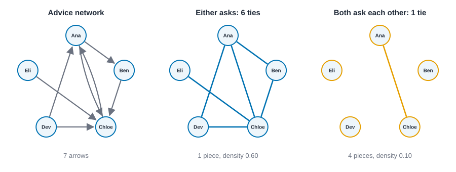{#fig-symmetrize-rules fig-alt="Three drawings of the five advice-network people. Left: the original with seven arrows. Middle: the either rule, with six plain lines and all five people connected. Right: the both rule, with a single line between Ana and Chloe and Ben, Dev and Eli standing alone."}

::: {.panel-tabset group="language"}

## R

```r
# "max" keeps a pair if either person goes to the other; "min" only if both do.
c(either = "max", both = "min") |>
  map(\(rule) {
    g <- net_symmetrize(advice, rule)
    tibble(ties = nrow(g$edges), density = net_density(g), pieces = net_components(g)$no)
  }) |>
  list_rbind(names_to = "rule")
```

::: {.code-output}
```text
# A tibble: 2 × 4
  rule    ties density pieces
  <chr>  <int>   <dbl>  <int>
1 either     6     0.6      1
2 both       1     0.1      4
```
:::

## Python

```python
# to_undirected keeps a pair if either person goes to the other; reciprocal=True only if both do.
for rule, plain in [("either", advice.to_undirected()), ("both", advice.to_undirected(reciprocal=True))]:
    print(f"{rule:<6} ties {plain.number_of_edges()}, density {nx.density(plain):.2f}, "
          f"pieces {nx.number_connected_components(plain)}")
```

::: {.code-output}
```text
either ties 6, density 0.60, pieces 1
both   ties 1, density 0.10, pieces 4
```
:::

## Rust

```rust
use knappnet::metrics::descriptive_more::{compute_symmetrize, SymmetrizeMethod};

// Weak keeps a pair if either person goes to the other; Strong only if both do.
for (rule, method) in [("either", SymmetrizeMethod::Weak), ("both", SymmetrizeMethod::Strong)] {
    let pairs = compute_symmetrize(&advice, method);
    let a: Vec<i64> = pairs.from.iter().map(|&v| v as i64).collect();
    let b: Vec<i64> = pairs.to.iter().map(|&v| v as i64).collect();
    let plain = Graph::from_edges(5, &a, &b, None, false)?;
    println!(
        "{rule:<6} ties {}, density {:.2}, pieces {}",
        plain.edge_count(),
        compute_density(&plain, false),
        find_components(&plain, ComponentKind::Weak).count()
    );
}
```

::: {.code-output}
```text
either ties 6, density 0.60, pieces 1
both   ties 1, density 0.10, pieces 4
```
:::

:::

There's no right answer in general. "Either" suits questions about *who could have heard from whom*. "Both" suits questions about *mutual relationships*. What is not defensible is to choose silently, or to choose the one that gives the answer you hoped for. Report the rule, and, if the answer changes, report both. The card `symmetrization` has the checklist, and @sec-subgroups shows a real case where the choice changes the communities found.

## A real network, from start to finish

Time to use all of this on something real, the Florentine marriage network from @sec-introduction. @fig-florentine-intro in @sec-centrality draws it. Here is the plan: count the pieces, summarize the degrees, then stress-test the one claim we made about it, that the Medici have more marriages than anyone.

The by-hand part is a short list. The data has 15 families and 20 marriages, and the network is undirected. Density is $2 \cdot 20 / (15 \cdot 14) = 40/210 = 0.190$ and mean degree is $40/15 = 2.67$. If we sort the degrees, we expect them to add to 40.

::: {.panel-tabset group="language"}

## R

```r
rows <- read.csv("data/florentine/edges.csv")
ids <- sort(unique(c(rows$source, rows$target)))
florence <- net_frame(rows, nodes = tibble(id = ids), directed = FALSE)

# The degree sequence, from smallest to largest, and the handshake check.
degrees <- net_degree(florence)
tibble(
  degree_sequence = paste(sort(degrees), collapse = " "),
  sum_of_degrees = sum(degrees),
  twice_the_ties = 2 * nrow(rows)
)

# Pieces, and the farthest apart any two families are.
tibble(pieces = net_components(florence)$no, diameter = net_diameter(florence))
```

::: {.code-output}
```text
# A tibble: 1 × 3
  degree_sequence               sum_of_degrees twice_the_ties
  <chr>                                  <dbl>          <dbl>
1 1 1 1 1 2 2 3 3 3 3 3 3 4 4 6             40             40
# A tibble: 1 × 2
  pieces diameter
   <int>    <dbl>
1      1        5
```
:::

## Python

```python
import csv

with open("data/florentine/edges.csv") as f:
    rows = [(r["source"], r["target"]) for r in csv.DictReader(f)]
florence = nx.Graph(rows)

# The degree sequence, from smallest to largest, and the handshake check.
degrees = sorted(d for _, d in florence.degree())
print("degree sequence", degrees)
print(f"sum of degrees {sum(degrees)}  twice the ties {2 * len(rows)}")

# Pieces, and the farthest apart any two families are.
print(f"pieces {nx.number_connected_components(florence)}  diameter {nx.diameter(florence)}")
```

::: {.code-output}
```text
degree sequence [1, 1, 1, 1, 2, 2, 3, 3, 3, 3, 3, 3, 4, 4, 6]
sum of degrees 40  twice the ties 40
pieces 1  diameter 5
```
:::

## Rust

```rust
// Florentine families around 1430: a tie means two families were joined by marriage.
let text = std::fs::read_to_string("data/florentine/edges.csv")?;
let rows: Vec<(&str, &str)> = text.lines().skip(1).map(|line| line.split_once(',').unwrap()).collect();
let mut families: Vec<&str> = Vec::new();
for &(a, b) in &rows {
    for family in [a, b] {
        if !families.contains(&family) {
            families.push(family);
        }
    }
}
let position = |family: &str| families.iter().position(|f| *f == family).unwrap() as i64;
let from: Vec<i64> = rows.iter().map(|row| position(row.0)).collect();
let to: Vec<i64> = rows.iter().map(|row| position(row.1)).collect();
let florence = Graph::from_edges(families.len(), &from, &to, None, false)?;

// The degree sequence, from smallest to largest, and the handshake check.
let degrees = compute_degree(&florence, DegreeMode::All, true);
let mut sequence: Vec<i64> = degrees.iter().map(|d| *d as i64).collect();
sequence.sort();
println!("degree sequence {sequence:?}");
println!("sum of degrees {}  twice the ties {}", degrees.iter().sum::<f64>(), 2 * rows.len());

// Pieces, and the farthest apart any two families are.
println!(
    "pieces {}  diameter {}",
    find_components(&florence, ComponentKind::Weak).count(),
    compute_diameter(&florence, paths, true)?
);
```

::: {.code-output}
```text
degree sequence [1, 1, 1, 1, 2, 2, 3, 3, 3, 3, 3, 3, 4, 4, 6]
sum of degrees 40  twice the ties 40
pieces 1  diameter 5
```
:::

:::

The degrees add to 40, as they must. The sequence is 1, 1, 1, 1, 2, 2, then six threes, two fours and a six: four families with a single marriage, a middle group of threes, and the Medici with six. The network is in one piece, and the farthest apart any two families can be is five marriages. A picture of the degrees makes the shape plain.

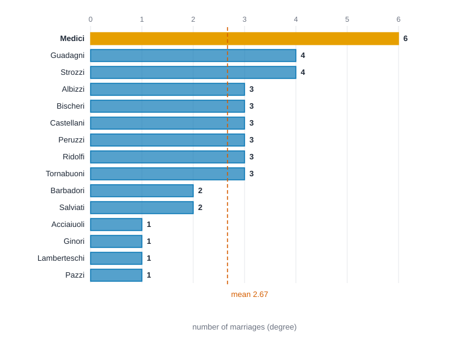{#fig-florentine-degrees fig-alt="A horizontal bar chart of 15 family names. Medici has the longest bar at 6. Guadagni and Strozzi have 4. Six families have 3, Barbadori and Salviati have 2, and four families have 1. A vertical dashed line marks the mean of 2.67."}

### Stress check: does the claim survive losing ties?

The claim is "the Medici have strictly the most marriages". Real data has errors and gaps, and a historical record certainly does. So try losing some ties. There are 20 marriages. Drop each one in turn (20 ways), and also every pair of marriages (190 ways), and after each drop ask two questions: is the Medici's degree still strictly the largest, and does the network split into more than one piece? The second question looks at a different idea in passing: a tie whose loss splits the network is a **bridge**, and these are the ties that Granovetter's argument, later in this chapter, is about.

::: {.panel-tabset group="language"}

## R

```r
# Rebuild the network without the marriages in `drop` (row numbers), and answer the two questions.
after <- function(drop) {
  g <- net_frame(slice(rows, -drop), nodes = tibble(id = ids), directed = FALSE, quiet = TRUE)
  d <- net_degree(g)
  tibble(
    medici_strictly_top = d[ids == "Medici"] == max(d) && sum(d == max(d)) == 1,
    medici_top_or_tied = d[ids == "Medici"] == max(d),
    splits = net_components(g)$no > 1
  )
}

bind_rows(
  `drop one marriage` = map(1:20, after) |> list_rbind(),
  `drop two marriages` = combn(20, 2, simplify = FALSE) |> map(after) |> list_rbind(),
  .id = "scenario"
) |>
  summarise(
    cases = n(), strictly_top = sum(medici_strictly_top), top_or_tied = sum(medici_top_or_tied),
    network_splits = sum(splits), .by = scenario
  )
```

::: {.code-output}
```text
# A tibble: 2 × 5
  scenario           cases strictly_top top_or_tied network_splits
  <chr>              <int>        <int>       <int>          <int>
1 drop one marriage     20           20          20              5
2 drop two marriages   190          175         190             87
```
:::

## Python

```python
from itertools import combinations

def after(drop):
    """Drop the marriages whose row numbers are in `drop`; is the Medici degree the top (strictly, or tied), and does the network split?"""
    g = nx.Graph()
    g.add_nodes_from(florence)  # a family left with no marriages is still a family
    g.add_edges_from(r for k, r in enumerate(rows) if k not in drop)
    d = dict(g.degree())
    top = max(d.values())
    return d["Medici"] == top and list(d.values()).count(top) == 1, d["Medici"] == top, nx.number_connected_components(g) > 1

for label, drops in [("drop one marriage", list(combinations(range(20), 1))),
                     ("drop two marriages", list(combinations(range(20), 2)))]:
    results = [after(set(drop)) for drop in drops]
    print(f"{label}: {len(results)} cases, Medici strictly top in {sum(r[0] for r in results)}, "
          f"top or tied in {sum(r[1] for r in results)}, network splits in {sum(r[2] for r in results)}")
```

::: {.code-output}
```text
drop one marriage: 20 cases, Medici strictly top in 20, top or tied in 20, network splits in 5
drop two marriages: 190 cases, Medici strictly top in 175, top or tied in 190, network splits in 87
```
:::

## Rust

```rust
// Rebuild the network without the marriages in `drop` (row numbers), and answer the two questions.
let medici = position("Medici") as usize;
let after = |drop: &[usize]| -> Result<(bool, bool, bool), knappnet::Error> {
    let keep: Vec<usize> = (0..from.len()).filter(|k| !drop.contains(k)).collect();
    let a: Vec<i64> = keep.iter().map(|&k| from[k]).collect();
    let b: Vec<i64> = keep.iter().map(|&k| to[k]).collect();
    let g = Graph::from_edges(families.len(), &a, &b, None, false)?;
    let d = compute_degree(&g, DegreeMode::All, true);
    let top = d.iter().cloned().fold(0.0, f64::max);
    let strictly = d[medici] == top && d.iter().filter(|&&x| x == top).count() == 1;
    Ok((strictly, d[medici] == top, find_components(&g, ComponentKind::Weak).count() > 1))
};

let mut one = Vec::new();
let mut two = Vec::new();
for i in 0..20 {
    one.push(after(&[i])?);
    for j in i + 1..20 {
        two.push(after(&[i, j])?);
    }
}
for (label, results) in [("drop one marriage", &one), ("drop two marriages", &two)] {
    println!(
        "{label}: {} cases, Medici strictly top in {}, top or tied in {}, network splits in {}",
        results.len(),
        results.iter().filter(|r| r.0).count(),
        results.iter().filter(|r| r.1).count(),
        results.iter().filter(|r| r.2).count()
    );
}
```

::: {.code-output}
```text
drop one marriage: 20 cases, Medici strictly top in 20, top or tied in 20, network splits in 5
drop two marriages: 190 cases, Medici strictly top in 175, top or tied in 190, network splits in 87
```
:::

:::

Drop any single marriage and the Medici are still strictly first in all 20 cases. Drop any two and they remain strictly first in 175 of 190; the 15 cases where they lose strict first place are exactly the pairs of Medici marriages, which bring their six down to four and into a tie with Guadagni and Strozzi. So the *count* is hard to dislodge, and a claim like "the Medici have the most or equal-most marriages" survives every case we tried. The *connectivity* is another story: losing one marriage splits the network in 5 of 20 cases, and losing two splits it in 87 of 190. Five marriages are each the only link between some part of the network and the rest: bridges. Whatever the Medici's position means, the network as a whole is thin in places. (Compare @sec-case-florentine, where we also compare with random networks of the same size.)

What can we say? A defensible sentence: "In this 15-family marriage network, the Medici have six marriages, more than any other family and more than twice the mean of 2.67. The ranking is unchanged if any one marriage is dropped, and a tie for first is the worst case if any two are." An over-claiming one: "The Medici were the centre of Florentine society, and the network proves it." The data show a count, in 15 families, in one kind of tie, at one time. They don't show influence, they don't cover the rest of the city, and they say nothing about cause.

## Where the numbers disagree

You will meet three kinds of disagreement, and the rest of the book returns to each.

- **Conventions.** Tools differ over how a loop counts in degree (once or twice), whether repeated ties are kept, whether density divides by $n(n-1)/2$ or $n^2$, and what "reciprocity" means. None of the choices is wrong. @sec-reproducibility runs one small network through three readings and @sec-conventions tabulates the differences.
- **Direction.** "Degree" means one thing in an undirected network and splits into in and out in a directed one. Some functions silently ignore direction and some silently use it. Check what your function does before you trust it.
- **Disconnection.** Distances, diameters and many centrality measures are undefined when the network is in several pieces. Tools handle it by dropping the unreachable pairs, by setting them to the number of nodes, or by stopping with an error. If your network has more than one component, the number you got may be a convention, not a fact.

And one habit that catches most mistakes in this chapter: write down what you expect before you run anything. The hand counts above are not a warm-up. They're the test.

## Where the ideas come from

Now the second half. With the vocabulary in place, we can ask what each classic idea looks like as a *pattern of ties*. For each one in turn, notice which of the pieces above it uses: Simmel's pair and triple are dyads and triangles; Moreno's sociogram draws directed ties and counts in-degree; Granovetter's bridge is a tie whose removal increases the number of components; Burt's structural hole is a gap among someone's neighbors; and the small world is about the mean distance of a connected network together with local clustering.

One caveat before we start. This is a tour, not a complete history. Linton Freeman's *The Development of Social Network Analysis* tells the full story, including the many threads we'll skip [@freeman2004development]. Where I describe an idea, I cite where it comes from so you can read the original in the author's own words. Network science has a second root in mathematics, which began with Euler's solution of the Königsberg bridge problem [@euler1741solutio] and developed as graph theory [@harary1969graph; @bondy2008graph]. The vocabulary of the first half, and the formal definitions in @sec-math-review, come from there. The ideas below come from the social sciences.

## Simmel and the shape of social life

Start with the idea that makes everything else possible: that you can study the *form* of social relations separately from what they're *about*.

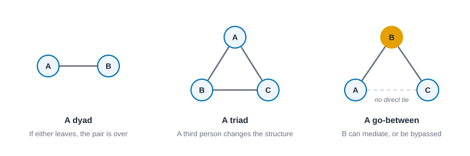{#fig-dyad-triad fig-alt="Left: two nodes joined by a line. Middle: three nodes joined in a triangle. Right: three nodes where the middle node is joined to both others, and a dashed line shows no direct tie between those two."}

The German sociologist Georg Simmel argued that you could look at the patterns in which people are tied together, such as who is in a pair, a trio, a larger group, or overlapping groups, apart from the particular content (love, money, politics) that happens to flow through them [@simmel1950sociology]. The same form can carry very different content, and the same content can live in very different forms.

His best-known example is how much changes when you go from two people to three. A pair depends on both members; if either leaves, the pair is over. Add a third person and new things become possible: one person can mediate between the other two, or be left out, or play them against each other. A single added person changes the *structure*, even though no individual changed.

Hold on to that. When we count triangles, ask who bridges whom, or study who gets left out, we are following Simmel's lead. He didn't have the vocabulary of graphs, but he had the intuition: structure has consequences of its own.

## Moreno draws the first maps

If Simmel supplied the intuition, Jacob Moreno supplied the pictures. In the 1930s he developed *sociometry*, a way of asking people in a group to name those they would choose to sit with, work with, or spend time with, and then drawing the answers as diagrams of dots and arrows, which he called sociograms [@moreno1934who].

This was a breakthrough for a simple reason: for the first time, you could *see* a group's structure. Who gets many choices? Who gets none? Where do cliques sit, and who falls between them? Notice the data shape. Moreno wasn't recording attributes of individuals. He was recording a relation, "chooses," among all the members of a group, and the picture showed things you couldn't have read from a roster.

You'll see the descendants of the sociogram in @sec-visualization, and the descendants of "who gets chosen" in the measures of prestige and centrality in @sec-centrality.

## Anthropologists find the network

Meanwhile, anthropologists were running into the same idea from a different direction.

A. R. Radcliffe-Brown had described social structure as the network of relations actually existing among people, as distinct from the idealized rules about how they ought to behave [@radcliffebrown1940social]. That's a crucial move: structure is something you can observe in who really interacts with whom.

In a study of a Norwegian island parish, J. A. Barnes used the idea of a social network to describe a field of ties of friendship and acquaintance that cut across the formal divisions of class and committee [@barnes1954class]. The formal organization told you who sat on which committee; the network told you how people actually knew one another.

Elizabeth Bott then gave the idea a striking empirical punch. Studying ordinary London families, she found that how couples divided household roles seemed to depend on how connected their outside friends and relatives were to one another: tightly knit networks went with more sharply separated roles, loosely knit ones with more shared roles [@bott1957family]. The same family, in other words, behaved differently depending on the shape of the network around it.

At about the same time, a group of researchers working in African towns and elsewhere, many connected to Manchester, developed network concepts for the study of urban life, and their work was gathered in an influential collection edited by J. Clyde Mitchell [@mitchell1969social]. This is where a lot of the everyday vocabulary of density and connectedness gets its footing in the social sciences.

## Balance: psychology gets a graph

Now a different thread, from psychology. Fritz Heider asked how a person's *attitudes* hold together. Suppose you like Sam, and Sam likes jazz. Do you like jazz? Heider's answer was that people prefer a kind of consistency among their feelings about the other person, about the thing, and about how the other person feels about the thing, and that inconsistency creates pressure to change something [@heider1946attitudes].

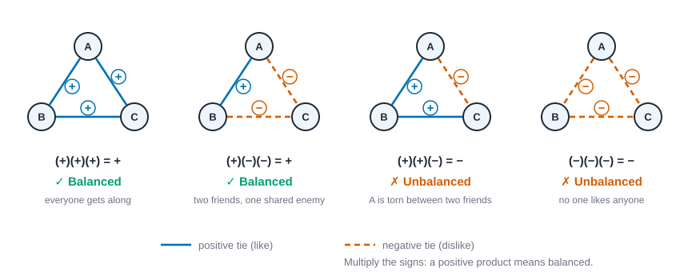{#fig-balance-triads fig-alt="Four triangles with signed ties. Plus, plus, plus: balanced. One plus and two minus: balanced. Two plus and one minus: unbalanced. Three minus: unbalanced."}

Put it as a triangle of three signed ties, each positive (like) or negative (dislike). Heider's rule of thumb, in network terms:

| Triangle | Signs | Balanced? |
| --- | --- | --- |
| A likes B, B likes C, A likes C | + + + | Yes: everyone gets along |
| A likes B, B dislikes C, A dislikes C | + − − | Yes: two friends share an enemy |
| A likes B, B likes C, A dislikes C | + + − | No: A is uncomfortable |
| A dislikes B, B dislikes C, A dislikes C | − − − | No: nobody likes anyone, so tensions can pull toward change |

The shortcut: multiply the three signs. If the product is positive, the triangle is balanced. That is why "the friend of my friend is my friend" and "the enemy of my enemy is my friend" both feel natural, and why "the friend of my friend is my enemy" doesn't.

The mathematical step came from Dorwin Cartwright and Frank Harary, who generalized Heider's idea to whole networks of signed ties and connected it to the mathematics of graphs [@cartwright1956structural; @harary1953notion]. Their result is elegant: a network of signed ties is balanced exactly when you can split the nodes into two camps so that all ties *within* a camp are positive and all ties *between* camps are negative. Two factions, internally friendly, mutually hostile.

This is one of the places where a psychological claim and a graph property line up perfectly, which makes it a good first test of the whole project. We'll compute balance in code at the end of this chapter and test it properly in @sec-signed-and-valued, but you can already check small cases by hand: take any triangle from the table and see whether the nodes split into two camps the way the theorem says.

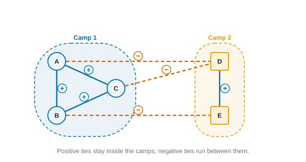{#fig-two-camps fig-alt="Five nodes in two outlined groups. The three nodes of Camp 1 are joined by positive ties, the two nodes of Camp 2 by one positive tie, and three negative dashed ties cross between the camps."}

## Positions and roles

Another thread asks not "who is connected to whom" but "who occupies the same *position*." Harrison White and colleagues proposed that people can be grouped by the pattern of their relations to others, so that two people are alike if they stand in similar relationships to similar others, even if they never meet [@white1976social]. Two department heads at different companies may never have spoken, yet they hold the same position in the structure. We'll make that precise as *structural equivalence* in @sec-positions-and-roles, and as blockmodels, which summarize a network as a small map of positions and the ties between them.

## Weak ties and bridges

Mark Granovetter's 1973 paper may be the most cited idea in network analysis, and its core is surprising enough to be worth slowing down for [@granovetter1973strength].

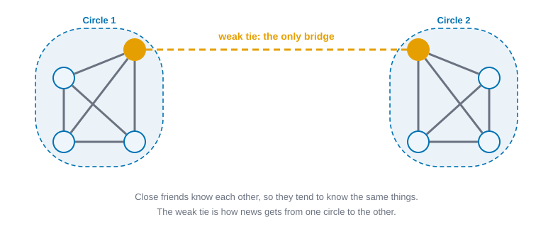{#fig-weak-ties fig-alt="Two outlined clusters, each with four fully connected nodes drawn with thick gray lines. A single dashed orange line links one orange node in the left cluster to one orange node in the right cluster."}

Granovetter started by defining the *strength* of a tie as a mix of time spent together, emotional intensity, intimacy, and reciprocal services. Then he asked what *weak* ties, acquaintances rather than close friends, are good for.

His answer: your close friends tend to know each other and to know the same things. The information in your circle is redundant. Acquaintances, in contrast, are more likely to move in different circles from yours. A weak tie can therefore be a **bridge**, the only link between two otherwise separate clusters, and that makes it a path for new information to travel. Hence the paradoxical title: the strength of weak ties.

He also pointed at a structural regularity worth noting. If you have strong ties to two people, those two people are very likely to know each other, at least slightly. A pair of strong ties without any tie between the third pair is rare, which is why triangles are so common in friendship networks. (You'll see this "friends of friends" tendency again as *transitivity* and *clustering*.)

When you later compute a bridge, a cut-point, or an "effective size," keep this picture in mind: they're all ways of asking where the shortcuts and the dead-ends are, and who is standing on them.

## Embeddedness: economic life is social life

Granovetter made a second move that matters for how you interpret networks in organizations and markets. He argued that economic behavior can't be understood either as isolated individuals pursuing interests or as individuals who simply follow the norms handed to them. Instead, economic actions are *embedded* in ongoing networks of social relations that shape trust, expectations, and opportunities [@granovetter1985economic].

This is why network analysis spread so quickly into studies of firms, labor markets and entrepreneurs. It gave researchers a way to say, concretely, "who you know, and how they know each other, affects what you can do," and to measure it.

## Structural holes: brokers and their advantages

Ronald Burt took Granovetter's bridge and pushed it into a theory of competition. A **structural hole** is a gap between two groups or people who aren't connected to each other. Someone who spans that gap, a *broker*, has access to non-redundant information and some control over what flows between the groups [@burt1992structural]. Burt later showed how this brokerage position relates to good ideas and to how people evaluate and develop them [@burt2004structural].

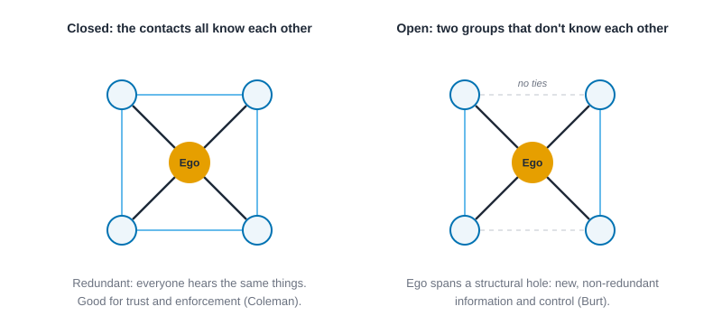{#fig-structural-hole fig-alt="Two diagrams of an orange node with four contacts. On the left the four contacts are connected to each other. On the right the contacts form two separate pairs with no ties between the pairs."}

The picture to hold is almost visual. Take a network with two tight clusters and one person with a tie to each. That person sits on a structural hole. Measures of constraint and effective size, which we meet in @sec-ego-networks, quantify how much of a person's circle is redundant, and so how many holes they span.

## Social capital: closure or brokerage?

Here is where the field developed a productive disagreement, and it's a good example of why interpretation takes care.

James Coleman argued that social structure can be a resource, "social capital," and that one form of it is *closure*: when your friends all know one another, norms are easier to enforce, trust is easier to build, and obligations are easier to count on [@coleman1988social]. Think of a close-knit parent community where everyone watches everyone's kids.

Burt's brokerage argument points the opposite way: the advantages come from *not* being closed in, from spanning holes [@burt1992structural]. Nan Lin offered a broader theory in which social capital is a set of resources embedded in networks that people can mobilize for their purposes [@lin2001social]. And Robert Putnam popularized the distinction between *bonding* ties within a group and *bridging* ties across groups, arguing about what each does for communities [@putnam2000bowling].

So which is right? The useful answer is "it depends on what you're trying to achieve." Closure helps when you need trust and enforcement; brokerage helps when you need new information and variety. Research on Broadway musical teams, for instance, found that success was highest at an intermediate mix of close-knit clusters and bridging ties [@uzzi2005collaboration]. A measure can tell you whether someone's network looks closed or brokered, but the *interpretation* of whether that's good depends on the goal. That's the habit of mind we want.

## Homophily: why similar people connect

Why do ties form where they do? One of the most robust findings in the field is **homophily**, the tendency of similar people to connect with each other. McPherson, Smith-Lovin and Cook reviewed decades of evidence across race, age, religion, education, occupation and more, and organized it, among other ways, by distinguishing homophily that simply reflects who is available to meet from homophily that goes beyond what availability would predict [@mcpherson2001birds].

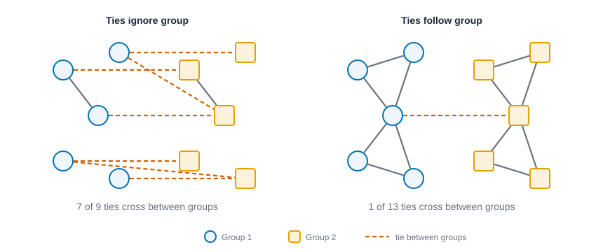{#fig-homophily fig-alt="Two network diagrams of ten people, five circles and five squares. In the left diagram seven of nine ties cross between the shapes. In the right diagram only one of thirteen ties crosses."}

Why that distinction matters: if your workplace is 90% one group, most of your ties will be to that group even if you're not choosing anyone by group. To claim a *preference*, you have to compare against what chance and opportunity would give you. That's precisely the kind of comparison we build in the chapters on permutation tests and models.

Homophily also has consequences. Because ties form among similar people, networks tend to be segregated along the lines people are similar on, which shapes who hears about what, who trusts whom, and who is exposed to unfamiliar ideas.

## Small worlds

You've probably heard that everyone is only "six degrees" from everyone else. Where does that come from?

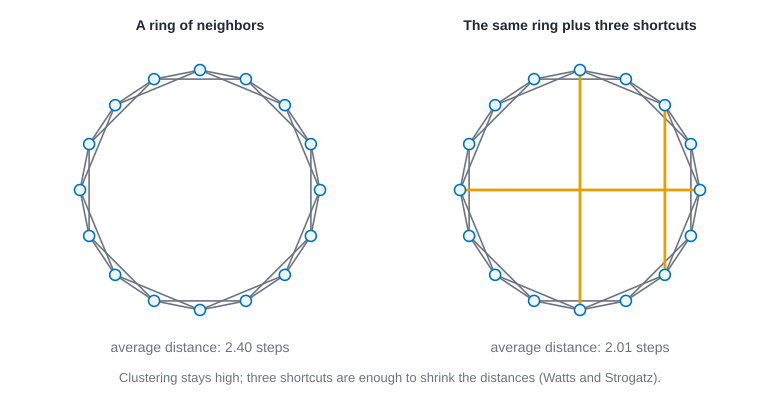{#fig-small-world fig-alt="Two circular networks of sixteen nodes. The right one has three extra straight orange lines crossing the circle. Captions give the average distance in each."}

Jeffrey Travers and Stanley Milgram asked people to pass a letter toward a target person by sending it to someone they knew on a first-name basis who might be closer to the target. Among the chains that reached the target, the number of steps was surprisingly small, on the order of five or six intermediaries, though many chains never arrived [@travers1969experimental]. The experiment is a wonderful piece of work and a reminder that the pop-culture slogan hides a lot of nuance, including all the chains that failed.

Decades later, Duncan Watts and Steven Strogatz showed that networks can combine two properties that seem to pull against each other: lots of local clustering (friends of friends are friends) and short typical distances. A few random long-range shortcuts, they found, are enough to collapse the distances [@watts1998collective]. And Albert-László Barabási and Réka Albert described how a simple growth rule, new nodes tending to attach to nodes that already have many ties, can generate a few highly connected hubs [@barabasi1999emergence].

These are *models* of how networks come to look the way they do, and we'll build and test them later. For now the interpretive lesson is simple: short paths and clustering are not contradictory, and the presence of hubs is a structural fact worth explaining, not a given.

## Minds in the network

So far we've talked as if ties are facts waiting to be recorded. But who says a tie exists? David Krackhardt pointed out that each person holds their own picture of the network, a *cognitive social structure*, and those pictures can differ from one another and from any single "true" version [@krackhardt1987cognitive]. If you ask two coworkers whether they're friends, you may get two different answers, and both are data.

This opens a door to a broader worry. Mustafa Emirbayer and Jeff Goodwin argued that network analysis, for all its strengths, risked ignoring culture, meaning and human agency: people aren't just nodes pushed around by structure, they interpret, choose and imagine [@emirbayer1994network]. It's a fair challenge, and a healthy one. When you interpret network results, you'll do best by treating structure as one important part of the story, and by asking what the people involved understood themselves to be doing.

## From ideas to measures: a cheat sheet

Here's the map for the rest of the book. Each row connects an idea in this chapter to the part of the book where you'll measure it, and to the caution you should carry with you.

| Idea | Core claim | Where we measure it | Interpretation caution |
| --- | --- | --- | --- |
| Structure matters (Simmel, Wellman) | Patterns of ties have effects independent of individuals | Throughout | Don't forget attributes and context |
| Sociometry (Moreno) | Group structure can be seen and counted | @sec-visualization, @sec-centrality | Choices depend on the question asked |
| Balance (Heider, Cartwright and Harary) | Triads of signed ties tend toward consistency | @sec-signed-and-valued | Requires signed data |
| Positions (White et al.) | Roles are patterns of relations | @sec-positions-and-roles | Two people can match without ever meeting |
| Weak ties (Granovetter) | Bridges carry novel information | @sec-paths-and-cohesion | "Weak" is defined by time, intensity, intimacy and exchange, not just tie count |
| Structural holes (Burt) | Brokers span gaps | @sec-ego-networks | Advantage depends on context and goal |
| Closure vs. brokerage (Coleman, Burt, Lin, Putnam) | Different structures help different goals | @sec-ego-networks | Neither is universally better |
| Homophily (McPherson et al.) | Similar people connect | @sec-tests-and-null-models | Separate preference from opportunity |
| Small worlds (Travers and Milgram, Watts and Strogatz) | Short paths with high clustering | @sec-paths-and-cohesion | Many chains fail; "six" is an average |
| Perception (Krackhardt) | Ties are reported by people | @sec-collecting-data | Whose report counts? |

## In code: Heider's balance rule

Here is one idea from the second half that we can already put into code: Heider's balance rule. The by-hand version is the multiplication trick above. The code takes a small signed network, finds every triangle, checks whether its three signs multiply to a positive number, and then tries every way of splitting the people into two camps to see whether one split explains every sign.

The network is five coworkers. Ana, Ben and Chloe like each other, Dev and Eli like each other, and every tie between the two groups is a dislike. (Ana and Eli don't know each other, and neither do Ben and Dev, so those two pairs have no tie at all.) Then we add one tie, "Ben likes Dev", and watch what it breaks. A tie that is absent is not a negative tie: no tie means no information, and only triangles whose three ties all exist can be balanced or unbalanced.

::: {.panel-tabset group="language"}

## R

```r
# Signed ties among five coworkers: +1 means they get on, -1 means they don't.
signed <- tibble(
  a = c("Ana", "Ana", "Ben", "Dev", "Ana", "Chloe", "Chloe", "Ben"),
  b = c("Ben", "Chloe", "Chloe", "Eli", "Dev", "Dev", "Eli", "Eli"),
  sign = c(1, 1, 1, 1, -1, -1, -1, -1)
)
signed_plus <- bind_rows(signed, tibble(a = "Ben", b = "Dev", sign = 1)) # Ben also likes Dev

# Every triangle (three people all tied to each other) and how many of its ties are negative.
triangles_of <- function(ties) {
  s <- matrix(0, 5, 5, dimnames = list(people, people)) # a symmetric sign matrix; 0 means no tie
  s[cbind(ties$a, ties$b)] <- ties$sign
  s <- s + t(s)
  trio <- combn(people, 3)
  tibble(x = trio[1, ], y = trio[2, ], z = trio[3, ]) |>
    mutate(xy = s[cbind(x, y)], xz = s[cbind(x, z)], yz = s[cbind(y, z)]) |>
    filter(xy != 0, xz != 0, yz != 0) |>
    mutate(negatives = (xy < 0) + (xz < 0) + (yz < 0), balanced = negatives %% 2 == 0)
}

# Every split into two camps (Ana always in the first): how many ties does the best one break?
best_split <- function(ties) {
  camps <- cbind(1, as.matrix(expand.grid(rep(list(c(1, -1)), 4))))
  together <- camps[, match(ties$a, people)] * camps[, match(ties$b, people)]
  broken <- rowSums(together != matrix(ties$sign, nrow(camps), nrow(ties), byrow = TRUE))
  best <- camps[which.min(broken), ]
  tibble(fewest_broken = min(broken), camp_1 = paste(people[best == 1], collapse = " "), camp_2 = paste(people[best == -1], collapse = " "))
}

list(`the office` = signed, `plus Ben likes Dev` = signed_plus) |>
  map(\(ties) {
    tri <- triangles_of(ties)
    bind_cols(tibble(ties = nrow(ties), triangles = nrow(tri), balanced = sum(tri$balanced)), best_split(ties))
  }) |>
  list_rbind(names_to = "network")

# The triangles that break the rule once Ben likes Dev.
triangles_of(signed_plus) |> filter(!balanced) |> select(x, y, z, negatives)
```

::: {.code-output}
```text
# A tibble: 2 × 7
  network             ties triangles balanced fewest_broken camp_1        camp_2
  <chr>              <int>     <int>    <int>         <dbl> <chr>         <chr> 
1 the office             8         4        4             0 Ana Ben Chloe Dev E…
2 plus Ben likes Dev     9         7        4             1 Ana Ben Chloe Dev E…
# A tibble: 3 × 4
  x     y     z     negatives
  <chr> <chr> <chr>     <int>
1 Ana   Ben   Dev           1
2 Ben   Chloe Dev           1
3 Ben   Dev   Eli           1
```
:::

## Python

```python
from itertools import combinations

# Signed ties among five coworkers: +1 means they get on, -1 means they don't.
signed = {("Ana", "Ben"): 1, ("Ana", "Chloe"): 1, ("Ben", "Chloe"): 1, ("Dev", "Eli"): 1,
          ("Ana", "Dev"): -1, ("Chloe", "Dev"): -1, ("Chloe", "Eli"): -1, ("Ben", "Eli"): -1}
signed_plus = {**signed, ("Ben", "Dev"): 1}  # Ben also likes Dev

def sign(ties, a, b):
    """The sign between two people, or None if they are not tied."""
    return ties.get((a, b)) or ties.get((b, a))

def check(label, ties):
    # Every triangle (three people all tied to each other) and how many of its ties are negative.
    triangles = {t: sum(sign(ties, a, b) < 0 for a, b in combinations(t, 2))
                 for t in combinations(people, 3) if all(sign(ties, a, b) for a, b in combinations(t, 2))}
    balanced = sum(k % 2 == 0 for k in triangles.values())
    # Every split into two camps (Ana always in camp 0): how many ties does each one break?
    def broken(mask):
        camp = {p: 0 if i == 0 else (mask >> (i - 1)) & 1 for i, p in enumerate(people)}
        return sum((camp[a] == camp[b]) != (s > 0) for (a, b), s in ties.items()), camp
    best = min((broken(m)[0], m) for m in range(16))
    fewest, camp = best[0], broken(best[1])[1]
    side = lambda wanted: " ".join(p for p in people if camp[p] == wanted)
    print(f"{label}: {len(ties)} ties, {len(triangles)} triangles, {balanced} balanced")
    print(f"  fewest ties that break a two-camp split: {fewest} ({side(0)} | {side(1)})")
    bad = [f"{' '.join(t)} ({k} negative)" for t, k in triangles.items() if k % 2 == 1]
    if bad:
        print("  unbalanced:", ", ".join(bad))

check("the office", signed)
check("plus Ben likes Dev", signed_plus)
```

::: {.code-output}
```text
the office: 8 ties, 4 triangles, 4 balanced
  fewest ties that break a two-camp split: 0 (Ana Ben Chloe | Dev Eli)
plus Ben likes Dev: 9 ties, 7 triangles, 4 balanced
  fewest ties that break a two-camp split: 1 (Ana Ben Chloe | Dev Eli)
  unbalanced: Ana Ben Dev (1 negative), Ben Chloe Dev (1 negative), Ben Dev Eli (1 negative)
```
:::

## Rust

```rust
// Signed ties among five coworkers: +1 means they get on, -1 means they don't.
let office: Vec<(usize, usize, i32)> =
    vec![(0, 1, 1), (0, 2, 1), (1, 2, 1), (3, 4, 1), (0, 3, -1), (2, 3, -1), (2, 4, -1), (1, 4, -1)];
let mut office_plus = office.clone();
office_plus.push((1, 3, 1)); // Ben also likes Dev

// The sign between two people, if they are tied at all.
fn sign_of(ties: &[(usize, usize, i32)], a: usize, b: usize) -> Option<i32> {
    ties.iter().find(|t| (t.0 == a && t.1 == b) || (t.0 == b && t.1 == a)).map(|t| t.2)
}

for (label, ties) in [("the office", &office), ("plus Ben likes Dev", &office_plus)] {
    // Every triangle (three people all tied to each other) and how many of its ties are negative.
    let mut triangles: Vec<([usize; 3], usize)> = Vec::new();
    for a in 0..5 {
        for b in a + 1..5 {
            for c in b + 1..5 {
                if let (Some(x), Some(y), Some(z)) = (sign_of(ties, a, b), sign_of(ties, a, c), sign_of(ties, b, c)) {
                    triangles.push(([a, b, c], [x, y, z].iter().filter(|&&s| s < 0).count()));
                }
            }
        }
    }
    let balanced = triangles.iter().filter(|t| t.1 % 2 == 0).count();

    // Every split into two camps (Ana always in camp 0): how many ties does the best one break?
    let mut best = (usize::MAX, 0u32);
    for mask in 0..16u32 {
        let camp = |k: usize| if k == 0 { 0 } else { (mask >> (k - 1)) & 1 };
        let broken = ties.iter().filter(|&&(a, b, s)| (camp(a) == camp(b)) != (s > 0)).count();
        if broken < best.0 {
            best = (broken, mask);
        }
    }
    let camp = |k: usize| if k == 0 { 0 } else { (best.1 >> (k - 1)) & 1 };
    let side = |wanted: u32| (0..5).filter(|&k| camp(k) == wanted).map(|k| people[k]).collect::<Vec<_>>().join(" ");

    println!("{label}: {} ties, {} triangles, {balanced} balanced", ties.len(), triangles.len());
    println!("  fewest ties that break a two-camp split: {} ({} | {})", best.0, side(0), side(1));
    let bad: Vec<String> = triangles
        .iter()
        .filter(|t| t.1 % 2 == 1)
        .map(|t| format!("{} ({} negative)", t.0.iter().map(|&k| people[k]).collect::<Vec<_>>().join(" "), t.1))
        .collect();
    if !bad.is_empty() {
        println!("  unbalanced: {}", bad.join(", "));
    }
}
```

::: {.code-output}
```text
the office: 8 ties, 4 triangles, 4 balanced
  fewest ties that break a two-camp split: 0 (Ana Ben Chloe | Dev Eli)
plus Ben likes Dev: 9 ties, 7 triangles, 4 balanced
  fewest ties that break a two-camp split: 1 (Ana Ben Chloe | Dev Eli)
  unbalanced: Ana Ben Dev (1 negative), Ben Chloe Dev (1 negative), Ben Dev Eli (1 negative)
```
:::

:::

The office starts with four triangles, all balanced, and the best split into two camps, Ana, Ben and Chloe against Dev and Eli, breaks no ties. After "Ben likes Dev" there are seven triangles. Only four are balanced, and the three that aren't are all of the "two friends who disagree about a third person" kind: each has exactly one negative tie. The best split is the same as before, and it now breaks exactly one tie, the new one. So one new tie, between two people on opposite sides, is enough to make three triangles unbalanced. The code found it by trying every split, which is fine for five people and hopeless for fifty, and @sec-signed-and-valued shows how it's done properly, and why checking triangles alone is not a test of balance.

## Exercises

1. **By hand.** Four people, A to D. A goes to B, B goes to A, B goes to C, and D goes to C. Find the number of mutual, asymmetric and null dyads, the number of ties, the reciprocity, and the density.
2. **By hand.** Could a simple undirected network on five people have these degrees? (a) 3, 3, 2, 2, 2. (b) 3, 3, 3, 1, 1. (c) 4, 1, 1, 1, 1. For each, either draw one or say why none exists.
3. **By hand.** Four people form a path: A is tied to B, B to C, C to D. Write the adjacency matrix, square it, and read off the degrees on the diagonal. What is the trace of the cube, and what does that tell you?
4. **By hand.** In the advice network of this chapter, add one tie, from Ana to Dev. How many strong components are there now, and who is in each? What happens to the number of weak components?
5. **By hand.** Four people, A to D. A and B like each other, C and D like each other, and every other pair dislikes each other. Is this network balanced? Find the two camps. Now change one tie so that A and C like each other too. Check each triangle. What breaks, and why?
6. **Coding.** Krackhardt's 21 managers are in `data/krackhardt/edges.csv`, with one row per tie and a `relation` column. Take the advice ties (the person in `from` goes to the person in `to` for advice). Compute the number of ties, the density and the reciprocity. Is the reciprocity higher than the density would lead you to expect by chance?
7. **Coding.** In the Florentine network, remove each family in turn (with all of its marriages), and count the pieces that remain. Which families split the network when they go? Compare with the five single marriages whose loss splits it.
8. **Interpretation.** A report says: "Network A, a department of 80 people, has a density of 0.05. Network B, a team of 10 people, has a density of 0.4. So the team is much more cohesive than the department." What does the density comparison hide? Work out the mean degree in each, and say what you would report instead.
9. **Interpretation.** A study asks teenagers to name up to five friends, keeps only the pairs where both named each other, and reports that the friendship network "breaks into small, isolated groups". List three things you would ask before accepting the claim, and say how you would test whether the rule for turning nominations into ties drove it.
10. **Interpretation and reading.** Choose one idea from the cheat sheet. Describe a real situation where it would fit, and one where it would mislead you. Then pick one of the original papers cited in this chapter (the links are in the references), read its first page or abstract, and write two sentences on what surprised you about how the author framed the problem.

::: {.callout-note collapse="true"}
## Answers

1. There are $4 \cdot 3/2 = 6$ pairs. A and B go to each other, so $M = 1$. B–C and D–C each have one arrow, so $A = 2$. The other three pairs (A–C, A–D, B–D) are null, so $N = 3$, and $1 + 2 + 3 = 6$. The number of ties is $2M + A = 4$. Reciprocity is $2M/m = 2/4 = 0.5$. Density is $4/(4 \cdot 3) = 1/3$.
2. (a) Yes. The degrees add to 12, so there are six ties, and the example from @sec-introduction (exercise 2) has exactly these degrees. (b) No. The degrees add to 11, which is odd, and the handshake lemma says the sum of the degrees is twice the number of ties. (c) Yes: the star, with the person of degree 4 tied to each of the other four.
3. The matrix has ones at A–B, B–C and C–D (and their mirror images). Its square is the matrix with rows $(1, 0, 1, 0)$, $(0, 2, 0, 1)$, $(1, 0, 2, 0)$ and $(0, 1, 0, 1)$. The diagonal reads 1, 2, 2, 1, which are the degrees. The cube has an all-zero diagonal, so its trace is 0 and the path has no triangles, as it shouldn't. (The one walk of length 3 from A to D is A, B, C, D, so the corresponding entry of the cube is 1.)
4. Now Ana and Dev go to each other, so Dev can be reached from Ana and can reach Ana. Strong components: Ana, Ben, Chloe and Dev together, and Eli alone, so two strong components. Weak components don't change: there was already only one, and adding a tie can't split anything.
5. All four triangles (ABC, ABD, ACD, BCD) have two negative ties and one positive, so each product is positive and the network is balanced. The camps are A and B against C and D. After A and C like each other, triangle ABC has A–B positive, A–C positive and B–C negative, and triangle ACD has A–C positive, C–D positive and A–D negative. Each now has two positive ties and one negative: two friends who disagree about a third person. The other two triangles are untouched, so two of the four break.
6. 21 managers, 190 advice ties, density 0.452 and reciprocity 0.474. With a density of 0.452, about 45% of ties would be returned by chance, and the observed 47% is only slightly more, so advice in this firm is returned a little more often than a pure chance model would give. (For friendship the contrast is sharper: 102 ties, density 0.243, reciprocity 0.451.) The numbers are in the Krackhardt table of @sec-paths-and-cohesion.
7. Removing Albizzi, Guadagni, Medici or Salviati splits the network; these are the cut points, and the table in @sec-paths-and-cohesion lists them with the bridges. The families that hang by a single marriage (Acciaiuoli, Ginori, Lamberteschi and Pazzi) leave the rest in one piece when they go. In this network each of the five bridges has one of the four cut points at an end.
8. Density falls as size grows even if everyone has the same number of contacts. Mean degree is density times $(n - 1)$: $0.05 \times 79 = 3.95$ for the department and $0.4 \times 9 = 3.6$ for the team. Each person in the department has about as many contacts as each person in the team (slightly more). The honest comparison is in mean degree, or against random networks of the same size and number of ties, and it says the two are similar, not that the team is much more cohesive.
9. Questions: How many nominations did each teenager have the chance to make, and how many pairs would be mutual by chance? Would the groups look the same if you kept pairs where either teenager named the other? Were the data gathered from everyone in the school, or only those who agreed to take part (missing ties look like null dyads)? To test the rule, rebuild the network under "either" as well as "both", and compare the number of components and their sizes. If the answer holds under both, it isn't an artifact of the rule.
10. There is no single right answer. A good one names the situation and the specific failure: for example, Granovetter's weak ties fit a job search but mislead if you are asking about who gives emotional support, where strong ties matter more; Burt's structural holes fit a competitive sales team but mislead in a group that needs trust and shared norms. The point of the exercise is that each idea has a setting where it helps and a setting where it doesn't.
:::

## Summary

::: {.callout-tip appearance="simple"}
A network is a set of nodes and a set of ties, and almost everything else is built from a few pieces of that. Ties can be undirected or directed; in a directed network every pair is mutual, asymmetric or null. Degree counts ties (in and out when directed), and the degrees always add up to twice the ties, or to the ties in each direction. Weights turn degree into strength, and thresholding a weighted network is a choice that changes the answer. The adjacency matrix counts walks, and a sixth of the trace of its cube counts triangles. Distance is the length of a shortest path, and components say whether distances exist at all. Density is mean degree divided by $n - 1$, so it falls as networks grow. Turning arrows into plain ties needs a rule, and the rule changes the network. The classic ideas are each a pattern of ties: Simmel's pair and triple; Moreno's sociogram and the people who are chosen; anthropologists' network of actual relations; Heider's balance, Cartwright and Harary's two camps; White's positions; Granovetter's bridges and Burt's gaps; Coleman, Lin and Putnam on closure and bridging; McPherson on homophily; Milgram, Watts, Strogatz and Barabási on short paths and hubs; and Krackhardt and Emirbayer and Goodwin on how people see their own networks.
:::

## Further reading

For a full history, see @freeman2004development. For the vocabulary of graphs and networks, @wasserman1994social is the standard reference, @newman2018networks is a clear account from the physics side, and @hanneman2005introduction is free and patient; @kolaczyk2009statistical and @scott2017social cover similar ground. For dyads and triads, @holland1970method. For Granovetter's two key papers, see @granovetter1973strength and @granovetter1985economic. For brokerage and closure side by side, read @burt1992structural and @coleman1988social. For homophily, @mcpherson2001birds is a long but rewarding review. For a broad overview of how network ideas spread across disciplines, see @borgatti2009network. To practice several of these ideas in R, Phil Murphy's tutorials on brokerage [@murphyrpubs320424] and structural equivalence [@murphyrpubs325575] are good companions to the sections on structural holes and positions.
