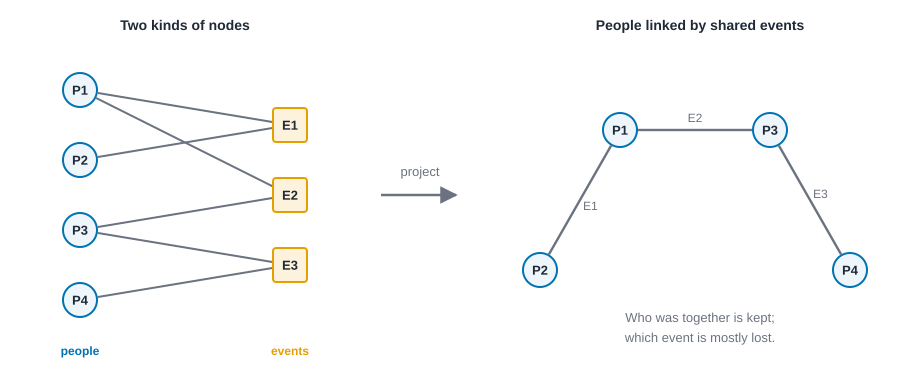
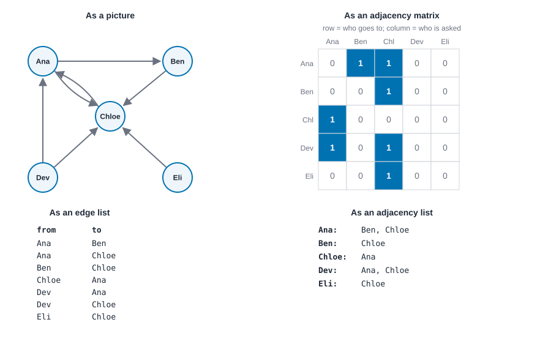
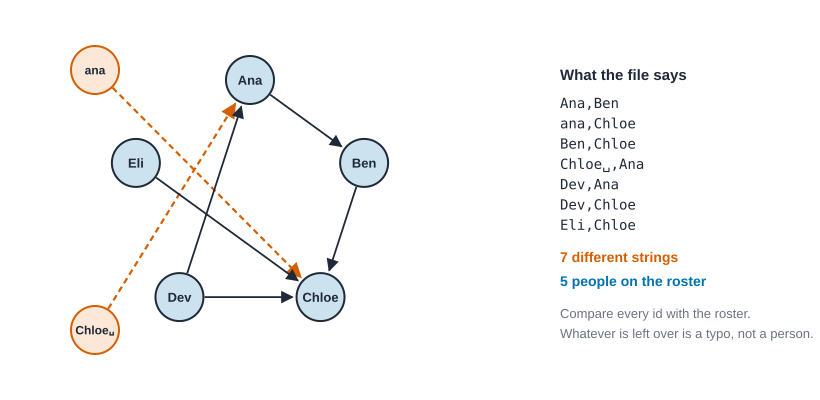
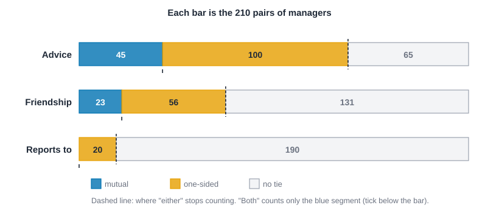
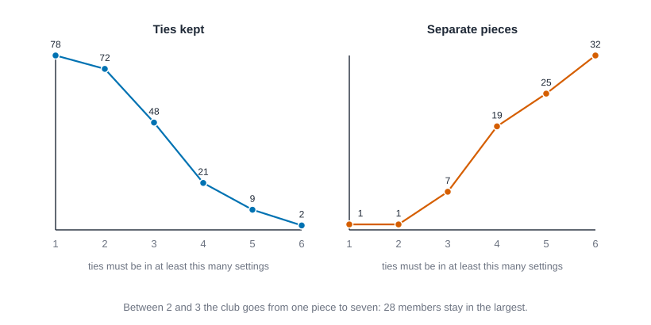
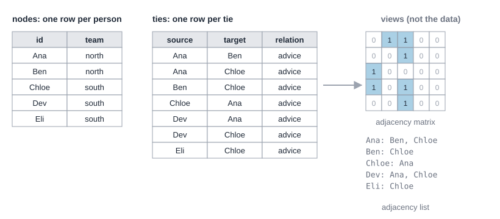
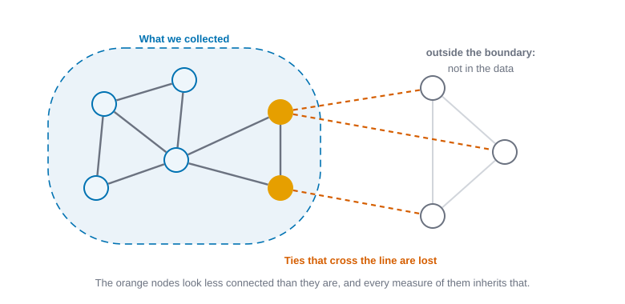
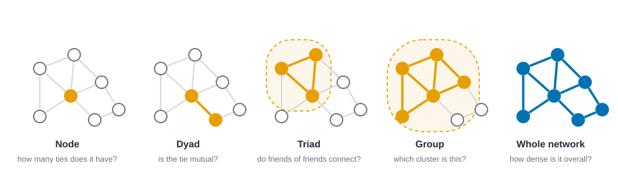

# Networks as data {#sec-networks-as-data}

::: {.callout-note appearance="simple"}
## Prerequisites
@sec-introduction. @sec-foundations will make the "why" behind several choices in this chapter clearer, but you can read this one first. We use the five-coworker advice network, Krackhardt's 21 managers [@krackhardt1987cognitive] and Zachary's karate club [@zachary1977information], all bundled with the book. Every number comes from the code in the chapter.
:::

## A network is a claim

When you turn a piece of social life into a network dataset, you make a series of decisions that sound technical and are actually theoretical. Who counts as a node? What counts as a tie? Where does the network stop? Each answer is a small claim about how the world works, and the measures you compute later inherit every one of them.

That's not a reason to worry. It's a reason to be deliberate. A good network dataset is one where you can say, in plain words, *what the nodes are, what the ties mean, and who got left out*, and where those answers fit the question you're asking.

This chapter is about making those choices well, and about the formats we use to write them down. It has a second job. Most of the mistakes in network analysis are not made in the statistics. They're made in the table: a name spelled two ways, a matrix read with its rows and columns swapped, a directed network treated as undirected, a count of emails read as a count of friends. These mistakes are cheap to prevent and expensive to find later, so we practice the preventions on data you can check by hand and then on real data.

The standard references treat network data at length: the opening chapters of @wasserman1994social set out the notation we use here, @borgatti2022analyzing and @hanneman2005introduction work through the same ideas with software, and @newman2018networks and @kolaczyk2009statistical give the mathematical and statistical view. We take what a working analyst needs first.

## What counts as a tie

Ties come in many flavors, and which flavor you pick decides which theory you're testing. One useful way to organize them splits relations into four broad types [@borgatti2009network]:

| Type | What it means | Examples |
| --- | --- | --- |
| Similarities | Two nodes share a location, a membership, or an attribute | Same neighborhood, same club, same employer |
| Social relations | A standing relationship of some kind | Kinship, friendship, liking, knowing, being someone's boss |
| Interactions | Something two nodes did together or to each other | Talked, emailed, advised, helped |
| Flows | Something moved between nodes | Information, money, goods, a disease |

Why bother with the distinction? Because the ideas from @sec-foundations assume different kinds of ties. Heider's balance rule needs *sentiment* ties (like and dislike), a kind of social relation. Granovetter's strong and weak ties mix time spent together (interaction) with emotional closeness (social relation). Anything about "information reaching someone" is about flows. If you measure the wrong kind of tie, you can compute every measure perfectly and still not be testing the idea you care about.

A practical test: finish this sentence. "There is a tie from A to B if ______." If you can't fill in the blank clearly, your readers won't be able to interpret the results either. The same table can carry quite different meanings depending on how you finish it, as the next table shows. The card `tie-definition` lists the questions to ask.

| The sentence | Type | Directed? | Valued? | A measure it supports | A measure it does not |
| --- | --- | --- | --- | --- | --- |
| "A names B as a friend" | Social relation | Yes | No | Reciprocity: who names back | Flow of anything |
| "A sent B at least one email" | Interaction | Yes | Can be (count) | Who talks to whom | Who likes whom |
| "A and B belong to the same club" | Similarity | No | No | Overlap of memberships | Anyone ever meeting |
| "A bought from B" | Flow | Yes | Yes (amount) | Paths of goods | Trust |

## Kinds of networks

Once you've decided what a tie is, you'll face a handful of design questions. Each one has a name, and each changes what you can measure.

**Directed or undirected.** Does the tie run from one node to another, or is it mutual by nature? "Asked advice from" is directed: Ana can seek Ben's advice without the reverse. "Works in the same office as" is undirected. Directed ties are sometimes called *arcs*. In a directed network, you need to be careful with everything that assumes symmetry, and you gain new questions such as reciprocity (do people return the tie?) and popularity (who receives many ties?).

**Binary or valued.** Is a tie either present or absent, or does it have a strength, count, frequency or amount? "Emailed at least once" is binary. "Number of emails sent" is valued. Valued data carries more information, but many classic measures were designed for binary data, so you'll often decide whether to keep the values or to apply a threshold. We try both below.

**Signed.** Are ties positive or negative, as in friendship versus antagonism? Signed ties are what Heider's balance rule needs (@sec-signed-and-valued).

**One-mode or two-mode.** In a one-mode network, ties connect nodes of one kind to each other (people to people). In a two-mode network, there are two different kinds of nodes and ties only run between the kinds, such as people and the events they attended, or authors and the papers they wrote. A classic example is the dataset gathered by Davis, Gardner and Gardner in their study of social class in a Southern U.S. town, which records which of 18 women attended which of 14 social events [@davis1941deep]. Ronald Breiger's idea of the duality of persons and groups shows how a two-mode network can be turned into two one-mode networks: one linking people who share events, the other linking events that share people [@breiger1974duality]. We'll come back to this in @sec-two-mode.

**Single-layer or multiplex.** Do you have one kind of tie, or several kinds among the same nodes (friends *and* coworkers *and* neighbors)? Several kinds at once makes a *multiplex* or *multilayer* network. White and colleagues' work on positions was built on exactly this: people are alike when their patterns across several kinds of relation line up [@white1976social]. See @sec-multilayer.

**Static or changing.** Is the network a snapshot, or do you have ties across time? We take this up in @sec-time and @sec-dynamics.

**Whole network or ego network.** Did you try to record ties among *everyone* in a defined group, or did you ask a sample of people (egos) about their own contacts? Whole-network data lets you study the overall structure. Ego-network data lets you study people's personal circles, typically when you can't survey an entire population [@marsden2002egocentric; @perry2018egocentric]. They answer different questions, and mixing them up is a common source of confusion.

{#fig-two-mode fig-alt="Left: people P1 to P4 each linked to events E1 to E3. Right: a chain of people P2, P1, P3, P4 where each neighboring pair is tied and the tie is labeled with the event they share."}

## Three ways to write a network down

Say we have a small advice network: five coworkers, and ties that mean "goes to for advice." Here it is as a directed network, in the three standard formats.

{#fig-three-formats fig-alt="A directed network of five people shown as a picture, with the same ties as a five by five matrix of ones and zeros, as a seven-row edge list, and as a list of who each person goes to."}

### 1. The edge list

One row per tie. It's compact, it's flexible, and it's what most real data files look like.

| from | to |
| --- | --- |
| Ana | Ben |
| Ana | Chloe |
| Ben | Chloe |
| Chloe | Ana |
| Dev | Ana |
| Dev | Chloe |
| Eli | Chloe |

Read the first row as "Ana goes to Ben for advice." Notice that Ana → Chloe and Chloe → Ana are two separate rows, because the network is directed.

An edge list can carry extra columns: a weight (how often?), a sign, a time stamp, or a tie type. That's one of its big strengths.

### 2. The adjacency matrix

A square table with one row and one column per node. The entry in row *i*, column *j* is 1 if there's a tie from *i* to *j*, and 0 otherwise. In symbols, the matrix is $A$ and its entries are

$$
A_{ij} = \begin{cases} 1 & \text{if there is a tie from } i \text{ to } j,\\ 0 & \text{otherwise.}\end{cases}
$$

For our network:

| | Ana | Ben | Chloe | Dev | Eli |
| --- | --- | --- | --- | --- | --- |
| **Ana** | 0 | 1 | 1 | 0 | 0 |
| **Ben** | 0 | 0 | 1 | 0 | 0 |
| **Chloe** | 1 | 0 | 0 | 0 | 0 |
| **Dev** | 1 | 0 | 1 | 0 | 0 |
| **Eli** | 0 | 0 | 1 | 0 | 0 |

A few things to notice. Rows are senders and columns are receivers. The diagonal is all zeros, because nobody goes to themselves for advice (a tie from a node to itself is called a *loop*, and some networks have them). If the network were undirected, the matrix would be symmetric: the entry for (Ana, Ben) would always equal the entry for (Ben, Ana). The sum of row $i$ is person $i$'s out-degree, $\sum_j A_{ij}$, and the sum of column $j$ is person $j$'s in-degree, $\sum_i A_{ij}$. The sum of the whole table is the number of ties. You can check all three on the table above: the rows sum to 2, 1, 1, 2, 1, the columns to 2, 1, 4, 0, 0, and the table to 7.

The matrix is the standard format for the mathematics of networks, and many classic textbooks work with it [@wasserman1994social]. Its downside is size. A network of a million people needs a million-by-million table, almost all of it zeros. That's why large networks are stored in more clever ways.

### 3. The adjacency list

For each node, a list of the nodes it points to:

- Ana: Ben, Chloe
- Ben: Chloe
- Chloe: Ana
- Dev: Ana, Chloe
- Eli: Chloe

This is the format that scales to big, sparse networks, because it only stores the ties that exist. Behind the scenes, many software packages store networks in something like this form even if you gave them a matrix.

**Which should you use?** For collecting and sharing data, edge lists are friendliest. For by-hand math and small examples, matrices are clearest. For software working on very large networks, adjacency lists (or cleverer relatives of them) win. They hold the same information, and a good tool lets you move between them freely. The first block of code does exactly that, and checks that nothing was lost on the way.

::: {.callout-tip appearance="simple"}
## How to read the code
The blocks in this chapter run top to bottom as one script per language, like cells in a notebook: later blocks reuse names defined earlier. The first block of each language loads the libraries, and the Rust blocks put their `use` lines where they are first needed. Data files are read from `data/`.
:::

::: {.panel-tabset group="language"}

## R

```r
library(knappnet)

people <- c("Ana", "Ben", "Chloe", "Dev", "Eli")
ties <- data.frame(
  source = c("Ana", "Ana", "Ben", "Chloe", "Dev", "Dev", "Eli"),
  target = c("Ben", "Chloe", "Chloe", "Ana", "Ana", "Chloe", "Chloe")
)
g <- net_frame(ties, nodes = data.frame(id = people), directed = TRUE)

# Edge list to adjacency matrix: row = sender, column = receiver.
m <- as.matrix(g)
dimnames(m) <- list(people, people)
m

# Matrix to adjacency list: for each row, the columns holding a 1.
lapply(setNames(people, people), \(p) people[m[p, ] == 1])

# Row sums are out-degrees, column sums are in-degrees; the whole table sums to the number of ties.
data.frame(goes_to = rowSums(m), comes_to_them = colSums(m))
sum(m)

# And back to an edge list.
at <- which(m == 1, arr.ind = TRUE)
at <- at[order(at[, 1], at[, 2]), ]
data.frame(source = people[at[, 1]], target = people[at[, 2]], row.names = NULL)
```

::: {.code-output}
```text
      Ana Ben Chloe Dev Eli
Ana     0   1     1   0   0
Ben     0   0     1   0   0
Chloe   1   0     0   0   0
Dev     1   0     1   0   0
Eli     0   0     1   0   0
# A tibble: 5 × 2
  person goes_to   
  <chr>  <chr>     
1 Ana    Ben, Chloe
2 Ben    Chloe     
3 Chloe  Ana       
4 Dev    Ana, Chloe
5 Eli    Chloe     
# A tibble: 5 × 3
  person goes_to comes_to_them
  <chr>    <dbl>         <dbl>
1 Ana          2             2
2 Ben          1             1
3 Chloe        1             4
4 Dev          2             0
5 Eli          1             0
[1] 7
# A tibble: 1 × 2
   rows same_as_the_table
  <int> <lgl>            
1     7 TRUE             
[1] TRUE
```
:::

## Python

```python
import numpy as np
import networkx as nx

names = ["Ana", "Ben", "Chloe", "Dev", "Eli"]
ties = [("Ana", "Ben"), ("Ana", "Chloe"), ("Ben", "Chloe"), ("Chloe", "Ana"),
        ("Dev", "Ana"), ("Dev", "Chloe"), ("Eli", "Chloe")]

# Edge list to adjacency matrix: row = sender, column = receiver.
place = {name: i for i, name in enumerate(names)}
m = np.zeros((5, 5), dtype=int)
for a, b in ties:
    m[place[a], place[b]] = 1
print(m)

# Matrix to adjacency list: for each row, the columns holding a 1.
for i, name in enumerate(names):
    print(f"{name:<6}{', '.join(names[j] for j in np.flatnonzero(m[i]))}")

# Row sums are out-degrees, column sums are in-degrees; the whole table sums to the number of ties.
print("goes to", m.sum(axis=1), " comes to them", m.sum(axis=0), " ties", m.sum())

# And back to an edge list.
back = [(names[i], names[j]) for i, j in zip(*np.nonzero(m))]
print("same seven rows:", back == ties)

# The library's own view of the same network.
g = nx.DiGraph(ties)
print("NetworkX matrix agrees:", bool((nx.to_numpy_array(g, nodelist=names) == m).all()))
```

::: {.code-output}
```text
[[0 1 1 0 0]
 [0 0 1 0 0]
 [1 0 0 0 0]
 [1 0 1 0 0]
 [0 0 1 0 0]]
Ana   Ben, Chloe
Ben   Chloe
Chloe Ana
Dev   Ana, Chloe
Eli   Chloe
goes to [2 1 1 2 1]  comes to them [2 1 4 0 0]  ties 7
same seven rows: True
NetworkX matrix agrees: True
```
:::

## Rust

```rust
use knappnet::{compute_degree, DegreeMode, Graph};

let names = ["Ana", "Ben", "Chloe", "Dev", "Eli"];
let ties = [("Ana", "Ben"), ("Ana", "Chloe"), ("Ben", "Chloe"), ("Chloe", "Ana"),
            ("Dev", "Ana"), ("Dev", "Chloe"), ("Eli", "Chloe")];

// Edge list to adjacency matrix: row = sender, column = receiver.
let place = |name: &str| names.iter().position(|&n| n == name).unwrap();
let mut m = [[0i32; 5]; 5];
for (a, b) in ties {
    m[place(a)][place(b)] = 1;
}
for row in &m {
    println!("{row:?}");
}

// Matrix to adjacency list: for each row, the columns holding a 1.
for (i, name) in names.iter().enumerate() {
    let goes: Vec<&str> = (0..5).filter(|&j| m[i][j] == 1).map(|j| names[j]).collect();
    println!("{name:<6}{}", goes.join(", "));
}

// Row sums are out-degrees, column sums are in-degrees; the whole table sums to the number of ties.
let out: Vec<i32> = m.iter().map(|row| row.iter().sum()).collect();
let inn: Vec<i32> = (0..5).map(|j| m.iter().map(|row| row[j]).sum()).collect();
println!("goes to {out:?}  comes to them {inn:?}  ties {}", out.iter().sum::<i32>());

// And back to an edge list.
let back: Vec<(&str, &str)> = (0..5)
    .flat_map(|i| (0..5).map(move |j| (i, j)))
    .filter(|&(i, j)| m[i][j] == 1)
    .map(|(i, j)| (names[i], names[j]))
    .collect();
println!("same seven rows: {}", back == ties);

// The library's own view of the same network.
let from: Vec<i64> = ties.iter().map(|&(a, _)| place(a) as i64).collect();
let to: Vec<i64> = ties.iter().map(|&(_, b)| place(b) as i64).collect();
let g = Graph::from_edges(5, &from, &to, None, true)?;
let lib_out = compute_degree(&g, DegreeMode::Out, true);
let lib_in = compute_degree(&g, DegreeMode::In, true);
println!("library degrees agree with the matrix: {}",
         (0..5).all(|i| lib_out[i] == out[i] as f64 && lib_in[i] == inn[i] as f64));
```

::: {.code-output}
```text
[0, 1, 1, 0, 0]
[0, 0, 1, 0, 0]
[1, 0, 0, 0, 0]
[1, 0, 1, 0, 0]
[0, 0, 1, 0, 0]
Ana   Ben, Chloe
Ben   Chloe
Chloe Ana
Dev   Ana, Chloe
Eli   Chloe
goes to [2, 1, 1, 2, 1]  comes to them [2, 1, 4, 0, 0]  ties 7
same seven rows: true
library degrees agree with the matrix: true
```
:::

:::

Three outputs agree: the matrix, the list and the round trip. When you build your own network from a file, run this kind of check at once: row sums against the out-degrees you expect, the total against the number of lines in the file. It takes a minute and catches transposed matrices and lost rows.

## Node ids: who is who

A tie says "this node to that node", so the computer must know which rows of the edge list name the same person. That's a surprisingly fragile step. The usual choices are names ("Ana"), numbers (21) and codes ("A-17"), and each has its own way of going wrong.

- **The same person spelled two ways.** "Chloe", "chloe" and "Chloe " (with a trailing space) are three different strings, so a program creates three people. This is the commonest source of *phantom nodes*: extra nodes with a handful of ties, which then add isolated pieces, shrink the density and distort every measure that divides by the number of nodes.
- **Two people with one name.** The opposite error merges them. Two employees called Alex become one person with twice the ties. If your data may contain this, use a code that is unique, and keep the names as an attribute.
- **Numbers that start at 1.** A survey codes respondents 1 to 21, but arrays in Rust and Python start at 0 (R starts at 1). If you use the id as a position without subtracting, everything shifts by one person, and the last person falls off the end. Keep a separate column or dictionary that maps an id to its position, and do not do arithmetic on ids.
- **Numbers that look like numbers.** A code such as 007 becomes 7 when a spreadsheet reads it as a number, and "1E5" becomes 100000. Read ids as text unless they really are counts.
- **People who are in the roster and in no tie.** They are isolates. If your file lists only ties, they vanish, and a count of nodes silently omits them. Keep the roster as its own table.

The second block shows three of these on a file that arrives with two small mistakes: one lower-case name and one trailing space. By hand: there should be five people. The file has seven different strings. @fig-id-phantoms shows what the computer builds from it.

::: {.panel-tabset group="language"}

## R

```r
# A file as it might really arrive: one lower-case name, one trailing space.
raw <- c("Ana,Ben", "ana,Chloe", "Ben,Chloe", "Chloe ,Ana", "Dev,Ana", "Dev,Chloe", "Eli,Chloe")
rows <- strsplit(raw, ",")
roster <- c("Ana", "Ben", "Chloe", "Dev", "Eli")
seen <- unique(unlist(rows))
c(names_seen = length(seen))
setdiff(seen, roster)   # the names that are not on the roster

# Trim the spaces and fix the capitals, then count again.
fix <- \(s) paste0(toupper(substring(trimws(s), 1, 1)), tolower(substring(trimws(s), 2)))
clean <- lapply(rows, fix)
seen <- unique(unlist(clean))
c(names_seen = length(seen), not_on_roster = length(setdiff(seen, roster)),
  repeated_rows = length(clean) - length(unique(sapply(clean, paste, collapse = ","))))

# Files that number people from 1 need care before they become positions from 0.
club <- read.csv("data/karate/edges.csv")
ids <- sort(unique(c(club$source, club$target)))
c(different = length(ids), first = min(ids), last = max(ids))

# Someone on the roster who is in no tie is an isolate; the tie file alone would never show them.
setdiff(c(roster, "Faye"), unlist(clean))
```

::: {.code-output}
```text
# A tibble: 1 × 2
  names_seen not_on_roster  
       <int> <chr>          
1          7 'Chloe ', 'ana'
# A tibble: 1 × 3
  names_seen not_on_roster repeated_rows
       <int>         <int>         <int>
1          5             0             0
# A tibble: 1 × 3
  different first  last
      <int> <int> <int>
1        34     1    34
[1] "Faye"
```
:::

## Python

```python
import csv
from collections import Counter

# A file as it might really arrive: one lower-case name, one trailing space.
raw = "Ana,Ben\nana,Chloe\nBen,Chloe\nChloe ,Ana\nDev,Ana\nDev,Chloe\nEli,Chloe"
rows = [line.split(",") for line in raw.split("\n")]
roster = {"Ana", "Ben", "Chloe", "Dev", "Eli"}

seen = {name for row in rows for name in row}
print("names seen:", len(seen), " not on the roster:", sorted(seen - roster))

clean = [[name.strip().title() for name in row] for row in rows]
seen = {name for row in clean for name in row}
print("after strip and title case:", len(seen), " not on the roster:", sorted(seen - roster),
      " repeated rows:", len(clean) - len({tuple(r) for r in clean}))

# Files that number people from 1 need care before they become positions from 0.
def read(path):
    with open(path) as f:
        return list(csv.DictReader(f))

club = read("data/karate/edges.csv")
ids = sorted({int(r[k]) for r in club for k in ("source", "target")})
print(f"karate ids: {len(ids)} different, from {ids[0]} to {ids[-1]}, so position = id - 1")

# Someone on the roster who is in no tie is an isolate; the tie file alone would never show them.
print("on the roster but in no tie:", sorted((roster | {"Faye"}) - {name for row in clean for name in row}))
```

::: {.code-output}
```text
names seen: 7  not on the roster: ['Chloe ', 'ana']
after strip and title case: 5  not on the roster: []  repeated rows: 0
karate ids: 34 different, from 1 to 34, so position = id - 1
on the roster but in no tie: ['Faye']
```
:::

## Rust

```rust
use std::collections::BTreeSet;

// A file as it might really arrive: one lower-case name, one trailing space.
let raw = "Ana,Ben\nana,Chloe\nBen,Chloe\nChloe ,Ana\nDev,Ana\nDev,Chloe\nEli,Chloe";
let rows: Vec<Vec<&str>> = raw.lines().map(|line| line.split(',').collect()).collect();
let roster: BTreeSet<&str> = ["Ana", "Ben", "Chloe", "Dev", "Eli"].into_iter().collect();

let seen: BTreeSet<&str> = rows.iter().flatten().copied().collect();
println!("names seen: {}  not on the roster: {:?}", seen.len(), seen.difference(&roster).collect::<Vec<_>>());

let title = |s: &str| -> String {
    let s = s.trim().to_lowercase();
    let mut chars = s.chars();
    chars.next().map(|c| c.to_uppercase().collect::<String>() + chars.as_str()).unwrap_or_default()
};
let clean: Vec<Vec<String>> = rows.iter().map(|r| r.iter().map(|s| title(s)).collect()).collect();
let seen: BTreeSet<String> = clean.iter().flatten().cloned().collect();
let distinct_rows: BTreeSet<&Vec<String>> = clean.iter().collect();
let off: Vec<&String> = seen.iter().filter(|s| !roster.contains(s.as_str())).collect();
println!("after strip and title case: {}  not on the roster: {:?}  repeated rows: {}",
         seen.len(), off, clean.len() - distinct_rows.len());

// Files that number people from 1 need care before they become positions from 0.
let read = |path: &str| -> Vec<Vec<String>> {
    std::fs::read_to_string(path).unwrap().lines().skip(1)
        .map(|line| line.split(',').map(String::from).collect()).collect()
};
let club = read("data/karate/edges.csv");
let ids: BTreeSet<usize> = club.iter().flat_map(|r| [r[0].parse().unwrap(), r[1].parse().unwrap()]).collect();
println!("karate ids: {} different, from {} to {}, so position = id - 1",
         ids.len(), ids.first().unwrap(), ids.last().unwrap());

// Someone on the roster who is in no tie is an isolate; the tie file alone would never show them.
let mut everyone = roster.clone();
everyone.insert("Faye");
println!("on the roster but in no tie: {:?}",
         everyone.iter().filter(|s| !seen.contains(**s)).collect::<Vec<_>>());
```

::: {.code-output}
```text
names seen: 7  not on the roster: ["Chloe ", "ana"]
after strip and title case: 5  not on the roster: []  repeated rows: 0
karate ids: 34 different, from 1 to 34, so position = id - 1
on the roster but in no tie: ["Faye"]
```
:::

:::

Seven strings become five, and the check ("not on the roster") names the culprits, `ana` and `Chloe ` with its trailing space. Notice what made the check possible: a roster kept apart from the ties. Without it, the typo would have been a perfectly good new person. Keep the roster, compare every id in the ties against it, and stop if anything is left over. The karate club's ids are the numbers 1 to 34 with none missing; the Rust and Python arrays that hold them start at 0, so member 1 lives in position 0.

{#fig-id-phantoms fig-alt="A drawing with five blue people, Ana, Ben, Chloe, Dev and Eli, around a ring, plus two orange nodes outside it, labeled ana and Chloe with a space mark. Two dashed red arrows run from the orange nodes: ana to Chloe and Chloe-space to Ana. To the right, the seven lines of the file and a note that there are seven different strings but five people on the roster."}

## Direction: directed, undirected, and the rules between them

Most real ties are directed, and most classic measures were written for undirected ones. Sooner or later you'll turn one into the other, so it pays to see what that does.

Start with the pair, the *dyad*. In a directed network every pair of people is in exactly one of three states: **mutual** (each names the other), **asymmetric** (one names the other, not the reverse) or **null** (neither). Call the three counts $M$, $A$ and $N$. Every pair is counted once, so

$$
M + A + N = \binom{n}{2} = \frac{n(n-1)}{2},
$$

and the number of ties (arcs) is $2M + A$, because each mutual pair contributes two ties and each asymmetric pair one. By hand on the five-person advice network: Ana and Chloe name each other, so $M = 1$. Five more pairs have one tie (Ana to Ben, Ben to Chloe, Dev to Ana, Dev to Chloe, Eli to Chloe), so $A = 5$. That leaves $10 - 1 - 5 = 4$ null pairs, and the arcs are $2 \cdot 1 + 5 = 7$, as they must be. The share of arcs that are returned is $2M/(2M + A) = 2/7$. @sec-paths-and-cohesion and @sec-triads-and-motifs take reciprocity and the dyad census further; here we only need the counts.

To make an undirected network from a directed one you must say what a tie between two people *is*. There are two natural rules.

- **Either.** A tie exists if *at least one* of the two names the other. This keeps every pair with $A$ or $M$: $M + A$ ties. It treats a one-sided report as evidence of a tie.
- **Both.** A tie exists only if *both* name each other. This keeps only the mutual pairs: $M$ ties. It treats a one-sided report as noise, or as a different relation (an admired colleague who doesn't name you back).

Neither rule is right in general. Either is natural when ties are *observed events* ("someone saw them together"): a single report is enough. Both is natural for *claims of a mutual bond* ("we are friends"): one person's claim is weaker than two. And because the two rules can differ a lot, the choice should be stated and its effect checked. The card `symmetrization-rules` lists the checks. @krackhardt1987cognitive built a whole study on the fact that people's reports about the same tie disagree.

Krackhardt's 21 managers give three relations among the same people: who goes to whom for advice, who names whom a friend, and who reports to whom in the company records. The third block counts the dyads of each relation, and what either and both give.

::: {.panel-tabset group="language"}

## R

```r
krack <- read.csv("data/krackhardt/edges.csv")

# One tie table with a relation column; one network per relation.
relations <- c("advice", "friendship", "reports_to")
nets <- lapply(setNames(relations, relations), \(relation) {
  rows <- krack[krack$relation == relation, ]
  net_frame(data.frame(source = rows$from, target = rows$to), nodes = data.frame(id = 1:21), directed = TRUE)
})
arcs <- sapply(nets, \(g) nrow(g$edges))

# Reciprocity: the share of arcs that are returned.
data.frame(arcs, returned = round(sapply(nets, net_reciprocity), 3))

# Keep a pair if either manager names the other ("max") or only if both do ("min").
# (The reporting line has no mutual pair, so "both" would leave an empty network.)
pair_rules <- lapply(nets[1:2], \(g) list(either = net_symmetrize(g, "max"), both = net_symmetrize(g, "min")))
data.frame(
  directed_arcs = arcs[1:2],
  either = sapply(pair_rules, \(r) nrow(r$either$edges)),
  both = sapply(pair_rules, \(r) nrow(r$both$edges))
)

# Mean degree under each rule: a decision in one line of code.
data.frame(
  directed = round(sapply(nets[1:2], net_avg_degree, mode = "out"), 2),
  either = round(sapply(pair_rules, \(r) net_avg_degree(r$either)), 2),
  both = round(sapply(pair_rules, \(r) net_avg_degree(r$both)), 2)
)
```

::: {.code-output}
```text
# A tibble: 3 × 8
  relation    arcs mutual  asym  null returned either  both
  <chr>      <dbl>  <dbl> <dbl> <dbl>    <dbl>  <dbl> <dbl>
1 advice       190     45   100    65    0.474    145    45
2 friendship   102     23    56   131    0.451     79    23
3 reports_to    20      0    20   190    0         20     0
# A tibble: 1 × 3
  directed either  both
     <dbl>  <dbl> <dbl>
1     9.05   13.8  4.29
```
:::

## Python

```python
def table(rows, n, relation):
    """Row i, column j is 1 when manager i names manager j. Files number people from 1."""
    m = np.zeros((n, n), dtype=int)
    for r in rows:
        if r["relation"] == relation:
            m[int(r["from"]) - 1, int(r["to"]) - 1] = 1
    return m

krack = read("data/krackhardt/edges.csv")
print(f"{'relation':<11}{'arcs':>5}{'mutual':>7}{'asym':>6}{'null':>6}{'returned':>9}{'either':>7}{'both':>6}")
for relation in ["advice", "friendship", "reports_to"]:
    a = table(krack, 21, relation)
    mutual = int((a * a.T).sum() // 2)
    asym = int(a.sum() - 2 * mutual)
    null = 21 * 20 // 2 - mutual - asym
    either = int(np.maximum(a, a.T).sum() // 2)
    print(f"{relation:<11}{a.sum():>5}{mutual:>7}{asym:>6}{null:>6}{2 * mutual / a.sum():>9.3f}{either:>7}{mutual:>6}")

advice = table(krack, 21, "advice")
either = np.maximum(advice, advice.T)
print(f"mean degree: directed {advice.sum() / 21:.2f}, either {either.sum() / 21:.2f}, "
      f"both {(advice * advice.T).sum() / 21:.2f}")
```

::: {.code-output}
```text
relation    arcs mutual  asym  null returned either  both
advice       190     45   100    65    0.474    145    45
friendship   102     23    56   131    0.451     79    23
reports_to    20      0    20   190    0.000     20     0
mean degree: directed 9.05, either 13.81, both 4.29
```
:::

## Rust

```rust
// Row i, column j is 1 when manager i names manager j. Files number people from 1.
let table = |rows: &[Vec<String>], n: usize, relation: &str| -> Vec<Vec<i32>> {
    let mut m = vec![vec![0; n]; n];
    for r in rows.iter().filter(|r| r[2] == relation) {
        m[r[0].parse::<usize>().unwrap() - 1][r[1].parse::<usize>().unwrap() - 1] = 1;
    }
    m
};
let krack = read("data/krackhardt/edges.csv");
println!("{:<11}{:>5}{:>7}{:>6}{:>6}{:>9}{:>7}{:>6}", "relation", "arcs", "mutual", "asym", "null", "returned", "either", "both");
for relation in ["advice", "friendship", "reports_to"] {
    let a = table(&krack, 21, relation);
    let arcs: i32 = a.iter().flatten().sum();
    let mutual = (0..21).flat_map(|i| (i + 1..21).map(move |j| (i, j))).filter(|&(i, j)| a[i][j] == 1 && a[j][i] == 1).count() as i32;
    let asym = arcs - 2 * mutual;
    let null = 21 * 20 / 2 - mutual - asym;
    println!("{relation:<11}{arcs:>5}{mutual:>7}{asym:>6}{null:>6}{:>9.3}{:>7}{mutual:>6}",
             2.0 * mutual as f64 / arcs as f64, mutual + asym);
}

let advice = table(&krack, 21, "advice");
let arcs: i32 = advice.iter().flatten().sum();
let mutual: i32 = (0..21).flat_map(|i| (0..21).map(move |j| (i, j))).filter(|&(i, j)| advice[i][j] == 1 && advice[j][i] == 1).count() as i32;
let either = (0..21).flat_map(|i| (0..21).map(move |j| (i, j))).filter(|&(i, j)| advice[i][j] == 1 || advice[j][i] == 1).count();
println!("mean degree: directed {:.2}, either {:.2}, both {:.2}", arcs as f64 / 21.0, either as f64 / 21.0, mutual as f64 / 21.0);
```

::: {.code-output}
```text
relation    arcs mutual  asym  null returned either  both
advice       190     45   100    65    0.474    145    45
friendship   102     23    56   131    0.451     79    23
reports_to    20      0    20   190    0.000     20     0
mean degree: directed 9.05, either 13.81, both 4.29
```
:::

:::

Read the rows. In the advice network 190 arcs are spread over 45 mutual and 100 one-sided pairs, with 65 pairs naming nobody. Under *either* there are $45 + 100 = 145$ undirected ties; under *both* only 45. The same people, the same survey, and the network has either 145 ties or 45, with mean degree 13.81 or 4.29, depending on a decision in one line of code. Friendship behaves alike: 79 pairs under either, 23 under both. The reporting line is the extreme: 20 arcs, none mutual, so *both* leaves an empty network. A rule that is sensible for friendship is nonsense for a chain of command.

{#fig-dyads-krackhardt fig-alt="Three horizontal bars, one each for advice, friendship and reporting, each split into mutual, one-sided and no-tie pairs out of 210. Advice: 45 mutual, 100 one-sided, 65 none. Friendship: 23, 56, 131. Reporting: 0, 20, 190."}

::: {.callout-warning appearance="simple"}
## Directed tools, undirected defaults
Tools differ in their default. The R package reads an edge list as directed unless told otherwise, NetworkX makes you choose between `Graph` and `DiGraph`, and a plain CSV or an adjacency matrix file does not say which it is. If the number of ties comes out nearly half of what you expected, check the direction first. A symmetric matrix read as directed gives double the arcs; a directed list read as undirected quietly merges Ana to Chloe with Chloe to Ana.
:::

## Two checks on the managers

Before we read anything into those numbers, two checks. Both are the kind you can run on any directed network.

**Is "47 percent returned" a lot?** It sounds like a lot, but a dense network returns many ties by accident. Place $m$ arcs at random among the $N = n(n-1)$ possible ordered pairs. An ordered pair holds an arc with probability $m/N$, and given that it does, the reverse pair holds one with probability $(m-1)/(N-1)$. A pair of people is mutual when both of its arcs are present, so the expected number of mutual pairs under pure chance is

$$
\mathbb{E}[M] = \binom{n}{2}\,\frac{m(m-1)}{N(N-1)}.
$$

By hand for friendship: $n = 21$, $N = 420$, $m = 102$, so $\mathbb{E}[M] = 210 \cdot \tfrac{102 \cdot 101}{420 \cdot 419} = 210 \times 0.0585 \approx 12.3$. We observed 23. @sec-tests-and-null-models does this with simulated networks and explains the conditioning choices; the formula is the shortcut for this one question.

**Does the ranking of people survive the rule?** Rank the managers by their degree under *either* and again under *both*, and ask how well the two rankings agree. The agreement is Spearman's rank correlation $\rho$: 1 means the same order, 0 means unrelated orders.

::: {.panel-tabset group="language"}

## R

```r
# With m arcs placed at random among the N = n(n - 1) ordered pairs, a pair is mutual with probability m(m - 1) / (N(N - 1)).
mutual <- sapply(pair_rules, \(r) nrow(r$both$edges))
expected <- 210 * arcs[1:2] * (arcs[1:2] - 1) / (420 * 419)
data.frame(mutual, expected = round(expected, 2), ratio = round(mutual / expected, 2))

# Does the ranking of managers survive the choice of rule? Rank correlation of degree under either and under both.
round(sapply(pair_rules, \(r) cor(net_degree(r$either), net_degree(r$both), method = "spearman")), 3)
```

::: {.code-output}
```text
# A tibble: 2 × 4
  relation   mutual expected ratio
  <chr>       <dbl>    <dbl> <dbl>
1 advice         45     42.8  1.05
2 friendship     23     12.3  1.87
# A tibble: 2 × 2
  relation     rho
  <chr>      <dbl>
1 advice     0.298
2 friendship 0.735
```
:::

## Python

```python
def ranks(x):
    # 1 for the smallest; tied values share the average of their ranks
    x = np.asarray(x)
    return np.array([(x < v).sum() + ((x == v).sum() + 1) / 2 for v in x])

def spearman(x, y):
    return np.corrcoef(ranks(x), ranks(y))[0, 1]

# With m arcs placed at random among the N = n(n - 1) ordered pairs, a pair is mutual with probability m(m - 1) / (N(N - 1)).
N = 21 * 20
for relation in ["advice", "friendship"]:
    a = table(krack, 21, relation)
    m, mutual = int(a.sum()), int((a * a.T).sum() // 2)
    expected = 210 * m * (m - 1) / (N * (N - 1))
    print(f"{relation:<11} mutual {mutual:>3}  expected by chance {expected:5.2f}  ratio {mutual / expected:.2f}")

# Does the ranking of managers survive the choice of rule? Rank correlation of degree under either and under both.
for relation in ["advice", "friendship"]:
    a = table(krack, 21, relation)
    print(f"{relation:<11} rank correlation of degree, either vs both: {spearman(np.maximum(a, a.T).sum(1), (a * a.T).sum(1)):.3f}")
```

::: {.code-output}
```text
advice      mutual  45  expected by chance 42.85  ratio 1.05
friendship  mutual  23  expected by chance 12.29  ratio 1.87
advice      rank correlation of degree, either vs both: 0.298
friendship  rank correlation of degree, either vs both: 0.735
```
:::

## Rust

```rust
// Average ranks (tied values share the mean of their ranks) and the rank correlation.
let ranks = |x: &[f64]| -> Vec<f64> {
    x.iter().map(|&v| x.iter().filter(|&&u| u < v).count() as f64
        + (x.iter().filter(|&&u| u == v).count() as f64 + 1.0) / 2.0).collect()
};
let spearman = |x: &[f64], y: &[f64]| -> f64 {
    let (rx, ry) = (ranks(x), ranks(y));
    let (mx, my) = (rx.iter().sum::<f64>() / rx.len() as f64, ry.iter().sum::<f64>() / ry.len() as f64);
    let cov: f64 = rx.iter().zip(&ry).map(|(a, b)| (a - mx) * (b - my)).sum();
    cov / (rx.iter().map(|a| (a - mx).powi(2)).sum::<f64>() * ry.iter().map(|b| (b - my).powi(2)).sum::<f64>()).sqrt()
};

// With m arcs placed at random among the N = n(n - 1) ordered pairs, a pair is mutual with probability m(m - 1) / (N(N - 1)).
let both_ways = |a: &Vec<Vec<i32>>, i: usize, j: usize| a[i][j] == 1 && a[j][i] == 1;
for relation in ["advice", "friendship"] {
    let a = table(&krack, 21, relation);
    let m = a.iter().flatten().sum::<i32>() as f64;
    let mutual = (0..21).flat_map(|i| (i + 1..21).map(move |j| (i, j))).filter(|&(i, j)| both_ways(&a, i, j)).count() as f64;
    let expected = 210.0 * m * (m - 1.0) / (420.0 * 419.0);
    println!("{relation:<11} mutual {mutual:>3}  expected by chance {expected:5.2}  ratio {:.2}", mutual / expected);
}

// Does the ranking of managers survive the choice of rule? Rank correlation of degree under either and under both.
for relation in ["advice", "friendship"] {
    let a = table(&krack, 21, relation);
    let either: Vec<f64> = (0..21).map(|i| (0..21).filter(|&j| a[i][j] == 1 || a[j][i] == 1).count() as f64).collect();
    let both: Vec<f64> = (0..21).map(|i| (0..21).filter(|&j| both_ways(&a, i, j)).count() as f64).collect();
    println!("{relation:<11} rank correlation of degree, either vs both: {:.3}", spearman(&either, &both));
}
```

::: {.code-output}
```text
advice      mutual  45  expected by chance 42.85  ratio 1.05
friendship  mutual  23  expected by chance 12.29  ratio 1.87
advice      rank correlation of degree, either vs both: 0.298
friendship  rank correlation of degree, either vs both: 0.735
```
:::

:::

Advice looks reciprocal and isn't, by this yardstick: 45 mutual pairs against 42.85 expected from the density alone, a ratio of 1.05. Friendship does return more than density predicts: 23 against 12.29, a ratio of 1.87. Two relations with almost the same returned share (0.474 and 0.451) tell very different stories once each is set beside what its own density would give. The ranking check is even starker. For advice, the order of managers by degree under *either* and under *both* has a rank correlation of only 0.298, so who counts as a well-connected manager depends heavily on the rule; for friendship the two orders agree much better (0.735). A statement such as "manager 15 is the best connected" should therefore carry its rule: it's a statement about the either-network.

## Weights, repeated ties and loops

Real data rarely arrive as clean 0s and 1s. Three things happen, and each needs a rule.

**Repeated ties.** An email log has one row per message, so the same pair appears many times. A network in which one pair can be tied several times is a *multigraph*, and the ties are *parallel edges*. Most measures assume at most one tie per pair, so you must either keep the repeats as the **weight** of a single tie (the number of messages) or collapse to "at least one message" (a binary tie). Which one you pick is a claim about what matters: volume, or existence.

**Loops.** A row from a person to themselves (an email sent to oneself, a citation of one's own work) is a *loop*. Loops are real in some data and noise in other data, and tools disagree about them. In an undirected network the usual graph-theory convention counts a loop twice in the degree, because both ends of the tie sit on the same node; some tools count it once. And a loop makes the person their own neighbor.

**Values.** A weight can be a *strength* (more is a closer tie: messages, hours together) or a *distance* (more is farther: kilometers, travel time). Path-based measures such as betweenness treat weights as distances. If you give them strengths, "the strongest tie" becomes "the longest route", and the numbers are silently wrong. Always say which you mean.

A tiny log shows all three. By hand: nine messages, one of them Chloe writing to herself. Ana wrote to Ben three times, so the nine rows collapse to six distinct directed pairs. In the log Ana sent four messages, so her out-strength should be 4.

For valued data in the wild we use Zachary's karate club [@zachary1977information]. Its ties are valued: each tie counts the number of settings (up to eight) in which two members interacted. The question is what the network looks like if we keep only ties of at least $k$ settings, a *threshold*. The fourth block builds both.

::: {.panel-tabset group="language"}

## R

```r
# An email log has one row per message, so the same pair can appear many times.
emails <- data.frame(
  source = c("Ana", "Ana", "Ben", "Ana", "Ben", "Chloe", "Dev", "Ana", "Dev"),
  target = c("Ben", "Ben", "Ana", "Chloe", "Chloe", "Chloe", "Chloe", "Ben", "Chloe")
)
g <- net_frame(emails, directed = TRUE)
data.frame(messages = nrow(emails), is_simple = net_is_simple(g), to_oneself = sum(emails$source == emails$target))

# Collapsing parallel ties into one tie with a count keeps the information in a weight.
w <- net_simplify(g, combine = "count")
w$edges
data.frame(out_strength = net_strength(w, mode = "out"), in_degree = net_degree(w, mode = "in"), row.names = w$nodes$id)

# A loop is one tie, but counts twice toward the degree in an undirected network.
u <- net_symmetrize(w)
data.frame(degree = net_degree(u), degree_without_loop = net_degree(u, loops = FALSE), row.names = u$nodes$id)

# Karate: ties valued by the number of settings (of 8) in which two members interacted.
club <- read.csv("data/karate/edges.csv")
karate <- net_frame(club, nodes = data.frame(id = 1:34), directed = FALSE, weight = "contexts", weight_type = "strength")
cutoffs <- 1:6
kept <- lapply(cutoffs, \(k) net_dichotomize(karate, k, ">="))
data.frame(
  at_least = cutoffs,
  ties = sapply(kept, \(h) nrow(h$edges)),
  density = round(sapply(kept, net_density), 3),
  pieces = sapply(kept, \(h) net_components(h)$no),
  largest = sapply(kept, \(h) max(net_components(h)$csize))
)
```

::: {.code-output}
```text
# A tibble: 1 × 3
  messages is_simple to_oneself
     <int> <lgl>          <int>
1        9 FALSE              1
# A tibble: 6 × 3
  source target count
  <chr>  <chr>  <dbl>
1 Ana    Ben        3
2 Ben    Ana        1
3 Ana    Chloe      1
4 Ben    Chloe      1
5 Chloe  Chloe      1
6 Dev    Chloe      2
# A tibble: 4 × 3
  person out_strength in_degree
  <chr>         <dbl>     <dbl>
1 Ana               4         1
2 Ben               2         1
3 Chloe             1         4
4 Dev               2         0
# A tibble: 4 × 3
  person degree degree_without_loop
  <chr>   <dbl>               <dbl>
1 Ana         2                   2
2 Ben         2                   2
3 Chloe       5                   3
4 Dev         1                   1
# A tibble: 6 × 5
  at_least  ties density pieces largest
     <int> <int>   <dbl>  <int>   <int>
1        1    78   0.139      1      34
2        2    72   0.128      1      34
3        3    48   0.086      7      28
4        4    21   0.037     19      15
5        5     9   0.016     25       5
6        6     2   0.004     32       2
```
:::

## Python

```python
import networkx as nx

# An email log is a multigraph: one row per message, so the same pair can appear many times.
log = [("Ana", "Ben"), ("Ana", "Ben"), ("Ben", "Ana"), ("Ana", "Chloe"), ("Ben", "Chloe"),
       ("Chloe", "Chloe"), ("Dev", "Chloe"), ("Ana", "Ben"), ("Dev", "Chloe")]
weights = Counter(log)
print("messages:", len(log), " distinct directed pairs:", len(weights),
      " messages sent to oneself:", sum(a == b for a, b in log))
for (a, b), w in weights.items():
    print(f"  {a} -> {b}: {w}")

# Collapsing parallel ties into one tie with a count keeps the information in a weight.
g = nx.DiGraph()
g.add_weighted_edges_from((a, b, w) for (a, b), w in weights.items())
print("out-strength:", dict(g.out_degree(weight="weight")))
print("in-degree (distinct senders, loop counted once):", dict(g.in_degree()))

# A loop is one tie, but counts twice toward the degree in an undirected network.
u = nx.Graph([(a, b) for a, b in weights])
print("undirected degree:", dict(u.degree()))

# Karate: ties valued by the number of settings (of 8) in which two members interacted.
contexts = [(int(r["source"]), int(r["target"]), int(r["contexts"])) for r in club]
print(f"{'at least':>8}{'ties':>6}{'density':>9}{'pieces':>8}{'largest':>9}")
for k in range(1, 7):
    h = nx.Graph()
    h.add_nodes_from(range(1, 35))
    h.add_edges_from((a, b) for a, b, w in contexts if w >= k)
    pieces = list(nx.connected_components(h))
    print(f"{k:>8}{h.number_of_edges():>6}{nx.density(h):>9.3f}{len(pieces):>8}{max(map(len, pieces)):>9}")
```

::: {.code-output}
```text
messages: 9  distinct directed pairs: 6  messages sent to oneself: 1
  Ana -> Ben: 3
  Ben -> Ana: 1
  Ana -> Chloe: 1
  Ben -> Chloe: 1
  Chloe -> Chloe: 1
  Dev -> Chloe: 2
out-strength: {'Ana': 4, 'Ben': 2, 'Chloe': 1, 'Dev': 2}
in-degree (distinct senders, loop counted once): {'Ana': 1, 'Ben': 1, 'Chloe': 4, 'Dev': 0}
undirected degree: {'Ana': 2, 'Ben': 2, 'Chloe': 5, 'Dev': 1}
at least  ties  density  pieces  largest
       1    78    0.139       1       34
       2    72    0.128       1       34
       3    48    0.086       7       28
       4    21    0.037      19       15
       5     9    0.016      25        5
       6     2    0.004      32        2
```
:::

## Rust

```rust
use knappnet::metrics::topography::{compute_density, find_components, ComponentKind};
use knappnet::compute_strength;

// An email log is a multigraph: one row per message, so the same pair can appear many times.
let log = [("Ana", "Ben"), ("Ana", "Ben"), ("Ben", "Ana"), ("Ana", "Chloe"), ("Ben", "Chloe"),
           ("Chloe", "Chloe"), ("Dev", "Chloe"), ("Ana", "Ben"), ("Dev", "Chloe")];
let mut weights: Vec<((&str, &str), u32)> = Vec::new();
for pair in log {
    match weights.iter_mut().find(|(p, _)| *p == pair) {
        Some(entry) => entry.1 += 1,
        None => weights.push((pair, 1)),
    }
}
println!("messages: {}  distinct directed pairs: {}  messages sent to oneself: {}",
         log.len(), weights.len(), log.iter().filter(|(a, b)| a == b).count());
for ((a, b), w) in &weights {
    println!("  {a} -> {b}: {w}");
}

// Collapsing parallel ties into one tie with a count keeps the information in a weight.
let people = ["Ana", "Ben", "Chloe", "Dev"];
let at = |name: &str| people.iter().position(|&n| n == name).unwrap() as i64;
let from: Vec<i64> = weights.iter().map(|((a, _), _)| at(a)).collect();
let to: Vec<i64> = weights.iter().map(|((_, b), _)| at(b)).collect();
let w: Vec<f64> = weights.iter().map(|(_, w)| *w as f64).collect();
let g = Graph::from_edges(4, &from, &to, Some(&w), true)?;
println!("out-strength: {:?}", compute_strength(&g, DegreeMode::Out, true)?);
println!("in-degree (distinct senders, loop counted once): {:?}", compute_degree(&g, DegreeMode::In, true));

// A loop is one tie, but counts twice toward the degree in an undirected network.
let pairs: BTreeSet<(i64, i64)> = from.iter().zip(&to).map(|(&a, &b)| (a.min(b), a.max(b))).collect();
let (ua, ub): (Vec<i64>, Vec<i64>) = pairs.into_iter().unzip();
let u = Graph::from_edges(4, &ua, &ub, None, false)?;
println!("undirected degree with the loop {:?}, without {:?}",
         compute_degree(&u, DegreeMode::All, true), compute_degree(&u, DegreeMode::All, false));

// Karate: ties valued by the number of settings (of 8) in which two members interacted.
println!("{:>8}{:>6}{:>9}{:>8}{:>9}", "at least", "ties", "density", "pieces", "largest");
for k in 1..=6 {
    let kept: Vec<&Vec<String>> = club.iter().filter(|r| r[2].parse::<i32>().unwrap() >= k).collect();
    let a: Vec<i64> = kept.iter().map(|r| r[0].parse::<i64>().unwrap() - 1).collect();
    let b: Vec<i64> = kept.iter().map(|r| r[1].parse::<i64>().unwrap() - 1).collect();
    let h = Graph::from_edges(34, &a, &b, None, false)?;
    let pieces = find_components(&h, ComponentKind::Weak);
    println!("{k:>8}{:>6}{:>9.3}{:>8}{:>9}", h.edge_count(), compute_density(&h, false),
             pieces.count(), pieces.sizes.iter().max().unwrap());
}
```

::: {.code-output}
```text
messages: 9  distinct directed pairs: 6  messages sent to oneself: 1
  Ana -> Ben: 3
  Ben -> Ana: 1
  Ana -> Chloe: 1
  Ben -> Chloe: 1
  Chloe -> Chloe: 1
  Dev -> Chloe: 2
out-strength: [4.0, 2.0, 1.0, 2.0]
in-degree (distinct senders, loop counted once): [1.0, 1.0, 4.0, 0.0]
undirected degree with the loop [2.0, 2.0, 5.0, 1.0], without [2.0, 2.0, 3.0, 1.0]
at least  ties  density  pieces  largest
       1    78    0.139       1       34
       2    72    0.128       1       34
       3    48    0.086       7       28
       4    21    0.037      19       15
       5     9    0.016      25        5
       6     2    0.004      32        2
```
:::

:::

By hand the log gave six pairs and Ana's strength 4, and the code agrees (Ana to Ben three times plus Ana to Chloe once). Two numbers show why conventions matter. Chloe's in-degree is 4 in the directed network: Ana, Ben and Dev, plus the loop from herself. And in the undirected collapse her degree is 5 in the convention where a loop counts twice, and 3 when the loop is ignored. Neither is a mistake. They answer different questions: "how many ties end at Chloe?" and "how many *other* people does Chloe have?" Because the second is usually what a reader means by degree, drop loops unless you have a reason to keep them, and say that you did.

The karate table shows what thresholding does. At "at least 1" we have the whole club: 78 ties, one piece. Raise the bar to 2 and 6 ties vanish but the club is still one piece. Raise it to 3 and the club falls into 7 pieces with 28 members in the largest; at 4 into 19 pieces, with the largest piece only 15 people. So a binary network built at "at least 3" settings is a different network from one built at "at least 2", and almost any measure of connectivity would differ. @fig-karate-thresholds-data shows the whole curve. The honest practice is to report the threshold, show the result at one or two neighboring thresholds, and prefer a method that uses the values (@sec-signed-and-valued) when the values carry meaning. The card `dichotomization` lists the checks.

{#fig-karate-thresholds-data fig-alt="Two line charts with the threshold, from 1 to 6 shared settings, across the bottom. The first shows ties kept, falling from 78 to 72, 48, 21, 9 and 2. The second shows separate pieces: 1, 1, 7, 19, 25 and 32, with the steepest rise between thresholds 2 and 3."}

## Attributes: the table beside the network

Ties describe relationships, but you usually also know things about the *nodes*: age, role, department, group membership. These go in a separate **attribute table**, with one row per node:

| name | role | team | years |
| --- | --- | --- | --- |
| Ana | manager | north | 7 |
| Ben | analyst | north | 2 |
| Chloe | senior analyst | south | 5 |
| Dev | analyst | south | 1 |
| Eli | intern | south | 0 |

Keeping the attribute table separate from the tie list, joined by a node name or ID, is a good habit. It avoids repeating each person's details on every row of the edge list, and it lets you add new attributes without touching the ties. The same idea extends to attributes of *ties* (a weight, a type, a date), which belong in extra columns on the edge list.

Attributes are what let you ask the questions from @sec-foundations about homophily and about structure versus individual characteristics. "Do people from the same team go to each other for advice more than chance would predict?" needs both the ties and the team column. @sec-homophily makes that comparison properly; here we only prepare the data for it.

A join is where attribute tables go wrong. Each node must have exactly one row. If a person has two rows the join duplicates their ties; if a person has none their attributes are missing, and a model may drop them without a word. So check the join before you use it: the number of rows equals the number of nodes, the ids are unique, and every id in the ties is in the table.

Krackhardt's managers come with an attribute table: age, years with the firm, level in the hierarchy (1 is the chief executive, 2 a vice president, 3 everyone else) and department. The fifth block joins it to the advice network and asks how many advice ties each level receives and sends. Then it deletes one row to show what a bad join looks like.

::: {.panel-tabset group="language"}

## R

```r
managers <- read.csv("data/krackhardt/nodes.csv")
advice <- nets$advice
managers$asked <- net_degree(advice, mode = "in")[managers$name]
managers$asks <- net_degree(advice, mode = "out")[managers$name]

# Join checks: one row per manager, and every manager in a tie is in the table.
c(rows = nrow(managers), different_names = length(unique(managers$name)),
  in_ties_not_in_table = length(setdiff(c(krack$from, krack$to), managers$name)))

# Average in the table, by level and by department.
by_level <- aggregate(cbind(asked, asks) ~ level, data = managers, FUN = mean)
by_level$managers <- as.vector(table(managers$level))
by_level[c("asked", "asks")] <- round(by_level[c("asked", "asks")], 2)
by_level
by_department <- aggregate(cbind(asked, asks) ~ department, data = managers, FUN = mean)
by_department$managers <- as.vector(table(managers$department))
by_department[c("asked", "asks")] <- round(by_department[c("asked", "asks")], 2)
by_department

# What a missing row looks like once joined: manager 7 vanishes from the table, the ties stay.
short <- managers[managers$name != 7, ]
tie_rows <- krack[krack$relation == "advice", ]
c(name_someone_missing = sum(!tie_rows$from %in% short$name | !tie_rows$to %in% short$name), of = nrow(tie_rows))

# The package refuses to build a network from ties that name someone who is not in the node table.
advice_edges <- data.frame(source = tie_rows$from, target = tie_rows$to)
tryCatch(net_frame(advice_edges, nodes = data.frame(id = short$name), directed = TRUE), error = \(e) conditionMessage(e))
```

::: {.code-output}
```text
# A tibble: 1 × 3
   rows different_names in_ties_not_in_table
  <int>           <int>                <int>
1    21              21                    0
# A tibble: 3 × 4
  level managers asked  asks
  <int>    <int> <dbl> <dbl>
1     1        1 13     8   
2     2        4 14.5   8.75
3     3       16  7.44  9.19
# A tibble: 5 × 4
  department managers asked  asks
       <int>    <int> <dbl> <dbl>
1          0        1  13    8   
2          1        5  10.2  5.4 
3          2        8   5.5 12   
4          3        3  11.7 11.3 
5          4        4  11.8  6.25
  name_someone_missing  of
1                   21 190
[1] "net_frame(): edge endpoints (columns `source` and `target` of `edges`) must be identifiers in column `id` of `nodes`; add the missing nodes, or declare add_nodes to take them from the edges; rows 8, 14, 40, 53, 54, and 16 more of `edges` (not in `nodes`: 7; add them to `nodes`, or set `add_nodes = TRUE`)."
```
:::

## Python

```python
import pandas as pd

managers = pd.read_csv("data/krackhardt/nodes.csv")
advice_in = table(krack, 21, "advice").sum(axis=0)
advice_out = table(krack, 21, "advice").sum(axis=1)
managers["asked"] = advice_in[managers["name"] - 1]
managers["asks"] = advice_out[managers["name"] - 1]

# Join checks: one row per manager, and every manager in a tie is in the table.
in_ties = {int(r[k]) for r in krack for k in ("from", "to")}
print("rows:", len(managers), " different names:", managers["name"].nunique(),
      " in ties but not in the table:", len(in_ties - set(managers["name"])))

print(managers.groupby("level").agg(managers=("name", "count"), asked=("asked", "mean"), asks=("asks", "mean")).round(2))
print(managers.groupby("department").agg(managers=("name", "count"), asked=("asked", "mean"), asks=("asks", "mean")).round(2))

# What a missing row looks like once joined: manager 7 vanishes from the table, the ties stay.
short = managers[managers["name"] != 7]
print("ties that name someone missing from the table:",
      sum(int(r["from"]) not in set(short["name"]) or int(r["to"]) not in set(short["name"]) for r in krack
          if r["relation"] == "advice"), "of 190")
```

::: {.code-output}
```text
rows: 21  different names: 21  in ties but not in the table: 0
       managers  asked  asks
level                       
1             1  13.00  8.00
2             4  14.50  8.75
3            16   7.44  9.19
            managers  asked   asks
department                        
0                  1  13.00   8.00
1                  5  10.20   5.40
2                  8   5.50  12.00
3                  3  11.67  11.33
4                  4  11.75   6.25
ties that name someone missing from the table: 21 of 190
```
:::

## Rust

```rust
use std::collections::BTreeMap;

// name,age,tenure,level,department: one row per manager.
let managers = read("data/krackhardt/nodes.csv");
let advice = table(&krack, 21, "advice");
let asked = |name: usize| (0..21).map(|i| advice[i][name - 1]).sum::<i32>() as f64;
let asks = |name: usize| advice[name - 1].iter().sum::<i32>() as f64;

// Join checks: one row per manager, and every manager in a tie is in the table.
let listed: BTreeSet<usize> = managers.iter().map(|r| r[0].parse().unwrap()).collect();
let in_ties: BTreeSet<usize> = krack.iter().flat_map(|r| [r[0].parse().unwrap(), r[1].parse().unwrap()]).collect();
println!("rows: {}  different names: {}  in ties but not in the table: {}",
         managers.len(), listed.len(), in_ties.difference(&listed).count());

// Mean advice received and given by level and by department.
for (label, column) in [("level", 3), ("department", 4)] {
    let mut groups: BTreeMap<usize, Vec<usize>> = BTreeMap::new();
    for r in &managers {
        groups.entry(r[column].parse().unwrap()).or_default().push(r[0].parse().unwrap());
    }
    println!("{label:<11}{:>9}{:>7}{:>6}", "managers", "asked", "asks");
    for (key, members) in &groups {
        let mean = |f: &dyn Fn(usize) -> f64| members.iter().map(|&n| f(n)).sum::<f64>() / members.len() as f64;
        println!("{key:<11}{:>9}{:>7.2}{:>6.2}", members.len(), mean(&asked), mean(&asks));
    }
}

// What a missing row looks like once joined: manager 7 vanishes from the table, the ties stay.
let mut short = listed.clone();
short.remove(&7);
let named = krack.iter().filter(|r| r[2] == "advice")
    .filter(|r| !short.contains(&r[0].parse().unwrap()) || !short.contains(&r[1].parse().unwrap())).count();
println!("ties that name someone missing from the table: {named} of 190");
```

::: {.code-output}
```text
rows: 21  different names: 21  in ties but not in the table: 0
level       managers  asked  asks
1                  1  13.00  8.00
2                  4  14.50  8.75
3                 16   7.44  9.19
department  managers  asked  asks
0                  1  13.00  8.00
1                  5  10.20  5.40
2                  8   5.50 12.00
3                  3  11.67 11.33
4                  4  11.75  6.25
ties that name someone missing from the table: 21 of 190
```
:::

:::

Look at the join checks first: 21 rows, 21 different names, and no manager in a tie without a row. Only then read the tables. The chief executive (level 1) is asked for advice 13 times and asks 8 people; the four vice presidents are asked 14.5 times on average and ask 8.75; the 16 other managers are asked 7.44 times and ask 9.19. People at the top are asked more often, and managers at every level ask between 8 and 9 people on average. By department the picture differs: department 2's eight managers are asked 5.5 times on average but ask 12 people, while department 1's five managers are asked 10.2 times and ask 5.4. These are *means over very few people* (one chief executive, four vice presidents, departments of three to eight), so we only describe them; we would not generalize from them, and whether department matters beyond chance is a question for @sec-homophily. The last line is the lesson for joins: delete manager 7's row and 21 of the 190 advice ties now name someone who isn't in the table. A careless join would keep them as ties between nodes that have no attributes, or silently drop them. Either way the answer to "who is asked most?" is wrong, and nothing would have warned you.

## Reading and writing files

Sooner or later your network leaves the program that made it. The formats you'll meet fall into a few families.

| Format | What it is | Keeps direction | Keeps weights | Keeps attributes |
| --- | --- | --- | --- | --- |
| Edge list (CSV, TSV, text) | One row per tie, any extra columns | Only if you say so | A column | A column, per tie |
| Adjacency matrix file | A square table of numbers | No (the matrix may or may not be symmetric) | The cell values | No |
| Pajek `.net` [@batagelj1998pajek] | A list of vertices, then `*Arcs` or `*Edges` | Yes (the section name) | One value per tie | Little: a label and a layout position |
| UCINET DL [@borgatti2002ucinet] | Matrices or edge lists in a header-and-data layout | Not always: the reader may have to be told | The cell values | No |
| GraphML [@brandes2002graphml] | XML with typed attributes for nodes, ties and the network | Yes | Yes | Yes, with types |
| GML | Nested text, one block per node and tie | Yes | As attributes | As attributes |
| JSON node-link | Lists of nodes and links, as used by web tools | Yes | As attributes | As attributes |

Two rules keep files honest. **Write down what the file cannot say.** A CSV edge list has no way to say "these ties are directed", so someone has to tell the reader, in a note next to the file or in the file name. **Prefer a format that carries what you need.** If your data have a signed, weighted, time-stamped tie with node attributes, an edge list with columns or GraphML carries it all; a Pajek file carries one number per tie.

The sixth block writes the five-person network in several formats, prints one so you can read it, and reads each back, checking people, ties and direction. By hand, a faithful round trip gives 5 nodes, 7 ties, directed.

::: {.panel-tabset group="language"}

## R

```r
five <- net_frame(ties, nodes = data.frame(id = people), directed = TRUE)
formats <- c(pajek = "net", dl = "dl", graphml = "graphml", gml = "gml", csv = "csv")
paths <- setNames(file.path(tempdir(), paste0("advice.", formats)), names(formats))
invisible(Map(\(path, format) net_write(five, path, format = format), paths, names(paths)))

# One of them, to read: Pajek lists the vertices, then the arcs.
readLines(paths[["pajek"]])

# Read each back: same people, same ties, same direction?
back <- Map(\(path, format) net_read(path, format = format, directed = TRUE, weight_type = "strength"), paths, names(paths))
data.frame(
  lines = sapply(paths, \(p) length(readLines(p))),
  nodes = sapply(back, \(b) nrow(b$nodes)),
  ties = sapply(back, \(b) nrow(b$edges)),
  directed = sapply(back, \(b) b$directed)
)

# A plain edge list has no way to say "directed": the reader must be told.
once <- net_read(paths[["csv"]], directed = FALSE)
nrow(net_simplify(once)$edges)
```

::: {.code-output}
```text
 [1] "*Vertices 5" "1 \"Ana\""   "2 \"Ben\""   "3 \"Chloe\"" "4 \"Dev\""  
 [6] "5 \"Eli\""   "*Arcs"       "1 2"         "1 3"         "2 3"        
[11] "3 1"         "4 1"         "4 3"         "5 3"        
# A tibble: 5 × 5
  format  lines nodes  ties directed
  <chr>   <int> <int> <int> <lgl>   
1 pajek      14     5     7 TRUE    
2 dl         11     5     7 TRUE    
3 graphml    17     5     7 TRUE    
4 gml        51     5     7 TRUE    
5 csv         8     5     7 TRUE    
[1] 6
```
:::

## Python

```python
import io

# One network, several file formats. NetworkX writes text (or bytes) that other tools read back.
g = nx.DiGraph()
g.add_nodes_from(names)
g.add_edges_from(ties)

pajek = "\n".join(nx.generate_pajek(g))
print(pajek)

gml = "\n".join(nx.generate_gml(g))
buffer = io.BytesIO()
nx.write_graphml(g, buffer)
print(f"GML: {len(gml.splitlines())} lines, GraphML: {len(buffer.getvalue().decode().splitlines())} lines")

# Reading each back: same people, same ties, same direction?
for label, back in [("Pajek", nx.parse_pajek(pajek.splitlines())), ("GML", nx.parse_gml(gml)),
                    ("GraphML", nx.read_graphml(io.BytesIO(buffer.getvalue())))]:
    print(f"{label:<8} {back.number_of_nodes()} nodes, {back.number_of_edges()} ties, directed: {back.is_directed()}")

# A plain edge list has no way to say "directed": the reader must be told.
text = "\n".join(f"{a},{b}" for a, b in ties)
once = nx.parse_edgelist(text.splitlines(), delimiter=",", create_using=nx.Graph)
print(f"CSV read as undirected: {once.number_of_edges()} ties (Ana and Chloe's two ties became one)")
```

::: {.code-output}
```text
*vertices 5
1 Ana 0.0 0.0 ellipse
2 Ben 0.0 0.0 ellipse
3 Chloe 0.0 0.0 ellipse
4 Dev 0.0 0.0 ellipse
5 Eli 0.0 0.0 ellipse
*arcs
1 2 1.0
1 3 1.0
2 3 1.0
3 1 1.0
4 1 1.0
4 3 1.0
5 3 1.0
GML: 51 lines, GraphML: 14 lines
Pajek    5 nodes, 7 ties, directed: True
GML      5 nodes, 7 ties, directed: True
GraphML  5 nodes, 7 ties, directed: True
CSV read as undirected: 6 ties (Ana and Chloe's two ties became one)
```
:::

## Rust

```rust
use knappnet::io::{read_str, write_string, Format, NetworkBuilder, ReadOptions, WriteOptions};

let mut builder = NetworkBuilder::new(true);
for name in names {
    builder.add_node(name, vec![]);
}
for (a, b) in ties {
    builder.add_edge(a, b, vec![]);
}
let net = builder.finish()?;

// One of them, to read: Pajek lists the vertices, then the arcs.
println!("{}", write_string(Format::Pajek, &net, &WriteOptions::default())?);

// Read each back: same people, same ties, same direction?
for (label, format) in [("Pajek", Format::Pajek), ("UCINET DL", Format::Dl), ("GraphML", Format::GraphMl), ("GML", Format::Gml)] {
    let text = write_string(format, &net, &WriteOptions::default())?;
    let back = read_str(format, &text, &ReadOptions { directed: Some(true) })?;
    println!("{label:<10}{:>3} lines  {} nodes, {} ties, directed: {}",
             text.lines().count(), back.nodes.nrow(), back.edges.nrow(), back.directed);
}

// A plain edge list has no way to say "directed": the reader must be told.
let once: BTreeSet<(&str, &str)> = ties.iter().map(|&(a, b)| (a.min(b), a.max(b))).collect();
println!("CSV read as undirected: {} ties (Ana and Chloe's two ties became one)", once.len());
```

::: {.code-output}
```text
*Vertices 5
1 "Ana"
2 "Ben"
3 "Chloe"
4 "Dev"
5 "Eli"
*Arcs
1 2
1 3
2 3
3 1
4 1
4 3
5 3

Pajek      14 lines  5 nodes, 7 ties, directed: true
UCINET DL  11 lines  5 nodes, 7 ties, directed: true
GraphML    17 lines  5 nodes, 7 ties, directed: true
GML        51 lines  5 nodes, 7 ties, directed: true
CSV read as undirected: 6 ties (Ana and Chloe's two ties became one)
```
:::

:::

## Tidy network data

The word *tidy* comes from data analysis, where it means a table in which each variable is a column, each observation is a row and each kind of thing has its own table [@wickham2023r]. Network data have a natural tidy form, and it's the one the tools in this book expect: **two tables**. One has a row per node (the roster and its attributes). The other has a row per tie (who, to whom, and anything about the tie). A matrix is a convenient *view* of the second table, and an adjacency list another. They are not the data.

The tidy habit pays off in four places. @fig-tidy-tables sketches the idea.

1. **Ties with many columns stay together.** A weight, a date, a sign and a relation are all columns of the tie table. Nothing is encoded in the file name or in a second matrix.
2. **Several relations are one table with a `relation` column.** Krackhardt's three networks live in one file; filtering the column gives any one of them. It is also what makes a multilayer network (@sec-multilayer) easy.
3. **Two-mode data are already tidy.** One row per attendance, with a person column and an event column.
4. **A survey that arrives wide is reshaped once, and then it's tidy.** Nomination slots ("first friend", "second friend") are not three variables but one: *who the person named*. Putting names in slots means counting empty slots as data.

{#fig-tidy-tables fig-alt="Left, a table of five people with a team column. Middle, a table of seven ties with source, target and relation columns. Right, an arrow to a five by five matrix of ones and zeros and a list of who each person goes to, labeled as views, not the data."}

The last block reshapes a wide nomination table, splits the multiplex table, and summarizes the two-mode table. By hand: four respondents with three slots each is 12 cells, but only 6 of them hold a name, so there are 6 ties.

::: {.panel-tabset group="language"}

## R

```r
# A survey often arrives wide: one row per respondent, one column per nomination slot.
wide <- data.frame(
  person = c("Ana", "Ben", "Chloe", "Dev"),
  first = c("Ben", "Chloe", "Ana", "Ana"),
  second = c("Chloe", NA, NA, "Chloe"),
  third = NA_character_
)
long <- data.frame(person = rep(wide$person, 3), goes_to = unlist(wide[c("first", "second", "third")], use.names = FALSE))
long <- long[!is.na(long$goes_to), ]
long[order(match(long$person, wide$person)), ]
c(slots = nrow(wide) * 3, ties = nrow(long))

# One edge table with a relation column holds all three Krackhardt networks at once.
table(krack$relation)
advice_only <- krack[krack$relation == "advice", ]
c(ties = nrow(advice_only), managers = length(unique(c(advice_only$from, advice_only$to))))

# Two-mode data are already tidy as one row per attendance.
attend <- read.csv("data/southern_women/edges.csv")
c(attendances = nrow(attend), women = length(unique(attend$woman)), events = length(unique(attend$event)))
range(table(attend$woman))   # fewest and most events per woman
range(table(attend$event))   # fewest and most women per event
```

::: {.code-output}
```text
# A tibble: 6 × 2
  person goes_to
  <chr>  <chr>  
1 Ana    Ben    
2 Ana    Chloe  
3 Ben    Chloe  
4 Chloe  Ana    
5 Dev    Ana    
6 Dev    Chloe  
# A tibble: 1 × 2
  slots  ties
  <dbl> <int>
1    12     6
# A tibble: 3 × 2
  relation       n
  <chr>      <int>
1 advice       190
2 friendship   102
3 reports_to    20
# A tibble: 1 × 2
   ties managers
  <int>    <int>
1   190       21
# A tibble: 1 × 3
  attendances women events
        <int> <int>  <int>
1          89    18     14
# A tibble: 1 × 2
  fewest  most
   <int> <int>
1      2     8
# A tibble: 1 × 2
  fewest  most
   <int> <int>
1      3    14
```
:::

## Python

```python
# A survey often arrives wide: one row per respondent, one column per nomination slot.
wide = pd.DataFrame({"person": ["Ana", "Ben", "Chloe", "Dev"],
                     "first": ["Ben", "Chloe", "Ana", "Ana"],
                     "second": ["Chloe", None, None, "Chloe"],
                     "third": [None, None, None, None]})
long = (wide.melt(id_vars="person", value_name="goes_to").dropna(subset=["goes_to"])
            .drop(columns="variable").reset_index(drop=True))
print(long)
print("slots:", wide.shape[0] * 3, " ties:", len(long))

# One edge table with a relation column holds all three Krackhardt networks at once.
edges = pd.read_csv("data/krackhardt/edges.csv")
print(edges.groupby("relation").size().to_dict())
advice_only = edges[edges["relation"] == "advice"]
print("advice network:", len(advice_only), "ties among", len(set(advice_only["from"]) | set(advice_only["to"])), "managers")

# Two-mode data are already tidy as one row per attendance.
attend = pd.read_csv("data/southern_women/edges.csv")
print(attend.shape[0], "attendances;", attend["woman"].nunique(), "women, ", attend["event"].nunique(), "events")
print("events per woman:", int(attend.groupby("woman").size().min()), "to", int(attend.groupby("woman").size().max()),
      "; women per event:", int(attend.groupby("event").size().min()), "to", int(attend.groupby("event").size().max()))
```

::: {.code-output}
```text
  person goes_to
0    Ana     Ben
1    Ben   Chloe
2  Chloe     Ana
3    Dev     Ana
4    Ana   Chloe
5    Dev   Chloe
slots: 12  ties: 6
{'advice': 190, 'friendship': 102, 'reports_to': 20}
advice network: 190 ties among 21 managers
89 attendances; 18 women,  14 events
events per woman: 2 to 8 ; women per event: 3 to 14
```
:::

## Rust

```rust
// A survey often arrives wide: one row per respondent, one column per nomination slot.
let wide: [(&str, [Option<&str>; 3]); 4] = [
    ("Ana", [Some("Ben"), Some("Chloe"), None]),
    ("Ben", [Some("Chloe"), None, None]),
    ("Chloe", [Some("Ana"), None, None]),
    ("Dev", [Some("Ana"), Some("Chloe"), None]),
];
let long: Vec<(&str, &str)> = wide.iter()
    .flat_map(|(person, slots)| slots.iter().flatten().map(move |named| (*person, *named))).collect();
for (person, goes_to) in &long {
    println!("{person:<6}{goes_to}");
}
println!("slots: {}  ties: {}", wide.len() * 3, long.len());

// One edge table with a relation column holds all three Krackhardt networks at once.
let mut by_relation: BTreeMap<&str, usize> = BTreeMap::new();
for r in &krack {
    *by_relation.entry(r[2].as_str()).or_default() += 1;
}
println!("{by_relation:?}");
let advice_rows: Vec<&Vec<String>> = krack.iter().filter(|r| r[2] == "advice").collect();
let in_advice: BTreeSet<&String> = advice_rows.iter().flat_map(|r| [&r[0], &r[1]]).collect();
println!("advice network: {} ties among {} managers", advice_rows.len(), in_advice.len());

// Two-mode data are already tidy as one row per attendance.
let attend = read("data/southern_women/edges.csv");
let mut per_woman: BTreeMap<&str, usize> = BTreeMap::new();
let mut per_event: BTreeMap<&str, usize> = BTreeMap::new();
for r in &attend {
    *per_woman.entry(r[0].as_str()).or_default() += 1;
    *per_event.entry(r[1].as_str()).or_default() += 1;
}
println!("{} attendances; {} women, {} events", attend.len(), per_woman.len(), per_event.len());
println!("events per woman: {} to {}; women per event: {} to {}",
         per_woman.values().min().unwrap(), per_woman.values().max().unwrap(),
         per_event.values().min().unwrap(), per_event.values().max().unwrap());
```

::: {.code-output}
```text
Ana   Ben
Ana   Chloe
Ben   Chloe
Chloe Ana
Dev   Ana
Dev   Chloe
slots: 12  ties: 6
{"advice": 190, "friendship": 102, "reports_to": 20}
advice network: 190 ties among 21 managers
89 attendances; 18 women, 14 events
events per woman: 2 to 8; women per event: 3 to 14
```
:::

:::

## Where the network stops: boundaries and sampling

Real social life doesn't come with borders. Everyone is connected to someone outside whatever group you chose to study. So every network dataset involves a decision about where to draw the line, and that line affects your results.

{#fig-boundary fig-alt="A network inside a dashed outline. Two orange nodes on its right edge have dashed red ties leading out to three gray nodes outside the outline, which are not part of the data."}

Some boundaries are natural: a school class, a firm's employees, a set of countries. Others are chosen by you: everyone who posted using a hashtag this month, say. If your boundary cuts through a cluster of people who are all closely tied together, your measures for the people near the cut will be off, because you've dropped some of their ties. @sec-collecting-data measures the damage on the karate club (studying only one side of it cuts 11 of its 78 ties and moves the order of the members by betweenness a lot) and shows the checks; here the point is only that the boundary is part of the data and belongs in the file's documentation.

Marsden's overview of network data collection is a good place to learn the standard approaches, including how surveys ask people to name those they're connected to, and the many ways wording and format shape the answers [@marsden1990network]. The key habit is to write down, along with your data, exactly how you drew the boundary and how you collected the ties, so that someone reading your results knows what the numbers refer to.

::: {.callout-note appearance="simple"}
## Hidden networks
Some networks are hidden on purpose. Researchers who study covert and illicit groups, often called dark networks, can't hand out a survey. They have to reconstruct ties from incomplete records, and every boundary and missing-data problem in this chapter gets sharper. Sean Everton's *Disrupting Dark Networks* [@everton2012disrupting] and Cunningham, Everton and Murphy's *Understanding Dark Networks* [@cunningham2016understanding] are good places to see how analysts reason about data like this and what they can responsibly conclude from it.
:::

## Missing and mistaken ties

No network dataset is perfect, and in network data the problems are especially sneaky.

**Missing nodes and ties.** In a survey, some people don't respond. Their *outgoing* ties are missing, but their *incoming* ties may be reported by others. That asymmetry is usually worth handling deliberately. Kossinets studied how different kinds of missing data distort common network measures, and found that the effects vary by the measure and by how the data went missing [@kossinets2006effects]. For models that deal with missing data directly, see Robins, Pattison and Woolcock's treatment in the exponential random graph framework [@robins2004missing], which we take up in @sec-ergm. A silent zero is the worst case: a person who didn't answer looks exactly like a person who named nobody. Code non-response as missing, not as zero, and keep a column that says who answered.

**Whose report is it?** As we saw in @sec-foundations, ties are reported by people, and people's pictures of the network differ [@krackhardt1987cognitive]. If Ana says Ben is a friend and Ben doesn't say the same of Ana, is there a tie? You'll need a rule: count it if either person reports it, only if both do, or keep the two reports separate and treat the disagreement as data. We saw above how far apart these rules land (145 advice ties or 45). There's no universally right answer, but there is a right habit: pick a rule on purpose and state it.

**Mistakes in coding.** Names that don't match across files, duplicate rows, or a person who appears twice under different spellings can quietly create phantom nodes or break real ties. A cheap, powerful check is to count your nodes and see whether the number matches what you expect, as in the second block.

## Levels of analysis

Network data lets you look at the same system at several scales, and different questions live at different scales:

{#fig-levels fig-alt="Five copies of the same seven-node network. Each highlights something different in orange: a single node, a pair of tied nodes, a triangle, a five-node cluster, and finally the whole network in blue."}

- **Node level**: one person or unit, such as how many ties they have.
- **Dyad level**: a pair, such as whether a tie is reciprocated.
- **Triad level**: a trio, such as whether friends-of-friends are friends. Holland and Leinhardt's work on local structure builds a whole way of describing networks out of dyads and triads [@holland1976local].
- **Group level**: clusters, communities, positions.
- **Whole-network level**: overall density, how connected it is, how centralized.

When you read a result, ask which level it's about. A statement about a node's position is not a statement about the network's overall structure, and vice versa. Mixing levels is one of the most common ways to over-claim.

## The same table in different settings

An edge list looks the same whatever it records. What it *means* depends on the setting, and so does what can go wrong with it. The table below is a reading guide for the data, before any measure.

| Setting | What a tie is, usually | Direction and values | What the file tends to miss | What it does not show |
| --- | --- | --- | --- | --- |
| Marriage or alliance among families | A recorded marriage or pact | Undirected, binary, from archives | Unrecorded unions, families outside the chosen set | Whether the tie mattered, or who initiated it |
| Advice or friendship in an office | A person's report (a name generator) | Directed, binary, shaped by the question and any cap on names | Non-respondents, informal contacts outside the firm | Actual behavior: reports and behavior differ [@krackhardt1987cognitive] |
| Transport or supply network | A route, a contract or a shipment | Often undirected or directed with a value; check whether it is a strength (volume) or a distance | Informal routes, capacity | Resilience, unless capacity is also recorded |
| Online platform | A follow, a reply, a mention, a click | Directed, repeated, heavily valued; one row per event | Anything outside the platform, deleted accounts, automated accounts | Who knows whom offline; what a follow means to either person |

## Putting it together: the managers' advice network

Collect what we've learned about one real dataset. Krackhardt's advice network has 21 managers and 190 arcs, 45 of them mutual (the second block's table). Its three relations sit in one tidy edge table, joined to an attribute table that passes the checks. And the checks on it say two things that a single number would hide: advice is returned about as often as its density alone would produce (45 mutual pairs against 42.85 expected), and the order of managers by degree depends strongly on whether you count a tie if either or only if both name each other (rank correlation 0.298).

Here are two sentences about the same results, one defensible and one that over-claims.

- **Defensible.** "In the 21 managers' reports, 190 advice ties were named, 45 of them in both directions. The count of mutual pairs is about what the density of the network would produce by chance (42.85 expected), so we do not call advice unusually reciprocal; the ranking of managers by degree depends on whether a tie needs one or both reports (rank correlation 0.298), so we report both."
- **Over-claiming.** "Advice in the firm is mutual in 47 percent of ties, so it's a collaborative culture in which most managers rely on each other, and manager 15 is the best-connected person."

The second sentence treats a share as evidence of culture without a yardstick, reads reports as behavior, and names a person on a ranking that changes with the rule.

## Common misconceptions

- **"The edge list and the matrix are different datasets."** They hold the same information; what differs is what each is good at. The first block moved between them and lost nothing.
- **"Undirected is the safe default."** It isn't safe: it discards who named whom, merges pairs, and changes the number of ties and every degree. Collapse direction only when you can say what rule you used.
- **"A weight is a strength."** Sometimes it's a distance. Path measures treat it as a distance. Check the documentation of the tool and state the meaning in the data.
- **"A loop is harmless."** It changes degree (Chloe's undirected degree was 5 or 3 depending on the convention), the density formula in some tools, and the number of neighbors.
- **"Isolates don't matter."** They count as components, they lower density and mean degree, and a file of ties alone cannot contain them.
- **"If it loads, it's right."** Phantom nodes, swapped rows and columns, and a wrong direction all load without an error. Check counts against something you know.

### Where tools disagree

Formats and tools differ in conventions that matter for exactly these steps; we observed these in the blocks above.

- **Loops in degree.** For an undirected network, NetworkX and the R package (with its default igraph convention) count a loop twice in the degree. The Rust function takes a flag, and we saw 5 with the loop and 3 without it. The sna and UCINET conventions ignore loops altogether.
- **Writing the same file.** The Pajek file NetworkX wrote carries a position and a shape for every node and a value of 1.0 on every arc; the Rust writer wrote only the labels and bare arcs. Both are valid; a downstream tool may treat the extra columns as a layout.
- **Reading a CSV.** The R reader assumes directed ties unless told otherwise, as it must, because a CSV carries no direction. NetworkX asks you to choose a class. Neither can recover what the file does not say.
- **Default for a repeated tie.** Some tools keep parallel ties as separate ties (the R package, a NetworkX `MultiGraph`), others merge them (a plain `DiGraph` stores one tie per pair). Count rows and distinct pairs after loading.

## Exercises

1. **By hand.** Write the advice network above as an adjacency list. Then count each person's *outgoing* ties (the people they go to) and *incoming* ties (the people who come to them). Who is the most sought-after?
2. **By hand.** Suppose the network were undirected: a tie exists if either person goes to the other. Write the new edge list and adjacency matrix. What do you notice about the matrix? Then do the same with the rule "both".
3. **By hand.** Count the dyads of the five-person advice network (mutual, asymmetric, null) and check that they add up to $\binom{5}{2}$ and that $2M + A$ equals the number of ties.
4. **By hand.** An email log has 12 messages among four people: Ana wrote to Ben 5 times, Ben to Ana twice, Ana to Chloe 3 times, Dev to Chloe twice. Write the weighted directed network, and the undirected network under "sum the messages both ways". What is Ana's strength in each?
5. **Design.** You want to study who in a school's staff trusts whom. Write the sentence "There is a tie from A to B if ______." Then say whether your tie is directed, valued, signed, and which of the four tie types it is. What boundary would you use, and who would be left out?
6. **Coding.** On the karate club, choose the smallest threshold $k$ for which the network (all 34 members) breaks into more than one piece. Then report how many members are in the largest piece at that threshold and at the next one. What would you write next to a figure drawn at that threshold?
7. **Coding.** Take the Krackhardt friendship network and find the five managers with the highest degree under *either* and the five under *both*. How many appear in both lists? What does the answer say about the sentence "manager X has the most friends"?
8. **Coding.** Delete a manager from the attribute table, as the fifth block did, and describe in two sentences what each of the three tools does when you try to join or build the network. Which behavior would you want in your own pipeline?
9. **Interpretation.** A colleague sends a CSV of 1,200 rows with columns `a`, `b`, `n`. Write the five questions you would ask before you analyze it.
10. **Interpretation.** A report says: "45 percent of friendship ties among the managers are reciprocated, so the group is close-knit." Using the numbers in this chapter, write a short, kind reply that says what the claim needs before it can be defended.

::: {.callout-note collapse="true" appearance="simple"}
## Worked answers

1. Ana: Ben, Chloe. Ben: Chloe. Chloe: Ana. Dev: Ana, Chloe. Eli: Chloe. Out-degrees 2, 1, 1, 2, 1; in-degrees 2, 1, 4, 0, 0. Chloe is the most sought after (four of the other four people come to her).
2. *Either*: the pairs are Ana-Ben, Ana-Chloe, Ben-Chloe, Dev-Ana, Dev-Chloe, Eli-Chloe: six ties (Ana-Chloe was two arcs). The matrix is symmetric, with row sums 3, 2, 4, 2, 1. *Both*: only Ana-Chloe survives, one tie; Ben, Dev and Eli become isolates. The two rules give a six-tie network and a one-tie network from the same data.
3. Pairs: 10. Mutual: Ana-Chloe, so $M = 1$. Asymmetric: Ana to Ben, Ben to Chloe, Dev to Ana, Dev to Chloe, Eli to Chloe, so $A = 5$. Null: Ana-Eli, Ben-Dev, Ben-Eli, Dev-Eli, so $N = 4$. $1 + 5 + 4 = 10$ and $2 \cdot 1 + 5 = 7$ ties.
4. Directed weights: Ana to Ben 5, Ben to Ana 2, Ana to Chloe 3, Dev to Chloe 2. Out-strength of Ana: 8. Undirected, summing both ways: Ana-Ben 7, Ana-Chloe 3, Dev-Chloe 2; Ana's strength is 10 (7 + 3), which is her in-strength 2 plus her out-strength 8. The two numbers answer different questions: what Ana sent, and what passed through Ana's pairs in either direction.
5. There is no single answer. A good one names the tie ("A says they trust B with a sensitive matter"), calls it directed, binary or valued, a social relation, and names the boundary (staff on the payroll on a given date) and who is left out (part-time and temporary staff, people who left). The answer is good if a reader can tell what was measured.
6. Thresholds 1 and 2 keep one piece. At $k = 3$ the club breaks into 7 pieces; the largest holds 28 members. At $k = 4$ there are 19 pieces and the largest holds 15. A caption should say "ties kept where members interacted in at least 3 of the 8 settings", the number of ties kept (48) and that the picture is not the club's connectivity but a view of its strongest ties.
7. Run the either and both degrees and compare the top five; the rank correlation was 0.735 for friendship, so the lists will overlap but not be identical. The sentence should say which rule was used: "under the either rule, manager X names or is named by the most others".
8. The R package refuses to build the network when a tie names someone who is missing from the node table (see the message printed by the fifth block). NetworkX keeps nodes and their attributes in the graph itself, so a manager without a row simply has no attributes, and the code that reads them fails or falls back to a default later. A hand-written count, like the Rust one, just finds ties that name someone absent. Failing loudly at construction is the behavior you want.
9. Examples: What does a row mean (a message, a meeting, a tie that exists)? Is `a` to `b` directed? What does `n` count and what are its units? Is a node ever listed twice under different spellings, and is there a roster? Who is missing: how was the boundary drawn and how were the ties collected?
10. A good reply: "Friendship ties are returned about 45 percent of the time (23 mutual pairs among 102 arcs), and that's more than density alone would give (12.3 expected). So there's some reciprocity beyond chance, which is worth reporting. But 'close-knit' also needs a statement about density and cohesion, and a reciprocity share of 0.45 doesn't give it. Advice has nearly the same share (0.47), yet it is what chance would give."
:::

## Summary

::: {.callout-tip appearance="simple"}
A network dataset is a set of decisions: what the nodes are, what a tie means, how far the boundary reaches, and who reported what. Ties can be similarities, social relations, interactions or flows; networks can be directed, valued, signed, one-mode or two-mode, single-layer or multiplex, whole or ego. The same network can be written as an edge list, an adjacency matrix or an adjacency list, with node attributes in a separate table, and the tidy form is two tables, one row per node and one row per tie. Names need a roster, directions need a rule (either or both) and thresholds need reporting, because each changes the network and the numbers: 145 advice ties or 45, one piece or seven. Check counts against what you know, check a returned share against what density produces, and remember that behind every node is a person who may not have chosen to be there.
:::

## Further reading

For a wide-angle view of kinds of network ties and why they matter, see @borgatti2009network. For classic coverage of network data and notation, see @wasserman1994social, and for a gentle, software-led introduction, @hanneman2005introduction. For the data and the cognitive study behind the managers' networks, see @krackhardt1987cognitive. For the practicalities of collecting data from surveys, see @marsden1990network, and for personal-network data in particular, @perry2018egocentric. For how missing data affects results, see @kossinets2006effects. For data tables and tidy form, see @wickham2023r, and for the file formats, @brandes2002graphml and @batagelj1998pajek. To get data into R, Phil Murphy's short tutorials cover loading an adjacency matrix [@murphyrpubs965721], importing an edge list [@murphyrpubs534143] and reading Pajek files [@murphyrpubs317505], and he has two on two-mode data, in statnet [@murphyrpubs542335] and in igraph [@murphyrpubs317838]. For networks that are hidden on purpose, see @everton2012disrupting and @cunningham2016understanding.
