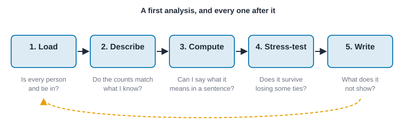
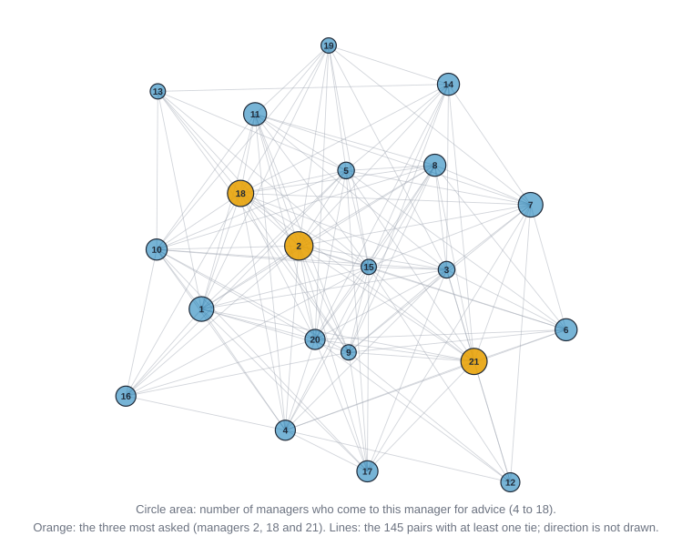

# Getting started {#sec-getting-started}

::: {.callout-note appearance="simple"}
## Prerequisites
@sec-networks-as-data. You don't need to know any of the three languages well. If you can read a few lines of code and guess what they do, you're fine.
:::

## What we'll do

In @sec-networks-as-data we wrote a small advice network down on paper: five coworkers and seven "I go to this person for advice" ties. In this chapter we make the computer hold that same network, ask it a couple of simple questions, and check its answers against what we worked out by hand.

That last part matters more than it sounds. The most valuable habit in network analysis is not knowing a lot of commands. It's *checking a result you can verify before you trust one you can't*. A five-person network is small enough that you can do everything by hand, so it's the perfect place to build that habit.

## Three languages, one idea

Every example in this book appears in R, Python and Rust. They aren't three different ways of doing network analysis. They're three doors into the same room: the same engine does the counting, so the numbers match whichever door you walk through. Pick the language you're most comfortable with, click its tab, and your choice carries through the rest of the website. (In the printed book the three versions appear one after another.)

::: {.callout-tip appearance="simple"}
## How to read the code
The blocks in this chapter run top to bottom as one script per language, like cells in a notebook: later blocks reuse names defined earlier. Each language prints its own results in its own style, and the numbers agree. The R tabs use the R package, the Python tabs use NetworkX, and the Rust tabs call the engine directly (the same engine sits behind the R package). Data files are read from `data/`.
:::

## Installing and loading

Before the first line of analysis, you need the tools. This is the least interesting part of the chapter and the one that most often stops people, so here it is in one place. The project's README is the source of truth for the commands, because they change as the software matures; today the packages build from the project's repository, so each of them needs a Rust compiler.

| You work in | You use | Install |
| --- | --- | --- |
| R | The R package, which wraps the engine and speaks data frames | `remotes::install_github("knapply/knappnet", subdir = "r")` |
| Python | NetworkX, and optionally the knappnet backend that runs the same calls on the engine | `pip install networkx numpy pandas`, then `pip install "git+https://github.com/knapply/knappnet.git#subdirectory=python"` for the backend |
| Rust | The engine itself, as a library | `knappnet = { git = "https://github.com/knapply/knappnet" }` under `[dependencies]` in `Cargo.toml` |

Three things to know.

- **A Rust toolchain.** The R package and the Python backend compile the engine when you install them, and the Rust code needs it directly. Install it with `rustup` from <https://www.rust-lang.org/tools/install>, then check it with `rustc --version` at a terminal.
- **The Python tabs in this book use plain NetworkX.** The backend is a speed-up that leaves NetworkX code as it is; you can add it later without touching the examples. NetworkX's algorithms are the reference implementations in many places, which is why we use it for the cross-checks (@sec-reproducibility says more about pinning versions).
- **The R tabs load a few tidyverse packages** (`dplyr`, `purrr`, `tibble`, `tidyr`). They are ordinary packages from CRAN.

To check that the install worked, load the library and build the smallest network you can. If you can do that, everything in the chapter will run.

::: {.panel-tabset group="language"}

## R

```r
library(knappnet)
library(dplyr)
library(purrr)
net_frame(data.frame(source = "a", target = "b"), directed = FALSE)
```

::: {.code-output}
```text
# net_frame: 2 nodes, 1 edge
#   directed:  no        mode: one-mode (2 actors)
#   weights:   unweighted
#   time:      static    space: none
#   simple:    no loops, no parallel edges
#   components: 1    isolates: 0    density: 1.000
#
# Nodes (2 x 1)   Edges (1 x 2)
#   id              source target
#   <chr>           <chr>  <chr>
# 1 a             1 a      b
# 2 b
```
:::

## Python

```python
import networkx as nx
print(nx.Graph([("a", "b")]).number_of_edges())
```

::: {.code-output}
```text
1
```
:::

## Rust

```rust
let g = knappnet::Graph::from_edges(2, &[0], &[1], None, false)?;
println!("{} nodes, {} ties", g.node_count(), g.edge_count());
```

::: {.code-output}
```text
2 nodes, 1 ties
```
:::

:::

If one of the three fails, the error message usually names the missing piece: a compiler not found, a package that did not build, a dependency not on the path. Fix that before moving on, because every later chapter uses the same set-up. @sec-reproducibility shows how to record exactly which versions you used.

## Step 1: tell the computer who is in the network

Our five coworkers are Ana, Ben, Chloe, Dev and Eli. Computers like numbers more than names, so the engine numbers the people from zero: Ana is 0, Ben is 1, Chloe is 2, Dev is 3 and Eli is 4. We keep the names in a list on the side, so we can turn numbers back into people when we print.

The ties come as two parallel lists, one for who the tie starts with and one for who it ends with. Each position in the lists is one tie. Here is the advice network, tie by tie.

| Tie number | From | To |
| --- | --- | --- |
| 0 | Ana (0) | Ben (1) |
| 1 | Ana (0) | Chloe (2) |
| 2 | Ben (1) | Chloe (2) |
| 3 | Chloe (2) | Ana (0) |
| 4 | Dev (3) | Ana (0) |
| 5 | Dev (3) | Chloe (2) |
| 6 | Eli (4) | Chloe (2) |

This is the edge list format from @sec-networks-as-data, split into its two columns. We also tell the computer that the ties have a direction (Ana going to Ben is not the same as Ben going to Ana), and that we have no tie strengths, only present or absent.

## Step 2: ask a question you can check

The simplest question about a person is how many ties they have. Because ours are directed, there are two versions: how many people each person goes to (*out-degree*) and how many people come to them (*in-degree*). We counted these by hand in @sec-networks-as-data. The computer should agree.

By hand, from the table above:

| | Ana | Ben | Chloe | Dev | Eli |
| --- | --- | --- | --- | --- | --- |
| Goes to (out) | 2 | 1 | 1 | 2 | 1 |
| Comes to them (in) | 2 | 1 | 4 | 0 | 0 |

Chloe is the one everybody turns to: four of the other four people come to her. Dev and Eli are the opposite: they ask, but nobody asks them. We'll hold off on what that *means* for a few chapters, because it depends on what "advice" is doing in this workplace. For now, the job is only to get the counts right.

## Step 3: a second question, and a first taste of "position"

Degree counts a person's own ties. A different question looks at the ties *between other people*: who sits on the routes that connect everyone else? A person who lies on many of the shortest routes between pairs of other people is, in a precise sense, in between. That count is called **betweenness**, and @sec-centrality gives it the careful treatment it deserves.

Try it by hand on this network. Follow the arrows only. Who has to go through Ana to reach Ben? Dev (Dev goes to Ana, then Ana goes to Ben), Chloe, and Eli (Eli goes to Chloe, Chloe goes to Ana, Ana goes to Ben). That's three pairs. Now who has to go through Chloe? Eli to Ana, Eli to Ben, and Ben to Ana (Ben goes to Chloe, then Chloe goes to Ana). Also three. Ana and Chloe each lie on three shortest routes between other people. Ben, Dev and Eli lie on none.

Notice what this does and doesn't say. Chloe has the most people coming to her, but Ana is exactly as "in between" as Chloe. Being popular and being in the middle are different things, and a good chunk of the book is about learning to tell them apart. The brokerage route we just traced is the idea behind Freeman's classic treatment of betweenness [@freeman1977set] and the fast algorithm most software uses to compute it [@brandes2001faster].

## Step 4: draw it

You'll meet layouts properly in @sec-visualization. A layout assigns each person a place on the page, and a stress layout tries to make distance on the page match distance in the network. With five people the result is simple, but the same call works for five hundred. Because layouts start from a random guess, we give the computer a *seed*, a number that fixes the guess, so you and I get the same picture.

## In code

::: {.panel-tabset group="language"}

## R

```r
library(knappnet)
library(dplyr)

# A network is two tables. The edge table has one row per tie; the node
# table lists the people, in order.
edges <- tibble(
  source = c("Ana", "Ana", "Ben", "Chloe", "Dev", "Dev", "Eli"),
  target = c("Ben", "Chloe", "Chloe", "Ana", "Ana", "Chloe", "Chloe")
)
people <- tibble(id = c("Ana", "Ben", "Chloe", "Dev", "Eli"))

# Directed, because advice goes from the person who asks to the person asked.
g <- net_frame(edges, nodes = people, directed = TRUE)

# Evaluating g prints a short card describing the network.
g

# Steps 2 and 3: degree in each direction, and betweenness as a plain count of routes.
people |>
  mutate(
    out = net_degree(g, mode = "out"),
    `in` = net_degree(g, mode = "in"),
    betweenness = net_betweenness(g)
  )

# Step 4: a stress layout; the seed fixes the starting guess.
layout <- net_layout(g, method = "stress", seed = 1)
people |>
  mutate(x = layout[, 1], y = layout[, 2]) |>
  mutate(across(c(x, y), \(v) round(v, 3)))
```

::: {.code-output}
```text
# net_frame: 5 nodes, 7 edges
#   directed:  yes       mode: one-mode (5 actors)
#   weights:   unweighted
#   time:      static    space: none
#   simple:    no loops, no parallel edges
#   components: 1    isolates: 0    density: 0.350
#
# Nodes (5 x 1)   Edges (7 x 2)
#   id              source target
#   <chr>           <chr>  <chr>
# 1 Ana           1 Ana    Ben
# 2 Ben           2 Ana    Chloe
# 3 Chloe         3 Ben    Chloe
# 4 Dev           4 Chloe  Ana
# 5 Eli           5 Dev    Ana
#                 6 Dev    Chloe
#                   ... 1 more rows
# A tibble: 5 × 4
  id      out  `in` betweenness
  <chr> <dbl> <dbl>       <dbl>
1 Ana       2     2           3
2 Ben       1     1           0
3 Chloe     1     4           3
4 Dev       2     0           0
5 Eli       1     0           0
# A tibble: 5 × 3
  id         x      y
  <chr>  <dbl>  <dbl>
1 Ana   -1.02   0    
2 Ben   -0.592 -0.911
3 Chloe -0.035  0    
4 Dev   -0.592  0.911
5 Eli    1.02   0    
```
:::

## Python

```python
import networkx as nx

# People are numbered from zero in Rust; here we use their names directly.
names = ["Ana", "Ben", "Chloe", "Dev", "Eli"]
ties = [("Ana", "Ben"), ("Ana", "Chloe"), ("Ben", "Chloe"), ("Chloe", "Ana"),
        ("Dev", "Ana"), ("Dev", "Chloe"), ("Eli", "Chloe")]

# Directed, because advice goes from the person who asks to the person asked.
# (NetworkX has no one-call description like Rust's describe(), so we ask for
# the pieces we need.)
g = nx.DiGraph()
g.add_nodes_from(names)
g.add_edges_from(ties)

# Step 2: out-degree and in-degree.
for name in names:
    print(f"{name:<6} goes to {g.out_degree(name)}  comes to them {g.in_degree(name)}")

# Step 3: betweenness. normalized=False gives the plain count of routes.
between = nx.betweenness_centrality(g, normalized=False)
for name in names:
    print(f"{name:<6} betweenness {between[name]:g}")

# Step 4: a layout. NetworkX has no stress layout, so Kamada-Kawai (a close
# relative) places the people, and the exact coordinates differ from Rust's.
layout = nx.kamada_kawai_layout(g.to_undirected())
for name in names:
    x, y = layout[name]
    print(f"{name:<6} x {x:7.3f}  y {y:7.3f}")
```

::: {.code-output}
```text
Ana    goes to 2  comes to them 2
Ben    goes to 1  comes to them 1
Chloe  goes to 1  comes to them 4
Dev    goes to 2  comes to them 0
Eli    goes to 1  comes to them 0
Ana    betweenness 3
Ben    betweenness 0
Chloe  betweenness 3
Dev    betweenness 0
Eli    betweenness 0
Ana    x  -0.253  y   0.614
Ben    x   0.607  y   0.572
Chloe  x   0.068  y  -0.165
Dev    x  -0.834  y  -0.021
Eli    x   0.412  y  -1.000
```
:::

## Rust

```rust
use knappnet::layout::{layout_stress_majorization, StressOptions};
use knappnet::{compute_betweenness, compute_degree, BetweennessOptions, DegreeMode, Graph};

// People are numbered from zero; the names stay in a list on the side.
let names = ["Ana", "Ben", "Chloe", "Dev", "Eli"];

// One position in each list is one tie: from[i] goes to to[i].
let from_five = [0, 0, 1, 2, 3, 3, 4];
let to_five = [1, 2, 2, 0, 0, 2, 2];

// No weights, and the ties are directed.
let g = Graph::from_edges(names.len(), &from_five, &to_five, None, true)?;

// describe() gives a short, readable summary of any network.
println!("{}", g.describe().with_labels(&names));

// Step 2: out-degree and in-degree (the `true` counts self-loops; we have none).
let out = compute_degree(&g, DegreeMode::Out, true);
let inn = compute_degree(&g, DegreeMode::In, true);
for (i, name) in names.iter().enumerate() {
    println!("{name:<6} goes to {}  comes to them {}", out[i], inn[i]);
}

// Step 3: betweenness, with the default options.
let between = compute_betweenness(&g, BetweennessOptions::default())?;
for (i, name) in names.iter().enumerate() {
    println!("{name:<6} betweenness {}", between[i]);
}

// Step 4: a stress layout; the seed fixes the starting guess.
let layout = layout_stress_majorization(&g, &StressOptions { seed: 1, ..Default::default() })?;
for (i, name) in names.iter().enumerate() {
    println!("{name:<6} x {:7.3}  y {:7.3}", layout.x[i], layout.y[i]);
}
```

::: {.code-output}
```text
Directed network: 5 nodes, 7 ties (arcs)
  Density           0.350
  Out-degree        1 to 2, mean 1.40
  In-degree         0 to 4, mean 1.40
  Reciprocity       0.29 of ties are returned
  Connected pieces  1 weak, 3 strong
  Isolated nodes    0
  Loops, repeats    none
  Busiest           Chloe (5), Ana (4), Ben (2)

Ana    goes to 2  comes to them 2
Ben    goes to 1  comes to them 1
Chloe  goes to 1  comes to them 4
Dev    goes to 2  comes to them 0
Eli    goes to 1  comes to them 0
Ana    betweenness 3
Ben    betweenness 0
Chloe  betweenness 3
Dev    betweenness 0
Eli    betweenness 0
Ana    x  -1.020  y   0.000
Ben    x  -0.592  y  -0.911
Chloe  x  -0.035  y  -0.000
Dev    x  -0.592  y   0.911
Eli    x   1.020  y  -0.000
```
:::

:::


Run the Rust version and you should see the same counts as the hand-built table: Chloe with four people coming to her, Dev and Eli with none, and Ana and Chloe each at three on betweenness. If a number differs from the table, stop and find out why before going further. Usually it's a typo in one of the two lists, and finding it is good practice.

## A first analysis, end to end

Five people was the warm-up. Now the same steps on a real network, with 21 managers of a small manufacturing firm: Krackhardt's advice network [@krackhardt1987cognitive]. Each manager was asked whom they go to for advice, and the data record 190 such ties. Everything we do has the same shape, and it's the shape to use on your own data:

1. **Load** the tables and build the network.
2. **Describe** it and compare the description with what you know (how many people, how many ties).
3. **Compute** one or two measures whose meaning you can state in a sentence.
4. **Stress-test** the answer: would it survive losing a few ties?
5. **Write** what you found, with its limits.

{#fig-first-analysis-loop fig-alt="Five boxes in a row labeled load, describe, compute, stress-test and write, joined by arrows. Under each is a short question. A dashed arrow runs from the last box back to the first."}

### Load and describe

The data file has one row per tie, with a column naming the relation, so the advice network is the rows that say `advice`. We build the network on all 21 managers, whether or not each has ties, and then compare what the computer says with what we expect: 21 people, 190 ties, no loops, and the sum of everyone's out-degrees equal to the sum of their in-degrees (because every tie leaves one person and enters another).

::: {.panel-tabset group="language"}

## R

```r
krack <- read.csv("data/krackhardt/edges.csv") |> as_tibble()

# One tie table with a relation column; the advice network is the rows that say "advice".
advice_edges <- krack |>
  filter(relation == "advice") |>
  select(source = from, target = to)
advice <- net_frame(advice_edges, nodes = tibble(id = 1:21), directed = TRUE)
advice

# Compare with what we know: 21 managers, 190 ties, and in-degrees that add up to out-degrees.
tibble(
  ties = nrow(advice_edges),
  in_total = sum(net_degree(advice, mode = "in")),
  out_total = sum(net_degree(advice, mode = "out")),
  density = round(net_density(advice), 3),
  returned = round(net_reciprocity(advice), 3),
  weak_pieces = net_components(advice)$no,
  strong_pieces = net_components(advice, mode = "strong")$no
)
```

::: {.code-output}
```text
# net_frame: 21 nodes, 190 edges
#   directed:  yes       mode: one-mode (21 actors)
#   weights:   unweighted
#   time:      static    space: none
#   simple:    no loops, no parallel edges
#   components: 1    isolates: 0    density: 0.452
#
# Nodes (21 x 1)       Edges (190 x 2)
#   id                   source target
#   <int>                <int>  <int>
# 1 1                  1 1       2
# 2 2                  2 1       4
# 3 3                  3 1       8
# 4 4                  4 1      16
# 5 5                  5 1      18
# 6 6                  6 1      21
#   ... 15 more rows     ... 184 more rows
# A tibble: 1 × 7
   ties in_total out_total density returned weak_pieces strong_pieces
  <int>    <dbl>     <dbl>   <dbl>    <dbl>       <int>         <int>
1   190      190       190   0.452    0.474           1             1
```
:::

## Python

```python
import csv

import numpy as np

def read(path):
    with open(path) as f:
        return list(csv.DictReader(f))

# One tie table with a relation column; the advice network is the rows that say "advice".
rows = [r for r in read("data/krackhardt/edges.csv") if r["relation"] == "advice"]
nodes = list(range(1, 22))
advice = nx.DiGraph()
advice.add_nodes_from(nodes)
advice.add_edges_from((int(r["from"]), int(r["to"])) for r in rows)

# Compare with what we know: 21 managers, 190 ties, and in-degrees that add up to out-degrees.
print("managers:", advice.number_of_nodes(), " rows in the file:", len(rows), " ties:", advice.number_of_edges(),
      " loops:", nx.number_of_selfloops(advice))
print("in-degrees add up to", sum(d for _, d in advice.in_degree()), "and out-degrees to", sum(d for _, d in advice.out_degree()))
print(f"density {nx.density(advice):.3f}  returned {nx.reciprocity(advice):.3f}  "
      f"weak pieces {nx.number_weakly_connected_components(advice)}  strong pieces {nx.number_strongly_connected_components(advice)}")
```

::: {.code-output}
```text
managers: 21  rows in the file: 190  ties: 190  loops: 0
in-degrees add up to 190 and out-degrees to 190
density 0.452  returned 0.474  weak pieces 1  strong pieces 1
```
:::

## Rust

```rust
use knappnet::metrics::descriptive::{compute_reciprocity, ReciprocityMode};
use knappnet::metrics::topography::{compute_density, find_components, ComponentKind};
use std::collections::{BTreeMap, BTreeSet};

// The rows of a comma-separated file, without the header line.
let read = |path: &str| -> Vec<Vec<String>> {
    std::fs::read_to_string(path).unwrap().lines().skip(1)
        .map(|line| line.split(',').map(String::from).collect()).collect()
};

// One tie table with a relation column; the advice network is the rows that say "advice".
let rows: Vec<Vec<String>> = read("data/krackhardt/edges.csv").into_iter().filter(|r| r[2] == "advice").collect();
let a_from: Vec<i64> = rows.iter().map(|r| r[0].parse::<i64>().unwrap() - 1).collect();
let a_to: Vec<i64> = rows.iter().map(|r| r[1].parse::<i64>().unwrap() - 1).collect();
let advice = Graph::from_edges(21, &a_from, &a_to, None, true)?;
let labels: Vec<String> = (1..=21).map(|m| format!("manager {m}")).collect();
println!("{}", advice.describe().with_labels(&labels));

// Compare with what we know: 21 managers, 190 ties, and in-degrees that add up to out-degrees.
let in_total: f64 = compute_degree(&advice, DegreeMode::In, true).iter().sum();
let out_total: f64 = compute_degree(&advice, DegreeMode::Out, true).iter().sum();
let loops = a_from.iter().zip(&a_to).filter(|(a, b)| a == b).count();
let distinct: BTreeSet<(i64, i64)> = a_from.iter().copied().zip(a_to.iter().copied()).collect();
println!("rows in the file: {}  distinct ties: {}  loops: {}  in-degrees add up to {}, out-degrees to {}",
         rows.len(), distinct.len(), loops, in_total, out_total);
println!("density {:.3}  returned {:.3}  weak pieces {}  strong pieces {}",
         compute_density(&advice, false), compute_reciprocity(&advice, ReciprocityMode::Default),
         find_components(&advice, ComponentKind::Weak).count(), find_components(&advice, ComponentKind::Strong).count());
```

::: {.code-output}
```text
Directed network: 21 nodes, 190 ties (arcs)
  Density           0.452
  Out-degree        1 to 20, mean 9.05
  In-degree         4 to 18, mean 9.05
  Reciprocity       0.47 of ties are returned
  Connected pieces  1 weak, 1 strong
  Isolated nodes    0
  Loops, repeats    none
  Busiest           manager 18 (32), manager 21 (26), manager 15 (24)

rows in the file: 190  distinct ties: 190  loops: 0  in-degrees add up to 190, out-degrees to 190
density 0.452  returned 0.474  weak pieces 1  strong pieces 1
```
:::

:::

Everything matches: 190 ties on 21 managers, no loops, no repeated rows, in-degrees and out-degrees both adding to 190. The density is 0.452: nearly half of the 420 possible directed ties are present, which makes this a dense network (@sec-paths-and-cohesion), and the returned share is 0.474, about the share we found in @sec-networks-as-data when we compared it with chance. Everyone can reach everyone: one weak piece, and one strong piece too, so following the arrows leaves nobody stranded. Those facts already shape what we can say. In a network this dense, a person's distance to anyone is short, and measures that depend on being far from others will not separate people much.

### Compute: who is asked, who asks, who is in between

Three questions from the earlier sections, on 21 people. By hand you can't list all 190 ties, but you can check a corner: the in-degrees must add to 190, which they do. Then we report the top five of each measure, breaking ties by the smaller manager number so that the lists are the same in every language.

::: {.panel-tabset group="language"}

## R

```r
spearman <- \(x, y) cor(x, y, method = "spearman")
managers <- tibble(
  manager = 1:21,
  asked = net_degree(advice, mode = "in"),
  asks = net_degree(advice, mode = "out"),
  routes = net_betweenness(advice)
)

# The five highest, ties broken by the smaller manager number.
managers |> arrange(desc(asked), manager) |> select(manager, asked) |> head(5)
managers |> arrange(desc(asks), manager) |> select(manager, asks) |> head(5)
managers |> arrange(desc(routes), manager) |> select(manager, routes) |> head(5) |> mutate(routes = round(routes, 2))

# Do the three say the same thing? Rank correlations.
tibble(asked_vs_routes = spearman(managers$asked, managers$routes),
       asked_vs_asks = spearman(managers$asked, managers$asks)) |>
  mutate(across(everything(), \(x) round(x, 3)))
```

::: {.code-output}
```text
# A tibble: 5 × 2
  manager asked
    <int> <dbl>
1       2    18
2      18    15
3      21    15
4       1    13
5       7    13
# A tibble: 5 × 2
  manager  asks
    <int> <dbl>
1      15    20
2      18    17
3       3    15
4       5    15
5      10    14
# A tibble: 5 × 2
  manager routes
    <int>  <dbl>
1      18   88.9
2      21   60.1
3       7   27.6
4      10   18.3
5       1   13.8
# A tibble: 1 × 2
  asked_vs_routes asked_vs_asks
            <dbl>         <dbl>
1           0.388        -0.339
```
:::

## Python

```python
def ranks(x):
    # 1 for the smallest; tied values share the average of their ranks
    x = np.asarray(x)
    return np.array([(x < v).sum() + ((x == v).sum() + 1) / 2 for v in x])

def spearman(x, y):
    return np.corrcoef(ranks(x), ranks(y))[0, 1]

def top(scores, k=5):
    """The k highest scores, ties broken by the smaller manager number."""
    return sorted(scores.items(), key=lambda kv: (-kv[1], kv[0]))[:k]

asked, asks = dict(advice.in_degree()), dict(advice.out_degree())
routes = nx.betweenness_centrality(advice, normalized=False)
print("most asked    ", [(m, d) for m, d in top(asked)])
print("asks the most ", [(m, d) for m, d in top(asks)])
print("on most routes", [(m, round(b, 2)) for m, b in top(routes)])

# Do the three say the same thing? Rank correlations.
print(f"rank correlation: asked vs routes {spearman([asked[m] for m in nodes], [routes[m] for m in nodes]):.3f}, "
      f"asked vs asks {spearman([asked[m] for m in nodes], [asks[m] for m in nodes]):.3f}")
```

::: {.code-output}
```text
most asked     [(2, 18), (18, 15), (21, 15), (1, 13), (7, 13)]
asks the most  [(15, 20), (18, 17), (3, 15), (5, 15), (10, 14)]
on most routes [(18, 88.92), (21, 60.13), (7, 27.62), (10, 18.3), (1, 13.75)]
rank correlation: asked vs routes 0.388, asked vs asks -0.339
```
:::

## Rust

```rust
// Average ranks (tied values share the mean of their ranks) and the rank correlation.
let ranks = |x: &[f64]| -> Vec<f64> {
    x.iter().map(|&v| x.iter().filter(|&&u| u < v).count() as f64
        + (x.iter().filter(|&&u| u == v).count() as f64 + 1.0) / 2.0).collect()
};
let spearman = |x: &[f64], y: &[f64]| -> f64 {
    let (rx, ry) = (ranks(x), ranks(y));
    let (mx, my) = (rx.iter().sum::<f64>() / rx.len() as f64, ry.iter().sum::<f64>() / ry.len() as f64);
    let cov: f64 = rx.iter().zip(&ry).map(|(a, b)| (a - mx) * (b - my)).sum();
    cov / (rx.iter().map(|a| (a - mx).powi(2)).sum::<f64>() * ry.iter().map(|b| (b - my).powi(2)).sum::<f64>()).sqrt()
};
// The k highest scores as (manager, score), ties broken by the smaller manager number.
let top = |scores: &[f64], k: usize| -> Vec<(usize, f64)> {
    let mut order: Vec<usize> = (0..scores.len()).collect();
    order.sort_by(|&a, &b| scores[b].partial_cmp(&scores[a]).unwrap().then(a.cmp(&b)));
    order.into_iter().take(k).map(|i| (i + 1, scores[i])).collect()
};

let asked = compute_degree(&advice, DegreeMode::In, true);
let asks = compute_degree(&advice, DegreeMode::Out, true);
let routes = compute_betweenness(&advice, BetweennessOptions::default())?;
let rounded: Vec<f64> = routes.iter().map(|b| (b * 100.0).round() / 100.0).collect();
println!("most asked     {:?}", top(&asked, 5));
println!("asks the most  {:?}", top(&asks, 5));
println!("on most routes {:?}", top(&rounded, 5));

// Do the three say the same thing? Rank correlations.
println!("rank correlation: asked vs routes {:.3}, asked vs asks {:.3}", spearman(&asked, &routes), spearman(&asked, &asks));
```

::: {.code-output}
```text
most asked     [(2, 18.0), (18, 15.0), (21, 15.0), (1, 13.0), (7, 13.0)]
asks the most  [(15, 20.0), (18, 17.0), (3, 15.0), (5, 15.0), (10, 14.0)]
on most routes [(18, 88.92), (21, 60.13), (7, 27.62), (10, 18.3), (1, 13.75)]
rank correlation: asked vs routes 0.388, asked vs asks -0.339
```
:::

:::

Read the lists one at a time, and say what each means before comparing. Manager 2 is asked for advice by 18 of the other 20 managers, more than anyone. Managers 18 and 21 follow with 15 each. The ones who ask the most are different people: manager 15 goes to 20 colleagues, which is everyone, and managers 18, 3, 5 and 10 follow. And the managers on the most shortest routes between others are 18, then 21 and 7. So three plausible meanings of "important" give three overlapping lists. Manager 18 is on all three, which is worth a sentence; manager 2, the most asked, is only tenth of 21 by routes (5.94). The rank correlation tells the same story at the scale of the whole team: being asked and being on routes are only loosely related ($\rho = 0.388$), and being asked and asking are *negatively* related ($\rho = -0.339$): the people who are sought out ask less. We'll see why in @sec-centrality, which treats these measures carefully; for now, notice that no single number summarizes "importance".

### Stress-test: would the answer survive losing a few ties?

Surveys miss ties, people forget, files are truncated. One cheap way to find out how much a result depends on every tie being there is to *delete a few at random and recompute*. We drop each tie with probability 0.1, so about 19 of the 190 disappear, 200 times, and ask how often the top three of each list stays the same three people. The draws come from a tiny shared generator (Park and Miller's), so every language drops the same ties and prints the same numbers.

::: {.panel-tabset group="language"}

## R

```r
# Park and Miller's little generator, so every language draws the same "random" numbers.
uniform <- \(count, seed) {
  states <- accumulate(seq_len(count), \(state, i) (state * 48271) %% 2147483647, .init = seed)
  states[-1] / 2147483647
}
top_three <- \(scores) order(-scores, seq_along(scores))[1:3]
draws <- matrix(uniform(200 * nrow(advice_edges), 1), nrow = 200, byrow = TRUE)
base <- list(asked = top_three(managers$asked), routes = top_three(net_betweenness(advice)))

drops <- map(1:200, \(rep) {
  h <- net_frame(advice_edges[draws[rep, ] >= 0.1, ], nodes = tibble(id = 1:21), directed = TRUE)
  tibble(
    ties = net_degree(h, mode = "all") |> sum() / 2,
    asked_top = list(top_three(net_degree(h, mode = "in"))),
    routes_top = list(top_three(net_betweenness(h)))
  ) |>
    mutate(asked_kept = length(intersect(base$asked, asked_top[[1]])), routes_kept = length(intersect(base$routes, routes_top[[1]])))
}) |>
  list_rbind()

drops |>
  summarise(
    mean_ties_left = mean(ties),
    asked_all_three = mean(asked_kept == 3), asked_average = mean(asked_kept),
    routes_all_three = mean(routes_kept == 3), routes_average = mean(routes_kept)
  ) |>
  mutate(across(everything(), \(x) round(x, 3)))

# How often each of the original top three stayed in the top three, out of 200 draws.
bind_rows(
  tibble(list = "asked", manager = sort(base$asked), stayed = map_int(sort(base$asked), \(m) sum(map_lgl(drops$asked_top, \(t) m %in% t)))),
  tibble(list = "routes", manager = sort(base$routes), stayed = map_int(sort(base$routes), \(m) sum(map_lgl(drops$routes_top, \(t) m %in% t))))
)
```

::: {.code-output}
```text
# A tibble: 1 × 5
  mean_ties_left asked_all_three asked_average routes_all_three routes_average
           <dbl>           <dbl>         <dbl>            <dbl>          <dbl>
1           171.             0.5          2.49            0.715           2.72
# A tibble: 6 × 3
  list   manager stayed
  <chr>    <int>  <int>
1 asked        2    198
2 asked       18    157
3 asked       21    143
4 routes       7    143
5 routes      18    200
6 routes      21    200
```
:::

## Python

```python
from collections import Counter

def uniform(count, seed):
    """Park and Miller's little generator, so every language draws the same "random" numbers."""
    state, out = seed, []
    for _ in range(count):
        state = state * 48271 % 2147483647
        out.append(state / 2147483647)
    return out

arcs = [(int(r["from"]), int(r["to"])) for r in rows]
draws = uniform(200 * len(arcs), 1)
base = {"asked": {m for m, _ in top(asked, 3)}, "routes": {m for m, _ in top(routes, 3)}}

kept_counts, asked_kept, routes_kept = [], [], []
stayed = {"asked": Counter(), "routes": Counter()}
for rep in range(200):
    kept = [t for t, d in zip(arcs, draws[rep * len(arcs):(rep + 1) * len(arcs)]) if d >= 0.1]
    h = nx.DiGraph()
    h.add_nodes_from(nodes)
    h.add_edges_from(kept)
    kept_counts.append(len(kept))
    now = {"asked": {m for m, _ in top(dict(h.in_degree()), 3)},
           "routes": {m for m, _ in top(nx.betweenness_centrality(h, normalized=False), 3)}}
    asked_kept.append(len(base["asked"] & now["asked"]))
    routes_kept.append(len(base["routes"] & now["routes"]))
    for name in stayed:
        stayed[name].update(base[name] & now[name])

asked_kept, routes_kept = np.array(asked_kept), np.array(routes_kept)
print(f"ties left on average: {np.mean(kept_counts):.1f}")
print(f"top three asked:  all three kept in {np.mean(asked_kept == 3):.3f} of draws, {asked_kept.mean():.3f} of 3 on average")
print(f"top three routes: all three kept in {np.mean(routes_kept == 3):.3f} of draws, {routes_kept.mean():.3f} of 3 on average")
print("stayed in the top three, of 200 draws:", {name: {m: stayed[name][m] for m in sorted(base[name])} for name in stayed})
```

::: {.code-output}
```text
ties left on average: 170.9
top three asked:  all three kept in 0.500 of draws, 2.490 of 3 on average
top three routes: all three kept in 0.715 of draws, 2.715 of 3 on average
stayed in the top three, of 200 draws: {'asked': {2: 198, 18: 157, 21: 143}, 'routes': {7: 143, 18: 200, 21: 200}}
```
:::

## Rust

```rust
// Park and Miller's little generator, so every language draws the same "random" numbers.
let uniform = |count: usize, seed: u64| -> Vec<f64> {
    let mut state = seed;
    (0..count).map(|_| { state = state * 48271 % 2147483647; state as f64 / 2147483647.0 }).collect()
};
let top_three = |scores: &[f64]| -> BTreeSet<usize> { top(scores, 3).into_iter().map(|(m, _)| m).collect() };
let draws = uniform(200 * a_from.len(), 1);
let (base_asked, base_routes) = (top_three(&asked), top_three(&routes));

let (mut ties_left, mut asked_all, mut asked_sum, mut routes_all, mut routes_sum) = (0.0, 0.0, 0.0, 0.0, 0.0);
let (mut stayed_asked, mut stayed_routes): (BTreeMap<usize, usize>, BTreeMap<usize, usize>) = (BTreeMap::new(), BTreeMap::new());
for rep in 0..200 {
    let keep: Vec<usize> = (0..a_from.len()).filter(|&i| draws[rep * a_from.len() + i] >= 0.1).collect();
    let (f, t): (Vec<i64>, Vec<i64>) = keep.iter().map(|&i| (a_from[i], a_to[i])).unzip();
    let h = Graph::from_edges(21, &f, &t, None, true)?;
    let (now_asked, now_routes) = (top_three(&compute_degree(&h, DegreeMode::In, true)),
                                   top_three(&compute_betweenness(&h, BetweennessOptions::default())?));
    let (a, r) = (base_asked.intersection(&now_asked).count() as f64, base_routes.intersection(&now_routes).count() as f64);
    base_asked.intersection(&now_asked).for_each(|m| *stayed_asked.entry(*m).or_default() += 1);
    base_routes.intersection(&now_routes).for_each(|m| *stayed_routes.entry(*m).or_default() += 1);
    ties_left += keep.len() as f64;
    (asked_sum, routes_sum) = (asked_sum + a, routes_sum + r);
    (asked_all, routes_all) = (asked_all + (a == 3.0) as u8 as f64, routes_all + (r == 3.0) as u8 as f64);
}
println!("ties left on average: {:.1}", ties_left / 200.0);
println!("top three asked:  all three kept in {:.3} of draws, {:.3} of 3 on average", asked_all / 200.0, asked_sum / 200.0);
println!("top three routes: all three kept in {:.3} of draws, {:.3} of 3 on average", routes_all / 200.0, routes_sum / 200.0);
println!("stayed in the top three, of 200 draws: asked {stayed_asked:?}, routes {stayed_routes:?}");
```

::: {.code-output}
```text
ties left on average: 170.9
top three asked:  all three kept in 0.500 of draws, 2.490 of 3 on average
top three routes: all three kept in 0.715 of draws, 2.715 of 3 on average
stayed in the top three, of 200 draws: asked {2: 198, 18: 157, 21: 143}, routes {7: 143, 18: 200, 21: 200}
```
:::

:::

With about 171 ties left of 190, the three most-asked managers are all still the top three in half of the draws (0.500), and 2.49 of the three on average. The last line says where the instability sits. Manager 2 stays in the top three in 198 of the 200 draws. Managers 18 and 21, tied at 15 incoming ties, stay in 157 and 143, because deleting one or two ties lets manager 1 or manager 7 (two behind, at 13) overtake. The top three by routes hold up better: all three in 71.5 percent of draws (2.715 of three on average), with managers 18 and 21 in all 200 and manager 7 in 143. A defensible sentence is therefore "manager 2 is clearly the most asked, and managers 18 and 21 come next, not far ahead of managers 1 and 7", and not "the three most asked managers are 2, 18 and 21". We will use this kind of check for every measure in the book (@sec-centrality, @sec-tests-and-null-models).

### Draw it

@fig-managers-advice draws the same network with each manager's circle sized by the number of people who come to them, the idea from Step 4 at 21 people. Notice how much the picture does *not* say: the positions come from a layout, so only nearness is meaningful, and the ties are dense enough that the picture begins to be a hairball. @sec-visualization takes that up.

{#fig-managers-advice fig-alt="A network of 21 numbered managers drawn as circles joined by thin gray lines, 145 lines in all. Circle area grows with the number of managers who ask each one for advice. Managers 2, 18 and 21, the three most asked, are orange and the largest; the rest are blue."}

## Reading a result, not just printing it

A number on its own is easy to misread, so get into the habit of asking four questions every time the computer hands you one.

1. **What was it computed on?** Which network, directed or not, weighted or not?
2. **What choices did the function make for you?** Does it count self-loops? Does it divide by a maximum so the answer is between zero and one? Each function documents how it treats self-loops, parallel ties, weights and normalization, and where well-known tools disagree on a convention, that difference is recorded rather than hidden.
3. **Could I check it by hand?** On a small network, always do. On a large one, check a small piece.
4. **What would change my mind?** If the answer is "nothing", you're not analyzing, you're decorating.

Notice how little of that is about code. It's the "Doubt" box from the habit in @sec-introduction, and it's why the first example in a book about networks is a network small enough to hold in your head. The card `reading-a-result` turns the four questions into a checklist.

Question 2 deserves a worked example, because the same word means different things in different tools. Betweenness in this book is a raw count of shortest routes. NetworkX divides by the largest possible count unless told not to. In a directed network of $n$ people that largest count is $(n-1)(n-2)$, the number of ordered pairs that leave out the person in question. On the five coworkers, Ana's 3 routes become $3/12 = 0.25$. On the managers, manager 18's 88.92 becomes $88.92/380 = 0.234$. Both are right. Only one of them is what the person next to you means by "3".

::: {.panel-tabset group="language"}

## R

```r
# The same measure with and without the division by the largest possible count.
tibble(
  network = c("five coworkers: Ana", "managers: manager 18"),
  raw = c(net_betweenness(g)[1], net_betweenness(advice)[18]),
  normalized = c(net_betweenness(g, normalized = TRUE)[1], net_betweenness(advice, normalized = TRUE)[18]),
  largest_count = c(4 * 3, 20 * 19)
) |>
  mutate(across(where(is.numeric), \(x) round(x, 3)))
```

::: {.code-output}
```text
# A tibble: 2 × 4
  network                raw normalized largest_count
  <chr>                <dbl>      <dbl>         <dbl>
1 five coworkers: Ana    3        0.25             12
2 managers: manager 18  88.9      0.234           380
```
:::

## Python

```python
# The same measure with and without the division by the largest possible count.
for label, graph, who, size in [("five coworkers: Ana", g, "Ana", 5), ("managers: manager 18", advice, 18, 21)]:
    raw = nx.betweenness_centrality(graph, normalized=False)[who]
    norm = nx.betweenness_centrality(graph)[who]
    print(f"{label:<22} raw {raw:7.3f}  normalized {norm:.3f}  largest count {(size - 1) * (size - 2)}")
```

::: {.code-output}
```text
five coworkers: Ana    raw   3.000  normalized 0.250  largest count 12
managers: manager 18   raw  88.917  normalized 0.234  largest count 380
```
:::

## Rust

```rust
// The same measure with and without the division by the largest possible count.
let normalized = BetweennessOptions { normalized: true, ..Default::default() };
for (label, graph, who, size) in [("five coworkers: Ana", &g, 0, 5), ("managers: manager 18", &advice, 17, 21)] {
    let raw = compute_betweenness(graph, BetweennessOptions::default())?[who];
    let norm = compute_betweenness(graph, normalized)?[who];
    println!("{label:<22} raw {raw:7.3}  normalized {norm:.3}  largest count {}", (size - 1) * (size - 2));
}
```

::: {.code-output}
```text
five coworkers: Ana    raw   3.000  normalized 0.250  largest count 12
managers: manager 18   raw  88.917  normalized 0.234  largest count 380
```
:::

:::

## When things go wrong

Mistakes are the most useful thing to see in a first chapter, because you will make each of these. Three typical ones, on the five coworkers: a name misspelled in one tie, an id that counts from 1 where the code counts from 0, and two lists of different lengths. The tools treat them differently, and the differences matter more than the mistakes.

::: {.panel-tabset group="language"}

## R

```r
# A tie whose endpoint is misspelled, so it names nobody on the roster.
typo <- tibble(source = c("Ana", "Ben"), target = c("Ben", "Chlo"))
tryCatch(net_frame(typo, nodes = people, directed = TRUE), error = \(e) conditionMessage(e))

# Unless you allow it, and then the sixth person appears.
allowed <- net_frame(typo, nodes = people, directed = TRUE, add_nodes = TRUE, quiet = TRUE)
tibble(people_on_the_roster = 5, people_in_the_network = nrow(allowed$nodes), extra = setdiff(allowed$nodes$id, people$id))

# The same person listed twice.
tryCatch(net_frame(edges, nodes = bind_rows(people, tibble(id = "Ana")), directed = TRUE), error = \(e) conditionMessage(e))

# An id that counts from 1 where the code counts from 0: R counts from 1, but one past the end is NA, not an error.
people$id[6]
```

::: {.code-output}
```text
[1] "net_frame(): edge endpoints (columns `source` and `target` of `edges`) must be identifiers in column `id` of `nodes`; add the missing nodes, or declare add_nodes to take them from the edges; row 2 of `edges` (not in `nodes`: Chlo; add them to `nodes`, or set `add_nodes = TRUE`)."
# A tibble: 1 × 3
  people_on_the_roster people_in_the_network extra
                 <dbl>                 <int> <chr>
1                    5                     6 Chlo 
[1] "net_frame(): node identifiers (column `id` of `nodes`) must be unique; the listed rows repeat an earlier identifier; row 6 of `nodes` (repeated: Ana)."
[1] NA
```
:::

## Python

```python
# A tie whose endpoint is misspelled, so it names nobody on the roster.
mistaken = nx.DiGraph()
mistaken.add_nodes_from(names)
mistaken.add_edges_from([("Ana", "Ben"), ("Ben", "Chlo")])
print("people on the roster: 5, people in the network:", mistaken.number_of_nodes(), sorted(set(mistaken) - set(names)))

# An id that counts from 1 where the code counts from 0: one past the end of the list.
try:
    names[5]
except IndexError as error:
    print("IndexError:", error)
```

::: {.code-output}
```text
people on the roster: 5, people in the network: 6 ['Chlo']
IndexError: list index out of range
```
:::

## Rust

```rust
// An id beyond the number of people, as when a file counts from 1 and the code from 0.
match Graph::from_edges(5, &[0, 5], &[1, 2], None, true) {
    Ok(_) => println!("built"),
    Err(e) => println!("id out of range: {e}"),
}
// Lists of different lengths: one tie has a start but no end.
match Graph::from_edges(5, &[0, 1, 2], &[1, 2], None, true) {
    Ok(_) => println!("built"),
    Err(e) => println!("lists of different lengths: {e}"),
}
```

::: {.code-output}
```text
id out of range: edge 1 refers to node index 5, but valid indices are 0..5; node indices are 0-based, so fix the endpoint or raise the node count
lists of different lengths: targets has length 2, but 3 was expected; every input array must have the expected length
```
:::

:::

## What the same numbers mean in different settings

Degree and betweenness are computed the same way on any network, and read very differently. Using the three lists above as the example:

| Setting | A high in-degree means | A high betweenness means | What neither shows |
| --- | --- | --- | --- |
| Advice among managers (this chapter) | Many colleagues say they go to this person | Many shortest routes between other pairs pass through this person | Whether the advice was good, or whether the person knows they are sought |
| Marriage network among families | Many other families linked to this one by marriage | The family sits between otherwise separate clusters of families | Wealth, or who chose whom |
| Supply or transport network | Many suppliers or routes lead here | A failure here would lengthen many routes | Capacity, cost, alternative suppliers off the map |
| Online platform | Many accounts follow, reply to or mention this account | The account links audiences that are otherwise separate | Whether followers are real, or paying attention |

The two lists answer different questions, and the data can disagree about them, as they did for the managers: a rank correlation of 0.388 between being asked and being on routes. That disagreement is the finding, not a flaw in either measure.

## Common misconceptions

- **"The computer's answer is the answer."** It is the answer to the question the function was asked, with the choices it made. The raw and normalized betweenness for manager 18 differ by a factor of 380, and both are correct.
- **"If it ran, it's right."** All three tools happily built networks from the data, and only Rust and R refused a tie that named nobody on the roster; NetworkX built a sixth person without a word.
- **"The top of a list is the top."** Two managers tied at 15 incoming ties, and which of three managers is third depended on which ties survived a few deletions. Report tied or close scores as tied.
- **"A picture shows the structure."** A layout is a choice; the same network has many pictures. @sec-visualization takes this up.

### Where tools disagree

- **Normalizing betweenness.** NetworkX divides by the largest possible count by default (0.250 for Ana on the five coworkers); the Rust and R functions return the raw count (3) unless you ask. The three agree when told to do the same thing.
- **Laying out a network.** NetworkX has no stress layout, so its coordinates for the same five people differ from those of the R package and the Rust function, which agree with each other. Coordinates are not comparable across tools; compare how well each preserves distance (@sec-visualization).
- **Refusing mistakes.** R and Rust refuse a tie that names a person who is not in the node list and say what they expected; NetworkX adds a node for whatever string appears.
- **Sorting ties.** Neither a tool's order of equal scores nor an index is a result. We broke ties by the smaller manager number, so every language printed the same lists.

## Exercises

1. **By hand.** Add one tie to the advice network: Eli now also goes to Ben. Update the two lists. Which counts in the table change, and which don't? Does Ana's betweenness change? (Work it out before you run anything.)
2. **By hand.** Add a tie from Ben to Dev. Is anyone's in-degree still zero? Who now lies on shortest routes that they didn't before?
3. **By hand.** On the original five coworkers, treat each tie as undirected. Write each person's number of different neighbors and compare it with their in-degree plus out-degree. What accounts for the difference?
4. **Coding.** Rebuild the network, but this time treat the ties as undirected. What does "degree" now mean, and how do the numbers relate to the in- and out-degrees above?
5. **Coding.** Compute the layout with two different seeds. Which things change between the two pictures, and which stay the same? Why does that matter when you share a figure?
6. **Coding.** Repeat the stress test with a drop probability of 0.2 and again with 0.05. How do "all three kept" and the average number kept change for each list? At what drop rate would you stop trusting the top three?
7. **Coding.** Run the first analysis on Krackhardt's friendship network instead of the advice network. Which of the checks in the first block give a different answer, and what does that say about the two relations?
8. **Interpretation.** A colleague says, "Chloe is clearly the most important person in this team because she has the highest in-degree." Using what you computed for Ana, write a short, kind reply that adds what the claim leaves out.
9. **Interpretation.** A report prints "betweenness of Ana: 0.25" and your code prints 3. Write the two sentences you would send to find out whether the two of you disagree.
10. **Interpretation.** Manager 2 is the most asked for advice (18 of 20 colleagues) but only tenth by betweenness. Write three possible explanations, and one check for each.

::: {.callout-note collapse="true" appearance="simple"}
## Worked answers

1. Eli's out-degree becomes 2 and Ben's in-degree becomes 2; the other counts stay as they were. Ana's betweenness falls from 3 to 2: Eli no longer has to go through Chloe and Ana to reach Ben, so that route stops passing through her (Chloe's falls from 3 to 2 for the same reason).
2. Dev's in-degree becomes 1, so only Eli's in-degree is still zero. Ben now lies on routes to Dev. The code gives Ana 5, Ben 3, Chloe 3.5, Dev 0.5 and Eli 0; the halves appear when two shortest routes tie and each gets half a route.
3. The undirected degrees are 3, 2, 4, 2, 1 for Ana, Ben, Chloe, Dev and Eli, against in-plus-out of 4, 2, 5, 2, 1. The difference is the pair that names each other (Ana and Chloe): that pair counts twice in in-plus-out and once as a neighbor, so Ana and Chloe each lose one.
4. Degree is now the number of different people tied to a person, regardless of direction. For each person it equals in-degree plus out-degree minus the number of people who go both ways to them.
5. The coordinates change, but pairs that are close stay close and the picture is rotated or flipped. For a shared figure, record the seed so others can redraw it, and do not read the axes.
6. With the same generator and seed: dropping 5 percent keeps all three most-asked managers in 0.715 of draws (2.71 of 3 on average) and all three on routes in 0.83 (2.83); 10 percent gives 0.500 and 0.715; 20 percent gives 0.285 (2.205) and 0.56 (2.56). So the betweenness list is the more stable of the two at every rate. Which rate to defend depends on how many ties your own survey plausibly missed.
7. Friendship has 102 ties, so the density is 0.243 against 0.452 for advice. The returned share is about the same (0.451 against 0.474), the network is still one weak piece, but it has 3 strong pieces where advice has 1, so following the arrows now strands some managers. The checks that differ show that the two relations are different networks over the same people.
8. "Chloe is the person everyone comes to, which is real. But Ana is on exactly as many shortest routes between other people (3 each), so if the question is who connects people who otherwise wouldn't reach each other, Ana matters just as much. In-degree answers who is sought out; it doesn't answer who is in between."
9. "I get raw betweenness 3 for Ana on the five-person network, counting shortest routes between other pairs. 0.25 is 3 divided by 12, the number of ordered pairs leaving out Ana, which is NetworkX's default. Did you normalize?"
10. (a) The people who ask manager 2 may be able to reach each other without manager 2, so few routes need them; check by counting ties among the 18 (150 of the 306 ordered pairs are advice ties, 0.49, about the density of the whole network). (b) Manager 2's asked-by crowd may be mostly managers who ask, but who are rarely asked: check how their out-degree compares. (c) The network is dense (0.452), so routes are short and spread among many people: compare with a random network of the same density and size.
:::

## Summary

::: {.callout-tip appearance="simple"}
To analyze a network on a computer you give it the number of people, two parallel lists saying who each tie starts and ends with, and whether the ties are directed. From that, one call returns degree (a person's own ties) and another returns betweenness (how often a person lies on routes between others), and a stress layout turns the network into a picture. A first analysis has five steps (load, describe, compute, stress-test, write), each with a check. On Krackhardt's 21 managers the checks matched the data's counts (21 people, 190 ties), the three lists of who is asked, who asks and who is in between overlapped but did not agree, and deleting a tenth of the ties at random kept the same top three most-asked managers in only half of the draws. Always check a small result by hand before trusting a large one, and ask four questions of every number: what it was computed on, what choices were made for you, whether you could check it, and what would change your mind.
:::

## Further reading

To get comfortable loading and inspecting data in R, Phil Murphy's tutorials are a friendly place to start: getting started with R and igraph [@murphyrpubs523135], loading an adjacency matrix [@murphyrpubs965721] and importing an edge list [@murphyrpubs534143]. For where betweenness comes from, see @freeman1977set, and for the algorithm that makes it fast on large networks, @brandes2001faster. For the data in the first analysis, see @krackhardt1987cognitive. For the layout idea, see @gansner2005graph and the discussion in @sec-visualization. For NetworkX and the other Python tools, see @hagberg2008exploring, and for igraph, @csardi2006igraph.
