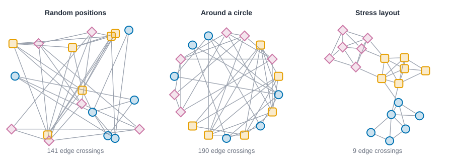
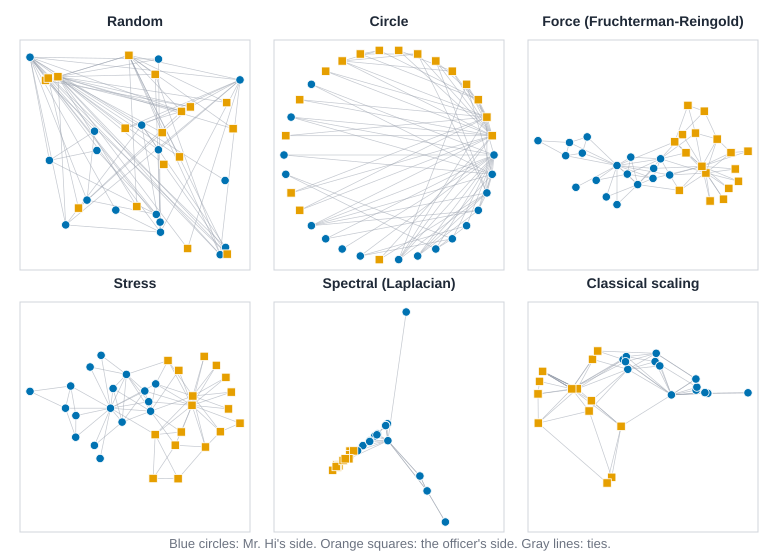
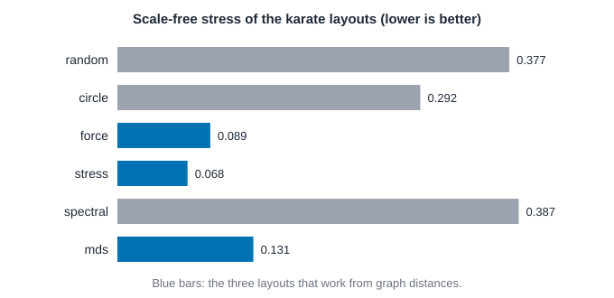
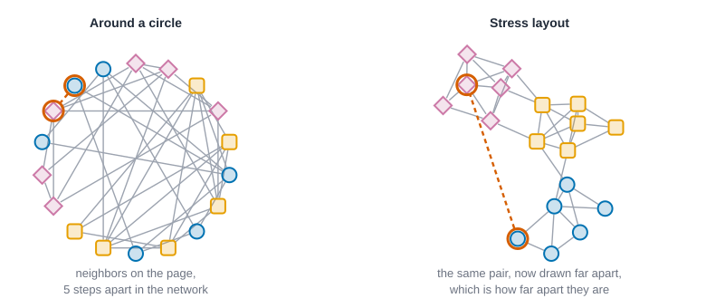
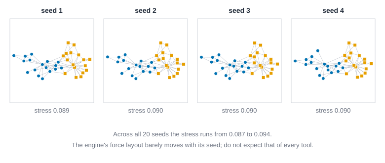
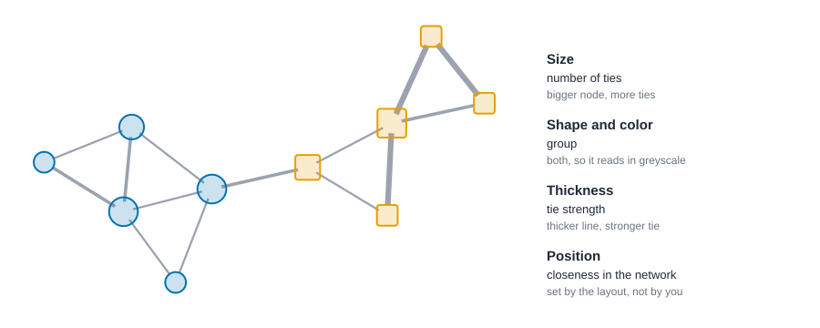
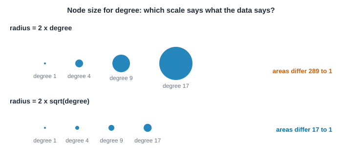
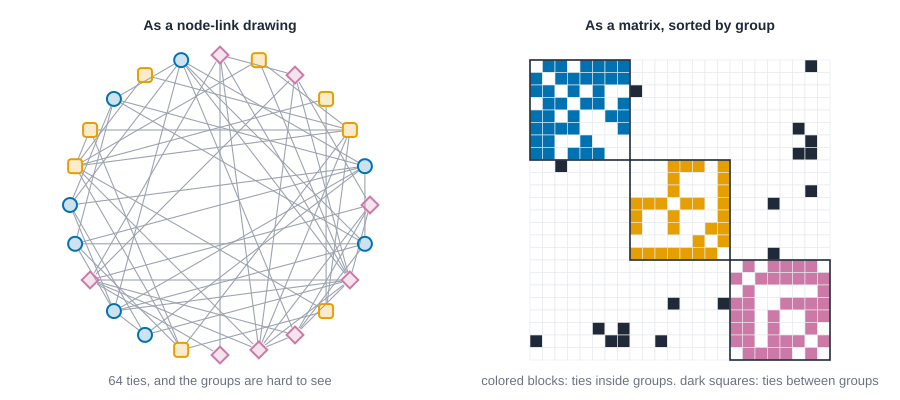
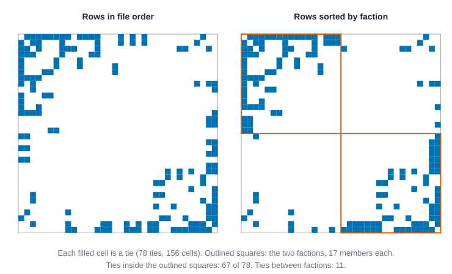

# Visualization {#sec-visualization}

::: {.callout-note appearance="simple"}
## Prerequisites
@sec-networks-as-data. If you want to run the code, @sec-getting-started shows how to load a network. The ideas in this chapter work without it.
:::

## A picture is an argument

Network pictures are the most tempting thing in this field. They're beautiful, they get shared, and they make a room full of strangers lean in. They're also the easiest place to fool yourself, because a picture feels like evidence when it's often closer to an opinion.

Here's the catch. In a network, a node has no natural location. There's no map to anchor it to, no axis that means anything. Where you put each dot is a choice, and that choice decides which structure the reader sees. We touched on this in @sec-introduction with two teams that shared a table of attributes but not a pattern of ties. This chapter is about drawing networks so the picture says what the data says, and about noticing when a picture says more than it should.

By the end you should be able to explain what a layout algorithm is trying to do, pick one for your question, choose visual encodings that survive a black-and-white printer, and know when to give up on dots and lines altogether.

## A short history of drawing relations

Drawing social relations is as old as the field. Jacob Moreno's *Who Shall Survive?* [@moreno1934who] is full of what he called sociograms: hand-drawn diagrams of who chose whom, built to make the structure of a group visible at a glance. Linton Freeman's history of the field [@freeman2004development] follows how pictures like these, and the arguments about how to draw them well, ran alongside the measures we meet in later chapters.

Early diagrams were drawn by hand, and the person drawing moved nodes around until the picture looked right. That's a useful memory. When you move nodes around until the picture looks right, you're doing exactly what a layout algorithm does, just slowly. The algorithms automate a judgment about what "right" means, and different algorithms mean different things by it.

## Positions are free, so they need a rule

Look at @fig-layout-matters. It's one network of eighteen people in three groups, drawn three ways. Nothing about the data changed between panels. Only the positions did.

{#fig-layout-matters fig-alt="Three drawings of the same eighteen nodes, which belong to three groups drawn as circles, squares and diamonds. In the first, positions are random and ties form a tangle. In the second, nodes sit on a circle and many ties cross the middle. In the third, each group forms its own tight cluster with a few ties between the clusters."}

The first panel scatters the nodes at random. The second puts them around a circle in the order they happen to appear in the file. Both are honest in the sense that every tie is there, and both are close to useless for seeing groups. The third panel uses a *stress layout*, and the three groups jump out.

A good layout turns a vague wish ("show me the structure") into a rule a computer can follow. The most common rule is this: **people who are close in the network should be close on the page, and people who are far apart in the network should be far apart on the page.**

## How layout algorithms think

You don't need the math to use a layout, but one idea is worth having. Take every pair of people, find how many steps apart they are in the network (their graph distance, which we meet properly in @sec-paths-and-cohesion), and compare that to how far apart you drew them. The mismatch, added up over all pairs, is called *stress*. A stress layout moves the nodes to make that total mismatch as small as it can [@gansner2005graph]. For the curious, the quantity being minimized is

$$
\text{stress} = \sum_{i<j} w_{ij}\,\big(\lVert x_i - x_j\rVert - d_{ij}\big)^2, \qquad w_{ij} = d_{ij}^{-2},
$$

where $x_i$ is where person $i$ sits on the page, $d_{ij}$ is the number of steps between $i$ and $j$, and the weights $w_{ij}$ make mismatches between near neighbors count more than mismatches between distant pairs. In words: care most about getting the neighbors right.

Several families of layouts share this spirit:

- **Spring layouts.** Imagine every tie is a spring and every node pushes other nodes away. Let go and the whole thing settles into a shape. Fruchterman and Reingold's classic version [@fruchterman1991graph] works like this. Kamada and Kawai's [@kamada1989algorithm] sets each spring's resting length to the graph distance between its two ends, which makes it a close cousin of stress. A popular variant tuned for large networks and for interactive exploration is ForceAtlas2 [@jacomy2014forceatlas2], the default layout in Gephi [@bastian2009gephi].
- **Stress and scaling layouts.** These work directly from the distances. They're related to multidimensional scaling, the older statistical idea of recovering a map from a table of distances [@torgerson1952multidimensional; @kruskal1964multidimensional; @borg2005modern]. Brandes and Pich compare how well several ways of doing this perform [@brandes2009experimental], and for big networks there are faster approximations, such as sparse stress [@ortmann2017sparse].
- **Geometric layouts.** Circles, grids and lines. Nothing in them depends on the data, which is their strength (nothing is hidden) and their weakness (nothing is revealed). A mathematical cousin, Tutte's "How to Draw a Graph" [@tutte1963draw], shows that for some graphs the placement can be pinned down by a simple rule, and is a landmark in the field of graph drawing.

If you only remember one recommendation, make it this: start with a stress layout for small and medium networks, because it tries to make the distances on the page mean something.

## Stress by hand

Before any software, put a number on a picture you can check on paper. Take five people in a row, A tied to B tied to C tied to D tied to E. The graph distances are the number of steps along the row: A to B is 1, A to C is 2, and A to E is 4. Draw them two ways. In the first, on a straight line with one unit between neighbors, every page distance equals the graph distance, so the stress is 0. In the second, on a regular pentagon whose side is 1, each pair of neighbors is still 1 apart on the page, but A and E, four steps apart, are now *neighbors on the page*.

The stress of the pentagon, pair by pair, with the formula above (and $w_{ij} = d_{ij}^{-2}$ written out):

| Pairs | Graph distance $d$ | Page distance | Contribution $(\text{page} - d)^2 / d^2$ |
| --- | --- | --- | --- |
| AB, BC, CD, DE | 1 | 1 | 0 each |
| AE | 4 | 1 | $(1 - 4)^2 / 16 = 0.5625$ |
| AC, BD, CE | 2 | 1.618 | $(1.618 - 2)^2 / 4 = 0.0365$ each |
| AD, BE | 3 | 1.618 | $(1.618 - 3)^2 / 9 = 0.2122$ each |

The diagonals of a regular pentagon with side 1 are $1.618$ (the golden ratio), which is where those page distances come from. The total is $0.5625 + 3(0.0365) + 2(0.2122) \approx 1.096$. The code below should agree, and it names the pair that does the most damage.

Two more layouts of the same five people come from the other families. A **spectral layout** uses the eigenvectors of the *Laplacian* matrix $L = D - A$, where $D$ has each person's degree on its diagonal and $A$ is the adjacency matrix. The reason is a short identity: $x^\top L x = \sum_{i \sim j} (x_i - x_j)^2$, the sum over ties of the squared page distance between the two ends. Making that small pulls tied people together. The smallest eigenvalue of $L$ is 0, with a constant eigenvector that says nothing, so the layout takes the eigenvectors of the second- and third-smallest eigenvalues as its two coordinates. The second one is Fiedler's vector [@fiedler1973algebraic], which we use again to split networks into two groups (@sec-subgroups). **Classical multidimensional scaling** starts from the table of graph distances $D$: square it, double-center it to get $B = -\tfrac12 J D^{\circ 2} J$ with $J = I - \tfrac1n \mathbf{1}\mathbf{1}^\top$, and use the leading eigenvectors of $B$, each multiplied by the square root of its eigenvalue, as coordinates [@torgerson1952multidimensional]. For distances that really are distances on a line, this recovers the line exactly.

::: {.panel-tabset group="language"}

## R

```r
library(knappnet)
library(dplyr)
library(purrr)
library(tibble)
library(tidyr)

# Stress: the sum over pairs of (page distance - graph distance)^2 / graph distance^2.
stress <- \(points, d) {
  page <- as.matrix(dist(points))
  keep <- upper.tri(page)
  sum((page[keep] - d[keep])^2 / d[keep]^2)
}
d5 <- abs(outer(1:5, 1:5, "-"))
line <- cbind(0:4, 0)
radius <- 1 / (2 * sin(pi / 5))
pentagon <- radius * cbind(cos(2 * pi * (0:4) / 5), sin(2 * pi * (0:4) / 5))
tibble(layout = c("straight line", "pentagon with side 1"), stress = round(c(stress(line, d5), stress(pentagon, d5)), 3))

# Which pair does the most damage on the pentagon?
page <- as.matrix(dist(pentagon))
error <- (page - d5)^2 / d5^2
error[!upper.tri(error)] <- 0
worst <- which(error == max(error), arr.ind = TRUE)
tibble(pair = paste(LETTERS[worst[1, ]], collapse = ""), steps_apart = d5[worst], on_the_page = round(page[worst], 3))

# Spectral layout: eigenvectors of the second- and third-smallest eigenvalues of the Laplacian.
fix_sign <- \(v) v * sign(v[which(abs(v) > 1e-9)[1]])
spectral <- \(a) {
  vectors <- eigen(diag(rowSums(a)) - a, symmetric = TRUE)$vectors
  n <- nrow(a)
  cbind(fix_sign(vectors[, n - 1]), fix_sign(vectors[, n - 2]))
}
a5 <- (d5 == 1) * 1
round(spectral(a5), 3) + 0

# Classical scaling of the path distances recovers the straight line.
round(net_mds(d5, 2)$points, 3) + 0
```

::: {.code-output}
```text
```
:::

## Python

```python
import csv
import math

import networkx as nx
import numpy as np

def read(path):
    with open(path) as f:
        return list(csv.DictReader(f))

# Stress: the sum over pairs of (page distance - graph distance)^2 / graph distance^2.
def stress(points, d):
    n = len(points)
    return sum((np.linalg.norm(points[i] - points[j]) - d[i, j]) ** 2 / d[i, j] ** 2 for i in range(n) for j in range(i + 1, n))

d5 = np.array([[abs(i - j) for j in range(5)] for i in range(5)], dtype=float)
line = np.array([[i, 0.0] for i in range(5)])
radius = 1 / (2 * math.sin(math.pi / 5))
pentagon = np.array([[radius * math.cos(2 * math.pi * i / 5), radius * math.sin(2 * math.pi * i / 5)] for i in range(5)])
print(f"stress of the straight line {stress(line, d5):.3f}, of the pentagon with side 1 {stress(pentagon, d5):.3f}")

# Which pair does the most damage on the pentagon?
page = np.linalg.norm(pentagon[:, None] - pentagon[None], axis=2)
worst = max(((i, j) for i in range(5) for j in range(i + 1, 5)), key=lambda p: (page[p] - d5[p]) ** 2 / d5[p] ** 2)
print(f"worst pair: {'ABCDE'[worst[0]]}{'ABCDE'[worst[1]]}, {d5[worst]:.0f} steps apart and {page[worst]:.3f} apart on the page")

# Spectral layout: eigenvectors of the second- and third-smallest eigenvalues of the Laplacian.
def fix_sign(v):
    return v * np.sign(v[np.flatnonzero(np.abs(v) > 1e-9)[0]])

def spectral(a):
    values, vectors = np.linalg.eigh(np.diag(a.sum(axis=1)) - a)
    return np.column_stack([fix_sign(vectors[:, 1]), fix_sign(vectors[:, 2])])

print(np.round(spectral(nx.to_numpy_array(nx.path_graph(5))), 3) + 0)

# Classical scaling of the path distances recovers the straight line.
def classical_mds(dist, k=2):
    """Torgerson's classical scaling: double-centre the squared distances and keep the top eigenvectors."""
    n = len(dist)
    j = np.eye(n) - np.ones((n, n)) / n
    values, vectors = np.linalg.eigh(-0.5 * j @ (dist ** 2) @ j)
    top = np.argsort(values)[::-1][:k]
    return vectors[:, top] * np.sqrt(np.maximum(values[top], 0))

print(np.round(classical_mds(d5), 3) + 0)
```

::: {.code-output}
```text
stress of the straight line 0.000, of the pentagon with side 1 1.096
worst pair: AE, 4 steps apart and 1.000 apart on the page
[[ 0.602  0.512]
 [ 0.372 -0.195]
 [ 0.    -0.632]
 [-0.372 -0.195]
 [-0.602  0.512]]
[[ 2.  0.]
 [ 1.  0.]
 [ 0.  0.]
 [-1.  0.]
 [-2.  0.]]
```
:::

## Rust

```rust
use knappnet::linalg::symmetric_eigen;
use knappnet::matrix::Dense;
use knappnet::metrics::scaling::compute_classical_mds;

// Stress: the sum over pairs of (page distance - graph distance)^2 / graph distance^2.
let page_distance = |p: &[(f64, f64)], i: usize, j: usize| ((p[i].0 - p[j].0).powi(2) + (p[i].1 - p[j].1).powi(2)).sqrt();
let stress = |p: &[(f64, f64)], d: &dyn Fn(usize, usize) -> f64| -> f64 {
    (0..p.len()).flat_map(|i| (i + 1..p.len()).map(move |j| (i, j)))
        .map(|(i, j)| (page_distance(p, i, j) - d(i, j)).powi(2) / d(i, j).powi(2)).sum()
};
let path_distance = |i: usize, j: usize| (i as f64 - j as f64).abs();
let line: Vec<(f64, f64)> = (0..5).map(|i| (i as f64, 0.0)).collect();
let radius = 1.0 / (2.0 * (std::f64::consts::PI / 5.0).sin());
let pentagon: Vec<(f64, f64)> = (0..5).map(|i| {
    let angle = 2.0 * std::f64::consts::PI * i as f64 / 5.0;
    (radius * angle.cos(), radius * angle.sin())
}).collect();
println!("stress of the straight line {:.3}, of the pentagon with side 1 {:.3}", stress(&line, &path_distance), stress(&pentagon, &path_distance));

// Which pair does the most damage on the pentagon?
let damage = |&(i, j): &(usize, usize)| (page_distance(&pentagon, i, j) - path_distance(i, j)).powi(2) / path_distance(i, j).powi(2);
let worst = (0..5).flat_map(|i| (i + 1..5).map(move |j| (i, j)))
    .max_by(|a, b| damage(a).partial_cmp(&damage(b)).unwrap()).unwrap();
println!("worst pair: {}{}, {} steps apart and {:.3} apart on the page",
         "ABCDE".chars().nth(worst.0).unwrap(), "ABCDE".chars().nth(worst.1).unwrap(),
         path_distance(worst.0, worst.1), page_distance(&pentagon, worst.0, worst.1));

// Spectral layout: eigenvectors of the second- and third-smallest eigenvalues of the Laplacian.
let fix_sign = |v: Vec<f64>| -> Vec<f64> {
    let first = v.iter().find(|x| x.abs() > 1e-9).copied().unwrap_or(1.0);
    v.into_iter().map(|x| x * first.signum()).collect()
};
let spectral = |a: &Vec<Vec<f64>>| -> Result<Vec<Vec<f64>>, knappnet::Error> {
    let n = a.len();
    let laplacian: Vec<f64> = (0..n * n).map(|p| {
        let (i, j) = (p / n, p % n);
        if i == j { a[i].iter().sum::<f64>() } else { -a[i][j] }
    }).collect();
    let (_, vectors) = symmetric_eigen(&Dense::from_row_major(n, n, laplacian)?)?;
    let columns: Vec<Vec<f64>> = [1, 2].iter().map(|&c| fix_sign((0..n).map(|i| vectors.get(i, c)).collect())).collect();
    Ok((0..n).map(|i| vec![columns[0][i], columns[1][i]]).collect())
};
let a5: Vec<Vec<f64>> = (0..5).map(|i| (0..5).map(|j| if path_distance(i, j) == 1.0 { 1.0 } else { 0.0 }).collect()).collect();
let tidy = |x: f64| (x * 1000.0).round() / 1000.0 + 0.0; // rounds, and turns -0.0 into 0.0
for row in spectral(&a5)? {
    println!("{:6.3} {:6.3}", tidy(row[0]), tidy(row[1]));
}

// Classical scaling of the path distances recovers the straight line.
let d5 = Dense::from_row_major(5, 5, (0..25).map(|p| path_distance(p / 5, p % 5)).collect())?;
let mds = compute_classical_mds(&d5, 2)?;
println!("dimensions kept: {}", mds.points.cols());
for i in 0..5 {
    println!("{:6.3}", tidy(mds.points.get(i, 0)));
}
```

::: {.code-output}
```text
stress of the straight line 0.000, of the pentagon with side 1 1.096
worst pair: AE, 4 steps apart and 1.000 apart on the page
 0.602  0.512
 0.372 -0.195
 0.000 -0.632
-0.372 -0.195
-0.602  0.512
dimensions kept: 1
 2.000
 1.000
 0.000
-1.000
-2.000
```
:::

:::

The first line agrees with the table: 0 for the line and 1.096 for the pentagon, with A and E the worst pair (4 steps apart, 1 apart on the page). The spectral columns match the formula for a path: the first coordinate is proportional to $\cos\big(\pi(2i-1)/10\big)$, which is $0.951, 0.588, 0, -0.588, -0.951$ before scaling to unit length, and the second is bent the other way, so the five people lie on a shallow horseshoe rather than on a line. Classical scaling needs only one dimension for the path (the second eigenvalue is zero), and returns the line itself: $2, 1, 0, -1, -2$ up to the sign. Three different rules, three different pictures of the same five people. That is the point of the next section, on a network with a real structure.


## Six layouts of one club

Now a network with a real structure. The karate club that Zachary recorded [@zachary1977information] has 34 members and 78 ties, and it split into two sides, Mr. Hi's and the officer's, 17 members each. We know which side every member took, so we can ask of any picture whether it lets that split show. Six layouts are stored in `data/layouts/karate_layouts.csv`, one row per member per layout:

- **Random.** Positions drawn from the small generator the book uses everywhere, so every language draws the same numbers.
- **Circle.** The members in file order around a ring.
- **Force.** The engine's Fruchterman and Reingold layout [@fruchterman1991graph], seed 1.
- **Stress.** The engine's stress layout, seed 1.
- **Spectral.** The Laplacian eigenvectors from the last section, applied to the club.
- **Classical scaling.** Torgerson's method on the table of graph distances.

@fig-karate-layouts shows all six. Before reading the figure, look away from the colors for a moment. Which panels would let a stranger guess that the club has two sides?

{#fig-karate-layouts fig-alt="Six small drawings of the same 34-member network with 78 gray ties. Random scatters the members across the square. Circle puts them on a ring with ties crossing the middle. Force and stress show two loose clusters, blue circles on the left and orange squares on the right. Classical scaling shows blue circles together at the upper right and orange squares spread across the left. Spectral piles most members into one small clump near the middle, with a few blue circles strung out toward the top and the lower right."}

To compare the layouts without squinting, the block below scores each one four ways. All four are computed from the coordinates and the graph distances, so a program can do it.

- **Scale-free stress.** The stress from above, but with the drawing rescaled by the best common factor first. If $p_{ij}$ is the page distance and $d_{ij}$ the graph distance, the factor is $s^* = \sum (p_{ij}/d_{ij}) \big/ \sum (p_{ij}/d_{ij})^2$ and the score is the mean of $\big((s^* p_{ij} - d_{ij})/d_{ij}\big)^2$ over pairs. Making the picture bigger or smaller does not change it. Lower is better.
- **Distance correlation.** The ordinary correlation between page distance and graph distance over all 561 pairs. Higher is better.
- **Sides apart.** The average page distance between pairs on opposite sides of the split, divided by the average for pairs on the same side. A value near 1 means the picture does not separate the sides at all; larger means it does.
- **Crossings.** How many pairs of ties cross each other on the page, counting only pairs of ties that share no member.

The last column asks whether the middle of the picture is where the well-connected people are: the rank correlation between a member's degree and the member's distance from the center of the drawing. A negative number means the well-connected sit nearer the middle. The circle has no middle, so that cell says `n/a`.

::: {.panel-tabset group="language"}

## R

```r
# The karate club, its graph distances, and six stored layouts of it.
members <- read.csv("data/karate/nodes.csv") |> as_tibble()
ties <- read.csv("data/karate/edges.csv") |> as_tibble()
club <- net_frame(select(ties, source, target), nodes = select(members, id), directed = FALSE)
d <- net_distances(club)
degree <- net_degree(club)

layouts <- read.csv("data/layouts/karate_layouts.csv") |>
  as_tibble() |>
  summarize(points = list(cbind(x, y)), .by = layout) |>
  deframe()

# Pairs of ties that share no member, with the four members named.
tie_pairs <- expand_grid(i = seq_len(nrow(ties)), j = seq_len(nrow(ties))) |>
  filter(i < j) |>
  mutate(a = ties$source[i], b = ties$target[i], c = ties$source[j], e = ties$target[j]) |>
  filter(a != c, a != e, b != c, b != e)

# Scale-free stress, correlation of page and graph distance, how much farther apart the factions sit, and crossings.
quality <- \(points) {
  page <- as.matrix(dist(points))
  keep <- upper.tri(page)
  p <- page[keep]
  g <- d[keep]
  scale <- sum(p / g) / sum((p / g)^2)
  same <- outer(members$faction, members$faction, "==")[keep]
  ccw <- \(a, b, c) (points[c, 2] - points[a, 2]) * (points[b, 1] - points[a, 1]) - (points[b, 2] - points[a, 2]) * (points[c, 1] - points[a, 1])
  tibble(
    stress = mean(((scale * p - g) / g)^2),
    distance_r = cor(p, g),
    sides_apart = mean(p[!same]) / mean(p[same]),
    crossings = with(tie_pairs, sum(ccw(a, b, c) * ccw(a, b, e) < -1e-9 & ccw(c, e, a) * ccw(c, e, b) < -1e-9))
  )
}

# Is the middle of the picture where the well-connected people are?
centre_link <- \(points) {
  from_centre <- sqrt(rowSums(sweep(points, 2, colMeans(points))^2))
  if (sd(from_centre) < 1e-6) NA_real_ else cor(degree, from_centre, method = "spearman")
}

cat(sprintf("%d members, %d ties, longest distance %d\n", nrow(club$nodes), nrow(ties), max(d)))
c("random", "circle", "force", "stress", "spectral", "mds") |>
  map(\(name) bind_cols(layout = name, quality(layouts[[name]]), centre_vs_degree = centre_link(layouts[[name]]))) |>
  list_rbind() |>
  mutate(across(c(stress, distance_r, centre_vs_degree), \(x) round(x, 3)), sides_apart = round(sides_apart, 2))
```

::: {.code-output}
```text
```
:::

## Python

```python
# The karate club, its graph distances, and six stored layouts of it.
members = [int(r["id"]) for r in read("data/karate/nodes.csv")]
faction = np.array([r["faction"] for r in read("data/karate/nodes.csv")])
club = nx.Graph()
club.add_nodes_from(members)
club.add_edges_from((int(r["source"]), int(r["target"])) for r in read("data/karate/edges.csv"))
lengths = dict(nx.all_pairs_shortest_path_length(club))
d = np.array([[lengths[a][b] for b in members] for a in members], dtype=float)
degree = np.array([club.degree(v) for v in members])

layouts = {}
for r in read("data/layouts/karate_layouts.csv"):
    layouts.setdefault(r["layout"], []).append((float(r["x"]), float(r["y"])))
layouts = {name: np.array(points) for name, points in layouts.items()}

def ccw(a, b, c):
    return (c[1] - a[1]) * (b[0] - a[0]) - (b[1] - a[1]) * (c[0] - a[0])

def quality(points):
    """Scale-free stress, correlation of page and graph distance, how much farther apart the factions sit, and crossings."""
    n = len(points)
    page = np.linalg.norm(points[:, None] - points[None], axis=2)
    keep = np.triu_indices(n, 1)
    p, g = page[keep], d[keep]
    scale = (p / g).sum() / ((p / g) ** 2).sum()
    same = (faction[:, None] == faction[None])[keep]
    ties = list(club.edges())
    crossings = 0
    for i, (a, b) in enumerate(ties):
        for c, e in ties[i + 1:]:
            if len({a, b, c, e}) == 4:
                pa, pb, pc, pe = (points[x - 1] for x in (a, b, c, e))
                crossings += ccw(pa, pb, pc) * ccw(pa, pb, pe) < -1e-9 and ccw(pc, pe, pa) * ccw(pc, pe, pb) < -1e-9
    return np.mean(((scale * p - g) / g) ** 2), np.corrcoef(p, g)[0, 1], p[~same].mean() / p[same].mean(), int(crossings)

def ranks(x):
    # 1 for the smallest; tied values share the average of their ranks
    x = np.asarray(x)
    return np.array([(x < v).sum() + ((x == v).sum() + 1) / 2 for v in x])

def spearman(x, y):
    return np.corrcoef(ranks(x), ranks(y))[0, 1]

print(f"{club.number_of_nodes()} members, {club.number_of_edges()} ties, longest distance {int(d.max())}")
print(f"{'layout':<9}{'stress':>8}{'distance r':>12}{'sides apart':>13}{'crossings':>11}{'centre vs degree':>18}")
for name in ["random", "circle", "force", "stress", "spectral", "mds"]:
    s, r, ratio, crossings = quality(layouts[name])
    from_centre = np.linalg.norm(layouts[name] - layouts[name].mean(axis=0), axis=1)
    link = "n/a" if from_centre.std() < 1e-6 else f"{spearman(degree, from_centre):.3f}"
    print(f"{name:<9}{s:>8.3f}{r:>12.3f}{ratio:>13.2f}{crossings:>11}{link:>18}")
```

::: {.code-output}
```text
34 members, 78 ties, longest distance 5
layout     stress  distance r  sides apart  crossings  centre vs degree
random      0.377      -0.085         1.02        596             0.350
circle      0.292       0.156         1.28        608               n/a
force       0.089       0.876         2.08         72            -0.563
stress      0.068       0.884         1.79         86            -0.622
spectral    0.387       0.591         1.97         60            -0.535
mds         0.131       0.864         2.25         69            -0.402
```
:::

## Rust

```rust
use knappnet::metrics::descriptive::{compute_distances, PathOptions};
use knappnet::Graph;
use std::collections::BTreeMap;

let read = |path: &str| -> Vec<Vec<String>> {
    std::fs::read_to_string(path).unwrap().lines().skip(1)
        .map(|line| line.split(',').map(|cell| cell.to_string()).collect()).collect()
};
// The karate club, its graph distances, and six stored layouts of it.
let member_rows = read("data/karate/nodes.csv");
let faction: Vec<String> = member_rows.iter().map(|r| r[1].clone()).collect();
let tie_rows = read("data/karate/edges.csv");
let tie_from: Vec<usize> = tie_rows.iter().map(|r| r[0].parse::<usize>().unwrap() - 1).collect();
let tie_to: Vec<usize> = tie_rows.iter().map(|r| r[1].parse::<usize>().unwrap() - 1).collect();
let club = Graph::from_edges(34, &tie_from.iter().map(|&i| i as i64).collect::<Vec<_>>(),
                             &tie_to.iter().map(|&i| i as i64).collect::<Vec<_>>(), None, false)?;
let dist = compute_distances(&club, None, PathOptions::default())?;
let mut degree = vec![0.0; 34];
for (&a, &b) in tie_from.iter().zip(&tie_to) { degree[a] += 1.0; degree[b] += 1.0; }

let mut layouts: BTreeMap<String, Vec<(f64, f64)>> = BTreeMap::new();
for r in read("data/layouts/karate_layouts.csv") {
    layouts.entry(r[0].clone()).or_default().push((r[2].parse().unwrap(), r[3].parse().unwrap()));
}

let mean = |x: &[f64]| x.iter().sum::<f64>() / x.len() as f64;
let pearson = |x: &[f64], y: &[f64]| -> f64 {
    let (mx, my) = (mean(x), mean(y));
    let cov: f64 = x.iter().zip(y).map(|(a, b)| (a - mx) * (b - my)).sum();
    cov / (x.iter().map(|a| (a - mx).powi(2)).sum::<f64>() * y.iter().map(|b| (b - my).powi(2)).sum::<f64>()).sqrt()
};
// Average ranks (tied values share the mean of their ranks) and the rank correlation.
let ranks = |x: &[f64]| -> Vec<f64> {
    x.iter().map(|&v| x.iter().filter(|&&u| u < v).count() as f64
        + (x.iter().filter(|&&u| u == v).count() as f64 + 1.0) / 2.0).collect()
};
let spearman = |x: &[f64], y: &[f64]| pearson(&ranks(x), &ranks(y));
let ccw = |a: (f64, f64), b: (f64, f64), c: (f64, f64)| (c.1 - a.1) * (b.0 - a.0) - (b.1 - a.1) * (c.0 - a.0);

// Scale-free stress, correlation of page and graph distance, how much farther apart the factions sit, and crossings.
let quality = |points: &Vec<(f64, f64)>| -> (f64, f64, f64, usize) {
    let pairs: Vec<(usize, usize)> = (0..34).flat_map(|i| (i + 1..34).map(move |j| (i, j))).collect();
    let p: Vec<f64> = pairs.iter().map(|&(i, j)| ((points[i].0 - points[j].0).powi(2) + (points[i].1 - points[j].1).powi(2)).sqrt()).collect();
    let g: Vec<f64> = pairs.iter().map(|&(i, j)| dist.get(i, j)).collect();
    let scale = p.iter().zip(&g).map(|(a, b)| a / b).sum::<f64>() / p.iter().zip(&g).map(|(a, b)| (a / b).powi(2)).sum::<f64>();
    let stress = mean(&p.iter().zip(&g).map(|(a, b)| ((scale * a - b) / b).powi(2)).collect::<Vec<_>>());
    let between: Vec<f64> = pairs.iter().zip(&p).filter(|(&(i, j), _)| faction[i] != faction[j]).map(|(_, &x)| x).collect();
    let within: Vec<f64> = pairs.iter().zip(&p).filter(|(&(i, j), _)| faction[i] == faction[j]).map(|(_, &x)| x).collect();
    let mut crossings = 0;
    for i in 0..tie_from.len() {
        for j in i + 1..tie_from.len() {
            let ends = [tie_from[i], tie_to[i], tie_from[j], tie_to[j]];
            if (0..4).all(|a| (a + 1..4).all(|b| ends[a] != ends[b])) {
                let q = |k: usize| points[ends[k]];
                if ccw(q(0), q(1), q(2)) * ccw(q(0), q(1), q(3)) < -1e-9 && ccw(q(2), q(3), q(0)) * ccw(q(2), q(3), q(1)) < -1e-9 {
                    crossings += 1;
                }
            }
        }
    }
    (stress, pearson(&p, &g), mean(&between) / mean(&within), crossings)
};

println!("{} members, {} ties, longest distance {}", club.node_count(), tie_from.len(),
         (0..34).flat_map(|i| (0..34).map(move |j| (i, j))).map(|(i, j)| dist.get(i, j)).fold(0.0, f64::max));
println!("{:<9}{:>8}{:>12}{:>13}{:>11}{:>18}", "layout", "stress", "distance r", "sides apart", "crossings", "centre vs degree");
for name in ["random", "circle", "force", "stress", "spectral", "mds"] {
    let points = &layouts[name];
    let (s, r, ratio, crossings) = quality(points);
    let (cx, cy) = (mean(&points.iter().map(|p| p.0).collect::<Vec<_>>()), mean(&points.iter().map(|p| p.1).collect::<Vec<_>>()));
    let from_centre: Vec<f64> = points.iter().map(|p| ((p.0 - cx).powi(2) + (p.1 - cy).powi(2)).sqrt()).collect();
    let spread = (from_centre.iter().map(|x| (x - mean(&from_centre)).powi(2)).sum::<f64>() / 34.0).sqrt();
    let link = if spread < 1e-6 { "n/a".to_string() } else { format!("{:.3}", spearman(&degree, &from_centre)) };
    println!("{:<9}{:>8.3}{:>12.3}{:>13.2}{:>11}{:>18}", name, s, r, ratio, crossings, link);
}
```

::: {.code-output}
```text
34 members, 78 ties, longest distance 5
layout     stress  distance r  sides apart  crossings  centre vs degree
random      0.377      -0.085         1.02        596             0.350
circle      0.292       0.156         1.28        608               n/a
force       0.089       0.876         2.08         72            -0.563
stress      0.068       0.884         1.79         86            -0.622
spectral    0.387       0.591         1.97         60            -0.535
mds         0.131       0.864         2.25         69            -0.402
```
:::

:::


The three layouts that work from graph distances do what they claim. Their scale-free stress is 0.068 for the stress layout, 0.089 for the force layout and 0.131 for classical scaling, against 0.377 for random positions, and their page distances correlate with graph distances at 0.884, 0.876 and 0.864. They also pull the sides apart (the opposite sides sit 1.79 to 2.25 times farther apart than people on the same side), which nobody asked them to do. Their crossings are 86, 72 and 69 against 596 for random.

{#fig-layout-quality fig-alt="A horizontal bar chart of six layouts. Random 0.377, circle 0.292, force 0.089, stress 0.068, spectral 0.387 and classical scaling 0.131. The force, stress and classical scaling bars are blue and the others gray. Spectral has the longest bar and stress the shortest."}

Random positions score 1.02 on "sides apart": the picture knows nothing about the split, as it should, and that makes 1 a useful floor to read the others against. The circle, which also ignores the data, scores 1.28 and has the most crossings of all (608), so a ring is not a neutral choice either. It makes neighbors in the file look like neighbors on the page, and 608 crossings is what a ring does to a network where most ties are not between neighbors in the file.

The spectral layout is the odd one. Its stress, 0.387, is the worst of the six, a little worse than random, yet it has the fewest crossings (60) and separates the sides well (1.97). In @fig-karate-layouts most members are piled into one small clump, with a few blue circles strung out away from it. I have not worked out which members those are or why, and I would not guess from the picture. What the numbers say is enough for a decision: fewest crossings and a clear gap between sides did not make it a faithful picture of distances, and a reader who judged by crossings alone would have chosen it.

On the question about the middle: for the stress layout the rank correlation between degree and distance from the center is $-0.622$, and for the force layout $-0.563$, so the well-connected members do sit nearer the middle, as the rule of thumb in the next section says. But for the random layout the same number is $+0.350$, which is a draw with no reason behind it, and the spread of that number across layouts is a reminder that it is a property of one picture. The measure to use for "well connected" is degree itself (@sec-centrality), not the picture.

## Raw stress, scale, and what other tools do

Two practical points hide in the scores above. The first is why they are called scale-free. The raw version of stress, the sum from the formula earlier, depends on how big you drew the picture, because $\lVert x_i - x_j \rVert$ grows with the drawing while $d_{ij}$ does not. The block below scores the circle, force and stress layouts both ways, then enlarges the stress layout tenfold. The raw number explodes from 37.9 to 42,409.3 while the picture, and its scale-free score, have not changed. If you compare two layouts on raw stress and one was drawn bigger, you have compared sizes.

The second point is that tools differ. The engine in Rust and R has a stress layout and a force layout and, with a seed, makes the same pictures again; the block checks this against the stored files. NetworkX has no stress layout. Its nearest neighbor is Kamada and Kawai's [@kamada1989algorithm], and its force layout is its own implementation, so the Python tab prints scores for those instead. They are close to the engine's for Kamada-Kawai and a little worse for the spring layout, but they are different pictures, not the same ones.

::: {.panel-tabset group="language"}

## R

```r
# Raw stress depends on the size of the drawing; the scale-free version does not.
raw_stress <- \(points) {
  page <- as.matrix(dist(points))
  keep <- upper.tri(page)
  sum((page[keep] - d[keep])^2 / d[keep]^2)
}
c("circle", "force", "stress") |>
  map(\(name) tibble(layout = name, raw_stress = raw_stress(layouts[[name]]), scale_free = quality(layouts[[name]])$stress)) |>
  list_rbind() |>
  mutate(across(where(is.double), \(x) round(x, 3)))
tibble(raw = raw_stress(10 * layouts$stress), scale_free = quality(10 * layouts$stress)$stress) |>
  mutate(raw = round(raw, 1), scale_free = round(scale_free, 3))

# The engine makes the stored layouts, and with a seed it makes the same ones again.
again <- list(
  circle = net_layout(club, "circle"),
  force = net_layout(club, "fr", seed = 1),
  stress = net_layout(club, "stress", seed = 1)
)
tibble(layout = names(again), largest_difference = map_dbl(names(again), \(name) max(abs(unname(again[[name]]) - unname(layouts[[name]])))))
```

::: {.code-output}
```text
```
:::

## Python

```python
# Raw stress depends on the size of the drawing; the scale-free version does not.
def raw_stress(points):
    page = np.linalg.norm(points[:, None] - points[None], axis=2)
    keep = np.triu_indices(len(points), 1)
    return float(((page[keep] - d[keep]) ** 2 / d[keep] ** 2).sum())

for name in ["circle", "force", "stress"]:
    print(f"{name:<7} raw stress {raw_stress(layouts[name]):7.3f}, scale-free {quality(layouts[name])[0]:.3f}")
print(f"stress layout drawn ten times larger: raw {raw_stress(10 * layouts['stress']):.1f}, scale-free {quality(10 * layouts['stress'])[0]:.3f}")

# NetworkX has no stress layout; Kamada-Kawai is the nearest thing, and its force layout is its own implementation.
as_array = lambda layout: np.array([layout[v] for v in members])
for label, points in [("kamada_kawai_layout", as_array(nx.kamada_kawai_layout(club))), ("spring_layout, seed 1", as_array(nx.spring_layout(club, seed=1)))]:
    print(f"NetworkX {label:<22} scale-free stress {quality(points)[0]:.3f}, crossings {quality(points)[3]}")
```

::: {.code-output}
```text
circle  raw stress 169.104, scale-free 0.292
force   raw stress 467.594, scale-free 0.089
stress  raw stress  37.906, scale-free 0.068
stress layout drawn ten times larger: raw 42409.3, scale-free 0.068
NetworkX kamada_kawai_layout    scale-free stress 0.069, crossings 69
NetworkX spring_layout, seed 1  scale-free stress 0.105, crossings 87
```
:::

## Rust

```rust
use knappnet::layout::{layout_circle, layout_fruchterman_reingold, layout_stress_majorization, FrOptions, StressOptions};

// Raw stress depends on the size of the drawing; the scale-free version does not.
let raw_stress = |points: &Vec<(f64, f64)>| -> f64 {
    (0..34).flat_map(|i| (i + 1..34).map(move |j| (i, j)))
        .map(|(i, j)| (((points[i].0 - points[j].0).powi(2) + (points[i].1 - points[j].1).powi(2)).sqrt() - dist.get(i, j)).powi(2) / dist.get(i, j).powi(2)).sum()
};
for name in ["circle", "force", "stress"] {
    println!("{:<7} raw stress {:7.3}, scale-free {:.3}", name, raw_stress(&layouts[name]), quality(&layouts[name]).0);
}
let ten_times: Vec<(f64, f64)> = layouts["stress"].iter().map(|p| (10.0 * p.0, 10.0 * p.1)).collect();
println!("stress layout drawn ten times larger: raw {:.1}, scale-free {:.3}", raw_stress(&ten_times), quality(&ten_times).0);

// The engine makes the stored layouts, and with a seed it makes the same ones again.
let from_engine = |layout: knappnet::layout::Layout| -> Vec<(f64, f64)> { layout.x.iter().zip(&layout.y).map(|(&x, &y)| (x, y)).collect() };
let again = [
    ("circle", from_engine(layout_circle(&club))),
    ("force", from_engine(layout_fruchterman_reingold(&club, &FrOptions { seed: 1, ..Default::default() })?)),
    ("stress", from_engine(layout_stress_majorization(&club, &StressOptions { seed: 1, ..Default::default() })?)),
];
for (name, points) in &again {
    let off = points.iter().zip(&layouts[*name]).map(|(a, b)| (a.0 - b.0).abs().max((a.1 - b.1).abs())).fold(0.0, f64::max);
    println!("{:<7} largest difference from the stored layout {:.6}", name, off);
}
```

::: {.code-output}
```text
circle  raw stress 169.104, scale-free 0.292
force   raw stress 467.594, scale-free 0.089
stress  raw stress  37.906, scale-free 0.068
stress layout drawn ten times larger: raw 42409.3, scale-free 0.068
circle  largest difference from the stored layout 0.000000
force   largest difference from the stored layout 0.000000
stress  largest difference from the stored layout 0.000000
```
:::

:::


The Python lines say that NetworkX's Kamada-Kawai scores 0.069 against the engine's stress layout at 0.068, and that its spring layout scores 0.105 against the engine's force layout at 0.089. The Rust tab asks the engine for the circle, force and stress layouts again with seed 1 and finds that the largest difference from any stored coordinate is 0.000000, so the stored files are exactly what the engine makes; the R tab makes the same check through `net_layout`.

## Distance on the page is a hint, not a measurement

Even the best layout can't do everything. A network with many ties lives in many more "directions" than a flat page has, so the algorithm squeezes. Some distances come out right, others don't, and you can't tell which from looking.

@fig-distance-lies shows the effect from the other side. On the circle, two people sit right next to each other. In the network, they're five steps apart. The circle ignores distance entirely, so adjacency on the page tells you nothing. In the stress layout the same two people land far apart, which is where they belong.

{#fig-distance-lies fig-alt="Left: a circular drawing of an eighteen-node network with two nodes ringed in red that sit next to each other on the circle, joined by a dashed red line. Right: a stress-layout drawing of the same network with the same two nodes ringed in red, now far apart."}

Some rules of thumb follow from this.

- **Don't read the axes.** Left, right, up and down mean nothing. Rotate or flip a layout and it's the same picture. What carries information is relative position: who's near whom.
- **A different run can give a different picture.** Many algorithms start from random positions. Save the random seed so the picture can be reproduced (more on this in @sec-reproducibility).
- **Centers tend to be well connected.** Layouts often pull highly connected people toward the middle, so the center of a picture tends to line up with degree, one kind of centrality (@sec-centrality). But "tends to" is not "is". Check with the measure, not the picture.
- **Don't count crossings as a verdict.** The stress layout in @fig-layout-matters has far fewer crossings than the random one, but fewer crossings isn't the goal. The goal is that distance on the page means something.


### Same layout, twenty seeds

The second bullet says a different run can give a different picture. How different? The file `data/layouts/fr_seeds.csv` holds the engine's force layout of the club from twenty seeds. Because a drawing can be rotated, reflected or moved without changing what it shows, we cannot compare coordinates. We compare the one thing those moves leave alone: the page distance between each pair of members. If two runs agree on those, they tell the same story.

::: {.panel-tabset group="language"}

## R

```r
# Seeds: the same force layout from twenty seeds.
runs <- read.csv("data/layouts/fr_seeds.csv") |>
  as_tibble() |>
  summarize(points = list(cbind(x, y)), .by = seed)
page_distances <- \(points) as.matrix(dist(points))[upper.tri(diag(34))]
runs <- runs |>
  mutate(
    stress = map_dbl(points, \(p) quality(p)$stress),
    agreement = map_dbl(points, \(p) cor(page_distances(points[[1]]), page_distances(p)))
  )
tibble(
  seeds = nrow(runs),
  stress_min = min(runs$stress), stress_median = median(runs$stress), stress_max = max(runs$stress),
  agreement_min = min(runs$agreement[-1]), agreement_max = max(runs$agreement[-1])
) |>
  mutate(across(where(is.double), \(x) round(x, 3)))
runs$points[[1]][1, ] |> round(2)
runs$points[[2]][1, ] |> round(2)
```

::: {.code-output}
```text
```
:::

## Python

```python
# Seeds: the same force layout from twenty seeds.
runs = {}
for r in read("data/layouts/fr_seeds.csv"):
    runs.setdefault(int(r["seed"]), []).append((float(r["x"]), float(r["y"])))
runs = {seed: np.array(points) for seed, points in runs.items()}
page_distances = lambda points: np.linalg.norm(points[:, None] - points[None], axis=2)[np.triu_indices(34, 1)]
stresses = np.array([quality(points)[0] for points in runs.values()])
agreement = np.array([np.corrcoef(page_distances(runs[1]), page_distances(runs[s]))[0, 1] for s in range(2, 21)])
print(f"{len(runs)} seeds: scale-free stress from {stresses.min():.3f} to {stresses.max():.3f}, median {np.median(stresses):.3f}")
print(f"page distances of seed 1 against each other seed: r from {agreement.min():.3f} to {agreement.max():.3f}")
print("member 1 sits at", np.round(runs[1][0], 2), "with seed 1 and", np.round(runs[2][0], 2), "with seed 2")
```

::: {.code-output}
```text
20 seeds: scale-free stress from 0.087 to 0.094, median 0.090
page distances of seed 1 against each other seed: r from 0.958 to 0.984
member 1 sits at [-1.42  0.57] with seed 1 and [-1.46  0.64] with seed 2
```
:::

## Rust

```rust
// Seeds: the same force layout from twenty seeds.
let mut runs: BTreeMap<u32, Vec<(f64, f64)>> = BTreeMap::new();
for r in read("data/layouts/fr_seeds.csv") {
    runs.entry(r[0].parse().unwrap()).or_default().push((r[1].parse().unwrap(), r[2].parse().unwrap()));
}
let page_distances = |points: &Vec<(f64, f64)>| -> Vec<f64> {
    (0..34).flat_map(|i| (i + 1..34).map(move |j| (i, j)))
        .map(|(i, j)| ((points[i].0 - points[j].0).powi(2) + (points[i].1 - points[j].1).powi(2)).sqrt()).collect()
};
let stresses: Vec<f64> = runs.values().map(|p| quality(p).0).collect();
let agreement: Vec<f64> = (2..=20u32).map(|s| pearson(&page_distances(&runs[&1]), &page_distances(&runs[&s]))).collect();
let (lo, hi) = (stresses.iter().cloned().fold(f64::MAX, f64::min), stresses.iter().cloned().fold(f64::MIN, f64::max));
let mut sorted = stresses.clone();
sorted.sort_by(|a, b| a.partial_cmp(b).unwrap());
println!("{} seeds: scale-free stress from {:.3} to {:.3}, median {:.3}", runs.len(), lo, hi, (sorted[9] + sorted[10]) / 2.0);
println!("page distances of seed 1 against each other seed: r from {:.3} to {:.3}",
         agreement.iter().cloned().fold(f64::MAX, f64::min), agreement.iter().cloned().fold(f64::MIN, f64::max));
println!("member 1 sits at ({:.2}, {:.2}) with seed 1 and ({:.2}, {:.2}) with seed 2", runs[&1][0].0, runs[&1][0].1, runs[&2][0].0, runs[&2][0].1);
```

::: {.code-output}
```text
20 seeds: scale-free stress from 0.087 to 0.094, median 0.090
page distances of seed 1 against each other seed: r from 0.958 to 0.984
member 1 sits at (-1.42, 0.57) with seed 1 and (-1.46, 0.64) with seed 2
```
:::

:::


{#fig-layout-seeds fig-alt="Four small drawings of the karate club side by side, labeled seed 1 to seed 4, each with its stress value underneath. All four show the same two loose clusters of blue circles and orange squares in nearly the same places."}

In this engine the force layout hardly moves with its seed. The scale-free stress runs from 0.087 to 0.094 over twenty seeds, and the page distances of seed 1 correlate with the other nineteen runs at no less than 0.958. Member 1 sits at nearly the same spot with seeds 1 and 2. That is good news about this tool and no promise about any other. NetworkX's spring layout, which is a different algorithm, does not behave the same way as the engine's, and a layout started from random positions can settle into pictures that disagree. The habit does not change: save the method and the seed with the figure, and rerun a few seeds before you tell a story from one.

## Ties and nodes can carry information, too

Position is only one of the things you can use. Nodes can vary in size, shape and color. Ties can vary in thickness, style and color. Each of these is a *channel*, and each can carry one idea.

{#fig-encodings fig-alt="A ten-node network drawn in two clusters. Larger nodes have more ties. Circles and squares in different colors mark the two groups. Thicker lines mark stronger ties. A list on the right names each channel and what it encodes."}

A handful of habits keep these channels honest.

1. **One idea per channel.** If node size means number of ties, don't also use size to mean group. Readers will assume size always means the same thing.
2. **Say what each channel means.** A short legend turns a pretty picture into a readable one.
3. **Make color optional.** Pair color with shape or line style, as the figures in this book do, so the picture works in greyscale and for readers who can't tell certain colors apart. The palette here comes from Okabe and Ito's color-blind-friendly set [@okabe2008color]. If you build your own palettes, the colorspace toolbox [@zeileis2020colorspace] can check them.
4. **Match the channel to the data.** Size and thickness suit amounts. Shape and color suit categories. Using a rainbow of colors for a number is hard to read.
5. **Label sparingly.** Names on every node make a crowded picture unreadable. Label the nodes your argument is about.

Where the labels are people, remember the point from @sec-networks-as-data: a node with a name is a person, and a picture can identify someone even if a table wouldn't. Think about who will see the picture before you share it.


### Size, shape, color and width, in code

Two of the habits above are easy to check with numbers. The first is the node-size habit. Suppose degree runs from 1 to 17, as it does in the karate club. If you set a circle's *radius* proportional to degree, the biggest circle has 17 times the radius of the smallest and so 289 times the area. Readers compare areas, not radii, so they see a hub 289 times as big as a member with one tie. Scaling the radius with the square root of degree makes area proportional to degree: 17 to 1 in area, 17 to 1 in ties.

{#fig-encoding-area fig-alt="Two rows of four blue circles for degrees 1, 4, 9 and 17. In the top row, radius grows in step with degree and the last circle is much larger than the others. In the bottom row, radius grows with the square root of degree and the circles grow gently. Labels say the areas differ 289 to 1 on top and 17 to 1 below."}

The block below does the arithmetic, then goes further and draws the club as a string of SVG text, so that every channel is an explicit line of code: circles in blue and squares in orange for the two sides, circle and square size from the square root of degree, and line width from the number of *contexts* in which two members were seen together (the karate edge table records 1 to 7). The colors are the blue and orange of the Okabe and Ito set [@okabe2008color]. Nothing here needs a plotting library, which makes the encoding easy to read and to test: the last two lines count the shapes and the line widths.

::: {.panel-tabset group="language"}

## R

```r
# Encoding: node size from degree. Radius proportional to degree exaggerates; radius proportional to its square root does not.
low <- min(degree)
high <- max(degree)
cat(sprintf("degree runs from %d to %d, a ratio of %.0f to 1\n", low, high, high / low))
cat(sprintf("radius = 2 x degree:       radii %.1f and %.1f px, areas differ %.0f to 1\n", 2 * low, 2 * high, (high / low)^2))
cat(sprintf("radius = 2 x sqrt(degree): radii %.1f and %.1f px, areas differ %.0f to 1\n", 2 * sqrt(low), 2 * sqrt(high), high / low))

# Draw with a string: circles for one faction, squares for the other, line width from the number of shared contexts.
points <- layouts$stress
lowest <- apply(points, 2, min)
span <- max(apply(points, 2, max) - lowest)
place <- \(v) 30 + 440 * (points[v, ] - lowest) / span
line_tags <- ties |>
  mutate(
    from = map(source, place), to = map(target, place),
    tag = sprintf('<line x1="%.1f" y1="%.1f" x2="%.1f" y2="%.1f" stroke="#999" stroke-width="%.1f"/>',
                  map_dbl(from, 1), map_dbl(from, 2), map_dbl(to, 1), map_dbl(to, 2), 0.5 + 0.5 * contexts)
  ) |>
  pull(tag)
node_tags <- members |>
  mutate(
    x = map_dbl(id, \(v) place(v)[[1]]), y = map_dbl(id, \(v) place(v)[[2]]), r = 2 + 2 * sqrt(degree),
    tag = if_else(faction == "Mr. Hi",
      sprintf('<circle cx="%.1f" cy="%.1f" r="%.1f" fill="#0072B2"/>', x, y, r),
      sprintf('<rect x="%.1f" y="%.1f" width="%.1f" height="%.1f" fill="#E69F00"/>', x - r, y - r, 2 * r, 2 * r))
  ) |>
  pull(tag)
svg <- c('<svg xmlns="http://www.w3.org/2000/svg" viewBox="0 0 500 500">', line_tags, node_tags, "</svg>") |> paste(collapse = "\n")
n_tags <- \(tag) lengths(regmatches(svg, gregexpr(tag, svg, fixed = TRUE)))
cat(sprintf("%d lines, %d circles, %d squares\n", n_tags("<line"), n_tags("<circle"), n_tags("<rect")))
cat(sprintf("line widths run from %.1f px (%d context) to %.1f px (%d contexts)\n",
            0.5 + 0.5 * min(ties$contexts), min(ties$contexts), 0.5 + 0.5 * max(ties$contexts), max(ties$contexts)))
```

::: {.code-output}
```text
```
:::

## Python

```python
# Encoding: node size from degree. Radius proportional to degree exaggerates; radius proportional to its square root does not.
low, high = degree.min(), degree.max()
print(f"degree runs from {low} to {high}, a ratio of {high / low:.0f} to 1")
print(f"radius = 2 x degree:       radii {2 * low:.1f} and {2 * high:.1f} px, areas differ {(high / low) ** 2:.0f} to 1")
print(f"radius = 2 x sqrt(degree): radii {2 * math.sqrt(low):.1f} and {2 * math.sqrt(high):.1f} px, areas differ {high / low:.0f} to 1")

# Draw with a string: circles for one faction, squares for the other, line width from the number of shared contexts.
contexts = {(int(r["source"]), int(r["target"])): int(r["contexts"]) for r in read("data/karate/edges.csv")}
points = layouts["stress"]
lowest, span = points.min(axis=0), (points.max(axis=0) - points.min(axis=0)).max()
place = lambda v: 30 + 440 * (points[v - 1] - lowest) / span
parts = ['<svg xmlns="http://www.w3.org/2000/svg" viewBox="0 0 500 500">']
for (a, b), w in contexts.items():
    (x1, y1), (x2, y2) = place(a), place(b)
    parts.append(f'<line x1="{x1:.1f}" y1="{y1:.1f}" x2="{x2:.1f}" y2="{y2:.1f}" stroke="#999" stroke-width="{0.5 + 0.5 * w:.1f}"/>')
for v in members:
    x, y = place(v)
    r = 2 + 2 * math.sqrt(degree[v - 1])
    if faction[v - 1] == "Mr. Hi":
        parts.append(f'<circle cx="{x:.1f}" cy="{y:.1f}" r="{r:.1f}" fill="#0072B2"/>')
    else:
        parts.append(f'<rect x="{x - r:.1f}" y="{y - r:.1f}" width="{2 * r:.1f}" height="{2 * r:.1f}" fill="#E69F00"/>')
parts.append("</svg>")
svg = "\n".join(parts)
print(f"{svg.count('<line')} lines, {svg.count('<circle')} circles, {svg.count('<rect')} squares")
print(f"line widths run from {0.5 + 0.5 * min(contexts.values()):.1f} px ({min(contexts.values())} context) to {0.5 + 0.5 * max(contexts.values()):.1f} px ({max(contexts.values())} contexts)")
```

::: {.code-output}
```text
degree runs from 1 to 17, a ratio of 17 to 1
radius = 2 x degree:       radii 2.0 and 34.0 px, areas differ 289 to 1
radius = 2 x sqrt(degree): radii 2.0 and 8.2 px, areas differ 17 to 1
78 lines, 17 circles, 17 squares
line widths run from 1.0 px (1 context) to 4.0 px (7 contexts)
```
:::

## Rust

```rust
// Encoding: node size from degree. Radius proportional to degree exaggerates; radius proportional to its square root does not.
let (low, high) = (degree.iter().cloned().fold(f64::MAX, f64::min), degree.iter().cloned().fold(f64::MIN, f64::max));
println!("degree runs from {} to {}, a ratio of {:.0} to 1", low, high, high / low);
println!("radius = 2 x degree:       radii {:.1} and {:.1} px, areas differ {:.0} to 1", 2.0 * low, 2.0 * high, (high / low).powi(2));
println!("radius = 2 x sqrt(degree): radii {:.1} and {:.1} px, areas differ {:.0} to 1", 2.0 * low.sqrt(), 2.0 * high.sqrt(), high / low);

// Draw with a string: circles for one faction, squares for the other, line width from the number of shared contexts.
let contexts: Vec<f64> = tie_rows.iter().map(|r| r[2].parse().unwrap()).collect();
let points = &layouts["stress"];
let lowest = (points.iter().map(|p| p.0).fold(f64::MAX, f64::min), points.iter().map(|p| p.1).fold(f64::MAX, f64::min));
let span = (points.iter().map(|p| p.0).fold(f64::MIN, f64::max) - lowest.0).max(points.iter().map(|p| p.1).fold(f64::MIN, f64::max) - lowest.1);
let place = |v: usize| (30.0 + 440.0 * (points[v].0 - lowest.0) / span, 30.0 + 440.0 * (points[v].1 - lowest.1) / span);
let mut svg = String::from("<svg xmlns=\"http://www.w3.org/2000/svg\" viewBox=\"0 0 500 500\">\n");
for k in 0..tie_from.len() {
    let ((x1, y1), (x2, y2)) = (place(tie_from[k]), place(tie_to[k]));
    svg.push_str(&format!("<line x1=\"{:.1}\" y1=\"{:.1}\" x2=\"{:.1}\" y2=\"{:.1}\" stroke=\"#999\" stroke-width=\"{:.1}\"/>\n", x1, y1, x2, y2, 0.5 + 0.5 * contexts[k]));
}
for v in 0..34 {
    let ((x, y), r) = (place(v), 2.0 + 2.0 * degree[v].sqrt());
    if faction[v] == "Mr. Hi" {
        svg.push_str(&format!("<circle cx=\"{:.1}\" cy=\"{:.1}\" r=\"{:.1}\" fill=\"#0072B2\"/>\n", x, y, r));
    } else {
        svg.push_str(&format!("<rect x=\"{:.1}\" y=\"{:.1}\" width=\"{:.1}\" height=\"{:.1}\" fill=\"#E69F00\"/>\n", x - r, y - r, 2.0 * r, 2.0 * r));
    }
}
svg.push_str("</svg>");
println!("{} lines, {} circles, {} squares", svg.matches("<line").count(), svg.matches("<circle").count(), svg.matches("<rect").count());
let (fewest, most) = (contexts.iter().cloned().fold(f64::MAX, f64::min), contexts.iter().cloned().fold(f64::MIN, f64::max));
println!("line widths run from {:.1} px ({} context) to {:.1} px ({} contexts)", 0.5 + 0.5 * fewest, fewest, 0.5 + 0.5 * most, most);
```

::: {.code-output}
```text
degree runs from 1 to 17, a ratio of 17 to 1
radius = 2 x degree:       radii 2.0 and 34.0 px, areas differ 289 to 1
radius = 2 x sqrt(degree): radii 2.0 and 8.2 px, areas differ 17 to 1
78 lines, 17 circles, 17 squares
line widths run from 1.0 px (1 context) to 4.0 px (7 contexts)
```
:::

:::


The counts match the data: 78 lines for 78 ties, 17 circles for Mr. Hi's side and 17 squares for the officer's. Line widths run from 1.0 px for a tie seen in one context to 4.0 px for a tie seen in seven. The squares do the job that color cannot do in greyscale; the legend would say that size means degree, shape and color mean the side, and width means contexts.

## When the hairball wins, switch pictures

Add enough ties and any node-link drawing becomes what network people call a hairball: a ball of lines in which nothing can be seen. No layout can rescue a network that's dense enough, because there simply isn't room on a page.

The fix isn't a cleverer algorithm. It's a different picture. An *adjacency matrix* (the table from @sec-networks-as-data) shows every possible tie as a cell, so nothing overlaps. And if you sort the rows and columns so people in the same group sit together, the structure appears.

{#fig-hairball-matrix fig-alt="Left: a tangled circular drawing of twenty-four nodes in three groups. Right: a twenty-four by twenty-four grid of squares, with three dense blocks along the diagonal outlined in black and very few filled squares outside them."}

In @fig-hairball-matrix the picture on the left hides what the one on the right makes obvious: three dense blocks and a few ties between them. We'll return to this when we look for subgroups (@sec-subgroups) and positions (@sec-positions-and-roles), where sorting a matrix is the core idea, not just a drawing trick.

Two warnings. First, a matrix is only as good as its ordering. Sort by the wrong thing and the blocks vanish, so say how you sorted. Second, if you thin out a network to make it drawable, for example by hiding ties below some strength, you've made an analytic choice. Report the threshold, and check that your conclusion survives a different one.


### The sorted matrix, in code

The matrix for the club sorted by side is the picture to try when the node-link drawing will not settle the question. Sorting is a one-line decision, and it is the whole of the technique: put Mr. Hi's members first, the officer's second, in file order within each side, and count the ties in each block.

{#fig-karate-matrix fig-alt="Two 34 by 34 grids of cells. In the left grid, rows in file order, filled blue cells crowd the top-left and bottom-right corners and are scattered elsewhere. In the right grid, the members are sorted by faction and two outlined squares along the diagonal, each 17 by 17, hold most of the filled cells, with a few filled cells outside them."}

::: {.panel-tabset group="language"}

## R

```r
# The matrix, sorted by faction.
order_ids <- members |> arrange(faction != "Mr. Hi", id) |> pull(id)
cat(sprintf("Mr. Hi rows end with member %d; Officer rows start with member %d\n", order_ids[17], order_ids[18]))
sizes <- members |> count(hi = faction == "Mr. Hi")
n_hi <- sizes$n[sizes$hi]
n_of <- sizes$n[!sizes$hi]
capacity <- tibble(
  block = c("Mr. Hi block", "Officer block", "between the blocks"),
  possible = c(n_hi * (n_hi - 1) / 2, n_of * (n_of - 1) / 2, n_hi * n_of)
)
ties |>
  mutate(block = case_when(
    members$faction[source] == "Mr. Hi" & members$faction[target] == "Mr. Hi" ~ "Mr. Hi block",
    members$faction[source] != "Mr. Hi" & members$faction[target] != "Mr. Hi" ~ "Officer block",
    .default = "between the blocks")) |>
  count(block, name = "ties") |>
  left_join(capacity, by = "block") |>
  arrange(match(block, capacity$block)) |>
  mutate(density = round(ties / possible, 3))
```

::: {.code-output}
```text
```
:::

## Python

```python
# The matrix, sorted by faction.
order = sorted(members, key=lambda v: (faction[v - 1] != "Mr. Hi", v))
print(f"Mr. Hi rows end with member {order[16]}; Officer rows start with member {order[17]}")
a = nx.to_numpy_array(club, nodelist=order)
hi = [i for i, v in enumerate(order) if faction[v - 1] == "Mr. Hi"]
of = [i for i, v in enumerate(order) if faction[v - 1] != "Mr. Hi"]
within_hi, within_of, between = a[np.ix_(hi, hi)].sum() / 2, a[np.ix_(of, of)].sum() / 2, a[np.ix_(hi, of)].sum()
print(f"Mr. Hi block: {len(hi)} members, {within_hi:.0f} ties, density {within_hi / (len(hi) * (len(hi) - 1) / 2):.3f}")
print(f"Officer block: {len(of)} members, {within_of:.0f} ties, density {within_of / (len(of) * (len(of) - 1) / 2):.3f}")
print(f"between the blocks: {between:.0f} ties, density {between / (len(hi) * len(of)):.3f}")
```

::: {.code-output}
```text
Mr. Hi rows end with member 22; Officer rows start with member 10
Mr. Hi block: 17 members, 35 ties, density 0.257
Officer block: 17 members, 32 ties, density 0.235
between the blocks: 11 ties, density 0.038
```
:::

## Rust

```rust
// The matrix, sorted by faction.
let mut order: Vec<usize> = (0..34).collect();
order.sort_by_key(|&v| (faction[v] != "Mr. Hi", v));
println!("Mr. Hi rows end with member {}; Officer rows start with member {}", order[16] + 1, order[17] + 1);
let mut ties_in = [0usize; 3]; // Mr. Hi block, Officer block, between
for (&a, &b) in tie_from.iter().zip(&tie_to) {
    let (ha, hb) = (faction[a] == "Mr. Hi", faction[b] == "Mr. Hi");
    ties_in[if ha && hb { 0 } else if !ha && !hb { 1 } else { 2 }] += 1;
}
let (n_hi, n_of) = (order.iter().filter(|&&v| faction[v] == "Mr. Hi").count(), order.iter().filter(|&&v| faction[v] != "Mr. Hi").count());
println!("Mr. Hi block: {} members, {} ties, density {:.3}", n_hi, ties_in[0], ties_in[0] as f64 / (n_hi * (n_hi - 1) / 2) as f64);
println!("Officer block: {} members, {} ties, density {:.3}", n_of, ties_in[1], ties_in[1] as f64 / (n_of * (n_of - 1) / 2) as f64);
println!("between the blocks: {} ties, density {:.3}", ties_in[2], ties_in[2] as f64 / (n_hi * n_of) as f64);
```

::: {.code-output}
```text
Mr. Hi rows end with member 22; Officer rows start with member 10
Mr. Hi block: 17 members, 35 ties, density 0.257
Officer block: 17 members, 32 ties, density 0.235
between the blocks: 11 ties, density 0.038
```
:::

:::


The sorted matrix says what the layouts could only hint at. Inside Mr. Hi's block 35 of the possible 136 pairs are tied (density 0.257), inside the officer's block 32 of 136 (0.235), and between the sides 11 of the possible 289 (0.038). Put in a sentence: a pair of members on the same side is about 6 to 7 times as likely to be tied as a pair on opposite sides. The left matrix in @fig-karate-matrix, with rows in file order, shows the same 78 ties and gives no such sentence. The only thing that changed is the order of the rows, which is why the order must be reported.

## Pictures that move

A network that changes over time is harder still. You can draw a sequence of snapshots, animate them, or draw time as an axis, and each choice emphasizes something different. Moody, McFarland and Bender-deMoll [@moody2005dynamic] lay out the options and the traps. We return to this in @sec-dynamics.


## What a picture means in different settings

A layout is computed the same way for every network and read very differently. The same karate scores in the table above are the ones to keep in mind: a score is a property of a picture, and what the picture is for decides what you do with it.

| Setting | What the picture is good for | How to read closeness on the page | What it cannot show |
| --- | --- | --- | --- |
| Friendship among members of a club (this chapter) | Seeing whether sides exist and who lies between them | Near on the page tends to mean few steps apart; check the stress score | Why the sides formed, or whether the sides were chosen |
| Advice among managers, from a survey | Finding the few people who are drawn large and labelled | Closeness is steps along reported ties, not working distance | Whether the advice was used, or whether the ties are mutual |
| Collaboration among thousands of authors | A sample or a summary, not the whole network | Almost nothing, because a hairball squeezes everything | Anything about a tie that was filtered out |
| Two networks to compare | Showing both on the same layout and scales | Differences in position are differences in ties only if the layout is shared | Differences hidden by two different layouts |
| A network over time | A shared layout across snapshots | Movement of a node is a change in its ties, if the layout is fixed | The ties in between snapshots |

## A failure, with numbers

Many tools draw a network on a circle unless asked otherwise, because a circle needs no computation. Draw the karate club on a circle and a reader looking for sides sees what @fig-karate-layouts shows: every member the same distance from the center, ties running across the middle in all directions, 608 crossings. The numbers say the same thing: the correlation between page distance and graph distance is 0.156, the sides sit 1.28 times farther apart than members of the same side (random positions give 1.02), and the stress is 0.292 against 0.068 for the stress layout.

The failure is not that the circle is wrong. Every one of the 78 ties is on it. The failure is what a reader will take from it: no sides, a club tied together in every direction. The sorted matrix tells a different story from the same ties. 67 of the 78 lie inside the two sides, and 11 between them. The circle hid a pattern that was in the data all along, and only the second picture checked it. The remedy is not a better circle but the habit of scoring a layout, or sorting a matrix, before drawing a conclusion from a picture.

## One defensible sentence and one that over-claims

The stress layout of the club, the force layout over twenty seeds, and the sorted matrix are enough for a careful sentence.

- **Defensible.** "In a stress layout of the club (scale-free stress 0.068) the two sides occupy different regions, and in a matrix sorted by side 67 of the 78 ties fall inside a side (densities 0.257 and 0.235 inside, 0.038 between). The force layout gives close to the same picture from all twenty seeds I tried. The pictures agree; they do not say why the club split."
- **Over-claiming.** "The picture proves the club split because the two groups are far apart, and the officer's side is the more cohesive one because its members are drawn closer together."

The second sentence takes a distance on the page as a measurement, and the layouts were never told about the split. It also reads cohesion off a picture when the densities are in the table: 0.235 for the officer's side against 0.257 for Mr. Hi's, which does not support it.

## Common misconceptions

- **"Nodes in the middle are the important ones."** In the stress layout, degree and distance from the center have a rank correlation of $-0.622$; in the random layout the same correlation is $+0.350$. A layout can put well-connected members in the middle, but it is not a measure of importance. Compute the measure.
- **"Fewer crossings means a better picture."** The spectral layout has the fewest crossings (60) and the worst stress of the six (0.387, a little worse than random positions). The stress layout has 86 crossings and the lowest stress.
- **"Two groups that look separate are separate."** The sides sit 1.79 to 2.25 times farther apart than members of one side in three good layouts and 1.28 on the circle, from the same ties. The picture depends on the layout; the 67 of 78 ties inside the sides do not.
- **"Radius is the right way to scale a node."** It makes a hub with 17 times the ties cover 289 times the area.
- **"If two layouts differ, one is wrong."** Both can preserve distance about as well and look different, and a rotation is not a difference at all. Compare page distances, not coordinates.
- **"A picture of a network is a picture of the people."** The picture is one of the ways of drawing a set of reports, and it can identify people that a table would not.

### Where tools disagree

- **Stress layouts.** The Rust function and the R function use the same engine and agree with each other. NetworkX has no stress layout; its Kamada-Kawai layout scored 0.069 against the engine's 0.068 on the club, and its spring layout 0.105 against 0.089 for the engine's force layout. The pictures are not the same pictures.
- **Raw and scale-free stress.** The engine can report the raw sum, which depends on how big the picture is. The scale-free score in this chapter is computed by the code shown, not by a library, so that every language gets the same number from the same coordinates.
- **Signs and order of eigenvectors.** The sign of an eigenvector is arbitrary, so a spectral layout may come back flipped, and the first block fixes a sign by making the first non-zero entry positive. The engine has no spectral layout, so the blocks build it from the eigenvectors of the Laplacian, as @fiedler1973algebraic describes.
- **Circle order.** A circle depends on the order of the nodes in the file: sort the members another way and the same ring puts different people side by side. Compare page distances, not coordinates.

## Choosing a picture

Here's a quick guide. None of it is law, but it's a good place to start.

| Situation | Try | Watch out for |
| --- | --- | --- |
| A small or medium network, and you want to see groups | A stress layout | Reading the axes; reading distance too literally |
| A very large network, exploring | A force layout built for scale | Beautiful blobs that mean little |
| A dense network | A sorted adjacency matrix | Unsorted matrices that look like noise |
| Comparing two networks | The same layout and scales for both | Layouts that differ for no reason |
| Showing time | Snapshots on a shared layout | Animations that move nodes needlessly |
| A figure for print | Shape and line style, not only color | Color-only legends |
| Deciding between two layouts | Score both (scale-free stress) and rerun a few seeds | Comparing raw stress between drawings of different size |

## Exercises

1. **By hand.** Draw a path of five people, A through E, twice: once as a straight line in the order A to E, and once on a circle in the order A, C, E, B, D. On the circle, which pairs look close, and are any of them tied?
2. **By hand.** Three people, A tied to B and B tied to C, are drawn as an equilateral triangle with side 1. Use the stress formula from the chapter to compute the stress, and say which pair is responsible.
3. **By hand.** Draw the five-person path on a straight line, but with the people in the order A, C, E, B, D (unit spacing). Compute the stress pair by pair. Is it larger or smaller than the pentagon's 1.096?
4. **Design.** A friend wants to show a network of 2,000 people with 30,000 ties as one picture. Suggest two alternatives to a single node-link drawing, and say what each would reveal and hide.
5. **Coding.** Place the members of the karate club on a circle again, but order them by side first, Mr. Hi's members and then the officer's. Score the layout with the function from the chapter. What changes compared with the circle in file order, and what does not?
6. **Coding.** Multiply every coordinate of the force layout by 100 and compute its raw and scale-free stress. Which of the two changes, and what does that mean for a table that compares layouts?
7. **By hand.** A node of degree 9 and a node of degree 1 are drawn with radius equal to 2 times the square root of degree. Give the two radii and the ratio of areas. What would the ratio be if the radius were 2 times the degree?
8. **Interpretation.** A report says "the two groups are far apart in the network" and points to a layout where the groups sit at opposite corners. Write down three things you would want to check before agreeing.
9. **Coding.** Find the 11 ties of the karate club that run between the two sides. How many members are on one end of at least one of them, and which member is on the most?
10. **Interpretation.** A colleague chose the spectral layout for a figure because it had the fewest crossings. Write a short, kind reply that uses the scores in this chapter.

::: {.callout-note collapse="true" appearance="simple"}
## Worked answers

1. On the line, people who are tied are next to each other and every distance on the page matches the steps. On the circle the order around the ring is A, C, E, B, D, so the pairs side by side are A-C, C-E, E-B, B-D and D-A. None of them is a tie: A and C are two steps apart, C and E two, E and B three, B and D two, and D and A three. All four real ties (A-B, B-C, C-D, D-E) are between people who are second neighbors on the circle.
2. The pairs A-B and B-C are one step apart and drawn one apart, so they contribute 0. A and C are two steps apart and drawn 1 apart, which contributes $(1 - 2)^2 / 2^2 = 0.25$. The stress is 0.25, all of it from the pair A-C.
3. Write the page positions as A 0, C 1, E 2, B 3, D 4. The pairs contribute A-B $(3-1)^2/1 = 4$, A-C $(1-2)^2/4 = 0.25$, A-D $(4-3)^2/9 = 0.111$, A-E $(2-4)^2/16 = 0.25$, B-C $(2-1)^2/1 = 1$, B-D $(1-2)^2/4 = 0.25$, B-E $(1-3)^2/9 = 0.444$, C-D $(3-1)^2/1 = 4$, C-E $(1-2)^2/4 = 0.25$ and D-E $(2-1)^2/1 = 1$. The total is 11.556, ten times the pentagon's. Having the right pairs side by side matters more than having a tidy shape.
4. A matrix of the 2,000 people sorted by a group variable (or a matrix of the groups, with the density between each pair of groups as the cell), which shows block structure and hides who the individuals are. A sample, such as the ties of a few chosen people and their neighbors, which shows what a tie neighborhood looks like and hides the whole. Plotting only ties above a strength is a third option, but it is an analytic choice, so report the threshold. With 2,000 people and 30,000 ties the mean degree is 30, which is why a node-link drawing will be a hairball.
5. The circle in file order scores stress 0.292, distance correlation 0.156, sides apart 1.28 and 608 crossings. With the members ordered by side the scores are 0.286, 0.316, 1.66 and 550. The sides are now apart on the ring, so sides apart rises and the distance correlation doubles, but the crossings barely fall: ties still run across the middle, and a ring has no way to put a member's neighbors next to them. A ring ordered by side is better than a ring in file order and still far behind the stress layout (0.068).
6. The raw stress changes and the scale-free stress does not. The raw score of any layout depends on the size it was drawn at, so a table that compares layouts on raw stress compares sizes unless every layout is first drawn at one scale. Use the scale-free version, or rescale before scoring. (The chapter's code shows the same effect for the stress layout drawn ten times larger: raw 37.9 became 42,409.3, scale-free stayed at 0.068.)
7. The radii are $2\sqrt{9} = 6.0$ and $2\sqrt{1} = 2.0$ px, a ratio of 3 in radius and 9 in area, which matches 9 ties against 1. With radius equal to 2 times the degree the radii would be 18 and 2 px, and the areas would differ 81 to 1.
8. First, whether the picture is a faithful one: score it (stress, correlation of page and graph distance) and compare with another layout of the same network. Second, whether the result survives another seed or another method. Third, whether the ties agree: count ties inside and between the groups, or look at a sorted matrix. Also ask who defined the groups, and remember that the corners of a layout mean nothing.
9. The between-side ties are 1-32, 2-31, 3-10, 3-28, 3-29, 3-33, 9-31, 9-33, 9-34, 14-34 and 20-34. They touch 13 members. Member 3 is on four of them, members 9 and 34 on three each, members 31 and 33 on two each, and eight others on one. (We computed this in Python from the edge table; the answer does not depend on the language.)
10. "Fewer crossings is a nice property, but it is not what the layout is for. On the club, the spectral layout has the fewest crossings (60) and also the highest stress (0.387, a little worse than random positions at 0.377), which tells us that page distances in it do not follow steps in the network. The stress layout has 86 crossings and the lowest stress, 0.068. If we want the picture to show who is near whom, I would use that one and mention the score."
:::

## Summary

::: {.callout-tip appearance="simple"}
A network has no natural place to put its nodes, so every picture is a choice, and the choice shapes what a reader sees. Layout algorithms turn "show the structure" into a rule, most often that nearness on the page should match nearness in the network, as stress layouts try to do, and that rule can be scored: on the karate club the stress, force and classical scaling layouts score 0.068, 0.089 and 0.131 while random positions score 0.377. Even so, distance on the page is a hint, not a measurement, the axes mean nothing, and crossings and the middle of a picture are not verdicts. Use size, shape, color and thickness for one idea each, scale area and not radius, explain them in a legend, and make sure the picture survives greyscale. When a drawing becomes a hairball, switch to a sorted matrix, and say how you sorted. Save the method and the seed with the figure. And remember that a picture of people can expose them.
:::

## Further reading

For the history of network images and the ideas behind them, see @moreno1934who and @freeman2004development. For the layout algorithms mentioned here, see @fruchterman1991graph, @kamada1989algorithm, @gansner2005graph, @ortmann2017sparse and @jacomy2014forceatlas2, and for the statistical roots of scaling, @borg2005modern. For networks that change over time, see @moody2005dynamic. For drawing networks in software, @bastian2009gephi describes Gephi, @batagelj2026pajekmanual documents Pajek, and @epskamp2012qgraph shows how network drawings are used for relationships in psychological data. To practice drawing networks in R, Phil Murphy's tutorials on getting started with igraph [@murphyrpubs523135] and an introduction to R and igraph [@murphyrpubs653242] are a friendly way in, and for a color-blind-friendly palette see @okabe2008color.
