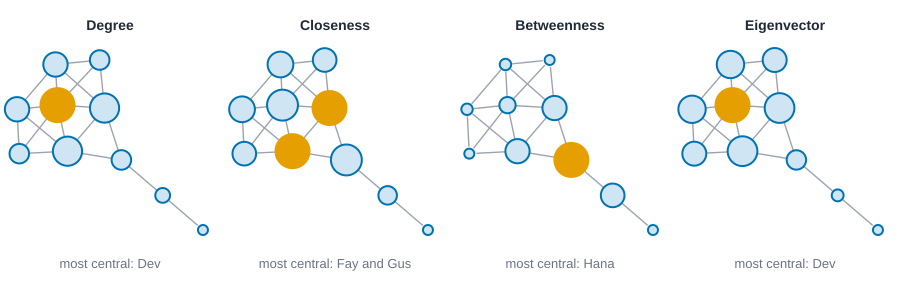
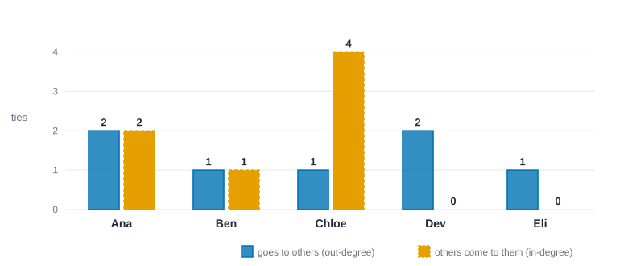
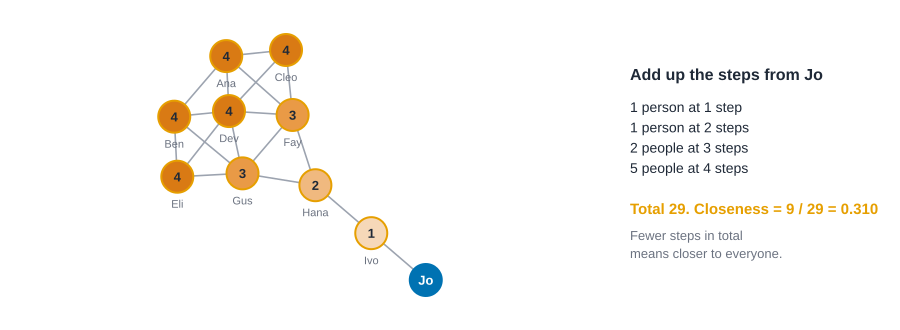
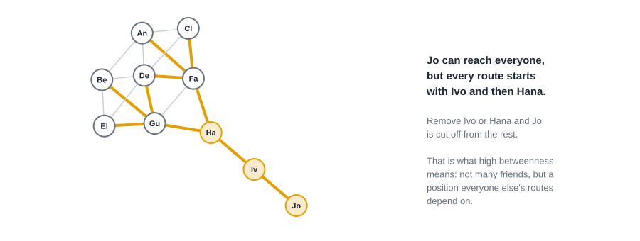
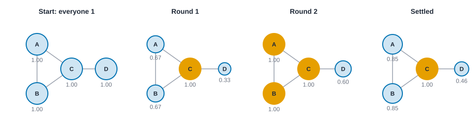
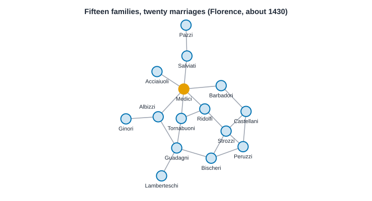
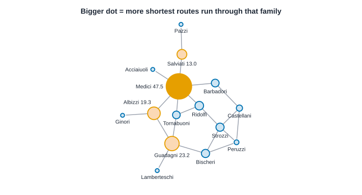
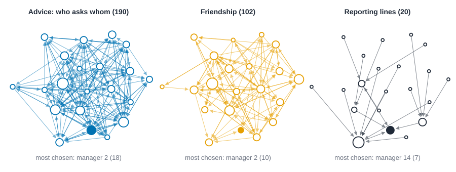
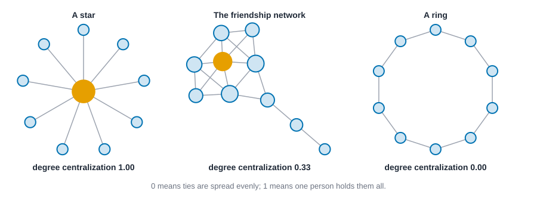

# Centrality and prestige {#sec-centrality}

::: {.callout-note appearance="simple"}
## Prerequisites
@sec-networks-as-data and @sec-getting-started. The idea of who has a structural advantage comes from @sec-foundations, especially the sections on weak ties and structural holes.
:::

## Who matters here?

::: {.callout-tip appearance="simple"}
## Code lives next to the idea
Each measure comes with its code right where it is explained. The Rust blocks in this chapter run top to bottom as one script: the first builds the friendship network, and later ones reuse it.
:::

Put ten people in a group and ask who the most important one is. You'll get an argument, and the argument will be productive, because you'll quickly discover that people mean different things. One person means the best-connected. Another means the person who knows everybody's business. A third means the person without whom the group would fall apart.

Network analysis turns each of those meanings into a number. The numbers are called **centrality** measures, and the first thing to learn about them is that there isn't one. There's a family, and the members disagree on purpose.

@fig-four-centralities shows the point. It's one network of ten friends. This ten-person structure is **Krackhardt's kite**, a small network that has been used since David Krackhardt's paper on power in organizations [@krackhardt1990assessing] to show how differently the measures can behave. We've renamed the people Ana to Jo; the original uses other names, but the ties are the same. If you take a course on network analysis, you will meet the kite again. In each panel, node size shows a different measure, and the largest node is highlighted.

{#fig-four-centralities fig-alt="Four copies of the same ten-node network. In the degree and eigenvector panels the node Dev, near the middle of the left cluster, is the largest. In the closeness panel two nodes, Fay and Gus, are largest and equal. In the betweenness panel Hana, on the narrow link leading out to two more people, is largest."}

Dev has the most friends. Fay and Gus are the closest, on average, to everyone. Hana has only three friends, yet sits on the one road that leads out to Ivo and Jo, and by the betweenness measure she is by far the most central person in the network. Four measures, three different answers. None of them is wrong. Each is a precise answer to a different question, and the work of this chapter is learning to ask the right one.

## Where the idea comes from

Centrality has psychological roots, and it's worth knowing them, because they explain what the measures were *for*.

In the late 1940s, Alex Bavelas and colleagues asked a small-group question: if you control who can talk to whom, what happens to how a group performs? Harold Leavitt's well-known experiment from this tradition [@leavitt1951communication] wired small groups into different communication patterns, such as a wheel, where everyone talks only through one person in the middle, and a circle, where everyone talks to their two neighbors. Groups did differently depending on the pattern, and people in different positions did differently too: they reported differences in how satisfied they were and in how likely they were to emerge as the leader. The takeaway that mattered for network analysis was simple. *Position in a pattern of communication matters, separate from who the person is.*

Linton Freeman's clarifying paper on centrality [@freeman1978centrality] gathered the many intuitions that had grown up since and sorted them into three that still organize the field: centrality as **activity** (how much is going on around this person), centrality as **independence** or efficiency (how close this person is to everyone, so they don't need intermediaries), and centrality as **control** (how much of other people's communication depends on this person). Those three are degree, closeness and betweenness. A fourth idea, that it matters *who* your contacts are and not only how many, gives us eigenvector-style measures.

## Degree: activity

Degree is the number of ties a person has. It's the simplest centrality measure, and the one we've been computing by hand since @sec-introduction. In the friendship network, Dev has six friends, Fay and Gus have five, and Jo has one.

Degree measures *activity* or *exposure*: how many people a person can reach in one step, and how many can reach them. In a network of who talks to whom, it tells you who is at the center of the conversation. In a network of who might pass an infection on, it tells you who has the most opportunities.

### When ties have a direction

In a directed network, degree splits in two. **Out-degree** counts the ties a person sends, and **in-degree** counts the ties they receive. In the advice network from @sec-networks-as-data they come apart sharply.

{#fig-in-out-bars fig-alt="A grouped bar chart for Ana, Ben, Chloe, Dev and Eli. Out-degree bars are solid blue: 2, 1, 1, 2, 1. In-degree bars are dashed orange: 2, 1, 4, 0, 0. Chloe's in-degree bar is the tallest."}

Network analysts use the word **prestige** for what in-degree captures when the tie means something like respect, trust or being sought out [@wasserman1994social]. It's a different quality from activity. Someone can be very active and have no prestige (Dev, who asks two people for advice and is asked by nobody) or highly prestigious and not especially active (Chloe). Before you compute anything, decide whether your question is about who *sends* or who *receives*.

### When ties differ in strength

Counting ties treats a close friend and a nodding acquaintance as the same. If your data carry strengths, you can sum them instead, which gives **strength** (sometimes called weighted degree). That keeps information, but it also mixes two things, how many ties someone has and how strong they are, so that a person with many weak ties can look like a person with a few strong ones. Opsahl and colleagues [@opsahl2010node] proposed a way to blend the two with a tuning parameter, so you can decide how much each should count.

::: {.panel-tabset group="language"}

## R

```r
library(knappnet)
library(dplyr)
library(purrr)

# People are rows of the node table; one row of the edge table is one tie.
people <- c("Ana", "Ben", "Cleo", "Dev", "Eli", "Fay", "Gus", "Hana", "Ivo", "Jo")
friends <- tibble(
  source = people[c(1, 1, 1, 1, 2, 2, 2, 3, 3, 4, 4, 4, 5, 6, 6, 7, 8, 9)],
  target = people[c(2, 3, 4, 6, 4, 5, 7, 4, 6, 5, 6, 7, 7, 7, 8, 8, 9, 10)]
)
g <- net_frame(friends, nodes = tibble(id = people), directed = FALSE)
g

# Measures go in columns next to the people they describe.
g$nodes |> mutate(degree = net_degree(g))
```

::: {.code-output}
```text
# net_frame: 10 nodes, 18 edges
#   directed:  no        mode: one-mode (10 actors)
#   weights:   unweighted
#   time:      static    space: none
#   simple:    no loops, no parallel edges
#   components: 1    isolates: 0    density: 0.400
#
# Nodes (10 x 1)      Edges (18 x 2)
#   id                  source target
#   <chr>               <chr>  <chr>
# 1 Ana               1 Ana    Ben
# 2 Ben               2 Ana    Cleo
# 3 Cleo              3 Ana    Dev
# 4 Dev               4 Ana    Fay
# 5 Eli               5 Ben    Dev
# 6 Fay               6 Ben    Eli
#   ... 4 more rows     ... 12 more rows
# A tibble: 10 × 2
   id    degree
   <chr>  <dbl>
 1 Ana        4
 2 Ben        4
 3 Cleo       3
 4 Dev        6
 5 Eli        3
 6 Fay        5
 7 Gus        5
 8 Hana       3
 9 Ivo        2
10 Jo         1
```
:::

## Python

```python
import networkx as nx

names = ["Ana", "Ben", "Cleo", "Dev", "Eli", "Fay", "Gus", "Hana", "Ivo", "Jo"]
ties = [(0, 1), (0, 2), (0, 3), (0, 5), (1, 3), (1, 4), (1, 6), (2, 3), (2, 5),
        (3, 4), (3, 5), (3, 6), (4, 6), (5, 6), (5, 7), (6, 7), (7, 8), (8, 9)]
g = nx.Graph()
g.add_nodes_from(names)
g.add_edges_from((names[a], names[b]) for a, b in ties)

for name in names:
    print(f"{name:<5} {g.degree(name)}")
```

::: {.code-output}
```text
Ana   4
Ben   4
Cleo  3
Dev   6
Eli   3
Fay   5
Gus   5
Hana  3
Ivo   2
Jo    1
```
:::

## Rust

```rust
use knappnet::{compute_degree, DegreeMode, Graph};

// People are numbered from zero; the names stay in a list on the side.
let names = ["Ana", "Ben", "Cleo", "Dev", "Eli", "Fay", "Gus", "Hana", "Ivo", "Jo"];
// Eighteen friendships. One position in each list is one tie.
let from = [0, 0, 0, 0, 1, 1, 1, 2, 2, 3, 3, 3, 4, 5, 5, 6, 7, 8];
let to = [1, 2, 3, 5, 3, 4, 6, 3, 5, 4, 5, 6, 6, 6, 7, 7, 8, 9];
let g = Graph::from_edges(names.len(), &from, &to, None, false)?;
println!("{}", g.describe().with_labels(&names));

// The `true` counts self-loops; there are none here.
let degree = compute_degree(&g, DegreeMode::All, true);
for (i, name) in names.iter().enumerate() {
    println!("{name:<5} {}", degree[i]);
}
```

::: {.code-output}
```text
Undirected network: 10 nodes, 18 ties
  Density           0.400
  Degree            1 to 6, mean 3.60
  Connected pieces  1
  Isolated nodes    0
  Loops, repeats    none
  Busiest           Dev (6), Fay (5), Gus (5)

Ana   4
Ben   4
Cleo  3
Dev   6
Eli   3
Fay   5
Gus   5
Hana  3
Ivo   2
Jo    1
```
:::

:::

Dev has six friends, the most. Jo has one, and Ivo two. This is what you would get by counting the lines at each name in the picture.

### How to read degree

Degree is a *count*, so it's easy to read, and it's worth being specific about what the count does and doesn't say.

- **A high degree** means a person has many direct contacts. They hear more, can reach more people in one step, and are exposed to more of whatever flows (news, advice, infections). Dev, at 6, is tied to six of the other nine people.
- **A low degree** means few direct contacts. That is not the same as being unimportant: Jo has a single friend, Ivo, and yet the one path out to the rest of the network runs through them both.
- **To compare across networks**, divide by the largest degree possible, which is $n - 1$ (everyone else). Dev's *normalized* degree is $6 / 9 = 0.67$. A degree of 6 in a network of ten is a very different thing from a degree of 6 in a network of ten thousand.
- **What degree can't see:** who the contacts are. Six friends who all know each other, and six friends who each lead to a different part of the network, have the same degree.

## Closeness: independence

Closeness asks how near a person is to everyone else. Take the length of the shortest route from the person to each other person (we'll define these routes properly in @sec-paths-and-cohesion), add the lengths up, and flip it so that a smaller total gives a larger score. A common way to write this, for a network of $n$ people, is

$$
\text{closeness}(i) = \frac{n - 1}{\sum_{j \neq i} d(i, j)},
$$

where $d(i, j)$ is the number of steps on the shortest route from $i$ to $j$. A score of 1 would mean you're one step from everybody. The idea goes back to Sabidussi [@sabidussi1966centrality] and is part of Freeman's "independence" intuition: if you're near everyone, you don't depend on anyone in particular to reach the rest.

There's a catch. If the network has pieces that aren't connected, the distance to someone in another piece is undefined, and the formula breaks. People handle that in different ways. One popular fix is **harmonic centrality**, which adds up the *reciprocals* of the distances, so an unreachable person simply contributes zero [@marchiori2000harmony]. When your network might not be connected, prefer it, and say so.

::: {.panel-tabset group="language"}

## R

```r
g$nodes |> mutate(closeness = round(net_closeness(g, normalized = TRUE), 3))
```

::: {.code-output}
```text
# A tibble: 10 × 2
   id    closeness
   <chr>     <dbl>
 1 Ana       0.529
 2 Ben       0.529
 3 Cleo      0.5  
 4 Dev       0.6  
 5 Eli       0.5  
 6 Fay       0.643
 7 Gus       0.643
 8 Hana      0.6  
 9 Ivo       0.429
10 Jo        0.31 
```
:::

## Python

```python
# On a connected network this is (n - 1) divided by the sum of distances.
close = nx.closeness_centrality(g)
for name in names:
    print(f"{name:<5} {close[name]:.3f}")
```

::: {.code-output}
```text
Ana   0.529
Ben   0.529
Cleo  0.500
Dev   0.600
Eli   0.500
Fay   0.643
Gus   0.643
Hana  0.600
Ivo   0.429
Jo    0.310
```
:::

## Rust

```rust
use knappnet::metrics::closeness::{compute_closeness, ClosenessOptions};

// `normalized` divides by the best possible score, so the answer runs from 0 to 1.
let close = compute_closeness(&g, ClosenessOptions { normalized: true, ..Default::default() })?;
for (i, name) in names.iter().enumerate() {
    println!("{name:<5} {:.3}", close[i]);
}
```

::: {.code-output}
```text
Ana   0.529
Ben   0.529
Cleo  0.500
Dev   0.600
Eli   0.500
Fay   0.643
Gus   0.643
Hana  0.600
Ivo   0.429
Jo    0.310
```
:::

:::

Fay and Gus are the closest to everyone, at 0.643. Hana, the bridge, is close to the whole network at 0.600 even though she has only three friends, and Jo, at the far end of the chain, is farthest at 0.310.

### Closeness by hand: Jo

Here's the whole calculation for Jo, so that no number in the table is a mystery. Count the steps from Jo to each of the other nine people along the shortest route.

| From Jo to... | Route | Steps |
| --- | --- | --- |
| Ivo | straight there | 1 |
| Hana | through Ivo | 2 |
| Fay, Gus | through Ivo and Hana | 3 each |
| Ana, Ben, Cleo, Dev, Eli | one step further, through Fay or Gus | 4 each |

The steps add up to $1 + 2 + 3 + 3 + (5 \times 4) = 29$. With $n - 1 = 9$ other people, closeness is $9 / 29 = 0.310$, matching the table. Now do the same for Fay: she's one step from Ana, Cleo, Dev, Gus and Hana, two from Ben, Eli and Ivo, and three from Jo, so her total is $5 + 6 + 3 = 14$ and her closeness is $9 / 14 = 0.643$.

Here is the same sum drawn on the network. Every person carries their distance from Jo, and the farther away, the darker the shade (@fig-closeness-from-jo).

{#fig-closeness-from-jo fig-alt="The ten-person network. Jo is on the right edge in blue. Each other person shows a number from 1 to 5, the number of steps to Jo, and is shaded darker as the number grows. A side note adds the distances to 29 and gives 9 divided by 29 as 0.310."}

### How to read closeness

- **A high score** means a person can reach everyone in few steps, on average. Information that starts with them arrives quickly, and they don't need to rely on any one go-between. A score of 1 would mean one step from everyone.
- **A low score** means a person is on the edge: it takes many steps to reach the rest. Jo is not "unconnected", just far out.
- **Closeness is an average**, so it's smoothed over everyone. It can hide the fact that a person is very close to a few people and far from many.
- **In big, well-mixed networks** the scores bunch together (everyone is a few steps from everyone), and small differences are not worth much. Closeness is most informative in small or stretched-out networks.

## Betweenness: control of routes

Betweenness asks something different. For every pair of *other* people, how often does the shortest route between them pass through this person? If a person lies on many such routes, a lot of what flows through the network passes through them, and they can slow it down, speed it up or reshape it. This is Freeman's "control" [@freeman1977set].

@fig-betweenness-paths shows it with the friendship network. Every shortest route from Jo to anyone else goes through Ivo and then through Hana.

{#fig-betweenness-paths fig-alt="A ten-node network. Thick orange lines mark the shortest routes starting at the node Jo: Jo to Ivo, Ivo to Hana, then Hana to the two nodes Fay and Gus, and on from them to the rest. Thin gray lines mark ties not on those routes."}

Hana's betweenness is high not because she has many friends but because she holds the only bridge. If you read @sec-foundations you'll recognize the shape: it's the same structure as a weak tie that links two clusters, or a broker spanning a structural hole. Betweenness is the number that tells you how much a person plays that role.

Two practical notes. First, the straightforward way to compute betweenness is slow on big networks, because it needs the shortest routes between every pair. Brandes found a much faster method [@brandes2001faster], and nearly every modern tool uses it. Second, if there are several equally short routes between two people, each gets a share of the credit, which is why you'll see fractional scores, like Ana's 0.8, in the table later in this chapter.

::: {.panel-tabset group="language"}

## R

```r
g$nodes |> mutate(betweenness = round(net_betweenness(g), 1))
```

::: {.code-output}
```text
# A tibble: 10 × 2
   id    betweenness
   <chr>       <dbl>
 1 Ana           0.8
 2 Ben           0.8
 3 Cleo          0  
 4 Dev           3.7
 5 Eli           0  
 6 Fay           8.3
 7 Gus           8.3
 8 Hana         14  
 9 Ivo           8  
10 Jo            0  
```
:::

## Python

```python
# normalized=False gives the plain count of routes, each pair counted once.
between = nx.betweenness_centrality(g, normalized=False)
for name in names:
    print(f"{name:<5} {between[name]:.1f}")
```

::: {.code-output}
```text
Ana   0.8
Ben   0.8
Cleo  0.0
Dev   3.7
Eli   0.0
Fay   8.3
Gus   8.3
Hana  14.0
Ivo   8.0
Jo    0.0
```
:::

## Rust

```rust
use knappnet::{compute_betweenness, BetweennessOptions};

let between = compute_betweenness(&g, BetweennessOptions::default())?;
for (i, name) in names.iter().enumerate() {
    println!("{name:<5} {:.1}", between[i]);
}
```

::: {.code-output}
```text
Ana   0.8
Ben   0.8
Cleo  0.0
Dev   3.7
Eli   0.0
Fay   8.3
Gus   8.3
Hana  14.0
Ivo   8.0
Jo    0.0
```
:::

:::

Hana scores 14, because every shortest route between the dense group and the three people past her runs through her. Ivo scores 8, and Jo, at the very end, scores 0.

### Betweenness by hand

The idea is easiest to see on the smallest interesting network: five people in a line, Ann, Bo, Cy, Di and Ed, with each person tied to the next. Take every pair of people and ask who stands in the middle of their shortest route.

| Pair | Who is in between |
| --- | --- |
| Ann and Cy | Bo |
| Ann and Di | Bo, Cy |
| Ann and Ed | Bo, Cy, Di |
| Bo and Di | Cy |
| Bo and Ed | Cy, Di |
| Cy and Ed | Di |

(Neighbors, like Ann and Bo, have nobody between them.) Count the appearances: Bo is in between 3 times, Cy 4 times, Di 3 times, and Ann and Ed never. Those counts are the betweenness scores: 0, 3, 4, 3, 0. The person in the middle of the line, who has only two friends, scores highest, because the rest of the network can only get across through them.

When two routes are equally short, they share the credit. If a ring had two equally short ways around, each person on the way would get half a point for that pair. That's where fractions like Ana's 0.8 come from.

### How to read betweenness

- **A high score** means a person sits on many of the shortest routes between other people. If something has to pass between two parts of the network, it passes through them. They *could* control, delay, filter or help it along. Hana, at 14, is the clearest case in the kite.
- **A score of 0** means a person never sits between two others, usually because their contacts are already tied to each other, or because they are at the edge of the network.
- **It is very uneven.** A handful of people tend to get high scores and everyone else near zero, so don't expect a smooth ranking.
- **It assumes shortest routes.** If things in your network spread along all routes, or along random ones, betweenness is answering a slightly different question than the one you care about.

## Eigenvector centrality and its relatives: it matters who you know

The first three measures all count something about *you*. The fourth family says that isn't enough: being connected to well-connected people should count for more than being connected to peripheral ones.

**Eigenvector centrality** makes that idea precise. A person's score is proportional to the sum of the scores of their contacts. That sounds circular, and it is, but the circle has a stable solution, which a computer finds by repeating the calculation until the scores stop changing. The idea comes from Bonacich [@bonacich1972factoring]. In the friendship network, Dev and the people near him score high, while Ivo and Jo at the far end score near zero, even though Ivo has two friends. His friends aren't well connected.

Several close relatives are worth knowing by name.

- **Katz centrality** [@katz1953new] counts every route out of a person, not just the shortest, but gives longer routes a smaller weight, so nearby people count more. It also gives everyone a small baseline, which helps when some people have no ties pointing at them.
- **PageRank** [@brin1998anatomy] is the idea behind early web search. Imagine a person clicking links at random, and now and then jumping to a random page. How often do they land on each page? That's the score. It is close in spirit to Katz.
- **Bonacich power** [@bonacich1987power] adds a twist with a tuning number. With a positive setting, being tied to central people raises your score, as in eigenvector centrality. With a negative setting, being tied to *weak* people raises it. That sounds odd, until you think about bargaining: someone who has many options and whose partners have few has the upper hand. The same structure can mean prestige in one setting and power in another, which is a good reminder to think about what your tie means.

::: {.panel-tabset group="language"}

## R

```r
# Scaled so the largest score is 1 (the default).
g$nodes |> mutate(eigenvector = round(net_eigen(g), 3))
```

::: {.code-output}
```text
# A tibble: 10 × 2
   id    eigenvector
   <chr>       <dbl>
 1 Ana         0.732
 2 Ben         0.732
 3 Cleo        0.594
 4 Dev         1    
 5 Eli         0.594
 6 Fay         0.827
 7 Gus         0.827
 8 Hana        0.407
 9 Ivo         0.1  
10 Jo          0.023
```
:::

## Python

```python
# NetworkX scales the scores to unit length; divide by the largest to put the
# top score at 1.
eigen = nx.eigenvector_centrality_numpy(g)
top = max(eigen.values())
for name in names:
    print(f"{name:<5} {eigen[name] / top:.3f}")
```

::: {.code-output}
```text
Ana   0.732
Ben   0.732
Cleo  0.594
Dev   1.000
Eli   0.594
Fay   0.827
Gus   0.827
Hana  0.407
Ivo   0.100
Jo    0.023
```
:::

## Rust

```rust
use knappnet::metrics::eigenvector::{compute_eigenvector_centrality, EigenvectorOptions};

let eigen = compute_eigenvector_centrality(&g, EigenvectorOptions::default())?;
for (i, name) in names.iter().enumerate() {
    println!("{name:<5} {:.3}", eigen.values[i]);
}
```

::: {.code-output}
```text
Ana   0.732
Ben   0.732
Cleo  0.594
Dev   1.000
Eli   0.594
Fay   0.827
Gus   0.827
Hana  0.407
Ivo   0.100
Jo    0.023
```
:::

:::

Dev is at the top, scaled to 1.000, because Dev is tied to many people who are themselves well connected. Hana drops to 0.407: she knows only three people, and one of them is Ivo. Compare that with her betweenness.

### Eigenvector centrality by hand

Four people: Ann, Bo and Cy are all friends with each other, and Di is friends only with Cy. Here is the circle made concrete. Start everyone at a score of 1. Then repeat two steps: give each person a new score equal to the *sum of their friends' scores*, then rescale so the highest score is 1.

| | Ann | Bo | Cy | Di |
| --- | --- | --- | --- | --- |
| Start | 1 | 1 | 1 | 1 |
| Round 1 | 0.67 | 0.67 | 1.00 | 0.33 |
| Round 2 | 1.00 | 1.00 | 1.00 | 0.60 |
| Where it settles | 0.85 | 0.85 | 1.00 | 0.46 |

After round 1, each score is just the person's degree (Cy has 3 friends, Di has 1). In round 2, scores include who the friends are: Ann is friends with Bo and Cy, who both scored well, so Ann catches up with Cy. The scores keep adjusting a little each round and settle where Cy is on top, Ann and Bo a bit behind, and Di well behind. A computer does this in a blink for thousands of people. The settled numbers are what "eigenvector centrality" is.

You can watch the passing game happen on a tiny network in @fig-eigen-rounds.

{#fig-eigen-rounds fig-alt="Four copies of a triangle A, B, C with a tail D attached to C. Dots grow or shrink with scores written beneath. At the start all are 1. After two rounds C is 1, A and B are 1, D is 0.6. Settled, C is 1.00, A and B 0.85 and D 0.46."}

### How to read eigenvector centrality

- **A high score** means a person is tied to many people who are themselves tied to many people. It rewards being in the thick of a well-connected neighborhood.
- **A low score** doesn't mean few friends. It means friends who don't themselves have many. Ivo has two friends and a score of 0.100, because those friends are Hana and Jo.
- **It is a relative measure.** Scores are rescaled so the top person is 1, and what matters is the ordering and the ratios.
- **It concentrates.** In a network with one dense core and a long tail, nearly all the score piles up in the core. If you want to find well-placed people *outside* the biggest cluster, this measure won't help.

## A cheat sheet

| Measure | Question it answers | What it assumes | Watch out for |
| --- | --- | --- | --- |
| Degree | Who has the most ties? | Every tie counts the same | Mixing up sending and receiving in directed data |
| Closeness | Who can reach everyone fastest? | Things travel along shortest routes | Disconnected networks; use harmonic |
| Betweenness | Who sits on the routes between others? | Things travel along shortest routes, one route at a time | Ignores routes that aren't shortest |
| Eigenvector and relatives | Who is tied to well-connected people? | Influence comes through contacts | Scores can concentrate on one dense area |

## Classic data in action

Everything so far used one small invented-looking network. Let's use two famous real ones, to see these measures earn their keep.

### The Medici and the marriages of Florence

In the early 1400s, Florence was run by a handful of wealthy families, and the Medici became the most powerful of them. Why them? They were not the richest, and not the most numerous. John Padgett and Christopher Ansell [@padgett1993robust] looked at the network of *marriages* among the leading families around 1430 and argued that the Medici's strength came from where they sat in it: they were the family that connected the others.

The data are small: 15 families and 20 marriages. A tie between two families means a marriage joined them.

{#fig-florentine-intro fig-alt="A network of fifteen labeled dots joined by twenty lines. The Medici, drawn in orange, sit in the middle with six lines. A few families such as Pazzi and Salviati hang off the edge with only one or two lines."}

@fig-florentine-intro is the network we will measure. Notice that the Medici are in the middle, but they are not obviously bigger than anyone else yet; the figure only shows who is married to whom.

::: {.panel-tabset group="language"}

## R

```r
# Florentine families around 1430: a tie means two families were joined by marriage.
rows <- read.csv("data/florentine/edges.csv")
florence <- net_frame(rows, directed = FALSE)
florence

# The four families with the most routes running through them. The last column
# is the share of all pairs of other families whose shortest routes they sit on.
as_tibble(florence$nodes) |>
  mutate(
    ties = net_degree(florence),
    closeness = net_closeness(florence, normalized = TRUE),
    betweenness = net_betweenness(florence),
    share = betweenness / choose(n() - 1, 2)
  ) |>
  slice_max(betweenness, n = 4) |>
  rename(family = id) |>
  mutate(across(where(is.numeric), \(x) round(x, 3)))
```

::: {.code-output}
```text
# net_frame: 15 nodes, 20 edges
#   directed:  no        mode: one-mode (15 actors)
#   weights:   unweighted
#   time:      static    space: none
#   simple:    no loops, no parallel edges
#   components: 1    isolates: 0    density: 0.190
#
# Nodes (15 x 1)      Edges (20 x 2)
#   id                  source     target
#   <chr>               <chr>      <chr>
# 1 Acciaiuoli        1 Acciaiuoli Medici
# 2 Medici            2 Albizzi    Ginori
# 3 Albizzi           3 Albizzi    Guadagni
# 4 Ginori            4 Bischeri   Guadagni
# 5 Guadagni          5 Barbadori  Castellani
# 6 Bischeri          6 Castellani Peruzzi
#   ... 9 more rows     ... 14 more rows
    family ties closeness betweenness share
1   Medici    6     0.560      47.500 0.522
2 Guadagni    4     0.467      23.167 0.255
3  Albizzi    3     0.483      19.333 0.212
4 Salviati    2     0.389      13.000 0.143
```
:::

## Python

```python
import csv

# Florentine families around 1430: a tie means two families were joined by marriage.
with open("data/florentine/edges.csv") as f:
    rows = [tuple(r) for r in list(csv.reader(f))[1:]]
florence = nx.Graph(rows)

degree = dict(florence.degree())
close = nx.closeness_centrality(florence)
between = nx.betweenness_centrality(florence, normalized=False)

# The four families with the most routes running through them.
top = sorted(florence.nodes, key=lambda v: -between[v])[:4]
n = florence.number_of_nodes()
print(f"{n} families, {len(rows)} marriages")
print(f"{'family':<11} {'ties':>6} {'closeness':>9} {'betweenness':>12}")
for v in top:
    print(f"{v:<11} {degree[v]:>6} {close[v]:>9.3f} {between[v]:>12.1f}")
routes = (n - 1) * (n - 2) // 2
print(f"pairs of other families: {routes}; the top family sits on {100 * between[top[0]] / routes:.0f}% of their shortest routes")
```

::: {.code-output}
```text
15 families, 20 marriages
family        ties closeness  betweenness
Medici           6     0.560         47.5
Guadagni         4     0.467         23.2
Albizzi          3     0.483         19.3
Salviati         2     0.389         13.0
pairs of other families: 91; the top family sits on 52% of their shortest routes
```
:::

## Rust

```rust
// Florentine families around 1430: a tie means two families were joined by marriage.
let text = std::fs::read_to_string("data/florentine/edges.csv")?;
let rows: Vec<(&str, &str)> = text.lines().skip(1).map(|line| line.split_once(',').unwrap()).collect();
let mut families: Vec<&str> = Vec::new();
for &(a, b) in &rows {
    for family in [a, b] {
        if !families.contains(&family) { families.push(family); }
    }
}
let position = |family: &str| families.iter().position(|f| *f == family).unwrap() as i64;
let marry_from: Vec<i64> = rows.iter().map(|row| position(row.0)).collect();
let marry_to: Vec<i64> = rows.iter().map(|row| position(row.1)).collect();
let florence = Graph::from_edges(families.len(), &marry_from, &marry_to, None, false)?;
println!("{}", florence.describe().with_labels(&families));

let degree = compute_degree(&florence, DegreeMode::All, true);
let close = compute_closeness(&florence, ClosenessOptions { normalized: true, ..Default::default() })?;
let between = compute_betweenness(&florence, BetweennessOptions::default())?;

// The four families with the most routes running through them.
let mut order: Vec<usize> = (0..families.len()).collect();
order.sort_by(|&a, &b| between[b].partial_cmp(&between[a]).unwrap());
println!("{} families, {} marriages", families.len(), rows.len());
println!("{:<11} {:>6} {:>9} {:>12}", "family", "ties", "closeness", "betweenness");
for &i in &order[..4] {
    println!("{:<11} {:>6} {:>9.3} {:>12.1}", families[i], degree[i], close[i], between[i]);
}
let routes = (families.len() - 1) * (families.len() - 2) / 2;
println!("pairs of other families: {routes}; the top family sits on {:.0}% of their shortest routes", 100.0 * between[order[0]] / routes as f64);
```

::: {.code-output}
```text
Undirected network: 15 nodes, 20 ties
  Density           0.190
  Degree            1 to 6, mean 2.67
  Connected pieces  1
  Isolated nodes    0
  Loops, repeats    none
  Busiest           Medici (6), Guadagni (4), Strozzi (4)

15 families, 20 marriages
family        ties closeness  betweenness
Medici           6     0.560         47.5
Guadagni         4     0.467         23.2
Albizzi          3     0.483         19.3
Salviati         2     0.389         13.0
pairs of other families: 91; the top family sits on 52% of their shortest routes
```
:::

:::

The Medici have the most marriages (6, against 4 for the next families, Guadagni and Strozzi), the highest closeness (0.560), and an enormous betweenness: 47.5, more than twice the next family. Read the last line of the output slowly. Of the 91 pairs of *other* families, the Medici sit on the shortest route between more than half. If you wanted to get a message, a deal or a marriage proposal between two randomly chosen other families, you would most often go through them.

That is Padgett and Ansell's point in one number. The Medici are well connected, but what set them apart is being the *bridge*: the families around them mostly did not marry each other directly, and the Medici did marry into both sides. Degree shows a lead; betweenness shows a different kind of lead, the kind that comes from being the one who joins separate groups. Four of the families, Acciaiuoli, Ginori, Lamberteschi and Pazzi, have a single marriage each, and their position is the opposite: everything they do goes through one partner.

Two cautions. This is one relation (marriage) at one moment, and Padgett and Ansell's own argument draws on several relations and a lot of history. And a high betweenness describes a *position*; it doesn't prove the position caused the family's rise, though it is a good reason to take that story seriously.

The result is easier to see than to read off a table: size each family by its betweenness and the Medici swallow the picture (@fig-florentine-between).

{#fig-florentine-between fig-alt="The fifteen-family marriage network again, now with dots of different sizes. The Medici dot in the middle is by far the largest and labeled 47.5. Guadagni, Albizzi and Salviati are medium sized and labeled. The families at the edge are tiny."}

### Who do Krackhardt's managers turn to?

David Krackhardt asked the 21 managers of a small manufacturing firm a few simple questions: who do you go to for advice, and who is your friend? He also had the company's chart of who reports to whom [@krackhardt1987cognitive]. That gives three networks on the same 21 people, one of the best-known teaching datasets in the field, and a good test of the difference between *activity* and *prestige*. In each network a tie points from the person who asks to the person who is asked.

{#fig-krackhardt-layers fig-alt="Three copies of the same 21 dots. The left copy has many arrows, the middle fewer, the right is a tree of reporting lines with the filled CEO dot at the top. Manager 2 is the largest dot in the advice and friendship copies; manager 14 is the largest in the reporting copy."}

The same 21 managers carry three different networks (@fig-krackhardt-layers). The advice network is dense, friendship is sparser, and the reporting lines form a tree with the CEO at the top. We will measure each in turn.

::: {.panel-tabset group="language"}

## R

```r
# Krackhardt's 21 managers: three relations among the same people, numbered 1 to 21.
kr <- read.csv("data/krackhardt/edges.csv")
managers <- tibble(id = as.character(1:21))

# One network per relation: advice, friendship, reports_to.
graphs <- kr |>
  split(~relation) |>
  map(\(e) net_frame(tibble(source = as.character(e$from), target = as.character(e$to)),
                     nodes = managers, directed = TRUE))
map_int(graphs, \(h) nrow(h$edges))

# Prestige: how many people name each manager. The top three for each relation.
prestige <- graphs |>
  map(\(h) mutate(h$nodes, received = net_degree(h, mode = "in"))) |>
  list_rbind(names_to = "relation") |>
  rename(manager = id)

prestige |>
  group_by(relation) |>
  slice_max(received, n = 3, with_ties = FALSE)

# Where does the CEO, manager 7, rank for advice?
prestige |>
  filter(relation == "advice") |>
  mutate(rank = min_rank(desc(received))) |>
  filter(manager == "7")
```

::: {.code-output}
```text
    advice friendship reports_to 
       190        102         20 
# A tibble: 9 × 3
# Groups:   relation [3]
  relation   manager received
  <chr>      <chr>      <dbl>
1 advice     2             18
2 advice     18            15
3 advice     21            15
4 friendship 2             10
5 friendship 1              8
6 friendship 12             8
7 reports_to 14             7
8 reports_to 7              4
9 reports_to 21             4
# A tibble: 1 × 4
  relation manager received  rank
  <chr>    <chr>      <dbl> <int>
1 advice   7             13     4
```
:::

## Python

```python
# Krackhardt's 21 managers: three relations among the same people, numbered 1 to 21.
with open("data/krackhardt/edges.csv") as f:
    kr = list(csv.DictReader(f))

def build(relation):
    g = nx.DiGraph()
    g.add_nodes_from(range(1, 22))
    g.add_edges_from((int(r["from"]), int(r["to"])) for r in kr if r["relation"] == relation)
    return g

advice = build("advice")
friendship = build("friendship")
reports_to = build("reports_to")
print(f"advice ties {advice.number_of_edges()}, friendship ties {friendship.number_of_edges()}, "
      f"reporting ties {reports_to.number_of_edges()}")

# Prestige: how many people name each manager. The top three for each relation.
for label, graph in [("sought out for advice", advice), ("named as a friend", friendship),
                     ("has direct reports", reports_to)]:
    top = sorted(graph.nodes, key=lambda v: (-graph.in_degree(v), v))[:3]
    print(f"{label:<22} " + ", ".join(f"manager {v} ({graph.in_degree(v)})" for v in top))
advice_in = dict(advice.in_degree())
rank = sum(d > advice_in[7] for d in advice_in.values()) + 1
print(f"the CEO, manager 7, is sought out by {advice_in[7]} people, rank {rank} of 21")
```

::: {.code-output}
```text
advice ties 190, friendship ties 102, reporting ties 20
sought out for advice  manager 2 (18), manager 18 (15), manager 21 (15)
named as a friend      manager 2 (10), manager 1 (8), manager 12 (8)
has direct reports     manager 14 (7), manager 7 (4), manager 21 (4)
the CEO, manager 7, is sought out by 13 people, rank 4 of 21
```
:::

## Rust

```rust
// Krackhardt's 21 managers: three relations among the same people. Managers are numbered 1 to 21; positions are 0 to 20.
let text = std::fs::read_to_string("data/krackhardt/edges.csv")?;
let build = |relation: &str| -> Result<Graph, knappnet::Error> {
    let mut who = Vec::new();
    let mut whom = Vec::new();
    for line in text.lines().skip(1) {
        let parts: Vec<&str> = line.split(',').collect();
        if parts[2] == relation {
            who.push(parts[0].parse::<i64>().unwrap() - 1);
            whom.push(parts[1].parse::<i64>().unwrap() - 1);
        }
    }
    Graph::from_edges(21, &who, &whom, None, true)
};
let advice = build("advice")?;
let friendship = build("friendship")?;
let reports_to = build("reports_to")?;
println!("advice ties {}, friendship ties {}, reporting ties {}", advice.edge_count(), friendship.edge_count(), reports_to.edge_count());

// Prestige: how many people name each manager. The top three for each relation.
for (label, graph) in [("sought out for advice", &advice), ("named as a friend", &friendship), ("has direct reports", &reports_to)] {
    let received = compute_degree(graph, DegreeMode::In, true);
    let mut order: Vec<usize> = (0..21).collect();
    order.sort_by(|&a, &b| received[b].partial_cmp(&received[a]).unwrap().then(a.cmp(&b)));
    let top: Vec<String> = order[..3].iter().map(|&i| format!("manager {} ({})", i + 1, received[i])).collect();
    println!("{label:<22} {}", top.join(", "));
}
let advice_in = compute_degree(&advice, DegreeMode::In, true);
let rank = advice_in.iter().filter(|&&d| d > advice_in[6]).count() + 1;
println!("the CEO, manager 7, is sought out by {} people, rank {} of 21", advice_in[6], rank);
```

::: {.code-output}
```text
advice ties 190, friendship ties 102, reporting ties 20
sought out for advice  manager 2 (18), manager 18 (15), manager 21 (15)
named as a friend      manager 2 (10), manager 1 (8), manager 12 (8)
has direct reports     manager 14 (7), manager 7 (4), manager 21 (4)
the CEO, manager 7, is sought out by 13 people, rank 4 of 21
```
:::

:::

Look first at the advice relation. Manager 2 is sought out by 18 of the 20 other managers, an extraordinary level of prestige, and the same manager is also the one named most often as a friend (10 people). The next two, managers 18 and 21, are sought out by 15 each. All of these are vice presidents: manager 2 is a vice president with 20 years at the firm, according to the node table that comes with the data.

Now compare with the company chart. Manager 14 has the most direct reports (7). The CEO, manager 7, has four. And in the advice network, the CEO is sought out by 13 people, tied with manager 1 for fourth place. So the person at the top of the organization chart is respected, but isn't where most of the firm goes for advice. The formal structure and the informal one overlap without being the same, which is exactly the observation that made this dataset famous.

Notice also what we did *not* do: we only counted people who named each manager (in-degree). We didn't ask who each manager chooses to ask, which is the out-degree, the activity side of the same network. Exercise 6 asks you to do that. The advice network used here is each manager's *own* report of whom they go to; Krackhardt's study also collected what managers believed about *other people's* ties, a subtler structure that this book doesn't use [@krackhardt1987cognitive].

## From people to networks: centralization

So far we've scored people. Sometimes you want a score for the whole network: is influence concentrated in a few hands, or spread out? **Centralization** answers that. Take a centrality measure, find the person with the highest score, and add up how far everyone else falls below them. Then divide by the largest total that sum could be for a network of that size [@freeman1978centrality]. The result runs from 0 (everyone is equal) to 1 (one person holds everything, like the hub of a star).

{#fig-centralization fig-alt="Three ten-node networks side by side. A star with one hub joined to nine others is labeled 1.00. The friendship network with one slightly larger hub is labeled 0.33. A ring in which everyone has two ties is labeled 0.00."}

For degree, the friendship network comes out at 0.33: Dev stands above the others, but nowhere near the way the hub of a star does. Notice the distance from the star's 1.00 and the ring's 0.00. It's a statement about the whole network, not any one person. The levels-of-analysis warning from @sec-networks-as-data applies in full: a statement about a person is not a statement about the network.

### A convention that changes the number

Here's a good example of why we write down our choices. The default setting in the engine used by this book counts self-loops as possible, and it divides by a maximum that allows for them. For the friendship network, which has no self-loops, that gives 0.267. Switch loops off and you get Freeman's classic 0.333. Same network, same measure, two correct answers under two conventions. Both are in the code below, and neither is wrong. What would be wrong is to compare one tool's number with another's without checking. Each function documents its convention, and the differences between well-known tools are recorded rather than hidden.

::: {.panel-tabset group="language"}

## R

```r
tibble(
  convention = c("default", "loops left out"),
  centralization = round(c(
    net_centralization(g, "degree"),
    net_centralization(g, "degree", loops = FALSE)
  ), 3)
)
```

::: {.code-output}
```text
# A tibble: 2 × 2
  convention     centralization
  <chr>                   <dbl>
1 default                 0.267
2 loops left out          0.333
```
:::

## Python

```python
# NetworkX has no centralization index, so compute it from the definition:
# the summed gap to the top score, divided by the largest sum possible.
n = g.number_of_nodes()
degrees = [d for _, d in g.degree()]
gap = sum(max(degrees) - d for d in degrees)
print(f"default convention   {gap / (n * (n - 1)):.3f}")  # maximum allows for self-loops
print(f"loops left out       {gap / ((n - 1) * (n - 2)):.3f}")  # Freeman's maximum (a star)
```

::: {.code-output}
```text
default convention   0.267
loops left out       0.333
```
:::

## Rust

```rust
use knappnet::metrics::topography::{compute_centralization, CentralizationOptions};

let default = compute_centralization(&g, CentralizationOptions::default())?;
let freeman = compute_centralization(&g, CentralizationOptions { loops: false, ..Default::default() })?;
println!("default convention   {default:.3}");
println!("loops left out       {freeman:.3}");
```

::: {.code-output}
```text
default convention   0.267
loops left out       0.333
```
:::

:::

The same network gets two answers, and neither is a mistake. The second is the number you get from Freeman's original formula, and it is the one this chapter quotes.

## Reading centrality honestly

Put the four sets of results side by side, as the first figure of this chapter does, and you can see the point. Dev leads on degree and eigenvector. Fay and Gus tie on closeness. Hana's betweenness of 14 towers over everyone else's (the next highest is 8.3), and Ivo is near the top on betweenness while low on the rest. A person can be peripheral by one measure and pivotal by another.

Centrality numbers are easy to compute and easy to over-read. A few habits keep you honest.

**Match the measure to the process.** Borgatti [@borgatti2005centrality] made an argument that deserves to be better known: each centrality measure quietly assumes a model of what moves through the network and how. Betweenness assumes things take the shortest route, one trip at a time. That's a good fit for, say, a package that is routed efficiently, and a poor fit for gossip, which spreads in every direction at once. Degree suits things that spread by contact with neighbors. Before you pick a measure, ask what is flowing, and let the answer choose.

**Central doesn't mean important, or good.** A person with high betweenness may be a valuable connector or a bottleneck. A person with high degree may be popular or just chatty. The number locates a *position*; what that position means has to come from what you know about the setting and the ties.

**Check how much your data can bear.** Centrality scores come from the data you collected, and the data are always incomplete. Borgatti, Carley and Krackhardt [@borgatti2006robustness] studied how centrality scores hold up when parts of the network are missing or recorded wrongly. The lesson to take from this line of work is to treat the *rankings* with some humility, especially for people near the boundary you drew (@sec-networks-as-data), and to check whether your conclusions survive a little noise.

**Compare like with like.** Raw scores depend on network size. Degree 6 means something different in a network of ten than in a network of ten thousand. Normalize when you compare, and say how.

**Beware of key-player logic with hidden networks.** In work on covert and illicit groups, analysts often ask which few people, if removed, would most disrupt the group. Borgatti's key player problem [@borgatti2006identifying] is one way to frame it, and Everton's *Disrupting Dark Networks* [@everton2012disrupting] shows how centrality and related ideas are put to work on such networks, including their limits. Cunningham, Everton and Murphy [@cunningham2016understanding] cover the broader question of what you can responsibly conclude from incomplete, intentionally hidden data. The same care applies here as everywhere in this chapter, only more so: the people in those networks may be harmed by a wrong answer.

## Exercises

1. **By hand.** In the friendship network, list every pair of people whose shortest route has to pass through Ivo. Why does Ivo get a betweenness of 8 while Jo, who is farther out, gets 0?
2. **By hand.** Draw a star of five people and a path of five people. Compute degree and betweenness for each person in both. Which network is more centralized, and under which measure?
3. **Design.** You're studying how rumors spread through a school staff. Which of degree, closeness, betweenness or eigenvector would you choose, and what would you assume about how rumors move? What would change if the thing spreading were a formal announcement instead?
4. **Coding.** Compute all four measures for the advice network from @sec-getting-started, treating it as directed. For degree, compute both in and out. Who leads on each? Does anyone lead on more than one?
5. **Coding.** For the Florentine families, find who has the highest *eigenvector* centrality. Is it the Medici? Which other family comes second, and how does that ranking compare with the betweenness ranking?
6. **Coding.** For Krackhardt's managers, compute *out*-degree (who asks the most people for advice) in the advice network. Who is most active as an asker? Is the most active asker also the most sought out?
7. **Interpretation.** A consultant tells a manager, "Hana is the most important person in this team because she has the highest betweenness." Write two sentences that explain what the number does say, and two that explain what it doesn't.

## Summary

::: {.callout-tip appearance="simple"}
Centrality is a family of measures, each answering a different question about position: degree for activity, closeness for how near someone is to everyone, betweenness for control over routes between others, and eigenvector-style measures for being tied to well-connected people. They come from the psychology of communication in small groups and rest on assumptions about what flows through the network. In directed networks, separate sending (activity) from receiving (prestige). Centralization summarizes a whole network and depends on stated conventions. And a centrality score locates a position; what that position means depends on the ties, the setting, and how good your data are.
:::

## Further reading

For the three intuitions behind the classic measures, start with @freeman1978centrality, and for betweenness in particular, @freeman1977set. For the psychology of position in communication patterns, see @leavitt1951communication. For the argument that a centrality measure should match the process you care about, see @borgatti2005centrality, and for how sturdy scores are to imperfect data, @borgatti2006robustness. For the eigenvector family, see @bonacich1972factoring, @bonacich1987power, @katz1953new and @brin1998anatomy, and for weighted ties, @opsahl2010node. For the fast betweenness algorithm, see @brandes2001faster. For the Florentine families, see @padgett1993robust, and for Krackhardt's managers, @krackhardt1987cognitive. For centrality in covert and illicit networks, see @everton2012disrupting and @cunningham2016understanding, together with @borgatti2006identifying. To practice in R, Phil Murphy's tutorials on centrality in statnet [@murphyrpubs546652], on local measures in igraph [@murphyrpubs313180] and on global measures [@murphyrpubs308024] walk through these measures step by step, and his igraph centrality page [@murphyrpubsigraphCentrality] is a handy reference.
