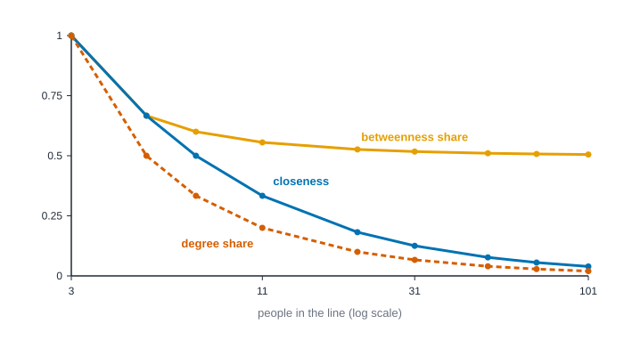
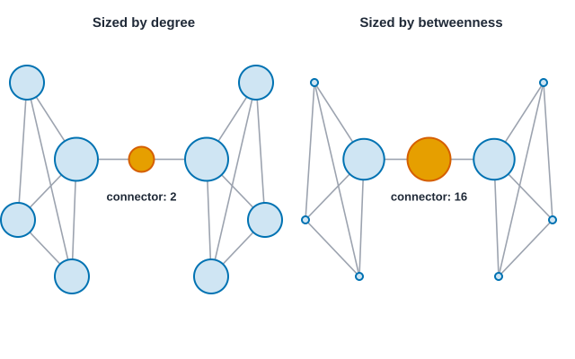

# Centrality and prestige {#sec-centrality}

::: {.callout-note appearance="simple"}
## Prerequisites
@sec-networks-as-data and @sec-getting-started. The idea of who has a structural advantage comes from @sec-foundations, especially the sections on weak ties and structural holes.
:::

## Who matters here?

::: {.callout-tip appearance="simple"}
## Code lives next to the idea
Each measure comes with its code right where it is explained. The Rust blocks in this chapter run top to bottom as one script: the first builds the friendship network, and later ones reuse it.
:::

Put ten people in a group and ask who the most important one is. You'll get an argument, and the argument will be productive, because you'll quickly discover that people mean different things. One person means the best-connected. Another means the person who knows everybody's business. A third means the person without whom the group would fall apart.

Network analysis turns each of those meanings into a number. The numbers are called **centrality** measures, and the first thing to learn about them is that there isn't one. There's a family, and the members disagree on purpose.

@fig-four-centralities shows the point. It's one network of ten friends. This ten-person structure is **Krackhardt's kite**, a small network that has been used since David Krackhardt's paper on power in organizations [@krackhardt1990assessing] to show how differently the measures can behave. We've renamed the people Ana to Jo; the original uses other names, but the ties are the same. If you take a course on network analysis, you will meet the kite again. In each panel, node size shows a different measure, and the largest node is highlighted.

{#fig-four-centralities fig-alt="Four copies of the same ten-node network. In the degree and eigenvector panels the node Dev, near the middle of the left cluster, is the largest. In the closeness panel two nodes, Fay and Gus, are largest and equal. In the betweenness panel Hana, on the narrow link leading out to two more people, is largest."}

Dev has the most friends. Fay and Gus are the closest, on average, to everyone. Hana has only three friends, yet sits on the one road that leads out to Ivo and Jo, and by the betweenness measure she is by far the most central person in the network. Four measures, three different answers. None of them is wrong. Each is a precise answer to a different question, and the work of this chapter is learning to ask the right one.

## Where the idea comes from

Centrality has psychological roots, and it's worth knowing them, because they explain what the measures were *for*.

In the late 1940s, Alex Bavelas and colleagues asked a small-group question: if you control who can talk to whom, what happens to how a group performs? Harold Leavitt's well-known experiment from this tradition [@leavitt1951communication] wired small groups into different communication patterns, such as a wheel, where everyone talks only through one person in the middle, and a circle, where everyone talks to their two neighbors. Groups did differently depending on the pattern, and people in different positions did differently too: they reported differences in how satisfied they were and in how likely they were to emerge as the leader. The takeaway that mattered for network analysis was simple. *Position in a pattern of communication matters, separate from who the person is.*

Linton Freeman's clarifying paper on centrality [@freeman1978centrality] gathered the many intuitions that had grown up since and sorted them into three that still organize the field: centrality as **activity** (how much is going on around this person), centrality as **independence** or efficiency (how close this person is to everyone, so they don't need intermediaries), and centrality as **control** (how much of other people's communication depends on this person). Those three are degree, closeness and betweenness. A fourth idea, that it matters *who* your contacts are and not only how many, gives us eigenvector-style measures.

A short family tree helps with the names. Sabidussi [@sabidussi1966centrality] gave the closeness index. Katz [@katz1953new] proposed a status score for sociometric choices that counts walks of every length, nearer people counting more, and Bonacich [@bonacich1972factoring] proposed the leading eigenvector of the choice matrix as a status score. Freeman [@freeman1977set] defined betweenness. Bonacich [@bonacich1987power] later gave a one-parameter family that runs from degree to eigenvector and can turn negative. PageRank [@brin1998anatomy] is a damped random-walk relative, harmonic centrality [@marchiori2000harmony] repairs closeness for broken networks, and Brandes [@brandes2001faster] made betweenness fast. Textbook treatments to keep beside this chapter are Wasserman and Faust [@wasserman1994social] (their chapter on centrality and prestige), Newman [@newman2018networks], Kolaczyk [@kolaczyk2009statistical] and the free text by Hanneman and Riddle [@hanneman2005introduction].

## Notation, and a network small enough for paper

Every measure here is a function of who is tied to whom, so we fix a few symbols once. A network has $n$ nodes. Its **adjacency matrix** $A$ has entries $a_{ij} = 1$ if there is a tie from $i$ to $j$ and $0$ if not; in an undirected network $a_{ij} = a_{ji}$, and in a weighted one $a_{ij}$ holds the weight. A **walk** is any sequence of ties, revisits allowed; a **path** never revisits a node. The **distance** $d(i, j)$ is the number of steps on a shortest path from $i$ to $j$. We write $\sigma_{st}$ for the number of shortest paths from $s$ to $t$, and $\sigma_{st}(v)$ for how many of those pass through $v$.

Every definition below gets checked against one network small enough to do on paper: a triangle A, B, C with a tail running from C to D to E.

```text
A --- B
 \   /
  \ /
   C --- D --- E
```

Its adjacency matrix, with rows and columns in the order A to E, is

$$
A = \begin{pmatrix}
0 & 1 & 1 & 0 & 0 \\
1 & 0 & 1 & 0 & 0 \\
1 & 1 & 0 & 1 & 0 \\
0 & 0 & 1 & 0 & 1 \\
0 & 0 & 0 & 1 & 0
\end{pmatrix}.
$$

A and B have exactly the same neighbors, so they are interchangeable, and any sensible measure must give them the same score. That is a free check on every table that follows.

## Degree: activity

Degree is the number of ties a person has. It's the simplest centrality measure, and the one we've been computing by hand since @sec-introduction. In the friendship network, Dev has six friends, Fay and Gus have five, and Jo has one.

Degree measures *activity* or *exposure*: how many people a person can reach in one step, and how many can reach them. In a network of who talks to whom, it tells you who is at the center of the conversation. In a network of who might pass an infection on, it tells you who has the most opportunities.

### Degree, formally

For an undirected network,

$$
k_i = \sum_{j} a_{ij}, \qquad k_i^{\text{norm}} = \frac{k_i}{n - 1}.
$$

In a directed network the two sums come apart: **out-degree** $k_i^{\text{out}} = \sum_j a_{ij}$ counts ties sent, and **in-degree** $k_i^{\text{in}} = \sum_j a_{ji}$ counts ties received. Every undirected tie has two ends, so the degrees always add up to twice the number of ties, $\sum_i k_i = 2m$: 36 in the friendship network (18 ties) and 10 in the five-node network (5 ties). If your total is odd, something is wrong with the data. In a directed network the in-degrees and the out-degrees each add up to $m$. On the five-node network the degrees are 2, 2, 3, 2, 1.

### When ties have a direction

In a directed network, degree splits in two. **Out-degree** counts the ties a person sends, and **in-degree** counts the ties they receive. In the advice network from @sec-networks-as-data they come apart sharply.

{#fig-in-out-bars fig-alt="A grouped bar chart for Ana, Ben, Chloe, Dev and Eli. Out-degree bars are solid blue: 2, 1, 1, 2, 1. In-degree bars are dashed orange: 2, 1, 4, 0, 0. Chloe's in-degree bar is the tallest."}

Network analysts use the word **prestige** for what in-degree captures when the tie means something like respect, trust or being sought out [@wasserman1994social]. It's a different quality from activity. Someone can be very active and have no prestige (Dev, who asks two people for advice and is asked by nobody) or highly prestigious and not especially active (Chloe). Before you compute anything, decide whether your question is about who *sends* or who *receives*.

### When ties differ in strength

Counting ties treats a close friend and a nodding acquaintance as the same. If your data carry strengths, you can sum them instead, which gives **strength** (sometimes called weighted degree). That keeps information, but it also mixes two things, how many ties someone has and how strong they are, so that a person with many weak ties can look like a person with a few strong ones. Opsahl and colleagues [@opsahl2010node] proposed a way to blend the two with a tuning parameter, so you can decide how much each should count. Formally, strength is $s_i = \sum_j w_{ij}$, and Opsahl's blend is $k_i^{1-\alpha} s_i^{\alpha}$, which is degree at $\alpha = 0$ and strength at $\alpha = 1$. @sec-signed-and-valued works it through on the karate club, where member 26 has three ties but a strength of 14.

::: {.panel-tabset group="language"}

## R

```r
library(knappnet)
library(dplyr)
library(purrr)

# People are rows of the node table; one row of the edge table is one tie.
people <- c("Ana", "Ben", "Cleo", "Dev", "Eli", "Fay", "Gus", "Hana", "Ivo", "Jo")
friends <- tibble(
  source = people[c(1, 1, 1, 1, 2, 2, 2, 3, 3, 4, 4, 4, 5, 6, 6, 7, 8, 9)],
  target = people[c(2, 3, 4, 6, 4, 5, 7, 4, 6, 5, 6, 7, 7, 7, 8, 8, 9, 10)]
)
g <- net_frame(friends, nodes = tibble(id = people), directed = FALSE)
g

# Measures go in columns next to the people they describe.
g$nodes |> mutate(degree = net_degree(g))
```

::: {.code-output}
```text
# net_frame: 10 nodes, 18 edges
#   directed:  no        mode: one-mode (10 actors)
#   weights:   unweighted
#   time:      static    space: none
#   simple:    no loops, no parallel edges
#   components: 1    isolates: 0    density: 0.400
#
# Nodes (10 x 1)      Edges (18 x 2)
#   id                  source target
#   <chr>               <chr>  <chr>
# 1 Ana               1 Ana    Ben
# 2 Ben               2 Ana    Cleo
# 3 Cleo              3 Ana    Dev
# 4 Dev               4 Ana    Fay
# 5 Eli               5 Ben    Dev
# 6 Fay               6 Ben    Eli
#   ... 4 more rows     ... 12 more rows
# A tibble: 10 × 2
   id    degree
   <chr>  <dbl>
 1 Ana        4
 2 Ben        4
 3 Cleo       3
 4 Dev        6
 5 Eli        3
 6 Fay        5
 7 Gus        5
 8 Hana       3
 9 Ivo        2
10 Jo         1
```
:::

## Python

```python
import networkx as nx

names = ["Ana", "Ben", "Cleo", "Dev", "Eli", "Fay", "Gus", "Hana", "Ivo", "Jo"]
ties = [(0, 1), (0, 2), (0, 3), (0, 5), (1, 3), (1, 4), (1, 6), (2, 3), (2, 5),
        (3, 4), (3, 5), (3, 6), (4, 6), (5, 6), (5, 7), (6, 7), (7, 8), (8, 9)]
g = nx.Graph()
g.add_nodes_from(names)
g.add_edges_from((names[a], names[b]) for a, b in ties)

for name in names:
    print(f"{name:<5} {g.degree(name)}")
```

::: {.code-output}
```text
Ana   4
Ben   4
Cleo  3
Dev   6
Eli   3
Fay   5
Gus   5
Hana  3
Ivo   2
Jo    1
```
:::

## Rust

```rust
use knappnet::{compute_degree, DegreeMode, Graph};

// People are numbered from zero; the names stay in a list on the side.
let names = ["Ana", "Ben", "Cleo", "Dev", "Eli", "Fay", "Gus", "Hana", "Ivo", "Jo"];
// Eighteen friendships. One position in each list is one tie.
let from = [0, 0, 0, 0, 1, 1, 1, 2, 2, 3, 3, 3, 4, 5, 5, 6, 7, 8];
let to = [1, 2, 3, 5, 3, 4, 6, 3, 5, 4, 5, 6, 6, 6, 7, 7, 8, 9];
let g = Graph::from_edges(names.len(), &from, &to, None, false)?;
println!("{}", g.describe().with_labels(&names));

// The `true` counts self-loops; there are none here.
let degree = compute_degree(&g, DegreeMode::All, true);
for (i, name) in names.iter().enumerate() {
    println!("{name:<5} {}", degree[i]);
}
```

::: {.code-output}
```text
Undirected network: 10 nodes, 18 ties
  Density           0.400
  Degree            1 to 6, mean 3.60
  Connected pieces  1
  Isolated nodes    0
  Loops, repeats    none
  Busiest           Dev (6), Fay (5), Gus (5)

Ana   4
Ben   4
Cleo  3
Dev   6
Eli   3
Fay   5
Gus   5
Hana  3
Ivo   2
Jo    1
```
:::

:::

Dev has six friends, the most. Jo has one, and Ivo two. This is what you would get by counting the lines at each name in the picture.

### How to read degree

Degree is a *count*, so it's easy to read, and it's worth being specific about what the count does and doesn't say.

- **A high degree** means a person has many direct contacts. They hear more, can reach more people in one step, and are exposed to more of whatever flows (news, advice, infections). Dev, at 6, is tied to six of the other nine people.
- **A low degree** means few direct contacts. That is not the same as being unimportant: Jo has a single friend, Ivo, and yet the one path out to the rest of the network runs through them both.
- **To compare across networks**, divide by the largest degree possible, which is $n - 1$ (everyone else). Dev's *normalized* degree is $6 / 9 = 0.67$. A degree of 6 in a network of ten is a very different thing from a degree of 6 in a network of ten thousand.
- **What degree can't see:** who the contacts are. Six friends who all know each other, and six friends who each lead to a different part of the network, have the same degree.

## Closeness: independence

Closeness asks how near a person is to everyone else. Take the length of the shortest route from the person to each other person (we'll define these routes properly in @sec-paths-and-cohesion), add the lengths up, and flip it so that a smaller total gives a larger score. A common way to write this, for a network of $n$ people, is

$$
\text{closeness}(i) = \frac{n - 1}{\sum_{j \neq i} d(i, j)},
$$

where $d(i, j)$ is the number of steps on the shortest route from $i$ to $j$. A score of 1 would mean you're one step from everybody. The sum $\sum_{j \neq i} d(i, j)$ is called the **farness**, and closeness is its inverse, multiplied by $n - 1$ so that the score runs from 0 to 1 whatever the size of the network. (Without the $n - 1$, the raw $1 / \sum_j d(i, j)$ shrinks as networks grow, which is why tools disagree about whether to include it.) The idea goes back to Sabidussi [@sabidussi1966centrality] and is part of Freeman's "independence" intuition: if you're near everyone, you don't depend on anyone in particular to reach the rest.

There's a catch. If the network has pieces that aren't connected, the distance to someone in another piece is undefined, and the formula breaks. People handle that in different ways. One popular fix is **harmonic centrality**, which adds up the *reciprocals* of the distances, so an unreachable person simply contributes zero [@marchiori2000harmony]. When your network might not be connected, prefer it, and say so.

::: {.panel-tabset group="language"}

## R

```r
g$nodes |> mutate(closeness = round(net_closeness(g, normalized = TRUE), 3))
```

::: {.code-output}
```text
# A tibble: 10 × 2
   id    closeness
   <chr>     <dbl>
 1 Ana       0.529
 2 Ben       0.529
 3 Cleo      0.5  
 4 Dev       0.6  
 5 Eli       0.5  
 6 Fay       0.643
 7 Gus       0.643
 8 Hana      0.6  
 9 Ivo       0.429
10 Jo        0.31 
```
:::

## Python

```python
# On a connected network this is (n - 1) divided by the sum of distances.
close = nx.closeness_centrality(g)
for name in names:
    print(f"{name:<5} {close[name]:.3f}")
```

::: {.code-output}
```text
Ana   0.529
Ben   0.529
Cleo  0.500
Dev   0.600
Eli   0.500
Fay   0.643
Gus   0.643
Hana  0.600
Ivo   0.429
Jo    0.310
```
:::

## Rust

```rust
use knappnet::metrics::closeness::{compute_closeness, ClosenessOptions};

// `normalized` divides by the best possible score, so the answer runs from 0 to 1.
let close = compute_closeness(&g, ClosenessOptions { normalized: true, ..Default::default() })?;
for (i, name) in names.iter().enumerate() {
    println!("{name:<5} {:.3}", close[i]);
}
```

::: {.code-output}
```text
Ana   0.529
Ben   0.529
Cleo  0.500
Dev   0.600
Eli   0.500
Fay   0.643
Gus   0.643
Hana  0.600
Ivo   0.429
Jo    0.310
```
:::

:::

Fay and Gus are the closest to everyone, at 0.643. Hana, the bridge, is close to the whole network at 0.600 even though she has only three friends, and Jo, at the far end of the chain, is farthest at 0.310.

### Closeness by hand: Jo

Here's the whole calculation for Jo, so that no number in the table is a mystery. Count the steps from Jo to each of the other nine people along the shortest route.

| From Jo to... | Route | Steps |
| --- | --- | --- |
| Ivo | straight there | 1 |
| Hana | through Ivo | 2 |
| Fay, Gus | through Ivo and Hana | 3 each |
| Ana, Ben, Cleo, Dev, Eli | one step further, through Fay or Gus | 4 each |

The steps add up to $1 + 2 + 3 + 3 + (5 \times 4) = 29$. With $n - 1 = 9$ other people, closeness is $9 / 29 = 0.310$, matching the table. Now do the same for Fay: she's one step from Ana, Cleo, Dev, Gus and Hana, two from Ben, Eli and Ivo, and three from Jo, so her total is $5 + 6 + 3 = 14$ and her closeness is $9 / 14 = 0.643$.

Here is the same sum drawn on the network. Every person carries their distance from Jo, and the farther away, the darker the shade (@fig-closeness-from-jo).

{#fig-closeness-from-jo fig-alt="The ten-person network. Jo is on the right edge in blue. Each other person shows a number from 1 to 5, the number of steps to Jo, and is shaded darker as the number grows. A side note adds the distances to 29 and gives 9 divided by 29 as 0.310."}

### How to read closeness

- **A high score** means a person can reach everyone in few steps, on average. Information that starts with them arrives quickly, and they don't need to rely on any one go-between. A score of 1 would mean one step from everyone.
- **A low score** means a person is on the edge: it takes many steps to reach the rest. Jo is not "unconnected", just far out.
- **Closeness is an average**, so it's smoothed over everyone. It can hide the fact that a person is very close to a few people and far from many.
- **In big, well-mixed networks** the scores bunch together (everyone is a few steps from everyone), and small differences are not worth much. Closeness is most informative in small or stretched-out networks.

### When the network is not connected, or directed

Closeness needs a distance to everyone. If the network has pieces that don't touch, $d(i, j)$ is undefined across them and the formula breaks. Tools repair it in different ways, and the repairs disagree on purpose. Let $r_i$ be the number of other people $i$ can reach and $S_i$ the sum of the distances to them.

- **Average over the reachable** (igraph's behavior when normalized): $r_i / S_i$. It ignores everyone you can't reach.
- **Wasserman and Faust's fix** [@wasserman1994social]: $\dfrac{r_i}{S_i} \cdot \dfrac{r_i}{n - 1}$. It scales that average by the share of the network you can reach. NetworkX does this by default.
- **Harmonic centrality** [@marchiori2000harmony]: $\dfrac{1}{n - 1} \sum_{j \neq i} \dfrac{1}{d(i, j)}$, with $1 / \infty = 0$. No special case is needed.

To see the difference, add a separate pair, F and G, to the five-node network.

::: {.panel-tabset group="language"}

## R

```r
# The five-node network plus a separate pair, F - G.
split_net <- net_frame(
  tibble(source = c("A", "A", "B", "C", "D", "F"), target = c("B", "C", "C", "D", "E", "G")),
  nodes = tibble(id = LETTERS[1:7]), directed = FALSE
)

split_net$nodes |>
  mutate(
    ignore = net_closeness(split_net, normalized = TRUE),
    wasserman_faust = net_closeness(split_net, normalized = TRUE, convention = "networkx"),
    harmonic = net_harmonic(split_net, normalized = TRUE)
  ) |>
  mutate(across(where(is.numeric), \(x) round(x, 3)))
```

::: {.code-output}
```text
# A tibble: 7 × 4
  id    ignore wasserman_faust harmonic
  <chr>  <dbl>           <dbl>    <dbl>
1 A      0.571           0.381    0.472
2 B      0.571           0.381    0.472
3 C      0.8             0.533    0.583
4 D      0.667           0.444    0.5  
5 E      0.444           0.296    0.361
6 F      1               0.167    0.167
7 G      1               0.167    0.167
```
:::

## Python

```python
split = nx.Graph([("A", "B"), ("A", "C"), ("B", "C"), ("C", "D"), ("D", "E"), ("F", "G")])
ignore = nx.closeness_centrality(split, wf_improved=False)
wasserman_faust = nx.closeness_centrality(split)  # NetworkX's default
harmonic = nx.harmonic_centrality(split)

print("node ignore wasserman_faust harmonic")
for v in split:
    print(f"{v:<4} {ignore[v]:>6.3f} {wasserman_faust[v]:>15.3f} {harmonic[v] / 6:>8.3f}")
```

::: {.code-output}
```text
node ignore wasserman_faust harmonic
A     0.571           0.381    0.472
B     0.571           0.381    0.472
C     0.800           0.533    0.583
D     0.667           0.444    0.500
E     0.444           0.296    0.361
F     1.000           0.167    0.167
G     1.000           0.167    0.167
```
:::

## Rust

```rust
use knappnet::metrics::closeness::Unreachable;

let split = Graph::from_edges(7, &[0, 0, 1, 2, 3, 5], &[1, 2, 2, 3, 4, 6], None, false)?;
let rule = |unreachable: Unreachable| {
    compute_closeness(&split, ClosenessOptions { normalized: true, unreachable, ..Default::default() })
};
let (ignore, wasserman_faust) = (rule(Unreachable::Ignore)?, rule(Unreachable::WassermanFaust)?);
let harmonic = compute_harmonic_centrality(&split, ClosenessOptions { normalized: true, ..Default::default() })?;

println!("node ignore wasserman_faust harmonic");
for (i, v) in ["A", "B", "C", "D", "E", "F", "G"].iter().enumerate() {
    println!("{v:<4} {:>6.3} {:>15.3} {:>8.3}", ignore[i], wasserman_faust[i], harmonic[i]);
}
```

::: {.code-output}
```text
node ignore wasserman_faust harmonic
A     0.571           0.381    0.472
B     0.571           0.381    0.472
C     0.800           0.533    0.583
D     0.667           0.444    0.500
E     0.444           0.296    0.361
F     1.000           0.167    0.167
G     1.000           0.167    0.167
```
:::

:::

Look at F and G. Averaged over the one person each can reach, they are one step from everyone, a perfect 1.000, which beats C, the best-placed person in the big piece (0.800). Wasserman and Faust's version gives F and G 0.167, because they reach one of six other people, and harmonic centrality gives the same 0.167 by a different route. Under both repairs C stays on top (0.533 and 0.583). Nobody is wrong: the first rule answers "how close am I to the people I can reach?", which for someone on a tiny island is a flattering question. When your network might have pieces, use harmonic or Wasserman and Faust, and say which. Other tools have other rules; according to the engine's documentation, sna scores zero for anyone who cannot reach everyone, and UCINET counts a missing distance as one more than the longest observed.

In a directed network distances have a direction too. **Out-closeness** uses paths leaving $i$ (how fast $i$ can reach others) and **in-closeness** uses paths arriving at $i$ (how fast others can reach $i$); Wasserman and Faust build their proximity prestige on the second idea. The defaults differ between tools: according to the engine's documentation, igraph follows paths out of a node and NetworkX follows paths into it. Most directed networks are not strongly connected (a reporting chart is the extreme), so the disconnection problem above is the normal case there, and harmonic centrality is the safer default.

## Betweenness: control of routes

Betweenness asks something different. For every pair of *other* people, how often does the shortest route between them pass through this person? If a person lies on many such routes, a lot of what flows through the network passes through them, and they can slow it down, speed it up or reshape it. This is Freeman's "control" [@freeman1977set].

@fig-betweenness-paths shows it with the friendship network. Every shortest route from Jo to anyone else goes through Ivo and then through Hana.

{#fig-betweenness-paths fig-alt="A ten-node network. Thick orange lines mark the shortest routes starting at the node Jo: Jo to Ivo, Ivo to Hana, then Hana to the two nodes Fay and Gus, and on from them to the rest. Thin gray lines mark ties not on those routes."}

Hana's betweenness is high not because she has many friends but because she holds the only bridge. If you read @sec-foundations you'll recognize the shape: it's the same structure as a weak tie that links two clusters, or a broker spanning a structural hole. Betweenness is the number that tells you how much a person plays that role.

Two practical notes. First, the straightforward way to compute betweenness is slow on big networks, because it needs the shortest routes between every pair. Brandes found a much faster method [@brandes2001faster], and nearly every modern tool uses it. Second, if there are several equally short routes between two people, each gets a share of the credit, which is why you'll see fractional scores, like Ana's 0.8, in the table later in this chapter.

::: {.panel-tabset group="language"}

## R

```r
g$nodes |> mutate(betweenness = round(net_betweenness(g), 1))
```

::: {.code-output}
```text
# A tibble: 10 × 2
   id    betweenness
   <chr>       <dbl>
 1 Ana           0.8
 2 Ben           0.8
 3 Cleo          0  
 4 Dev           3.7
 5 Eli           0  
 6 Fay           8.3
 7 Gus           8.3
 8 Hana         14  
 9 Ivo           8  
10 Jo            0  
```
:::

## Python

```python
# normalized=False gives the plain count of routes, each pair counted once.
between = nx.betweenness_centrality(g, normalized=False)
for name in names:
    print(f"{name:<5} {between[name]:.1f}")
```

::: {.code-output}
```text
Ana   0.8
Ben   0.8
Cleo  0.0
Dev   3.7
Eli   0.0
Fay   8.3
Gus   8.3
Hana  14.0
Ivo   8.0
Jo    0.0
```
:::

## Rust

```rust
use knappnet::{compute_betweenness, BetweennessOptions};

let between = compute_betweenness(&g, BetweennessOptions::default())?;
for (i, name) in names.iter().enumerate() {
    println!("{name:<5} {:.1}", between[i]);
}
```

::: {.code-output}
```text
Ana   0.8
Ben   0.8
Cleo  0.0
Dev   3.7
Eli   0.0
Fay   8.3
Gus   8.3
Hana  14.0
Ivo   8.0
Jo    0.0
```
:::

:::

Hana scores 14, because every shortest route between the dense group and the three people past her runs through her. Ivo scores 8, and Jo, at the very end, scores 0.

### Betweenness by hand

The idea is easiest to see on the smallest interesting network: five people in a line, Ann, Bo, Cy, Di and Ed, with each person tied to the next. Take every pair of people and ask who stands in the middle of their shortest route.

| Pair | Who is in between |
| --- | --- |
| Ann and Cy | Bo |
| Ann and Di | Bo, Cy |
| Ann and Ed | Bo, Cy, Di |
| Bo and Di | Cy |
| Bo and Ed | Cy, Di |
| Cy and Ed | Di |

(Neighbors, like Ann and Bo, have nobody between them.) Count the appearances: Bo is in between 3 times, Cy 4 times, Di 3 times, and Ann and Ed never. Those counts are the betweenness scores: 0, 3, 4, 3, 0. The person in the middle of the line, who has only two friends, scores highest, because the rest of the network can only get across through them.

When two routes are equally short, they share the credit. If a ring had two equally short ways around, each person on the way would get half a point for that pair. That's where fractions like Ana's 0.8 come from.

### Betweenness, formally

For a node $v$,

$$
C_B(v) = \sum_{s \neq v \neq t} \frac{\sigma_{st}(v)}{\sigma_{st}}.
$$

Each pair $s, t$ contributes the share of its shortest paths that run through $v$: 1 if $v$ is on all of them, 1/2 if it is on half. In an undirected network the pair $\{s, t\}$ counts once; in a directed one $(s, t)$ and $(t, s)$ are different pairs and both count. A pair with no path between them contributes nothing, so betweenness runs happily on a disconnected network.

**Normalizing.** The most any node can score is the number of pairs that don't include it: $(n - 1)(n - 2) / 2$ in an undirected network and $(n - 1)(n - 2)$ in a directed one. Dividing by it gives a share between 0 and 1, "the share of all pairs of other people whose shortest paths run through $v$". That is the 52 percent we quoted for the Medici (47.5 of 91 pairs). Tools differ on whether they normalize by default: knappnet reports the raw count unless you ask, and NetworkX normalizes unless you ask.

**Endpoints.** Some definitions also credit a node for the pairs it belongs to, since it is trivially on its own routes. That adds $n - 1$ to every node in a connected network, so it cannot change the order within one network, but it does change the numbers and any comparison of shares [@brandes2008variants]. NetworkX offers it as `endpoints=True`. The size table later in this chapter prints both versions.

**Brandes' algorithm.** Counting shortest paths pair by pair is slow. Brandes [@brandes2001faster] noticed that one search from a source $s$ gives everything needed for that source at once. Search outward from $s$, counting $\sigma_{sv}$ on the way, then walk back from the farthest nodes, accumulating a *dependency*

$$
\delta_s(v) = \sum_{w \,:\, v \in P_s(w)} \frac{\sigma_{sv}}{\sigma_{sw}} \bigl(1 + \delta_s(w)\bigr),
$$

where $P_s(w)$ lists the nodes just before $w$ on shortest paths from $s$. Add the dependencies over all sources and halve them for an undirected network: $C_B(v) = \tfrac{1}{2} \sum_s \delta_s(v)$. The cost is about $n \times m$ steps, not one search per pair. Here are the dependencies on the five-node network, one row per source.

| Source | A | B | C | D | E |
| --- | --- | --- | --- | --- | --- |
| A | | 0 | 2 | 1 | 0 |
| B | 0 | | 2 | 1 | 0 |
| C | 0 | 0 | | 1 | 0 |
| D | 0 | 0 | 2 | | 0 |
| E | 0 | 0 | 2 | 3 | |
| Sum | 0 | 0 | 8 | 6 | 0 |
| Half | 0 | 0 | 4 | 3 | 0 |

Read the E row. From E the shortest paths to A and to B both run D, C, so C lies on two paths (dependency 2). D lies on those two paths and on the path to C itself, which makes 3. The halved sums, 4 for C and 3 for D, are the betweenness scores that the five-node code later in the chapter prints, and they match the pair-by-pair count you can do on paper: C sits between A and D, A and E, B and D, B and E, and D sits between A and E, B and E, C and E.

### How to read betweenness

- **A high score** means a person sits on many of the shortest routes between other people. If something has to pass between two parts of the network, it passes through them. They *could* control, delay, filter or help it along. Hana, at 14, is the clearest case in the kite.
- **A score of 0** means a person never sits between two others, usually because their contacts are already tied to each other, or because they are at the edge of the network.
- **It is very uneven.** A handful of people tend to get high scores and everyone else near zero, so don't expect a smooth ranking.
- **It assumes shortest routes.** If things in your network spread along all routes, or along random ones, betweenness is answering a slightly different question than the one you care about.

### Directed and weighted betweenness

In a directed network routes follow the arrows, so the pair $(s, t)$ is not the pair $(t, s)$, and some pairs have a route one way and none the other. In a weighted network the question is what a weight means. Shortest-path code treats a weight as a *distance* (larger is farther). A strength, like the karate club's count of contexts (larger is closer), is the opposite, and if you read strength as distance the code routes around your best ties. The karate club shows how much that matters. The three readings below use the same 78 ties.

::: {.panel-tabset group="language"}

## R

```r
karate <- read.csv("data/karate/edges.csv") |> as_tibble() |> mutate(across(c(source, target), as.character))
club <- net_frame(karate, directed = FALSE, weight = "contexts", weight_type = "strength")

# Three readings of the same weights: ignore them, call them distances, call them strengths.
list(
  unweighted = net_betweenness(club, weighted = FALSE),
  `as distances` = net_betweenness(club, weighted = TRUE, weights_as = "distance"),
  `as strengths` = net_betweenness(club, weighted = TRUE, weights_as = "strength")
) |>
  map(\(scores) club$nodes |>
    mutate(score = scores) |>
    slice_max(score, n = 5, with_ties = FALSE) |>
    summarise(top_five = paste0(id, " (", round(score, 1), ")", collapse = ", "))) |>
  list_rbind(names_to = "weights")
```

::: {.code-output}
```text
       weights                                                top_five
1   unweighted     1 (231.1), 34 (160.6), 33 (76.7), 3 (75.9), 32 (73)
2 as distances 1 (250.1), 34 (209.5), 20 (127.1), 32 (66.3), 33 (38.1)
3 as strengths           1 (209), 3 (177), 34 (174), 33 (83.5), 9 (72)
```
:::

## Python

```python
import csv

with open("data/karate/edges.csv") as f:
    club_rows = [(int(r["source"]), int(r["target"]), int(r["contexts"])) for r in csv.DictReader(f)]
club = nx.Graph()
club.add_edges_from((a, b, {"w": w, "inverse": 1 / w}) for a, b, w in club_rows)

# NetworkX reads a weight as a distance, so "as strengths" uses 1 / weight.
reads = {
    "unweighted": nx.betweenness_centrality(club, normalized=False),
    "as distances": nx.betweenness_centrality(club, weight="w", normalized=False),
    "as strengths": nx.betweenness_centrality(club, weight="inverse", normalized=False),
}
for label, b in reads.items():
    best = sorted(b, key=lambda v: (-b[v], v))[:5]
    print(f"{label:<13}" + ", ".join(f"{v} ({b[v]:.1f})" for v in best))
```

::: {.code-output}
```text
unweighted   1 (231.1), 34 (160.6), 33 (76.7), 3 (75.9), 32 (73.0)
as distances 1 (250.1), 34 (209.5), 20 (127.1), 32 (66.3), 33 (38.1)
as strengths 1 (208.5), 3 (178.0), 34 (173.5), 33 (84.0), 9 (72.0)
```
:::

## Rust

```rust
use knappnet::WeightKind;

let club_text = std::fs::read_to_string("data/karate/edges.csv")?;
let club_rows: Vec<(i64, i64, f64)> = club_text.lines().skip(1).map(|l| {
    let p: Vec<&str> = l.split(',').collect();
    (p[0].parse::<i64>().unwrap() - 1, p[1].parse::<i64>().unwrap() - 1, p[2].parse::<f64>().unwrap())
}).collect();
let club_from: Vec<i64> = club_rows.iter().map(|r| r.0).collect();
let club_to: Vec<i64> = club_rows.iter().map(|r| r.1).collect();
let club_weight: Vec<f64> = club_rows.iter().map(|r| r.2).collect();
let club = Graph::from_edges(34, &club_from, &club_to, Some(&club_weight), false)?;

for (label, opts) in [
    ("unweighted", BetweennessOptions::default()),
    ("as distances", BetweennessOptions { weighted: true, weights_as: WeightKind::Distance, ..Default::default() }),
    ("as strengths", BetweennessOptions { weighted: true, weights_as: WeightKind::Strength, ..Default::default() }),
] {
    let b = compute_betweenness(&club, opts)?;
    let mut order: Vec<usize> = (0..34).collect();
    order.sort_by(|&x, &y| b[y].partial_cmp(&b[x]).unwrap().then(x.cmp(&y)));
    let best: Vec<String> = order[..5].iter().map(|&i| format!("{} ({:.1})", i + 1, b[i])).collect();
    println!("{label:<13}{}", best.join(", "));
}
```

::: {.code-output}
```text
unweighted   1 (231.1), 34 (160.6), 33 (76.7), 3 (75.9), 32 (73.0)
as distances 1 (250.1), 34 (209.5), 20 (127.1), 32 (66.3), 33 (38.1)
as strengths 1 (209.0), 3 (177.0), 34 (174.0), 33 (83.5), 9 (72.0)
```
:::

:::

All three put member 1 on top, but second place and what follows move. Read the contexts as distances, which is wrong for this data because more contexts mean a closer tie, and member 20 jumps to third place with 127.1, though member 20 is nowhere in the top five when weights are ignored. Read them as strengths, which is right for this data, and member 3 moves up to second (177.0, just ahead of member 34 at 174.0) while member 9 enters the top five.

The tabs also disagree in the last digit: for member 1 the Python tab prints 208.5 and the Rust and R tabs print 209. I recomputed these scores in exact fractions outside the book, and they match the 209.0 and 177.0 and 174.0 that knappnet gives. The likely cause is rounding. Path lengths built from $1/w$, such as $1/2 + 1/3$ and $5/6$, are exactly tied on paper but can differ by a hair as decimal numbers, and a tie that is missed changes how credit is shared. It is a good reason to read weighted betweenness to the nearest whole number, not the first decimal.

### Reading betweenness in different settings

The number never changes: betweenness counts how many shortest routes between other pairs of nodes pass through this one [@freeman1977set; @brandes2001faster]. What the number *means* depends on what the ties are, because that decides what travels along a route and who, if anyone, can do something about it. Here is the same score read five ways.

**In a marriage network between families.** A high score, like the Medici's 47.5 above, says the family linked groups that otherwise had no direct marriage between them, so other families needed it to reach each other. That is a position that makes control possible: the Medici could have chosen whom to introduce to whom, or whom to leave out. A low score says the family's links are duplicated by other families' links, or that it sits at the edge. What a high score does not say is that the family used its position, or that its position is why it rose. Those are questions for the historical record, not the network.

**In an office communication network.** Suppose a tie means two colleagues talk regularly. A high score marks a person through whom word between groups tends to pass, and so a candidate for translator, gatekeeper or bottleneck. Those are very different jobs, and the score can't tell them apart. Someone who forwards everything promptly and someone who sits on it get the same number. A low score means the person's news reaches others by other routes, or that they talk almost only inside one tight team. It does not mean they are unimportant; a specialist who talks to the same three people may do the most valuable work in the building. Be careful, too, about *which* messages the ties record. If the network is built from email, it shows email, and the real bridges may be hallway conversations you never recorded.

**In a transport or supply network.** Here betweenness reads most literally. Goods, passengers or packets really do follow short routes, and a high score marks a hub or a bridge whose failure would lengthen many trips. Think of a junction station or a single supplier that many assemblies pass through: that is a candidate single point of failure. A low score means the node can be removed and almost nothing else is affected. Even here, the shortest-route assumption deserves a second look. Trucks take the cheapest route, not the fewest-stops route, and if you have distances or costs you should use them (as weights, where larger means *longer*, not stronger) rather than counting steps.

**In a friendship network.** A high score picks out someone who connects separate friend groups: the person who knows both the climbing crowd and the board-game crowd. It says nothing about being liked, trusted or influential. A low score usually means someone who sits inside one close group, or at the edge. In friendship data in particular, the edge of the network is often the edge of the survey: a person near the boundary of the people you asked looks peripheral, and may be central in a world you didn't collect.

**On an online platform.** Suppose a tie means one account regularly replies to another. A high score marks an account that sits between communities, so it is a candidate bridge for how content crosses from one group to another. It could equally be a moderator, a bot, or someone arguing with both sides, and the score can't tell them apart. Recommendation systems also create ties, so part of the position may be the platform's doing, not the people's. A low score is the typical account: it replies inside its own community. As with email, the network shows only the interactions the platform recorded.

Three habits cut across all four settings.

*A score locates a position; it doesn't describe a person's behavior or power.* To say that someone controls, influences or benefits from what passes through them, you need evidence about what they do, not just where they stand.

*Ties among scores aren't rankings.* In a small network, many nodes tie, often at zero. Don't put them in order, and don't make much of small gaps between scores that are close.

*Scores belong to one network at one size.* Raw betweenness grows with the number of pairs, so a 9 in a network of ten and a 9 in a network of ten thousand are not the same thing. Compare ranks or shares, or normalize and say how.

#### Three quick checks before you report a score

None of these takes long, and each one can overturn a result that looked solid. We take them in order of effort.

**Remove the top node and recompute.** If one person holds most of the routes, taking them out shows what the network looks like without them, and who the next candidates really are. If the second-ranked node jumps, or if the network breaks into pieces, then the ranking depends on a single actor. That isn't necessarily a problem (it may be the finding), but you should say so. In a supply network, this check *is* a resilience test.

**Drop a few ties and recompute.** Real data has errors: ties that were forgotten, ties that were mistaken. Remove a random 5 to 10 percent of the ties, recompute, and repeat several times. If the same few nodes stay at the top, the ranking is hard to knock over. If the order shuffles, then the ranking depends on details the data can't support. The point is not that the data are bad, but that you should know how much wobble your conclusion can take [@borgatti2006robustness]. Dropping ties only tests for ties that are *missing*; it can't find ties that were recorded wrongly or people who were never included.

**Compare with a random network that has the same degrees.** A person with many ties will have a high betweenness in almost any network; that doesn't need an explanation. The question is whether a node's score is higher than you'd expect from its number of ties alone. Build many random networks in which every node keeps its degree but the ties are shuffled, compute the score in each, and see where the real value falls (@sec-tests-and-null-models explains how). If it sits in the middle of the random values, its position follows from its degree. If it sits well beyond them, something about *who* it is tied to is doing the work. @sec-case-florentine runs all three checks on the Medici.

A last sanity check costs nothing: put the score beside degree and closeness. High betweenness with low degree points to a bridge, someone with few ties that happen to be the important ones. High betweenness with high degree points to a hub that also bridges. And look at the node's own contacts: if they are mostly tied to each other, the node sits inside one group, however large its score looks.

When you write the result down, give the number, the share it represents, its rank, and what you checked. For example: "In this marriage network of 15 families, the Medici have betweenness 47.5, so about 52 percent of the shortest routes between other pairs of families pass through them. That describes their position on routes, not what they did with it." Then add whether the ranking survived the checks, and name the kind of error the checks can't catch.

## Eigenvector centrality and its relatives: it matters who you know

The first three measures all count something about *you*. The fourth family says that isn't enough: being connected to well-connected people should count for more than being connected to peripheral ones.

**Eigenvector centrality** makes that idea precise. A person's score is proportional to the sum of the scores of their contacts. That sounds circular, and it is, but the circle has a stable solution, which a computer finds by repeating the calculation until the scores stop changing. The idea comes from Bonacich [@bonacich1972factoring]. In the friendship network, Dev and the people near him score high, while Ivo and Jo at the far end score near zero, even though Ivo has two friends. His friends aren't well connected.

Several close relatives are worth knowing by name.

- **Katz centrality** [@katz1953new] counts every route out of a person, not just the shortest, but gives longer routes a smaller weight, so nearby people count more. It also gives everyone a small baseline, which helps when some people have no ties pointing at them.
- **PageRank** [@brin1998anatomy] is the idea behind early web search. Imagine a person clicking links at random, and now and then jumping to a random page. How often do they land on each page? That's the score. It is close in spirit to Katz.
- **Bonacich power** [@bonacich1987power] adds a twist with a tuning number. With a positive setting, being tied to central people raises your score, as in eigenvector centrality. With a negative setting, being tied to *weak* people raises it. That sounds odd, until you think about bargaining: someone who has many options and whose partners have few has the upper hand. The same structure can mean prestige in one setting and power in another, which is a good reminder to think about what your tie means.

::: {.panel-tabset group="language"}

## R

```r
# Scaled so the largest score is 1 (the default).
g$nodes |> mutate(eigenvector = round(net_eigen(g), 3))
```

::: {.code-output}
```text
# A tibble: 10 × 2
   id    eigenvector
   <chr>       <dbl>
 1 Ana         0.732
 2 Ben         0.732
 3 Cleo        0.594
 4 Dev         1    
 5 Eli         0.594
 6 Fay         0.827
 7 Gus         0.827
 8 Hana        0.407
 9 Ivo         0.1  
10 Jo          0.023
```
:::

## Python

```python
# NetworkX scales the scores to unit length; divide by the largest to put the
# top score at 1.
eigen = nx.eigenvector_centrality_numpy(g)
top = max(eigen.values())
for name in names:
    print(f"{name:<5} {eigen[name] / top:.3f}")
```

::: {.code-output}
```text
Ana   0.732
Ben   0.732
Cleo  0.594
Dev   1.000
Eli   0.594
Fay   0.827
Gus   0.827
Hana  0.407
Ivo   0.100
Jo    0.023
```
:::

## Rust

```rust
use knappnet::metrics::eigenvector::{compute_eigenvector_centrality, EigenvectorOptions};

let eigen = compute_eigenvector_centrality(&g, EigenvectorOptions::default())?;
for (i, name) in names.iter().enumerate() {
    println!("{name:<5} {:.3}", eigen.values[i]);
}
```

::: {.code-output}
```text
Ana   0.732
Ben   0.732
Cleo  0.594
Dev   1.000
Eli   0.594
Fay   0.827
Gus   0.827
Hana  0.407
Ivo   0.100
Jo    0.023
```
:::

:::

Dev is at the top, scaled to 1.000, because Dev is tied to many people who are themselves well connected. Hana drops to 0.407: she knows only three people, and one of them is Ivo. Compare that with her betweenness.

### Eigenvector centrality by hand

Four people: Ann, Bo and Cy are all friends with each other, and Di is friends only with Cy. Here is the circle made concrete. Start everyone at a score of 1. Then repeat two steps: give each person a new score equal to the *sum of their friends' scores*, then rescale so the highest score is 1.

| | Ann | Bo | Cy | Di |
| --- | --- | --- | --- | --- |
| Start | 1 | 1 | 1 | 1 |
| Round 1 | 0.67 | 0.67 | 1.00 | 0.33 |
| Round 2 | 1.00 | 1.00 | 1.00 | 0.60 |
| Where it settles | 0.85 | 0.85 | 1.00 | 0.46 |

After round 1, each score is just the person's degree (Cy has 3 friends, Di has 1). In round 2, scores include who the friends are: Ann is friends with Bo and Cy, who both scored well, so Ann catches up with Cy. The scores keep adjusting a little each round and settle where Cy is on top, Ann and Bo a bit behind, and Di well behind. A computer does this in a blink for thousands of people. The settled numbers are what "eigenvector centrality" is.

You can watch the passing game happen on a tiny network in @fig-eigen-rounds.

{#fig-eigen-rounds fig-alt="Four copies of a triangle A, B, C with a tail D attached to C. Dots grow or shrink with scores written beneath. At the start all are 1. After two rounds C is 1, A and B are 1, D is 0.6. Settled, C is 1.00, A and B 0.85 and D 0.46."}

### How to read eigenvector centrality

- **A high score** means a person is tied to many people who are themselves tied to many people. It rewards being in the thick of a well-connected neighborhood.
- **A low score** doesn't mean few friends. It means friends who don't themselves have many. Ivo has two friends and a score of 0.100, because those friends are Hana and Jo.
- **It is a relative measure.** Scores are rescaled so the top person is 1, and what matters is the ordering and the ratios.
- **It concentrates.** In a network with one dense core and a long tail, nearly all the score piles up in the core. If you want to find well-placed people *outside* the biggest cluster, this measure won't help.

### The family, formally

**Eigenvector centrality.** "Proportional to the sum of my contacts' scores" is

$$
x_i = \frac{1}{\lambda} \sum_j a_{ij}\, x_j, \qquad\text{that is,}\qquad A x = \lambda x.
$$

Among the solutions we want the *leading* eigenvector, the one that goes with the largest eigenvalue $\lambda$. For a connected undirected network the Perron-Frobenius theorem says this vector can be chosen with every entry positive and is unique up to scale. That is why the scale is a free choice (top score 1, or length 1) and why a table in either scale is the same table. A computer finds it with the passing game from the hand example: start from all ones, multiply by $A$, rescale, repeat.

It breaks in three ways. On a **disconnected** network the score lives on the piece with the largest eigenvalue and the other pieces get zero, or the tool refuses: NetworkX's `eigenvector_centrality_numpy` raised an error on the disconnected networks in the stress test below, so that tab takes the leading eigenvector straight from the matrix. In a **directed** network you use incoming ties, $x_i = \lambda^{-1} \sum_j a_{ji} x_j$, and you need the network to be strongly connected for a unique answer; a network with no cycles at all, such as a pure chain of command, has no positive eigenvalue and gives every person a score of zero. And on a network with one dense core and a long tail, the score collapses onto the core.

**Katz.** Eigenvector centrality listens to walks of unlimited length, so it hears mainly the densest region. Katz damps walks by their length:

$$
x_i = \alpha \sum_j a_{ji}\, x_j + \beta
\quad\Longleftrightarrow\quad
x = \beta\,(I - \alpha A^{\mathsf T})^{-1} \mathbf{1}
  = \beta\bigl(\mathbf{1} + \alpha A^{\mathsf T}\mathbf{1} + \alpha^2 (A^{\mathsf T})^2 \mathbf{1} + \cdots\bigr).
$$

The number $\alpha$ is a discount per step (a walk of length $\ell$ counts $\alpha^{\ell}$) and $\beta$ is a baseline that everyone gets. The series converges only if $\alpha < 1 / \lambda_1$, where $\lambda_1$ is the largest eigenvalue of $A$. A small $\alpha$ makes Katz look like degree, because only the shortest walks matter, and as $\alpha$ approaches $1 / \lambda_1$ it turns into eigenvector centrality. Katz's own index leaves out the walks of length zero; NetworkX and igraph keep them as the baseline $\beta$, and so do we.

**PageRank.** Picture a walker who follows a random outgoing tie with probability $d$ (the damping, usually 0.85) and otherwise jumps to a node chosen uniformly. The long-run share of time at node $i$ is

$$
p_i = \frac{1 - d}{n} + d \sum_j \frac{a_{ji}}{k_j^{\text{out}}}\, p_j.
$$

Each person passes their score on in equal parts to the people they point at, so a tie from someone who points at three people is worth more than a tie from someone who points at three hundred. People with no outgoing ties (dangling nodes) jump anywhere. The scores add up to 1. Unlike eigenvector centrality, PageRank is defined for every network, which is why it suits a web full of dead ends. On an undirected network it is close to degree.

**Bonacich power.** Bonacich's family writes the score as

$$
c = \alpha\,(I - \beta A)^{-1} A\,\mathbf{1},
$$

where $\alpha$ is only a scaling constant (here the scores are scaled so that their squares add up to $n$) and $\beta$ decides what a tie to a well-placed person *does*. At $\beta = 0$ the score is degree. With $\beta > 0$, being tied to high scorers raises yours: status, as in eigenvector centrality. With $\beta < 0$, being tied to high scorers lowers yours, and being tied to low scorers raises it. For the series to converge, $|\beta|$ has to stay below $1 / \lambda_1$.

Why would a negative sign ever make sense? Bonacich's paper [@bonacich1987power] is usually cited for bargaining and exchange networks, where a person with many partners who have no other options is in a strong position: their partners need them more than they need any one partner. The network below has that shape. Pat has three partners who have nobody else, Quinn is tied to Pat and Rory, and Rory has two partners of their own with nobody else.

::: {.panel-tabset group="language"}

## R

```r
# Pat has three partners who have nobody else; Quinn and Rory sit further along.
bargain <- net_frame(
  tibble(source = c("Pat", "Pat", "Pat", "Quinn", "Quinn", "Rory", "Rory"),
         target = c("Ada", "Bix", "Cam", "Pat", "Rory", "Dot", "Eve")),
  nodes = tibble(id = c("Pat", "Quinn", "Rory", "Ada", "Bix", "Cam", "Dot", "Eve")),
  directed = FALSE
)

bargain$nodes |>
  mutate(
    plus = net_bonacich(bargain, exponent = 0.3),
    zero = net_bonacich(bargain, exponent = 0),
    minus = net_bonacich(bargain, exponent = -0.3)
  ) |>
  mutate(across(where(is.numeric), \(x) round(x, 2)))
```

::: {.code-output}
```text
# A tibble: 8 × 4
  id     plus  zero minus
  <chr> <dbl> <dbl> <dbl>
1 Pat    1.71  1.94  2.31
2 Quinn  1.24  0.97 -0.11
3 Rory   1.24  1.46  1.6 
4 Ada    0.69  0.49 -0.16
5 Bix    0.69  0.49 -0.16
6 Cam    0.69  0.49 -0.16
7 Dot    0.55  0.49  0.05
8 Eve    0.55  0.49  0.05
```
:::

## Python

```python
import numpy as np

# NetworkX has no Bonacich power centrality, so it is written from the formula.
people = ["Pat", "Quinn", "Rory", "Ada", "Bix", "Cam", "Dot", "Eve"]
bargain = nx.Graph()
bargain.add_nodes_from(people)
bargain.add_edges_from([("Pat", "Ada"), ("Pat", "Bix"), ("Pat", "Cam"), ("Quinn", "Pat"),
                        ("Quinn", "Rory"), ("Rory", "Dot"), ("Rory", "Eve")])
a = nx.to_numpy_array(bargain, nodelist=people)

def bonacich(a, beta):
    c = np.linalg.solve(np.eye(len(a)) - beta * a, a @ np.ones(len(a)))
    return c * np.sqrt(len(a) / (c @ c))  # scale so the squares sum to n

print("node     plus   zero  minus")
for i, v in enumerate(people):
    print(f"{v:<6} " + " ".join(f"{bonacich(a, b)[i]:>6.2f}" for b in (0.3, 0, -0.3)))
```

::: {.code-output}
```text
node     plus   zero  minus
Pat      1.71   1.94   2.31
Quinn    1.24   0.97  -0.11
Rory     1.24   1.46   1.60
Ada      0.69   0.49  -0.16
Bix      0.69   0.49  -0.16
Cam      0.69   0.49  -0.16
Dot      0.55   0.49   0.05
Eve      0.55   0.49   0.05
```
:::

## Rust

```rust
use knappnet::metrics::spectral::{compute_bonacich_power, BonacichOptions};

let people = ["Pat", "Quinn", "Rory", "Ada", "Bix", "Cam", "Dot", "Eve"];
let bargain = Graph::from_edges(8, &[0, 0, 0, 1, 1, 2, 2], &[3, 4, 5, 0, 2, 6, 7], None, false)?;
let power = |beta: f64| compute_bonacich_power(&bargain, BonacichOptions { exponent: beta, ..Default::default() });
let (plus, zero, minus) = (power(0.3)?, power(0.0)?, power(-0.3)?);
println!("node     plus   zero  minus");
for (i, v) in people.iter().enumerate() {
    println!("{v:<6} {:>6.2} {:>6.2} {:>6.2}", plus[i], zero[i], minus[i]);
}
```

::: {.code-output}
```text
node     plus   zero  minus
Pat      1.71   1.94   2.31
Quinn    1.24   0.97  -0.11
Rory     1.24   1.46   1.60
Ada      0.69   0.49  -0.16
Bix      0.69   0.49  -0.16
Cam      0.69   0.49  -0.16
Dot      0.55   0.49   0.05
Eve      0.55   0.49   0.05
```
:::

:::

Same ties, three verdicts. With $\beta = 0.3$ Pat leads (1.71) and Quinn and Rory tie (1.24), each being tied to someone with a high score. At $\beta = -0.3$ Pat's lead grows to 2.31, because Pat's partners are weak; Rory moves up to 1.60 for the same reason; and Quinn, tied to the strongest person in the network, drops to $-0.11$. Pat's three partners, whose only tie is to a strong person, drop to $-0.16$. A negative score here does not mean a person has less than nothing; it means a position that is weak *relative to* the scale. The same structure reads as "well connected to the powerful" under one sign and "dependent on the powerful" under the other, and the data alone cannot say which sign is right. Only your account of what the tie does can.

### Five nodes, all the measures

Here is the chapter's whole toolkit on the one network small enough to check by hand. The first columns need nothing but counting. The last column lists the pairs whose shortest path runs through the node.

| Node | Degree | Distances to the other four | Sum | Closeness $4 / \text{sum}$ | $\sum 1/d$ | Harmonic | Sits between |
| --- | --- | --- | --- | --- | --- | --- | --- |
| A | 2 | B 1, C 1, D 2, E 3 | 7 | 0.571 | 2.83 | 0.708 | no pair |
| B | 2 | A 1, C 1, D 2, E 3 | 7 | 0.571 | 2.83 | 0.708 | no pair |
| C | 3 | A 1, B 1, D 1, E 2 | 5 | 0.800 | 3.50 | 0.875 | A-D, A-E, B-D, B-E: 4 |
| D | 2 | A 2, B 2, C 1, E 1 | 6 | 0.667 | 3.00 | 0.750 | A-E, B-E, C-E: 3 |
| E | 1 | A 3, B 3, C 2, D 1 | 9 | 0.444 | 2.17 | 0.542 | no pair |

The other three measures aren't sums, but you can check the printed numbers against their own rules. For eigenvector centrality the rule is $\lambda x_i = \sum_j a_{ij} x_j$: at C, $0.824 + 0.824 + 0.567 = 2.215$, which is $\lambda$ times C's score of 1, and at A, $0.824 + 1 = 1.824$, which is $\lambda$ times 0.824, so $\lambda \approx 2.21$ both ways. For Katz with $\alpha = 0.1$ the rule is $x_i = 1 + 0.1 \sum_j a_{ij} x_j$: $x_A = 1 + 0.1(1.264 + 1.378) = 1.264$ and $x_E = 1 + 0.1 \times 1.250 = 1.125$. For PageRank the scores add up to 1, and C's is $0.15/5 + 0.85\,(0.192/2 + 0.192/2 + 0.213/2) \approx 0.28$.

::: {.panel-tabset group="language"}

## R

```r
# The five-node network: a triangle A, B, C with a tail C - D - E.
five <- net_frame(
  tibble(source = c("A", "A", "B", "C", "D"), target = c("B", "C", "C", "D", "E")),
  nodes = tibble(id = LETTERS[1:5]), directed = FALSE
)

five$nodes |>
  mutate(
    degree = net_degree(five),
    close = net_closeness(five, normalized = TRUE),
    harmonic = net_harmonic(five, normalized = TRUE),
    between = net_betweenness(five),
    eigen = net_eigen(five),
    katz = net_katz(five, alpha = 0.1),
    pagerank = net_pagerank(five)
  ) |>
  mutate(across(where(is.numeric), \(x) round(x, 3)))
```

::: {.code-output}
```text
# A tibble: 5 × 8
  id    degree close harmonic between eigen  katz pagerank
  <chr>  <dbl> <dbl>    <dbl>   <dbl> <dbl> <dbl>    <dbl>
1 A          2 0.571    0.708       0 0.824  1.26    0.192
2 B          2 0.571    0.708       0 0.824  1.26    0.192
3 C          3 0.8      0.875       4 1      1.38    0.283
4 D          2 0.667    0.75        3 0.567  1.25    0.213
5 E          1 0.444    0.542       0 0.256  1.12    0.12 
```
:::

## Python

```python
five = nx.Graph([("A", "B"), ("A", "C"), ("B", "C"), ("C", "D"), ("D", "E")])
eigen5 = nx.eigenvector_centrality_numpy(five)
scores = {
    "degree": dict(five.degree()),
    "close": nx.closeness_centrality(five),
    "harmonic": {v: x / 4 for v, x in nx.harmonic_centrality(five).items()},
    "between": nx.betweenness_centrality(five, normalized=False),
    "eigen": {v: x / max(eigen5.values()) for v, x in eigen5.items()},
    "katz": nx.katz_centrality(five, alpha=0.1, beta=1, normalized=False),
    "pagerank": nx.pagerank(five, alpha=0.85),
}
print("node " + " ".join(f"{k:>8}" for k in scores))
for v in five:
    print(f"{v:<4} " + " ".join(f"{scores[k][v]:>8.3f}" for k in scores))
```

::: {.code-output}
```text
node   degree    close harmonic  between    eigen     katz pagerank
A       2.000    0.571    0.708    0.000    0.824    1.264    0.192
B       2.000    0.571    0.708    0.000    0.824    1.264    0.192
C       3.000    0.800    0.875    4.000    1.000    1.378    0.283
D       2.000    0.667    0.750    3.000    0.567    1.250    0.213
E       1.000    0.444    0.542    0.000    0.256    1.125    0.120
```
:::

## Rust

```rust
use knappnet::metrics::closeness::compute_harmonic_centrality;
use knappnet::metrics::spectral::{compute_katz, compute_pagerank, KatzOptions, PagerankOptions};

// Nodes A to E are numbered 0 to 4.
let five = Graph::from_edges(5, &[0, 0, 1, 2, 3], &[1, 2, 2, 3, 4], None, false)?;
let normalized = ClosenessOptions { normalized: true, ..Default::default() };
let deg5 = compute_degree(&five, DegreeMode::All, true);
let close5 = compute_closeness(&five, normalized)?;
let harm5 = compute_harmonic_centrality(&five, normalized)?;
let btw5 = compute_betweenness(&five, BetweennessOptions::default())?;
let eig5 = compute_eigenvector_centrality(&five, EigenvectorOptions::default())?;
let katz5 = compute_katz(&five, &KatzOptions { alpha: 0.1, normalized: false, ..Default::default() })?;
let pr5 = compute_pagerank(&five, &PagerankOptions::default())?;

println!("node   degree    close harmonic  between    eigen     katz pagerank");
for (i, v) in ["A", "B", "C", "D", "E"].iter().enumerate() {
    println!("{v:<4} {:>8.0} {:>8.3} {:>8.3} {:>8.3} {:>8.3} {:>8.3} {:>8.3}",
        deg5[i], close5[i], harm5[i], btw5[i], eig5.values[i], katz5[i], pr5[i]);
}
```

::: {.code-output}
```text
node   degree    close harmonic  between    eigen     katz pagerank
A           2    0.571    0.708    0.000    0.824    1.264    0.192
B           2    0.571    0.708    0.000    0.824    1.264    0.192
C           3    0.800    0.875    4.000    1.000    1.378    0.283
D           2    0.667    0.750    3.000    0.567    1.250    0.213
E           1    0.444    0.542    0.000    0.256    1.125    0.120
```
:::

:::

C leads every column, and A and B tie everywhere, as they must. Below C the measures part company. D beats A on closeness (0.667 against 0.571) and betweenness (3 against 0), and ties it on degree (2 and 2). The two nearest relatives of eigenvector centrality split on the same pair: Katz puts A ahead (1.264 against 1.250) and PageRank puts D ahead (0.213 against 0.192). Even the walk-based measures answer slightly different questions about who is better placed.

## A cheat sheet

| Measure | Question it answers | What it assumes | Watch out for |
| --- | --- | --- | --- |
| Degree | Who has the most ties? | Every tie counts the same | Mixing up sending and receiving in directed data |
| Closeness | Who can reach everyone fastest? | Things travel along shortest routes | Disconnected networks; use harmonic |
| Betweenness | Who sits on the routes between others? | Things travel along shortest routes, one route at a time | Ignores routes that aren't shortest |
| Eigenvector and relatives | Who is tied to well-connected people? | Influence comes through contacts | Scores can concentrate on one dense area |

### At a glance: definitions, ranges and conventions

| Measure | Definition | Range | Needs one piece? | Directed form |
| --- | --- | --- | --- | --- |
| Degree | $k_i = \sum_j a_{ij}$ | 0 to $n - 1$ | No | in and out |
| Closeness | $(n - 1) / \sum_j d(i, j)$ | 0 to 1 | Yes, or use a repair | paths out or paths in |
| Harmonic | $\frac{1}{n-1} \sum_j 1 / d(i, j)$ | 0 to 1 | No | paths out or paths in |
| Betweenness | $\sum_{s \ne v \ne t} \sigma_{st}(v) / \sigma_{st}$ | 0 to $(n-1)(n-2)/2$ | No (pairs without a path add 0) | ordered pairs |
| Eigenvector | $A x = \lambda x$ | any scale | One piece; strongly connected if directed | incoming ties |
| Katz | $x = \alpha A^{\mathsf T} x + \beta \mathbf{1}$ | any scale | No, but $\alpha < 1/\lambda_1$ | incoming ties |
| PageRank | $p = \frac{1-d}{n} + d\,(\text{walk})$ | adds up to 1 | No | incoming ties |
| Bonacich power | $\alpha (I - \beta A)^{-1} A \mathbf{1}$ | any scale | No, but $\lvert\beta\rvert < 1/\lambda_1$ | outgoing ties (igraph, sna) |

## Size, normalization and what you can compare

Raw scores aren't on a common scale, and the way to see it is to stretch the same shape. Take a line of $n$ people and look at the person in the middle. Their degree is always 2, and they are always the most central person in the line, and yet every score about them changes as $n$ grows.

::: {.panel-tabset group="language"}

## R

```r
# The middle person of a path of n people: how each score grows with n.
tibble(n = c(5, 11, 51, 101)) |>
  mutate(
    middle = (n + 1) / 2,
    path = map(n, \(k) net_frame(
      tibble(source = as.character(1:(k - 1)), target = as.character(2:k)),
      nodes = tibble(id = as.character(1:k)), directed = FALSE, quiet = TRUE
    )),
    raw = map2_dbl(path, middle, \(h, m) net_betweenness(h)[m]),
    share = map2_dbl(path, middle, \(h, m) net_betweenness(h, normalized = TRUE)[m]),
    endpoints = raw + n - 1,
    closeness = map2_dbl(path, middle, \(h, m) net_closeness(h, normalized = TRUE)[m]),
    degree = map2_dbl(path, middle, \(h, m) net_degree(h)[m]) / (n - 1)
  ) |>
  select(!c(path, middle)) |>
  mutate(across(c(share, closeness, degree), \(x) round(x, 3)))
```

::: {.code-output}
```text
# A tibble: 4 × 6
      n   raw share endpoints closeness degree
  <dbl> <dbl> <dbl>     <dbl>     <dbl>  <dbl>
1     5     4 0.667         8     0.667   0.5 
2    11    25 0.556        35     0.333   0.2 
3    51   625 0.51        675     0.077   0.04
4   101  2500 0.505      2600     0.039   0.02
```
:::

## Python

```python
print(f"{'n':>4} {'raw':>7} {'share':>6} {'endpoints':>9} {'closeness':>9} {'degree':>6}")
for k in (5, 11, 51, 101):
    path, mid = nx.path_graph(k), k // 2
    raw = nx.betweenness_centrality(path, normalized=False)[mid]
    share = nx.betweenness_centrality(path)[mid]  # NetworkX normalizes by default
    with_ends = nx.betweenness_centrality(path, normalized=False, endpoints=True)[mid]
    print(f"{k:>4} {raw:>7.0f} {share:>6.3f} {with_ends:>9.0f} "
          f"{nx.closeness_centrality(path)[mid]:>9.3f} {path.degree(mid) / (k - 1):>6.3f}")
```

::: {.code-output}
```text
   n     raw  share endpoints closeness degree
   5       4  0.667         8     0.667  0.500
  11      25  0.556        35     0.333  0.200
  51     625  0.510       675     0.077  0.040
 101    2500  0.505      2600     0.039  0.020
```
:::

## Rust

```rust
println!("{:>4} {:>7} {:>6} {:>9} {:>9} {:>6}", "n", "raw", "share", "endpoints", "closeness", "degree");
for k in [5usize, 11, 51, 101] {
    let from: Vec<i64> = (0..k as i64 - 1).collect();
    let to: Vec<i64> = (1..k as i64).collect();
    let path = Graph::from_edges(k, &from, &to, None, false)?;
    let mid = k / 2;
    let raw = compute_betweenness(&path, BetweennessOptions::default())?[mid];
    let share = compute_betweenness(&path, BetweennessOptions { normalized: true, ..Default::default() })?[mid];
    let close = compute_closeness(&path, ClosenessOptions { normalized: true, ..Default::default() })?[mid];
    let degree = compute_degree(&path, DegreeMode::All, true)[mid] / (k as f64 - 1.0);
    println!("{k:>4} {raw:>7.0} {share:>6.3} {:>9.0} {close:>9.3} {degree:>6.3}", raw + k as f64 - 1.0);
}
```

::: {.code-output}
```text
   n     raw  share endpoints closeness degree
   5       4  0.667         8     0.667  0.500
  11      25  0.556        35     0.333  0.200
  51     625  0.510       675     0.077  0.040
 101    2500  0.505      2600     0.039  0.020
```
:::

:::

Read down the columns. Raw betweenness grows like the square of $n$: the middle of 101 people sits between 2,500 pairs, which is exactly $((n-1)/2)^2$. Closeness shrinks like $4/(n + 1)$ and the degree share like $2/(n - 1)$. The betweenness *share* settles near one half, since the middle person of any long line sits between about half of all pairs of the others (@fig-centrality-size). Three things follow. Never compare raw scores across networks of different sizes. Normalizing repairs the arithmetic but not the meaning: a closeness of 0.04 in a line of 100 and in a ring of a thousand is not the same fact, because the shapes differ. And a score of 8 from one tool and 4 from another can be the same network, as the endpoints column shows. Compare within a network (ranks, shares), or against a random network of the same size and degrees (@sec-tests-and-null-models), and say how you normalized.

{#fig-centrality-size fig-alt="A line chart against the number of people in the line, from 3 to 101 on a log scale. The betweenness share starts at 1 for 3 people and falls to 0.505 at 101. Closeness falls from 1 at 3 people to 0.039 at 101. The degree share falls from 1 at 3 people to 0.020 at 101."}

## Where each measure fails

Every measure is right about the question it asks and silent about the rest. Two small shapes make the silences visible.

::: {.panel-tabset group="language"}

## R

```r
ties_frame <- function(ties, n) {
  net_frame(tibble(source = as.character(ties$a), target = as.character(ties$b)),
            nodes = tibble(id = as.character(seq_len(n) - 1)), directed = FALSE, quiet = TRUE)
}

# Degree is a share of n - 1; the others are as before.
position_table <- function(h, who) {
  h$nodes |>
    mutate(
      degree = net_degree(h) / (nrow(h$nodes) - 1),
      closeness = net_closeness(h, normalized = TRUE),
      betweenness = net_betweenness(h),
      eigenvector = net_eigen(h),
      role = names(who)[match(id, who)]
    ) |>
    filter(!is.na(role)) |>
    select(role, degree, closeness, betweenness, eigenvector)
}

# Two groups of four, each fully tied inside, joined only through a connector, node 8.
cluster_ties <- tibble(a = c(0, 0, 0, 1, 1, 2, 4, 4, 4, 5, 5, 6, 8, 8),
                       b = c(1, 2, 3, 2, 3, 3, 5, 6, 7, 6, 7, 7, 0, 4))
one_link <- ties_frame(cluster_ties, 9)
# The same, plus a second connector, node 9, between members 1 and 5.
two_links <- ties_frame(bind_rows(cluster_ties, tibble(a = 9, b = c(1, 5))), 10)

list(
  star = position_table(ties_frame(tibble(a = 0, b = 1:8), 9), c(hub = "0", spoke = "1")),
  one_connector = position_table(one_link, c(connector = "8", access = "0", inside = "1")),
  two_connectors = position_table(two_links, c(connector = "8", access = "0", inside = "2"))
) |>
  list_rbind(names_to = "network") |>
  mutate(across(where(is.numeric), \(x) round(x, 3)))
```

::: {.code-output}
```text
# A tibble: 8 × 6
  network        role      degree closeness betweenness eigenvector
  <chr>          <chr>      <dbl>     <dbl>       <dbl>       <dbl>
1 star           hub        1         1              28       1    
2 star           spoke      0.125     0.533           0       0.354
3 one_connector  access     0.5       0.533          15       1    
4 one_connector  inside     0.375     0.4             0       0.849
5 one_connector  connector  0.25      0.571          16       0.629
6 two_connectors access     0.444     0.529           8       1    
7 two_connectors inside     0.333     0.429           0       0.861
8 two_connectors connector  0.222     0.529           8       0.602
```
:::

## Python

```python
import itertools

def position_table(label, G, who):
    n_all = len(G)
    eigen = nx.eigenvector_centrality_numpy(G)
    top_eigen = max(eigen.values())
    close, between = nx.closeness_centrality(G), nx.betweenness_centrality(G, normalized=False)
    for role, v in who.items():
        print(f"{label:<15} {role:<10} {G.degree(v) / (n_all - 1):>7.3f} {close[v]:>9.3f} "
              f"{between[v]:>8.1f} {eigen[v] / top_eigen:>7.3f}")

# Two groups of four, each fully tied inside, joined only through a connector, node 8.
groups = list(itertools.combinations(range(4), 2)) + list(itertools.combinations(range(4, 8), 2))
one_link = nx.Graph(groups + [(8, 0), (8, 4)])
# The same, plus a second connector, node 9, between members 1 and 5.
two_links = nx.Graph(groups + [(8, 0), (8, 4), (9, 1), (9, 5)])

print(f"{'network':<15} {'role':<10} {'degree':>7} {'closeness':>9} {'between':>8} {'eigen':>7}")
position_table("star", nx.star_graph(8), {"hub": 0, "spoke": 1})
position_table("one connector", one_link, {"connector": 8, "access": 0, "inside": 1})
position_table("two connectors", two_links, {"connector": 8, "access": 0, "inside": 2})
```

::: {.code-output}
```text
network         role        degree closeness  between   eigen
star            hub          1.000     1.000     28.0   1.000
star            spoke        0.125     0.533      0.0   0.354
one connector   connector    0.250     0.571     16.0   0.629
one connector   access       0.500     0.533     15.0   1.000
one connector   inside       0.375     0.400      0.0   0.849
two connectors  connector    0.222     0.529      8.0   0.602
two connectors  access       0.444     0.529      8.0   1.000
two connectors  inside       0.333     0.429      0.0   0.861
```
:::

## Rust

```rust
// Builds an undirected network from a list of ties between nodes numbered from zero.
let make = |n: usize, ties: &[(i64, i64)]| -> Result<Graph, knappnet::Error> {
    let from: Vec<i64> = ties.iter().map(|t| t.0).collect();
    let to: Vec<i64> = ties.iter().map(|t| t.1).collect();
    Graph::from_edges(n, &from, &to, None, false)
};
// Degree is a share of n - 1; the others are as before.
let position_table = |label: &str, graph: &Graph, who: &[(&str, usize)]| -> Result<(), knappnet::Error> {
    let n_all = graph.node_count() as f64;
    let degree = compute_degree(graph, DegreeMode::All, true);
    let close = compute_closeness(graph, ClosenessOptions { normalized: true, ..Default::default() })?;
    let between = compute_betweenness(graph, BetweennessOptions::default())?;
    let eigen = compute_eigenvector_centrality(graph, EigenvectorOptions::default())?;
    for &(role, i) in who {
        println!("{label:<15} {role:<10} {:>7.3} {:>9.3} {:>8.1} {:>7.3}",
            degree[i] / (n_all - 1.0), close[i], between[i], eigen.values[i]);
    }
    Ok(())
};

// Two groups of four, each fully tied inside, joined only through a connector, node 8.
let mut groups: Vec<(i64, i64)> = vec![(0, 1), (0, 2), (0, 3), (1, 2), (1, 3), (2, 3),
                                       (4, 5), (4, 6), (4, 7), (5, 6), (5, 7), (6, 7), (8, 0), (8, 4)];
let one_link = make(9, &groups)?;
// The same, plus a second connector, node 9, between members 1 and 5.
groups.extend([(9, 1), (9, 5)]);
let two_links = make(10, &groups)?;
let star_ties: Vec<(i64, i64)> = (1..9).map(|b| (0, b)).collect();

println!("{:<15} {:<10} {:>7} {:>9} {:>8} {:>7}", "network", "role", "degree", "closeness", "between", "eigen");
position_table("star", &make(9, &star_ties)?, &[("hub", 0), ("spoke", 1)])?;
position_table("one connector", &one_link, &[("connector", 8), ("access", 0), ("inside", 1)])?;
position_table("two connectors", &two_links, &[("connector", 8), ("access", 0), ("inside", 2)])?;
```

::: {.code-output}
```text
network         role        degree closeness  between   eigen
star            hub          1.000     1.000     28.0   1.000
star            spoke        0.125     0.533      0.0   0.354
one connector   connector    0.250     0.571     16.0   0.629
one connector   access       0.500     0.533     15.0   1.000
one connector   inside       0.375     0.400      0.0   0.849
two connectors  connector    0.222     0.529      8.0   0.602
two connectors  access       0.444     0.529      8.0   1.000
two connectors  inside       0.333     0.429      0.0   0.861
```
:::

:::

**A star.** In a star every measure agrees. The hub has a degree share of 1, a closeness of 1, a betweenness of 28 (all $\binom{8}{2} = 28$ pairs of spokes) and an eigenvector score of 1. The failure is in what none of them says. The eight spokes tie exactly (betweenness 0), so any ranking of spokes by a score is made of noise. And the hub is a single point of failure that no score flags as fragile: take it out and the network is eight isolated people. A star in real data is often a product of how the data were collected, since if you asked one person to list their contacts, that person is the hub by construction.

**A connector between two groups.** Two groups of four are tied fully inside and joined only through one connector, who is tied to one member of each group (@fig-centrality-connector). By degree the connector is at the bottom: 0.250, against 0.375 for ordinary members and 0.500 for the two members they touch. By eigenvector centrality the connector is below ordinary members too (0.629 against 0.849), because its two contacts are each part of a group of only four, and it is the members inside a dense group that eigenvector centrality rewards. Closeness (0.571, the highest) and betweenness (16, the highest) do see the connector, who lies on all $4 \times 4 = 16$ paths between the groups. The two members they touch get 15, which is $3 \times 5$: paths between their three group-mates and everyone outside.

{#fig-centrality-connector fig-alt="Two drawings of the same nine dots: two groups of four dots, each group tied all round, with one dot in the middle tied to one member of each group. On the left, dot size follows the number of ties: the middle dot has 2 ties, the two members it touches have 4 each, and the other six members have 3 each, so the middle dot is the smallest. On the right, dot size follows betweenness: the middle dot is largest at 16, the two members it touches score 15 each, and the other six score 0."}

So degree and eigenvector centrality miss the bridge, and closeness and betweenness find it. Betweenness has a failure of its own, which the last two lines of the table show. Add a second connector between the groups and the first connector's betweenness halves, from 16 to 8, level with the members it touches, and it is no longer alone at the top. The connector did nothing differently; the network around it changed. A betweenness score is relative to whatever alternatives happen to exist, so one tie that was never recorded can move it a lot.

## Classic data in action

Everything so far used one small invented-looking network. Let's use two famous real ones, to see these measures earn their keep.

### The Medici and the marriages of Florence

In the early 1400s, Florence was run by a handful of wealthy families, and the Medici became the most powerful of them. Why them? They were not the richest, and not the most numerous. John Padgett and Christopher Ansell [@padgett1993robust] looked at the network of *marriages* among the leading families around 1430 and argued that the Medici's strength came from where they sat in it: they were the family that connected the others.

The data are small: 15 families and 20 marriages. A tie between two families means a marriage joined them.

{#fig-florentine-intro fig-alt="A network of fifteen labeled dots joined by twenty lines. The Medici, drawn in orange, sit in the middle with six lines. A few families such as Pazzi and Salviati hang off the edge with only one or two lines."}

@fig-florentine-intro is the network we will measure. Notice that the Medici are in the middle, but they are not obviously bigger than anyone else yet; the figure only shows who is married to whom.

::: {.panel-tabset group="language"}

## R

```r
# Florentine families around 1430: a tie means two families were joined by marriage.
rows <- read.csv("data/florentine/edges.csv")
florence <- net_frame(rows, directed = FALSE)
florence

# The four families with the most routes running through them. The last column
# is the share of all pairs of other families whose shortest routes they sit on.
as_tibble(florence$nodes) |>
  mutate(
    ties = net_degree(florence),
    closeness = net_closeness(florence, normalized = TRUE),
    betweenness = net_betweenness(florence),
    share = betweenness / choose(n() - 1, 2)
  ) |>
  slice_max(betweenness, n = 4) |>
  rename(family = id) |>
  mutate(across(where(is.numeric), \(x) round(x, 3)))
```

::: {.code-output}
```text
# net_frame: 15 nodes, 20 edges
#   directed:  no        mode: one-mode (15 actors)
#   weights:   unweighted
#   time:      static    space: none
#   simple:    no loops, no parallel edges
#   components: 1    isolates: 0    density: 0.190
#
# Nodes (15 x 1)      Edges (20 x 2)
#   id                  source     target
#   <chr>               <chr>      <chr>
# 1 Acciaiuoli        1 Acciaiuoli Medici
# 2 Medici            2 Albizzi    Ginori
# 3 Albizzi           3 Albizzi    Guadagni
# 4 Ginori            4 Bischeri   Guadagni
# 5 Guadagni          5 Barbadori  Castellani
# 6 Bischeri          6 Castellani Peruzzi
#   ... 9 more rows     ... 14 more rows
# A tibble: 4 × 5
  family    ties closeness betweenness share
  <chr>    <dbl>     <dbl>       <dbl> <dbl>
1 Medici       6     0.56         47.5 0.522
2 Guadagni     4     0.467        23.2 0.255
3 Albizzi      3     0.483        19.3 0.212
4 Salviati     2     0.389        13   0.143
```
:::

## Python

```python
import csv

# Florentine families around 1430: a tie means two families were joined by marriage.
with open("data/florentine/edges.csv") as f:
    rows = [tuple(r) for r in list(csv.reader(f))[1:]]
florence = nx.Graph(rows)

degree = dict(florence.degree())
close = nx.closeness_centrality(florence)
between = nx.betweenness_centrality(florence, normalized=False)

# The four families with the most routes running through them.
top = sorted(florence.nodes, key=lambda v: -between[v])[:4]
n = florence.number_of_nodes()
print(f"{n} families, {len(rows)} marriages")
print(f"{'family':<11} {'ties':>6} {'closeness':>9} {'betweenness':>12}")
for v in top:
    print(f"{v:<11} {degree[v]:>6} {close[v]:>9.3f} {between[v]:>12.1f}")
routes = (n - 1) * (n - 2) // 2
print(f"pairs of other families: {routes}; the top family sits on {100 * between[top[0]] / routes:.0f}% of their shortest routes")
```

::: {.code-output}
```text
15 families, 20 marriages
family        ties closeness  betweenness
Medici           6     0.560         47.5
Guadagni         4     0.467         23.2
Albizzi          3     0.483         19.3
Salviati         2     0.389         13.0
pairs of other families: 91; the top family sits on 52% of their shortest routes
```
:::

## Rust

```rust
// Florentine families around 1430: a tie means two families were joined by marriage.
let text = std::fs::read_to_string("data/florentine/edges.csv")?;
let rows: Vec<(&str, &str)> = text.lines().skip(1).map(|line| line.split_once(',').unwrap()).collect();
let mut families: Vec<&str> = Vec::new();
for &(a, b) in &rows {
    for family in [a, b] {
        if !families.contains(&family) { families.push(family); }
    }
}
let position = |family: &str| families.iter().position(|f| *f == family).unwrap() as i64;
let marry_from: Vec<i64> = rows.iter().map(|row| position(row.0)).collect();
let marry_to: Vec<i64> = rows.iter().map(|row| position(row.1)).collect();
let florence = Graph::from_edges(families.len(), &marry_from, &marry_to, None, false)?;
println!("{}", florence.describe().with_labels(&families));

let degree = compute_degree(&florence, DegreeMode::All, true);
let close = compute_closeness(&florence, ClosenessOptions { normalized: true, ..Default::default() })?;
let between = compute_betweenness(&florence, BetweennessOptions::default())?;

// The four families with the most routes running through them.
let mut order: Vec<usize> = (0..families.len()).collect();
order.sort_by(|&a, &b| between[b].partial_cmp(&between[a]).unwrap());
println!("{} families, {} marriages", families.len(), rows.len());
println!("{:<11} {:>6} {:>9} {:>12}", "family", "ties", "closeness", "betweenness");
for &i in &order[..4] {
    println!("{:<11} {:>6} {:>9.3} {:>12.1}", families[i], degree[i], close[i], between[i]);
}
let routes = (families.len() - 1) * (families.len() - 2) / 2;
println!("pairs of other families: {routes}; the top family sits on {:.0}% of their shortest routes", 100.0 * between[order[0]] / routes as f64);
```

::: {.code-output}
```text
Undirected network: 15 nodes, 20 ties
  Density           0.190
  Degree            1 to 6, mean 2.67
  Connected pieces  1
  Isolated nodes    0
  Loops, repeats    none
  Busiest           Medici (6), Guadagni (4), Strozzi (4)

15 families, 20 marriages
family        ties closeness  betweenness
Medici           6     0.560         47.5
Guadagni         4     0.467         23.2
Albizzi          3     0.483         19.3
Salviati         2     0.389         13.0
pairs of other families: 91; the top family sits on 52% of their shortest routes
```
:::

:::

The Medici have the most marriages (6, against 4 for the next families, Guadagni and Strozzi), the highest closeness (0.560), and an enormous betweenness: 47.5, more than twice the next family. Read the last line of the output slowly. Of the 91 pairs of *other* families, the Medici sit on the shortest route between more than half. If you wanted to get a message, a deal or a marriage proposal between two randomly chosen other families, you would most often go through them.

That is Padgett and Ansell's point in one number. The Medici are well connected, but what set them apart is being the *bridge*: the families around them mostly did not marry each other directly, and the Medici did marry into both sides. Degree shows a lead; betweenness shows a different kind of lead, the kind that comes from being the one who joins separate groups. Four of the families, Acciaiuoli, Ginori, Lamberteschi and Pazzi, have a single marriage each, and their position is the opposite: everything they do goes through one partner.

Two cautions. This is one relation (marriage) at one moment, and Padgett and Ansell's own argument draws on several relations and a lot of history. And a high betweenness describes a *position*; it doesn't prove the position caused the family's rise, though it is a good reason to take that story seriously.

The result is easier to see than to read off a table: size each family by its betweenness and the Medici swallow the picture (@fig-florentine-between).

{#fig-florentine-between fig-alt="The fifteen-family marriage network again, now with dots of different sizes. The Medici dot in the middle is by far the largest and labeled 47.5. Guadagni, Albizzi and Salviati are medium sized and labeled. The families at the edge are tiny."}

### Who do Krackhardt's managers turn to?

David Krackhardt asked the 21 managers of a small manufacturing firm a few simple questions: who do you go to for advice, and who is your friend? He also had the company's chart of who reports to whom [@krackhardt1987cognitive]. That gives three networks on the same 21 people, one of the best-known teaching datasets in the field, and a good test of the difference between *activity* and *prestige*. In each network a tie points from the person who asks to the person who is asked.

{#fig-krackhardt-layers fig-alt="Three copies of the same 21 dots. The left copy has many arrows, the middle fewer, the right is a tree of reporting lines with the filled CEO dot at the top. Manager 2 is the largest dot in the advice and friendship copies; manager 14 is the largest in the reporting copy."}

The same 21 managers carry three different networks (@fig-krackhardt-layers). The advice network is dense, friendship is sparser, and the reporting lines form a tree with the CEO at the top. We will measure each in turn.

::: {.panel-tabset group="language"}

## R

```r
# Krackhardt's 21 managers: three relations among the same people, numbered 1 to 21.
kr <- read.csv("data/krackhardt/edges.csv")
managers <- tibble(id = as.character(1:21))

# One network per relation: advice, friendship, reports_to.
graphs <- kr |>
  split(~relation) |>
  map(\(e) net_frame(tibble(source = as.character(e$from), target = as.character(e$to)),
                     nodes = managers, directed = TRUE))
map_int(graphs, \(h) nrow(h$edges))

# Prestige: how many people name each manager. The top three for each relation.
prestige <- graphs |>
  map(\(h) mutate(h$nodes, received = net_degree(h, mode = "in"))) |>
  list_rbind(names_to = "relation") |>
  rename(manager = id)

prestige |>
  group_by(relation) |>
  slice_max(received, n = 3, with_ties = FALSE)

# Where does the CEO, manager 7, rank for advice?
prestige |>
  filter(relation == "advice") |>
  mutate(rank = min_rank(desc(received))) |>
  filter(manager == "7")
```

::: {.code-output}
```text
    advice friendship reports_to 
       190        102         20 
# A tibble: 9 × 3
# Groups:   relation [3]
  relation   manager received
  <chr>      <chr>      <dbl>
1 advice     2             18
2 advice     18            15
3 advice     21            15
4 friendship 2             10
5 friendship 1              8
6 friendship 12             8
7 reports_to 14             7
8 reports_to 7              4
9 reports_to 21             4
# A tibble: 1 × 4
  relation manager received  rank
  <chr>    <chr>      <dbl> <int>
1 advice   7             13     4
```
:::

## Python

```python
# Krackhardt's 21 managers: three relations among the same people, numbered 1 to 21.
with open("data/krackhardt/edges.csv") as f:
    kr = list(csv.DictReader(f))

def build(relation):
    g = nx.DiGraph()
    g.add_nodes_from(range(1, 22))
    g.add_edges_from((int(r["from"]), int(r["to"])) for r in kr if r["relation"] == relation)
    return g

advice = build("advice")
friendship = build("friendship")
reports_to = build("reports_to")
print(f"advice ties {advice.number_of_edges()}, friendship ties {friendship.number_of_edges()}, "
      f"reporting ties {reports_to.number_of_edges()}")

# Prestige: how many people name each manager. The top three for each relation.
for label, graph in [("sought out for advice", advice), ("named as a friend", friendship),
                     ("has direct reports", reports_to)]:
    top = sorted(graph.nodes, key=lambda v: (-graph.in_degree(v), v))[:3]
    print(f"{label:<22} " + ", ".join(f"manager {v} ({graph.in_degree(v)})" for v in top))
advice_in = dict(advice.in_degree())
rank = sum(d > advice_in[7] for d in advice_in.values()) + 1
print(f"the CEO, manager 7, is sought out by {advice_in[7]} people, rank {rank} of 21")
```

::: {.code-output}
```text
advice ties 190, friendship ties 102, reporting ties 20
sought out for advice  manager 2 (18), manager 18 (15), manager 21 (15)
named as a friend      manager 2 (10), manager 1 (8), manager 12 (8)
has direct reports     manager 14 (7), manager 7 (4), manager 21 (4)
the CEO, manager 7, is sought out by 13 people, rank 4 of 21
```
:::

## Rust

```rust
// Krackhardt's 21 managers: three relations among the same people. Managers are numbered 1 to 21; positions are 0 to 20.
let text = std::fs::read_to_string("data/krackhardt/edges.csv")?;
let build = |relation: &str| -> Result<Graph, knappnet::Error> {
    let mut who = Vec::new();
    let mut whom = Vec::new();
    for line in text.lines().skip(1) {
        let parts: Vec<&str> = line.split(',').collect();
        if parts[2] == relation {
            who.push(parts[0].parse::<i64>().unwrap() - 1);
            whom.push(parts[1].parse::<i64>().unwrap() - 1);
        }
    }
    Graph::from_edges(21, &who, &whom, None, true)
};
let advice = build("advice")?;
let friendship = build("friendship")?;
let reports_to = build("reports_to")?;
println!("advice ties {}, friendship ties {}, reporting ties {}", advice.edge_count(), friendship.edge_count(), reports_to.edge_count());

// Prestige: how many people name each manager. The top three for each relation.
for (label, graph) in [("sought out for advice", &advice), ("named as a friend", &friendship), ("has direct reports", &reports_to)] {
    let received = compute_degree(graph, DegreeMode::In, true);
    let mut order: Vec<usize> = (0..21).collect();
    order.sort_by(|&a, &b| received[b].partial_cmp(&received[a]).unwrap().then(a.cmp(&b)));
    let top: Vec<String> = order[..3].iter().map(|&i| format!("manager {} ({})", i + 1, received[i])).collect();
    println!("{label:<22} {}", top.join(", "));
}
let advice_in = compute_degree(&advice, DegreeMode::In, true);
let rank = advice_in.iter().filter(|&&d| d > advice_in[6]).count() + 1;
println!("the CEO, manager 7, is sought out by {} people, rank {} of 21", advice_in[6], rank);
```

::: {.code-output}
```text
advice ties 190, friendship ties 102, reporting ties 20
sought out for advice  manager 2 (18), manager 18 (15), manager 21 (15)
named as a friend      manager 2 (10), manager 1 (8), manager 12 (8)
has direct reports     manager 14 (7), manager 7 (4), manager 21 (4)
the CEO, manager 7, is sought out by 13 people, rank 4 of 21
```
:::

:::

Look first at the advice relation. Manager 2 is sought out by 18 of the 20 other managers, an extraordinary level of prestige, and the same manager is also the one named most often as a friend (10 people). The next two, managers 18 and 21, are sought out by 15 each. All of these are vice presidents: manager 2 is a vice president with 20 years at the firm, according to the node table that comes with the data.

Now compare with the company chart. Manager 14 has the most direct reports (7). The CEO, manager 7, has four. And in the advice network, the CEO is sought out by 13 people, tied with manager 1 for fourth place. So the person at the top of the organization chart is respected, but isn't where most of the firm goes for advice. The formal structure and the informal one overlap without being the same, which is exactly the observation that made this dataset famous.

Notice also what we did *not* do: we only counted people who named each manager (in-degree). We didn't ask who each manager chooses to ask, which is the out-degree, the activity side of the same network. Exercise 6 asks you to do that. The advice network used here is each manager's *own* report of whom they go to; Krackhardt's study also collected what managers believed about *other people's* ties, a subtler structure that this book doesn't use [@krackhardt1987cognitive].

### How much do the measures disagree on real data?

The measures answer different questions, but how far apart are their answers on real networks? Here are Spearman rank correlations, where 1 means two measures put people in exactly the same order and 0 means no relation. For the directed advice network, degree and closeness mean being sought out (in-degree, and paths arriving at a manager).

::: {.panel-tabset group="language"}

## R

```r
# Five scores per network. For the directed advice network "in" means being sought out.
measures <- function(h) {
  m <- if (h$directed) "in" else "all"
  tibble(
    degree = net_degree(h, mode = m),
    harmonic = net_harmonic(h, mode = m),
    betweenness = net_betweenness(h),
    eigenvector = net_eigen(h),
    pagerank = net_pagerank(h)
  )
}

# Spearman correlation: do two measures put people in the same order?
list(Florentine = florence, `Krackhardt advice` = graphs$advice) |>
  map(\(h) measures(h) |>
    mutate(across(everything(), \(x) round(x, 9))) |>
    cor(method = "spearman") |>
    round(2))
```

::: {.code-output}
```text
$Florentine
            degree harmonic betweenness eigenvector pagerank
degree        1.00     0.90        0.77        0.93     0.96
harmonic      0.90     1.00        0.85        0.91     0.91
betweenness   0.77     0.85        1.00        0.68     0.82
eigenvector   0.93     0.91        0.68        1.00     0.86
pagerank      0.96     0.91        0.82        0.86     1.00

$`Krackhardt advice`
            degree harmonic betweenness eigenvector pagerank
degree        1.00     0.99        0.39        0.97     0.91
harmonic      0.99     1.00        0.39        0.98     0.93
betweenness   0.39     0.39        1.00        0.40     0.38
eigenvector   0.97     0.98        0.40        1.00     0.95
pagerank      0.91     0.93        0.38        0.95     1.00
```
:::

## Python

```python
import numpy as np
from scipy.stats import spearmanr

def leading_vector(G):
    # NetworkX refuses to compute eigenvector centrality on a disconnected network,
    # and ties will go missing below, so take the leading eigenvector of the matrix.
    values, vectors = np.linalg.eig(nx.to_numpy_array(G, nodelist=list(G)).T)
    return dict(zip(G, np.abs(vectors[:, np.argmax(values.real)].real)))

def measures5(G):
    directed = G.is_directed()
    eigen = leading_vector(G)
    return {
        "degree": dict(G.in_degree() if directed else G.degree()),
        "harmonic": nx.harmonic_centrality(G),
        "between": nx.betweenness_centrality(G, normalized=False),
        "eigen": eigen,
        "pagerank": nx.pagerank(G),
    }

# Spearman correlation: do two measures put people in the same order?
for label, G in [("Florentine families", florence), ("Krackhardt advice", advice)]:
    table = measures5(G)
    columns = np.round([[table[k][v] for k in table] for v in G], 9)
    print(label)
    print(f"{'':<9}" + "".join(f"{k:>9}" for k in table))
    for k, row in zip(table, spearmanr(columns).statistic):
        print(f"{k:<9}" + "".join(f"{x:>9.2f}" for x in row))
```

::: {.code-output}
```text
Florentine families
            degree harmonic  between    eigen pagerank
degree        1.00     0.90     0.77     0.93     0.96
harmonic      0.90     1.00     0.85     0.91     0.91
between       0.77     0.85     1.00     0.68     0.82
eigen         0.93     0.91     0.68     1.00     0.86
pagerank      0.96     0.91     0.82     0.86     1.00
Krackhardt advice
            degree harmonic  between    eigen pagerank
degree        1.00     0.99     0.39     0.97     0.91
harmonic      0.99     1.00     0.39     0.98     0.93
between       0.39     0.39     1.00     0.40     0.38
eigen         0.97     0.98     0.40     1.00     0.95
pagerank      0.91     0.93     0.38     0.95     1.00
```
:::

## Rust

```rust
// Five scores per network. For a directed network, `mode` says which ties count.
let scores = |graph: &Graph, mode: DegreeMode| -> Result<Vec<Vec<f64>>, knappnet::Error> {
    Ok(vec![
        compute_degree(graph, mode, true),
        compute_harmonic_centrality(graph, ClosenessOptions { mode, ..Default::default() })?,
        compute_betweenness(graph, BetweennessOptions::default())?,
        compute_eigenvector_centrality(graph, EigenvectorOptions::default())?.values,
        compute_pagerank(graph, &PagerankOptions::default())?,
    ])
};

// Spearman correlation is not in the library, so it is written out: the Pearson
// correlation of average ranks, with scores within 1e-9 counted as tied.
let rank = |x: &[f64]| -> Vec<f64> {
    x.iter().map(|&v| {
        let below = x.iter().filter(|&&u| u < v - 1e-9).count() as f64;
        let same = x.iter().filter(|&&u| (u - v).abs() <= 1e-9).count() as f64;
        below + (same + 1.0) / 2.0
    }).collect()
};
let pearson = |a: &[f64], b: &[f64]| -> f64 {
    let n = a.len() as f64;
    let (ma, mb) = (a.iter().sum::<f64>() / n, b.iter().sum::<f64>() / n);
    let cov: f64 = a.iter().zip(b).map(|(x, y)| (x - ma) * (y - mb)).sum();
    let va: f64 = a.iter().map(|x| (x - ma).powi(2)).sum();
    let vb: f64 = b.iter().map(|y| (y - mb).powi(2)).sum();
    cov / (va * vb).sqrt()
};

let measure_names = ["degree", "harmonic", "between", "eigen", "pagerank"];
for (label, graph, mode) in [("Florentine families", &florence, DegreeMode::All), ("Krackhardt advice", &advice, DegreeMode::In)] {
    let table = scores(graph, mode)?;
    println!("{label}");
    println!("{:<9}{}", "", measure_names.iter().map(|k| format!("{k:>9}")).collect::<String>());
    for (i, row) in table.iter().enumerate() {
        let cells: String = table.iter().map(|other| format!("{:>9.2}", pearson(&rank(row), &rank(other)))).collect();
        println!("{:<9}{cells}", measure_names[i]);
    }
}
```

::: {.code-output}
```text
Florentine families
            degree harmonic  between    eigen pagerank
degree        1.00     0.90     0.77     0.93     0.96
harmonic      0.90     1.00     0.85     0.91     0.91
between       0.77     0.85     1.00     0.68     0.82
eigen         0.93     0.91     0.68     1.00     0.86
pagerank      0.96     0.91     0.82     0.86     1.00
Krackhardt advice
            degree harmonic  between    eigen pagerank
degree        1.00     0.99     0.39     0.97     0.91
harmonic      0.99     1.00     0.39     0.98     0.93
between       0.39     0.39     1.00     0.40     0.38
eigen         0.97     0.98     0.40     1.00     0.95
pagerank      0.91     0.93     0.38     0.95     1.00
```
:::

:::

In the marriage network all five orders are broadly alike (degree against PageRank 0.96, degree against eigenvector 0.93), and betweenness is the odd one out, with 0.77 against degree and 0.68 against eigenvector. In the advice network the pattern is sharper. Degree, harmonic closeness, eigenvector and PageRank agree with each other at between 0.91 and 0.99, while betweenness correlates only 0.38 to 0.40 with every one of them. A plausible reason is density: the advice network has 190 of 420 possible ties, so nearly everyone is one or two steps from nearly everyone, and the few pairs that do need a go-between decide who scores. Two lessons follow. Four measures that correlate at 0.95 are one finding in different clothes, not four findings. And when betweenness disagrees with the rest, it is not noise to be dropped but a different question with a different answer: in the advice network, manager 2 is sought out the most, but managers 18 and 21 sit on the most routes between others.

### Stress test: drop ties and see who moves

This is the second of the three quick checks, done properly: drop a random tenth of the ties, recompute everything, and compare with the original. For each measure the table gives two numbers: the average Spearman correlation between the original order and the new one, and the share of runs in which the person who topped the original list is still at the top (a tie for first counts). Each language draws its own random ties, so the three tabs agree closely but not digit for digit; the numbers below are from the Rust tab.

::: {.panel-tabset group="language"}

## R

```r
set.seed(1)

# Drop a tenth of the ties at random, 500 times. For each measure, how well does the new
# order of people match the original (Spearman), and is the original top person still on top?
stability <- function(h, edges, share = 0.1, reps = 500) {
  base <- measures(h)
  k <- round(share * nrow(edges))
  tops <- map_int(base, which.max)
  map(seq_len(reps), \(r) {
    now <- edges[-sample(nrow(edges), k), ] |>
      net_frame(nodes = tibble(id = h$nodes$id), directed = h$directed, quiet = TRUE) |>
      measures()
    tibble(
      measure = names(base),
      rho = map2_dbl(base, now, \(a, b) cor(round(a, 9), round(b, 9), method = "spearman")),
      top_kept = map2_lgl(now, tops, \(b, t) b[t] >= max(b) - 1e-9)
    )
  }) |>
    list_rbind() |>
    summarise(mean_rho = mean(rho), top_kept = mean(top_kept), .by = measure)
}

advice_edges <- kr |> filter(relation == "advice") |> transmute(source = as.character(from), target = as.character(to))
list(Florentine = stability(florence, rows), `Krackhardt advice` = stability(graphs$advice, advice_edges)) |>
  list_rbind(names_to = "network") |>
  mutate(across(where(is.numeric), \(x) round(x, 2)))
```

::: {.code-output}
```text
# A tibble: 10 × 4
   network           measure     mean_rho top_kept
   <chr>             <chr>          <dbl>    <dbl>
 1 Florentine        degree          0.93     1   
 2 Florentine        harmonic        0.89     0.93
 3 Florentine        betweenness     0.84     0.93
 4 Florentine        eigenvector     0.84     0.63
 5 Florentine        pagerank        0.89     0.97
 6 Krackhardt advice degree          0.97     0.95
 7 Krackhardt advice harmonic        0.96     0.93
 8 Krackhardt advice betweenness     0.95     0.95
 9 Krackhardt advice eigenvector     0.95     0.78
10 Krackhardt advice pagerank        0.96     0.93
```
:::

## Python

```python
rng = np.random.default_rng(3)

def stability(G, share=0.1, reps=500):
    ties, full = list(G.edges), measures5(G)
    keep = len(ties) - round(share * len(ties))
    tops = {k: max(full[k], key=full[k].get) for k in full}
    rho = {k: [] for k in full}
    kept = {k: 0 for k in full}
    for _ in range(reps):
        H = G.__class__()
        H.add_nodes_from(G)
        H.add_edges_from(ties[i] for i in rng.permutation(len(ties))[:keep])
        now = measures5(H)
        for k in full:
            a, b = (np.round([full[k][v] for v in G], 9), np.round([now[k][v] for v in G], 9))
            rho[k].append(spearmanr(a, b).statistic)
            kept[k] += now[k][tops[k]] >= max(now[k].values()) - 1e-9
    return {k: (np.nanmean(rho[k]), kept[k] / reps) for k in full}

print(f"{'network':<19} {'measure':<10} {'mean_rho':>8} {'top_kept':>8}")
for label, G in [("Florentine", florence), ("Krackhardt advice", advice)]:
    for k, (r, t) in stability(G).items():
        print(f"{label:<19} {k:<10} {r:>8.2f} {t:>8.2f}")
```

::: {.code-output}
```text
network             measure    mean_rho top_kept
Florentine          degree         0.93     1.00
Florentine          harmonic       0.89     0.95
Florentine          between        0.85     0.95
Florentine          eigen          0.84     0.66
Florentine          pagerank       0.89     0.99
Krackhardt advice   degree         0.97     0.95
Krackhardt advice   harmonic       0.97     0.92
Krackhardt advice   between        0.95     0.97
Krackhardt advice   eigen          0.96     0.74
Krackhardt advice   pagerank       0.96     0.95
```
:::

## Rust

```rust
use knappnet::rng::Stream;

// Both networks as lists of ties, numbered from zero.
let kr_text = std::fs::read_to_string("data/krackhardt/edges.csv")?;
let advice_ties: Vec<(i64, i64)> = kr_text.lines().skip(1).filter_map(|line| {
    let p: Vec<&str> = line.split(',').collect();
    (p[2] == "advice").then(|| (p[0].parse::<i64>().unwrap() - 1, p[1].parse::<i64>().unwrap() - 1))
}).collect();
let florence_ties: Vec<(i64, i64)> = marry_from.iter().cloned().zip(marry_to.iter().cloned()).collect();

// Drop a tenth of the ties at random, 500 times; compare each measure with the full-network one.
let stability = |ties: &[(i64, i64)], n_nodes: usize, directed: bool, mode: DegreeMode, seed: u64|
        -> Result<Vec<(f64, f64)>, knappnet::Error> {
    let build = |ties: &[(i64, i64)]| {
        let from: Vec<i64> = ties.iter().map(|t| t.0).collect();
        let to: Vec<i64> = ties.iter().map(|t| t.1).collect();
        Graph::from_edges(n_nodes, &from, &to, None, directed)
    };
    let full = scores(&build(ties)?, mode)?;
    let tops: Vec<usize> = full.iter().map(|s| (0..s.len()).max_by(|&a, &b| s[a].partial_cmp(&s[b]).unwrap().then(b.cmp(&a))).unwrap()).collect();
    let keep = ties.len() - ties.len() / 10;
    let reps = 500u64;
    let mut out = vec![(0.0, 0.0); full.len()];
    for draw in 0..reps {
        let mut order = vec![0usize; ties.len()];
        Stream::new(seed, draw).fill_permutation(&mut order);
        let kept_ties: Vec<(i64, i64)> = order[..keep].iter().map(|&i| ties[i]).collect();
        let now = scores(&build(&kept_ties)?, mode)?;
        for k in 0..full.len() {
            let best = now[k].iter().cloned().fold(f64::MIN, f64::max);
            out[k].0 += pearson(&rank(&full[k]), &rank(&now[k])) / reps as f64;
            out[k].1 += if now[k][tops[k]] >= best - 1e-9 { 1.0 / reps as f64 } else { 0.0 };
        }
    }
    Ok(out)
};

println!("{:<19} {:<10} {:>8} {:>8}", "network", "measure", "mean_rho", "top_kept");
for (label, result) in [
    ("Florentine", stability(&florence_ties, 15, false, DegreeMode::All, 3)?),
    ("Krackhardt advice", stability(&advice_ties, 21, true, DegreeMode::In, 3)?),
] {
    for (k, (rho, kept)) in result.iter().enumerate() {
        println!("{label:<19} {:<10} {rho:>8.2} {kept:>8.2}", measure_names[k]);
    }
}
```

::: {.code-output}
```text
network             measure    mean_rho top_kept
Florentine          degree         0.93     1.00
Florentine          harmonic       0.89     0.96
Florentine          between        0.84     0.96
Florentine          eigen          0.84     0.66
Florentine          pagerank       0.89     0.99
Krackhardt advice   degree         0.97     0.95
Krackhardt advice   harmonic       0.97     0.92
Krackhardt advice   between        0.95     0.95
Krackhardt advice   eigen          0.96     0.75
Krackhardt advice   pagerank       0.96     0.96
```
:::

:::

As a whole, the order is fairly sturdy. The average rank correlation with the original is 0.84 to 0.93 in the marriage network and 0.95 to 0.97 in the advice network. The larger network is steadier: it has 190 ties and loses 19, while the marriage network has 20 and loses 2, so each lost tie matters more. The weak spot is the top place. By degree, the original top person is still on top in all or nearly all runs, and by betweenness, harmonic closeness and PageRank in roughly 92 to 99 percent. By eigenvector centrality the original top person keeps first place in only about two runs in three in the marriage network (0.66) and three in four in the advice network (0.75). So "this family is in the top group by eigenvector centrality" is a much safer sentence than "this family is the most central by eigenvector centrality". The check also says nothing about *which* ties go missing: random loss is the kindest case, and a survey that systematically missed the ties of one group would hurt more.

Dropping ties tests only for ties that are *missing*. It cannot find ties that were recorded wrongly or people who were never in the data. Costenbader and Valente [@costenbader2003stability] ran this kind of experiment on sampled networks and found that measures differ in how well they hold up, and @borgatti2006robustness did the same for random error. The third check, comparing with random networks that keep every node's degree, is run on the Medici in @sec-case-florentine. One defensible sentence for the marriage network is: "The Medici rank first on degree, closeness, betweenness and eigenvector centrality; first place by betweenness survives dropping a tenth of the marriages in about 96 percent of random trials, by eigenvector in about 66 percent." An over-claiming one is: "The Medici controlled Florence because they had the highest betweenness."

## From people to networks: centralization

So far we've scored people. Sometimes you want a score for the whole network: is influence concentrated in a few hands, or spread out? **Centralization** answers that. Take a centrality measure, find the person with the highest score, and add up how far everyone else falls below them. Then divide by the largest total that sum could be for a network of that size [@freeman1978centrality]. The result runs from 0 (everyone is equal) to 1 (one person holds everything, like the hub of a star).

{#fig-centralization fig-alt="Three ten-node networks side by side. A star with one hub joined to nine others is labeled 1.00. The friendship network with one slightly larger hub is labeled 0.33. A ring in which everyone has two ties is labeled 0.00."}

For degree, the friendship network comes out at 0.33: Dev stands above the others, but nowhere near the way the hub of a star does. Notice the distance from the star's 1.00 and the ring's 0.00. It's a statement about the whole network, not any one person. The levels-of-analysis warning from @sec-networks-as-data applies in full: a statement about a person is not a statement about the network.

### A convention that changes the number

Here's a good example of why we write down our choices. The default setting in the engine used by this book counts self-loops as possible, and it divides by a maximum that allows for them. For the friendship network, which has no self-loops, that gives 0.267. Switch loops off and you get Freeman's classic 0.333. Same network, same measure, two correct answers under two conventions. Both are in the code below, and neither is wrong. What would be wrong is to compare one tool's number with another's without checking. Each function documents its convention, and the differences between well-known tools are recorded rather than hidden.

::: {.panel-tabset group="language"}

## R

```r
tibble(
  convention = c("default", "loops left out"),
  centralization = round(c(
    net_centralization(g, "degree"),
    net_centralization(g, "degree", loops = FALSE)
  ), 3)
)
```

::: {.code-output}
```text
# A tibble: 2 × 2
  convention     centralization
  <chr>                   <dbl>
1 default                 0.267
2 loops left out          0.333
```
:::

## Python

```python
# NetworkX has no centralization index, so compute it from the definition:
# the summed gap to the top score, divided by the largest sum possible.
n = g.number_of_nodes()
degrees = [d for _, d in g.degree()]
gap = sum(max(degrees) - d for d in degrees)
print(f"default convention   {gap / (n * (n - 1)):.3f}")  # maximum allows for self-loops
print(f"loops left out       {gap / ((n - 1) * (n - 2)):.3f}")  # Freeman's maximum (a star)
```

::: {.code-output}
```text
default convention   0.267
loops left out       0.333
```
:::

## Rust

```rust
use knappnet::metrics::topography::{compute_centralization, CentralizationOptions};

let default = compute_centralization(&g, CentralizationOptions::default())?;
let freeman = compute_centralization(&g, CentralizationOptions { loops: false, ..Default::default() })?;
println!("default convention   {default:.3}");
println!("loops left out       {freeman:.3}");
```

::: {.code-output}
```text
default convention   0.267
loops left out       0.333
```
:::

:::

The same network gets two answers, and neither is a mistake. The second is the number you get from Freeman's original formula, and it is the one this chapter quotes.

### Freeman's general form, and what a network-level score says

For any centrality $c$, with $c^*$ the highest score in the network,

$$
C = \frac{\sum_i \bigl(c^* - c_i\bigr)}{\max \sum_i \bigl(c^* - c_i\bigr)},
$$

where the denominator is the same sum in the most centralized network of the same size, which for degree, closeness and betweenness is the star [@freeman1978centrality]. For degree that maximum is $(n-1)(n-2)$. For betweenness with raw scores it is $(n-1)^2(n-2)/2$, and for normalized closeness it is $(n-1)(n-2)/(2n-3)$. The Python tab uses exactly these, so it is a check on the library, not a copy of it.

::: {.panel-tabset group="language"}

## R

```r
shapes <- list(
  star = ties_frame(tibble(a = 0, b = 1:9), 10),
  ring = ties_frame(tibble(a = 0:9, b = c(1:9, 0)), 10),
  path = ties_frame(tibble(a = 0:8, b = 1:9), 10),
  kite = g,
  Florentine = florence
)

shapes |>
  map(\(h) tibble(
    degree = net_centralization(h, "degree", loops = FALSE),
    closeness = net_centralization(h, "closeness", loops = FALSE),
    betweenness = net_centralization(h, "betweenness", loops = FALSE)
  )) |>
  list_rbind(names_to = "network") |>
  mutate(across(where(is.numeric), \(x) round(x, 3)))
```

::: {.code-output}
```text
# A tibble: 5 × 4
  network    degree closeness betweenness
  <chr>       <dbl>     <dbl>       <dbl>
1 star        1         1           1    
2 ring        0         0           0    
3 path        0.028     0.176       0.247
4 kite        0.333     0.27        0.296
5 Florentine  0.275     0.322       0.437
```
:::

## Python

```python
# From the definition: the summed gap to the top score, over the same sum for a star.
def freeman(G):
    m = len(G)
    gap = lambda s: sum(max(s) - x for x in s)
    return (gap([d for _, d in G.degree()]) / ((m - 1) * (m - 2)),
            gap(list(nx.closeness_centrality(G).values())) / ((m - 1) * (m - 2) / (2 * m - 3)),
            gap(list(nx.betweenness_centrality(G, normalized=False).values())) / ((m - 1) ** 2 * (m - 2) / 2))

shapes = {"star": nx.star_graph(9), "ring": nx.cycle_graph(10), "path": nx.path_graph(10),
          "kite": g, "Florentine": florence}
print(f"{'network':<11} {'degree':>7} {'closeness':>9} {'betweenness':>11}")
for label, G in shapes.items():
    d, c, b = freeman(G)
    print(f"{label:<11} {d:>7.3f} {c:>9.3f} {b:>11.3f}")
```

::: {.code-output}
```text
network      degree closeness betweenness
star          1.000     1.000       1.000
ring          0.000     0.000       0.000
path          0.028     0.176       0.247
kite          0.333     0.270       0.296
Florentine    0.275     0.322       0.437
```
:::

## Rust

```rust
use knappnet::metrics::topography::CentralizationMeasure;

let ring_ties: Vec<(i64, i64)> = (0..10).map(|a| (a, (a + 1) % 10)).collect();
let path_ties: Vec<(i64, i64)> = (0..9).map(|a| (a, a + 1)).collect();
let star_ties: Vec<(i64, i64)> = (1..10).map(|b| (0, b)).collect();
let (star, ring, path) = (make(10, &star_ties)?, make(10, &ring_ties)?, make(10, &path_ties)?);
let shapes = [("star", &star), ("ring", &ring), ("path", &path), ("kite", &g), ("Florentine", &florence)];

println!("{:<11} {:>7} {:>9} {:>11}", "network", "degree", "closeness", "betweenness");
for (label, graph) in shapes {
    let freeman = |measure| compute_centralization(graph, CentralizationOptions { measure, loops: false, ..Default::default() });
    println!("{label:<11} {:>7.3} {:>9.3} {:>11.3}", freeman(CentralizationMeasure::Degree)?,
        freeman(CentralizationMeasure::Closeness)?, freeman(CentralizationMeasure::Betweenness)?);
}
```

::: {.code-output}
```text
network      degree closeness betweenness
star          1.000     1.000       1.000
ring          0.000     0.000       0.000
path          0.028     0.176       0.247
kite          0.333     0.270       0.296
Florentine    0.275     0.322       0.437
```
:::

:::

The star scores 1 and the ring 0 on every measure, as they must. In between, the measures disagree about the same network. The ten-person line is almost uncentralized by degree (0.028, since every degree is 1 or 2) but clearly centralized by betweenness (0.247), because the middle of a line sits between far more pairs than the ends. The Florentine marriages score 0.275 on degree and 0.437 on betweenness, and the friendship kite scores 0.333, 0.270 and 0.296 on degree, closeness and betweenness. The Python tab, written from the definitions, and the library agree to three decimals on all fifteen numbers.

What does a centralization score say? How unequal the distribution of one measure is, compared with a star of the same size. What it doesn't say is whether the network is fragile (a line and a star have very different weak points and a score of one number can't show which), whether the center is helpful, or anything about a different measure: a network can be spread out by degree and concentrated by betweenness, as the line is. So a centralization "of 0.3" without the measure named is meaningless. Comparing scores across networks of very different size or density needs care for the same reasons as raw scores in the size table. And as the convention example showed, even degree centralization depends on whether self-loops count.

## What high and low mean, by setting

Betweenness had its own readings above. Here are the four main measures side by side, read in four settings. In each cell, "high" is what the number can reasonably suggest, before you check it against what you know.

| High score | Marriage or alliance | Office communication | Supply or transport | Online platform |
| --- | --- | --- | --- | --- |
| **Degree** | Many partners: wide access, and many obligations | Talks to many people: well informed, or just chatty | A busy node with many routes in and out | A popular or very active account, or a bot |
| **Closeness** | Reaches every other family in few steps | News reaches them early and theirs spreads fast | Short trips to everywhere, a good place for a depot | Sees content early from across the network |
| **Betweenness** | Links families that would not otherwise marry: a possible broker | Sits between teams: gatekeeper, translator or bottleneck | A single point of failure | Bridges communities: moderator, bot or arguer |
| **Eigenvector or PageRank** | Married into well-connected families | Close to the people other people talk to | Next to major hubs, so exposed to their disruptions | Followed by accounts that are themselves widely followed |

A low degree means few direct contacts, which is quite different from being unimportant. A low closeness means far from the rest, perhaps because the person is at the edge of what you collected. A low betweenness means nobody needs this person to reach anyone else, because their contacts are tied to each other or there are other routes. A low eigenvector score means contacts who themselves have few contacts, whatever the person's own count. What none of the numbers show is intent, the quality of the ties, or whether the position gave the person any advantage. Those take evidence from outside the network.

## Reading centrality honestly

Put the four sets of results side by side, as the first figure of this chapter does, and you can see the point. Dev leads on degree and eigenvector. Fay and Gus tie on closeness. Hana's betweenness of 14 towers over everyone else's (the next highest is 8.3), and Ivo is near the top on betweenness while low on the rest. A person can be peripheral by one measure and pivotal by another.

Centrality numbers are easy to compute and easy to over-read. A few habits keep you honest.

**Match the measure to the process.** Borgatti [@borgatti2005centrality] made an argument that deserves to be better known: each centrality measure quietly assumes a model of what moves through the network and how. Betweenness assumes things take the shortest route, one trip at a time. That's a good fit for, say, a package that is routed efficiently, and a poor fit for gossip, which spreads in every direction at once. Degree suits things that spread by contact with neighbors. Before you pick a measure, ask what is flowing, and let the answer choose.

**Central doesn't mean important, or good.** A person with high betweenness may be a valuable connector or a bottleneck. A person with high degree may be popular or just chatty. The number locates a *position*; what that position means has to come from what you know about the setting and the ties.

**Check how much your data can bear.** Centrality scores come from the data you collected, and the data are always incomplete. Borgatti, Carley and Krackhardt [@borgatti2006robustness] studied how centrality scores hold up when parts of the network are missing or recorded wrongly. The lesson to take from this line of work is to treat the *rankings* with some humility, especially for people near the boundary you drew (@sec-networks-as-data), and to check whether your conclusions survive a little noise.

**Compare like with like.** Raw scores depend on network size. Degree 6 means something different in a network of ten than in a network of ten thousand. Normalize when you compare, and say how.

**Beware of key-player logic with hidden networks.** In work on covert and illicit groups, analysts often ask which few people, if removed, would most disrupt the group. Borgatti's key player problem [@borgatti2006identifying] is one way to frame it, and Everton's *Disrupting Dark Networks* [@everton2012disrupting] shows how centrality and related ideas are put to work on such networks, including their limits. Cunningham, Everton and Murphy [@cunningham2016understanding] cover the broader question of what you can responsibly conclude from incomplete, intentionally hidden data. The same care applies here as everywhere in this chapter, only more so: the people in those networks may be harmed by a wrong answer.

## Common misconceptions, and where tools disagree

- **"The most central person is the most important."** Central by which measure, for what flow? In the advice network, manager 2 is the most sought out and is not at the top of the betweenness list. "Central" is a position, "important" is a judgment.
- **"High degree means high betweenness."** In the marriage network the correlation is 0.77 and in the advice network 0.39. The connector in the two-group network has the lowest degree and the highest betweenness.
- **"Closeness works on any network."** On a network with pieces, the plain average gave the two-person island a perfect score and put it ahead of everyone in the big piece. Use harmonic or the Wasserman and Faust fix.
- **"Eigenvector centrality is degree with extra steps."** Often close, as the correlations show, but it can invert: the connector between two groups has the lowest degree and also scores below ordinary members, and on a chain of command with no cycles it is zero for everyone.
- **"PageRank is for the web."** It is a damped random walk, defined on any network, and on an undirected network it is close to degree (correlation 0.96 in the marriage network).
- **"A normalized score can be compared across networks."** The betweenness share of the middle of a line is near one half whether the line has 11 people or 101, and the closeness is 0.33 or 0.04. Same shape, different scores.
- **"A negative Bonacich parameter is a bug."** It is a different claim about what a tie to a strong person does: weaken you, as in bargaining.
- **"If the ranking looks right, it is stable."** In the stress test the whole order was fairly sturdy but the identity of the top person was not, for eigenvector centrality especially.
- **"A centralization of 0.3 tells you who has power."** It tells you how unequal one measure is, relative to a star.

Differences we saw between tools, using the same networks:

- **Closeness on a disconnected network.** The reachable-only average, the Wasserman and Faust fix and harmonic centrality gave three different answers for the same two-person island: 1.000, 0.167 and 0.167. NetworkX's default is the second; knappnet's default (igraph's convention) is the first.
- **Betweenness defaults.** NetworkX normalizes by default and knappnet returns raw counts. NetworkX can also count endpoints, which shifted the middle of a five-person line from 4 to 8.
- **Weighted betweenness.** NetworkX reads a weight as a distance, so a strength must be converted to $1/w$ first, and on the karate club the results differed in the first decimal from knappnet's (208.5 and 209.0 for member 1).
- **Eigenvector centrality.** NetworkX scales to unit length where knappnet's default puts the top score at 1, and NetworkX refused the disconnected networks in the stress test.
- **Katz.** NetworkX scales Katz scores to unit length by default, while the table in this chapter used the raw sums. igraph and knappnet's default give the raw sums.
- **Directed closeness.** According to the engine's documentation, igraph follows paths out of a node and NetworkX follows paths into it.
- **Centralization.** Whether self-loops count changed one network's degree centralization from 0.267 to 0.333.

## Exercises

1. **By hand.** In the friendship network, list every pair of people whose shortest route has to pass through Ivo. Why does Ivo get a betweenness of 8 while Jo, who is farther out, gets 0?
2. **By hand.** Draw a star of five people and a path of five people. Compute degree and betweenness for each person in both. Which network is more centralized, and under which measure?
3. **Design.** You're studying how rumors spread through a school staff. Which of degree, closeness, betweenness or eigenvector would you choose, and what would you assume about how rumors move? What would change if the thing spreading were a formal announcement instead?
4. **Coding.** Compute all four measures for the advice network from @sec-getting-started, treating it as directed. For degree, compute both in and out. Who leads on each? Does anyone lead on more than one?
5. **Coding.** For the Florentine families, find who has the highest *eigenvector* centrality. Is it the Medici? Which other family comes second, and how does that ranking compare with the betweenness ranking?
6. **Coding.** For Krackhardt's managers, compute *out*-degree (who asks the most people for advice) in the advice network. Who is most active as an asker? Is the most active asker also the most sought out?
7. **Interpretation.** A consultant tells a manager, "Hana is the most important person in this team because she has the highest betweenness." Write two sentences that explain what the number does say, and two that explain what it doesn't.
8. **By hand.** Add a tie from D to A in the five-node network. Recompute the degree and the betweenness of all five people. Whose betweenness changes the most, and why does D's not change?
9. **Coding.** Repeat the stress test for Krackhardt's friendship network, which is directed and has 102 ties. Which measure's overall order is the least stable, and does the person at the top change? Check first whether the network is strongly connected and say what that means for eigenvector centrality.
10. **Interpretation.** A report says, "this account has the highest PageRank in the reply network, so it is the most influential account in the community." Say what PageRank shows and what it doesn't, and name two checks you would run before repeating the claim.

::: {.callout-note collapse="true"}
## Worked answers

1. Ivo is tied to Hana and Jo. Every shortest route that starts at Jo and ends at someone other than Ivo passes through Ivo: Jo with Hana, Fay, Gus, Ana, Ben, Cleo, Dev and Eli, which is 8 pairs, so Ivo's betweenness is 8. Jo scores 0 because Jo is an end of every route Jo is on; to count for betweenness a person has to be *between* two others.
2. In a star of five (hub plus four) the hub has degree 4 and betweenness $\binom{4}{2} = 6$, and the four others have degree 1 and betweenness 0. In a path of five the degrees are 1, 2, 2, 2, 1 and the betweenness scores 0, 3, 4, 3, 0. The star is more centralized on both: degree centralization is 1 against $2/12 = 0.167$, and betweenness centralization is 1 against $10/24 = 0.417$.
3. There is no single right answer, which is the point. Rumors spread along every route at once, and through people who are chatty, so degree, or eigenvector or Katz if you care about who hears from well-placed people, fits better than betweenness, which assumes one shortest route. A formal announcement goes along the reporting chart, so a directed measure on the chart (in the reporting network, out-closeness from the top) fits better, and who is central in the informal network matters less.
4. For the five-person advice network, treated as directed, in-degree is 2, 1, 4, 0, 0 and out-degree is 2, 1, 1, 2, 1 for Ana, Ben, Chloe, Dev, Eli. Chloe leads on in-degree, on in-direction harmonic closeness, on eigenvector centrality (Dev and Eli score 0 because nobody goes to them) and on PageRank. Ana and Chloe tie on betweenness at 3 each. Dev and Ana tie for the highest out-degree at 2, and Dev has the highest out-direction harmonic closeness. So yes: Chloe leads on several, and the leaders on the "sending" side (Dev) are different people from the leaders on the "receiving" side.
5. The Medici have the highest eigenvector centrality (scaled to 1). The Strozzi come second at about 0.83, then the Ridolfi and Tornabuoni. By betweenness the order after the Medici is the Guadagni, Albizzi and Salviati, so the Strozzi, who are tied to well-connected families, rank high on one measure and nowhere in the top four of the other.
6. Manager 15 asks the most people, all 20 others; manager 2, the most sought out, goes to only 3 people. The most active asker and the most sought out are different people.
7. What the number says: Hana lies on more shortest routes between other pairs of people on the team than anyone else, so word passing between parts of the team most often passes through her. What it doesn't say: that she controls or uses that position, that the team's real work flows by shortest routes, or that she matters more than someone with a rare skill; and "most important" is a judgment that needs evidence beyond the ties.
8. The degrees become A 3, B 2, C 3, D 3, E 1. The betweenness scores become A 1, B 0, C 1, D 3, E 0. C's betweenness falls from 4 to 1, the largest change: with the new tie, B has two equally short routes to D (through C and through A), and two to E, so C and A split the credit. D stays at 3 because every route from A, B and C to E must still pass through D.
9. The friendship network is not strongly connected, so the leading eigenvector exists but is zero for everyone outside the dominant strongly connected piece, and tools will warn you. In my own run of 500 draws the average rank correlations ran from about 0.90 (harmonic) to 0.96 (PageRank), and the top person stayed on top in about 70 percent of runs by eigenvector centrality, in about 83 to 84 percent by harmonic and PageRank, and in all of them by betweenness (manager 17 leads by a wide margin). Your numbers will differ a little with the seed.
10. PageRank shows that a lot of replies, weighted by how widely replied-to the repliers are, arrive at this account. It doesn't show influence in the sense of changing what people think or do, since replies include arguments, spam and automated accounts, and a reply network records attention, not agreement. Two checks: look at who the replies come from and whether a few accounts supply most of them (a coordinated group can inflate a score), and rerun after dropping a tenth of the ties and with different damping values (0.5 and 0.95) to see whether the account stays on top.
:::

## Summary

::: {.callout-tip appearance="simple"}
Centrality is a family of measures, each answering a different question about position: degree for activity, closeness for how near someone is to everyone, betweenness for control over routes between others, and eigenvector-style measures for being tied to well-connected people. They come from the psychology of communication in small groups and rest on assumptions about what flows through the network. In directed networks, separate sending (activity) from receiving (prestige). Centralization summarizes a whole network and depends on stated conventions. And a centrality score locates a position; what that position means depends on the ties, the setting, and how good your data are. Scores depend on network size and on how you normalize, the measures fail in different and predictable places (a connector between groups, a star, a network in pieces), and the top place in a ranking is more fragile than the ranking as a whole.
:::

## Further reading

For the three intuitions behind the classic measures, start with @freeman1978centrality, and for betweenness in particular, @freeman1977set. For the psychology of position in communication patterns, see @leavitt1951communication. For the argument that a centrality measure should match the process you care about, see @borgatti2005centrality, and for how sturdy scores are to imperfect data, @borgatti2006robustness. For the eigenvector family, see @bonacich1972factoring, @bonacich1987power, @katz1953new and @brin1998anatomy, and for weighted ties, @opsahl2010node. For the fast betweenness algorithm, see @brandes2001faster, and for the variants of betweenness (endpoints and others), @brandes2008variants. For stability under sampling, see @costenbader2003stability. For textbook treatments, see chapter 5 of @wasserman1994social, @newman2018networks, @kolaczyk2009statistical and @hanneman2005introduction. For the Florentine families, see @padgett1993robust, and for Krackhardt's managers, @krackhardt1987cognitive. For centrality in covert and illicit networks, see @everton2012disrupting and @cunningham2016understanding, together with @borgatti2006identifying. To practice in R, Phil Murphy's tutorials on centrality in statnet [@murphyrpubs546652], on local measures in igraph [@murphyrpubs313180] and on global measures [@murphyrpubs308024] walk through these measures step by step, and his igraph centrality page [@murphyrpubsigraphCentrality] is a handy reference.
