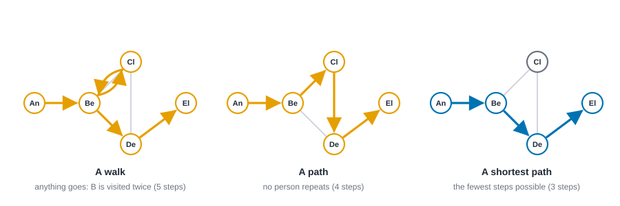
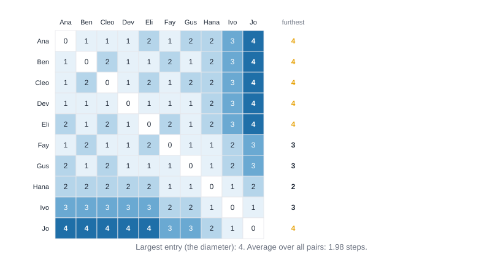
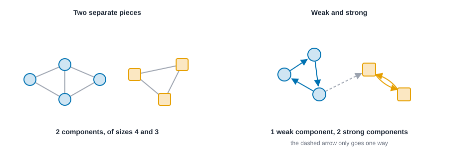
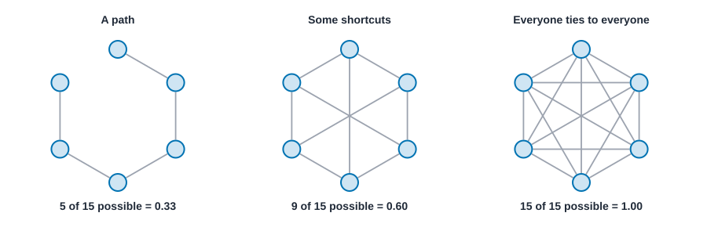
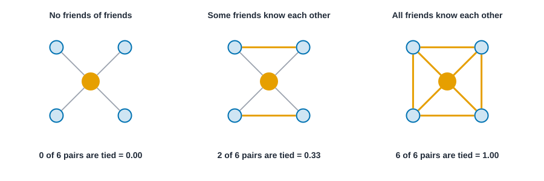
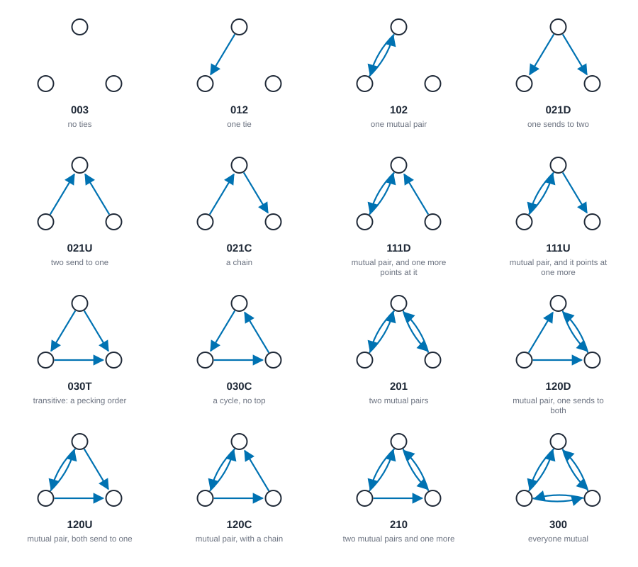
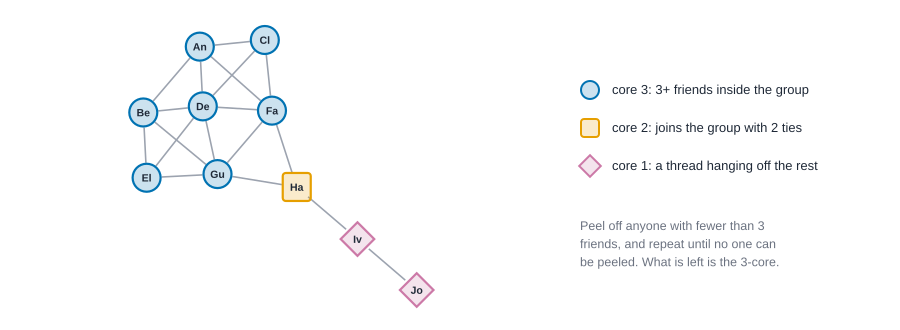

# Paths, distance and cohesion {#sec-paths-and-cohesion}

::: {.callout-note appearance="simple"}
## Prerequisites
@sec-networks-as-data and @sec-centrality. We use the ten-person friendship network from @sec-centrality again, so it helps to have it in mind.
:::

## From people to the whole network

@sec-centrality scored *people*. This chapter steps back and asks questions about the network as a whole. How far apart are people? Does everyone belong to one connected group, or several? Do friends of friends tend to be friends? How tightly knit is the whole thing, and where is it tightest?

These are the questions behind some of the oldest ideas in the field. How many handshakes separate two strangers? Why do groups that look similar on paper hold together so differently under stress? Why do rumors cross some organizations in a day and never reach others? Each of these turns out to depend on a handful of measures that are easy to compute and, once you know what they mean, easy to read.

::: {.callout-tip appearance="simple"}
## Code lives next to the idea
Each measure below comes with its code right where it is explained. The Rust blocks in this chapter run top to bottom as one script: the first builds the friendship network, and later ones reuse it.
:::

## Walks, paths and distance

Start with the vocabulary of getting from A to B.

- A **walk** is any sequence of people where each is tied to the next. It can double back and revisit anyone.
- A **path** is a walk that never repeats a person.
- A **shortest path**, or **geodesic**, is a path with the fewest possible steps. There can be several tied for shortest.
- The **distance** between two people is the number of steps on a shortest path between them.

{#fig-walks-paths fig-alt="Three drawings of a five-person network in which Ben, Cleo and Dev form a triangle, Ana hangs off Ben and Eli hangs off Dev. Left: a walk from Ana to Eli that goes to Cleo and back to Ben, five steps. Middle: a path through Ben, Cleo and Dev, four steps. Right: a shortest path through Ben and Dev, three steps."}

Once you can find distances, you can write them all down. @fig-distance-matrix is the distance table for the friendship network: ten rows, ten columns, and in each cell the number of steps between those two people.

{#fig-distance-matrix fig-alt="A ten by ten grid of numbers. The diagonal is zero. Most entries are 1, 2 or 3. The darkest entries, 4, appear between Jo and each of the first five people in the list. A column at the right gives each person's largest distance."}

Three summaries come straight out of that table, and you'll see them in almost every network paper.

- **Eccentricity** is a person's largest distance to anyone: how far they are from the person furthest from them. It's the number in the right-hand column.
- **Diameter** is the largest distance in the whole network: the farthest apart any two people are. Here it's 4, between Jo and the five people at the other end of the table.
- **Mean distance** (the average path length) is the average distance over all pairs of people. Here it's about 1.98. In this network, the typical pair of people is two steps apart.

::: {.panel-tabset group="language"}

## R

```r
# TODO(code, R): build the friendship network from the two lists, then compute its mean distance and diameter.
```

## Python

```python
# TODO(code, Python): build the friendship network from the two lists, then compute its mean distance and diameter.
```

## Rust

```rust
use knappnet::metrics::descriptive::{compute_diameter, compute_mean_distance, PathOptions};
use knappnet::Graph;

// The ten-person friendship network from the last chapter, people numbered from zero.
// One position in each list is one tie.
let from = [0, 0, 0, 0, 1, 1, 1, 2, 2, 3, 3, 3, 4, 5, 5, 6, 7, 8];
let to = [1, 2, 3, 5, 3, 4, 6, 3, 5, 4, 5, 6, 6, 6, 7, 7, 8, 9];
let friends = Graph::from_edges(10, &from, &to, None, false)?;

let paths = PathOptions::default();
println!("mean distance  {:.3}", compute_mean_distance(&friends, paths, true)?);
println!("diameter       {}", compute_diameter(&friends, paths, true)?);
```

:::

::: {.code-output}
```text
mean distance  1.978
diameter       4
```
:::

The mean of 1.978 and the diameter of 4 match the distance table: the largest entry is 4, and the typical pair is about two steps apart.

### Six degrees, and what that figure leaves out

The idea that everyone is only a few steps from everyone else has a famous experimental root. Jeffrey Travers and Stanley Milgram [@travers1969experimental] asked people to get a letter to a stranger in another city by passing it only to someone they knew on a first-name basis. The chains that reached the target were short, on the order of half a dozen steps, which gave rise to the phrase "six degrees of separation."

It's worth remembering what that finding does and doesn't say. The number comes from the chains that *finished*, and only a minority did. People dropped out, and some letters never moved. The experiment shows that short routes *exist*; it can't tell you that people *find* them. Watts and Strogatz [@watts1998collective] later showed that a network can have short distances and, at the same time, lots of tight local clustering, the small-world pattern you met in @sec-foundations. Short average distance, they argued, doesn't need many long-range ties, just a few.

### Why distance matters

Distances matter because many things in social life travel along ties: information, jobs, norms, infections, favors. If the typical distance is short, those things can reach nearly anyone quickly. If it's long, they stall. A caution from @sec-centrality carries over: shortest paths are a model of how things flow, and many real things don't take the shortest route [@borgatti2005centrality].

## Components: is it all one network?

Sometimes you can't get from A to B at all. A **component** is a piece of the network in which everyone can reach everyone else. A network that's in one piece has one component. A network with a clique of friends who've never met another group has two.

In a directed network there are two ways to ask. A **weak component** ignores the direction of the arrows: two people are in the same weak component if there's *any* route between them when you let yourself walk against arrows. A **strong component** respects the arrows: everyone has to be able to reach everyone else by following them.

{#fig-components fig-alt="Left: a four-person cluster and a separate three-person triangle, with no tie between them. Right: three people joined in a one-way cycle and two people who point at each other, with one dashed arrow from the cycle to the pair."}

Components matter for a practical reason: many measures break, or quietly change meaning, when the network isn't in one piece. Distances between pieces are undefined, so mean distance and diameter are only computed within pieces, and the closeness measure from @sec-centrality needs its harmonic version. Always check how many components you have, and how big they are, before you compute anything else. And ask where the gaps came from. A gap might reflect something real, like two departments that never talk, or something about your data collection, like a boundary that cut ties off (@sec-networks-as-data).

::: {.panel-tabset group="language"}

## R

```r
# TODO(code, R): add Kai and Lou, who only know each other, then count the weak components and their sizes.
```

## Python

```python
# TODO(code, Python): add Kai and Lou, who only know each other, then count the weak components and their sizes.
```

## Rust

```rust
use knappnet::metrics::topography::{find_components, ComponentKind};

// Two more people, Kai (10) and Lou (11), who only know each other.
let from_all: Vec<_> = from.iter().copied().chain([10]).collect();
let to_all: Vec<_> = to.iter().copied().chain([11]).collect();
let everyone = Graph::from_edges(12, &from_all, &to_all, None, false)?;

let parts = find_components(&everyone, ComponentKind::Weak);
println!("components  {} with sizes {:?}", parts.count(), parts.sizes);
```

:::

::: {.code-output}
```text
components  2 with sizes [10, 2]
```
:::

Two components, of sizes 10 and 2: the friendship network, and the pair who only know each other.

## Density: how many of the possible ties exist

**Density** is the share of possible ties that are actually there. In an undirected network of $n$ people, there are $n(n-1)/2$ possible ties, so

$$
\text{density} = \frac{\text{number of ties}}{n(n-1)/2}.
$$

For a directed network, divide by $n(n-1)$, because each pair can have a tie in each direction. The friendship network has 18 ties out of 45 possible, so its density is 0.40.

{#fig-density-dice fig-alt="Three drawings of six people on a circle. A path of five ties has density 0.33. A ring with three crossing ties, nine in all, has density 0.60. All fifteen ties give density 1.00."}

Density is the first thing people reach for and the first thing people over-read. Two cautions.

**It depends on size.** In a group of ten, a typical person can know everyone. In a group of ten thousand, no one can. Density falls as networks grow, so comparing the density of a team of eight with that of a company of eight thousand tells you almost nothing. Compare networks of similar size, or use degree, which doesn't shrink the same way.

**High density isn't always good.** A very dense group can be warm and supportive, and it can also be redundant, closed to outsiders and slow to hear new things, as in the strength-of-weak-ties argument from @sec-foundations. For covert groups there's an additional tension. Ties help a group coordinate, but they also give investigators more to find, so a secret network often can't afford high density. Everton and Cunningham [@everton2015dark] look at how centralization and density together shape how a dark network copes with a hostile environment, and the broader question of what such structure does and doesn't tell us is treated in @cunningham2016understanding.

::: {.panel-tabset group="language"}

## R

```r
# TODO(code, R): compute the density of the friendship network.
```

## Python

```python
# TODO(code, Python): compute the density of the friendship network.
```

## Rust

```rust
use knappnet::metrics::topography::compute_density;

// The `false` says there are no self-loops to count.
println!("density  {:.3}", compute_density(&friends, false));
```

:::

::: {.code-output}
```text
density  0.400
```
:::

That's 18 ties out of 45 possible, which is 0.400.

## Reciprocity and transitivity: do ties come back, and do friends of friends connect?

Two more whole-network measures look at the smallest structures inside the network.

**Reciprocity** is the share of ties that are returned. If Ana goes to Chloe for advice and Chloe goes to Ana, that's a reciprocated tie. In the advice network from @sec-getting-started, only that one pair is mutual, so two of seven ties are reciprocated, about 0.29. Reciprocity depends on what the tie means. Friendship is often reciprocated; advice-seeking tends not to be, because it follows expertise or rank. A low number isn't a flaw. It's a clue about the relationship.

::: {.panel-tabset group="language"}

## R

```r
# TODO(code, R): build the directed advice network from the Getting started chapter and compute its reciprocity.
```

## Python

```python
# TODO(code, Python): build the directed advice network from the Getting started chapter and compute its reciprocity.
```

## Rust

```rust
use knappnet::metrics::descriptive::{compute_reciprocity, ReciprocityMode};

// The directed advice network from "Getting started": five people, seven ties.
let advice = Graph::from_edges(5, &[0, 0, 1, 2, 3, 3, 4], &[1, 2, 2, 0, 0, 2, 2], None, true)?;
println!("reciprocity  {:.3}", compute_reciprocity(&advice, ReciprocityMode::Default));
```

:::

::: {.code-output}
```text
reciprocity  0.286
```
:::

Two of the seven ties are returned (Ana and Chloe, both ways), which is 2 out of 7, or 0.286.


**Transitivity** asks whether friends of friends are friends. Pick any two people who share a friend. How often are they tied to each other as well? Counting all such triples, the share that close into triangles is the network's **transitivity**. In the friendship network it's 0.58. You can also ask the question one person at a time: of all pairs among *my* friends, what share are tied?, which is the person's **local clustering**.

{#fig-clustering-idea fig-alt="Three drawings of a person in the middle tied to four friends. In the first no two friends are tied, giving 0 of 6, clustering 0.00. In the second two pairs of friends are tied, 2 of 6, clustering 0.33. In the third all pairs are tied, 6 of 6, clustering 1.00."}

::: {.panel-tabset group="language"}

## R

```r
# TODO(code, R): compute the transitivity of the friendship network.
```

## Python

```python
# TODO(code, Python): compute the transitivity of the friendship network.
```

## Rust

```rust
use knappnet::metrics::descriptive::{compute_transitivity, ClusteringOptions};

println!("transitivity  {:.3}", compute_transitivity(&friends, ClusteringOptions::default()));
```

:::

::: {.code-output}
```text
transitivity  0.579
```
:::

About 58% of the connected triples in the friendship network close into triangles.


Sociologically, transitivity is the measure of **closure**. It echoes Simmel's point about triads and Heider's idea that a friend of my friend is easier to like (@sec-foundations). Where it's high, people share contacts, norms get enforced because everyone is watching, and trust is easier to build. That is the logic of closure in social capital theory, which you also met in @sec-foundations.

### The triad census

Reciprocity and transitivity are both ways of summarizing what the three-person pieces of a network look like. You can go further and count *every* kind of triple. A set of three people can be connected in 16 different ways once you track direction, and Holland and Leinhardt [@holland1970method] proposed counting how many triples of each type a network contains. This is the **triad census**. @fig-triad-types shows all sixteen.

{#fig-triad-types fig-alt="A four by four grid of the sixteen directed triangles, each with its census code and a plain description, from 003 with no ties to 300 with every pair mutual."}

The codes follow the Holland and Leinhardt convention: three digits count the **m**utual, **a**symmetric and **n**ull pairs among the three people (so 102 is one mutual pair, no asymmetric pairs and two null pairs), and a letter distinguishes arrangements that share the same counts. **U** means "up" (ties point toward one person), **D** means "down" (ties point away from one person), **C** means "cyclic" or a chain, and **T** means "transitive". You can read the figure in four rows:

- **Rows one and two, little going on.** 003 is three strangers, 012 a single one-way tie, 102 a single mutual pair. 021D, 021U and 021C are the three ways to arrange two one-way ties: one person sends to both others, two people send to the same person, or a chain.
- **The 111 pair.** One mutual pair plus one more one-way tie. Whether the extra tie comes *into* the pair or goes *out* of it is the difference between 111D and 111U. Software packages have not always agreed on which label is which, so check the convention of your tool before comparing counts across tools.
- **The 030 pair.** Three one-way ties and no mutual pair. 030T is the pecking order: A beats B and C, and B beats C. 030C is the loop, where everyone is both above and below someone.
- **The bottom rows, lots going on.** 201 is two mutual pairs. 120D, 120U and 120C are one mutual pair plus two one-way ties in three arrangements. 210 is two mutual pairs and one one-way tie, and 300 is everyone mutual.

Many theories of hierarchy predict that a network will contain many transitive triples and few cyclic ones, because rank produces pecking orders and not loops [@holland1976local]. If you see the opposite, something other than rank is organizing the ties.

::: {.panel-tabset group="language"}

## R

```r
# TODO(code, R): compute the triad census of the directed advice network and print the count for every one of the 16 types.
```

## Python

```python
# TODO(code, Python): compute the triad census of the directed advice network and print the count for every one of the 16 types.
```

## Rust

```rust
use knappnet::{compute_triad_census, TRIAD_NAMES};

// One count per triad type, in the order of the figure. The 0 is the engine's default option.
let census = compute_triad_census(&advice, 0);
for (name, count) in TRIAD_NAMES.iter().zip(census) {
    println!("{name:<5} {count}");
}
```

:::

::: {.code-output}
```text
003   1
012   2
102   0
021D  0
021U  3
021C  1
111D  1
111U  0
030T  0
030C  0
201   0
120D  1
120U  0
120C  1
210   0
300   0
```
:::

The counts add up to 10, because five people make ten different triples. Most types are absent, which is typical of a small, sparse network. Three of the ten triples are 021U, where two people both go to the same third person (Dev and Eli both go to Chloe, for instance).

## Cohesion: how tightly knit, and where?

So far we've summarized a network with a single number. But a network can be dense in one place and sparse in another. **Cohesion** measures try to find the tight places and say how tight.

### k-cores

A **k-core** is a group in which everyone has at least $k$ ties to others in the group [@seidman1983network]. You find it by *peeling*: remove everyone with fewer than $k$ ties, which may leave others with fewer than $k$, so remove them too, and repeat until no one can be removed. What's left is the k-core. A person's **core number** is the largest $k$ for which they survive.

{#fig-cores fig-alt="The ten-person friendship network. Seven nodes drawn as blue circles form the dense cluster. Hana, drawn as an orange square, hangs off it. Ivo and Jo, drawn as purple diamonds, trail off at the far end."}

In the friendship network, seven people form the 3-core, Hana has core number 2, and Ivo and Jo have core number 1. Notice what that does and doesn't capture. Hana had the highest betweenness in @sec-centrality, yet her core number is only 2. That's not a contradiction: she holds a position, but she isn't inside the dense group. There's a fast algorithm for the whole decomposition [@batagelj2003algorithm].

::: {.panel-tabset group="language"}

## R

```r
# TODO(code, R): compute the core number of everyone in the friendship network.
```

## Python

```python
# TODO(code, Python): compute the core number of everyone in the friendship network.
```

## Rust

```rust
use knappnet::metrics::cores::compute_coreness;
use knappnet::DegreeMode;

println!("coreness  {:?}", compute_coreness(&friends, DegreeMode::All));
```

:::

::: {.code-output}
```text
coreness  [3, 3, 3, 3, 3, 3, 3, 2, 1, 1]
```
:::

Seven threes, then a two for Hana, then two ones for Ivo and Jo, just as in the figure.

### Structural cohesion

A different idea of tightness asks how hard a group is to *break*. Moody and White [@moody2003structural] proposed that a group is cohesive to the extent that you'd have to remove many people to split it apart. Count the smallest number of people whose removal disconnects the group. If it's one, a single departure would break it. If it's three, it takes three. The more people you'd have to remove, the more independent routes connect each pair, and the harder it is for the group to fall apart. They argued this connects to the sociological idea of social cohesion and embeddedness: a person in such a group isn't depending on any one other person to stay connected to the rest.

Applied here, the seven-person core needs at least three people removed to split, so its cohesion is 3. The whole friendship network has cohesion 1: removing Ivo or Hana cuts Jo off. That's the same vulnerable bridge we saw in @sec-centrality, from another angle.

## A cheat sheet

| Measure | Question | Range | Watch out for |
| --- | --- | --- | --- |
| Distance, mean distance, diameter | How far apart are people? | From 1 upward | Undefined between components |
| Components | Is everyone in one piece? | 1 component upward | Data boundaries creating gaps |
| Density | What share of possible ties exist? | 0 to 1 | Falls as networks grow |
| Reciprocity | How many ties are returned? | 0 to 1 | Depends on what the tie means |
| Transitivity | Do friends of friends connect? | 0 to 1 | Global and average-local versions differ |
| Core number | How deep inside a dense group? | 0 upward | Not the same as being influential |
| Structural cohesion | How many people hold the group together? | 1 upward | Needs the whole network to be known |

## Reading these measures honestly

Whole-network measures are tempting because they give one number per network. That's also the danger.

**One number hides a shape.** Two networks with the same density can look completely different: one evenly spread, the other a tight core with a thin tail. Look at the picture (@sec-visualization), the distance table and the cores as well as the summary.

**Comparing networks needs matching conditions.** Differences in size, in how ties were measured, and in where the boundary was drawn can each produce differences in density or distance that have nothing to do with the groups themselves.

**The sample isn't the network.** If the network is only partly observed, distances look longer, components look more numerous and density looks lower than they really are. This is where the data-collection chapters matter.

**Be careful with causal stories.** A network with a short diameter spreads things faster *if* things travel along its ties. Whether they do is a question about the process you care about, which these measures can't answer by themselves.

## Exercises

1. **By hand.** In @fig-walks-paths, list every path (no repeated person) from Ana to Eli. Which are shortest? How many walks of exactly five steps are there from Ana to Eli (the walk in the figure is one of them)?
2. **By hand.** A network of 20 people has 38 ties. What is its density, if it's undirected? What would it be if the 38 ties were directed?
3. **By hand.** Peel the 3-core by hand from the friendship network. Whom do you remove first, and why does the order not change the answer?
4. **Design.** You want to compare how tightly knit two companies are, one with 30 employees and one with 3,000. Which of the measures in the cheat sheet would you avoid comparing directly, and which would you use instead?
5. **Interpretation.** A study of two hospital wards reports that Ward A has density 0.6 and Ward B has density 0.2, and concludes that Ward A has "better teamwork." Write a short list of the things you'd want to know before agreeing.

## Summary

::: {.callout-tip appearance="simple"}
Distance is the number of steps on a shortest path, and the diameter and mean distance summarize it for a whole network. Components tell you whether everyone is in one piece, and most measures need that checked first. Density is the share of possible ties present, and it shrinks as networks grow. Reciprocity and transitivity look at pairs and triples, and the triad census counts all the three-person patterns. Cores and structural cohesion find the tight places and say how hard they are to break. Each is one number summarizing a shape, so read it together with a picture and with what the ties mean.
:::

## Further reading

For the experiment behind "six degrees," see @travers1969experimental, and for how short distances and local clustering fit together, @watts1998collective. For the triad census and local structure, see @holland1970method and @holland1976local. For k-cores and fast algorithms for them, see @seidman1983network and @batagelj2003algorithm, and for structural cohesion and its sociological meaning, @moody2003structural. For density and centralization in networks that hide on purpose, see @everton2015dark, @everton2012disrupting and @cunningham2016understanding. To practice in R, Phil Murphy's tutorials on global measures [@murphyrpubs308024] and on cohesive subgroups [@murphyrpubs977746; @murphyrpubs323120] are good companions.
