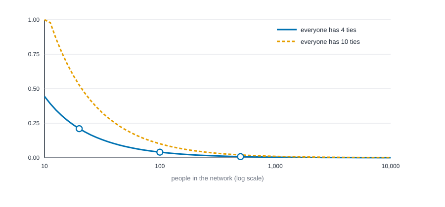
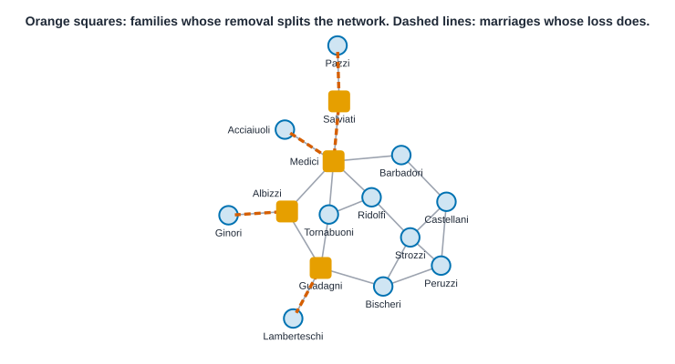
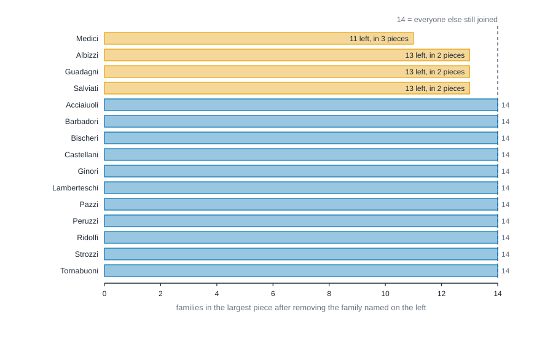

# Paths, distance and cohesion {#sec-paths-and-cohesion}

::: {.callout-note appearance="simple"}
## Prerequisites
@sec-networks-as-data and @sec-centrality. We use the ten-person friendship network from @sec-centrality again, so it helps to have it in mind.
:::

::: {.callout-note title="The short version"}
This chapter steps back from individual people and asks about the whole network. How many steps apart are people? Is everyone connected, or are there separate islands? What share of the possible ties actually exist? Are ties returned, and do friends of friends become friends? How easily could the network be broken, and where is it tightest? Each question gets one or two simple numbers, and the chapter shows how each one can mislead you.
:::

::: {.callout-note title="Why you might care"}
These are the numbers behind claims like "everyone is six steps from everyone", "that team is tight-knit" and "that supply chain has a single point of failure". If you know how to read them, and where they go wrong (a network in pieces, or a bigger network that always looks sparser), you can tell a solid claim from a slick one.
:::

## From people to the whole network

@sec-centrality scored *people*. This chapter steps back and asks questions about the network as a whole. How far apart are people? Does everyone belong to one connected group, or several? Do friends of friends tend to be friends? How tightly knit is the whole thing, and where is it tightest?

These are the questions behind some of the oldest ideas in the field. How many handshakes separate two strangers? Why do groups that look similar on paper hold together so differently under stress? Why do rumors cross some organizations in a day and never reach others? Each of these turns out to depend on a handful of measures that are easy to compute and, once you know what they mean, easy to read.

::: {.callout-tip appearance="simple"}
## Code lives next to the idea
Each measure below comes with its code right where it is explained. The Rust blocks in this chapter run top to bottom as one script: the first builds the friendship network, and later ones reuse it.
:::

## What you'll be able to do

By the end of the chapter you should be able to compute, read and defend six kinds of whole-network number: **distances** (how far apart people are), **components** (whether the network is in one piece), **density** (how many of the possible ties exist), **reciprocity** (whether ties are returned), **connectivity** (how many people or ties you would have to remove to break the network) and **cohesion** (where it is tightest). For each one we follow the same path: a question, a tiny example you can check on paper, the precise definition, the code, and then the ways the number goes wrong. At the end, two classic networks, the Florentine marriages and Krackhardt's managers, give us real data to practice on.

Most of these ideas are older than network software. The vocabulary of walks, distance, eccentricity, radius and diameter is standard graph theory [@harary1969graph; @bondy2008graph]. Whitney [@whitney1932congruent] and Menger [@menger1927allgemeinen] gave us the mathematics of connectivity. Sociologists borrowed all of it: @wasserman1994social is the standard reference for density, reciprocity and the dyad and triad counts, and @borgatti2022analyzing, @hanneman2005introduction and @newman2018networks cover the same ground from social-science and physics angles.

## Walks, paths and distance

Start with the vocabulary of getting from A to B.

- A **walk** is any sequence of people where each is tied to the next. It can double back and revisit anyone.
- A **path** is a walk that never repeats a person.
- A **shortest path**, or **geodesic**, is a path with the fewest possible steps. There can be several tied for shortest.
- The **distance** between two people is the number of steps on a shortest path between them.

{#fig-walks-paths fig-alt="Three drawings of a five-person network in which Ben, Cleo and Dev form a triangle, Ana hangs off Ben and Eli hangs off Dev. Left: a walk from Ana to Eli that goes to Cleo and back to Ben, five steps. Middle: a path through Ben, Cleo and Dev, four steps. Right: a shortest path through Ben and Dev, three steps."}

Once you can find distances, you can write them all down. @fig-distance-matrix is the distance table for the friendship network: ten rows, ten columns, and in each cell the number of steps between those two people.

{#fig-distance-matrix fig-alt="A ten by ten grid of numbers. The diagonal is zero. Most entries are 1, 2 or 3. The darkest entries, 4, appear between Jo and each of the first five people in the list. A column at the right gives each person's largest distance."}

Three summaries come straight out of that table, and you'll see them in almost every network paper.

- **Eccentricity** is a person's largest distance to anyone: how far they are from the person furthest from them. It's the number in the right-hand column.
- **Diameter** is the largest distance in the whole network: the farthest apart any two people are. Here it's 4, between Jo and the five people at the other end of the table.
- **Mean distance** (the average path length) is the average distance over all pairs of people. Here it's about 1.98. In this network, the typical pair of people is two steps apart.

The code below builds the friendship network, finds every distance and prints the three summaries. Look for the diameter of 4 and the mean of about 1.98.

::: {.panel-tabset group="language"}

## R

```r
library(knappnet)

# The ten-person friendship network from the last chapter. One row of the edge table is one tie.
people <- c("Ana", "Ben", "Cleo", "Dev", "Eli", "Fay", "Gus", "Hana", "Ivo", "Jo")
from <- c(0, 0, 0, 0, 1, 1, 1, 2, 2, 3, 3, 3, 4, 5, 5, 6, 7, 8)
to   <- c(1, 2, 3, 5, 3, 4, 6, 3, 5, 4, 5, 6, 6, 6, 7, 7, 8, 9)
edges <- data.frame(source = people[from + 1], target = people[to + 1])
friends <- net_frame(edges, nodes = data.frame(id = people), directed = FALSE)
friends

c(mean_distance = net_mean_distance(friends), diameter = net_diameter(friends)) |> round(3)
```

::: {.code-output}
```text
# net_frame: 10 nodes, 18 edges
#   directed:  no        mode: one-mode (10 actors)
#   weights:   unweighted
#   time:      static    space: none
#   simple:    no loops, no parallel edges
#   components: 1    isolates: 0    density: 0.400
#
# Nodes (10 x 1)      Edges (18 x 2)
#   id                  source target
#   <chr>               <chr>  <chr>
# 1 Ana               1 Ana    Ben
# 2 Ben               2 Ana    Cleo
# 3 Cleo              3 Ana    Dev
# 4 Dev               4 Ana    Fay
# 5 Eli               5 Ben    Dev
# 6 Fay               6 Ben    Eli
#   ... 4 more rows     ... 12 more rows
# A tibble: 1 × 2
  mean_distance diameter
          <dbl>    <dbl>
1         1.978        4
```
:::

## Python

```python
import networkx as nx

# The ten-person friendship network from the last chapter, people numbered from zero.
# One position in each list is one tie.
src = [0, 0, 0, 0, 1, 1, 1, 2, 2, 3, 3, 3, 4, 5, 5, 6, 7, 8]
dst = [1, 2, 3, 5, 3, 4, 6, 3, 5, 4, 5, 6, 6, 6, 7, 7, 8, 9]
friends = nx.Graph()
friends.add_nodes_from(range(10))
friends.add_edges_from(zip(src, dst))

print(f"mean distance  {nx.average_shortest_path_length(friends):.3f}")
print(f"diameter       {nx.diameter(friends)}")
```

::: {.code-output}
```text
mean distance  1.978
diameter       4
```
:::

## Rust

```rust
use knappnet::metrics::descriptive::{compute_diameter, compute_mean_distance, PathOptions};
use knappnet::Graph;

// The ten-person friendship network from the last chapter, people numbered from zero.
// One position in each list is one tie.
let from = [0, 0, 0, 0, 1, 1, 1, 2, 2, 3, 3, 3, 4, 5, 5, 6, 7, 8];
let to = [1, 2, 3, 5, 3, 4, 6, 3, 5, 4, 5, 6, 6, 6, 7, 7, 8, 9];
let friends = Graph::from_edges(10, &from, &to, None, false)?;
println!("{}", friends.describe());

let paths = PathOptions::default();
println!("mean distance  {:.3}", compute_mean_distance(&friends, paths, true)?);
println!("diameter       {}", compute_diameter(&friends, paths, true)?);
```

::: {.code-output}
```text
Undirected network: 10 nodes, 18 ties
  Density           0.400
  Degree            1 to 6, mean 3.60
  Connected pieces  1
  Isolated nodes    0
  Loops, repeats    none
  Busiest           node 3 (6), node 5 (5), node 6 (5)

mean distance  1.978
diameter       4
```
:::

:::

The mean of 1.978 and the diameter of 4 match the distance table: the largest entry is 4, and the typical pair is about two steps apart.

### The definitions, precisely

This section is the formal one. On a first read you can skip to "Six degrees" and you'll still have the plain ideas of distance, diameter and mean distance. The plain-words versions above hide a few details that matter as soon as you compare networks or write a result down. Here they are with symbols. Write $n$ for the number of people.

A **walk** of length $\ell$ from person $i$ to person $j$ is a list of people $i = v_0, v_1, \dots, v_\ell = j$ in which each person is tied to the next. The **distance** $d(i,j)$ is the smallest length of any walk from $i$ to $j$. (A shortest walk can't revisit anyone, so it is automatically a path, which is why "shortest path" and "shortest walk" mean the same thing.) We set $d(i,i) = 0$, and $d(i,j) = \infty$ when there is no walk at all. In an undirected network $d(i,j) = d(j,i)$. In a directed one the walk has to follow the arrows, so $d(i,j)$ and $d(j,i)$ can differ, and one can be infinite while the other is small.

::: {.callout-tip title="In plain words"}
A walk of length $\ell$ (the Greek letter ell) is a trip of $\ell$ steps, written as the list of people you pass through, from $v_0$ (where you start, $i$) to $v_\ell$ (where you finish, $j$). The distance is the smallest number of steps any such trip needs, 0 to yourself and infinity if no trip exists. In the five-person network below, Ana to Eli can go Ana, Ben, Dev, Eli: that list has 4 people, which is a walk of length 3, and nothing shorter works, so $d(\text{Ana}, \text{Eli}) = 3$.
:::

A pair can have more than one shortest path. Write $\sigma_{ij}$ for how many there are; the betweenness of @sec-centrality is built from these counts.

::: {.callout-tip title="In plain words"}
$\sigma_{ij}$ (sigma) is a head count of the shortest trips from $i$ to $j$. Two people on opposite corners of a square have $\sigma = 2$, one way around each side. In the five-person network every pair has exactly one shortest path, so every $\sigma$ is 1.
:::

From the distances come three summaries:

$$
\varepsilon(i) = \max_{j} d(i,j), \qquad D = \max_{i} \varepsilon(i), \qquad r = \min_{i} \varepsilon(i).
$$

::: {.callout-tip title="In plain words"}
The symbol $\varepsilon$ (epsilon) of $i$ is the eccentricity: person $i$'s distance to whoever is farthest from them. "$\max_j$" means "take the biggest value over every person $j$". $D$ is the biggest eccentricity in the network, so it is the farthest apart any two people are. $r$, the radius, uses "min" instead: it is the smallest eccentricity, held by the most central person. In the five-person example just below, Ana's farthest person is Eli, 3 steps away, so $\varepsilon(\text{Ana}) = 3$; Ben's farthest is Eli at 2. So $D = 3$ and $r = 2$.
:::

Here $\varepsilon(i)$ is the **eccentricity** of person $i$, $D$ is the **diameter** and $r$ is the **radius**. The people whose eccentricity equals the radius form the **center** of the network, and those whose eccentricity equals the diameter form its **periphery**. In a connected, undirected network the two are tied together by $r \le D \le 2r$. The first inequality is clear from the definitions. For the second, pick a central person $c$. Everyone is within $r$ steps of $c$, so any two people are within $2r$ steps of each other, by going through $c$.

Two averages describe the typical pair:

$$
L = \frac{1}{n(n-1)} \sum_{i \neq j} d(i,j), \qquad
H = \left[ \frac{1}{n(n-1)} \sum_{i \neq j} \frac{1}{d(i,j)} \right]^{-1}.
$$

::: {.callout-tip title="In plain words"}
Both are averages of distances over every ordered pair of different people ($i \neq j$ means "$i$ and $j$ are not the same person"; there are $n(n-1)$ such pairs). $L$ is the ordinary average: add up all the distances and divide by the number of pairs. $H$ first adds up the reciprocals, $1/d$, so a person one step away counts 1 and a person three steps away counts a third, averages those, and then flips the answer back. In the five-person example, the ten pairs of people have distances adding to $5 + 8 + 3 = 16$, so $L = 16/10 = 1.6$ (counting each pair once or twice gives the same average), and the reciprocals add to $22/3$, so $H = 30/22 \approx 1.364$ (see the arithmetic below).
:::

$L$ is the **mean distance**, also called the average path length. $H$ is the **harmonic mean distance**: add up the *reciprocals* of the distances, average them, and take the reciprocal of that average, with the convention $1/\infty = 0$. Its inverse, $E = 1/H$, goes by the name **global efficiency** [@marchiori2000harmony; @latora2001efficient]. Two facts about $H$ are worth keeping. First, whenever every pair can reach each other, $H \le L$, because a harmonic mean never exceeds the arithmetic mean. Second, and this is the reason it exists, $H$ is still defined when some pairs *can't* reach each other: an unreachable pair adds $1/\infty = 0$ to the sum instead of poisoning it with an infinity. We'll see shortly why that matters.

Let's check all of this on five people, small enough to do on paper. Ben, Cleo and Dev form a triangle; Ana is tied only to Ben, and Eli only to Dev (the network of @fig-walks-paths).

| | Ana | Ben | Cleo | Dev | Eli | Eccentricity |
| --- | --- | --- | --- | --- | --- | --- |
| Ana | 0 | 1 | 2 | 2 | 3 | 3 |
| Ben | 1 | 0 | 1 | 1 | 2 | 2 |
| Cleo | 2 | 1 | 0 | 1 | 2 | 2 |
| Dev | 2 | 1 | 1 | 0 | 1 | 2 |
| Eli | 3 | 2 | 2 | 1 | 0 | 3 |

The radius is 2 and the diameter is 3, so $2 \le 3 \le 4$ holds. The center is Ben, Cleo and Dev; the periphery is Ana and Eli. There are ten pairs: five at distance 1 (Ana and Ben, Ben and Cleo, Ben and Dev, Cleo and Dev, Dev and Eli), four at distance 2 (Ana and Cleo, Ana and Dev, Ben and Eli, Cleo and Eli) and one, Ana and Eli, at distance 3. So $L = (5 \cdot 1 + 4 \cdot 2 + 1 \cdot 3)/10 = 1.6$. For the harmonic version the reciprocals add up to $5 + 4/2 + 1/3 = 22/3$, their average over the ten pairs is $22/30$, and so $H = 30/22 \approx 1.364$. As promised, $H < L$.

The code below computes the same numbers by machine. Look for whether they agree with the paper results above.

::: {.panel-tabset group="language"}

## R

```r
# Five people: Ben, Cleo and Dev form a triangle; Ana hangs off Ben and Eli off Dev.
five <- c("Ana", "Ben", "Cleo", "Dev", "Eli")
small <- net_frame(
  data.frame(source = c("Ana", "Ben", "Ben", "Cleo", "Dev"),
             target = c("Ben", "Cleo", "Dev", "Dev", "Eli")),
  nodes = data.frame(id = five), directed = FALSE
)

# The distance table. A person's eccentricity is the largest number in their row.
net_distances(small)
net_eccentricity(small)

c(radius = net_radius(small), diameter = net_diameter(small),
  mean_distance = net_mean_distance(small))
# TODO(code, R): needs net_harmonic_mean_distance() (one over the average of 1/d across ordered pairs)
```

::: {.code-output}
```text
     Ana Ben Cleo Dev Eli
Ana    0   1    2   2   3
Ben    1   0    1   1   2
Cleo   2   1    0   1   2
Dev    2   1    1   0   1
Eli    3   2    2   1   0
# A tibble: 5 × 2
  person eccentricity
  <chr>         <dbl>
1 Ana               3
2 Ben               2
3 Cleo              2
4 Dev               2
5 Eli               3
# A tibble: 1 × 4
  radius diameter mean_distance harmonic_mean_distance
   <dbl>    <dbl>         <dbl>                  <dbl>
1      2        3           1.6                  1.364
```
:::

## Python

```python
# Five people: Ben, Cleo and Dev form a triangle; Ana hangs off Ben and Eli off Dev.
five = ["Ana", "Ben", "Cleo", "Dev", "Eli"]
small = nx.Graph([(0, 1), (1, 2), (1, 3), (2, 3), (3, 4)])

# The distance table. A person's eccentricity is the largest number in their row.
dist = dict(nx.all_pairs_shortest_path_length(small))
for i, name in enumerate(five):
    print(f"{name:<5}", [dist[i][j] for j in range(5)])
ecc = nx.eccentricity(small)
print("eccentricity", [ecc[i] for i in range(5)])

print(f"radius {nx.radius(small)}  diameter {nx.diameter(small)}  "
      f"mean distance {nx.average_shortest_path_length(small):.3f}")
# NetworkX calls the average of 1/d the global efficiency; the harmonic mean distance is 1 over it.
print(f"harmonic mean distance {1 / nx.global_efficiency(small):.3f}")
```

::: {.code-output}
```text
Ana   [0, 1, 2, 2, 3]
Ben   [1, 0, 1, 1, 2]
Cleo  [2, 1, 0, 1, 2]
Dev   [2, 1, 1, 0, 1]
Eli   [3, 2, 2, 1, 0]
eccentricity [3, 2, 2, 2, 3]
radius 2  diameter 3  mean distance 1.600
harmonic mean distance 1.364
```
:::

## Rust

```rust
use knappnet::metrics::descriptive::{compute_eccentricity, compute_radius};
use knappnet::metrics::distance_measures::compute_harmonic_diameter;

// Five people: Ben, Cleo and Dev form a triangle; Ana hangs off Ben and Eli off Dev.
let small = Graph::from_edges(5, &[0, 1, 1, 2, 3], &[1, 2, 3, 3, 4], None, false)?;
let ecc: Vec<u32> = compute_eccentricity(&small, paths)?.iter().map(|&e| e as u32).collect();
println!("eccentricity  {ecc:?}");
println!(
    "radius {}  diameter {}  mean distance {:.3}",
    compute_radius(&small, paths)?,
    compute_diameter(&small, paths, true)?,
    compute_mean_distance(&small, paths, true)?
);
// The engine calls the harmonic mean distance the "harmonic diameter".
println!("harmonic mean distance  {:.3}", compute_harmonic_diameter(&small, paths)?);
```

::: {.code-output}
```text
eccentricity  [3, 2, 2, 2, 3]
radius 2  diameter 3  mean distance 1.600
harmonic mean distance  1.364
```
:::

:::

The code agrees with the paper: eccentricities 3, 2, 2, 2, 3, radius 2, diameter 3, mean distance 1.6 and harmonic mean distance 1.364.

One more detail before we move on. If ties carry weights, a distance can be the sum of the weights along a path, but then a *larger* weight means *farther*. Social data usually works the other way: a larger weight means a *stronger* tie, which ought to bring people closer. knappnet reads weights as lengths unless you say otherwise, and tools differ, so check what yours does before trusting a weighted distance, and say in your report which way you went.

### Six degrees, and what that figure leaves out

The idea that everyone is only a few steps from everyone else has a famous experimental root. Jeffrey Travers and Stanley Milgram [@travers1969experimental] asked people to get a letter to a stranger in another city by passing it only to someone they knew on a first-name basis. The chains that reached the target were short, on the order of half a dozen steps, which gave rise to the phrase "six degrees of separation."

It's worth remembering what that finding does and doesn't say. The number comes from the chains that *finished*, and only a minority did. People dropped out, and some letters never moved. The experiment shows that short routes *exist*; it can't tell you that people *find* them. Watts and Strogatz [@watts1998collective] later showed that a network can have short distances and, at the same time, lots of tight local clustering, the small-world pattern you met in @sec-foundations. Short average distance, they argued, doesn't need many long-range ties, just a few.

### Why distance matters

Distances matter because many things in social life travel along ties: information, jobs, norms, infections, favors. If the typical distance is short, those things can reach nearly anyone quickly. If it's long, they stall. A caution from @sec-centrality carries over: shortest paths are a model of how things flow, and many real things don't take the shortest route [@borgatti2005centrality].

### What distance means in different settings

The same mean distance can mean quite different things depending on what the ties are.

| Setting | Short distances (small mean, small diameter) | Long distances | What the number does not show |
| --- | --- | --- | --- |
| Marriage or alliance network among families | A deal or a rumor can reach most families through a few marriages | Families are reachable only through long chains, so clusters may act separately | Whether anyone used those chains. Marriages are slow and costly to form, so a short distance is not the same as easy contact |
| Communication inside an organization | A message needs few handoffs, so announcements and gossip can travel fast, if people pass them on | Information is filtered through many hands, or runs only along formal reporting lines | Whether people actually pass things along, or how much is lost at each handoff |
| Transport or supply network (counting stops) | Few transfers between any two places | Many stops, so delays add up | Real travel time or cost, unless the ties are weighted by them |
| Online platform | Almost anyone is a few connections from anyone, often because a few accounts are very well connected | Communities are sealed off, or the platform links people only locally | What a tie *is* (a follow, a friendship, a message) differs from platform to platform, so distances are not comparable across them |

Two cautions apply everywhere. The **diameter is decided by a single pair**. In the friendship network it is 4 only because of five pairs that all involve Jo (@fig-distance-matrix); every other pair is within 3 steps, and the typical pair is 2. Use the mean (or the harmonic mean) for the typical pair, and the diameter for the worst case, and say which is which. And **distances only mean something among people who can reach each other**, which brings us to components.

## Components: is it all one network?

Sometimes you can't get from A to B at all. A **component** is a piece of the network in which everyone can reach everyone else. A network that's in one piece has one component. A network with a clique of friends who've never met another group has two.

In a directed network there are two ways to ask. A **weak component** ignores the direction of the arrows: two people are in the same weak component if there's *any* route between them when you let yourself walk against arrows. A **strong component** respects the arrows: everyone has to be able to reach everyone else by following them.

{#fig-components fig-alt="Left: a four-person cluster and a separate three-person triangle, with no tie between them. Right: three people joined in a one-way cycle and two people who point at each other, with one dashed arrow from the cycle to the pair."}

Components matter for a practical reason: many measures break, or quietly change meaning, when the network isn't in one piece. Distances between pieces are undefined, so mean distance and diameter are only computed within pieces, and the closeness measure from @sec-centrality needs its harmonic version. Always check how many components you have, and how big they are, before you compute anything else. And ask where the gaps came from. A gap might reflect something real, like two departments that never talk, or something about your data collection, like a boundary that cut ties off (@sec-networks-as-data).

Here is the precise version. Say that $i$ and $j$ are *joined* when $d(i,j) < \infty$. In an undirected network, being joined is reflexive (everyone is joined to themselves), symmetric (if $i$ reaches $j$ then $j$ reaches $i$) and transitive (a walk from $i$ to $j$ followed by a walk from $j$ to $k$ is a walk from $i$ to $k$). A relation with those three properties splits the people into groups that don't overlap, and those groups are the components. Their sizes add up to $n$. The biggest is the **largest component** (when it holds most of the people it is often called the *giant* component). A person with no ties at all is an **isolate** and counts as a component of size one, so a roster that includes 200 people nobody named has 200 extra components.

::: {.callout-tip title="In plain words"}
Two people are "joined" if there is any route between them. The three properties say: everyone is joined to themselves, if $i$ reaches $j$ then $j$ reaches $i$, and routes can be chained ($i$ to $j$ and $j$ to $k$ gives $i$ to $k$). Those three guarantee that the groups can't overlap, the way "lives in the same household" splits everyone in a town into separate households. Add Kai and Lou to the ten-person friendship network and the two groups have 10 and 2 people, which add up to all 12.
:::

For a directed network, the **weak components** are the components you get after erasing the arrowheads. Two people are in the same **strong component** when each can reach the other by following arrows: $d(i,j) < \infty$ *and* $d(j,i) < \infty$. That relation is also reflexive, symmetric and transitive, so strong components don't overlap either.

::: {.callout-tip title="In plain words"}
Strong components are groups in which everybody can reach everybody by following the arrows. Writing $d(i,j) < \infty$ just says "there is a route from $i$ to $j$". In the one-way loop of three people, A reaches B reaches C reaches A, so they are one strong component of size 3.
:::

The code below adds a separate pair, Kai and Lou, to the friendship network and counts the pieces. Look for two components, of sizes 10 and 2.

::: {.panel-tabset group="language"}

## R

```r
# Two more people, Kai and Lou, who only know each other.
everyone <- net_frame(
  rbind(edges, data.frame(source = "Kai", target = "Lou")),
  nodes = data.frame(id = c(people, "Kai", "Lou")), directed = FALSE
)
everyone

# Who is in each connected piece.
split(everyone$nodes$id, net_components(everyone, mode = "weak")$membership)
```

::: {.code-output}
```text
# net_frame: 12 nodes, 19 edges
#   directed:  no        mode: one-mode (12 actors)
#   weights:   unweighted
#   time:      static    space: none
#   simple:    no loops, no parallel edges
#   components: 2    isolates: 0    density: 0.288
#
# Nodes (12 x 1)      Edges (19 x 2)
#   id                  source target
#   <chr>               <chr>  <chr>
# 1 Ana               1 Ana    Ben
# 2 Ben               2 Ana    Cleo
# 3 Cleo              3 Ana    Dev
# 4 Dev               4 Ana    Fay
# 5 Eli               5 Ben    Dev
# 6 Fay               6 Ben    Eli
#   ... 6 more rows     ... 13 more rows
# A tibble: 2 × 3
  component  size people                                           
      <int> <int> <chr>                                            
1         1    10 Ana, Ben, Cleo, Dev, Eli, Fay, Gus, Hana, Ivo, Jo
2         2     2 Kai, Lou                                         
```
:::

## Python

```python
# Two more people, Kai (10) and Lou (11), who only know each other.
everyone = nx.Graph()
everyone.add_nodes_from(range(12))
everyone.add_edges_from(zip(src + [10], dst + [11]))
sizes = sorted((len(c) for c in nx.connected_components(everyone)), reverse=True)
print(f"components  {len(sizes)} with sizes {sizes}")
```

::: {.code-output}
```text
components  2 with sizes [10, 2]
```
:::

## Rust

```rust
use knappnet::metrics::topography::{find_components, ComponentKind};

// Two more people, Kai (10) and Lou (11), who only know each other.
let from_all: Vec<_> = from.iter().copied().chain([10]).collect();
let to_all: Vec<_> = to.iter().copied().chain([11]).collect();
let everyone = Graph::from_edges(12, &from_all, &to_all, None, false)?;
println!("{}", everyone.describe());

let parts = find_components(&everyone, ComponentKind::Weak);
println!("components  {} with sizes {:?}", parts.count(), parts.sizes);
```

::: {.code-output}
```text
Undirected network: 12 nodes, 19 ties
  Density           0.288
  Degree            1 to 6, mean 3.17
  Connected pieces  2 (largest has 10 of 12 nodes)
  Isolated nodes    0
  Loops, repeats    none
  Busiest           node 3 (6), node 5 (5), node 6 (5)

components  2 with sizes [10, 2]
```
:::

:::

Two components, of sizes 10 and 2: the friendship network, and the pair who only know each other.

### A directed example, by hand

Take the right-hand drawing of @fig-components: three people on a one-way loop (call them A, B, C), two people who point at each other (D and E), and one arrow from C to D.

Following arrows, A can reach D, through B, then C, then the extra arrow. D can never get back, because every arrow that leaves D or E stays inside the pair. So A and D are in the same *weak* component and in different *strong* ones. The loop is a strong component of size 3, the pair is another of size 2, and one weak component of size 5 holds everyone. Because every strong component sits inside a weak one, the number of strong components is never smaller than the number of weak ones.

::: {.panel-tabset group="language"}

## R

```r
# Three people in a one-way loop (A to B to C to A), two who point at each other (D and E),
# and one arrow from C to D.
chain <- net_frame(
  data.frame(source = c("A", "B", "C", "D", "E", "C"), target = c("B", "C", "A", "E", "D", "D")),
  nodes = data.frame(id = LETTERS[1:5]), directed = TRUE
)

lapply(c(weak = "weak", strong = "strong"), function(kind) {
  split(chain$nodes$id, net_components(chain, mode = kind)$membership)
})
```

::: {.code-output}
```text
# A tibble: 2 × 3
  kind   pieces sizes
  <chr>   <int> <chr>
1 weak        1 5    
2 strong      2 3, 2 
```
:::

## Python

```python
# Three people in a one-way loop (0 to 1 to 2 to 0), two who point at each other (3 and 4),
# and one arrow from 2 to 3.
chain = nx.DiGraph([(0, 1), (1, 2), (2, 0), (3, 4), (4, 3), (2, 3)])
weak = sorted((len(c) for c in nx.weakly_connected_components(chain)), reverse=True)
strong = sorted((len(c) for c in nx.strongly_connected_components(chain)), reverse=True)
print(f"weak components    {len(weak)} with sizes {weak}")
print(f"strong components  {len(strong)} with sizes {strong}")
print("can 0 reach 3?", nx.has_path(chain, 0, 3), "  can 3 reach 0?", nx.has_path(chain, 3, 0))
```

::: {.code-output}
```text
weak components    1 with sizes [5]
strong components  2 with sizes [3, 2]
can 0 reach 3? True   can 3 reach 0? False
```
:::

## Rust

```rust
// Three people in a one-way loop (0 to 1 to 2 to 0), two who point at each other (3 and 4),
// and one arrow from 2 to 3.
let chain = Graph::from_edges(5, &[0, 1, 2, 3, 4, 2], &[1, 2, 0, 4, 3, 3], None, true)?;
for (name, kind) in [("weak", ComponentKind::Weak), ("strong", ComponentKind::Strong)] {
    let parts = find_components(&chain, kind);
    println!("{name:<7} {} with sizes {:?}", parts.count(), parts.sizes);
}
```

::: {.code-output}
```text
weak    1 with sizes [5]
strong  2 with sizes [3, 2]
```
:::

:::

The machine agrees with the paper: one weak component holding all five people, and two strong ones, of sizes 3 and 2.

### When the network falls apart: what happens to distances

Everything we computed about distance quietly assumed you can get from anyone to anyone. With Kai and Lou added, who know only each other, that is no longer true: 40 of the 132 ordered pairs of people (about 30%) have no route at all. Software has to do *something* with those pairs, and three conventions are in use.

1. **Refuse.** NetworkX's average path length raises an error if the network is not connected.
2. **Average over the pairs that do have a route.** This is the default in igraph and in knappnet.
3. **Count an unreachable pair as infinitely far.** Then the mean distance and the diameter are infinite, which is honest and not very useful.

Convention 2 is the one to be careful with, because it can move in the wrong direction. The code below measures the share of pairs with no route, then the mean distance (averaged over reachable pairs) and the harmonic version, with and without Kai and Lou. Look for the two measures moving in opposite directions.

::: {.panel-tabset group="language"}

## R

```r
# Distances over the pairs that have a route, and what changes if the rest count as infinite.
data.frame(
  friends = c(mean_distance = net_mean_distance(friends), diameter = net_diameter(friends),
              mean_distance_infinite = net_mean_distance(friends, unconnected = FALSE)),
  everyone = c(mean_distance = net_mean_distance(everyone), diameter = net_diameter(everyone),
               mean_distance_infinite = net_mean_distance(everyone, unconnected = FALSE))
) |> round(3)
# TODO(code, R): needs net_harmonic_mean_distance() and a share-of-pairs-with-no-route measure
```

::: {.code-output}
```text
# A tibble: 5 × 3
  measure                                        friends everyone
  <chr>                                            <dbl>    <dbl>
1 mean distance, reachable pairs only              1.978   1.957 
2 diameter, reachable pairs only                   4       4     
3 mean distance, unreachable counted as infinite   1.978 Inf     
4 harmonic mean distance                           1.547   2.194 
5 share of pairs with no route                     0       0.3030
```
:::

## Python

```python
# TODO(code, Python): needs mean distance and diameter over the reachable pairs only, and the share of pairs with no route (NetworkX raises on a disconnected network; the Python package has no such function)
```

::: {.code-output}
```text
TODO(output)
```
:::

## Rust

```rust
// The last argument says whether to average over reachable pairs only (true) or to let an
// unreachable pair make the answer infinite (false).
for (name, g) in [("friends", &friends), ("everyone", &everyone)] {
    let parts = find_components(g, ComponentKind::Weak);
    let n = g.node_count() as f64;
    let reachable: f64 = parts.sizes.iter().map(|&s| (s * (s - 1)) as f64).sum();
    println!(
        "{name:<9} mean {:.3}  diameter {}  mean if unreachable is infinite {:.3}  harmonic {:.3}  no route {:.3}",
        compute_mean_distance(g, paths, true)?,
        compute_diameter(g, paths, true)?,
        compute_mean_distance(g, paths, false)?,
        compute_harmonic_diameter(g, paths)?,
        1.0 - reachable / (n * (n - 1.0))
    );
}
```

::: {.code-output}
```text
friends   mean 1.978  diameter 4  mean if unreachable is infinite 1.9777777777777779  harmonic 1.547  no route 0.000
everyone  mean 1.957  diameter 4  mean if unreachable is infinite inf  harmonic 2.194  no route 0.303
```
:::

:::

Adding Kai and Lou made the network *look closer*: the mean distance fell from 1.978 to 1.957, though nothing about the original ten people changed. The new pair added one distance of 1, which pulled the average down, and the 40 pairs that can no longer reach each other were simply left out of the average. The harmonic mean distance, which lets an unreachable pair contribute zero, gets the direction right: it rose from 1.547 to 2.194, and the efficiency $E = 1/H$ fell from 0.646 to 0.456.

What to do about it:

- **Report the number of components and their sizes before any distance.** "Two components, of 10 and 2 people" is part of the result.
- **Say which pairs an average covers.** "Mean distance 1.96 among the 92 ordered pairs that can reach each other, 70% of all pairs" is a defensible sentence. "Mean distance 1.96" is not.
- **Either work inside the largest component and say so, or use the harmonic mean distance**, which handles the whole network. Don't quietly drop people to make a number computable.
- **Don't compare mean distances between networks with different shares of unreachable pairs.**

Where do the gaps come from? A gap can be real (two departments that never talk) or an artifact of how the data were collected (a survey that stopped at the edge of one team, or a sample that missed the ties between groups). The numbers can't tell you which; the story of how the data were gathered can.

## Density: how many of the possible ties exist

**Density** is the share of possible ties that are actually there. In an undirected network of $n$ people, there are $n(n-1)/2$ possible ties, so

$$
\text{density} = \frac{\text{number of ties}}{n(n-1)/2}.
$$

::: {.callout-tip title="In plain words"}
There are $n$ people and each could be tied to the $n - 1$ others, but that counts every pair twice, so halve it: $n(n-1)/2$ pairs. Density is the number of ties that exist divided by that number of possible ties. The friendship network has $n = 10$, so $10 \times 9 / 2 = 45$ possible pairs; 18 are tied, and $18/45 = 0.40$.
:::

For a directed network, divide by $n(n-1)$, because each pair can have a tie in each direction. The friendship network has 18 ties out of 45 possible, so its density is 0.40.

{#fig-density-dice fig-alt="Three drawings of six people on a circle. A path of five ties has density 0.33. A ring with three crossing ties, nine in all, has density 0.60. All fifteen ties give density 1.00."}

Density is the first thing people reach for and the first thing people over-read. Two cautions.

**It depends on size.** In a group of ten, a typical person can know everyone. In a group of ten thousand, no one can. Density falls as networks grow, so comparing the density of a team of eight with that of a company of eight thousand tells you almost nothing. Compare networks of similar size, or use degree, which doesn't shrink the same way.

**High density isn't always good.** A very dense group can be warm and supportive, and it can also be redundant, closed to outsiders and slow to hear new things, as in the strength-of-weak-ties argument from @sec-foundations. For covert groups there's an additional tension. Ties help a group coordinate, but they also give investigators more to find, so a secret network often can't afford high density. Everton and Cunningham [@everton2015dark] look at how centralization and density together shape how a dark network copes with a hostile environment, and the broader question of what such structure does and doesn't tell us is treated in @cunningham2016understanding.

The code below asks for the density of the friendship network. Look for 0.400.

::: {.panel-tabset group="language"}

## R

```r
net_density(friends)
```

::: {.code-output}
```text
[1] 0.4
```
:::

## Python

```python
print(f"density  {nx.density(friends):.3f}")
```

::: {.code-output}
```text
density  0.400
```
:::

## Rust

```rust
use knappnet::metrics::topography::compute_density;

// The `false` says there are no self-loops to count.
println!("density  {:.3}", compute_density(&friends, false));
```

::: {.code-output}
```text
density  0.400
```
:::

:::

That's 18 ties out of 45 possible, which is 0.400.

### Density depends on size

Density and mean degree are two views of the same count. If $\bar{k}$ is the average number of ties per person, then $2m = n\bar{k}$, and so

$$
\text{density} = \frac{2m}{n(n-1)} = \frac{\bar{k}}{n-1}.
$$

::: {.callout-tip title="In plain words"}
$m$ is the number of ties and $\bar{k}$ (k-bar) is the average number of ties per person. Add up everybody's ties and each tie is counted twice, once at each end, so the total is $2m$, and also $n$ people times the average, $n\bar{k}$. The first form of density divides that by the number of ordered pairs, and cancelling the $n$ gives the second: the average person's ties as a share of the $n - 1$ other people. In the friendship network $m = 18$ and $n = 10$, so $\bar{k} = 3.6$ and $3.6/9 = 0.40$ again (worked by hand).
:::

Now picture a team of 8 and a company of 800 in which everyone has about four ties. The team's density is $4/7 \approx 0.57$; the company's is $4/799 \approx 0.005$. Nobody in the company is less sociable, yet the density is a hundred times lower. People's ties don't grow with the size of the group they belong to, so density falls toward zero as networks grow.

The code below builds rings in which everyone has four ties, however big the ring, and grows them from 20 to 500 people. Look at how density collapses while the ties per person stay at four.

::: {.panel-tabset group="language"}

## R

```r
# A ring in which everyone is tied to the two people on each side: 4 ties each, however big the ring.
ring <- function(n) {
  i <- 0:(n - 1)
  net_frame(
    data.frame(source = as.character(c(i, i)), target = as.character(c((i + 1) %% n, (i + 2) %% n))),
    nodes = data.frame(id = as.character(i)), directed = FALSE
  )
}

sapply(c(20, 100, 500), function(n) {
  g <- ring(n)
  c(people = n, ties = nrow(g$edges), density = net_density(g), mean_distance = net_mean_distance(g))
}) |> t() |> as.data.frame() |> round(3)
```

::: {.code-output}
```text
# A tibble: 3 × 4
  people  ties  density mean_distance
   <dbl> <int>    <dbl>         <dbl>
1     20    40 0.2105           2.895
2    100   200 0.04040         12.88 
3    500  1000 0.008016        62.88 
```
:::

## Python

```python
# A ring in which everyone is tied to the two people on each side: 4 ties each, however big the ring.
print(f"{'people':>7} {'ties':>6} {'density':>8} {'mean distance':>14}")
for n in [20, 100, 500]:
    ring = nx.circulant_graph(n, [1, 2])
    print(f"{n:>7} {ring.number_of_edges():>6} {nx.density(ring):>8.3f} {nx.average_shortest_path_length(ring):>14.3f}")
```

::: {.code-output}
```text
 people   ties  density  mean distance
     20     40    0.211          2.895
    100    200    0.040         12.879
    500   1000    0.008         62.876
```
:::

## Rust

```rust
// A ring in which everyone is tied to the two people on each side: 4 ties each, however big the ring.
println!("{:>7} {:>6} {:>8} {:>14}", "people", "ties", "density", "mean distance");
for n in [20usize, 100, 500] {
    let m = n as i64;
    let a: Vec<i64> = (0..m).chain(0..m).collect();
    let b: Vec<i64> = (0..m).map(|i| (i + 1) % m).chain((0..m).map(|i| (i + 2) % m)).collect();
    let ring = Graph::from_edges(n, &a, &b, None, false)?;
    println!(
        "{n:>7} {:>6} {:>8.3} {:>14.3}",
        ring.edge_count(),
        compute_density(&ring, false),
        compute_mean_distance(&ring, paths, true)?
    );
}
```

::: {.code-output}
```text
 people   ties  density  mean distance
     20     40    0.211          2.895
    100    200    0.040         12.879
    500   1000    0.008         62.876
```
:::

:::

The ties per person never changed, yet density fell from 0.211 to 0.008. That is the size effect in numbers.

{#fig-density-size fig-alt="A chart with the number of people from 10 to 10,000 on a log scale across the bottom and density from 0 to 1 up the side. Two curves fall steeply and then flatten near zero: one for everyone having 4 ties, one for 10 ties. Three circles on the 4-tie curve mark 20 people at 0.211, 100 people at 0.040 and 500 people at 0.008."}

The rings show something about distance too. Each person knows only their neighbors, so the mean distance grows in step with the size of the ring (2.9, 12.9 and 62.9): the extreme case, in which every tie is local. Real networks with a few long-range ties grow far more slowly [@newman2018networks], which is the surprise behind the small-world idea of @sec-small-worlds. A ring and a social network can have the same number of ties per person and completely different distances.

### What density means in different settings

| Setting | High density | Low density | What it does not show |
| --- | --- | --- | --- |
| Marriage or alliance network among families | Most families are linked directly to many others, so any one family is easy to bypass | Few direct links each, so a family that joins two others holds a real position | Whether the ties were chosen or arranged, or how much they mattered |
| Communication inside an office | Many people talk to many others, as in a small team; information is widely shared but also redundant | Messages move through a few people or reporting lines | How useful or frequent the talk is: density counts ties, not their quality |
| Transport or supply network | Many direct links, so many alternatives, at a cost to build and maintain | Hub-and-spoke or chains: cheap and fragile | Capacity: a dense network of thin links can still jam |
| Online platform | Rare at scale; found in small groups such as a group chat | The normal case. Density falls toward zero as the platform grows | Anything about how many ties a person has: use mean degree for that |

**Compare density only between networks of similar size and the same kind of tie.** Otherwise compare mean degree, or compare each network with a random network of its own size and number of ties (@sec-tests-and-null-models). Tools also differ in what they count: igraph and NetworkX divide the number of edges by the number of possible pairs, so repeated ties and loops can push the density above 1, while sna and UCINET count each distinct pair once and ignore loops. On a clean, simple network they agree.

## Reciprocity and transitivity: do ties come back, and do friends of friends connect?

Two more whole-network measures look at the smallest structures inside the network.

**Reciprocity** is the share of ties that are returned. If Ana goes to Chloe for advice and Chloe goes to Ana, that's a reciprocated tie. In the advice network from @sec-getting-started, only that one pair is mutual, so two of seven ties are reciprocated, about 0.29. Reciprocity depends on what the tie means. Friendship is often reciprocated; advice-seeking tends not to be, because it follows expertise or rank. A low number isn't a flaw. It's a clue about the relationship.

The code below enters the five-person advice network and prints its reciprocity. Look for 2 of the 7 ties being returned.

::: {.panel-tabset group="language"}

## R

```r
# The directed advice network from "Getting started": five people, seven ties.
advice <- net_frame(
  data.frame(source = c("Ana", "Ana", "Ben", "Chloe", "Dev", "Dev", "Eli"),
             target = c("Ben", "Chloe", "Chloe", "Ana", "Ana", "Chloe", "Chloe")),
  nodes = data.frame(id = c("Ana", "Ben", "Chloe", "Dev", "Eli")), directed = TRUE
)
advice

net_reciprocity(advice) |> round(3)
```

::: {.code-output}
```text
# net_frame: 5 nodes, 7 edges
#   directed:  yes       mode: one-mode (5 actors)
#   weights:   unweighted
#   time:      static    space: none
#   simple:    no loops, no parallel edges
#   components: 1    isolates: 0    density: 0.350
#
# Nodes (5 x 1)   Edges (7 x 2)
#   id              source target
#   <chr>           <chr>  <chr>
# 1 Ana           1 Ana    Ben
# 2 Ben           2 Ana    Chloe
# 3 Chloe         3 Ben    Chloe
# 4 Dev           4 Chloe  Ana
# 5 Eli           5 Dev    Ana
#                 6 Dev    Chloe
#                   ... 1 more rows
[1] 0.286
```
:::

## Python

```python
# The directed advice network from "Getting started": five people, seven ties.
advice = nx.DiGraph()
advice.add_nodes_from(range(5))
advice.add_edges_from(zip([0, 0, 1, 2, 3, 3, 4], [1, 2, 2, 0, 0, 2, 2]))
print(f"reciprocity  {nx.reciprocity(advice):.3f}")
```

::: {.code-output}
```text
reciprocity  0.286
```
:::

## Rust

```rust
use knappnet::metrics::descriptive::{compute_reciprocity, ReciprocityMode};

// The directed advice network from "Getting started": five people, seven ties.
let advice = Graph::from_edges(5, &[0, 0, 1, 2, 3, 3, 4], &[1, 2, 2, 0, 0, 2, 2], None, true)?;
println!("{}", advice.describe());
println!("reciprocity  {:.3}", compute_reciprocity(&advice, ReciprocityMode::Default));
```

::: {.code-output}
```text
Directed network: 5 nodes, 7 ties (arcs)
  Density           0.350
  Out-degree        1 to 2, mean 1.40
  In-degree         0 to 4, mean 1.40
  Reciprocity       0.29 of ties are returned
  Connected pieces  1 weak, 3 strong
  Isolated nodes    0
  Loops, repeats    none
  Busiest           node 2 (5), node 0 (4), node 1 (2)

reciprocity  0.286
```
:::

:::

Two of the seven ties are returned (Ana and Chloe, both ways), which is 2 out of 7, or 0.286.

### Reciprocity needs a baseline

To define reciprocity precisely, count pairs of people (dyads). Each pair is in one of three states: **mutual** (both ties present), **asymmetric** (one tie) or **null** (none). Call the numbers of each $M$, $A$ and $N$, so $M + A + N = n(n-1)/2$. The number of ties is $2M + A$, and the share of ties that are returned is

$$
r = \frac{2M}{2M + A}.
$$

::: {.callout-tip title="In plain words"}
Every pair of people is in exactly one of three states, and $M$, $A$ and $N$ count them: mutual (both ties), asymmetric (one tie) or null (no tie). A mutual pair holds two ties and an asymmetric pair holds one, which is where $2M + A$ comes from. Of those ties, the ones in mutual pairs, $2M$, are returned. So $r$ is simply "returned ties divided by all ties". In the advice network $M = 1$, $A = 5$ and $N = 4$ (ten pairs in all), so $r = 2/7 = 0.286$.
:::

In the advice network $M = 1$ (Ana and Chloe), $A = 5$ and $N = 4$, so $r = 2/7$.

Here is the part people miss. Suppose ties were handed out at random, each possible tie present with probability equal to the density $\Delta$. Then any tie you pick has a return tie with probability about $\Delta$, so reciprocity should be compared with the density, not with zero. The advice network has density $7/20 = 0.35$ and reciprocity 0.286: its ties are returned *no more* often than chance alone would return them. (With five people "chance" is a noisy yardstick, but the logic is the same for large networks.) Garlaschelli and Loffredo [@garlaschelli2004patterns] turned this into one number, $\rho = (r - \Delta)/(1 - \Delta)$, which is above zero when ties are returned more often than chance, near zero for chance, and below zero for less.

::: {.callout-tip title="In plain words"}
$\Delta$ (capital delta) is the density, and $\rho$ (rho) compares what we see, $r$, with what chance would give, $\Delta$, scaled so that 1 is "everything returned". For the advice network, $\Delta = 0.35$ and $r = 0.286$, so $\rho = (0.286 - 0.35)/(1 - 0.35) \approx -0.099$ (worked by hand, and it matches the last convention below). A bit below zero says these ties are returned no more often than chance.
:::

The same network, four conventions. The code below asks for each one in turn. Look at how far apart the four answers are:

::: {.panel-tabset group="language"}

## R

```r
# The same five-person advice network under the four conventions.
c(sapply(c("default", "ratio", "dyadic", "correlation"),
         function(m) net_reciprocity(advice, mode = m)),
  `density, for comparison` = net_density(advice)) |> round(3)
```

::: {.code-output}
```text
# A tibble: 5 × 2
  convention                 value
  <chr>                      <dbl>
1 default                  0.2857 
2 ratio                    0.1667 
3 dyadic                   0.5    
4 correlation             -0.09890
5 density, for comparison  0.35   
```
:::

## Python

```python
# TODO(code, Python): needs the four reciprocity conventions (ratio, dyadic, correlation) in the Python package; nx.reciprocity gives only the default
```

::: {.code-output}
```text
TODO(output)
```
:::

## Rust

```rust
let modes = [ReciprocityMode::Default, ReciprocityMode::Ratio, ReciprocityMode::Dyadic, ReciprocityMode::Correlation];
for mode in modes {
    println!("{:<12} {:.3}", format!("{mode:?}"), compute_reciprocity(&advice, mode));
}
println!("{:<12} {:.3}", "density", compute_density(&advice, false));
```

::: {.code-output}
```text
Default      0.286
Ratio        0.167
Dyadic       0.500
Correlation  -0.099
density      0.350
```
:::

:::

Four defensible answers to "how reciprocal is this network": 0.286, 0.167, 0.500 and $-0.099$. They count different things. The default is the share of ties that are returned. The ratio is the share of non-null dyads that are mutual. The dyadic version is the share of dyads that are mutual *or null*, so a sparse network earns credit for its many empty pairs. The correlation is $\rho$, which has the chance baseline built in. Name the convention whenever you report a reciprocity.

How to read it depends on what the tie means. In a **friendship network** high reciprocity is expected, and a low value suggests that people name friends who don't name them back, or that the ties were collected by asking each person separately. In an **advice or help network** a low value is normal and often follows hierarchy or expertise: people go to those who know more. In a **follow network on an online platform** a low value is the norm, because following someone obliges nobody. In a **supply or transport network** direction usually means flow, and reciprocity says whether goods or traffic move both ways. In every setting the number says nothing about trust, power or the quality of the tie, only about whether the relation points back.


**Transitivity** asks whether friends of friends are friends. Pick any two people who share a friend. How often are they tied to each other as well? Counting all such triples, the share that close into triangles is the network's **transitivity**. In the friendship network it's 0.58. You can also ask the question one person at a time: of all pairs among *my* friends, what share are tied?, which is the person's **local clustering**.

{#fig-clustering-idea fig-alt="Three drawings of a person in the middle tied to four friends. In the first no two friends are tied, giving 0 of 6, clustering 0.00. In the second two pairs of friends are tied, 2 of 6, clustering 0.33. In the third all pairs are tied, 6 of 6, clustering 1.00."}

The code below computes transitivity for the friendship network and for the five-person network. Look for 0.579 and 0.429.

::: {.panel-tabset group="language"}

## R

```r
round(net_transitivity(friends), 3)
round(net_transitivity(small), 3)
```

::: {.code-output}
```text
[1] 0.579
[1] 0.429
```
:::

## Python

```python
print(f"transitivity  {nx.transitivity(friends):.3f}")
print(f"five people   {nx.transitivity(small):.3f}")
```

::: {.code-output}
```text
transitivity  0.579
five people   0.429
```
:::

## Rust

```rust
use knappnet::metrics::descriptive::{compute_transitivity, ClusteringOptions};

println!("transitivity  {:.3}", compute_transitivity(&friends, ClusteringOptions::default()));
println!("five people   {:.3}", compute_transitivity(&small, ClusteringOptions::default()));
```

::: {.code-output}
```text
transitivity  0.579
five people   0.429
```
:::

:::

About 58% of the connected triples in the friendship network close into triangles.

Here is the arithmetic behind that. A **connected triple** is a person together with two of their friends, counted for the person in the middle; a person with $k$ friends is the middle of $\binom{k}{2}$ triples. If $T$ is the number of triangles, each triangle contains three connected triples (one for each corner), so

$$
C = \frac{3T}{\sum_i \binom{k_i}{2}}.
$$

::: {.callout-tip title="In plain words"}
$\binom{k}{2}$ (read "k choose 2") is the number of pairs you can pick from $k$ friends, which is $k(k-1)/2$. The sum adds that up over everyone, so the bottom is the number of connected triples: a person together with two of their friends. $T$ is the number of triangles; each triangle is a closed triple at each of its three corners, so $3T$ counts the closed triples. $C$ is "closed triples divided by all triples". In the five-person network the friend counts 1, 3, 2, 3, 1 give $0 + 3 + 1 + 3 + 0 = 7$ triples, and one triangle gives $3/7 \approx 0.43$.
:::

In the five-person network of this chapter there is one triangle (Ben, Cleo, Dev) and the people have 1, 3, 2, 3 and 1 friends, which gives $0 + 3 + 1 + 3 + 0 = 7$ triples, so $C = 3/7 \approx 0.43$. In the ten-person friendship network, 11 triangles and 57 triples give $33/57 = 0.579$. How to read transitivity, how it differs from the average of the local clustering values, and what to compare it with are covered in depth in @sec-triads-and-motifs. Here we only need the definition.


Sociologically, transitivity is the measure of **closure**. It echoes Simmel's point about triads and Heider's idea that a friend of my friend is easier to like (@sec-foundations). Where it's high, people share contacts, norms get enforced because everyone is watching, and trust is easier to build. That is the logic of closure in social capital theory, which you also met in @sec-foundations.

### The triad census

Reciprocity and transitivity are both ways of summarizing what the three-person pieces of a network look like. You can go further and count *every* kind of triple. A **triad** is any set of three people. They can be connected in 16 different ways once you track direction, and Holland and Leinhardt [@holland1970method] proposed counting how many triples of each type a network contains. This is the **triad census**. @fig-triad-types shows all sixteen.

{#fig-triad-types fig-alt="A four by four grid of the sixteen directed triangles, each with its census code and a plain description, from 003 with no ties to 300 with every pair mutual."}

The codes follow the Holland and Leinhardt convention: three digits count the **m**utual, **a**symmetric and **n**ull pairs among the three people (so 102 is one mutual pair, no asymmetric pairs and two null pairs), and a letter distinguishes arrangements that share the same counts. **U** means "up" (ties point toward one person), **D** means "down" (ties point away from one person), **C** means "cyclic" or a chain, and **T** means "transitive". You can read the figure in four rows:

- **Rows one and two, little going on.** 003 is three strangers, 012 a single one-way tie, 102 a single mutual pair. 021D, 021U and 021C are the three ways to arrange two one-way ties: one person sends to both others, two people send to the same person, or a chain.
- **The 111 pair.** One mutual pair plus one more one-way tie. Whether the extra tie comes *into* the pair or goes *out* of it is the difference between 111D and 111U. Software packages have not always agreed on which label is which, so check the convention of your tool before comparing counts across tools.
- **The 030 pair.** Three one-way ties and no mutual pair. 030T is the pecking order: A beats B and C, and B beats C. 030C is the loop, where everyone is both above and below someone.
- **The bottom rows, lots going on.** 201 is two mutual pairs. 120D, 120U and 120C are one mutual pair plus two one-way ties in three arrangements. 210 is two mutual pairs and one one-way tie, and 300 is everyone mutual.

Many theories of hierarchy predict that a network will contain many transitive triples and few cyclic ones, because rank produces pecking orders and not loops [@holland1976local]. If you see the opposite, something other than rank is organizing the ties.

The code below counts the triad types in the five-person advice network. Look for the few types that are not zero.

::: {.panel-tabset group="language"}

## R

```r
# One count per triad type, in the order of the figure.
data.frame(count = net_triad_census(advice))
```

::: {.code-output}
```text
# A tibble: 16 × 2
   triad count
   <chr> <dbl>
 1 003       1
 2 012       2
 3 102       0
 4 021D      0
 5 021U      3
 6 021C      1
 7 111D      1
 8 111U      0
 9 030T      0
10 030C      0
11 201       0
12 120D      1
13 120U      0
14 120C      1
15 210       0
16 300       0
```
:::

## Python

```python
# One count per triad type, in the order of the figure.
census = nx.triadic_census(advice)
for name in ["003", "012", "102", "021D", "021U", "021C", "111D", "111U",
             "030T", "030C", "201", "120D", "120U", "120C", "210", "300"]:
    print(f"{name:<5} {census[name]}")
```

::: {.code-output}
```text
003   1
012   2
102   0
021D  0
021U  3
021C  1
111D  1
111U  0
030T  0
030C  0
201   0
120D  1
120U  0
120C  1
210   0
300   0
```
:::

## Rust

```rust
use knappnet::{compute_triad_census, TRIAD_NAMES};

// One count per triad type, in the order of the figure. The 0 is the engine's default option.
let census = compute_triad_census(&advice, 0);
for (name, count) in TRIAD_NAMES.iter().zip(census) {
    println!("{name:<5} {count}");
}
```

::: {.code-output}
```text
003   1
012   2
102   0
021D  0
021U  3
021C  1
111D  1
111U  0
030T  0
030C  0
201   0
120D  1
120U  0
120C  1
210   0
300   0
```
:::

:::

The counts add up to 10, because five people make ten different triples. Most types are absent, which is typical of a small, sparse network. Three of the ten triples are 021U, where two people both go to the same third person (Dev and Eli both go to Chloe, for instance).

## Connectivity: how hard is the network to break?

Components tell you whether the network is in one piece today. **Connectivity** asks how close it is to not being: how many people, or how many ties, would have to disappear before it falls apart? That is the question behind the single point of failure in a supply chain, the team that depends on one person to talk to another, and the cell that survives an arrest.

### Cut points and bridges

A **cut point** (or articulation point) is a person whose removal leaves the network with more components than before. A **bridge** is a tie whose removal does. In the five-person network from earlier, Ben and Dev are cut points (take Ben away and Ana is stranded), and Ana-Ben and Dev-Eli are bridges. The three ties of the triangle are not bridges, because each pair still has a way around.

A bridge in this sense has no alternative route at all. That is stricter than Granovetter's bridge from @sec-foundations, which is often relaxed to a tie whose two ends share no friend. Every bridge in our sense qualifies, but the reverse isn't true: two people with no friend in common may still be linked by a long way around. Cut points and bridges can be found in a single pass over the network [@tarjan1972depth].

### Vertex and edge connectivity

Counting how much you must remove gives two numbers. The **vertex connectivity** $\kappa(G)$ is the smallest number of people whose removal disconnects the network (or leaves a single person). The **edge connectivity** $\lambda(G)$ is the smallest number of ties whose removal disconnects it. If the network is already in pieces, both are 0, and by convention a network in which everyone is tied to everyone else has $\kappa = n - 1$. Write $\delta(G)$ for the smallest degree. Whitney [@whitney1932congruent] showed that

$$
\kappa(G) \le \lambda(G) \le \delta(G).
$$

::: {.callout-tip title="In plain words"}
$\kappa$ (kappa) is the fewest people you must remove to break the network, $\lambda$ (lambda) is the fewest ties, and $\delta$ (delta) is the smallest number of ties any one person has. The chain says: breaking by removing people is never harder than breaking by removing ties, which is never harder than isolating your loneliest person. In the five-person network from earlier, Ben is a cut point so $\kappa = 1$, the bridge Ana-Ben gives $\lambda = 1$, and Ana has one tie, so $\delta = 1$: $1 \le 1 \le 1$ (worked by hand).
:::

The right-hand inequality is easy to see: cut every tie of the person with the fewest ties and you have isolated them. The left-hand one says it is never harder to break a network by removing people than by removing ties, because for any set of ties that disconnects it, removing one end of each tie does the job with no more removals. A network is **k-connected** when $\kappa \ge k$, so that at least $k$ people must go before it falls apart. For any network of three or more people, $\kappa = 1$ means there is a cut point; every tree is like that.

The code below finds the cut points and bridges of the friendship network, then counts connectivity (the R tab leaves the connectivity count blank until knappnet's R package has a function for it; see the engine gaps). Look for Hana and Ivo as cut points.

::: {.panel-tabset group="language"}

## R

```r
# Cut points, and the bridges as rows of the edge table.
net_cut_points(friends)
friends$edges[net_bridges(friends), ]
# TODO(code, R): needs net_vertex_connectivity() (the fewest people whose removal splits the network)
```

::: {.code-output}
```text
[1] "Hana" "Ivo" 
# A tibble: 2 × 2
  source target
  <chr>  <chr> 
1 Hana   Ivo   
2 Ivo    Jo    
# A tibble: 2 × 2
  network                  vertex_connectivity
  <chr>                                  <int>
1 whole friendship network                   1
2 seven-person core                          3
```
:::

## Python

```python
# People are numbered from zero: 7 is Hana, 8 is Ivo, 9 is Jo.
print("cut points", sorted(nx.articulation_points(friends)))
print("bridges   ", sorted(tuple(sorted(e)) for e in nx.bridges(friends)))

core7 = friends.subgraph(range(7))
print(f"vertex connectivity  whole {nx.node_connectivity(friends)}  core {nx.node_connectivity(core7)}")
print(f"edge connectivity    whole {nx.edge_connectivity(friends)}  core {nx.edge_connectivity(core7)}")
```

::: {.code-output}
```text
cut points [7, 8]
bridges    [(7, 8), (8, 9)]
vertex connectivity  whole 1  core 3
edge connectivity    whole 1  core 3
```
:::

## Rust

```rust
use knappnet::metrics::connectivity::{compute_edge_connectivity, compute_node_connectivity};
use knappnet::metrics::descriptive::{find_bridges, find_cut_points};

// People are numbered from zero: 7 is Hana, 8 is Ivo, 9 is Jo. A bridge is reported as its
// position in the list of ties.
println!("cut points  {:?}", find_cut_points(&friends));
println!("bridges     {:?}", find_bridges(&friends));

// The seven-person core: only the ties among people 0 to 6.
let keep: Vec<usize> = (0..from.len()).filter(|&k| from[k] < 7 && to[k] < 7).collect();
let core_from: Vec<i64> = keep.iter().map(|&k| from[k]).collect();
let core_to: Vec<i64> = keep.iter().map(|&k| to[k]).collect();
let core7 = Graph::from_edges(7, &core_from, &core_to, None, false)?;
println!(
    "vertex connectivity  whole {}  core {}",
    compute_node_connectivity(&friends, 0)?,
    compute_node_connectivity(&core7, 0)?
);
println!(
    "edge connectivity    whole {}  core {}",
    compute_edge_connectivity(&friends, 0)?,
    compute_edge_connectivity(&core7, 0)?
);
```

::: {.code-output}
```text
cut points  [7, 8]
bridges     [16, 17]
vertex connectivity  whole 1  core 3
edge connectivity    whole 1  core 3
```
:::

:::

The whole friendship network has two cut points, Hana and Ivo, and two bridges, Hana-Ivo and Ivo-Jo, so $\kappa = 1$ (and $\lambda = 1$, since a bridge is a single tie whose removal disconnects the network). The seven-person core has $\kappa = 3$ and $\lambda = 3$, and its smallest degree is also 3, so Whitney's inequality reads $3 \le 3 \le 3$. The thin tail of Hana, Ivo and Jo moves the headline number from 3 to 1. That is what connectivity is: a worst-case number. It answers "what is the weakest point?", not "how tight is the typical part?". When the answer is 1, say *which* person or tie, and report the connectivity of the part you care about too.

### Menger's theorem: breaking it and routing around it are the same question

Pick two people, $s$ and $t$, who are not tied directly. Menger's theorem [@menger1927allgemeinen] says that the smallest number of *other* people whose removal separates $s$ from $t$ equals the largest number of routes from $s$ to $t$ that share nobody in between. A matching version holds for ties: the fewest ties whose removal separates them equals the most routes that share no tie.

::: {.callout-tip title="In plain words"}
Think of two towns joined by roads through other towns. Menger's theorem says the number of towns you would have to close to cut them off equals the number of roads between them that share no town in the middle. Fewer ways around means easier to cut, and many ways around means hard to cut. It is one idea told two ways.
:::

One direction is plain common sense. If you have found $k$ routes that share nobody in between, any set of people that separates $s$ from $t$ must contain at least one person from each route, so it has at least $k$ people. The surprise is the other direction: you can always find a separating set that is *exactly* as small as the number of routes. A consequence, again due to Whitney, is that a network is $k$-connected exactly when every pair of people is joined by $k$ routes that share nobody in between. "Hard to cut" and "many independent ways around" are one idea seen from two sides, which is why both phrasings appear when sociologists talk about cohesion.

@fig-menger is small enough to check by hand. Six people sit on a ring, and there is one extra tie between $a$ and $c$.

{#fig-menger fig-alt="Six circles on a hexagon labeled s, a, b, t, c and d, joined in a ring, plus a grey line between a and c across the middle. The ring path s, a, b, t is drawn thick blue and the ring path s, d, c, t is drawn thick orange. The circles a and d have dashed rings around them."}

Between $s$ and $t$ there are two routes that share nobody in between: $s, a, b, t$ and $s, d, c, t$. There can't be a third, because $s$ has only two ties. And no single person separates them: take out $a$ and $s, d, c, t$ is left; take out $b$ and $s, a, c, t$ is left; take out $c$ and $s, a, b, t$ is left; take out $d$ and $s, a, b, t$ is left. So the fewest people is 2, exactly as the two routes predicted. Which two? $\{a, d\}$ (both of $s$'s neighbors) works, and so do $\{b, c\}$ and $\{a, c\}$: three different sets, all of size 2.

The code below finds the separating sets of the six-person ring. Look for none of size one and three of size two.

::: {.panel-tabset group="language"}

## R

```r
# TODO(code, R): needs net_node_connectivity(), net_node_disjoint_paths() and net_minimum_node_cut() for a pair of people
```

::: {.code-output}
```text
TODO(output)
```
:::

## Python

```python
# Numbering: 0 = s, 1 = a, 2 = b, 3 = t, 4 = c, 5 = d, with an extra tie between a (1) and c (4).
ring6 = nx.Graph([(0, 1), (1, 2), (2, 3), (3, 4), (4, 5), (5, 0), (1, 4)])
print("fewest people separating s from t ", nx.node_connectivity(ring6, 0, 3))
print("routes sharing no one in between  ", sorted(nx.node_disjoint_paths(ring6, 0, 3)))
print("one smallest separating set       ", sorted(nx.minimum_node_cut(ring6, 0, 3)))
print(f"whole network: vertex connectivity {nx.node_connectivity(ring6)}, edge connectivity {nx.edge_connectivity(ring6)}")
```

::: {.code-output}
```text
fewest people separating s from t  2
routes sharing no one in between   [[0, 1, 2, 3], [0, 5, 4, 3]]
one smallest separating set        [2, 4]
whole network: vertex connectivity 2, edge connectivity 2
```
:::

## Rust

```rust
use knappnet::metrics::connectivity::{
    compute_local_node_connectivity, find_minimum_st_node_cut, find_node_disjoint_paths, CutConvention,
};

// Numbering: 0 = s, 1 = a, 2 = b, 3 = t, 4 = c, 5 = d, with an extra tie between a (1) and c (4).
let ring6 = Graph::from_edges(6, &[0, 1, 2, 3, 4, 5, 1], &[1, 2, 3, 4, 5, 0, 4], None, false)?;
println!("fewest people separating s from t  {}", compute_local_node_connectivity(&ring6, 0, 3)?);
println!("routes sharing no one in between   {:?}", find_node_disjoint_paths(&ring6, 0, 3)?);
println!("one smallest separating set        {:?}", find_minimum_st_node_cut(&ring6, 0, 3, CutConvention::Engine)?);
println!(
    "whole network: vertex connectivity {}, edge connectivity {}",
    compute_node_connectivity(&ring6, 0)?,
    compute_edge_connectivity(&ring6, 0)?
);
```

::: {.code-output}
```text
fewest people separating s from t  2
routes sharing no one in between   [[0, 1, 2, 3], [0, 5, 4, 3]]
one smallest separating set        [1, 5]
whole network: vertex connectivity 2, edge connectivity 2
```
:::

:::

The R tab is a stub: knappnet's R package does not yet expose separating sets or node-disjoint routes. Python and Rust print the two routes that share nobody in between and one smallest separating set, and both agree that the whole six-person network has vertex connectivity 2 and edge connectivity 2.

### What connectivity means in different settings

| Setting | Connectivity of 2 or more | Connectivity of 1 | What it does not show |
| --- | --- | --- | --- |
| Marriage or alliance network among families | The network survives the loss of any single family | One family (a cut point) is the only link between parts, so on paper its loss splits the network | Whether that family chose to act as a link, or whether the tie was the channel that mattered |
| Communication inside an organization | Information between any two people has independent routes, so it is hard to silence or bottleneck | A gatekeeper whose absence cuts teams apart | Whether people actually use the backup routes when the usual one is gone |
| Supply or transport network | Redundancy: any single failure leaves everyone connected | A single point of failure | Capacity: a second route may be too small to carry the load. Connectivity counts routes, not what they can carry |
| Online platform | A community stays linked after any single account leaves | A community held together by one account | How strong or active the ties are |

In a directed network the same ideas apply with arrows: a route has to follow the arrows, and "separate" means that no arrow-following route is left. Directed connectivity can be much lower than the undirected number, because ignoring direction adds routes that nobody can actually use.

## Cohesion: how tightly knit, and where?

So far we've summarized a network with a single number. But a network can be dense in one place and sparse in another. **Cohesion** measures try to find the tight places and say how tight.

### k-cores

A **k-core** is a group in which everyone has at least $k$ ties to others in the group [@seidman1983network]. You find it by *peeling*: remove everyone with fewer than $k$ ties, which may leave others with fewer than $k$, so remove them too, and repeat until no one can be removed. What's left is the k-core. A person's **core number** is the largest $k$ for which they survive.

::: {.callout-tip title="In plain words"}
Keep asking everyone in the group, "do you have at least $k$ friends inside the group?", and send home anyone who says no. Sending people home can drop others below $k$, so keep asking until nobody leaves. Who is left is the k-core. In the friendship network the 3-core is the seven-person dense group: Jo goes first, then Ivo, then Hana.
:::

{#fig-cores fig-alt="The ten-person friendship network. Seven nodes drawn as blue circles form the dense cluster. Hana, drawn as an orange square, hangs off it. Ivo and Jo, drawn as purple diamonds, trail off at the far end."}

In the friendship network, seven people form the 3-core, Hana has core number 2, and Ivo and Jo have core number 1. Notice what that does and doesn't capture. Hana had the highest betweenness in @sec-centrality, yet her core number is only 2. That's not a contradiction: she holds a position, but she isn't inside the dense group. There's a fast algorithm for the whole decomposition [@batagelj2003algorithm].

The code below gives each person's core number. Look for seven threes, a two and two ones.

::: {.panel-tabset group="language"}

## R

```r
net_coreness(friends) |> sort(decreasing = TRUE)
```

::: {.code-output}
```text
# A tibble: 10 × 2
   id    coreness
   <chr>    <dbl>
 1 Ana          3
 2 Ben          3
 3 Cleo         3
 4 Dev          3
 5 Eli          3
 6 Fay          3
 7 Gus          3
 8 Hana         2
 9 Ivo          1
10 Jo           1
```
:::

## Python

```python
core = nx.core_number(friends)
print("coreness ", [core[i] for i in range(10)])
```

::: {.code-output}
```text
coreness  [3, 3, 3, 3, 3, 3, 3, 2, 1, 1]
```
:::

## Rust

```rust
use knappnet::metrics::cores::compute_coreness;
use knappnet::DegreeMode;

println!("coreness  {:?}", compute_coreness(&friends, DegreeMode::All));
```

::: {.code-output}
```text
coreness  [3, 3, 3, 3, 3, 3, 3, 2, 1, 1]
```
:::

:::

Seven threes, then a two for Hana, then two ones for Ivo and Jo, just as in the figure.

### Structural cohesion

A different idea of tightness asks how hard a group is to *break*. Moody and White [@moody2003structural] proposed that a group is cohesive to the extent that you'd have to remove many people to split it apart. Count the smallest number of people whose removal disconnects the group. If it's one, a single departure would break it. If it's three, it takes three. The more people you'd have to remove, the more independent routes connect each pair, and the harder it is for the group to fall apart. They argued this connects to the sociological idea of social cohesion and embeddedness: a person in such a group isn't depending on any one other person to stay connected to the rest.

Applied here, the seven-person core needs at least three people removed to split, so its cohesion is 3. The whole friendship network has cohesion 1: removing Ivo or Hana cuts Jo off. That's the same vulnerable bridge we saw in @sec-centrality, from another angle.

The connectivity section made this exact: the whole friendship network has vertex connectivity 1, and the seven-person core has 3. Two things are easy to mix up here. First, a k-core is defined by *degree* (everyone has at least $k$ ties inside the group), while structural cohesion is defined by *connectivity* (it takes $k$ removals to split the group). Every $k$-connected group sits inside the $k$-core, because $\kappa \le \delta$, but a $k$-core can be much weaker. Two separate groups of four friends, each tied to everyone in their own group, form a 3-core of eight people that isn't even connected. Second, a person's core number can never exceed their number of ties, and a high core number says nothing about betweenness, as Hana showed us.

## Two classic networks, end to end

The ideas above are easier to trust once they've been through real data and a little abuse. We use two networks you met in @sec-centrality and ask a different set of questions: how connected are they, where could they break, and are the distances more than the degrees explain?

### The Florentine marriages: how connected, and where does it break?

The setting is the one from @sec-centrality: fifteen leading Florentine families around 1430 and the marriages among them, studied by Padgett and Ansell [@padgett1993robust]. The first question is structural. Is it in one piece, how far apart are the families, and what holds it together?

The code below measures the marriage network end to end. Look at the radius, the diameter, the cut points and the bridges.

::: {.panel-tabset group="language"}

## R

```r
# Florentine families around 1430: a tie means two families were joined by marriage.
rows <- read.csv("data/florentine/edges.csv")
florence <- net_frame(rows, directed = FALSE)

c(families = nrow(florence$nodes), marriages = nrow(florence$edges),
  density = net_density(florence), components = net_components(florence)$no,
  radius = net_radius(florence), diameter = net_diameter(florence),
  mean_distance = net_mean_distance(florence)) |> round(3)

# The center (smallest eccentricity) and the periphery (largest).
ecc <- net_value(net_eccentricity(florence))
sort(ecc[ecc %in% range(ecc)])

net_cut_points(florence)
florence$edges[net_bridges(florence), ]
# TODO(code, R): needs net_vertex_connectivity() and net_harmonic_mean_distance()
```

::: {.code-output}
```text
# A tibble: 1 × 8
  families marriages density components radius diameter mean_distance
     <int>     <int>   <dbl>      <int>  <dbl>    <dbl>         <dbl>
1       15        20  0.1905          1      3        5         2.486
# ℹ 1 more variable: harmonic_mean_distance <dbl>
# A tibble: 8 × 2
  family       eccentricity
  <chr>               <dbl>
1 Albizzi                 3
2 Medici                  3
3 Ridolfi                 3
4 Tornabuoni              3
5 Bischeri                5
6 Lamberteschi            5
7 Pazzi                   5
8 Peruzzi                 5
[1] "Medici"   "Albizzi"  "Guadagni" "Salviati"
       source       target
1  Acciaiuoli       Medici
2     Albizzi       Ginori
8    Guadagni Lamberteschi
12     Medici     Salviati
17      Pazzi     Salviati
[1] 1
```
:::

## Python

```python
import csv
from itertools import combinations

# Florentine families around 1430: a tie means two families were joined by marriage.
with open("data/florentine/edges.csv") as f:
    marriages = [tuple(r) for r in list(csv.reader(f))[1:]]
florence = nx.Graph(marriages)

mean, diameter = nx.average_shortest_path_length(florence), nx.diameter(florence)
print(f"{florence.number_of_nodes()} families, {len(marriages)} marriages, density {nx.density(florence):.3f}, "
      f"components {nx.number_connected_components(florence)}")
print(f"radius {nx.radius(florence)}  diameter {diameter}  mean distance {mean:.3f}  "
      f"harmonic mean distance {1 / nx.global_efficiency(florence):.3f}")

ecc = nx.eccentricity(florence)
for label, value in [("center", min(ecc.values())), ("periphery", max(ecc.values()))]:
    print(f"{label} (eccentricity {value}):", ", ".join(sorted(v for v in ecc if ecc[v] == value)))

print("cut points", sorted(nx.articulation_points(florence)))
print("bridges   ", sorted(tuple(sorted(e)) for e in nx.bridges(florence)))
print("vertex connectivity", nx.node_connectivity(florence))
```

::: {.code-output}
```text
15 families, 20 marriages, density 0.190, components 1
radius 3  diameter 5  mean distance 2.486  harmonic mean distance 1.999
center (eccentricity 3): Albizzi, Medici, Ridolfi, Tornabuoni
periphery (eccentricity 5): Bischeri, Lamberteschi, Pazzi, Peruzzi
cut points ['Albizzi', 'Guadagni', 'Medici', 'Salviati']
bridges    [('Acciaiuoli', 'Medici'), ('Albizzi', 'Ginori'), ('Guadagni', 'Lamberteschi'), ('Medici', 'Salviati'), ('Pazzi', 'Salviati')]
vertex connectivity 1
```
:::

## Rust

```rust
// Florentine families around 1430: a tie means two families were joined by marriage.
let text = std::fs::read_to_string("data/florentine/edges.csv")?;
let rows: Vec<(&str, &str)> = text.lines().skip(1).map(|line| line.split_once(',').unwrap()).collect();
let mut families: Vec<&str> = Vec::new();
for &(a, b) in &rows {
    for family in [a, b] {
        if !families.contains(&family) { families.push(family); }
    }
}
let position = |family: &str| families.iter().position(|f| *f == family).unwrap() as i64;
let marry_from: Vec<i64> = rows.iter().map(|row| position(row.0)).collect();
let marry_to: Vec<i64> = rows.iter().map(|row| position(row.1)).collect();
let florence = Graph::from_edges(families.len(), &marry_from, &marry_to, None, false)?;

println!(
    "{} families, {} marriages, density {:.3}, components {}",
    families.len(),
    rows.len(),
    compute_density(&florence, false),
    find_components(&florence, ComponentKind::Weak).count()
);
println!(
    "radius {}  diameter {}  mean distance {:.3}  harmonic mean distance {:.3}",
    compute_radius(&florence, paths)?,
    compute_diameter(&florence, paths, true)?,
    compute_mean_distance(&florence, paths, true)?,
    compute_harmonic_diameter(&florence, paths)?
);

// The center (smallest eccentricity) and the periphery (largest).
let ecc = compute_eccentricity(&florence, paths)?;
let low = ecc.iter().cloned().fold(f64::MAX, f64::min);
let high = ecc.iter().cloned().fold(0.0, f64::max);
let named = |value: f64| {
    let mut names: Vec<&str> = families.iter().zip(&ecc).filter(|(_, e)| **e == value).map(|(f, _)| *f).collect();
    names.sort();
    names.join(", ")
};
println!("center (eccentricity {low}): {}", named(low));
println!("periphery (eccentricity {high}): {}", named(high));

let cut_names: Vec<&str> = find_cut_points(&florence).iter().map(|&i| families[i as usize]).collect();
let bridge_names: Vec<String> = find_bridges(&florence)
    .iter()
    .map(|&k| format!("{}-{}", families[marry_from[k] as usize], families[marry_to[k] as usize]))
    .collect();
println!("cut points  {cut_names:?}");
println!("bridges     {bridge_names:?}");
println!("vertex connectivity  {}", compute_node_connectivity(&florence, 0)?);
```

::: {.code-output}
```text
15 families, 20 marriages, density 0.190, components 1
radius 3  diameter 5  mean distance 2.486  harmonic mean distance 1.999
center (eccentricity 3): Albizzi, Medici, Ridolfi, Tornabuoni
periphery (eccentricity 5): Bischeri, Lamberteschi, Pazzi, Peruzzi
cut points  ["Medici", "Albizzi", "Guadagni", "Salviati"]
bridges     ["Acciaiuoli-Medici", "Albizzi-Ginori", "Guadagni-Lamberteschi", "Medici-Salviati", "Pazzi-Salviati"]
vertex connectivity  1
```
:::

:::

The network is one component with density 0.190. The radius is 3 and the diameter is 5: the Medici, Albizzi, Ridolfi and Tornabuoni are within three marriages of every other family, while Bischeri, Lamberteschi, Pazzi and Peruzzi are five marriages from at least one family. The mean distance is 2.486 and the harmonic mean distance 1.999, which agree closely because the network is connected. Four families are cut points (Medici, Albizzi, Guadagni and Salviati), five marriages are bridges, and the vertex connectivity is 1. @fig-cuts draws them.

{#fig-cuts fig-alt="The fifteen-family marriage network. Four families are drawn as orange squares: Medici, Albizzi, Guadagni, Salviati. Five marriages are drawn as thick dashed lines: Acciaiuoli–Medici; Albizzi–Ginori; Guadagni–Lamberteschi; Medici–Salviati; Pazzi–Salviati. All other families are blue circles and the other marriages are thin grey lines."}

Look at which marriages are bridges: Acciaiuoli-Medici, Albizzi-Ginori, Guadagni-Lamberteschi, Medici-Salviati and Salviati-Pazzi. Four of the five lead to a family with a single marriage, which is why the bridges and the cut points sit next to each other. A bridge is a fact about the *pattern* of ties. It says nothing about whether the family at the far end matters.

Two sentences you could write about this network. The defensible one: "In this marriage network of 15 families, four families (the Medici, Albizzi, Guadagni and Salviati) are cut points, so the network has vertex connectivity 1: removing any one of them leaves the remaining families in more than one piece." The over-claiming one: "The Medici held Florence together." Our numbers say that, on paper, the recorded marriages would fall into three pieces without the Medici. They don't say the Medici did anything with that position, that marriage was the channel that mattered, or that deleting a family from a diagram is the same as deleting it from history.

### Stress check: take families and marriages away

Cut points describe what happens when one family goes. A stress check asks more: what if two go, or a marriage is missing from the records?

The code below removes each family in turn, then each pair, then each marriage, and records the pieces left. Look at how few single removals do any damage.

::: {.panel-tabset group="language"}

## R

```r
# TODO(code, R): needs net_removal_effects(): the number of pieces and the size of the biggest after removing each person, each pair of people, or each tie
```

::: {.code-output}
```text
TODO(output)
```
:::

## Python

```python
# TODO(code, Python): needs net_removal_effects() in the Python package: pieces and largest piece after removing each person, each pair, or each tie
```

::: {.code-output}
```text
TODO(output)
```
:::

## Rust

```rust
// What is left after taking some families out: the number of pieces and the size of the biggest.
// The removed families stay in the list as one-person pieces, so we do not count them.
let after_removing = |drop: &[usize]| -> Result<(usize, usize), knappnet::Error> {
    let keep: Vec<usize> = (0..marry_from.len())
        .filter(|&k| !drop.contains(&(marry_from[k] as usize)) && !drop.contains(&(marry_to[k] as usize)))
        .collect();
    let a: Vec<i64> = keep.iter().map(|&k| marry_from[k]).collect();
    let b: Vec<i64> = keep.iter().map(|&k| marry_to[k]).collect();
    let g = Graph::from_edges(families.len(), &a, &b, None, false)?;
    let parts = find_components(&g, ComponentKind::Weak);
    Ok((parts.count() - drop.len(), parts.sizes.iter().copied().max().unwrap()))
};

// One family at a time. Only the families whose removal splits the network are shown.
for (i, family) in families.iter().enumerate() {
    let (pieces, largest) = after_removing(&[i])?;
    if pieces > 1 {
        println!("{family:<9} leaves {pieces} pieces, the largest with {largest}");
    }
}

// Every pair of families.
let (mut pairs, mut split, mut largest_total) = (0, 0, 0);
for i in 0..families.len() {
    for j in (i + 1)..families.len() {
        let (pieces, largest) = after_removing(&[i, j])?;
        pairs += 1;
        split += (pieces > 1) as usize;
        largest_total += largest;
    }
}
println!(
    "pairs {pairs}, split {split} ({:.3}), mean size of the largest piece {:.2}",
    split as f64 / pairs as f64,
    largest_total as f64 / pairs as f64
);

// One marriage at a time.
let (mut splits, mut diameters, mut means) = (0, Vec::new(), Vec::new());
for lost in 0..marry_from.len() {
    let a: Vec<i64> = (0..marry_from.len()).filter(|&k| k != lost).map(|k| marry_from[k]).collect();
    let b: Vec<i64> = (0..marry_from.len()).filter(|&k| k != lost).map(|k| marry_to[k]).collect();
    let g = Graph::from_edges(families.len(), &a, &b, None, false)?;
    if find_components(&g, ComponentKind::Weak).count() > 1 {
        splits += 1;
    } else {
        diameters.push(compute_diameter(&g, paths, true)?);
        means.push(compute_mean_distance(&g, paths, true)?);
    }
}
let lowest = |v: &Vec<f64>| v.iter().cloned().fold(f64::MAX, f64::min);
let highest = |v: &Vec<f64>| v.iter().cloned().fold(0.0, f64::max);
println!("marriages {}, splits {splits}", marry_from.len());
println!(
    "the other {}: diameter {} to {}, mean distance {:.3} to {:.3}",
    diameters.len(), lowest(&diameters), highest(&diameters), lowest(&means), highest(&means)
);
```

::: {.code-output}
```text
Medici    leaves 3 pieces, the largest with 11
Albizzi   leaves 2 pieces, the largest with 13
Guadagni  leaves 2 pieces, the largest with 13
Salviati  leaves 2 pieces, the largest with 13
pairs 105, split 47 (0.448), mean size of the largest piece 12.24
marriages 20, splits 5
the other 15: diameter 5 to 6, mean distance 2.505 to 2.762
```
:::

:::

Only four families split the network when removed alone. The Medici leave three pieces (11 families, 2 and 1); Albizzi, Guadagni and Salviati each cut off one family (Ginori, Lamberteschi and Pazzi). @fig-removal shows all fifteen.

{#fig-removal fig-alt="A bar for each of the fifteen families, sorted from shortest to longest. The shortest bar is for the Medici at 11. Albizzi, Guadagni and Salviati have bars of 13. All eleven other bars reach 14. The four shorter bars are orange and the rest blue."}

Taking out *pairs* is harsher: 47 of the 105 pairs (45%) leave the network in pieces. Even so, the largest piece averages 12.2 of the 13 families left over all 105 pairs, so on average these splits shave a family or two off the edge rather than cut the network in half. Taking out one *marriage* at a time, 5 of the 20 are bridges. For the other 15, the network stays in one piece, with diameter 5 or 6 and mean distance between 2.505 and 2.762. The structure is not fragile everywhere: it is a well-knit part with a few thin attachments, and the thin attachments are what the stress check finds. Report it as a range, not a single value: "the diameter is 5, and 5 or 6 if one marriage is missing from the record" is more honest than "the diameter is 5".

### Is the distance more than the degrees explain?

One more check, from @sec-centrality: compare with random networks that keep every family's number of marriages (@sec-tests-and-null-models explains the method). @fig-null-distance does this for mean distance, using 1,000 shuffles.

{#fig-null-distance fig-alt="Two histograms, one above the other. Top: Florentine marriages, with an orange line at the real mean distance 2.486 near the middle of a spread whose average is 2.52; 119 of 1,000 shuffles were disconnected. Bottom: Krackhardt friendships, with the real value 1.648 near the middle of a narrow spread whose average is 1.648; none of the shuffles was disconnected."}

The real mean distance of the marriage network, 2.486, sits in the middle of the shuffled values, whose average is 2.520; 410 of the 1,000 shuffles are at or below it. So the typical distance follows from how many marriages each family has. It tells us nothing extra about *who* married whom. In 119 of the 1,000 shuffles some family was cut off entirely (the mean covers reachable pairs only), a reminder that a network with so many single-marriage families is always close to splitting, however the marriages are arranged. The bottom panel shows the same for Krackhardt's friendship network with its ties read as two-way: the real mean distance is 1.648, the shuffled average is also 1.648, and none of the shuffles was disconnected. (These shuffles come from a script in the book's repository, not from the code tabs, so a reader's own run will differ in the last digit or two.)

A sentence you can defend: "The mean distance of 2.49 is ordinary for a network with these degrees." One you can't: "The Medici arranged marriages to keep Florence close." The check tells us the distances need no explanation beyond the degrees; it says nothing about intent.

### Krackhardt's managers: three relations, one table

For a directed example we return to Krackhardt's 21 managers [@krackhardt1987cognitive]: who goes to whom for advice, who names whom a friend, and who reports to whom. Directed ties raise two questions that undirected networks hide. Are ties returned? And can you actually follow the arrows from anyone to anyone?

The code below builds one summary column per relation: density, reciprocity, components and distances. Look for how the three relations differ.

::: {.panel-tabset group="language"}

## R

```r
# Krackhardt's 21 managers: three relations among the same people, numbered 1 to 21.
kr <- read.csv("data/krackhardt/edges.csv")
managers <- data.frame(id = as.character(1:21))

layers <- lapply(c(advice = "advice", friendship = "friendship", reports_to = "reports_to"),
  function(r) {
    e <- kr[kr$relation == r, ]
    net_frame(data.frame(source = as.character(e$from), target = as.character(e$to)),
              nodes = managers, directed = TRUE)
  })

# "Following arrows" respects who asked whom; "ignoring direction" treats every tie as two-way.
sapply(layers, function(g) {
  strong <- net_components(g, mode = "strong")
  c(arcs = nrow(g$edges),
    density = net_density(g),
    reciprocity = net_reciprocity(g),
    weak_components = net_components(g, mode = "weak")$no,
    strong_components = strong$no,
    largest_strong = max(strong$csize),
    mean_distance_following = net_mean_distance(g),
    diameter_following = net_diameter(g),
    mean_distance_ignoring = net_mean_distance(g, mode = "all"),
    diameter_ignoring = net_diameter(g, mode = "all"))
}) |> round(3)
```

::: {.code-output}
```text
# A tibble: 10 × 4
   measure                   advice friendship reports_to
   <chr>                      <dbl>      <dbl>      <dbl>
 1 arcs                    190        102        20      
 2 density                   0.4524     0.2429    0.04762
 3 reciprocity               0.4737     0.4510    0      
 4 weak_components           1          1         1      
 5 strong_components         1          3        21      
 6 largest_strong           21         19         1      
 7 mean_distance_following   1.640      2.103     1.444  
 8 diameter_following        3          5         2      
 9 mean_distance_ignoring    1.310      1.648     2.981  
10 diameter_ignoring         2          3         4      
```
:::

## Python

```python
# TODO(code, Python): needs mean distance and diameter over the reachable pairs, following arrows and ignoring direction, in the Python package (NetworkX raises on a network that is not strongly connected)
```

::: {.code-output}
```text
TODO(output)
```
:::

## Rust

```rust
// Krackhardt's 21 managers: three relations among the same people, numbered 1 to 21.
let kr_text = std::fs::read_to_string("data/krackhardt/edges.csv")?;
let kr_ties: Vec<(i64, i64, &str)> = kr_text
    .lines()
    .skip(1)
    .map(|line| {
        let mut f = line.split(',');
        let a: i64 = f.next().unwrap().parse().unwrap();
        let b: i64 = f.next().unwrap().parse().unwrap();
        (a - 1, b - 1, f.next().unwrap())
    })
    .collect();

// "Following arrows" respects who asked whom; "ignoring" treats every tie as two-way.
let ignoring = PathOptions { mode: DegreeMode::All, ..paths };
let mut cells: Vec<Vec<String>> = Vec::new();
for relation in ["advice", "friendship", "reports_to"] {
    let ids: Vec<(i64, i64)> = kr_ties.iter().filter(|t| t.2 == relation).map(|t| (t.0, t.1)).collect();
    let kr_from: Vec<i64> = ids.iter().map(|p| p.0).collect();
    let kr_to: Vec<i64> = ids.iter().map(|p| p.1).collect();
    let g = Graph::from_edges(21, &kr_from, &kr_to, None, true)?;
    let strong = find_components(&g, ComponentKind::Strong);
    cells.push(vec![
        format!("{}", ids.len()),
        format!("{:.3}", compute_density(&g, false)),
        format!("{:.3}", compute_reciprocity(&g, ReciprocityMode::Default)),
        format!("{}", find_components(&g, ComponentKind::Weak).count()),
        format!("{}", strong.count()),
        format!("{}", strong.sizes.iter().max().unwrap()),
        format!("{:.3}", compute_mean_distance(&g, paths, true)?),
        format!("{}", compute_diameter(&g, paths, true)?),
        format!("{:.3}", compute_mean_distance(&g, ignoring, true)?),
        format!("{}", compute_diameter(&g, ignoring, true)?),
    ]);
}
let labels = ["arcs", "density", "reciprocity", "weak components", "strong components", "largest strong",
    "mean distance, following", "diameter, following", "mean distance, ignoring", "diameter, ignoring"];
println!("{:<26} {:>8} {:>11} {:>11}", "", "advice", "friendship", "reports_to");
for (k, label) in labels.iter().enumerate() {
    println!("{label:<26} {:>8} {:>11} {:>11}", cells[0][k], cells[1][k], cells[2][k]);
}
```

::: {.code-output}
```text
                             advice  friendship  reports_to
arcs                            190         102          20
density                       0.452       0.243       0.048
reciprocity                   0.474       0.451       0.000
weak components                   1           1           1
strong components                 1           3          21
largest strong                   21          19           1
mean distance, following      1.640       2.103       1.444
diameter, following               3           5           2
mean distance, ignoring       1.310       1.648       2.981
diameter, ignoring                2           3           4
```
:::

:::

Read the table one column at a time.

- **Advice** is dense (0.452) and strongly connected: following arrows, every manager can reach every other, in at most 3 steps (mean 1.640). Ignoring direction, the diameter is 2. Its reciprocity, 0.474, is almost exactly its density, so advice is returned about as often as chance would return it. That fits advice that flows toward people who know things, but the number alone doesn't prove it.
- **Friendship** is sparser (0.243) and reciprocated far more often than chance would suggest: 0.451, nearly twice the density. It has three strong components, one of 19 managers and two single managers (7 and 9) who name nobody as a friend, so no friendship arrow leaves them. Following arrows, the mean distance is 2.103 and the diameter 5; ignoring direction they are 1.648 and 3. Which reading you choose changes the story, so say which one you used. A degree-preserving shuffle (@fig-null-distance, bottom) gives the same 1.648 on average, so even the shorter, direction-free figure follows from the degrees.
- **Reports to** is the organization chart: 20 arrows, no reciprocity, one weak component and 21 strong components. Following arrows only ever goes up the hierarchy, so no manager can reach anyone who works for them. (The "following" distances in this column cover only the pairs where one can reach the other.)

Two sentences you could write. The defensible one: "Among Krackhardt's 21 managers, friendship ties are reciprocated at 0.45, about twice the density of 0.24, so friendship in this firm tends to be mutual." The over-claiming one: "Managers 7 and 9 are socially isolated." They are not: they name nobody as a friend, but others name them. The strong-component count flags a pattern in *who names whom*, not a lack of friends.

## A cheat sheet

| Measure | Question | Range | Watch out for |
| --- | --- | --- | --- |
| Distance, mean distance, diameter | How far apart are people? | From 1 upward | Undefined between components |
| Eccentricity, radius, center | Who is closest to everyone, and who is farthest out? | Radius from 1 upward | Decided by one farthest person or pair |
| Harmonic mean distance | How far apart is the typical pair, even when some can't reach each other? | At least 1 | Not the same as mean distance; say which |
| Components | Is everyone in one piece? | 1 component upward | Data boundaries creating gaps |
| Density | What share of possible ties exist? | 0 to 1 | Falls as networks grow |
| Reciprocity | How many ties are returned? | 0 to 1 | Compare with density; conventions differ |
| Transitivity | Do friends of friends connect? | 0 to 1 | Global and average-local versions differ |
| Core number | How deep inside a dense group? | 0 upward | Not the same as being influential |
| Structural cohesion | How many people hold the group together? | 1 upward | Needs the whole network to be known |
| Cut points and bridges | Which person or tie is a single point of failure? | Counts from 0 | A bridge can lead to someone unimportant |
| Vertex and edge connectivity | How many people or ties must go before it splits? | 0 to $n-1$ | A worst-case number; one thin tail drives it |

## Reading these measures honestly

Whole-network measures are tempting because they give one number per network. That's also the danger.

**One number hides a shape.** Two networks with the same density can look completely different: one evenly spread, the other a tight core with a thin tail. Look at the picture (@sec-visualization), the distance table and the cores as well as the summary.

**Comparing networks needs matching conditions.** Differences in size, in how ties were measured, and in where the boundary was drawn can each produce differences in density or distance that have nothing to do with the groups themselves.

**The sample isn't the network.** If the network is only partly observed, distances look longer, components look more numerous and density looks lower than they really are. This is where the data-collection chapters matter.

**Be careful with causal stories.** A network with a short diameter spreads things faster *if* things travel along its ties. Whether they do is a question about the process you care about, which these measures can't answer by themselves.

**Common misconceptions.**

- *"A small diameter means everyone is close."* The diameter is one pair. Look at the mean or harmonic mean for the typical pair.
- *"Mean distance is comparable across networks."* It grows with size (the rings above) and depends on how unreachable pairs were treated.
- *"Density measures how cohesive the group is."* It depends on size, and a dense group can be redundant rather than strong.
- *"A bridge connects to someone important."* A bridge is a fact about the pattern of ties. In Florence, four of the five bridges lead to a family with one marriage.
- *"Reciprocity shows trust."* It shows that ties point back. Compare it with density before saying whether that is a lot.
- *"A high core number means a robust group."* Core numbers use degree; connectivity needs routes. Two separate cliques are both a 3-core and not connected.

**Where tools disagree.** All of these showed up in this chapter. Mean distance on a disconnected network: NetworkX raises an error, while igraph and knappnet average over reachable pairs. Reciprocity: four conventions gave 0.286, 0.167, 0.500 and $-0.099$ for one network. Density: igraph and NetworkX count repeated ties and loops; sna and UCINET don't. Harmonic mean distance: NetworkX offers it only as its inverse, the global efficiency, and knappnet's R package leaves you to compute it from the distance table. Connectivity: the R package has no function yet, so the R tabs count by brute force, while NetworkX and the Rust engine compute it directly. Always state which convention you used.

**A sentence you can adapt when reporting.** "In this {tie meaning} network of {n} {people or organizations}, there are {k} component(s) (sizes {sizes}). Among the pairs that can reach each other the mean distance is {L} and the diameter is {D}; {share} of pairs have no route. The density is {density}, which depends on the size of the network. There are {c} cut point(s) and {b} bridge(s), and the vertex connectivity is {kappa}. These describe the recorded ties, not what flows through them or how the people would behave if a tie or person were removed."

## Exercises

1. **By hand.** In @fig-walks-paths, list every path (no repeated person) from Ana to Eli. Which are shortest? How many walks of exactly five steps are there from Ana to Eli (the walk in the figure is one of them)?
2. **By hand.** A network of 20 people has 38 ties. What is its density, if it's undirected? What would it be if the 38 ties were directed?
3. **By hand.** Peel the 3-core by hand from the friendship network. Whom do you remove first, and why does the order not change the answer?
4. **Design.** You want to compare how tightly knit two companies are, one with 30 employees and one with 3,000. Which of the measures in the cheat sheet would you avoid comparing directly, and which would you use instead?
5. **Interpretation.** A study of two hospital wards reports that Ward A has density 0.6 and Ward B has density 0.2, and concludes that Ward A has "better teamwork." Write a short list of the things you'd want to know before agreeing.
6. **By hand.** Four people form a path: A is tied to B, B to C, C to D. Compute the mean distance $L$ and the harmonic mean distance $H$. Which is larger, and why must it be?
7. **By hand.** In the six-person example (@fig-menger), replace the extra tie between $a$ and $c$ with an extra tie between $b$ and $d$. How many routes sharing nobody in between connect $s$ and $t$ now? List every set of two people whose removal separates them.
8. **Coding.** In Krackhardt's *reports to* network, find the cut points and the bridges, treating the arrows as two-way ties. Why is every one of the 20 ties a bridge, and who are the cut points?
9. **Coding.** In the Florentine network, remove all four cut points at once. How many pieces are left, and how big is each?
10. **Interpretation.** A news story says "Network A has an average distance of 3.1 and Network B 4.6, so A is better connected." List four questions you would ask before accepting that, and say which of this chapter's ideas each one comes from.

::: {.callout-note collapse="true"}
## Answers

1. The paths from Ana to Eli are Ana, Ben, Dev, Eli (3 steps, the shortest) and Ana, Ben, Cleo, Dev, Eli (4 steps). There are 5 walks of exactly five steps, found by counting the entries of the fifth power of the adjacency matrix; one of them is the walk drawn in the figure.
2. Density is the share of possible ties that exist, so it is 0.2 for undirected ties and 0.1 for directed ones. Undirected: $38 / (20 \cdot 19 / 2) = 38/190 = 0.2$. Directed: $38 / (20 \cdot 19) = 38/380 = 0.1$. The same number of ties is half as dense when each pair can hold two.
3. Jo has one tie, so Jo is peeled first; then Ivo has one tie left and goes; then Hana has two and goes. Everyone remaining has at least three ties inside the seven-person group. The order doesn't matter because removing people only ever lowers the degrees of the people who stay, so anyone who is removable at some moment is still removable later, and the final set is the same whatever order you peel in.
4. Avoid comparing density directly (it falls with size) and be careful with mean distance (it grows with size). Compare mean degree, or compare each company with a random network of its own size and number of ties, or compare measures that are not driven by size, such as reciprocity against density.
5. Useful questions: How many people are on each ward (density falls with size)? What counts as a tie (a conversation, a shared patient, a handover)? Were the ties measured the same way and over the same period? Does density measure teamwork, or just how many people have to talk? What are the outcomes? Is a dense ward redundant rather than efficient? Were any staff missing, so that the true density differs?
6. $H$ comes out smaller than $L$, as it always must. The distances are 1, 1, 1, 2, 2, 3 for six pairs, so $L = 10/6 \approx 1.667$. The reciprocals add to $3 + 2/2 + 1/3 = 13/3$, their mean is $13/18$, and $H = 18/13 \approx 1.385$. $H$ is smaller, as it must be: a harmonic mean is never larger than the arithmetic mean of the same positive numbers.
7. Still two: $s$ has only two ties, so there can't be more, and $s, a, b, t$ and $s, d, c, t$ still share nobody in between. The separating sets of two people are $\{a, d\}$, $\{b, c\}$ and $\{b, d\}$. The set $\{a, c\}$, which worked before, no longer does, because $s, d, b, t$ is a route around it.
8. Because the chart is a tree, every tie is a bridge, and every manager who is not at the bottom is a cut point. The cut points are 2, 7, 14, 18 and 21, which are the CEO (7) and the four vice presidents. The 20 arrows connect 21 managers into a tree, and a connected network with $n$ people and $n - 1$ ties has no cycle, so every tie is the only route between its two ends.
9. Five pieces: one of 7 families and four single families (Acciaiuoli, Ginori, Lamberteschi and Pazzi).
10. For example: How many people are in each network, since mean distance grows with size? Are both networks in one piece, and how were unreachable pairs treated? Are ties the same kind and equally well measured? Is mean distance the right notion of "connected" for the question (compare the diameter, the harmonic mean distance, or the vertex connectivity)? Does anyone use the routes the number counts?
:::

## Summary

::: {.callout-tip appearance="simple"}
Distance is the number of steps on a shortest path, and the diameter and mean distance summarize it for a whole network. Components tell you whether everyone is in one piece, and most measures need that checked first. Density is the share of possible ties present, and it shrinks as networks grow. Reciprocity and transitivity look at pairs and triples, and the triad census counts all the three-person patterns. Connectivity counts how many people or ties must go before the network splits, and Menger's theorem says that equals the number of independent routes between a pair. Cores and structural cohesion find the tight places and say how hard they are to break. Each is one number summarizing a shape, so read it together with a picture, with a baseline, and with what the ties mean.
:::

## Further reading

For the experiment behind "six degrees," see @travers1969experimental, and for how short distances and local clustering fit together, @watts1998collective. For the triad census and local structure, see @holland1970method and @holland1976local. For k-cores and fast algorithms for them, see @seidman1983network and @batagelj2003algorithm, and for structural cohesion and its sociological meaning, @moody2003structural. For density and centralization in networks that hide on purpose, see @everton2015dark, @everton2012disrupting and @cunningham2016understanding. For connectivity and the mathematics behind it, see @whitney1932congruent and @menger1927allgemeinen; for the harmonic mean distance and global efficiency, @latora2001efficient; and for reciprocity against a chance baseline, @garlaschelli2004patterns. For textbook treatments of all of this, see @wasserman1994social, @hanneman2005introduction and @newman2018networks. To practice in R, Phil Murphy's tutorials on global measures [@murphyrpubs308024] and on cohesive subgroups [@murphyrpubs977746; @murphyrpubs323120] are good companions.
