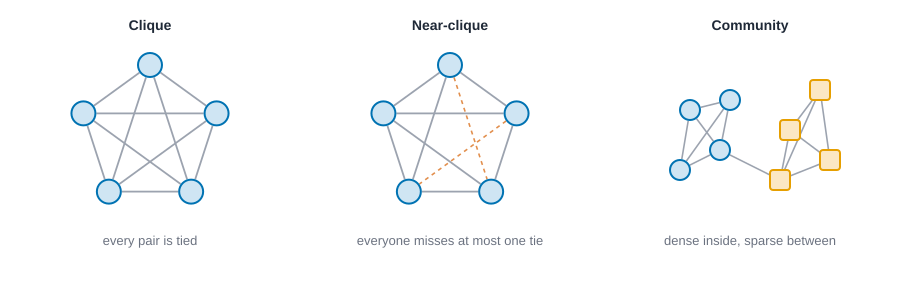
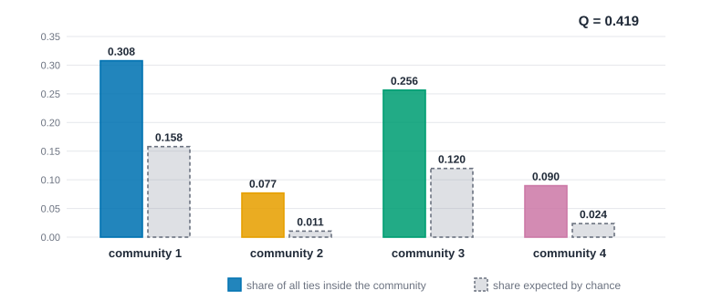
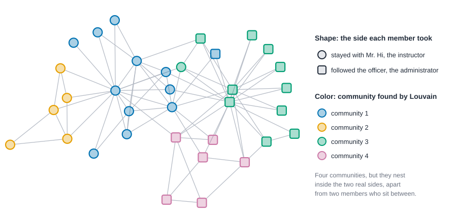
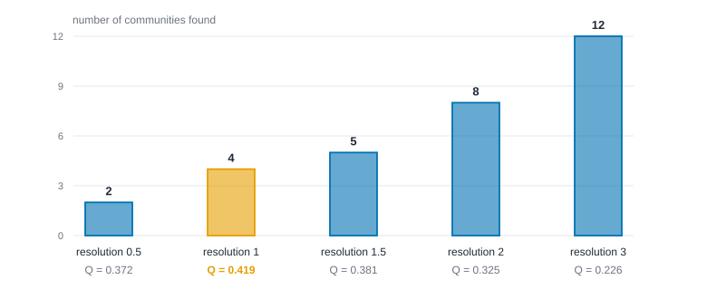

# Subgroups and communities {#sec-subgroups}

::: {.callout-note appearance="simple"}
## Prerequisites
@sec-networks-as-data, @sec-centrality and @sec-paths-and-cohesion. Betweenness (@sec-centrality) and cores (@sec-paths-and-cohesion) both come back here.
:::

## Groups inside the network

::: {.callout-tip appearance="simple"}
## Code lives next to the idea
Each idea comes with its code right where it is explained. The Rust blocks in this chapter run top to bottom as one script: the first enters the karate club, and later ones reuse it.
:::

Networks don't just connect people; they clump them. Look at almost any social network and you'll see clusters: people who tie mostly to each other and only a little to everyone else. Teams, cliques of friends, families, factions in a fight. A great deal of social life is about *who belongs with whom*, and a network is one of the few kinds of data that lets you see it without asking people.

The most famous example in the whole field is a karate club. In the early 1970s, the anthropologist Wayne Zachary spent about three years studying a university karate club of 34 members [@zachary1977information]. He recorded who interacted with whom outside the club's activities. Partway through, a dispute between the club's part-time instructor and its administrator split the club in two. Zachary used the network of friendships to predict which side each member would take, and he got all but one member right. A picture of friendship had *foreseen* a fission.

That's the promise of this chapter, and also its risk. There are many ways to define a "group" in a network, and they don't always agree. We'll go from the strictest definitions (everyone ties to everyone) to the loosest (more ties inside than you'd expect by chance), see how to find them, and spend real time on the question that matters most: when an algorithm hands you a set of groups, what has it actually told you?

## Three kinds of tight group

@fig-group-ladder lays out the range.

{#fig-group-ladder fig-alt="Left: five people on a circle with every pair tied. Middle: five people on a circle with two dashed red lines marking the two missing ties, so each person is missing at most one. Right: two small clusters of four, blue circles and orange squares, joined by a single tie."}

### Cliques

A **clique** is a set of people in which *everyone is tied to everyone else*. It's the strictest idea of a group, and it has a long history in sociology. A clique is **maximal** if you can't add anyone without breaking it. Maximal cliques overlap, since one person can belong to several, and that's a feature: it matches the way people really belong to more than one circle.

Cliques are demanding. In a large network, groups that are obviously meaningful to the people in them often have one or two missing ties, and a strict definition would split or discard them. A computer finds all maximal cliques with a classic algorithm [@bron1973algorithm], but on big networks there can be a huge number of them, most of them small and overlapping.

::: {.panel-tabset group="language"}

## R

```r
library(knappnet)

# Zachary's karate club: 34 members, 78 friendships. Members 0 to 33 in his numbering.
from <- c(
    0, 0, 0, 0, 0, 0, 0, 0, 0, 0, 0, 0, 0, 0, 0, 0, 1, 1, 1, 1, 1, 1, 1, 1, 2, 2, 2, 2, 2, 2, 2, 2, 3, 3, 3,
    4, 4, 5, 5, 5, 6, 8, 8, 8, 9, 13, 14, 14, 15, 15, 18, 18, 19, 20, 20, 22, 22, 23, 23, 23, 23, 23, 24, 24,
    24, 25, 26, 26, 27, 28, 28, 29, 29, 30, 30, 31, 31, 32,
)
to <- c(
    1, 2, 3, 4, 5, 6, 7, 8, 10, 11, 12, 13, 17, 19, 21, 31, 2, 3, 7, 13, 17, 19, 21, 30, 3, 7, 8, 9, 13, 27, 28,
    32, 7, 12, 13, 6, 10, 6, 10, 16, 16, 30, 32, 33, 33, 33, 32, 33, 32, 33, 32, 33, 33, 32, 33, 32, 33, 25, 27,
    29, 32, 33, 25, 27, 31, 31, 29, 33, 33, 31, 33, 32, 33, 32, 33, 32, 33, 33,
)
g <- net_frame(data.frame(source = from, target = to),
               nodes = data.frame(id = 0:33), directed = FALSE)

# Cliques: groups in which everyone is tied to everyone. Skip pairs (min_size = 3).
cliques <- net_max_cliques(g, min_size = 3)
cat(sprintf("largest clique   %d people\n", net_clique_number(g)))
cat(sprintf("maximal cliques  %d (of 3 or more people)\n", length(cliques)))
```

## Python

```python
import networkx as nx

# Zachary's karate club: 34 members, 78 friendships. Members 0 to 33 in his numbering.
src = [
    0, 0, 0, 0, 0, 0, 0, 0, 0, 0, 0, 0, 0, 0, 0, 0, 1, 1, 1, 1, 1, 1, 1, 1, 2, 2, 2, 2, 2, 2, 2, 2, 3, 3, 3,
    4, 4, 5, 5, 5, 6, 8, 8, 8, 9, 13, 14, 14, 15, 15, 18, 18, 19, 20, 20, 22, 22, 23, 23, 23, 23, 23, 24, 24,
    24, 25, 26, 26, 27, 28, 28, 29, 29, 30, 30, 31, 31, 32,
]
dst = [
    1, 2, 3, 4, 5, 6, 7, 8, 10, 11, 12, 13, 17, 19, 21, 31, 2, 3, 7, 13, 17, 19, 21, 30, 3, 7, 8, 9, 13, 27, 28,
    32, 7, 12, 13, 6, 10, 6, 10, 16, 16, 30, 32, 33, 33, 33, 32, 33, 32, 33, 32, 33, 33, 32, 33, 32, 33, 25, 27,
    29, 32, 33, 25, 27, 31, 31, 29, 33, 33, 31, 33, 32, 33, 32, 33, 32, 33, 33,
]
g = nx.Graph()
g.add_nodes_from(range(34))
g.add_edges_from(zip(src, dst))

# Cliques: groups in which everyone is tied to everyone. Skip pairs (size 3 or more).
cliques = [c for c in nx.find_cliques(g) if len(c) >= 3]
print(f"largest clique   {max(map(len, nx.find_cliques(g)))} people")
print(f"maximal cliques  {len(cliques)} (of 3 or more people)")
```

## Rust

```rust
use knappnet::metrics::cliques::{compute_clique_number, find_max_cliques};
use knappnet::Graph;

// Zachary's karate club: 34 members, 78 friendships, from his study of a club
// that split in two. Positions 0 to 33 are the members in his numbering.
let from = [
    0, 0, 0, 0, 0, 0, 0, 0, 0, 0, 0, 0, 0, 0, 0, 0, 1, 1, 1, 1, 1, 1, 1, 1, 2, 2, 2, 2, 2, 2, 2, 2, 3, 3, 3,
    4, 4, 5, 5, 5, 6, 8, 8, 8, 9, 13, 14, 14, 15, 15, 18, 18, 19, 20, 20, 22, 22, 23, 23, 23, 23, 23, 24, 24,
    24, 25, 26, 26, 27, 28, 28, 29, 29, 30, 30, 31, 31, 32,
];
let to = [
    1, 2, 3, 4, 5, 6, 7, 8, 10, 11, 12, 13, 17, 19, 21, 31, 2, 3, 7, 13, 17, 19, 21, 30, 3, 7, 8, 9, 13, 27, 28,
    32, 7, 12, 13, 6, 10, 6, 10, 16, 16, 30, 32, 33, 33, 33, 32, 33, 32, 33, 32, 33, 33, 32, 33, 32, 33, 25, 27,
    29, 32, 33, 25, 27, 31, 31, 29, 33, 33, 31, 33, 32, 33, 32, 33, 32, 33, 33,
];
let g = Graph::from_edges(34, &from, &to, None, false)?;
println!("{}", g.describe());

// Cliques: groups in which everyone is tied to everyone. The 3 skips pairs; the 0 is the default option.
let cliques = find_max_cliques(&g, 3, 0);
println!("largest clique   {} people", compute_clique_number(&g, 0));
println!("maximal cliques  {} (of 3 or more people)", cliques.len());
```

:::

::: {.code-output}
```text
Undirected network: 34 nodes, 78 ties
  Density           0.139
  Degree            1 to 17, mean 4.59
  Connected pieces  1
  Isolated nodes    0
  Loops, repeats    none
  Busiest           node 33 (17), node 0 (16), node 32 (12)

largest clique   5 people
maximal cliques  25 (of 3 or more people)
```
:::

The biggest clique has five members, and there are 25 maximal cliques of three or more people. Cliques exist, but they overlap heavily, and a 34-person club is clearly more than 25 separate little circles.

### Relaxing the rule

Sociologists have long relaxed the clique rule. An **n-clique** allows people to be up to $n$ steps apart rather than one [@luce1950connectivity]. A **k-plex** lets each member miss up to $k - 1$ ties to others in the group [@seidman1978graph]. The k-core from @sec-paths-and-cohesion is another relaxation: everyone has *at least* $k$ ties inside the group, whether or not they know the same people. Each definition is a different idea of what makes a group solid, and it's worth choosing one on purpose, based on what you think holds your groups together.

### Communities

The loosest and, today, the most used idea is the **community**: a set of people who have more ties among themselves than you'd expect by chance. There's no demand that every pair be tied, or even that anyone know a minimum number of others. The group only has to be *denser inside than it is to the outside*. That's flexible enough to find groups in networks of millions of people, and it's why community detection has become a standard tool.

## What "more than chance" means: modularity

To make "more ties inside than expected by chance" precise, we need a model of chance. The standard one asks: if we shuffled the ties at random, *keeping every person's number of ties fixed*, how many would land inside each group? People with many ties are more likely to be tied to someone in the group by luck, so the model accounts for that.

**Modularity**, usually written $Q$, is the result. For each group it takes the share of all ties that fall inside it, subtracts the share you'd expect by chance, and adds the differences up [@newman2004finding; @newman2006modularity]. For an undirected network with $m$ ties,

$$
Q = \sum_{c} \left[ \frac{L_c}{m} - \left( \frac{d_c}{2m} \right)^2 \right],
$$

where $L_c$ is the number of ties inside group $c$ and $d_c$ is the total number of ties its members have (their degrees added up). A higher $Q$ means the groups hold more ties than chance would put there. Zero means no better than chance. The values for good partitions of real networks are often between about 0.3 and 0.7.

{#fig-modularity-bars fig-alt="A grouped bar chart with four pairs of bars, one pair per community. In every pair the solid bar, the observed share of ties inside the community, is taller than the dashed bar, the share expected by chance."}

@fig-modularity-bars shows this for the karate club. In every community the observed share of ties (solid bar) beats the share expected by chance (dashed bar), and the gaps add up to $Q = 0.419$.

Modularity can also come with a tuning knob, the **resolution**, that makes the groups coarser or finer [@reichardt2006statistical]. We'll see why that matters in a moment.

::: {.panel-tabset group="language"}

## R

```r
# Which side each member took when the club split (0 = Mr. Hi, 1 = the officer).
sides <- c(
    0, 0, 0, 0, 0, 0, 0, 0, 0, 1, 0, 0, 0, 0, 1, 1, 0, 0, 1, 0, 1, 0, 1, 1, 1, 1, 1, 1, 1, 1, 1, 1, 1, 1,
)
cat(sprintf("modularity of the real split  %.3f\n", net_modularity(g, sides)))
```

## Python

```python
# Which side each member took when the club split (0 = Mr. Hi, 1 = the officer).
sides = [
    0, 0, 0, 0, 0, 0, 0, 0, 0, 1, 0, 0, 0, 0, 1, 1, 0, 0, 1, 0, 1, 0, 1, 1, 1, 1, 1, 1, 1, 1, 1, 1, 1, 1,
]
def as_groups(labels):
    return [{i for i, l in enumerate(labels) if l == k} for k in sorted(set(labels))]
print(f"modularity of the real split  {nx.community.modularity(g, as_groups(sides)):.3f}")
```

## Rust

```rust
use knappnet::metrics::community::compute_modularity;

// Which side each member took when the club split (0 = Mr. Hi, 1 = the officer).
let sides: [i64; 34] = [
    0, 0, 0, 0, 0, 0, 0, 0, 0, 1, 0, 0, 0, 0, 1, 1, 0, 0, 1, 0, 1, 0, 1, 1, 1, 1, 1, 1, 1, 1, 1, 1, 1, 1,
];
// 1.0 is the resolution setting (the standard score); `false` means the ties are unweighted.
let split_q = compute_modularity(&g, &sides, 1.0, false)?;
println!("modularity of the real split  {split_q:.3}");
```

:::

::: {.code-output}
```text
modularity of the real split  0.358
```
:::

A note on reproducibility. Some copies of the karate club data you'll find online carry tie weights, which Zachary also recorded. On those, the modularity of the real split comes out near 0.39 and not 0.358, because the weighted and unweighted versions are different data. The numbers here are for the unweighted version, as stated in the code. Whenever you reproduce a result from someone else's data, check which version you have.

## Finding communities

Finding the partition with the highest modularity is hard, so people use methods that find good ones quickly. A few worth knowing by name:

- **Girvan and Newman's method** [@girvan2002community] works by *removing* ties. It repeatedly deletes the tie with the highest betweenness (the same idea as @sec-centrality, applied to ties), because ties that bridge groups carry the most routes. As bridges fall away, groups separate. It's intuitive but slow.
- **Louvain** [@blondel2008fast] is fast and popular. It starts with every person in their own group, then moves people one at a time to whichever neighboring group raises modularity most, merges the groups into single nodes, and repeats.
- **Leiden** [@traag2019louvain] improves on Louvain and guarantees that every community it reports is connected. Louvain can occasionally return communities that fall apart internally.
- **Label propagation** [@raghavan2007near] gives each person a label and lets everyone repeatedly adopt the most common label among their neighbors. It's very fast, and different runs can give different answers.
- **Infomap** [@rosvall2008maps] follows a random walker around the network and looks for groups that trap the walker for a long time.
- **Clique percolation** [@palla2005uncovering] builds communities out of overlapping cliques, so a person can belong to several communities. Most of the methods above give each person exactly one.

There are many more, and good surveys [@fortunato2010community]. Another family, stochastic block models, treats community structure as a statistical model, and we meet it in @sec-latent-space.

::: {.panel-tabset group="language"}

## R

```r
# Louvain with resolution 1, unweighted, and seed 1 so the answer can be reproduced.
found <- net_louvain(g, resolution = 1, seed = 1)
cat(sprintf("communities  %d, modularity %.3f\n", length(unique(found)), attr(found, "modularity")))

# Check it: score the same partition with the modularity function from before.
cat(sprintf("scored again  %.3f\n", net_modularity(g, found)))
```

## Python

```python
# Louvain with resolution 1, unweighted, and seed 1 so the answer can be reproduced.
found = nx.community.louvain_communities(g, resolution=1, seed=1)
print(f"communities  {len(found)}, modularity {nx.community.modularity(g, found):.3f}")

# Check it: score the same partition with the modularity function from before.
print(f"scored again  {nx.community.modularity(g, found):.3f}")
```

## Rust

```rust
use knappnet::metrics::community::find_louvain_communities;

// Louvain with resolution 1.0, unweighted, and seed 1 so the answer can be reproduced.
let found = find_louvain_communities(&g, 1.0, false, 1)?;
let groups = found.membership.iter().max().unwrap() + 1;
println!("communities  {groups}, modularity {:.3}", found.modularity);

// Check it: score the same partition with the modularity function from before.
let labels: Vec<i64> = found.membership.iter().map(|&m| m as i64).collect();
println!("scored again  {:.3}", compute_modularity(&g, &labels, 1.0, false)?);
```

:::

::: {.code-output}
```text
communities  4, modularity 0.419
scored again  0.419
```
:::

Louvain finds four communities with modularity 0.419, higher than the 0.358 of the real two-way split. Scoring the partition again with the separate function gives the same number, which is a good habit: one measure computed two ways.

## The karate club, two ways

Here's where it gets interesting. The Louvain method, run on the karate club network, finds **four** communities with $Q = 0.419$. The actual split of the club was into **two** sides, and the modularity of *that* split is only $0.358$. The algorithm found a partition with *higher* modularity than the one that really happened.

@fig-karate-communities puts the two next to each other. Shape shows the side each member took, and color shows the Louvain community.

{#fig-karate-communities fig-alt="A network of 34 people. Circles are members who stayed with the instructor and squares followed the administrator. Four colors mark communities: two colors cover almost only circles, two cover almost only squares, with one circle among the squares' communities and one square among the circles' communities."}

Read the picture before reading the number. Each side of the club splits into two communities, so *merge the communities in pairs and you almost recover the split*. Two members are the exception: their ties point both ways, one to each side, so the algorithm puts them with one crowd, and history put them with the other. A statistic called the adjusted Rand index, which scores how closely two partitions agree (1 is identical, 0 is no better than chance), comes out at 0.39 between the communities and the real sides. That's well above chance, and far from identical, because four groups can never perfectly match two.

Is the four-community answer "wrong"? No. It's a different and finer description of the same network. Whether it's the right one depends on your question: if you want to predict the fission, the two-side description answers it; if you want to see the tight friendship circles inside each side, the four-community one does.

### Turning the dial

The resolution setting makes this explicit. @fig-resolution-sweep shows what Louvain finds on the same network as the setting rises.

{#fig-resolution-sweep fig-alt="A bar chart with five bars for resolution settings 0.5, 1, 1.5, 2 and 3, showing 2, 4, 5, 8 and 12 communities. The bar for resolution 1, four communities, is highlighted because it has the highest modularity, 0.419."}

At a low setting, Louvain finds two communities, which line up closely with the real sides. At the standard setting it finds four. Turn it up and you get eight, then twelve, which break the club into fragments. Each is a legitimate answer to a different question: how fine do you want the groups? The $Q$ values, which are all measured at the same standard setting so they can be compared, peak at four communities, but "highest $Q$" is a statement about the formula and not about the club.

::: {.panel-tabset group="language"}

## R

```r
# CHECK: stop
# R and Python draw different random numbers, so only some rows can agree.
for (r in c(0.5, 1, 1.5, 2, 3)) {
  f <- net_louvain(g, resolution = r, seed = 1)
  cat(sprintf("resolution %g: %2d groups, modularity %.3f\n",
              r, length(unique(f)), net_modularity(g, f)))
}
```

## Python

```python
# CHECK: stop
# R and Python draw different random numbers, so only some rows can agree.
for r in [0.5, 1, 1.5, 2, 3]:
    f = nx.community.louvain_communities(g, resolution=r, seed=1)
    print(f"resolution {r:g}: {len(f):>2} groups, modularity {nx.community.modularity(g, f):.3f}")
```

## Rust

```rust
for r in [0.5, 1.0, 1.5, 2.0, 3.0] {
    let f = find_louvain_communities(&g, r, false, 1)?;
    let labels: Vec<i64> = f.membership.iter().map(|&m| m as i64).collect();
    let q = compute_modularity(&g, &labels, 1.0, false)?;
    println!("resolution {r}: {:>2} groups, modularity {q:.3}", f.membership.iter().max().unwrap() + 1);
}
```

:::

::: {.code-output}
```text
resolution 0.5:  2 groups, modularity 0.372
resolution 1:  4 groups, modularity 0.419
resolution 1.5:  5 groups, modularity 0.381
resolution 2:  8 groups, modularity 0.325
resolution 3: 12 groups, modularity 0.226
```
:::

Turning the dial up gives more and smaller groups: two at 0.5, four at the standard setting of 1, twelve at 3. Scored on the same standard yardstick, the middle setting wins, but note that the winner depends on the yardstick.

The R and Python tabs draw different random numbers from the Rust one, so the middle rows of their sweep can differ in the last digits or by a group.

## Comparing partitions

How do you tell whether two ways of dividing a network agree? Several scores exist, and they answer the question slightly differently. The **adjusted Rand index** [@hubert1985comparing] counts pairs of people who are grouped together in both partitions or apart in both, and corrects for the agreement you'd get by chance. The **variation of information** [@meila2007comparing] and **normalized mutual information** measure how much knowing one partition tells you about the other. Adjusted mutual information [@vinh2010information] corrects the latter for chance. All of them are useful for the same three jobs: checking a method against known groups, checking whether two methods agree, and checking whether one method gives the same answer on repeated runs.

::: {.panel-tabset group="language"}

## R

```r
labels <- net_louvain(g, resolution = 1, seed = 1)
cat(sprintf("adjusted Rand  %.3f\n", net_compare_partitions(labels, sides, method = "adjusted_rand")))
```

## Python

```python
# Adjusted Rand index, written out from the pair counts (scikit-learn has the same function).
import numpy as np
from math import comb

labels = [0] * 34
for k, members in enumerate(found):
    for i in members:
        labels[i] = k
table = np.zeros((len(found), 2), dtype=int)
for i in range(34):
    table[labels[i], sides[i]] += 1
index = sum(comb(int(n), 2) for n in table.ravel())
rows = sum(comb(int(n), 2) for n in table.sum(axis=1))
cols = sum(comb(int(n), 2) for n in table.sum(axis=0))
expected = rows * cols / comb(34, 2)
ari = (index - expected) / ((rows + cols) / 2 - expected)
print(f"adjusted Rand  {ari:.3f}")
```

## Rust

```rust
use knappnet::metrics::partition::compare::{compare_partitions, CompareMethod};

let ari = compare_partitions(&labels, &sides, CompareMethod::AdjustedRand)?;
println!("adjusted Rand  {ari:.3}");
```

:::

::: {.code-output}
```text
adjusted Rand  0.392
```
:::

The adjusted Rand index is 1 for identical partitions and about 0 for agreement no better than chance. At 0.392 the communities agree with the real split a fair amount, which fits the picture: they nest inside the two sides, apart from a few members who sit between.

## Reading communities honestly

A detected community is easy to misread, so keep these in mind.

**A community is a pattern in ties, not necessarily a group of people.** An algorithm looks only at who is tied to whom. It knows nothing about whether those people think of themselves as a group, share goals, meet, or even know that the others exist. Sometimes communities match real groups, as they roughly did in the karate club. Sometimes they reflect something else, like geography or the way the data were collected. Check against what you know about the setting, and against attributes like department, location or role.

**Modularity has a blind spot.** Fortunato and Barthélemy [@fortunato2007resolution] showed that modularity-based methods can miss small communities in large networks, merging them into bigger ones, because the "chance" benchmark depends on the size of the whole network. If small groups matter to your question, check with a different method or a higher resolution.

**The answer depends on choices.** The method, the random seed, and the resolution all change the result. Fix the seed so others can reproduce your answer, as we do in the code below. Run several methods and see what's stable. Communities that appear across methods and seeds deserve more trust than ones that appear only once.

**Don't over-read the boundary.** Where a person is placed matters most when their ties split between groups, as with the two members here. Those people may be the most interesting ones, brokers between circles (@sec-foundations), and not errors to be tidied.

**Hidden networks need extra care.** Covert groups have subgroups too, such as cells, but data on them are incomplete and ties may be deliberately concealed. Everton's *Disrupting Dark Networks* [@everton2012disrupting] applies subgroup detection to such networks, and Cunningham, Everton and Murphy [@cunningham2016understanding] discuss what can be responsibly concluded from them. A community found in partial data is a hypothesis, not a finding.

## A cheat sheet

| Idea | What it asks | Good for | Watch out for |
| --- | --- | --- | --- |
| Clique | Is everyone tied to everyone? | Small, tight, overlapping circles | Too strict for most real groups |
| k-plex, n-clique | Is everyone tied to almost everyone? | Slightly looser groups | Choosing $k$ or $n$ |
| k-core | Does everyone have at least $k$ ties inside? | Finding the dense core | Cores can be one big blob |
| Modularity methods | Are there more ties inside than chance? | Large networks, one group per person | Resolution limit, many near-ties in score |
| Label propagation | What do my neighbors think? | Very large networks, speed | Different runs, different answers |
| Clique percolation | Which cliques overlap? | People in several groups | Needs cliques to exist |

## Exercises

1. **By hand.** In @fig-group-ladder, find every maximal clique of three or more people in the community panel. Which people belong to more than one?
2. **By hand.** Compute modularity for a network of two triangles joined by a single tie, with each triangle as a group. Then compute it for a single group containing everyone. Which is higher, and why?
3. **Design.** You want to find the friend groups in a school grade of 200 students. Would you use cliques, a modularity method, or something else? What would you check the result against?
4. **Coding.** Run Louvain on the karate club with five different seeds. Do you always get four communities? Which members change groups?
5. **Interpretation.** A report says "the algorithm found three departments in our company network, and they match the org chart exactly." Write down two reasons that could be good news and two reasons to be cautious.

## Summary

::: {.callout-tip appearance="simple"}
Groups in networks can be defined strictly (cliques), loosely (k-plexes, cores) or statistically (communities, which have more ties inside than chance predicts). Modularity scores a partition by that comparison, and methods like Louvain, Leiden and label propagation search for partitions that score well. On the karate club, Louvain finds four communities that refine the two sides the club actually split into, with higher modularity than the real split. That's a reminder that a community is a pattern in ties, depends on method, seed and resolution, and should be checked against what you know about the people. Partitions can be compared with scores like the adjusted Rand index, and stable results across methods deserve the most trust.
:::

## Further reading

For the karate club itself, see @zachary1977information. For modularity, see @newman2004finding and @newman2006modularity, and for the resolution parameter and limit, @reichardt2006statistical and @fortunato2007resolution. For the methods, see @girvan2002community, @blondel2008fast, @traag2019louvain, @raghavan2007near, @rosvall2008maps and @palla2005uncovering, and for a broad survey, @fortunato2010community. For cliques and their relaxations, see @bron1973algorithm, @luce1950connectivity and @seidman1978graph. For comparing partitions, see @hubert1985comparing, @meila2007comparing and @vinh2010information. For subgroups in networks that hide on purpose, see @everton2012disrupting and @cunningham2016understanding. To practice in R, Phil Murphy's tutorials on cohesive subgroups [@murphyrpubs977746; @murphyrpubs323120] walk through cliques and community detection step by step.
