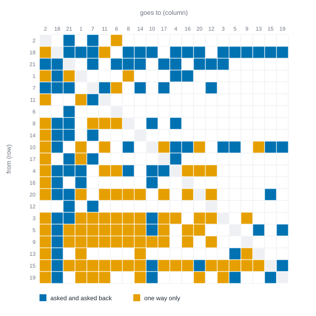
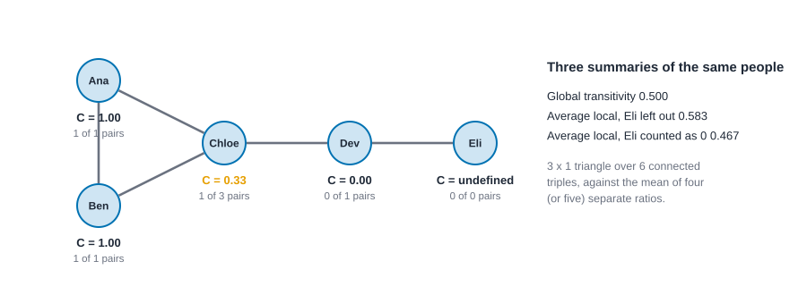
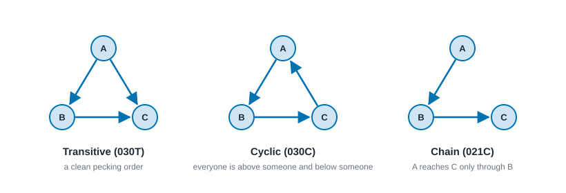

# Dyads, triads and motifs {#sec-triads-and-motifs}

::: {.callout-note appearance="simple"}
## Prerequisites
@sec-paths-and-cohesion, where reciprocity, transitivity and the triad census first appeared. We use Krackhardt's 21 managers from @sec-multilayer, Sampson's novices and the Florentine families, all in the book's `data` folder.
:::

## Why look at three people at a time?

Most network measures describe one person (degree, betweenness) or the whole network (density, diameter). A lot of the interesting social action sits in between, in the smallest groups that can have structure at all. Two people can be tied or not, and the tie can be returned or not. Add a third person and new things become possible: a pecking order, a go-between, a circle in which everyone defers to someone else.

So here is the plan. We count the patterns that two and three people can form. We find that the familiar measures from the last chapter, reciprocity and transitivity, are nothing but ratios of those counts. Then we ask the question that makes the counts useful and dangerous in equal measure: is this pattern more common than it "should" be? The honest answer is always "compared with what?", and we will see the same network look wildly hierarchical against one yardstick and unremarkable against another.

::: {.callout-tip appearance="simple"}
## Code lives next to the idea
Each block has an R, a Python and a Rust tab. The Rust blocks run top to bottom as one script, so a later block can use what an earlier one built. Where a random draw is involved, R and Rust use the same engine and the same seed, so they print the same numbers. The Python tab draws its own random networks, so its digits differ a little.
:::

## Dyads: mutual, asymmetric, null

A **dyad** is a pair of people. In an undirected network a dyad is tied or not tied. In a directed network there are three possibilities, and they are the first thing worth counting:

- **Mutual** (M): both ties are there. Ana goes to Chloe for advice and Chloe goes to Ana.
- **Asymmetric** (A): exactly one of the two ties is there.
- **Null** (N): neither is there.

With $n$ people there are $\binom{n}{2} = n(n-1)/2$ pairs, and every pair is exactly one of the three, so $M + A + N = \binom{n}{2}$. The triple $(M, A, N)$ is the **dyad census**. Holland and Leinhardt introduced it, together with the triad census below, as a way to ask whether a sociogram has structure beyond what chance would produce [@holland1970method].

Take the five-person advice network from @sec-paths-and-cohesion: Ana goes to Ben and to Chloe, Ben to Chloe, Chloe to Ana, Dev to Ana and to Chloe, and Eli to Chloe. There are ten pairs. Going through them: Ana and Chloe are mutual. Ana-Ben, Ana-Dev, Ben-Chloe, Chloe-Dev and Chloe-Eli each have a tie in one direction only. The other four pairs (Ana-Eli, Ben-Dev, Ben-Eli, Dev-Eli) have no tie at all. So $M = 1$, $A = 5$ and $N = 4$, and $1 + 5 + 4 = 10$.

### Reciprocity is a ratio of dyad counts, and there is more than one

**Reciprocity** is how much of a network's tie-making is returned. Three different ratios of $(M, A, N)$ go by that name:

$$
r_{\text{edge}} = \frac{2M}{2M + A}, \qquad
r_{\text{ratio}} = \frac{M}{M + A}, \qquad
r_{\text{dyad}} = \frac{M + N}{M + A + N}.
$$

The first is the share of *ties* that are returned (each mutual pair is two ties). The second is the share of *connected pairs* that are mutual. The third is the share of *all* pairs that are symmetric, counting two strangers as symmetric. A fourth option, the correlation between the two possible ties of a dyad, is also in use. For the five people: $r_{\text{edge}} = 2/7 = 0.286$, $r_{\text{ratio}} = 1/6 = 0.167$ and $r_{\text{dyad}} = 5/10 = 0.5$. One network, three answers, and all three are called reciprocity in some package. @sec-paths-and-cohesion used the first, which is also what NetworkX and igraph call reciprocity by default.

::: {.panel-tabset group="language"}

## R

```r
library(knappnet)
library(dplyr)
library(tibble)
library(tidyr)
library(purrr)

# The advice network from the last chapter: five people, seven "goes to for advice" ties.
people <- c("Ana", "Ben", "Chloe", "Dev", "Eli")
five_advice <- tibble(
  source = c("Ana", "Ana", "Ben", "Chloe", "Dev", "Dev", "Eli"),
  target = c("Ben", "Chloe", "Chloe", "Ana", "Ana", "Chloe", "Chloe")
) |>
  net_frame(nodes = tibble(id = people), directed = TRUE, quiet = TRUE)

# knappnet's R package has no dyad census function yet, so we count it from the
# edge table: a tie is returned when the reversed tie is also in the table.
dyad_census <- function(g) {
  arcs <- select(g$edges, source, target)
  returned <- nrow(semi_join(arcs, arcs, by = c(source = "target", target = "source")))
  pairs <- choose(nrow(g$nodes), 2)
  tibble(
    mutual = returned / 2,
    asymmetric = nrow(arcs) - returned,
    null = pairs - mutual - asymmetric
  )
}
dyad_census(five_advice)

# The three reciprocity ratios.
tibble(
  edgewise = net_reciprocity(five_advice),
  ratio = net_reciprocity(five_advice, mode = "ratio"),
  dyadic = net_reciprocity(five_advice, mode = "dyadic")
)
```

::: {.code-output}
```text
pending
```
:::

## Python

```python
import csv
import itertools

import networkx as nx
import numpy as np

NAMES = ["003", "012", "102", "021D", "021U", "021C", "111D", "111U",
         "030T", "030C", "201", "120D", "120U", "120C", "210", "300"]

def dyad_census(g):
    # A pair is mutual when both ties are there, asymmetric when exactly one is.
    mutual = sum(1 for u, v in g.edges if g.has_edge(v, u)) // 2
    asym = g.number_of_edges() - 2 * mutual
    n = g.number_of_nodes()
    return mutual, asym, n * (n - 1) // 2 - mutual - asym

# The advice network from the last chapter: five people, seven "goes to for advice" ties.
five_advice = nx.DiGraph([("Ana", "Ben"), ("Ana", "Chloe"), ("Ben", "Chloe"), ("Chloe", "Ana"),
                          ("Dev", "Ana"), ("Dev", "Chloe"), ("Eli", "Chloe")])
mutual, asym, null = dyad_census(five_advice)
print(f"mutual {mutual}, asymmetric {asym}, null {null}")

# The three reciprocity ratios.
print(f"edgewise {nx.reciprocity(five_advice):.3f}")
print(f"ratio    {mutual / (mutual + asym):.3f}")
print(f"dyadic   {(mutual + null) / (mutual + asym + null):.3f}")
```

::: {.code-output}
```text
mutual 1, asymmetric 5, null 4
edgewise 0.286
ratio    0.167
dyadic   0.500
```
:::

## Rust

```rust
use knappnet::metrics::descriptive::{compute_reciprocity, ReciprocityMode};
use knappnet::metrics::descriptive_more::compute_dyad_census;
use knappnet::{compute_triad_census, Graph, TRIAD_NAMES};

// Ana, Ben, Chloe, Dev and Eli are positions 0 to 4.
let five_advice = Graph::from_edges(5, &[0, 0, 1, 2, 3, 3, 4], &[1, 2, 2, 0, 0, 2, 2], None, true)?;
let [mutual, asym, null] = compute_dyad_census(&five_advice);
println!("mutual {mutual}, asymmetric {asym}, null {null}");

// The three reciprocity ratios.
println!("edgewise {:.3}", compute_reciprocity(&five_advice, ReciprocityMode::Default));
println!("ratio    {:.3}", compute_reciprocity(&five_advice, ReciprocityMode::Ratio));
println!("dyadic   {:.3}", compute_reciprocity(&five_advice, ReciprocityMode::Dyadic));
```

::: {.code-output}
```text
mutual 1, asymmetric 5, null 4
edgewise 0.286
ratio    0.167
dyadic   0.500
```
:::

:::

### Reciprocity against chance

Is 0.47 high? That depends on how many ties there are. If every tie in a network were placed independently and at random, a tie's reverse would be present with a probability equal to the network's density, so even a random network returns about that share of its ties. A reciprocity of 0.47 in a network of density 0.45 is therefore close to nothing, while 0.45 in a network of density 0.24 is a lot.

Krackhardt's managers show exactly this [@krackhardt1987cognitive]. He asked each of 21 managers of a small manufacturing firm whom they go to for advice and whom they count as a friend. @fig-advice-matrix draws the advice network as a grid: a cell in row $i$ and column $j$ means manager $i$ goes to manager $j$. Blue cells are returned, orange cells are not, and the managers are sorted by how many colleagues come to them.

{#fig-advice-matrix fig-alt="A 21 by 21 grid with 190 filled cells. 90 are blue, which is 45 returned pairs counted from both sides, and 100 are orange, advice that is not returned. The three most-asked managers, in order, are 2, 18 and 21, and the columns at the left of the grid are the densest."}

The grid shows a pattern the dyad census only hints at: the busy columns at the left belong to a few managers, and the sparse rows near the bottom belong to people who ask a lot and are asked little. The comparison with chance is a **conditional uniform graph test** (the idea from @sec-tests-and-null-models): draw many random directed networks with the same number of people and the same number of ties, place the ties at random, and see how often reciprocity is as high as what we observed.

::: {.panel-tabset group="language"}

## R

```r
# Krackhardt's 21 managers, one relation at a time. Nodes are the manager numbers 1 to 21.
kr <- read.csv("data/krackhardt/edges.csv")
read_relation <- function(name) {
  kr |>
    filter(relation == name) |>
    transmute(source = as.character(from), target = as.character(to)) |>
    net_frame(nodes = tibble(id = as.character(1:21)), directed = TRUE, quiet = TRUE)
}
advice <- read_relation("advice")
friends <- read_relation("friendship")

# Random networks with the same people and the same number of ties: 2,000 draws each.
list(advice = advice, friendship = friends) |>
  imap(\(g, name) {
    test <- net_cug_test(g, net_reciprocity, conditioning = "edges", reps = 2000, seed = 1)
    bind_cols(
      tibble(relation = name, density = net_density(g)),
      dyad_census(g),
      tibble(
        reciprocity = test$observed,
        chance_mean = mean(test$null),
        chance_sd = sd(test$null),
        share_as_high = test$p_greater
      )
    )
  }) |>
  list_rbind() |>
  mutate(across(c(density, reciprocity, chance_mean, chance_sd), \(x) round(x, 3)))
```

::: {.code-output}
```text
pending
```
:::

## Python

```python
# Krackhardt's 21 managers, one relation at a time. Nodes are the manager numbers 1 to 21.
with open("data/krackhardt/edges.csv") as f:
    rows = list(csv.DictReader(f))

def read_relation(name):
    g = nx.DiGraph()
    g.add_nodes_from(range(1, 22))
    g.add_edges_from((int(r["from"]), int(r["to"])) for r in rows if r["relation"] == name)
    return g

advice = read_relation("advice")
friends = read_relation("friendship")

# Random networks with the same people and the same number of ties: 2,000 draws each.
rng = np.random.default_rng(1)
for name, g in [("advice", advice), ("friendship", friends)]:
    m = g.number_of_edges()
    chance = np.array([nx.reciprocity(nx.gnm_random_graph(21, m, directed=True, seed=int(rng.integers(2**31))))
                       for _ in range(2000)])
    observed = nx.reciprocity(g)
    mutual, asym, null = dyad_census(g)
    print(f"{name:<10} density {nx.density(g):.3f}  M {mutual} A {asym} N {null}  reciprocity {observed:.3f}  "
          f"chance {chance.mean():.3f} (sd {chance.std(ddof=1):.3f})  as high {np.mean(chance >= observed - 1e-12):.4f}")
```

::: {.code-output}
```text
advice     density 0.452  M 45 A 100 N 65  reciprocity 0.474  chance 0.450 (sd 0.038)  as high 0.3115
friendship density 0.243  M 23 A 56 N 131  reciprocity 0.451  chance 0.240 (sd 0.052)  as high 0.0000
```
:::

## Rust

```rust
use knappnet::generate::{sample_gnm, EdgeList};

// Krackhardt's 21 managers, one relation at a time. Managers are numbered 1 to 21; positions are 0 to 20.
let text = std::fs::read_to_string("data/krackhardt/edges.csv")?;
let read_arcs = |name: &str| -> (Vec<i64>, Vec<i64>) {
    let (mut from, mut to) = (Vec::new(), Vec::new());
    for line in text.lines().skip(1) {
        let p: Vec<&str> = line.split(',').collect();
        if p[2] == name {
            from.push(p[0].parse::<i64>().unwrap() - 1);
            to.push(p[1].parse::<i64>().unwrap() - 1);
        }
    }
    (from, to)
};
let advice_arcs = read_arcs("advice");
let friend_arcs = read_arcs("friendship");
let advice = Graph::from_edges(21, &advice_arcs.0, &advice_arcs.1, None, true)?;
let friends = Graph::from_edges(21, &friend_arcs.0, &friend_arcs.1, None, true)?;

// Turn one random draw (lists of positions) into a network we can measure.
let to_graph = |d: &EdgeList| {
    let from: Vec<i64> = d.from.iter().map(|&x| x as i64).collect();
    let to: Vec<i64> = d.to.iter().map(|&x| x as i64).collect();
    Graph::from_edges(21, &from, &to, None, true)
};

// Random networks with the same people and the same number of ties: 2,000 draws each.
for (name, g, arcs) in [("advice", &advice, advice_arcs.0.len()), ("friendship", &friends, friend_arcs.0.len())] {
    let draws = sample_gnm(21, arcs as u64, true, false, 2_000, 1, 0)?;
    let mut chance = Vec::new();
    for d in &draws {
        chance.push(compute_reciprocity(&to_graph(d)?, ReciprocityMode::Default));
    }
    let observed = compute_reciprocity(g, ReciprocityMode::Default);
    let mean = chance.iter().sum::<f64>() / chance.len() as f64;
    let sd = (chance.iter().map(|x| (x - mean).powi(2)).sum::<f64>() / (chance.len() - 1) as f64).sqrt();
    let as_high = chance.iter().filter(|&&x| x >= observed - 1e-12).count() as f64 / chance.len() as f64;
    let [mutual, asym, null] = compute_dyad_census(g);
    println!("{name:<10} density {:.3}  M {mutual} A {asym} N {null}  reciprocity {observed:.3}  chance {mean:.3} (sd {sd:.3})  as high {as_high:.4}", arcs as f64 / 420.0);
}
```

::: {.code-output}
```text
advice     density 0.452  M 45 A 100 N 65  reciprocity 0.474  chance 0.452 (sd 0.037)  as high 0.3335
friendship density 0.243  M 23 A 56 N 131  reciprocity 0.451  chance 0.240 (sd 0.055)  as high 0.0000
```
:::

:::

Against chance, the two relations behave very differently. In the advice network 47 percent of ties are returned (0.474), but random networks with the same 190 ties return 45 percent on average (0.452, spread 0.037), and a third of them (0.33) are at least as reciprocal as the real network. On its own, advice reciprocity shows nothing beyond what the *number* of ties would give. In the friendship network 45 percent are returned (0.451), against 24 percent (0.240, spread 0.055) in random networks with 102 ties, and none of the 2,000 random networks reaches the observed value. The same "about 45 percent returned" is unremarkable for advice and a strong signal for friendship, and the difference is the density, 0.452 against 0.243.

Two cautions. First, reciprocity can be built into the data collection: if people are asked to name *mutual* friends, or if the tie is something like "attended the same meeting" that is symmetric by nature, the number is 1 by design and means nothing. Second, missing data bends it: if a manager did not answer the survey, his outgoing ties are missing, so every tie *toward* him looks unreturned and reciprocity is biased down.

### Reading reciprocity

What high and low mean depends on the tie, and the same number can be good news in one place and a red flag in another.

- **Friendship or marriage-like ties.** High reciprocity is normal. A low value suggests the survey asked about ties people do not admit, or that status differences are strong.
- **Advice and deference.** Low reciprocity is the ordinary signature of expertise or rank: people go up to ask. High reciprocity suggests peers who consult each other.
- **Email or messaging.** Reciprocity is the reply rate. A low value in a customer-support network is expected; in a team chat it may mean some members only listen.
- **Online follows.** Follow-back is cheap, so reciprocity reflects platform norms more than closeness.
- **Trade, transport and supply.** A returned flow can mean a balanced exchange or just that goods ship both ways for unrelated reasons. Reciprocity of *counts* says nothing about the *amounts* flowing in each direction.

Reciprocity does not show who is better off, whether the mutual ties are equally strong, or why they are returned.

## Triads: all the ways three people can be tied

A **triad** is a set of three people. There are $\binom{n}{3}$ of them in a network of $n$ people, and each is in one of a small number of states depending on which of its three pairs are tied. Simmel thought a third person changes everything [@simmel1950sociology], and this is where the claim becomes countable. Counting how many triads of each state a network has is the **triad census**.

### Undirected networks: four types

If ties have no direction, a triad has 0, 1, 2 or 3 of its three pairs tied, and nothing else can distinguish them. Call the counts $t_0, t_1, t_2, t_3$. The two that matter most have names: a triad with exactly two ties is an **open triple** (one person tied to two others who are not tied to each other, a potential go-between), and one with three ties is a **closed triangle**.

Take five people with five ties: Ana, Ben and Chloe are all tied to each other, Chloe is tied to Dev, and Dev is tied to Eli. A triangle with a tail. There are $\binom{5}{3} = 10$ triads. Going through them: Ana-Ben-Chloe has three ties. Ana-Chloe-Dev, Ben-Chloe-Dev and Chloe-Dev-Eli each have two. Ana-Ben-Dev, Ana-Ben-Eli, Ana-Chloe-Eli, Ana-Dev-Eli, Ben-Chloe-Eli and Ben-Dev-Eli each have one. None has zero. So $t_3 = 1$, $t_2 = 3$, $t_1 = 6$, $t_0 = 0$, and $1 + 3 + 6 + 0 = 10$.

### How transitivity and clustering fall out of the counts

Now the payoff. A **connected triple** is a person with two friends, counted at the person in the middle: it is either an open triple or one of the three corners of a triangle. Each open triple gives one connected triple (centred on its middle person), and each triangle gives three (one centred on each corner). So the number of connected triples is $t_2 + 3t_3$. It is also $\sum_i \binom{d_i}{2}$, where $d_i$ is person $i$'s degree, because each person with $d_i$ friends is the middle of $\binom{d_i}{2}$ pairs of them. In the example the degrees are 2, 2, 3, 2 and 1, so $1 + 1 + 3 + 1 + 0 = 6 = 3 + 3 \cdot 1$.

The **global transitivity** is the share of connected triples that are closed:

$$
T = \frac{3\,t_3}{t_2 + 3\,t_3} = \frac{3 t_3}{\sum_i \binom{d_i}{2}}.
$$

Here $T = 3/6 = 0.5$. In words: pick a random person, then two of their friends; the chance those two are friends is 0.5.

The **local clustering coefficient** of person $i$ asks the same thing for one person only. If $\tau_i$ is the number of triangles that include $i$ and $d_i \ge 2$,

$$
C_i = \frac{\tau_i}{\binom{d_i}{2}}.
$$

Ana and Ben have $C = 1$ (their two friends are friends). Chloe has three friends and so three pairs of friends, and only one pair, Ana and Ben, is tied: $C = 1/3$. Dev has two friends who are not tied: $C = 0$. Eli has one friend, so there are no pairs to ask about and $C_i$ is **undefined** ($0/0$). @fig-clustering-three-ways shows the five people with their coefficients.

{#fig-clustering-three-ways fig-alt="Five people drawn as dots. Ana, Ben and Chloe form a triangle. Dev is tied to Chloe and Eli is tied to Dev. Local clustering is 1.00 for Ana, 1.00 for Ben, 0.33 for Chloe, 0.00 for Dev and undefined for Eli, who has one friend. Beside the picture: global transitivity 0.500, average local clustering 0.583 with Eli left out and 0.467 with Eli counted as zero."}

To summarize the network you can average the local coefficients. That is what Watts and Strogatz did when they defined their clustering coefficient [@watts1998collective]; the ratio $T$ is the version used by, for instance, Newman, Strogatz and Watts [@newman2001random] and it is the one called transitivity in this book. Here the average over the four people with a defined coefficient is $(1 + 1 + 1/3 + 0)/4 = 0.583$.

### Why global and average-local differ

They are weighted averages of the same local numbers, with different weights. Global transitivity is the average of the $C_i$ weighted by $\binom{d_i}{2}$, the number of connected triples centred on each person:

$$
T = \frac{\sum_i \binom{d_i}{2}\, C_i}{\sum_i \binom{d_i}{2}}, \qquad
\bar C = \frac{1}{n'}\sum_i C_i,
$$

where $n'$ is the number of people with $d_i \ge 2$. Check on the example: $(1\cdot 1 + 1 \cdot 1 + 3 \cdot \tfrac13 + 1 \cdot 0)/6 = 0.5$. So $T$ gives every *triple* the same say, which means high-degree people dominate, since a person with 10 friends is the middle of 45 triples. $\bar C$ gives every *person* the same say, which means low-degree people dominate, since a person with 2 friends has a ratio that can only be 0 or 1. In a network with a few hubs and many low-degree people the two can differ a lot.

There is a third decision hiding in $\bar C$: what to do with people who have fewer than two friends. igraph's default leaves them out of the average; NetworkX counts them as 0. On our five people that is the difference between 0.583 and 0.467, from a single person with one friend.

::: {.panel-tabset group="language"}

## R

```r
five_ties <- tibble(
  source = c("Ana", "Ana", "Ben", "Chloe", "Dev"),
  target = c("Ben", "Chloe", "Chloe", "Dev", "Eli")
) |>
  net_frame(nodes = tibble(id = people), directed = FALSE, quiet = TRUE)

# An undirected tie counts as a mutual pair, so the four undirected types show up as
# 003, 102, 201 and 300: zero, one, two and three of the three possible ties.
enframe(net_triad_census(five_ties), name = "triad", value = "count") |>
  filter(triad %in% c("003", "102", "201", "300")) |>
  mutate(ties = 0:3, .before = 1)

tibble(person = people, friends = net_degree(five_ties), local = net_clustering(five_ties))

tibble(
  transitivity = net_transitivity(five_ties),
  average_left_out = net_avg_clustering(five_ties),
  average_as_zero = net_avg_clustering(five_ties, convention = "networkx")
)
```

::: {.code-output}
```text
pending
```
:::

## Python

```python
five_ties = nx.Graph([("Ana", "Ben"), ("Ana", "Chloe"), ("Ben", "Chloe"), ("Chloe", "Dev"), ("Dev", "Eli")])

# NetworkX's census wants a directed network, so read every tie as a mutual pair.
# The undirected types 0, 1, 2, 3 ties are then 003, 102, 201 and 300.
census = nx.triadic_census(five_ties.to_directed())
for ties, name in enumerate(["003", "102", "201", "300"]):
    print(f"{ties} ties  {census[name]}")

local = nx.clustering(five_ties)  # NetworkX gives 0 to someone with fewer than two friends
print({person: round(c, 3) for person, c in local.items()})
defined = [local[v] for v in five_ties if five_ties.degree(v) > 1]
print(f"transitivity             {nx.transitivity(five_ties):.3f}")
print(f"average, Eli left out    {np.mean(defined):.3f}")
print(f"average, Eli as zero     {nx.average_clustering(five_ties):.3f}")
```

::: {.code-output}
```text
0 ties  0
1 ties  6
2 ties  3
3 ties  1
{'Ana': 1.0, 'Ben': 1.0, 'Chloe': 0.333, 'Dev': 0, 'Eli': 0}
transitivity             0.500
average, Eli left out    0.583
average, Eli as zero     0.467
```
:::

## Rust

```rust
use knappnet::metrics::descriptive::{
    compute_average_clustering, compute_local_clustering, compute_transitivity, ClusteringOptions, Undefined,
};

let five_ties = Graph::from_edges(5, &[0, 0, 1, 2, 3], &[1, 2, 2, 3, 4], None, false)?;

// An undirected tie counts as a mutual pair, so the undirected types 0, 1, 2, 3 ties
// show up as 003, 102, 201 and 300.
let census = compute_triad_census(&five_ties, 0);
for (ties, name) in [(0, "003"), (1, "102"), (2, "201"), (3, "300")] {
    let at = TRIAD_NAMES.iter().position(|&t| t == name).unwrap();
    println!("{ties} ties  {}", census[at]);
}

let igraph = ClusteringOptions::default(); // 0/0 is NaN and left out of averages
let networkx = ClusteringOptions { undefined: Undefined::Zero, ..Default::default() };
let local: Vec<String> = compute_local_clustering(&five_ties, igraph)?.iter().map(|c| format!("{c:.3}")).collect();
println!("local        {}", local.join(" "));
println!("transitivity             {:.3}", compute_transitivity(&five_ties, igraph));
println!("average, Eli left out    {:.3}", compute_average_clustering(&five_ties, igraph)?);
println!("average, Eli as zero     {:.3}", compute_average_clustering(&five_ties, networkx)?);
```

::: {.code-output}
```text
0 ties  0
1 ties  6
2 ties  3
3 ties  1
local        1.000 1.000 0.333 0.000 NaN
transitivity             0.500
average, Eli left out    0.583
average, Eli as zero     0.467
```
:::

:::

The census gives 0, 6, 3, 1 for zero to three ties, as counted by hand. The three summaries come out as 0.500, 0.583 and 0.467.

### A real example: the Florentine families, and a number that needs a yardstick

Padgett and Ansell studied the marriage ties among the leading families of Renaissance Florence [@padgett1993robust]; @sec-centrality used the same fifteen families to look at the Medici. Here the question is whether marriage partners of the same family tend to marry each other.

::: {.panel-tabset group="language"}

## R

```r
florence <- read.csv("data/florentine/edges.csv") |>
  net_frame(directed = FALSE, quiet = TRUE)

# Families with at least three marriages: how many pairs of partners they have, and how many
# of those pairs are themselves married.
tibble(
  family = florence$nodes$id,
  ties = net_degree(florence),
  pairs = choose(ties, 2),
  local = net_clustering(florence)
) |>
  filter(ties >= 3) |>
  arrange(desc(ties), desc(local))

tibble(
  density = net_density(florence),
  transitivity = net_transitivity(florence),
  average_left_out = net_avg_clustering(florence),
  average_as_zero = net_avg_clustering(florence, convention = "networkx")
)
```

::: {.code-output}
```text
pending
```
:::

## Python

```python
with open("data/florentine/edges.csv") as f:
    florence = nx.Graph([tuple(r) for r in list(csv.reader(f))[1:]])

# Families with at least three marriages: how many pairs of partners they have, and the local coefficient.
local = nx.clustering(florence)
print(f"{'family':<11} {'ties':>4} {'pairs':>5} {'local':>6}")
for v in sorted(florence, key=lambda v: (-florence.degree(v), -local[v])):
    d = florence.degree(v)
    if d >= 3:
        print(f"{v:<11} {d:>4} {d * (d - 1) // 2:>5} {local[v]:>6.3f}")

defined = [local[v] for v in florence if florence.degree(v) > 1]
print(f"density                {nx.density(florence):.3f}")
print(f"transitivity           {nx.transitivity(florence):.3f}")
print(f"average, left out      {np.mean(defined):.3f}")
print(f"average, as zero       {nx.average_clustering(florence):.3f}")
```

::: {.code-output}
```text
family      ties pairs  local
Medici         6    15  0.067
Strozzi        4     6  0.333
Guadagni       4     6  0.000
Peruzzi        3     3  0.667
Bischeri       3     3  0.333
Castellani     3     3  0.333
Ridolfi        3     3  0.333
Tornabuoni     3     3  0.333
Albizzi        3     3  0.000
density                0.190
transitivity           0.191
average, left out      0.218
average, as zero       0.160
```
:::

## Rust

```rust
use knappnet::metrics::topography::compute_density;
use knappnet::{compute_degree, DegreeMode};

let text = std::fs::read_to_string("data/florentine/edges.csv")?;
let rows: Vec<(&str, &str)> = text.lines().skip(1).map(|line| line.split_once(',').unwrap()).collect();
let mut families: Vec<&str> = Vec::new();
for &(a, b) in &rows {
    for family in [a, b] {
        if !families.contains(&family) { families.push(family); }
    }
}
let position = |family: &str| families.iter().position(|f| *f == family).unwrap() as i64;
let marry_from: Vec<i64> = rows.iter().map(|row| position(row.0)).collect();
let marry_to: Vec<i64> = rows.iter().map(|row| position(row.1)).collect();
let florence = Graph::from_edges(families.len(), &marry_from, &marry_to, None, false)?;

// Families with at least three marriages: how many pairs of partners they have, and the local coefficient.
let ties = compute_degree(&florence, DegreeMode::All, true);
let local = compute_local_clustering(&florence, igraph)?;
let mut order: Vec<usize> = (0..families.len()).filter(|&i| ties[i] >= 3.0).collect();
order.sort_by(|&a, &b| ties[b].partial_cmp(&ties[a]).unwrap().then(local[b].partial_cmp(&local[a]).unwrap()));
println!("{:<11} {:>4} {:>5} {:>6}", "family", "ties", "pairs", "local");
for &i in &order {
    println!("{:<11} {:>4} {:>5} {:>6.3}", families[i], ties[i], ties[i] * (ties[i] - 1.0) / 2.0, local[i]);
}
println!("density                {:.3}", compute_density(&florence, false));
println!("transitivity           {:.3}", compute_transitivity(&florence, igraph));
println!("average, left out      {:.3}", compute_average_clustering(&florence, igraph)?);
println!("average, as zero       {:.3}", compute_average_clustering(&florence, networkx)?);
```

::: {.code-output}
```text
family      ties pairs  local
Medici         6    15  0.067
Strozzi        4     6  0.333
Guadagni       4     6  0.000
Peruzzi        3     3  0.667
Bischeri       3     3  0.333
Castellani     3     3  0.333
Ridolfi        3     3  0.333
Tornabuoni     3     3  0.333
Albizzi        3     3  0.000
density                0.190
transitivity           0.191
average, left out      0.218
average, as zero       0.160
```
:::

:::

Read the table through the weights. The Medici have six marriage partners, which makes 15 pairs of partners and 15 of the network's 47 connected triples (the two families with exactly two marriages add one each), almost a third. Only one of those 15 pairs is married, so the Medici pull the global ratio down. As a *person*, though, the Medici count once among the eleven families with a defined coefficient, so the average of the local coefficients (0.218) is moved far more by the five families at 0.333 and by Peruzzi at 0.667. Count the four families with a single marriage as zeros and the average falls to 0.160. Three numbers, 0.191, 0.218 and 0.160, for one network, and none of them is wrong.

The more useful comparison is with the density. The share of all possible marriages that happened is 0.190, and transitivity is 0.191: two marriage partners of the same family are about as likely to be married to each other as any two families picked at random. There is no sign of closure beyond what the number of marriages already gives. That fits an account of the Medici as brokers between families that were not otherwise connected [@padgett1993robust], though one network with 20 marriages and three triangles cannot establish it.

A defensible sentence is "transitivity in the marriage network (0.19) is no higher than its density (0.19), so there is no excess closure." An over-claiming one is "the families did not form blocs": three triangles are too few to say.

### Reading clustering

Whether high clustering is good, bad or merely descriptive depends on what the tie is for.

- **Friendship in an office or a class.** High clustering means cliques: friends of friends are friends, norms get enforced because everyone is watching, and an outsider has a hard time getting in.
- **Marriage or alliance networks.** Low clustering relative to density is common and means ties bridge groups; the Medici sit at the centre of a star, not inside a circle of families that also marry each other.
- **Collaboration networks.** Clustering is partly mechanical: a paper with four authors puts all four in one clique, so a handful of large teams generate many triangles without any one of them being a social choice.
- **Online platforms.** If the platform recommends friends of friends, closure may be produced by the recommender, not by the people.
- **Transport and supply.** Triangles mean a direct alternative if one leg fails, which is redundancy. Hub-and-spoke systems (most airline networks) have low clustering by design.

Clustering does not show trust, influence, or that anything flows within a triangle. It says three people are all connected, not that the connections matter equally.

## The sixteen directed triad types

With directed ties each pair of a triad has three states, so a triad has $3^3 = 27$ labelled arrangements. Three people who are interchangeable are the same shape, and the 27 labelled arrangements collapse to **16 triad types**. Each type has a three-digit code (the **MAN** code) giving the number of mutual, asymmetric and null pairs among the three people, and for the types where that is not enough, a letter: **D** for *down*, **U** for *up*, **C** for *cyclic* (a chain) and **T** for *transitive*. @fig-triad-types (@sec-paths-and-cohesion) draws all 16.

The counts of all 16 types sum to $\binom{n}{3}$. Across the 10 triads of the five-person advice network we can check by hand:

| Triad | Ties among them | Type |
|---|---|---|
| Ana, Ben, Chloe | Ana and Chloe both ways; Ana to Ben; Ben to Chloe | 120C |
| Ana, Ben, Dev | Dev to Ana; Ana to Ben | 021C |
| Ana, Ben, Eli | Ana to Ben | 012 |
| Ana, Chloe, Dev | Ana and Chloe both ways; Dev to Ana and to Chloe | 120D |
| Ana, Chloe, Eli | Ana and Chloe both ways; Eli to Chloe | 111D |
| Ana, Dev, Eli | Dev to Ana | 012 |
| Ben, Chloe, Dev | Ben to Chloe; Dev to Chloe | 021U |
| Ben, Chloe, Eli | Ben to Chloe; Eli to Chloe | 021U |
| Ben, Dev, Eli | none | 003 |
| Chloe, Dev, Eli | Dev to Chloe; Eli to Chloe | 021U |

That is one 003, two 012, three 021U, one each of 021C, 111D, 120D and 120C. The Python and R blocks below do the same count by machine. The R tab uses the census function that comes with knappnet; the Rust tab uses `compute_triad_census`, which implements the Batagelj and Mrvar algorithm [@batagelj2001subquadratic]; the Python tab uses NetworkX.

::: {.panel-tabset group="language"}

## R

```r
# The triad census of the five-person advice network, keeping only the types that occur.
enframe(net_triad_census(five_advice), name = "triad", value = "count") |>
  filter(count > 0)
```

::: {.code-output}
```text
pending
```
:::

## Python

```python
census = nx.triadic_census(five_advice)
for name in NAMES:
    if census[name]:
        print(f"{name:<5} {census[name]}")
```

::: {.code-output}
```text
003   1
012   2
021U  3
021C  1
111D  1
120D  1
120C  1
```
:::

## Rust

```rust
for (name, count) in TRIAD_NAMES.iter().zip(compute_triad_census(&five_advice, 0)) {
    if count > 0.0 {
        println!("{name:<5} {count}");
    }
}
```

::: {.code-output}
```text
003   1
012   2
021U  3
021C  1
111D  1
120D  1
120C  1
```
:::

:::

The hand count and the machine count agree. One caution about labels: the two 111 types differ in whether the lone one-way tie points *into* the mutual pair (111D, as in Eli to Chloe above) or *out of* it (111U). @fig-triad-types shows them. @@LABELS@@

### The triad census contains the dyad census

Every pair of people sits in exactly $n - 2$ triads (one for each possible third person), so the mutual pairs of the dyad census can be recovered from the triad census by adding up the mutual pairs inside each type and dividing by $n - 2$. The types with one mutual pair are 102, 111D, 111U, 120D, 120U and 120C; 201 and 210 have two; 300 has three. This identity is a good test of any census you computed yourself: if it fails, a label is wrong.

::: {.panel-tabset group="language"}

## R

```r
# Mutual pairs inside each of the 16 types, in census order.
mutual_in_type <- c(0, 0, 1, 0, 0, 0, 1, 1, 0, 0, 2, 1, 1, 1, 2, 3)

tibble(
  triad = names(net_triad_census(advice)),
  advice = unname(net_triad_census(advice)),
  friendship = unname(net_triad_census(friends))
) |>
  add_row(triad = "mutual pairs implied", advice = sum(mutual_in_type * net_triad_census(advice)) / 19,
          friendship = sum(mutual_in_type * net_triad_census(friends)) / 19)
```

::: {.code-output}
```text
pending
```
:::

## Python

```python
# Mutual pairs inside each of the 16 types, in census order.
mutual_in_type = [0, 0, 1, 0, 0, 0, 1, 1, 0, 0, 2, 1, 1, 1, 2, 3]

def census_vector(g):
    c = nx.triadic_census(g)
    return np.array([c[name] for name in NAMES])

advice_census, friend_census = census_vector(advice), census_vector(friends)
print(f"{'triad':<5} {'advice':>7} {'friendship':>11}")
for name, a, b in zip(NAMES, advice_census, friend_census):
    print(f"{name:<5} {a:>7} {b:>11}")
print(f"mutual pairs implied  {np.dot(mutual_in_type, advice_census) / 19:.0f} and {np.dot(mutual_in_type, friend_census) / 19:.0f}")
```

::: {.code-output}
```text
triad  advice  friendship
003        74         376
012       153         366
102        90         143
021D      160         114
021U       86          34
021C       49          35
111D       59          39
111U      101         101
030T      190          23
030C        2           0
201        72          20
120D       62          16
120U       78          25
120C       17           9
210       107          23
300        30           6
mutual pairs implied  45 and 23
```
:::

## Rust

```rust
// Mutual pairs inside each of the 16 types, in census order.
let mutual_in_type = [0.0, 0.0, 1.0, 0.0, 0.0, 0.0, 1.0, 1.0, 0.0, 0.0, 2.0, 1.0, 1.0, 1.0, 2.0, 3.0];
let advice_census = compute_triad_census(&advice, 0);
let friend_census = compute_triad_census(&friends, 0);
println!("{:<5} {:>7} {:>11}", "triad", "advice", "friendship");
for k in 0..16 {
    println!("{:<5} {:>7} {:>11}", TRIAD_NAMES[k], advice_census[k], friend_census[k]);
}
let implied = |c: &[f64; 16]| c.iter().zip(&mutual_in_type).map(|(a, b)| a * b).sum::<f64>() / 19.0;
println!("mutual pairs implied  {:.0} and {:.0}", implied(&advice_census), implied(&friend_census));
```

::: {.code-output}
```text
triad  advice  friendship
003        74         376
012       153         366
102        90         143
021D      160         114
021U       86          34
021C       49          35
111D       59          39
111U      101         101
030T      190          23
030C        2           0
201        72          20
120D       62          16
120U       78          25
120C       17           9
210       107          23
300        30           6
mutual pairs implied  45 and 23
```
:::

:::

Each column sums to 1,330, the number of triples of 21 managers. The advice network has 190 transitive triads (030T) and 2 cyclic ones (030C); friendship has 23 and none. Advice has far more triads with several ties (120, 210 and 300) mostly because it has nearly twice as many ties (190 against 102), so compare the shapes of the two columns and not the raw counts. The last line is the check: the mutual pairs implied by the census are 45 for advice and 23 for friendship, exactly the mutual counts in the dyad census above.

## Transitive, intransitive and cyclic

A directed triple $i \to j \to k$ (with $i \ne k$) is **transitive** if the shortcut $i \to k$ is also there. A triad is transitive if every such chain in it is closed. Checking each of the 16 types shows that nine are transitive (003, 012, 102, 021D, 021U, 030T, 120D, 120U, 300) and seven are not (021C, 111D, 111U, 030C, 201, 120C, 210). The two three-tie types tell the story best (@fig-transitive-cyclic).

{#fig-transitive-cyclic fig-alt="Three triangles of lettered dots with arrows. Left: A points to B, A points to C and B points to C, labeled transitive 030T. Middle: A points to B, B points to C and C points to A, labeled cyclic 030C. Right: A points to B and B points to C, with no arrow between A and C, labeled chain 021C."}

In 030T (the transitive triad), A points to B and C and B points to C. There is a top (A), a bottom (C) and a middle (B). If the arrows mean "defers to", "goes to for advice" or "is senior to", this is a pecking order. In 030C (the cyclic triad) A points to B, B to C and C to A. Everyone has someone above and someone below, so there is no ranking. The chain 021C is the intermediate case: A reaches C only through B.

### Where the idea comes from

Holland and Leinhardt's [@holland1971transitivity] argument was that if the choices in a small group respect a ranking (or sit inside a hierarchy), then triads should be transitive and cyclic triads should be rare. Davis [@davis1970clustering] tested two models of this kind, a clustering model and a hierarchy model, on 742 sociomatrices, and Davis and Leinhardt [@davis1972structure] formalized the picture of **ranked clusters**: small groups of people who choose each other mutually, with the groups ordered so that one-way choices run from lower groups to higher ones. In a ranked-cluster structure, going around a loop of one-way ties always means going up, so a cyclic triad cannot occur. Holland and Leinhardt's census [@holland1976local] turned these ideas into something you can count: the 16 numbers should look different under different social structures.

### A motif by another name: the feed-forward loop

The 030T triad has a second life in biology, where it is the **feed-forward loop**: gene A regulates gene B, and both A and B regulate gene C. Milo and colleagues [@milo2002network] proposed that complex networks (gene regulation, food webs, the web, neurons) are built from a few small subgraph patterns they called **network motifs**, patterns that show up much more often than in randomized versions of the same network. In the transcription network of *E. coli*, as I read the results, the feed-forward loop turned out to be one of the over-represented patterns [@shenorr2002network]. A **motif** in this sense is any small subgraph pattern; the 13 connected directed triad types are exactly the three-node motifs, and Milo and colleagues also looked at four-node patterns such as the bi-fan (two nodes that both point at the same two others).

The important word in that definition is "randomized". A motif is over-represented *relative to a null*. A raw count of feed-forward loops, or of 030T triads, tells you nothing until you say what it is being compared with. That is the next section.

## Comparing the census with a null

Return to Krackhardt's advice network. It has 190 transitive triads (030T) and only 2 cyclic ones (030C). That looks like a pecking order, and for advice in a company it would be the natural reading. But is 190 a lot? You can only say by comparing with random networks, and the choice of random network decides what you learn.

The common choices form a ladder. Each rung holds more fixed, so it asks a narrower question.

| Hold fixed | Null model | What an excess over it says |
|---|---|---|
| People only, ties with probability $p$ | Gilbert or Erdős-Rényi $G(n,p)$ | The network is not just random density |
| People and number of ties | Conditional uniform on edges, $G(n,m)$ | Pattern beyond the number of ties (the test of reciprocity above) |
| The dyad census $(M, A, N)$ | Conditional uniform on $M, A, N$, called U\|MAN | Triad structure beyond what the pairwise pattern gives |
| Every person's in- and out-degree | Degree-preserving (swap or configuration) | Triad structure beyond who is popular and who is active |

Holland and Leinhardt built the triad census analysis on the third rung [@holland1976local]. It draws a random directed network uniformly among all networks with exactly $M$ mutual, $A$ asymmetric and $N$ null pairs. The fourth rung can be made by starting from your own network and repeatedly swapping the heads of two ties, $a \to b$ and $c \to d$ become $a \to d$ and $c \to b$, which keeps every in- and out-degree [@maslov2002specificity]. Chapter @sec-small-worlds covers degree-preserving models in more detail.

For each of the 16 types we draw many random networks, count the type in each, and compare the observed count with the draws in two ways. The **z-score** is

$$
z = \frac{\text{observed} - \text{mean of the draws}}{\text{standard deviation of the draws}},
$$

the distance from the null's average in units of its spread. The **percentile** is the share of draws below the observed count, which needs no assumption about shape. Use both: triad counts are discrete and often skewed, and the 16 counts are tied to each other (they sum to $\binom{n}{3}$ and share ties), so a z-score of 2 is not the "p < 0.05" it would be for one independent, normal quantity. With 1,000 draws a percentile cannot say anything finer than "fewer than about 1 in 1,000".

::: {.panel-tabset group="language"}

## R

```r
obs <- net_triad_census(advice)
d <- dyad_census(advice)

# One row per random network, one column per triad type.
draw_census <- \(graphs) graphs |> map(\(g) as_tibble_row(net_triad_census(g))) |> list_rbind()

# How the observed census compares with a null: mean, spread and z-score for each type.
compare <- \(null) {
  tibble(
    triad = names(obs),
    observed = unname(obs),
    null_mean = unname(colMeans(null)),
    null_sd = unname(map_dbl(null, sd)),
    z = (observed - null_mean) / null_sd
  )
}

# 1,000 random directed networks with the same number of mutual, asymmetric and null pairs.
uman <- net_random_uman(21, d$mutual, d$asymmetric, reps = 1000, seed = 1) |> draw_census()
uman_table <- compare(uman)
uman_table |> mutate(across(c(null_mean, null_sd, z), \(x) round(x, 1)))
```

::: {.code-output}
```text
pending
```
:::

## Python

```python
obs = census_vector(advice)
mutual, asym, null = dyad_census(advice)
pairs = list(itertools.combinations(range(1, 22), 2))

def uman_draw():
    # Pick which pairs are mutual and which are asymmetric, then point each asymmetric tie at random.
    pick = rng.permutation(len(pairs))
    g = nx.DiGraph()
    g.add_nodes_from(range(1, 22))
    for k in pick[:mutual]:
        u, v = pairs[k]
        g.add_edges_from([(u, v), (v, u)])
    for k in pick[mutual:mutual + asym]:
        u, v = pairs[k]
        g.add_edge(*((u, v) if rng.random() < 0.5 else (v, u)))
    return g

def compare(null):
    mean, sd = null.mean(axis=0), null.std(axis=0, ddof=1)
    return mean, sd, (obs - mean) / sd

# 1,000 random directed networks with the same number of mutual, asymmetric and null pairs.
uman = np.array([census_vector(uman_draw()) for _ in range(1000)])
uman_mean, uman_sd, uman_z = compare(uman)
print(f"{'triad':<5} {'observed':>8} {'null mean':>9} {'null sd':>8} {'z':>6}")
for k, name in enumerate(NAMES):
    print(f"{name:<5} {obs[k]:>8} {uman_mean[k]:>9.1f} {uman_sd[k]:>8.1f} {uman_z[k]:>6.1f}")
```

::: {.code-output}
```text
triad observed null mean  null sd      z
003         74      38.3      5.2    6.8
012        153     182.3     10.6   -2.8
102         90      81.4      7.7    1.1
021D       160      70.1      8.1   11.2
021U        86      70.7      7.8    2.0
021C        49     140.2     10.6   -8.6
111D        59     128.0     10.3   -6.7
111U       101     127.9     10.6   -2.5
030T       190     106.2      7.9   10.6
030C         2      35.0      5.4   -6.1
201         72      55.9      6.5    2.5
120D        62      48.7      6.7    2.0
120U        78      48.6      6.7    4.4
120C        17      97.4      9.2   -8.8
210        107      86.8      7.7    2.6
300         30      12.5      3.2    5.4
```
:::

## Rust

```rust
use knappnet::generate::sample_uman;

let obs = compute_triad_census(&advice, 0);
let [mutual, asym, _] = compute_dyad_census(&advice);

// Mean, spread and z-score of each triad type over a set of random networks.
let compare = |null: &Vec<[f64; 16]>| -> Vec<(f64, f64, f64)> {
    (0..16).map(|k| {
        let mean = null.iter().map(|c| c[k]).sum::<f64>() / null.len() as f64;
        let sd = (null.iter().map(|c| (c[k] - mean).powi(2)).sum::<f64>() / (null.len() - 1) as f64).sqrt();
        (mean, sd, (obs[k] - mean) / sd)
    }).collect()
};

// 1,000 random directed networks with the same number of mutual, asymmetric and null pairs.
let mut uman = Vec::new();
for d in &sample_uman(21, mutual as u64, asym as u64, 1_000, 1, 0)? {
    uman.push(compute_triad_census(&to_graph(d)?, 0));
}
let uman_table = compare(&uman);
println!("{:<5} {:>8} {:>9} {:>8} {:>6}", "triad", "observed", "null mean", "null sd", "z");
for k in 0..16 {
    println!("{:<5} {:>8} {:>9.1} {:>8.1} {:>6.1}", TRIAD_NAMES[k], obs[k], uman_table[k].0, uman_table[k].1, uman_table[k].2);
}
```

::: {.code-output}
```text
triad observed null mean  null sd      z
003         74      38.2      5.1    7.0
012        153     181.7     10.0   -2.9
102         90      81.6      7.8    1.1
021D       160      70.7      7.5   11.9
021U        86      70.2      7.8    2.0
021C        49     140.7     10.2   -9.0
111D        59     128.0     10.3   -6.7
111U       101     127.6     10.5   -2.5
030T       190     106.0      8.0   10.5
030C         2      35.0      5.6   -5.9
201         72      56.6      6.4    2.4
120D        62      48.6      6.7    2.0
120U        78      48.6      6.4    4.6
120C        17      97.9      8.7   -9.3
210        107      86.2      7.5    2.8
300         30      12.4      3.2    5.6
```
:::

:::

Read the z column. Against this null, 030T (190 against about 106, z = 10.5) and 021D (z = 11.9) are far above chance, and 030C (2 against about 35, z = -5.9), 021C (z = -9.0) and 120C (z = -9.3) are far below. In words: given how many pairs are mutual, one-way and empty, the one-way ties line up into transitive pecking orders and avoid loops and chains much more than ties pointed at random would. The mutual pairs themselves are not being tested here, since this null fixes how many there are (102 is close to its null, z = 1.1).

Now the fourth rung. Keep every manager's number of advice-seekers and advice-givers fixed and rewire the rest.

::: {.panel-tabset group="language"}

## R

```r
# knappnet's R package cannot rewire a directed network yet, so we write the swap ourselves:
# take two ties a -> b and c -> d and turn them into a -> d and c -> b, unless that would
# make a loop or repeat a tie. Every manager keeps the same in- and out-degree.
n <- 21
swap_once <- function(e, pick) {
  i <- pick[[1]]
  j <- pick[[2]]
  new_i <- e$from[i] * n + e$to[j]
  new_j <- e$from[j] * n + e$to[i]
  ok <- i != j && e$from[i] != e$to[j] && e$from[j] != e$to[i] &&
    !(new_i %in% e$code) && !(new_j %in% e$code)
  if (!ok) return(e)
  e$to[c(i, j)] <- e$to[c(j, i)]
  e$code <- e$from * n + e$to
  e
}
chain <- function(e, steps) {
  picks <- matrix(sample.int(length(e$from), 2 * steps, replace = TRUE), nrow = 2)
  reduce(split(picks, col(picks)), swap_once, .init = e)
}

start <- list(from = as.integer(advice$edges$source), to = as.integer(advice$edges$target))
start$code <- start$from * n + start$to

# One long chain: 4,000 swaps to forget the start, then a network after every 400 more swaps.
set.seed(1)
burned <- chain(start, 4000)
states <- accumulate(seq_len(1000), \(e, k) chain(e, 400), .init = burned)[-1]
degree_null <- states |>
  map(\(e) net_frame(tibble(source = e$from, target = e$to), nodes = tibble(id = 1:21),
                     directed = TRUE, quiet = TRUE)) |>
  draw_census()
degree_table <- compare(degree_null)

# The two nulls side by side.
degree_table |>
  transmute(
    triad, observed,
    degree_mean = round(null_mean, 1),
    z_degree = round(z, 1),
    z_dyads = round(uman_table$z, 1)
  )

# The mutual pairs this null expects (from the identity above), and how in- and out-degree move together.
tibble(
  mutual_pairs_expected = sum(mutual_in_type * degree_table$null_mean) / 19,
  mutual_pairs_observed = d$mutual,
  in_out_correlation = cor(net_degree(advice, mode = "in"), net_degree(advice, mode = "out"))
) |>
  mutate(across(everything(), \(x) round(x, 2)))
```

::: {.code-output}
```text
pending
```
:::

## Python

```python
# One long chain of degree-preserving swaps: 4,000 to forget the start, then a network
# after every 400 more. NetworkX swaps three ties at a time and changes the network in place.
g = advice.copy()
nx.directed_edge_swap(g, nswap=4000, max_tries=400_000, seed=1)
degree_draws = []
for k in range(1000):
    nx.directed_edge_swap(g, nswap=400, max_tries=40_000, seed=2 + k)
    degree_draws.append(census_vector(g))
degree = np.array(degree_draws)
degree_mean, degree_sd, degree_z = compare(degree)

# The two nulls side by side.
print(f"{'triad':<5} {'observed':>8} {'degree mean':>11} {'z degree':>9} {'z dyads':>8}")
for k, name in enumerate(NAMES):
    print(f"{name:<5} {obs[k]:>8} {degree_mean[k]:>11.1f} {degree_z[k]:>9.1f} {uman_z[k]:>8.1f}")

# The mutual pairs this null expects (from the identity above), and how in- and out-degree move together.
expected = np.dot(mutual_in_type, degree_mean) / 19
in_out = np.corrcoef([advice.in_degree(v) for v in advice], [advice.out_degree(v) for v in advice])[0, 1]
print(f"mutual pairs: expected {expected:.1f}, observed {mutual}; in- and out-degree correlation {in_out:.2f}")
```

::: {.code-output}
```text
triad observed degree mean  z degree  z dyads
003         74        51.6       3.7      6.8
012        153       176.8      -2.2     -2.8
102         90        32.8       6.5      1.1
021D       160       159.2       0.1     11.2
021U        86        88.6      -0.3      2.0
021C        49        76.3      -2.2     -8.6
111D        59        55.6       0.4     -6.7
111U       101        91.7       0.8     -2.5
030T       190       233.7      -1.8     10.6
030C         2         7.6      -1.4     -6.1
201         72        30.1       5.9      2.5
120D        62        66.8      -0.6      2.0
120U        78        92.1      -1.5      4.4
120C        17        54.2      -3.9     -8.8
210        107        96.6       1.4      2.6
300         30        16.3       3.9      5.4
```
:::

## Rust

```rust
use knappnet::metrics::rewiring::run_directed_edge_swap;

// Rebuild a network from the swapped ties.
let rebuild = |arcs: &Vec<(u32, u32)>| {
    let from: Vec<i64> = arcs.iter().map(|a| a.0 as i64).collect();
    let to: Vec<i64> = arcs.iter().map(|a| a.1 as i64).collect();
    Graph::from_edges(21, &from, &to, None, true)
};

// One long chain of degree-preserving swaps: 4,000 to forget the start, then a network
// after every 400 more. The engine swaps three ties at a time.
let mut state = rebuild(&run_directed_edge_swap(&advice, 4_000, 400_000, 1)?)?;
let mut degree_draws = Vec::new();
for k in 0..1_000u64 {
    state = rebuild(&run_directed_edge_swap(&state, 400, 40_000, 2 + k)?)?;
    degree_draws.push(compute_triad_census(&state, 0));
}
let degree_table = compare(&degree_draws);

// The two nulls side by side.
println!("{:<5} {:>8} {:>11} {:>9} {:>8}", "triad", "observed", "degree mean", "z degree", "z dyads");
for k in 0..16 {
    println!("{:<5} {:>8} {:>11.1} {:>9.1} {:>8.1}", TRIAD_NAMES[k], obs[k], degree_table[k].0, degree_table[k].2, uman_table[k].2);
}

// The mutual pairs this null expects (from the identity above), and how in- and out-degree move together.
let expected: f64 = (0..16).map(|k| mutual_in_type[k] * degree_table[k].0).sum::<f64>() / 19.0;
let out_deg = compute_degree(&advice, DegreeMode::Out, true);
let in_deg = compute_degree(&advice, DegreeMode::In, true);
let (mean_out, mean_in) = (out_deg.iter().sum::<f64>() / 21.0, in_deg.iter().sum::<f64>() / 21.0);
let cov: f64 = out_deg.iter().zip(&in_deg).map(|(o, i)| (o - mean_out) * (i - mean_in)).sum();
let var_out: f64 = out_deg.iter().map(|o| (o - mean_out).powi(2)).sum();
let var_in: f64 = in_deg.iter().map(|i| (i - mean_in).powi(2)).sum();
println!("mutual pairs: expected {expected:.1}, observed {mutual}; in- and out-degree correlation {:.2}", cov / (var_out * var_in).sqrt());
```

::: {.code-output}
```text
triad observed degree mean  z degree  z dyads
003         74        51.8       3.5      7.0
012        153       176.6      -2.1     -2.9
102         90        32.7       6.7      1.1
021D       160       158.2       0.2     11.9
021U        86        88.2      -0.2      2.0
021C        49        77.0      -2.3     -9.0
111D        59        55.0       0.4     -6.7
111U       101        91.1       0.9     -2.5
030T       190       235.3      -1.8     10.5
030C         2         7.7      -1.4     -5.9
201         72        30.3       5.8      2.4
120D        62        67.0      -0.6      2.0
120U        78        92.9      -1.5      4.6
120C        17        54.3      -4.0     -9.3
210        107        96.0       1.4      2.8
300         30        16.0       4.0      5.6
```
:::

:::

The picture changes. With every manager's in- and out-degree held fixed, 030T is no longer high: the null expects about 235 and the observed 190 is, if anything, a little low (z = -1.8). The cyclic 030C is 2 against about 8 (z = -1.4), and 021D is ordinary (160 against 158). A few managers who are asked by many people, and a few who ask many, are enough to produce a great many transitive triads automatically.

Some things do survive. The types with mutual pairs are well above this null (102: 90 against 33, z = 6.7; 201: z = 5.8; 300: z = 4.0), and 120C, a mutual pair with a one-way chain through the third person, stays far below it (17 against 54, z = -4.0). The last line explains the mutual pairs: this null expects about 37 returned pairs and we observe 45. The reason it expects fewer than the uniform null of the last section (about 43, from the 0.452 chance reciprocity above) is that managers who ask a lot are asked little, so in- and out-degree are negatively correlated (-0.32), which leaves fewer chances for two people to ask each other.

@fig-triad-census-null draws both comparisons on the census itself.

{#fig-triad-census-null fig-alt="A horizontal bar chart with one row for each of the 16 triad types. Observed counts range from 2 (030C) to 190 (030T). Two short bands sit on each bar, the central 95 percent of random networks. For 030T the observed count of 190 is above the band of networks that keep the dyad census (92 to 124) and inside the band of networks that keep every in- and out-degree (184 to 283)."}

### What each comparison licenses

Read the two tables against each other, because the story is the most useful thing in this chapter.

- Against the dyad-census null, 030T has a huge positive z-score and 030C and 120C large negative ones. This says: *given how many pairs are mutual, one-way or empty, the one-way ties line up into pecking orders and avoid loops far more than if they were pointed at random.*
- Against the degree-preserving null, 030T and 030C are ordinary. The excess of transitive triads disappears once you grant that some managers are asked by many people and some ask many. A few popular advisers, asked by many people who also ask each other's advisers, generate pecking-order triads automatically.
- Some findings survive both. Triads with three mutual pairs (300) are above both nulls, and 120C is far below both: a mutual pair with a one-way chain through a third person, which contains a loop (A to B to C and back to A), is rare. Having *few loops* is robust here; having *many pecking orders* is not.

So a defensible sentence is "the advice ties contain far fewer loops than random networks with the same degrees, and managers return advice more often than their individual popularity and activity would predict; the number of transitive triads, though, is what a null that holds each manager's number of advice-givers and advice-seekers fixed would produce." The over-claiming sentence is "advice in this firm follows a hierarchy more than chance would give, z = 10." That is true of one null, false of another, and silent about what the hierarchy is: the grid shows the busiest columns belong to a few managers (the first three are 2, 18 and 21, who hold the rank of vice president in the data), and the census cannot tell you whether it is their rank, their expertise or their location that people respond to.

A null model also cannot say *why*. A significant excess is a measurement of a pattern, not a proof of a mechanism, and the 16 comparisons are not independent tests. Treat them as a profile to read, not a list of 16 hypotheses.

## The same census over time: Sampson's novices

Sampson lived in a New England monastery in the 1960s and asked 18 novices, at three times, whom they liked [@sampson1968novitiate]. Each novice named his top three (a few tied), so everyone names three or four others at every wave: the number of ties cannot change much *by design*. That makes the census a clean way to ask whether the ties are arranged differently when the number of ties is nearly the same. White, Boorman and Breiger [@white1976social] analyze these data with blockmodels (@sec-positions-and-roles).

::: {.panel-tabset group="language"}

## R

```r
sampson <- read.csv("data/sampson/edges.csv") |> filter(relation == "liking")
novices <- unique(c(sampson$from, sampson$to))

# One row per wave: ties, mutual pairs, the two three-tie triad types, and transitivity
# of the ties read as undirected.
map(1:3, \(wave) {
  g <- sampson |>
    filter(time == wave) |>
    select(source = from, target = to) |>
    net_frame(nodes = tibble(id = novices), directed = TRUE, quiet = TRUE)
  census <- net_triad_census(g)
  tibble(
    wave, arcs = nrow(g$edges), mutual_pairs = dyad_census(g)$mutual,
    t030T = census[["030T"]], t030C = census[["030C"]],
    transitivity = round(net_transitivity(g), 3)
  )
}) |>
  list_rbind()
```

::: {.code-output}
```text
pending
```
:::

## Python

```python
with open("data/sampson/edges.csv") as f:
    liking = [r for r in csv.DictReader(f) if r["relation"] == "liking"]
novices = sorted({r["from"] for r in liking} | {r["to"] for r in liking})

# One row per wave: ties, mutual pairs, the two three-tie triad types, and transitivity
# of the ties read as undirected.
print(f"{'wave':>4} {'arcs':>5} {'mutual':>7} {'030T':>5} {'030C':>5} {'transitivity':>13}")
for wave in (1, 2, 3):
    g = nx.DiGraph()
    g.add_nodes_from(novices)
    g.add_edges_from((r["from"], r["to"]) for r in liking if int(r["time"]) == wave)
    census = nx.triadic_census(g)
    print(f"{wave:>4} {g.number_of_edges():>5} {dyad_census(g)[0]:>7} {census['030T']:>5} {census['030C']:>5} "
          f"{nx.transitivity(g.to_undirected()):>13.3f}")
```

::: {.code-output}
```text
wave  arcs  mutual  030T  030C  transitivity
   1    55      14     7     0         0.262
   2    57      15     2     2         0.337
   3    56      15     3     1         0.426
```
:::

## Rust

```rust
use knappnet::metrics::descriptive::compute_transitivity as transitivity_of;

let text = std::fs::read_to_string("data/sampson/edges.csv")?;
let liking: Vec<Vec<&str>> = text.lines().skip(1).map(|l| l.split(',').collect())
    .filter(|p: &Vec<&str>| p[2] == "liking").collect();
let mut novices: Vec<&str> = Vec::new();
for p in &liking {
    for name in [p[0], p[1]] {
        if !novices.contains(&name) { novices.push(name); }
    }
}
let at = |name: &str| novices.iter().position(|v| *v == name).unwrap() as i64;

// One row per wave: ties, mutual pairs, the two three-tie triad types, and transitivity
// of the ties read as undirected.
println!("{:>4} {:>5} {:>7} {:>5} {:>5} {:>13}", "wave", "arcs", "mutual", "030T", "030C", "transitivity");
for wave in 1..=3 {
    let rows: Vec<&Vec<&str>> = liking.iter().filter(|p| p[4] == wave.to_string()).collect();
    let from: Vec<i64> = rows.iter().map(|p| at(p[0])).collect();
    let to: Vec<i64> = rows.iter().map(|p| at(p[1])).collect();
    let g = Graph::from_edges(novices.len(), &from, &to, None, true)?;
    let c = compute_triad_census(&g, 0);
    let [mutual, _, _] = compute_dyad_census(&g);
    println!("{:>4} {:>5} {:>7} {:>5} {:>5} {:>13.3}", wave, rows.len(), mutual, c[8], c[9], transitivity_of(&g, igraph));
}
```

::: {.code-output}
```text
wave  arcs  mutual  030T  030C  transitivity
   1    55      14     7     0         0.262
   2    57      15     2     2         0.337
   3    56      15     3     1         0.426
```
:::

:::

The number of ties barely moves (55, 57 and 56), and neither does the number of mutual pairs (14, 15 and 15). Read as undirected, that is 41, 42 and 41 pairs of novices who like each other in at least one direction. Yet the share of connected triples that close rises from 0.262 to 0.337 to 0.426, so the same number of ties makes more closed triangles at the third wave than at the first. The transitive triads (030T) are 7, 2 and 3 and the cyclic ones 0, 2 and 1, which is too few to read: a network of 18 people has only 816 triples, and any one type has a handful.

A defensible sentence is "among the same number of liking ties, a larger share of connected triples closed between the first and third wave." An over-claiming one is "the monastery split because friendships closed up." There is no null here, each number rests on a few triangles, and a census says what the pattern is, never what caused it.

## Stress-testing a census

Real data have missing ties: someone skipped a question, or a tie was too embarrassing to report. A census built from three ties at once is more sensitive to that than a degree is, because a triad of a given type needs *all* of its ties recorded. To see how much, drop 19 of the 190 advice ties (10 percent) at random, 500 times, and recompute.

::: {.panel-tabset group="language"}

## R

```r
set.seed(2)
arcs <- select(advice$edges, source, target)
nodes <- tibble(id = as.character(1:21))

# Drop 19 of the 190 ties (10 percent) at random, 500 times, and recompute three summaries.
dropped <- map(1:500, \(i) {
  g <- net_frame(slice_sample(arcs, n = 171), nodes = nodes, directed = TRUE, quiet = TRUE)
  census <- net_triad_census(g)
  tibble(t030T = census[["030T"]], t030C = census[["030C"]], transitivity = net_transitivity(g))
}) |>
  list_rbind()

tibble(
  statistic = names(dropped),
  full_network = c(obs[["030T"]], obs[["030C"]], net_transitivity(advice)),
  mean_after_dropping = unname(map_dbl(dropped, mean)),
  low_5pct = map_dbl(dropped, \(x) unname(quantile(x, 0.05))),
  high_95pct = map_dbl(dropped, \(x) unname(quantile(x, 0.95)))
) |>
  mutate(across(where(is.numeric), \(x) round(x, 3)))
```

::: {.code-output}
```text
pending
```
:::

## Python

```python
rng = np.random.default_rng(2)
ties = list(advice.edges)

# Drop 19 of the 190 ties (10 percent) at random, 500 times, and recompute three summaries.
dropped = []
for _ in range(500):
    kept = rng.permutation(len(ties))[19:]
    g = nx.DiGraph()
    g.add_nodes_from(advice)
    g.add_edges_from(ties[k] for k in kept)
    c = nx.triadic_census(g)
    dropped.append((c["030T"], c["030C"], nx.transitivity(g.to_undirected())))
dropped = np.array(dropped)
full = (obs[8], obs[9], nx.transitivity(advice.to_undirected()))

print(f"{'statistic':<13} {'full':>8} {'mean after':>11} {'low 5%':>8} {'high 95%':>9}")
for k, name in enumerate(["030T", "030C", "transitivity"]):
    low, high = np.percentile(dropped[:, k], [5, 95])
    print(f"{name:<13} {full[k]:>8.3f} {dropped[:, k].mean():>11.3f} {low:>8.3f} {high:>9.3f}")
```

::: {.code-output}
```text
statistic         full  mean after   low 5%  high 95%
030T           190.000     164.138  135.000   194.050
030C             2.000       3.466    1.000     7.000
transitivity     0.735       0.684    0.658     0.707
```
:::

## Rust

```rust
use knappnet::rng::Stream;

// Drop 19 of the 190 ties (10 percent) at random, 500 times, and recompute three summaries.
let mut dropped: Vec<[f64; 3]> = Vec::new();
for draw in 0..500u64 {
    let mut order = vec![0usize; advice_arcs.0.len()];
    Stream::new(2, draw).fill_permutation(&mut order);
    let from: Vec<i64> = order[19..].iter().map(|&k| advice_arcs.0[k]).collect();
    let to: Vec<i64> = order[19..].iter().map(|&k| advice_arcs.1[k]).collect();
    let g = Graph::from_edges(21, &from, &to, None, true)?;
    let c = compute_triad_census(&g, 0);
    dropped.push([c[8], c[9], transitivity_of(&g, igraph)]);
}
let full = [obs[8], obs[9], transitivity_of(&advice, igraph)];

println!("{:<13} {:>8} {:>11} {:>8} {:>9}", "statistic", "full", "mean after", "low 5%", "high 95%");
for (k, name) in ["030T", "030C", "transitivity"].iter().enumerate() {
    let mut v: Vec<f64> = dropped.iter().map(|d| d[k]).collect();
    v.sort_by(|a, b| a.partial_cmp(b).unwrap());
    let at = |q: f64| v[(q * (v.len() - 1) as f64).round() as usize];
    println!("{:<13} {:>8.3} {:>11.3} {:>8.3} {:>9.3}", name, full[k], v.iter().sum::<f64>() / v.len() as f64, at(0.05), at(0.95));
}
```

::: {.code-output}
```text
statistic         full  mean after   low 5%  high 95%
030T           190.000     162.428  135.000   192.000
030C             2.000       3.608    1.000     8.000
transitivity     0.735       0.682    0.657     0.705
```
:::

:::

Dropping a tenth of the ties lowers transitivity only a little, from 0.735 to about 0.68, with the middle 90 percent of draws between about 0.66 and 0.71. The census counts move more. The 030T count falls from 190 to about 160 (the middle 90 percent runs from about 135 to 192). It falls by less than you would guess from three ties each having to survive, because a lost tie also *turns* triads into 030T: a triad of type 120D or 210 that loses a tie can become a transitive 030T. For the same reason the cyclic count *rises*, from 2 to about 3.6 on average, as triads with more ties lose one and become 030C. Two lessons follow. A type count can go up when ties go missing, and a claim resting on a count as small as 2 is far less stable than one resting on 190. The overall story, many transitive triads and almost no cyclic ones, holds in every draw: even the 95th percentile of 030C (about 8) is far below the 5th percentile of 030T.

## Common misconceptions and where tools disagree

- **"High transitivity means the network has communities."** It means friends of friends are often friends. A dense core can have high transitivity with no communities in the sense of @sec-subgroups, and a network with clear communities can have modest transitivity if they are loosely knit inside.
- **"Transitivity and average clustering are the same number."** They are different weightings of the same local ratios (above), and tools also differ in how they treat people with fewer than two friends. Say which one you computed, and which convention.
- **"Reciprocity of 0.5 is high."** Compare it with density. In a dense network, chance returns about the same share.
- **"z above 2 means the pattern is real."** The z-score is relative to one null, and different nulls give opposite answers (above). The 16 counts are also not independent.
- **"A motif is a functional unit."** Over-representation is a statistical fact about a network and a null. Whether the motif *does* something is a separate question that needs other evidence.
- **"The triad census has no size problem."** Counts grow with $n^3$: the 21 managers have 1,330 triads, 18 novices have 816. Compare proportions, or z-scores against nulls built for each network, never raw counts across networks of different size.

Differences we saw between tools, using the same networks:

- **Three reciprocities.** The edgewise, ratio and dyadic versions gave 0.286, 0.167 and 0.500 on the same five people. knappnet exposes all three by name; NetworkX computes only the first.
- **Average clustering.** igraph's convention leaves people with one friend out; NetworkX's counts them as zero. On the Florentine families that is the difference between two averages.
- **111D and 111U.** NetworkX, igraph and knappnet all call "a mutual pair plus a tie pointing into it" 111D. @@LABELS2@@
- **Null draws.** R and Rust draw the same random networks (same engine, same seed), so they print the same table; NetworkX draws its own, so the Python numbers agree only up to simulation noise.

## Where this leads

Chapter @sec-signed-and-valued adds a sign to each tie and counts the *signed* triads, which is the census that structural balance theory [@heider1946attitudes; @cartwright1956structural] is about: a triad is balanced when the product of its signs is positive. Chapter @sec-ergm turns the counts of this chapter into the terms of a statistical model: the number of mutual pairs, of transitive and cyclic triples, and of triangles become statistics whose coefficients you estimate, with the dependence between ties handled by the model rather than assumed away [@frank1986markov; @snijders2006new]. A warning from that literature is useful already: raw triangle counts are unstable as model terms [@schweinberger2011instability], which is why the comparison with a null above is the right place to start and not the place to stop.

## A short guide to reporting

When you report a dyad or triad result, say five things: the **network** (who, what tie, directed or not, how many nodes and ties); the **count or ratio** and which definition (edgewise or ratio reciprocity, global or average-local clustering, and how you treated people with fewer than two friends); the **null** (what was held fixed, how many draws, which software); the **comparison** (z-score and percentile, and for how many types you looked); and what the number **does not show**. The cards for @sec-triads-and-motifs list the checks in a form a program can follow.

## Exercises

1. **By hand.** Four people: Ava goes to Bo and Bo goes to Ava; Bo goes to Cy; Cy goes to Di and Di goes to Cy. Write the dyad census and the three reciprocity ratios.
2. **By hand.** For the same network and the four people Ava, Bo, Cy and Di, list the four triads and give the MAN type of each. Use the identity from the chapter (mutual pairs implied by the census) as a check.
3. **By hand.** A hub is tied to four people, call them a, b, c and d, and a and b are also tied to each other. Count the connected triples, the triangles, the global transitivity, each person's local coefficient, and both versions of the average local coefficient.
4. **By hand.** Four people form a square with one diagonal (everyone is tied to everyone except one pair). Show that $\sum_i \binom{d_i}{2} = t_2 + 3t_3$ and compute the transitivity.
5. **Coding.** For Krackhardt's friendship network, compute the dyad census and the chance comparison of reciprocity as in the chapter. What changes between advice and friendship?
6. **Coding.** For the friendship network, compare the 16 triad counts with the dyad-census null. Which types have a z-score above 3 or below minus 3?
7. **Coding.** Verify the identity "mutual pairs implied by the triad census" for each of Sampson's three liking waves. If it fails, what would that tell you?
8. **Interpretation.** A study of a follow graph reports reciprocity of 0.60 and calls it "high mutuality." The network has density 0.55. What would you ask before agreeing?
9. **Interpretation.** A paper reports that a three-node pattern appears 1,200 times in a network, against 300 on average in randomized networks (z = 12), and concludes that it is a "functional building block." List what you would want to know about the randomization, and what else the claim needs.
10. **Design.** You want to compare the triad structure of a 30-person team with a 300-person department. Why can't you compare raw census counts, and what would you do?

::: {.callout-note collapse="true"}
## Worked answers

1. Four people have six pairs. Ava-Bo is mutual, Cy-Di is mutual, Bo-Cy is asymmetric, and Ava-Cy, Ava-Di and Bo-Di are null. So $M = 2$, $A = 1$, $N = 3$. Edgewise: $4/5 = 0.8$ (four of the five ties are returned). Ratio: $2/3 = 0.667$. Dyadic: $(2 + 3)/6 = 0.833$.
2. {Ava, Bo, Cy}: Ava and Bo mutual, Bo to Cy, Ava and Cy null: one mutual, one asymmetric, one null, and the asymmetric tie leaves the mutual pair, so 111U. {Ava, Bo, Di}: only Ava-Bo is tied: 102. {Ava, Cy, Di}: only Cy-Di is tied: 102. {Bo, Cy, Di}: Bo to Cy points into the mutual pair Cy-Di: 111D. The mutual pairs implied are $(1 + 1 + 1 + 1)/(4 - 2) = 2$, which matches $M = 2$.
3. Degrees: hub 4, a 2, b 2, c 1, d 1. Connected triples: $\binom{4}{2} + 1 + 1 = 8$. One triangle (hub, a, b), so $T = 3/8 = 0.375$. Local: hub $1/6$, a 1, b 1, c and d undefined. Average with c and d left out: $(1/6 + 1 + 1)/3 = 0.722$. Counting c and d as zero: $(1/6 + 2)/5 = 0.433$. The hub dominates the global number (6 of the 8 triples) and its local value is small.
4. Call the people 1 to 4, with everyone tied except 3 and 4. Degrees: 3, 3, 2, 2, so $\sum_i \binom{d_i}{2} = 3 + 3 + 1 + 1 = 8$. The triangles are {1, 2, 3} and {1, 2, 4}, so $t_3 = 2$. The triples with exactly two ties are {1, 3, 4} (ties 1-3 and 1-4) and {2, 3, 4} (ties 2-3 and 2-4), so $t_2 = 2$. Then $t_2 + 3t_3 = 2 + 6 = 8$, matching the degree sum, and $T = 3 \cdot 2 / 8 = 0.75$.
5. See the output of the reciprocity block: friendship has lower density than advice but similar reciprocity, so against chance it is much further above. Friendship's reciprocity is far above the chance average, advice's is close to it.
6. Run the census block with `friends` in place of `advice` and `read_relation("friendship")`. Expect the mutual-based types and several chain types to stand out. The exact z-scores depend on the draws, so judge by the percentile as well.
7. Add the same implied-mutual calculation inside the Sampson loop; with $n = 18$ the divisor is 16. It must equal the dyad census's mutual count in every wave. If it did not, a type label or a count would be wrong, most likely a 111 or 120 label swapped.
8. Chance returns about the density's share of ties, 0.55, so 0.60 is barely above chance. Ask for the chance comparison (with the number of ties fixed), whether follow-back is encouraged by the platform, and what share of accounts are organizations or bots that follow back automatically.
9. Ask what was held fixed (only counts, or each node's in- and out-degree), how many randomizations, whether they were uniform, which counts were compared (the total over 16 types, or one picked after looking), and how the network was bounded. Over-representation says the pattern is common, not that it is functional. The claim also needs evidence from experiments or from other networks.
10. A triad count grows with the cube of the number of people ($\binom{30}{3} = 4{,}060$ against $\binom{300}{3} = 4{,}455{,}100$), so raw counts differ for reasons unrelated to structure. Compare shares of all triads, or better, compare each census with a null made for its own network, and keep in mind that density differs too.
:::

## Summary

::: {.callout-tip appearance="simple"}
The dyad census counts mutual, asymmetric and null pairs; the triad census counts the 16 ways three people can be tied, or four types without direction. Reciprocity, transitivity and the clustering coefficient are ratios of these counts, and tools differ in which ratio they call by the name, and in how they treat people with too few friends. Cyclic triads and pecking orders have social meanings (hierarchy, ranked clusters) and a biological twin in the feed-forward loop. A count means something only against a null: the same census looked heavily hierarchical against a null that fixed the dyad census and ordinary against one that fixed everyone's degree. Always say what was held fixed.
:::

## Further reading

For the dyad and triad censuses and the model behind them, @holland1970method and @holland1976local; for transitivity, hierarchy and ranked clusters, @holland1971transitivity, @davis1970clustering and @davis1972structure. For clustering coefficients, @watts1998collective and @newman2001random, and for the whole picture, @wasserman1994social and @newman2018networks. For network motifs, @milo2002network and @shenorr2002network. For a statistical treatment of network summaries and nulls, @kolaczyk2009statistical. For triad-based models, @frank1986markov and @snijders2006new, and for the fast census algorithm, @batagelj2001subquadratic.
