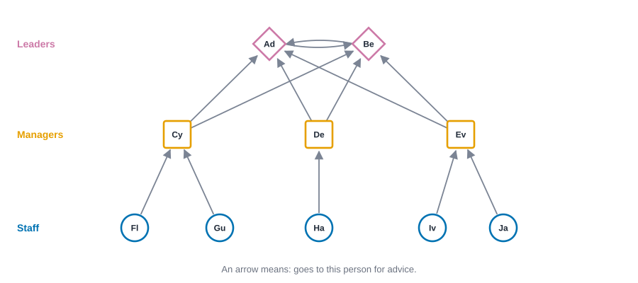
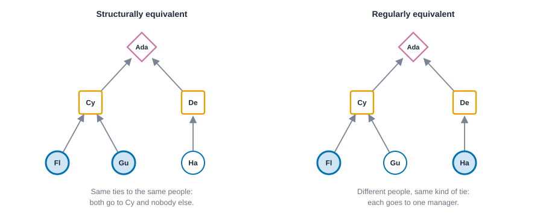
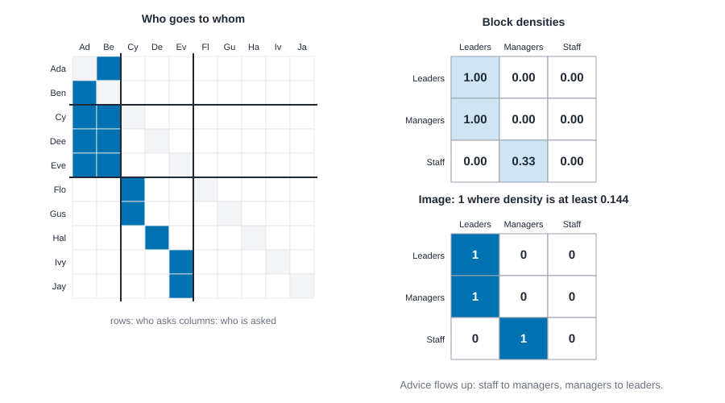

# Positions and roles {#sec-positions-and-roles}

::: {.callout-note appearance="simple"}
## Prerequisites
@sec-networks-as-data, @sec-centrality and @sec-subgroups. Directed ties (@sec-networks-as-data) matter a lot here, and so does the difference between a group of people who tie to each other and a set of people who merely look alike.
:::

## People who play the same part

::: {.callout-tip appearance="simple"}
## Code lives next to the idea
Each idea comes with its code right where it is explained. The Rust blocks in this chapter run top to bottom as one script: the first builds the office network, and later ones reuse it.
:::

Think about the last place you worked, or the last school you went to. You could probably describe the people there without using a single name. The person who everyone goes to when the printer breaks. The one who passes your questions up to the boss. The new hire who asks a lot of people a little bit each. We describe people by the *part they play*, and the part is defined by who they relate to and how, not by who they are.

That is an old and powerful idea in sociology. Two people can fill the same position without ever meeting. Two nurses on different wards, two shift supervisors at different shops, two aunts in different families: they have never spoken, yet they stand in the same pattern of relationships to everyone else. A network lets us ask this question without waiting for anyone's job title. Who has the *same pattern of ties* as whom?

The last chapter was about groups: sets of people who tie to *each other*. This one is about positions: sets of people who tie to the *same kinds of others*. The difference is easy to blur, so hold onto it. Members of a group talk to one another. Members of a position may never exchange a word. Think of all the cashiers in a supermarket chain. They are not a community, and yet they are alike in a way a network can see.

## A small office

Here's the network we'll use all chapter. It is a ten-person office, drawn in @fig-office-network. Each arrow means "goes to this person for advice." There are two leaders, Ada and Ben, who go to each other. There are three managers, Cy, Dee and Eve, who each go to both leaders. And there are five staff: Flo and Gus go to Cy, Hal goes to Dee, and Ivy and Jay go to Eve.

{#fig-office-network fig-alt="Ten people in three rows. Two leaders at the top, Ada and Ben, point at each other. Three managers in the middle each point at both leaders. Five staff at the bottom each point at one manager: Flo and Gus at Cy, Hal at Dee, and Ivy and Jay at Eve."}

I drew the picture in rows because I already knew the answer, which is cheating a little. Pretend instead that all you had was the list of arrows. Could you work out who plays which part? That's the job of this chapter, and we'll do it in four steps, from the strictest idea of "alike" to the loosest. First the data.

::: {.panel-tabset group="language"}

## R

```r
library(knappnet)
library(dplyr)
library(purrr)

options(pillar.sigfig = 4)

people <- c("Ada", "Ben", "Cy", "Dee", "Eve", "Flo", "Gus", "Hal", "Ivy", "Jay")
# One position in each list is one tie: from[i] goes to to[i] for advice.
from <- c(0, 1, 2, 2, 3, 3, 4, 4, 5, 6, 7, 8, 9)
to <- c(1, 0, 0, 1, 0, 1, 0, 1, 2, 2, 3, 4, 4)
office <- tibble(source = people[from + 1], target = people[to + 1]) |>
  net_frame(nodes = tibble(id = people), directed = TRUE)
office
```

::: {.code-output}
```text
Directed network: 10 nodes, 13 ties (arcs)
  Density           0.144
  Out-degree        1 to 2, mean 1.30
  In-degree         0 to 4, mean 1.30
  Reciprocity       0.15 of ties are returned
  Connected pieces  1 weak, 9 strong
  Isolated nodes    0
  Loops, repeats    none
  Busiest           Ada (5), Ben (5), Cy (4)

10 people, 13 ties
```
:::

## Python

```python
import networkx as nx
import numpy as np

# People are numbered from zero in Rust; here the ties are written as pairs of numbers
# and the names stay in a list on the side.
names = ["Ada", "Ben", "Cy", "Dee", "Eve", "Flo", "Gus", "Hal", "Ivy", "Jay"]
src = [0, 1, 2, 2, 3, 3, 4, 4, 5, 6, 7, 8, 9]
dst = [1, 0, 0, 1, 0, 1, 0, 1, 2, 2, 3, 4, 4]
office = nx.DiGraph()
office.add_nodes_from(range(len(names)))
office.add_edges_from(zip(src, dst))
print(f"{office.number_of_nodes()} people, {office.number_of_edges()} ties")
```

::: {.code-output}
```text
10 people, 13 ties
```
:::

## Rust

```rust
use knappnet::Graph;

// People are numbered from zero; the names stay in a list on the side.
let names = ["Ada", "Ben", "Cy", "Dee", "Eve", "Flo", "Gus", "Hal", "Ivy", "Jay"];
// One position in each list is one tie: from[i] goes to to[i] for advice.
let from = [0, 1, 2, 2, 3, 3, 4, 4, 5, 6, 7, 8, 9];
let to = [1, 0, 0, 1, 0, 1, 0, 1, 2, 2, 3, 4, 4];
let office = Graph::from_edges(names.len(), &from, &to, None, true)?;
println!("{}", office.describe().with_labels(&names));
println!("{} people, {} ties", office.node_count(), office.edge_count());
```

::: {.code-output}
```text
Directed network: 10 nodes, 13 ties (arcs)
  Density           0.144
  Out-degree        1 to 2, mean 1.30
  In-degree         0 to 4, mean 1.30
  Reciprocity       0.15 of ties are returned
  Connected pieces  1 weak, 9 strong
  Isolated nodes    0
  Loops, repeats    none
  Busiest           Ada (5), Ben (5), Cy (4)

10 people, 13 ties
```
:::

:::

## Structural equivalence: the same ties to the same people

The strictest idea is **structural equivalence**. Two people are structurally equivalent when they have exactly the same ties to exactly the same others [@lorrain1971structural]. Flo and Gus are the example in this office: both go to Cy, and neither goes to, or is gone to by, anyone else. If you swapped their names on the picture, nothing about the network would change. In the matrix, their rows and columns are identical.

That is rarely true to the letter in real data, so we measure *how far* two people are from it. Write down each person's **tie profile**: for every other person, whether they go to that person and whether that person goes to them. Then compare two people's profiles. The most common comparison is the **Euclidean distance** [@burt1976positions],

$$
d_{ij} = \sqrt{\sum_{k \neq i, j} \left[ (a_{ik} - a_{jk})^2 + (a_{ki} - a_{kj})^2 \right]},
$$

where $a_{ik}$ is 1 if $i$ has a tie to $k$ and 0 if not. In words: go through everyone else, count how often the two people differ in who they go to and who goes to them, and take a square root. We skip $k = i$ and $k = j$, so the two people's ties to *each other* are not held against them [@wasserman1994social, chap. 9]. Zero means identical profiles. Bigger means more different.

::: {.panel-tabset group="language"}

## R

```r
# net_struct_equiv() compares tie profiles by Euclidean distance by default.
dists <- net_struct_equiv(office)

tibble(
  a = c("Flo", "Ivy", "Ada", "Flo", "Cy", "Cy"),
  b = c("Gus", "Jay", "Ben", "Hal", "Dee", "Eve")
) |>
  mutate(distance = map2_dbl(a, b, \(x, y) dists[x, y]))
```

::: {.code-output}
```text
Flo  and Gus  0.000
Ivy  and Jay  0.000
Ada  and Ben  0.000
Flo  and Hal  1.414
Cy   and Dee  1.732
Cy   and Eve  2.000
```
:::

## Python

```python
# The adjacency matrix: a[i, k] is 1 when person i goes to person k.
a = nx.to_numpy_array(office, nodelist=range(len(names)))

def distance(i, j):
    # Skip i and j themselves, so their ties to each other are not held against them.
    keep = [k for k in range(len(names)) if k not in (i, j)]
    out_diff = a[i, keep] - a[j, keep]
    in_diff = a[keep, i] - a[keep, j]
    return np.sqrt((out_diff ** 2).sum() + (in_diff ** 2).sum())

for x, y in [(5, 6), (8, 9), (0, 1), (5, 7), (2, 3), (2, 4)]:
    print(f"{names[x]:<4} and {names[y]:<4} {distance(x, y):.3f}")
```

::: {.code-output}
```text
Flo  and Gus  0.000
Ivy  and Jay  0.000
Ada  and Ben  0.000
Flo  and Hal  1.414
Cy   and Dee  1.732
Cy   and Eve  2.000
```
:::

## Rust

```rust
use knappnet::metrics::equivalence::{compute_structural_equivalence, EquivalenceOptions};

// The default compares profiles by Euclidean distance.
let dist = compute_structural_equivalence(&office, EquivalenceOptions::default())?;
for (a, b) in [(5, 6), (8, 9), (0, 1), (5, 7), (2, 3), (2, 4)] {
    println!("{:<4} and {:<4} {:.3}", names[a], names[b], dist.get(a, b));
}
```

::: {.code-output}
```text
Flo  and Gus  0.000
Ivy  and Jay  0.000
Ada  and Ben  0.000
Flo  and Hal  1.414
Cy   and Dee  1.732
Cy   and Eve  2.000
```
:::

:::

Flo and Gus are at distance 0, and so are Ivy and Jay: identical profiles. Ada and Ben are at 0 as well, which surprises people. They go to each other, but that is the one cell we skip, and every other tie they have is the same. Flo and Hal are at 1.414 (the square root of 2), because Flo goes to Cy and Hal goes to Dee, which is two differences. Cy and Dee are further apart, at 1.732, because Cy has two staff coming to them and Dee has one.
Notice that structural equivalence found the *pairs*, but it hasn't told us "these are the managers." Cy, Dee and Eve are all different from each other, because each has a different set of staff. A strict standard like this is good at spotting near-duplicates and bad at spotting parts. In practice, people take a whole table of these distances and group the people whose rows are close, using a clustering method. That step needs a judgment about how close is close enough, so it is worth being honest that the computer proposes and you decide.

## Regular equivalence: the same kinds of ties to the same kinds of people

If we let go of "the same people" and keep "the same *kinds* of people," we get **regular equivalence** [@white1983graph; @everett1994regular]. Two people are regularly equivalent when, for every tie one has to someone, the other has the same kind of tie to someone who is *also* in the same position as that someone. It sounds circular, and it is, in a useful way: positions are defined by their relations to positions.

The managers show it. Cy goes to the leaders and gets visits from staff. So do Dee and Eve. They do not share any staff, so they are not structurally equivalent, but each of them plays the same part: *the person above the staff and below the leaders*. Flo, Gus, Hal, Ivy and Jay are likewise all regularly equivalent. Each goes to one manager, and every manager is, itself, in the same position.

@fig-equivalence-kinds sets the two ideas side by side.

{#fig-equivalence-kinds fig-alt="Two small drawings. In each, Ada at the top receives from two managers, Cy and Dee, and three staff members each point at a manager. On the left, Flo and Gus are highlighted and both point at Cy. On the right, Flo and Hal are highlighted: Flo points at Cy and Hal points at Dee."}

An algorithm for finding the regular equivalence classes is CATREGE [@borgatti1993two]. It starts with everyone in one class, then repeatedly splits each class by the kinds of ties its members have to the classes of their alters, until nothing splits.

::: {.panel-tabset group="language"}

## R

```r
# net_regular_equiv() numbers the classes from 1; the book counts from 0.
office$nodes |>
  mutate(class = net_regular_equiv(office) - 1L) |>
  group_by(class) |>
  summarise(members = paste(id, collapse = ", "))
```

::: {.code-output}
```text
class 0  ["Ada", "Ben"]
class 1  ["Cy", "Dee", "Eve"]
class 2  ["Flo", "Gus", "Hal", "Ivy", "Jay"]
```
:::

## Python

```python
# NetworkX has no regular equivalence, so here is the splitting rule in a few lines.
# Start with everyone in one class. Describe each person by their own class and the
# classes of the people they go to and who go to them. Split on that, and repeat.
n = len(names)
out_nbrs = [set(office.successors(i)) for i in range(n)]
in_nbrs = [set(office.predecessors(i)) for i in range(n)]
cls = [0] * n
while True:
    seen = {}
    new = [seen.setdefault((cls[i],
                            frozenset(cls[j] for j in out_nbrs[i]),
                            frozenset(cls[j] for j in in_nbrs[i])), len(seen))
           for i in range(n)]
    if len(seen) == len(set(cls)):
        break
    cls = new

for k in range(max(cls) + 1):
    members = ", ".join(f'"{names[i]}"' for i in range(n) if cls[i] == k)
    print(f"class {k}  [{members}]")
```

::: {.code-output}
```text
class 0  ["Ada", "Ben"]
class 1  ["Cy", "Dee", "Eve"]
class 2  ["Flo", "Gus", "Hal", "Ivy", "Jay"]
```
:::

## Rust

```rust
use knappnet::metrics::regular::{compute_regular_equivalence, RegularOptions};

// `None` means no starting partition: everyone begins in one class.
let classes = compute_regular_equivalence(&office, None, RegularOptions::default())?;
let k = classes.membership.iter().max().unwrap() + 1;
for class in 0..k {
    let members: Vec<&str> = (0..names.len())
        .filter(|&i| classes.membership[i] == class)
        .map(|i| names[i])
        .collect();
    println!("class {class}  {members:?}");
}
```

::: {.code-output}
```text
class 0  ["Ada", "Ben"]
class 1  ["Cy", "Dee", "Eve"]
class 2  ["Flo", "Gus", "Hal", "Ivy", "Jay"]
```
:::

:::

Three classes, and they are exactly the leaders, the managers and the staff. The computer was never told the job titles. It rebuilt them from the arrows alone.
Regular equivalence has a catch. In an *undirected* network, with no way to tell the direction of a tie, the strictest version collapses: everyone with at least one tie ends up in one big class. That is a known property of the method [@borgatti1993two], and the reason this chapter uses a directed example. If your ties have no direction, you will have to bring in other information, such as a starting partition, to get anywhere.

## Blockmodels: squeezing the network down to its positions

Once you have positions, you can do something lovely: shrink the network. A **blockmodel** takes a partition of people into positions and replaces the network with a much smaller one, with one node per position [@white1976social]. To build it, put the people in order by position and look at the matrix of who goes to whom. It splits into blocks, one for each pair of positions. Then ask, for each block, how dense is it? That is the share of possible ties from the row position to the column position that are actually present.

@fig-blockmodel-matrix shows both. On the left is the office, ordered by position. On the right, the block densities, and below them the **image matrix**: a 1 where the block's density is at least as large as the density of the whole network, and a 0 elsewhere [@arabie1978constructing]. The cutoff is a convention, and the whole network's density is the usual choice.

{#fig-blockmodel-matrix fig-alt="On the left, a ten by ten grid with blue cells where a person asks another for advice, separated by heavy lines into leaders, managers and staff. Blue cells fill the leaders' own block and the managers-to-leaders block, and a scatter in the staff-to-managers block. On the right, a three by three table of block densities with values 1.00 for leaders to leaders and managers to leaders, 0.33 for staff to managers and 0 elsewhere, and below it the image matrix with ones in those three places."}

::: {.panel-tabset group="language"}

## R

```r
# Position of each person: 0 = leaders, 1 = managers, 2 = staff.
positions <- c(0, 0, 1, 1, 1, 2, 2, 2, 2, 2)
model <- net_blockmodel(office, membership = positions)

# One row per ordered pair of positions: the density of ties from the row's block to the column's block,
# and the image (1 when the block is denser than the whole network).
net_block_summary(model) |>
  select(from, to, density, image)

tibble(overall_density = model$overall_density, r_squared = model$r_squared)
```

::: {.code-output}
```text
whole-network density 0.144
block densities (rows ask, columns are asked)
  1.00  0.00  0.00
  1.00  0.00  0.00
  0.00  0.33  0.00
image (rows ask, columns are asked)
  1.00  0.00  0.00
  1.00  0.00  0.00
  0.00  1.00  0.00
share of tie variation explained 0.700
```
:::

## Python

```python
# Position of each person: 0 = leaders, 1 = managers, 2 = staff.
positions = np.array([0, 0, 1, 1, 1, 2, 2, 2, 2, 2])
k = positions.max() + 1
density = np.zeros((k, k))
for r in range(k):
    for c in range(k):
        rows, cols = np.where(positions == r)[0], np.where(positions == c)[0]
        ties = a[np.ix_(rows, cols)].sum()
        # Within a block, a person cannot tie to themselves.
        pairs = len(rows) * len(cols) - (len(rows) if r == c else 0)
        density[r, c] = ties / pairs
n = len(names)
overall = a.sum() / (n * (n - 1))
image = (density >= overall).astype(float)

# Share of variation in the ties explained by the block densities (squared correlation).
off = ~np.eye(n, dtype=bool)
fitted = density[positions[:, None], positions[None, :]]
r_squared = np.corrcoef(a[off], fitted[off])[0, 1] ** 2

def show(label, m):
    print(f"{label} (rows ask, columns are asked)")
    for row in m:
        print("  " + "  ".join(f"{v:.2f}" for v in row))

print(f"whole-network density {overall:.3f}")
show("block densities", density)
show("image", image)
print(f"share of tie variation explained {r_squared:.3f}")
```

::: {.code-output}
```text
whole-network density 0.144
block densities (rows ask, columns are asked)
  1.00  0.00  0.00
  1.00  0.00  0.00
  0.00  0.33  0.00
image (rows ask, columns are asked)
  1.00  0.00  0.00
  1.00  0.00  0.00
  0.00  1.00  0.00
share of tie variation explained 0.700
```
:::

## Rust

```rust
use knappnet::metrics::blockmodel::{build_block_model, BlockModelOptions};

// Position of each person: 0 = leaders, 1 = managers, 2 = staff.
let positions: [i64; 10] = [0, 0, 1, 1, 1, 2, 2, 2, 2, 2];
let model = build_block_model(&office, &positions, BlockModelOptions::default())?;
let show = |label: &str, m: &knappnet::matrix::Dense| {
    println!("{label} (rows ask, columns are asked)");
    for r in 0..model.blocks() {
        let row: Vec<String> = (0..model.blocks()).map(|c| format!("{:.2}", m.get(r, c))).collect();
        println!("  {}", row.join("  "));
    }
};
println!("whole-network density {:.3}", model.overall);
show("block densities", &model.density);
show("image", &model.build_image(model.overall));
println!("share of tie variation explained {:.3}", model.r_squared);
```

::: {.code-output}
```text
whole-network density 0.144
block densities (rows ask, columns are asked)
  1.00  0.00  0.00
  1.00  0.00  0.00
  0.00  0.33  0.00
image (rows ask, columns are asked)
  1.00  0.00  0.00
  1.00  0.00  0.00
  0.00  1.00  0.00
share of tie variation explained 0.700
```
:::

:::

Read the image like a sentence. Leaders go to leaders (1 in the top left). Managers go to leaders (1 in the second row, first column). Staff go to managers (1 in the bottom row, second column). Nothing else. The last number says the three-position model accounts for 70% of the variation in who goes to whom, which is a lot for ten numbers' worth of description. The whole office reduces to three people-shaped boxes and a staircase of arrows.
A blockmodel is a map of the *structure*, with the individuals taken out. It lets you compare organizations of different sizes, or the same organization at two times, by comparing their images. That is what White, Boorman and Breiger had in mind when they proposed it for studying how social structure could be read off several kinds of ties at once [@white1976social]. For a modern treatment that fits the positions and the pattern together, see generalized blockmodeling [@doreian2005generalized], and we'll meet the statistical version in @sec-latent-space.

## Core and periphery

One more position pattern is so common it gets its own model. Many networks have a **core**, a set of people who are well connected to each other, and a **periphery**, a set of people who are connected to the core, or to no one, but not to each other. Think of a research field with a few central labs that cite one another and a ring of smaller groups that cite the central labs. Borgatti and Everett [@borgatti1999models] turned that picture into a model you can fit.

The idea is to compare the network with an *ideal pattern*: the core is tied to itself, the periphery is not tied to itself, and the pairs that cross from core to periphery are left out of the comparison, because they can go either way. Split the people into core and periphery in every possible way, and keep the split whose ideal pattern correlates best with the real ties. @fig-core-periphery shows the pattern, and the answer we are about to compute for the friendship network from @sec-centrality.

{#fig-core-periphery fig-alt="On the left, the ten-person friendship network with five people drawn as blue circles in the dense middle and five drawn as orange squares around the edge. On the right, a ten by ten grid ordered core first: the upper-left five by five block is blue, the lower-right block is white, and the two off-diagonal blocks are gray."}

Trying every split is out of reach for big networks (there are over a thousand for ten people and over a billion for thirty), so the engine uses a search that tries many starting points and keeps the best. It's a heuristic, and like any heuristic it can miss the best answer, so the fit is checked against exhaustive search on small networks. Set a seed so you can reproduce the result.

::: {.panel-tabset group="language"}

## R

```r
# The friendship network from the centrality chapter.
friend_names <- c("Ana", "Ben", "Cleo", "Dev", "Eli", "Fay", "Gus", "Hana", "Ivo", "Jo")
ffrom <- c(0, 0, 0, 0, 1, 1, 1, 2, 2, 3, 3, 3, 4, 5, 5, 6, 7, 8)
fto <- c(1, 2, 3, 5, 3, 4, 6, 3, 5, 4, 5, 6, 6, 6, 7, 7, 8, 9)
friends <- tibble(source = friend_names[ffrom + 1], target = friend_names[fto + 1]) |>
  net_frame(nodes = tibble(id = friend_names), directed = FALSE)
friends

fitted <- net_core_periphery(friends, method = "discrete", seed = 1)
friends$nodes |>
  mutate(in_core = fitted$core)

tibble(correlation = fitted$correlation)
```

::: {.code-output}
```text
Undirected network: 10 nodes, 18 ties
  Density           0.400
  Degree            1 to 6, mean 3.60
  Connected pieces  1
  Isolated nodes    0
  Loops, repeats    none
  Busiest           Dev (6), Fay (5), Gus (5)

core  ["Ana", "Ben", "Dev", "Fay", "Gus"]
correlation with the ideal pattern  0.600
```
:::

## Python

```python
# The friendship network from the centrality chapter.
friend_names = ["Ana", "Ben", "Cleo", "Dev", "Eli", "Fay", "Gus", "Hana", "Ivo", "Jo"]
ffrom = [0, 0, 0, 0, 1, 1, 1, 2, 2, 3, 3, 3, 4, 5, 5, 6, 7, 8]
fto = [1, 2, 3, 5, 3, 4, 6, 3, 5, 4, 5, 6, 6, 6, 7, 7, 8, 9]
friends = nx.Graph()
friends.add_nodes_from(range(len(friend_names)))
friends.add_edges_from(zip(ffrom, fto))

# NetworkX has no core-periphery model. With ten people there are only 1,022 splits,
# so try them all and keep the one whose ideal pattern correlates best with the ties.
# Core-to-periphery pairs are left out of the comparison.
m = len(friend_names)
adj = nx.to_numpy_array(friends, nodelist=range(m))
iu, ju = np.triu_indices(m, 1)
best_r, best_core = -2, None
for mask in range(1, 2 ** m - 1):
    core = np.array([(mask >> i) & 1 for i in range(m)], dtype=bool)
    both = core[iu] & core[ju]
    neither = ~core[iu] & ~core[ju]
    use = both | neither
    ideal, observed = both[use].astype(float), adj[iu, ju][use]
    if ideal.std() == 0 or observed.std() == 0:
        continue
    r = np.corrcoef(ideal, observed)[0, 1]
    if r > best_r + 1e-12:
        best_r, best_core = r, core

members = ", ".join(f'"{friend_names[i]}"' for i in range(m) if best_core[i])
print(f"core  [{members}]")
print(f"correlation with the ideal pattern  {best_r:.3f}")
```

::: {.code-output}
```text
core  ["Ana", "Ben", "Dev", "Fay", "Gus"]
correlation with the ideal pattern  0.600
```
:::

## Rust

```rust
use knappnet::metrics::coreperiphery::{fit_core_periphery, CorePeripheryOptions};

// The friendship network from the centrality chapter.
let friend_names = ["Ana", "Ben", "Cleo", "Dev", "Eli", "Fay", "Gus", "Hana", "Ivo", "Jo"];
let ffrom = [0, 0, 0, 0, 1, 1, 1, 2, 2, 3, 3, 3, 4, 5, 5, 6, 7, 8];
let fto = [1, 2, 3, 5, 3, 4, 6, 3, 5, 4, 5, 6, 6, 6, 7, 7, 8, 9];
let friends = Graph::from_edges(friend_names.len(), &ffrom, &fto, None, false)?;
println!("{}", friends.describe().with_labels(&friend_names));

let fitted = fit_core_periphery(&friends, CorePeripheryOptions::default())?;
let core: Vec<&str> = (0..friend_names.len()).filter(|&i| fitted.core[i]).map(|i| friend_names[i]).collect();
println!("core  {core:?}");
println!("correlation with the ideal pattern  {:.3}", fitted.correlation);
```

::: {.code-output}
```text
Undirected network: 10 nodes, 18 ties
  Density           0.400
  Degree            1 to 6, mean 3.60
  Connected pieces  1
  Isolated nodes    0
  Loops, repeats    none
  Busiest           Dev (6), Fay (5), Gus (5)

core  ["Ana", "Ben", "Dev", "Fay", "Gus"]
correlation with the ideal pattern  0.600
```
:::

:::

The core is Ana, Ben, Dev, Fay and Gus, the five people at the dense center, and Hana lands in the periphery. That echoes the centrality chapter: Hana held the most betweenness, but she is a bridge out of the dense group and not a member of it. The fit is 0.6, respectable but not perfect, and you can see why. Eight of the ten possible ties inside the core are present, and two of the ten pairs among the periphery are tied (Hana to Ivo, and Ivo to Jo), because the tail of the network is a chain.
Be careful not to confuse this with the k-core from @sec-paths-and-cohesion. A k-core is defined by a rule about how many ties each person has *inside the group*, and it is found by peeling. The core in a core-periphery model is whatever split fits the ideal pattern best, and it may include a person with fewer ties and exclude one with more. They often overlap, but they answer different questions.

## A cheat sheet

| Idea | Two people are alike if... | Needs | Watch out for |
| --- | --- | --- | --- |
| Structural equivalence | They have the same ties to the same people | Distances, then clustering | Rarely exact; Euclidean distance depends on degree |
| Regular equivalence | They have the same kinds of ties to the same kinds of people | A directed or labeled relation | Collapses in undirected networks |
| Blockmodel | They are in the same position you chose | A partition from any method | The image depends on the cutoff |
| Core-periphery | They are both in the core, or both outside it | A dense center and a sparse edge | A heuristic search; not every network has this shape |

## Reading positions honestly

**A position is a pattern, not a job title.** Nothing in the algorithm knows who is a manager. It rebuilds the idea from arrows, which is why it is useful, and also why it can disagree with the org chart. When it does, the interesting question is usually "who is doing a job that isn't on their door?"

**Same position does not mean same group.** Flo and Gus are alike but may never speak. Don't tell a story about teamwork, loyalty or friendship from a set of positions. That is the job of the group measures in @sec-subgroups, and the two answers can differ completely.

**Strict definitions meet messy data.** Real networks are missing ties and have extra ones. Structural equivalence in particular is fragile: one missing tie moves two people apart. When you cluster profiles, try more than one distance, and check whether the positions survive small changes to the data.

**The tie matters.** A blockmodel of advice ties and a blockmodel of friendship in the same office can look nothing alike, and both are right. Always say which relation the positions are built from.

**Roles in hidden networks are hypotheses.** Work on covert groups sometimes looks for roles such as leaders, brokers and foot soldiers [@everton2012disrupting; @cunningham2016understanding]. The data are incomplete and the ties are chosen for the sake of concealment, so a position found there is a lead to follow up, never a verdict about a person.

## Exercises

1. **By hand.** In the office network, write out the profile of Cy and the profile of Dee (who each of them goes to, and who goes to each of them). List the cells where they differ. There should be three, and the square root of three is the distance 1.732 in the output.
2. **By hand.** Add one tie: Gus goes to Hal. Which pairs of staff are still structurally equivalent? Is the regular equivalence structure changed?
3. **Design.** You have a network of who emails whom in a company of 400 people. Would you look for positions with structural equivalence, regular equivalence or a blockmodel? What would you check the result against?
4. **Coding.** Compute the structural equivalence distances with the Hamming option and compare them with the Euclidean ones. When do they agree?
5. **Interpretation.** A colleague writes: "The blockmodel shows that staff don't talk to each other, so the team has no culture." Using what the image matrix does and does not show, write a short, kind reply.

## Summary

::: {.callout-tip appearance="simple"}
A position is a set of people who stand in the same pattern of ties to everyone else, whether or not they know each other. Structural equivalence is the strictest version: same ties to the same people, measured by the distance between tie profiles. Regular equivalence relaxes it to the same kinds of ties to the same kinds of people, and on the office network it recovers leaders, managers and staff from the arrows alone. A blockmodel then squeezes the network down to one box per position and one 0 or 1 per pair of boxes. The core-periphery model asks a different question: is there a dense center and a sparse edge? Positions are patterns in ties, not groups, titles or friendships, so read them against what you know about the relation.
:::

## Further reading

For the origin of structural equivalence, see @lorrain1971structural, and for the distance measure, @burt1976positions. For regular equivalence and how to find it, see @white1983graph, @everett1994regular and @borgatti1993two. For blockmodels, see @white1976social and @arabie1978constructing, and for a textbook treatment of all of this, chapters 9 and 10 of @wasserman1994social. For generalized blockmodeling, see @doreian2005generalized. For core-periphery structure, see @borgatti1999models. For work on hidden networks, see @everton2012disrupting and @cunningham2016understanding. To practice structural equivalence in R, see Phil Murphy's tutorial [@murphyrpubs325575].
