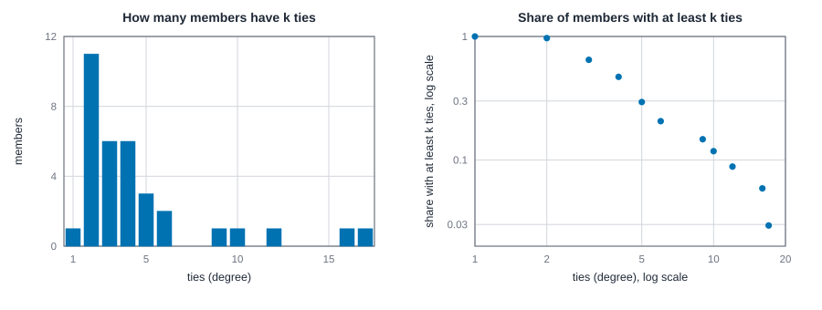
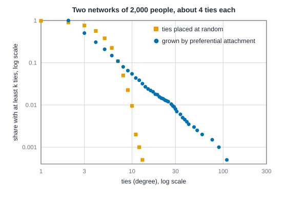
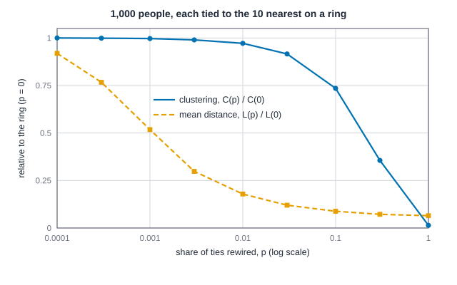

# Random graphs, small worlds and degree distributions {#sec-small-worlds}

::: {.callout-note appearance="simple"}
## Prerequisites
@sec-paths-and-cohesion: distance, mean distance, components and clustering. We use three small classic networks from the appendix (the karate club, the Florentine marriages and Krackhardt's managers) and some random ones we generate ourselves, each with a fixed seed so the numbers repeat.
:::

::: {.callout-note title="The short version"}
A number about your network, like "people are 2.4 steps apart", means little until you know what to compare it with. This chapter builds a small set of random networks to compare against, each one keeping a different feature of the real network and scrambling the rest. Along the way you meet three famous stories: a crowd of random ties suddenly clumps into one big piece, a few shortcuts make a big world feel small, and a few very popular people can emerge from simple "the popular get more popular" growth. The key habit is to treat these models as rulers for measuring your network, never as explanations of where it came from.
:::

::: {.callout-tip title="Why you might care"}
Suppose someone tells you their team's collaboration network is "highly clustered" or "a small world". Without a baseline, that's just a nice-sounding phrase. With one, you can say how much of the pattern is simply what you'd expect from how many ties each person has, and how much is something real worth explaining. That's the difference between a finding and a coincidence.
:::

## What counts as typical

Suppose you've measured something. The transitivity of your network is 0.26, or the typical distance between two people is 2.4 steps. Is that a lot?

You can't tell from the number alone, and this is one of the most common ways network analysis goes wrong. A number needs company. The question underneath every "is it high?" is "compared with what?", and the honest answer is a **baseline**: a family of random networks that share some features with yours and are unconstrained in every other way. If yours looks like the baseline, the number tells you nothing special. If it doesn't, you've learned that something beyond the shared features is going on, and you've learned exactly which features you ruled out.

This chapter builds the standard baselines, one at a time, and shows what each one can and can't tell you.

- The **degree distribution** is the picture of how ties are spread over people. It's the first thing to look at, and the thing the other models are built to reproduce.
- The **Erdős-Rényi** random graph is the plainest baseline: ties placed at random. It teaches density, and a surprising threshold at which a network suddenly holds together.
- **Preferential attachment** grows a network so that a few people end up with a huge number of ties.
- The **configuration model** keeps everyone's degree and randomizes the rest. For most questions about a real network, it's the baseline you want.
- The **Watts-Strogatz small world** shows that short distances and tight local clusters can live in one network.
- Then the **small-world quotient**, which tries to turn that into one number and has pitfalls; the question of whether a network is **scale-free**, and how to fit a tail honestly; and a note on Milgram's experiment.

And one warning that runs through all of it: these are models for *comparison*. A network that matches one of them hasn't been shown to have arisen the way the model does. Treat them as rulers, not as stories.

::: {.callout-tip appearance="simple"}
## Code lives next to the idea
As in the earlier chapters, the Rust blocks run top to bottom as one script, and so do the R blocks and the Python blocks. The random networks come from the engine's generators, so the Rust and R tabs print the same numbers. NetworkX draws different random networks from the same recipe, so the Python tabs agree with the others only up to the usual random wobble. Where knappnet does not yet have a function for something (a power-law fit, tie swapping, the small-world quotient in Python), the R or Python tab is a stub that names what is missing; the Rust tab shows the full computation.
:::

::: {.callout-tip appearance="simple"}
## A note on the math in this chapter
There are a handful of formulas here. Each one is followed by a box called "In plain words" that says what it computes, reads the symbols aloud and plugs in a small example. If formulas aren't your thing, read those boxes and the sentences around the code; you'll lose nothing you need.
:::

## The degree distribution

### The idea

Think of a party where you ask everyone how many of the other guests they know. A person's **degree** is exactly that count: the number of ties they have. Count it for everyone, and you have a list of $n$ numbers, where $n$ is the number of people. The **degree distribution** is that list, summarized: how many people have no ties, how many have one, and so on.

Two ways of drawing it matter. Write $n_k$ for the number of people with degree exactly $k$, and $p_k = n_k / n$ for their share. A **histogram** is a bar chart of those shares: one bar for each degree. The **complementary cumulative distribution** (CCDF) answers a slightly different question, "what share of people have *at least* this many ties?", and plots

$$P(K \ge k) = \sum_{j \ge k} p_j,$$

the share of people with *at least* $k$ ties. Here $K$ is the degree of a person picked at random, and the sum runs over every degree $j$ from $k$ upward. The CCDF starts at 1 (everyone has at least zero ties) and falls. It needs no binning, so there are no arbitrary bar widths, and it keeps the rare big values visible on the right. That's why people who study tails prefer it.

::: {.callout-tip title="In plain words"}
The formula says: to find the share of people with at least $k$ ties, add up the shares for degree $k$, degree $k+1$, and so on to the top. Here $K$ means "the number of ties of someone picked at random", and $p_j$ is the share of people with exactly $j$ ties. In the six-person example below, the share with at least 2 ties is $p_2 + p_3 + p_4 = 3/6 + 0 + 1/6 = 4/6$.
:::

One handy fact connects degrees to the total number of ties, which we call $m$. Add up everyone's degree and you count each tie twice, once from each end, like counting handshakes by asking each person how many hands they shook. So

$$\sum_i k_i = 2m, \qquad \text{mean degree } \langle k \rangle = \frac{2m}{n}.$$

::: {.callout-tip title="In plain words"}
The sigma sign means "add up". Here $k_i$ is person $i$'s degree, so the first formula says that the sum of everyone's degree equals twice the number of ties. The second says the average degree, written $\langle k \rangle$, is that total divided by the number of people. In the six-person example below there are $m = 6$ ties, so the degrees add to 12 and the average is $12/6 = 2$.
:::

### By hand

Six people. Ana knows Ben, Cleo, Dev and Eli; Ben knows Cleo; Eli knows Fay. That's six ties, so the degrees must add to 12.

- Ana has 4 ties. Ben has 2 (Ana, Cleo). Cleo has 2 (Ana, Ben). Dev has 1. Eli has 2 (Ana, Fay). Fay has 1.
- The list is 4, 2, 2, 1, 2, 1, and it does add to 12.
- Two people have degree 1, three have degree 2, none has degree 3, one has degree 4. So $p_1 = 2/6$, $p_2 = 3/6$, $p_3 = 0$, $p_4 = 1/6$.
- For the CCDF, add from the right. At least 4 ties: 1/6. At least 3: still 1/6, since nobody has exactly 3. At least 2: $1/6 + 3/6 = 4/6$. At least 1: everyone, so 1.

The first block builds the six people and prints their degrees and the "at least" shares; check them against the hand count.

::: {.panel-tabset group="language"}

## R

```r
library(knappnet)

# Six people. Ana knows Ben, Cleo, Dev and Eli; Ben knows Cleo; Eli knows Fay.
tiny <- net_frame(
  data.frame(
    source = c("Ana", "Ana", "Ana", "Ana", "Ben", "Eli"),
    target = c("Ben", "Cleo", "Dev", "Eli", "Cleo", "Fay")
  ),
  nodes = data.frame(id = c("Ana", "Ben", "Cleo", "Dev", "Eli", "Fay")),
  directed = FALSE
)
net_degree(tiny)
net_degree_dist(tiny, cumulative = TRUE)
```

::: {.code-output}
```text
[1] 4 2 2 1 2 1
  degree count proportion  at_least
1      1     2  0.3333333 1.0000000
2      2     3  0.5000000 0.6666667
3      4     1  0.1666667 0.1666667
```
:::

## Python

```python
import networkx as nx

# Six people. Ana (0) knows Ben, Cleo, Dev and Eli; Ben knows Cleo; Eli knows Fay.
tiny = nx.Graph([(0, 1), (0, 2), (0, 3), (0, 4), (1, 2), (4, 5)])
print("degrees", [d for _, d in tiny.degree()])
print("people at each degree", nx.degree_histogram(tiny))
```

::: {.code-output}
```text
degrees [4, 2, 2, 1, 2, 1]
people at each degree [0, 2, 3, 0, 1]
```
:::

## Rust

```rust
use knappnet::{compute_degree, DegreeMode, Graph};

// Six people. Ana (0) knows Ben, Cleo, Dev and Eli; Ben knows Cleo; Eli knows Fay.
let tiny = Graph::from_edges(6, &[0, 0, 0, 0, 1, 4], &[1, 2, 3, 4, 2, 5], None, false)?;
let degree: Vec<usize> = compute_degree(&tiny, DegreeMode::All, true).iter().map(|&d| d as usize).collect();
println!("degrees {:?}", degree);

println!("{:>6} {:>6} {:>7} {:>13}", "degree", "people", "share", "share_at_least");
for k in 1..=4 {
    let exactly = degree.iter().filter(|&&d| d == k).count();
    let at_least = degree.iter().filter(|&&d| d >= k).count();
    println!("{:>6} {:>6} {:>7.3} {:>13.3}", k, exactly, exactly as f64 / 6.0, at_least as f64 / 6.0);
}
```

::: {.code-output}
```text
degrees [4, 2, 2, 1, 2, 1]
degree people   share share_at_least
     1      2   0.333         1.000
     2      3   0.500         0.667
     3      0   0.000         0.167
     4      1   0.167         0.167
```
:::

:::

The table matches the hand count: shares 0.333, 0.500, 0.000 and 0.167, and at-least shares 1.000, 0.667, 0.167 and 0.167. So the computer is doing exactly the tallying we just did on paper.

### A real one: the karate club

Wayne Zachary observed a university karate club that eventually split in two, and recorded which members interacted outside club meetings [@zachary1977information]. The network has 34 members and 78 ties. We'll use it all through the chapter, because it's small enough to see whole and rich enough to disagree with a random network. The next block loads it and tallies how many members have each degree; look at how the mean compares with the median, and how far the biggest degrees sit from the rest.

::: {.panel-tabset group="language"}

## R

```r
# Zachary's karate club: a tie means two members were seen together outside club meetings.
edges <- read.csv("data/karate/edges.csv")
karate <- net_frame(edges[, c("source", "target")], nodes = data.frame(id = 1:34), directed = FALSE)
degree <- net_degree(karate)
c(mean = mean(degree), median = median(degree), max = max(degree), busiest = which.max(degree))
table(degree)
```

::: {.code-output}
```text
     mean    median       max   busiest 
 4.588235  3.000000 17.000000 34.000000 
degree
 1  2  3  4  5  6  9 10 12 16 17 
 1 11  6  6  3  2  1  1  1  1  1 
```
:::

## Python

```python
import csv

import numpy as np

# Zachary's karate club: a tie means two members were seen together outside club meetings.
with open("data/karate/edges.csv") as f:
    karate = nx.Graph([(int(a), int(b)) for a, b, _ in list(csv.reader(f))[1:]])
print(f"{karate.number_of_nodes()} members, {karate.number_of_edges()} ties")

degree = sorted(d for _, d in karate.degree())
busiest = max(karate.nodes, key=karate.degree)
print(f"mean {np.mean(degree):.2f}  median {np.median(degree):g}  max {degree[-1]} (member {busiest})")
print("members at each degree", nx.degree_histogram(karate))
```

::: {.code-output}
```text
34 members, 78 ties
mean 4.59  median 3  max 17 (member 34)
members at each degree [0, 1, 11, 6, 6, 3, 2, 0, 0, 1, 1, 0, 1, 0, 0, 0, 1, 1]
```
:::

## Rust

```rust
// Zachary's karate club: a tie means two members were seen together outside club meetings.
let text = std::fs::read_to_string("data/karate/edges.csv")?;
let ties: Vec<(i64, i64)> = text
    .lines()
    .skip(1)
    .map(|line| {
        let mut parts = line.split(',');
        (parts.next().unwrap().parse::<i64>().unwrap() - 1, parts.next().unwrap().parse::<i64>().unwrap() - 1)
    })
    .collect();
let karate_from: Vec<i64> = ties.iter().map(|t| t.0).collect();
let karate_to: Vec<i64> = ties.iter().map(|t| t.1).collect();
let karate = Graph::from_edges(34, &karate_from, &karate_to, None, false)?;
println!("{}", karate.describe());

let mut degree: Vec<usize> = compute_degree(&karate, DegreeMode::All, true).iter().map(|&d| d as usize).collect();
let busiest = (0..34).max_by_key(|&i| degree[i]).unwrap();
degree.sort();
println!("mean {:.2}  median {}  max {} (member {})", degree.iter().sum::<usize>() as f64 / 34.0, (degree[16] + degree[17]) as f64 / 2.0, degree[33], busiest + 1);
for k in 1..=17 {
    let count = degree.iter().filter(|&&d| d == k).count();
    if count > 0 {
        println!("degree {:>2}  {:>2} members  {}", k, count, "#".repeat(count));
    }
}
```

::: {.code-output}
```text
Undirected network: 34 nodes, 78 ties
  Density           0.139
  Degree            1 to 17, mean 4.59
  Connected pieces  1
  Isolated nodes    0
  Loops, repeats    none
  Busiest           node 33 (17), node 0 (16), node 32 (12)

mean 4.59  median 3  max 17 (member 34)
degree  1   1 members  #
degree  2  11 members  ###########
degree  3   6 members  ######
degree  4   6 members  ######
degree  5   3 members  ###
degree  6   2 members  ##
degree  9   1 members  #
degree 10   1 members  #
degree 12   1 members  #
degree 16   1 members  #
degree 17   1 members  #
```
:::

:::

The mean is 4.59 and the median is 3, so the mean sits well above the middle: a few members pull it up. Eleven members have exactly two ties, and most have four or fewer. At the other end, one member has 17 ties and another has 16. Together they hold 33 of the 156 tie ends (each of the 78 ties has two ends), about a fifth of all of them, from 2 of 34 people.

That is what a heavy right side looks like in a small network: a crowd at low degree and a few far out. The figure shows the same thing twice. The bars on the left are the histogram. The dots on the right are the CCDF: reading from the left, the share of members with at least $k$ ties falls from 1 at $k = 1$ to $1/34 = 0.029$ at $k = 17$, where only the busiest member is left.

{#fig-sw-degree-karate fig-alt="Two charts of karate club degrees. The bar chart shows 11 members with 2 ties, 6 with 3, 6 with 4, one with 1 tie, and single members with 9, 10, 12, 16 and 17 ties. The log-log chart plots the share of members with at least k ties; it starts at 1 for k = 1 and falls to 0.029 at k = 17."}

### How to read a degree distribution

Look at four things, in this order.

1. **The middle.** Mean and median. If the mean sits well above the median, a few large values are dragging it up.
2. **The spread.** Do most people have about the same degree, or do degrees range widely?
3. **The tail.** How far out do the biggest degrees go, compared with the mean? A **heavy tail** means that very large degrees are far more common than a bell-shaped spread would give you. There's no sharp cut-off for "heavy"; the useful habit is to compare the maximum with the mean and ask what share of all ties the top few people hold.
4. **The bottom.** How many people have no ties at all? In a survey, those might be non-respondents. In a transport network, they're places you can't get to.

Different settings read the same picture differently, so here is what a high or low degree can mean in four of them, and what it doesn't show.

- **A marriage network among families.** A high degree means a family with many marriage alliances in the records. It counts ties and says nothing about what they were worth. A low degree can mean a small or new family, or one that the records mention only a little.
- **An office.** A high degree means many colleagues named or were named by this person in this relation. It doesn't show that the person is liked, trusted, or powerful. A low degree can be a newcomer, a specialist, or someone who skipped the survey.
- **A transport or supply network.** A high degree is a hub: many routes meet there. A heavy tail means a few hubs carry a lot, which matters for how the system copes when one of them fails.
- **An online platform.** Follower counts and link counts are usually heavy tailed because attention is unequal. A heavy tail on its own doesn't say how it came about.

Two ways it fails, with numbers. First, **truncation** (a survey cap that cuts off the biggest values): in the karate club, seven members have six or more ties. A survey that let each person name at most five contacts would have flattened all seven to five, and the tail would be gone before any analysis began. Second, **size**: a network of 34 people has only five members with more than six ties. Any statement about "the tail" is a statement about five people.

Keep going; the next sections give you something to compare the karate club's shape with. A quick picture to carry: a school classroom where most kids have two or three close friends and one or two are friends with half the school.

## The Erdős-Rényi random graph

### The question

Imagine handing out friendships by drawing names from a hat. What does the resulting network look like? That's a worthwhile exercise, because the answer is a yardstick. If your network looks like this, nothing about its structure needs explaining. If it doesn't look like this, the way it differs is the finding.

### The model

A "random graph" is a network where chance decides every tie. There are two standard versions, which behave almost identically for large networks.

- $G(n, m)$: pick $m$ pairs of people uniformly at random out of all $\binom{n}{2}$ possible pairs, and tie them. This is the model of Erdős and Rényi [@erdos1959random].
- $G(n, p)$: for each of the $\binom{n}{2}$ pairs, tie them with probability $p$, independently. This version is due to Gilbert [@gilbert1959random] and is often loosely called "Erdős-Rényi" too.

::: {.callout-tip title="In plain words"}
Both recipes are lotteries over pairs of people. In the first you fix the number of ties and let chance choose which pairs get them; in the second you fix the chance and let each pair flip its own coin. The symbol $\binom{n}{2}$ ("n choose 2") just means the number of different pairs you can make from $n$ people. With the six people of our earlier example that's $6 \times 5 / 2 = 15$ pairs, so a network with 6 ties is $G(6, 6)$ and one where every pair has a 40% chance would be $G(6, 0.4)$, expected to have $15 \times 0.4 = 6$ ties as well.
:::

Here $n$ is the number of people, $m$ the number of ties, and $p$ the chance that any given pair is tied. Three facts follow almost by inspection. (Binomial and Poisson below are the textbook names for "count of successes in many independent chances"; all you need is that the counts cluster tightly around their average.)

1. **Density is $p$.** The density of a network is the share of possible ties that are present. In $G(n,p)$ it's $p$ on average.
2. **Degrees are spread narrowly.** A person has $n - 1$ possible partners, each tied with probability $p$, so their degree is Binomial, with mean $(n-1)p$. When $n$ is large and $p$ small, call the mean $c = np$; the share of people with degree $k$ is close to the Poisson formula $e^{-c} c^k / k!$. In words: $e$ is the constant 2.718..., $k!$ ("k factorial") is $k$ times every whole number below it, and the formula gives the share of people with exactly $k$ ties when the average is $c$. For $k = 0$ it reduces to $e^{-c}$. The spread is about $\sqrt{c}$, so with an average of four the typical person is within a couple of ties of four. Nobody has a hundred ties in a network where everyone averages four.
3. **Clustering is $p$ too.** Whether your two friends know each other is, in this model, just one more pair, tied with probability $p$. So transitivity is about $p$, which for a large sparse network is tiny.

A check on the Poisson claim: with $c = 4$, the share of people with no ties at all should be $e^{-4} = 0.018$, so in a network of 2,000 people about 37 of them ($2000 \times 0.018 = 37$). We'll see below.

### A threshold worth knowing

Here is a surprising fact. Hold the average degree $c$ fixed and let the number of people $n$ grow. There's a sharp change at $c = 1$. Below it, the network is a scatter of small pieces; above it, one **giant component** appears holding a share of everyone that doesn't shrink as $n$ grows (a standard result; see for example @bollobas1998modern and the review by @newman2003structure). Think of it as a phase change, like water freezing: a small tweak to the average number of ties, and the whole character of the network flips. Call the share of people in the giant component $S$. With a very large number of people, it solves

$$S = 1 - e^{-cS}.$$

::: {.callout-tip title="In plain words"}
The equation says: the share inside the giant piece ($S$) equals one minus the chance of being left out. Being left out means that none of your ties, on average $c$ of them, lead into the giant piece, and that chance is $e^{-cS}$. You can't solve it with a quick rearrangement, but you can guess an $S$, plug it in and see what comes out, then repeat. For $c = 2$, try $S = 0.797$: $1 - e^{-2 \times 0.797} = 1 - e^{-1.594} = 1 - 0.203 = 0.797$. It gives back what we put in, so about 80% of people sit in the giant piece. (We worked that last step by hand; the chapter's table gets the same 0.797.)
:::

Read it as: a person is *outside* the giant component when none of their $c$ expected neighbours leads into it, and the chance of that is $e^{-cS}$. Below $c = 1$ the only solution is $S = 0$. The next block draws 20 random networks of 2,000 people for each of several $c$ and compares the share in the largest component with that equation, which we solve by simply iterating it. In the output, compare the "simulated" share with the "predicted" one in each row; the threshold shows up as the jump from almost nothing to a big share.

::: {.panel-tabset group="language"}

## R

```r
# 2,000 people, mean degree c, ties placed at random: 20 random networks for each c.
# (The predicted share comes from a formula, shown in the Rust tab; knappnet has no function for it.)
n <- 2000
c_values <- c(0.5, 0.8, 1, 1.2, 1.5, 2, 3)
biggest_share <- \(g) max(net_components(g)$csize) / n
simulated <- sapply(c_values, \(k) {
  draws <- net_random_gnm(n, round(k * n / 2), reps = 20, seed = 1)
  mean(sapply(draws, biggest_share))
})
data.frame(c = c_values, simulated)
```

::: {.code-output}
```text
    c simulated
1 0.5  0.006900
2 0.8  0.023575
3 1.0  0.068725
4 1.2  0.306825
5 1.5  0.586725
6 2.0  0.799950
7 3.0  0.940450
```
:::

## Python

```python
# TODO(code, Python): needs a random-graph simulation with several draws and the giant-component share, e.g. a reps argument on the G(n, m) generator plus a component-size helper in the knappnet backend
```

::: {.code-output}
```text
TODO(output)
```
:::

## Rust

```rust
use knappnet::generate::{sample_gnm, EdgeList};
use knappnet::metrics::topography::{find_components, ComponentKind};

// Turn one random draw (lists of positions) into a network we can measure.
let to_graph = |d: &EdgeList| {
    let f: Vec<i64> = d.from.iter().map(|&x| x as i64).collect();
    let u: Vec<i64> = d.to.iter().map(|&x| x as i64).collect();
    Graph::from_edges(d.n, &f, &u, None, false)
};

// 2,000 people, mean degree c, ties placed at random: 20 random networks for each c.
let n = 2_000;
println!("{:>4} {:>10} {:>10}", "c", "simulated", "predicted");
for c in [0.5, 0.8, 1.0, 1.2, 1.5, 2.0, 3.0] {
    let draws = sample_gnm(n, (c * n as f64 / 2.0) as u64, false, false, 20, 1, 0)?;
    let mut biggest = 0.0;
    for d in &draws {
        let parts = find_components(&to_graph(d)?, ComponentKind::Weak);
        biggest += *parts.sizes.iter().max().unwrap() as f64 / n as f64 / 20.0;
    }
    // The share S in the giant component solves S = 1 - exp(-c S); iterate from S = 1.
    let mut s = 1.0;
    for _ in 0..500 {
        s = 1.0 - (-c * s).exp();
    }
    println!("{:>4.1} {:>10.3} {:>10.3}", c, biggest, s);
}
```

::: {.code-output}
```text
   c  simulated  predicted
 0.5      0.007      0.000
 0.8      0.024      0.000
 1.0      0.069      0.004
 1.2      0.307      0.314
 1.5      0.587      0.583
 2.0      0.800      0.797
 3.0      0.940      0.940
```
:::

:::

Below the threshold the largest component holds almost nobody: 0.7% of the people at $c = 0.5$ and 2.4% at $c = 0.8$. Above it a giant component appears, and the equation tracks it closely: at $c = 1.2$ the simulation gives 0.307 against a predicted 0.314, at $c = 2$ it gives 0.800 against 0.797, and at $c = 3$ the two agree at 0.940. So at three ties per person only about 6% of a random population sits outside the one big piece.

At $c = 1$ itself the table disagrees: the simulation gives 0.069 and the equation, iterated 500 times, 0.004 (the true limit is 0, approached very slowly). The threshold is sharp only as $n$ grows without bound. With 2,000 people it's smeared, and exercise 6 lets you watch it sharpen.

### What the threshold does and doesn't say

The threshold is a statement about *random* networks. It tells you that a connected-looking network doesn't need much: an average of two ties per person is enough for most of a random population to be in one piece. It doesn't tell you that a real network with average degree above 1 is connected for the reasons a random one is. And near $c = 1$ the sharpness is a large-$n$ idealization: with 2,000 people the transition is smeared, which you can see in the table.

### What random ties can't do

The Erdős-Rényi graph gives the wrong picture of nearly every real social network in two ways, and the blocks below show both. First, degrees stay close to the mean. Second, clustering is about $p$, far below what people's friends-of-friends actually do. The rest of the chapter fixes these in turn. Preferential attachment is one route to uneven degrees, the configuration model is another (it takes the degrees from your data), and the Watts-Strogatz model is the standard answer to the clustering failure.

## Preferential attachment: where heavy tails come from, in one story

If ties are placed at random, nobody gets very many. How could a few people end up with hundreds?

One answer, from Barabási and Albert [@barabasi1999emergence], is a growth story, like a new town where each arriving family tends to befriend the families who already know the most people. Start with a few people. Add newcomers one at a time. Each newcomer ties to $m$ existing people, and picks them with probability proportional to how many ties they already have. People who are already well connected are more likely to be picked, so they get more connected: the rich get richer. This is called **preferential attachment**.

Build the story by hand for the smallest case. Take two people tied to each other (degrees 1 and 1, total degree 2) and a newcomer who ties to one existing person ($m = 1$). Each is picked with probability $1/2$. Say person 1 is picked. Now the degrees are 2, 1, 1 (total 4). The next newcomer picks person 1 with probability $2/4$ and each of the others with $1/4$. The early lead compounds. Over many newcomers a few early people end up with a very large share of the ties.

::: {.callout-tip title="In plain words"}
There's no formula here, just a rule: your chance of being picked equals your share of all the tie ends in the network. In the example, person 1 had 2 of the 4 tie ends, so a $2/4$ chance, up from $1/2$ a moment earlier. Each win makes the next win more likely, which is the whole mechanism.
:::

The model produces a degree distribution with a long right tail, and Barabási and Albert reported a tail that falls off as a power of the degree. Compare it with ties placed at random, with the same number of people and about the same number of ties each. The next block builds both networks with 2,000 people and prints their summaries; look at the largest degree and at how much of all ties the top 1% of people hold.

::: {.panel-tabset group="language"}

## R

```r
# Two networks of 2,000 people with about four ties each: ties at random, and growth with preferential attachment.
random <- net_random_gnm(2000, 4000, seed = 1)
grown <- net_random_pref(2000, 2, seed = 1)
describe_degrees <- \(g) {
  d <- net_degree(g)
  c(mean = mean(d), median = median(d), max = max(d),
    top_1pct = sum(tail(sort(d), 20)) / sum(d),
    transitivity = as.numeric(net_transitivity(g)),
    L = net_mean_distance(g))
}
data.frame(random = describe_degrees(random), grown = describe_degrees(grown))
```

::: {.code-output}
```text
                   random        grown
mean          4.000000000 3.996000e+00
median        4.000000000 3.000000e+00
max          13.000000000 1.100000e+02
top_1pct      0.025750000 1.118619e-01
transitivity  0.001491332 5.807562e-03
L             5.578885759 4.378195e+00
```
:::

## Python

```python
# TODO(code, Python): needs a mean distance over joined pairs (nx.average_shortest_path_length requires a connected graph), e.g. a mean_distance() in the knappnet backend
```

::: {.code-output}
```text
TODO(output)
```
:::

## Rust

```rust
use knappnet::generate::sample_preferential;
use knappnet::metrics::descriptive::{compute_mean_distance, compute_transitivity, ClusteringOptions, PathOptions};

let degrees_of = |g: &Graph| -> Vec<usize> {
    compute_degree(g, DegreeMode::All, true).iter().map(|&d| d as usize).collect()
};

// Two networks of 2,000 people with about four ties each: ties at random, and growth with preferential attachment.
let random = to_graph(&sample_gnm(2_000, 4_000, false, false, 1, 1, 0)?[0])?;
let grown = to_graph(&sample_preferential(2_000, 2, 1, 1, 0)?[0])?;

println!("{:<8} {:>5} {:>6} {:>4} {:>8} {:>12} {:>13} {:>6}", "network", "mean", "median", "max", "no ties", "top 1% hold", "transitivity", "L");
for (name, g) in [("random", &random), ("grown", &grown)] {
    let mut d = degrees_of(g);
    d.sort();
    let total: usize = d.iter().sum();
    let top: usize = d[1_980..].iter().sum();
    println!(
        "{:<8} {:>5.2} {:>6} {:>4} {:>8} {:>11.1}% {:>13.3} {:>6.2}",
        name,
        total as f64 / 2_000.0,
        (d[999] + d[1_000]) as f64 / 2.0,
        d[1_999],
        d.iter().filter(|&&x| x == 0).count(),
        100.0 * top as f64 / total as f64,
        compute_transitivity(g, ClusteringOptions::default()),
        compute_mean_distance(g, PathOptions::default(), true)?
    );
}
```

::: {.code-output}
```text
network   mean median  max  no ties  top 1% hold  transitivity      L
random    4.00      4   13       39         2.6%         0.001   5.58
grown     4.00      3  110        0        11.2%         0.006   4.38
```
:::

:::

Both networks have the same mean degree, 4.00, and nearly the same number of ties. Beyond that they are very different.

- In the **random** network, the median is 4, the largest degree is 13, and 39 people have no ties at all (the Poisson formula said to expect about 37). The top 1% of people, 20 of them, hold 2.6% of all ties. Transitivity is 0.001, the same order as the density of 0.002.
- In the **grown** network, the median is only 3, yet the largest degree is 110. Nobody is isolated, since every newcomer arrives with two ties. The top 1% hold 11.2% of all ties. Mean distance is 4.38 against 5.58, because the hubs are shortcuts.

Notice the median: the grown network's typical person has *fewer* ties than the random network's, and the mean is held up by the hubs. That's why the mean alone is a poor summary of a heavy-tailed distribution.

Notice also the transitivity, 0.006: still tiny. Each newcomer picks its partners independently of each other, so in this model the people it ties to are not especially likely to know each other. Preferential attachment makes hubs, not triangles. A real social network has both, which is why no single model in this chapter is enough.

What the grown network shows is that one simple mechanism *can* produce a heavy tail. It doesn't show that the heavy tails you meet in real networks come from that mechanism. Many other processes make heavy tails too, and we come back to this at the end of the chapter.

{#fig-sw-degree-models fig-alt="A log-log plot with two clouds of dots. The orange squares, a network with ties placed at random, run from share 1 at degree 1 and drop sharply, ending at degree 13. The blue circles, a network grown by preferential attachment, fall in a nearly straight slope and end at degree 110."}

## The configuration model: the baseline you will use most

### The question

You've measured something on a real network, and you suspect it might just be a consequence of who has how many ties. (Think of a party: the guest who knows everyone will be in many triangles whatever the other guests are like.) A highly connected person has more chances to sit in triangles, more chances to lie on shortest paths, and more chances to be tied to other highly connected people. How much of what you see is *only* that?

The way to ask is to build random networks in which everyone has exactly the degree they have in your data, and everything else is random.

### The model

The **configuration model** works like a lottery with half-ties. Give each person as many *stubs* (half-ties) as their degree. Pool all the stubs, shuffle, and pair them off at random. Each pair of stubs becomes a tie. The people keep their degrees by construction, and nothing else is constrained [@molloy1995critical; @newman2001random].

Here is a tiny case. Take four people with degrees 3, 2, 2, 1: eight stubs, so four ties. The pairing is random, so you might get person 1 tied to everyone else and persons 2 and 3 tied to each other; or person 1 tied twice to person 2. That second outcome is the catch: random pairing can produce a **loop** (a stub paired with another stub of the same person) or a **repeated tie** between the same two people. In large sparse networks those are rare. In small networks, or ones with big hubs, they're nearly certain. The textbook fix is to throw out any draw that has one and pair again. Every simple network with that degree sequence arises from the same number of pairings (the product of the degrees' factorials), so the survivors are drawn uniformly. The first lines of the next block show where that stops working: for the karate club and the managers, the engine finds no simple network in 100,000 pairings.

The standard practical answer starts from your own network and **swaps ties** [@maslov2002specificity]. Imagine two couples dancing who trade partners: each person still has one partner, but the pairs are new. Pick two ties, $a$-$b$ and $c$-$d$, and replace them with $a$-$d$ and $c$-$b$, unless that would make a loop or repeat a tie. Every person keeps their degree. Do it many times (we use ten times the number of ties) and you have a random network with exactly your degrees. The Rust engine has this. The R and Python packages don't expose it yet, so those tabs are stubs that name the missing function.

A useful consequence of the pairing story (before any throwing out) answers the question "how many ties would we expect between these two particular people, given only how many ties each has?":

$$\frac{k_i k_j}{2m - 1},$$

::: {.callout-tip title="In plain words"}
Multiply the two people's degrees and divide by one less than the total number of tie ends. Here $k_i$ and $k_j$ are the degrees of person $i$ and person $j$, and $2m - 1$ is the number of stubs left to pair with after one is used. Busy people are expected to be tied to each other, quiet people not. In the four-person example, the expected number of ties between the degree-3 person and a degree-2 person is $3 \times 2 / (8 - 1) = 6/7 \approx 0.86$.
:::

The reason: each of $i$'s $k_i$ stubs is matched with one of $j$'s $k_j$ stubs with probability $k_j/(2m-1)$. In the karate club the two busiest members have 17 and 16 ties, and $m = 78$, so the pairing story expects $17 \times 16 / 155 = 1.75$ ties between them: they would very likely be tied. In the data they aren't tied at all, and they sit on opposite sides of the split (the `faction` column in the club's node file). That's a small piece of information a degree-only baseline hands you for free: two hubs that, by degree, ought to be neighbours aren't. It's one pair, so don't build much on it, but it shows how a baseline tells you where your network departs from it, and that departure is the finding.

### A worked comparison

The next block compares three networks with two random baselines each, using the swap method for the second one. Both baselines keep the number of people and ties; only the second keeps degrees. We measure transitivity (the share of connected triples that close, from @sec-paths-and-cohesion) and mean distance. The three networks: the karate club, the Florentine marriages, and the friendship relation among Krackhardt's 21 managers [@krackhardt1987cognitive] with the direction of each answer ignored. The block averages 500 random networks per cell.

::: {.panel-tabset group="language"}

## R

```r
# Florentine families around 1430: a tie means a marriage between two families.
florence <- net_frame(read.csv("data/florentine/edges.csv"), directed = FALSE)

# Krackhardt's 21 managers: "who is your friend?", with the direction of each answer ignored.
friend <- read.csv("data/krackhardt/edges.csv")
friend <- friend[friend$relation == "friendship", ]
managers <- net_symmetrize(net_frame(
  data.frame(source = as.character(friend$from), target = as.character(friend$to)),
  nodes = data.frame(id = as.character(1:21)), directed = TRUE
))

networks <- list(karate = karate, florentine = florence, managers = managers)

# Can plain stub matching give a network with no loops and no repeated ties? Each try is one pairing.
sapply(networks, \(g) !inherits(
  try(net_random_config(net_degree(g), simple = TRUE, max_tries = 100000, seed = 1), silent = TRUE),
  "try-error"
))

# TODO(code, R): needs a same-degrees tie-swapping function (e.g. net_random_swap() or net_random_config(method = "swap")); the same-degrees baseline table is in the Rust tab.
```

::: {.code-output}
```text
    karate florentine   managers 
     FALSE       TRUE      FALSE 
```
:::

## Python

```python
# TODO(code, Python): needs a same-degrees tie-swapping baseline with transitivity and mean distance averaged over draws (and a mean_distance() over joined pairs)
```

::: {.code-output}
```text
TODO(output)
```
:::

## Rust

```rust
// Florentine families around 1430: a tie means a marriage between two families.
let text = std::fs::read_to_string("data/florentine/edges.csv")?;
let rows: Vec<(&str, &str)> = text.lines().skip(1).map(|line| line.split_once(',').unwrap()).collect();
let mut families: Vec<&str> = Vec::new();
for &(a, b) in &rows {
    for family in [a, b] {
        if !families.contains(&family) {
            families.push(family);
        }
    }
}
let place = |family: &str| families.iter().position(|f| *f == family).unwrap() as i64;
let marry_from: Vec<i64> = rows.iter().map(|row| place(row.0)).collect();
let marry_to: Vec<i64> = rows.iter().map(|row| place(row.1)).collect();
let florence = Graph::from_edges(families.len(), &marry_from, &marry_to, None, false)?;

// Krackhardt's 21 managers: "who is your friend?", with the direction of each answer ignored.
let text = std::fs::read_to_string("data/krackhardt/edges.csv")?;
let mut friend = std::collections::BTreeSet::new();
for line in text.lines().skip(1).filter(|line| line.ends_with(",friendship")) {
    let mut parts = line.split(',');
    let a = parts.next().unwrap().parse::<i64>().unwrap() - 1;
    let b = parts.next().unwrap().parse::<i64>().unwrap() - 1;
    friend.insert((a.min(b), a.max(b)));
}
let managers = Graph::from_edges(
    21,
    &friend.iter().map(|t| t.0).collect::<Vec<_>>(),
    &friend.iter().map(|t| t.1).collect::<Vec<_>>(),
    None,
    false,
)?;
println!("florence {} / managers {}", florence.describe().to_string().lines().next().unwrap(), managers.describe().to_string().lines().next().unwrap());

use knappnet::generate::{sample_configuration, Degrees};
use knappnet::metrics::rewiring::run_double_edge_swap;

let stubs_of = |g: &Graph| -> Vec<u64> {
    compute_degree(g, DegreeMode::All, true).iter().map(|&d| d as u64).collect()
};
let networks = [("karate", &karate), ("florentine", &florence), ("managers", &managers)];

// Can plain stub matching give a network with no loops and no repeated ties? Each try is one pairing.
for (name, g) in networks {
    let found = sample_configuration(&Degrees::Undirected(stubs_of(g)), true, 100_000, 1, 1, 0).is_ok();
    println!("{:<11} simple network found within 100,000 pairings: {}", name, found);
}

// Mean transitivity and mean distance over `reps` random networks that keep (a) only the number of
// ties, placed at random, or (b) every person's degree too, by swapping ties of the observed network.
let baselines = |g: &Graph, reps: usize| -> Result<[f64; 5], knappnet::Error> {
    let observed = compute_transitivity(g, ClusteringOptions::default());
    let degrees = stubs_of(g);
    let (nodes, m) = (degrees.len(), degrees.iter().sum::<u64>() / 2);
    let mut out = [0.0; 5];
    let mut sets = vec![sample_gnm(nodes, m, false, false, reps, 1, 0)?.iter().map(to_graph).collect::<Result<Vec<_>, _>>()?];
    let mut swapped = Vec::new();
    for seed in 0..reps as u64 {
        let ties = run_double_edge_swap(g, 10 * m, 1_000_000, seed)?;
        let from: Vec<i64> = ties.iter().map(|t| t.0 as i64).collect();
        let to: Vec<i64> = ties.iter().map(|t| t.1 as i64).collect();
        swapped.push(Graph::from_edges(nodes, &from, &to, None, false)?);
    }
    sets.push(swapped);
    for (i, graphs) in sets.iter().enumerate() {
        for h in graphs {
            let t = compute_transitivity(h, ClusteringOptions::default());
            out[i] += t / reps as f64;
            out[2 + i] += compute_mean_distance(h, PathOptions::default(), true)? / reps as f64;
            if i == 1 && t >= observed - 1e-12 {
                out[4] += 1.0 / reps as f64;
            }
        }
    }
    Ok(out)
};

println!("{:<11} {:<14} {:>8} {:>8} {:>13} {:>10}", "network", "measure", "observed", "random", "same degrees", "as clustered");
for (name, g) in networks {
    let b = baselines(g, 500)?;
    let t = compute_transitivity(g, ClusteringOptions::default());
    let l = compute_mean_distance(g, PathOptions::default(), true)?;
    println!("{:<11} {:<14} {:>8.3} {:>8.3} {:>13.3} {:>12.3}", name, "transitivity", t, b[0], b[1], b[4]);
    println!("{:<11} {:<14} {:>8.3} {:>8.3} {:>13.3}", name, "mean distance", l, b[2], b[3]);
}
```

::: {.code-output}
```text
florence Undirected network: 15 nodes, 20 ties / managers Undirected network: 21 nodes, 79 ties
karate      simple network found within 100,000 pairings: false
florentine  simple network found within 100,000 pairings: true
managers    simple network found within 100,000 pairings: false
network     measure        observed   random  same degrees as clustered
karate      transitivity      0.256    0.135         0.225        0.130
karate      mean distance     2.408    2.396         2.254
florentine  transitivity      0.191    0.166         0.159        0.484
florentine  mean distance     2.486    2.428         2.508
managers    transitivity      0.471    0.370         0.457        0.244
managers    mean distance     1.648    1.653         1.647
```
:::

:::

Read the table across each row, comparing "observed" with the two random baselines and then looking at the last column.

- **Karate club.** Transitivity is 0.256, nearly twice the 0.135 of random networks with the same number of ties. Someone who stopped there would call the club highly clustered. But random networks that keep every member's degree average 0.225, so most of the excess is what a few busy members would produce anyway. The last column says 13% of the same-degree networks were at least as clustered as the club, so the remaining gap is well inside what chance gives. Mean distance, 2.408, is about the same in both baselines.
- **Florentine marriages.** 0.191 observed, 0.166 random, 0.159 same degrees, and 48% of same-degree networks are at least as clustered. There is essentially nothing here for degrees not to explain.
- **Managers' friendship.** 0.471 against 0.370 and 0.457; 24% of same-degree networks are at least as clustered. With 21 people and nearly 40% of all pairs tied, the network is dense, and a dense network has a lot of triangles by default.

The pattern across all three is the lesson. The random-ties baseline makes every network look clustered. The same-degrees baseline removes most or all of that. That's why it's the one to use by default: it asks the harder question. The counts at the top of the output explain why we swap ties instead of simply pairing stubs: for the karate club and the managers, no pairing in 100,000 came out as a simple network, and only the Florentine degrees (small and even) allow it.

Two cautions. First, these are averages over 500 random networks per cell; the "as clustered" column is the share, not the average, and it's the one that tells you whether the observed value is unusual. Second, a baseline that matches the network tells you what to *stop* explaining, not what to start: the karate club's clustering isn't evidence for anything about how the club's factions formed.

{#fig-sw-baselines fig-alt="Two panels with three groups of three dots each, one group per network: karate, florentine and managers. Each group shows the observed value in black, the random-ties baseline in orange and the same-degrees baseline in blue. karate transitivity: observed 0.26, random 0.14, same degrees 0.23. florentine transitivity: observed 0.19, random 0.17, same degrees 0.16. managers transitivity: observed 0.47, random 0.37, same degrees 0.46. karate mean distance: observed 2.41, random 2.40, same degrees 2.25. florentine mean distance: observed 2.49, random 2.43, same degrees 2.51. managers mean distance: observed 1.65, random 1.65, same degrees 1.65."}

## The Watts-Strogatz small world

### The question

Here is a puzzle. Real social networks have two properties that look as if they should be in tension. Your friends tend to know each other (lots of triangles, high clustering), and yet you're only a few steps from nearly anyone (short distances). A tight cluster of mutual friends feels like a place where you'd go round in circles, not a springboard to the rest of the world. Can one network have both?

Duncan Watts and Steven Strogatz answered with a small construction [@watts1998collective]. Start from a very regular network, rewire a few of its ties at random, and watch what happens to clustering and distance.

### The construction

Put $n$ people on a ring. Tie each person to the $k$ people nearest to them on the ring, $k/2$ on each side. That's the **ring lattice**: picture people sitting around a round table, each knowing only their near neighbours. Then visit each tie and, with probability $p$, rewire it: keep one end where it is and move the other end to a person chosen at random (avoiding loops and repeats). With $p = 0$ nothing changes. With $p = 1$ every tie is rewired and the network is essentially random. The interesting action is in between.

This is the one place where a formula takes a little work to follow. On a first read you can skim to "The experiment"; you'll still have the main idea, that a few rewired ties shorten distances a lot. Now the details. By hand: $n = 8$, $k = 4$, $p = 0$. Each person is tied to the two nearest on each side. Look at person 0: the neighbours are 1, 2, 6 and 7. Which of the six pairs among these four are tied? Three are: 1-2, 6-7 and 7-1 (each of these pairs sits within two places of each other on the ring). The other three, 1-6, 2-6 and 2-7, are not. So clustering is $3/6 = 0.5$ for every person. The general formula for the clustering of a person in a ring lattice answers "what share of my friends' pairs know each other?":

$$C(0) = \frac{3(k-2)}{4(k-1)},$$

::: {.callout-tip title="In plain words"}
Here $C(0)$ is the clustering of a ring (with no rewiring) and $k$ is how many neighbours each person has. The formula depends only on $k$: with 4 neighbours, $3 \times 2 / (4 \times 3) = 6/12 = 0.5$, which matches the count of 3 tied pairs out of 6 that we just did by hand. With more neighbours the answer climbs toward three quarters.
:::

which for $k = 4$ gives $3 \cdot 2 / (4 \cdot 3) = 0.5$ and for $k = 10$ gives $24/36 = 0.667$. For distances from person 0: four people at distance 1 (1, 2, 6 and 7) and three at distance 2 (3, reached through 1 or 2; 4, through 2 or 6; and 5, through 6 or 7). The distances are $1,1,1,1,2,2,2$, which sum to 10 over 7 people, a mean of $10/7 = 1.4286$. For a big ring, mean distance is roughly $n / (2k)$: many people, and each hop covers at most $k/2$ places.

### The experiment

Now the experiment itself: how fast do clustering and distance fall as we rewire more ties? Take 1,000 people, $k = 10$, and sweep $p$ from 0.0001 to 1. For each $p$ draw 10 random networks and average clustering (the mean of the local coefficients) and mean distance, each divided by its value at $p = 0$. We add one more column, $(1-p)^3$: a triangle in the ring survives rewiring only if none of its three ties is rewired, so this is the clustering we'd keep *if* rewiring only destroyed triangles and never created any. In the output, watch the distance column drop long before the clustering column does.

::: {.panel-tabset group="language"}

## R

```r
# The ring lattice by hand: 8 people on a ring, each tied to the 2 nearest on each side (k = 4), no rewiring.
ring8 <- net_random_small_world(8, 4, 0, seed = 1)
c(clustering = net_avg_clustering(ring8), mean_distance = net_mean_distance(ring8))

# 1,000 people, k = 10, rewiring probability p; 10 random networks for each p.
ring <- net_random_small_world(1000, 10, 0, seed = 1)
c0 <- net_avg_clustering(ring)
l0 <- net_mean_distance(ring)
c(c0 = c0, l0 = l0)
p <- c(0.0001, 0.0003, 0.001, 0.003, 0.01, 0.03, 0.1, 0.3, 1)
ratios <- sapply(p, \(p) {
  draws <- net_random_small_world(1000, 10, p, reps = 10, seed = 1)
  c(c_ratio = mean(sapply(draws, net_avg_clustering)) / c0,
    l_ratio = mean(sapply(draws, net_mean_distance)) / l0)
})
data.frame(p, t(ratios), untouched_triangle = (1 - p)^3)
```

::: {.code-output}
```text
   clustering mean_distance 
     0.500000      1.428571 
        c0         l0 
 0.6666667 50.4504505 
      p    c_ratio    l_ratio untouched_triangle
1 1e-04 0.99968341 0.91927755          0.9997000
2 3e-04 0.99909356 0.76745052          0.9991003
3 1e-03 0.99709644 0.51842090          0.9970030
4 3e-03 0.99048692 0.29839908          0.9910270
5 1e-02 0.97191300 0.17924573          0.9702990
6 3e-02 0.91618751 0.11974303          0.9126730
7 1e-01 0.73493850 0.08785910          0.7290000
8 3e-01 0.35579410 0.07159758          0.3430000
9 1e+00 0.01390827 0.06478850          0.0000000
```
:::

## Python

```python
# TODO(code, Python): needs a mean distance over joined pairs and a small-world rewiring sweep with averages over draws
```

::: {.code-output}
```text
TODO(output)
```
:::

## Rust

```rust
use knappnet::generate::sample_small_world;
use knappnet::metrics::descriptive::compute_average_clustering;

// The ring lattice by hand: 8 people on a ring, each tied to the 2 nearest on each side (k = 4), no rewiring.
let ring = to_graph(&sample_small_world(8, 4, 0.0, 1, 1, 0)?[0])?;
println!(
    "ring of 8: clustering {:.3}, mean distance {:.4}",
    compute_average_clustering(&ring, ClusteringOptions::default())?,
    compute_mean_distance(&ring, PathOptions::default(), true)?
);

// 1,000 people, k = 10, rewiring probability p; 10 random networks for each p.
let ring = to_graph(&sample_small_world(1_000, 10, 0.0, 1, 1, 0)?[0])?;
let c0 = compute_average_clustering(&ring, ClusteringOptions::default())?;
let l0 = compute_mean_distance(&ring, PathOptions::default(), true)?;
println!("p = 0: clustering {:.3}, mean distance {:.2}", c0, l0);
println!("{:>7} {:>11} {:>11} {:>8}", "p", "C(p)/C(0)", "L(p)/L(0)", "(1-p)^3");
for p in [0.0001, 0.0003, 0.001, 0.003, 0.01, 0.03, 0.1, 0.3, 1.0] {
    let (mut c, mut l) = (0.0, 0.0);
    for d in &sample_small_world(1_000, 10, p, 10, 1, 0)? {
        let g = to_graph(d)?;
        c += compute_average_clustering(&g, ClusteringOptions::default())? / 10.0;
        l += compute_mean_distance(&g, PathOptions::default(), true)? / 10.0;
    }
    println!("{:>7} {:>11.3} {:>11.3} {:>8.3}", p, c / c0, l / l0, (1.0 - p).powi(3));
}
```

::: {.code-output}
```text
ring of 8: clustering 0.500, mean distance 1.4286
p = 0: clustering 0.667, mean distance 50.45
      p   C(p)/C(0)   L(p)/L(0)  (1-p)^3
 0.0001       1.000       0.919    1.000
 0.0003       0.999       0.767    0.999
  0.001       0.997       0.518    0.997
  0.003       0.990       0.298    0.991
   0.01       0.972       0.179    0.970
   0.03       0.916       0.120    0.913
    0.1       0.735       0.088    0.729
    0.3       0.356       0.072    0.343
      1       0.014       0.065    0.000
```
:::

:::

At $p = 0$ the ring of 1,000 people has clustering 0.667 (the formula's 24/36) and mean distance 50.45 (close to $n/(2k) = 50$). Now rewire a few ties.

- Rewire 1 tie in 1,000 ($p = 0.001$): mean distance is already down to 52% of its starting value, and clustering has lost 0.3%.
- At $p = 0.01$, one tie in a hundred: mean distance is 18% of the ring's, about 9 steps instead of 50, and clustering is still at 97%.
- At $p = 0.03$: distance is 12% and clustering is 92%. Most of the collapse in distance has happened while almost all of the clustering is intact.
- Only past $p = 0.1$ does clustering fall quickly, reaching 0.014 of its starting value at $p = 1$, where the network is random.

The last column explains why clustering holds on so long. A triangle in the ring survives if none of its three ties was rewired, which has probability $(1-p)^3$, and that matches the observed clustering ratio closely up to $p = 0.1$ (0.735 against 0.729). Few triangles are lost per rewired tie, but each rewired tie is a shortcut that shortens the paths of everyone near both of its ends. That asymmetry is the whole effect. For larger $p$ the real clustering sits a little above $(1-p)^3$ (0.014 against 0 at $p=1$) because even a random network with 1,000 people and 5,000 ties has some clustering, about $k/n = 0.01$.

{#fig-sw-ws-curve fig-alt="A line chart with a log horizontal axis from 0.0001 to 1. The solid blue line, clustering relative to the ring, stays near 1 until about p = 0.03 and then falls to 0.01 at p = 1. The dashed orange line, mean distance relative to the ring, drops early: it is 0.18 at p = 0.01, while clustering there is still 0.97, and it ends at 0.07."}

### What this does and doesn't show

It shows that high clustering and short distances are compatible: they co-exist for a wide range of $p$. It doesn't show that real networks were *made* by rewiring a ring. The ring is a device. Its lesson is that very few long-range ties are needed for short distances, and that clustering is robust to losing a few percent of triangles.

It also says nothing about uneven degrees. In this model everyone has about the same number of ties, so the Watts-Strogatz network has no hubs. Real networks usually do.

## The small-world quotient, and what's wrong with it

To turn "high clustering with short paths" into one number, researchers compare both with a random network of the same size. The question it answers is "how much more clustered is this network than random, relative to how much more spread out it is?":

$$Q = \frac{C / C_{\text{random}}}{L / L_{\text{random}}}.$$

::: {.callout-tip title="In plain words"}
Divide your network's clustering by a random network's clustering; divide your mean distance by a random network's mean distance; then divide the first answer by the second. A big result means "lots more clustered, hardly any more spread out". In the karate club, $0.256/0.135 = 1.9$ on top and $2.408/2.396 = 1.0$ on the bottom, so $Q$ is about $1.9$ (the chapter's block gets 1.88 from unrounded values).
:::

$C$ is the network's clustering and $L$ its mean distance. $C_{\text{random}}$ and $L_{\text{random}}$ are the same two quantities averaged over random networks with the same number of people and ties. The top is how many times more clustered than random the network is. The bottom is how much longer its distances are than random ones. A network that is much more clustered than random but not much more spread out gets a large $Q$. This form is often called small-world-ness [@humphries2008network]. The engine's version averages $G(n,m)$ draws and uses transitivity for $C$, with $L$ the mean distance over pairs that are connected. The block below computes $Q$ for the three networks; look at the three quotients and compare them with the "1" that means "nothing special".

::: {.panel-tabset group="language"}

## R

```r
# The quotient Q = (C / C_random) / (L / L_random), with G(n, m) as the random network.
quotient <- \(g, reps) {
  s <- net_small_world(g, local = FALSE, reps = reps, seed = 1)
  c(C = s$clustering, C_rand = s$random_clustering, L = s$mean_distance,
    L_rand = s$random_mean_distance, Q = s$quotient)
}
t(sapply(networks, quotient, reps = 500))
```

::: {.code-output}
```text
                   C    C_rand        L   L_rand        Q
karate     0.2556818 0.1352648 2.408200 2.396005 1.880661
florentine 0.1914894 0.1663787 2.485714 2.427651 1.124040
managers   0.4714946 0.3701787 1.647619 1.653067 1.277906
```
:::

## Python

```python
# TODO(code, Python): needs a small-world quotient function (clustering and mean distance against G(n, m) draws), e.g. a net_small_world() in the knappnet backend
```

::: {.code-output}
```text
TODO(output)
```
:::

## Rust

```rust
use knappnet::metrics::coreperiphery::{compute_small_world, SmallWorldOptions};

// The quotient Q = (C / C_random) / (L / L_random), with G(n, m) as the random network.
let options = SmallWorldOptions { local: false, reps: 500, seed: 1, threads: 0 };
println!("{:<12} {:>6} {:>8} {:>6} {:>8} {:>6}", "network", "C", "C_rand", "L", "L_rand", "Q");
for (name, g) in [("karate", &karate), ("florentine", &florence), ("managers", &managers)] {
    let s = compute_small_world(g, options)?;
    println!("{:<12} {:>6.3} {:>8.3} {:>6.3} {:>8.3} {:>6.2}", name, s.clustering, s.random_clustering, s.mean_distance, s.random_mean_distance, s.quotient);
}
```

::: {.code-output}
```text
network           C   C_rand      L   L_rand      Q
karate        0.256    0.135  2.408    2.396   1.88
florentine    0.191    0.166  2.486    2.428   1.12
managers      0.471    0.370  1.648    1.653   1.28
```
:::

:::

The quotients are 1.88 for the karate club, 1.12 for the Florentine marriages and 1.28 for the managers. Take the karate club apart. Its clustering ratio is $0.256/0.135 = 1.9$ and its distance ratio is $2.408/2.396 = 1.0$, so almost all of the 1.88 comes from clustering. The configuration section just showed that against a degree-preserving baseline the clustering ratio is $0.256/0.225 = 1.14$ and the distance ratio $2.408/2.254 = 1.07$, which gives a quotient of about 1.1. The same network, two baselines, a quotient that nearly halves.

### Pitfalls

**Size.** For a fixed kind of structure, $C/C_{\text{random}}$ grows with the number of people, because $C_{\text{random}}$ shrinks like $1/n$ for a sparse network while the lattice's clustering doesn't. So $Q$ rises with size even when nothing about the structure has changed. The next block builds ring lattices with $p = 0.05$ and $k = 10$ at three sizes; watch what $Q$ does as the size grows.

::: {.panel-tabset group="language"}

## R

```r
# The same recipe, a growing network: ring lattices with k = 10 and p = 0.05, three sizes.
n <- c(100, 400, 1600)
q <- t(sapply(n, \(n) quotient(net_random_small_world(n, 10, 0.05, seed = 1), reps = 20)))
data.frame(n, c_ratio = q[, "C"] / q[, "C_rand"], l_ratio = q[, "L"] / q[, "L_rand"], Q = q[, "Q"])
```

::: {.code-output}
```text
     n   c_ratio  l_ratio         Q
1  100  5.684317 1.320284  4.305375
2  400 22.724094 1.520603 14.944131
3 1600 93.353971 1.653074 56.472964
```
:::

## Python

```python
# TODO(code, Python): needs a small-world quotient function (clustering and mean distance against G(n, m) draws), e.g. a net_small_world() in the knappnet backend
```

::: {.code-output}
```text
TODO(output)
```
:::

## Rust

```rust
// The same recipe, a growing network: ring lattices with k = 10 and p = 0.05, three sizes.
let options = SmallWorldOptions { local: false, reps: 20, seed: 1, threads: 0 };
println!("{:>6} {:>10} {:>10} {:>6}", "n", "C ratio", "L ratio", "Q");
for n in [100, 400, 1_600] {
    let g = to_graph(&sample_small_world(n, 10, 0.05, 1, 1, 0)?[0])?;
    let s = compute_small_world(&g, options)?;
    println!("{:>6} {:>10.2} {:>10.2} {:>6.2}", n, s.clustering / s.random_clustering, s.mean_distance / s.random_mean_distance, s.quotient);
}
```

::: {.code-output}
```text
     n    C ratio    L ratio      Q
   100       5.68       1.32   4.31
   400      22.72       1.52  14.94
  1600      93.35       1.65  56.47
```
:::

:::

The clustering ratio is 5.7 at 100 people, 22.7 at 400 and 93.4 at 1,600: it roughly quadruples each time the size does. The distance ratio creeps up from 1.3 to 1.7. The quotient goes from 4.3 to 14.9 to 56.5. The local structure is identical at every size, so $Q = 56$ is not a stronger small world than $Q = 4$. It's a bigger network.

**The baseline.** The quotient above uses $G(n,m)$. The same network against a degree-preserving baseline gives a different clustering ratio, because heavy-tailed degrees produce clustering by themselves. The table in the configuration section already showed the size of that gap. If you report $Q$, say which baseline and how many draws.

**The cut-off.** You'll see "$Q > 1$ means small-world" and sometimes "$Q > 3$". These are conventions. For large sparse networks, $Q$ is above 1 almost whatever the structure, so the label is nearly free. Telesford and colleagues made a related critique and proposed a measure that compares the network with a lattice as well as a random network [@telesford2011ubiquity].

**Different measures.** Transitivity (global) and the mean of the local clustering coefficients can differ a lot, and tools differ on what they do with people who have fewer than two neighbours. State which you used.

**Tiny networks.** With 15 or 21 people, the random baselines vary widely, and the ratio can swing with the seed. Report the pieces ($C$, $C_{\text{random}}$, $L$, $L_{\text{random}}$), not only the ratio.

## Milgram's experiment, and its limits

The idea that everyone is a few steps from everyone else has an experimental root. Travers and Milgram asked people in the United States to get a letter to a target person by passing it only to someone they knew on a first-name basis [@travers1969experimental]. Chains that reached the target were short, on the order of half a dozen steps. @sec-paths-and-cohesion tells the story and its caveats, and we add just the points that matter for this chapter.

- The chains that were counted are the ones that **finished**, and many didn't. The experiment shows that short routes *exist* among the people who completed them. It can't tell you how long the chains would have been for the people who gave up.
- Short routes existing is a statement about the network. People *finding* those routes is a statement about what people know. The first can be true while the second fails.
- The Watts-Strogatz construction is a statement about network structure, not a reconstruction of the experiment. It shows how little structure short distances require.

We don't have more detail about the study in our sources than that, so we stop there.

## Is it scale-free?

This is the most technical section of the chapter. On a first read you can skim to "Baselines, not explanations"; you'll still have the practical rule, which is that a straight-looking line on a plot isn't evidence of a power law.

### The claim

Barabási and Albert's model produced a degree distribution whose tail falls off like a power of the degree: the share of people with degree $k$ is proportional to $k^{-\alpha}$ for some exponent $\alpha$ (a small $\alpha$ means a fatter tail; each doubling of the degree cuts the share by a fixed factor, $2^{\alpha}$, which is the "no typical scale" idea behind the name). They reported that several real networks looked like this [@barabasi1999emergence], and "**scale-free**" became shorthand for a network with such a tail. On a log-log plot a power law is a straight line, so the test many people used was to plot the degree distribution on log axes and see whether the dots lined up.

### Why the picture isn't enough

Many distributions look roughly straight over a decade or two of a log-log plot, and a straight line fitted by least squares to a log-log histogram gives biased estimates. Clauset, Shalizi and Newman set out a better procedure [@clauset2009powerlaw]:

1. Choose where the tail starts, which we call $x_{\min}$ (the smallest degree we count as "in the tail"), by a stated rule, because the power law is only claimed above it.
2. Estimate the exponent by **maximum likelihood** (pick the exponent that makes the observed degrees most probable). For counts, a common approximation is
$$\hat\alpha = 1 + n_{\text{tail}} \left[ \sum_{i} \ln \frac{x_i}{x_{\min} - 1/2} \right]^{-1},$$
where the $x_i$ are the degrees at or above $x_{\min}$ and $n_{\text{tail}}$ is how many there are.

::: {.callout-tip title="In plain words"}
This formula turns a list of big degrees into a single steepness number. Take each tail person's degree, divide it by a bit less than the cutoff, take the natural logarithm (a way of measuring "how many times bigger"), add those up, and divide the number of tail people by that total; then add 1. The hat on $\hat\alpha$ means "estimated from data". Tiny invented example, worked by hand: three people with degrees 6, 8 and 12 and $x_{\min} = 6$, so we divide by $5.5$. The logs are $0.087$, $0.375$ and $0.780$, which sum to $1.242$, so $\hat\alpha = 1 + 3/1.242 = 3.42$. Bigger degrees in the list would push the sum up and the estimate down, meaning a fatter tail.
:::
3. Test whether the fit is plausible, and compare it with alternatives such as the log-normal and the exponential. A power law that is merely not rejected hasn't been shown to be better than a rival.

The next block applies step 2 with $x_{\min} = 6$ (chosen by eye, not by the full procedure) to the two networks from the preferential attachment section, and then checks the fit by comparing the share of the tail at several points with what the fitted law predicts: under the fit, the share of the tail with degree at least $k$ is $((k - 1/2)/(x_{\min} - 1/2))^{1-\hat\alpha}$. In plain words, that's how far out $k$ is compared with the cutoff, raised to a negative power so that the share shrinks as $k$ grows. For $\hat\alpha = 2.83$ and $k = 12$ it is $(11.5/5.5)^{-1.83} = 0.259$, which we worked out by hand and which matches the chapter's fitted value.

::: {.panel-tabset group="language"}

## R

```r
# TODO(code, R): needs a power-law tail fit, e.g. net_powerlaw_fit(degree, xmin) returning the estimate alpha and observed versus fitted tail shares (the Clauset, Shalizi and Newman estimator for counts)
```

::: {.code-output}
```text
TODO(output)
```
:::

## Python

```python
# TODO(code, Python): needs a power-law tail fit (alpha and observed versus fitted tail shares), e.g. a powerlaw_fit(degree, xmin) in the knappnet backend
```

::: {.code-output}
```text
TODO(output)
```
:::

## Rust

```rust
// A power-law fit to the tail of a degree sequence (Clauset, Shalizi and Newman's estimator for counts).
let tail_fit = |degree: &[usize], xmin: usize| {
    let tail: Vec<f64> = degree.iter().filter(|&&d| d >= xmin).map(|&d| d as f64).collect();
    let alpha = 1.0 + tail.len() as f64 / tail.iter().map(|x| (x / (xmin as f64 - 0.5)).ln()).sum::<f64>();
    println!("xmin {}: {} people in the tail, alpha = {:.2}", xmin, tail.len(), alpha);
    println!("{:>8} {:>10} {:>10}", "k", "observed", "fitted");
    for factor in [1, 2, 4, 8] {
        let k = (xmin * factor) as f64;
        let seen = tail.iter().filter(|&&x| x >= k).count() as f64 / tail.len() as f64;
        let fit = ((k - 0.5) / (xmin as f64 - 0.5)).powf(1.0 - alpha);
        println!("{:>8} {:>10.3} {:>10.3}", k, seen, fit);
    }
};
println!("grown network");
tail_fit(&degrees_of(&grown), 6);
println!("random network");
tail_fit(&degrees_of(&random), 6);
```

::: {.code-output}
```text
grown network
xmin 6: 296 people in the tail, alpha = 2.83
       k   observed     fitted
       6      1.000      1.000
      12      0.260      0.259
      24      0.084      0.070
      48      0.020      0.019
random network
xmin 6: 448 people in the tail, alpha = 5.78
       k   observed     fitted
       6      1.000      1.000
      12      0.004      0.029
      24      0.000      0.001
      48      0.000      0.000
```
:::

:::

For the grown network, 296 of the 2,000 people have degree at least 6, and the estimated exponent is $\hat\alpha = 2.83$. Barabási and Albert's analysis of the model gives an exponent of 3, so the estimate from one network of 2,000 people is in the right neighbourhood. The check agrees: at $k = 12$ the observed tail share is 0.260 and the fitted one 0.259, at $k = 24$ they are 0.084 and 0.070, and at $k = 48$ 0.020 and 0.019. The fit follows the tail.

For the random network the estimator is just as happy to give an answer: $\hat\alpha = 5.78$ from 448 people. But the check shows it's a bad fit. At $k = 12$, 0.4% of the tail has at least 12 ties and the fitted law says 2.9%, seven times too many; by $k = 24$ the observed share is zero. A formula returns a number for any list of degrees. The comparison with the data is what tells you whether the number means anything.

Broido and Clauset applied this kind of procedure to a large collection of real networks and found that strong evidence for scale-free structure was rare, with social networks at best weakly scale-free [@broido2019scalefree]. The lesson for us is not that heavy tails are rare, since many real networks are plainly heavy tailed, but that "scale-free" is a strong claim about the shape of the whole tail and needs to be supported as one.

A defensible sentence: "The degree distribution is right skewed, with a maximum of 17 against a mean of 4.6; we don't claim a power-law form." An over-claiming sentence: "The karate club is a scale-free network." With 34 members, only seven of whom have six or more ties, neither the data nor the fitting procedure could support it.

## Baselines, not explanations

Every model in this chapter generates a network by a simple rule. When a real network matches one of them on some feature, it's tempting to conclude that the real network arose by that rule. It doesn't follow.

- Many different processes produce the same degree distribution. A heavy tail is compatible with preferential attachment and also with, among others, variation in how attractive people are, or with sampling.
- Many different processes produce high clustering with short paths. Ring lattices with a few shortcuts are one way. Dense groups joined by a few brokers are another.
- Matching a model on the features it was built to match is no evidence for the model. Matching on features it was *not* built to match is better evidence, and even that is only evidence for a model, not a history.

So what are these models for? They're *rulers*. The question is always "what does my network have that this baseline doesn't?", and the answer is a finding about your network. Which baseline you choose decides which features you've ruled out:

| If you hold fixed... | ...you rule out | Typical use |
| --- | --- | --- |
| size and number of ties (Erdős-Rényi) | nothing about degree | a first sanity check; a weak baseline |
| every person's degree (configuration model) | "it's just who has how many ties" | the default baseline for clustering, paths and mixing |
| degrees and a ring-like local structure (Watts-Strogatz) | nothing about degrees | showing what shortcuts do |
| a growth rule (preferential attachment) | one story for heavy tails | exploring mechanisms, not testing them |

## A stress check: how stable is the karate club's clustering?

This is a quick test of how fragile a number is, like asking whether a recipe still works if you're short a pinch of salt. Before reporting any of the numbers on the karate club, ask how much they'd change if a tenth of the ties had been missed, which in a real data collection is not far-fetched (@sec-networks-as-data). Drop 8 of the 78 ties at random, recompute, and repeat 200 times. Look at how wide the range of results is compared with the gap you care about.

::: {.panel-tabset group="language"}

## R

```r
# Stress check: drop 8 of the karate club's 78 ties (about 10 percent) at random, 200 times.
measures <- \(g) c(transitivity = as.numeric(net_transitivity(g)), distance = net_mean_distance(g))
set.seed(2)
dropped <- t(sapply(1:200, \(r) {
  keep <- sample(nrow(edges), 70)
  measures(net_frame(edges[keep, c("source", "target")], nodes = data.frame(id = 1:34), directed = FALSE))
}))
rbind(observed = measures(karate), mean = colMeans(dropped),
      low = apply(dropped, 2, min), high = apply(dropped, 2, max))
```

::: {.code-output}
```text
         transitivity distance
observed    0.2556818 2.408200
mean        0.2280311 2.520738
low         0.1555556 2.414773
high        0.2834101 2.657754
```
:::

## Python

```python
# TODO(code, Python): needs a mean distance over joined pairs and a tie-dropping stress check helper
```

::: {.code-output}
```text
TODO(output)
```
:::

## Rust

```rust
// Stress check: drop 8 of the karate club's 78 ties (about 10 percent) at random, 200 times.
let mut state: u64 = 12345;
let mut next = move || {
    state ^= state << 13;
    state ^= state >> 7;
    state ^= state << 17;
    state
};
let (mut transitivity, mut distance) = (Vec::new(), Vec::new());
for _ in 0..200 {
    let mut keep: Vec<usize> = (0..78).collect();
    for i in (1..78).rev() {
        keep.swap(i, (next() % (i as u64 + 1)) as usize);
    }
    keep.truncate(70);
    let g = Graph::from_edges(
        34,
        &keep.iter().map(|&i| karate_from[i]).collect::<Vec<_>>(),
        &keep.iter().map(|&i| karate_to[i]).collect::<Vec<_>>(),
        None,
        false,
    )?;
    transitivity.push(compute_transitivity(&g, ClusteringOptions::default()));
    distance.push(compute_mean_distance(&g, PathOptions::default(), true)?);
}
let summary = |name: &str, observed: f64, v: &[f64]| {
    let low = v.iter().cloned().fold(f64::INFINITY, f64::min);
    let high = v.iter().cloned().fold(f64::NEG_INFINITY, f64::max);
    println!("{:<14} observed {:.3}, after dropping ties: mean {:.3}, range {:.3} to {:.3}", name, observed, v.iter().sum::<f64>() / v.len() as f64, low, high);
};
summary("transitivity", compute_transitivity(&karate, ClusteringOptions::default()), &transitivity);
summary("mean distance", compute_mean_distance(&karate, PathOptions::default(), true)?, &distance);
```

::: {.code-output}
```text
transitivity   observed 0.256, after dropping ties: mean 0.230, range 0.137 to 0.293
mean distance  observed 2.408, after dropping ties: mean 2.524, range 2.422 to 2.750
```
:::

:::

Dropping 8 ties at random moves transitivity from 0.256 to an average of 0.230, and individual draws range from 0.137 to 0.293. Mean distance moves from 2.408 to an average of 2.524, with a range of 2.422 to 2.750. Compare that with the gap that mattered in the baseline section: the club's 0.256 against the same-degree baseline's 0.225. That gap is smaller than the wobble from losing a tenth of the ties. (The R tab's own draws give an average of 0.228, with draws from 0.156 to 0.283, and the same conclusion.) The data can't distinguish the club's clustering from what its degrees imply.

## Misconceptions and disagreements

- **"Random networks have no structure."** They have a lot: a degree distribution, a threshold, a giant component. What they lack is anything beyond that.
- **"A short average distance means a small world."** Short distance alone is what even a random network has. The small-world claim is short distance *and* clustering above what a baseline gives.
- **"Scale-free means heavy tailed."** Scale-free is a specific claim about the shape of the whole tail. Heavy tailed is a loose description.
- **"The configuration model is the null model."** There isn't one null model, and the choice is the question. The Erdős-Rényi graph is an easier baseline to beat and the configuration model is a harder one.
- **"$Q$ is a property of the network."** It's a property of the network *and* the baseline *and* the way clustering was measured.

Tools disagree in ways you can reproduce here. NetworkX and the engine draw different random networks from the same recipe, so averages over a few hundred draws differ in the third decimal place, and tail probabilities in the second. NetworkX's `average_clustering` is the mean of local coefficients with undefined ones set to zero, while its `transitivity` is the global ratio; igraph and the engine's R functions have the same two, with a convention switch for undefined cases. And the NetworkX function `sigma` computes a small-world coefficient with a different baseline (randomized copies of the network itself), so its value shouldn't be compared with the $Q$ above.

## What to report

For a network of your own, a defensible short report has four parts: the degree summary (mean, median, maximum, and the share of ties held by the top few people); the comparison with a named baseline (which one, how many draws, which clustering measure); the result with its spread over draws or ties dropped; and one sentence on what the comparison does *not* establish. For the karate club, with the baseline that keeps degrees, that is the sentence in the next section. Machine-readable cards for the main ideas are in the book: `degree-distribution`, `configuration-model` and `small-world`.

A defensible sentence: "In this network of 34 club members, where a tie means two members were seen together outside meetings, transitivity is 0.256. Random networks with the same number of ties average 0.135, but those that also keep every member's degree average 0.225, and 13% of them are at least as clustered as the club; dropping a random tenth of the ties moves the value anywhere from 0.14 to 0.29. The club's clustering is therefore mostly what its degrees imply."

An over-claiming sentence: "The karate club is a small-world, scale-free network whose tight friendship clusters explain how its factions formed." It leans on a quotient computed against one weak baseline, on a power-law label that 34 members with seven in the tail can't support, and on a mechanism that no number in this chapter touches.

## Exercises

1. Five people: Ana-Ben, Ana-Cleo, Ana-Dev, Ben-Cleo, Dev-Eli. Write each person's degree, then $p_k$ and the CCDF $P(K \ge k)$ for each $k$ from 1 to 3. Check the mean degree against $2m/n$.
2. **By hand.** In $G(n, p)$ with $n = 101$ and $p = 0.03$, what's the expected degree, the expected number of ties, and (using the Poisson formula) the expected share of people with no ties?
3. **By hand.** Four people have degrees 3, 2, 2 and 1. How many stubs and how many ties is that? What is the expected number of ties between the person with degree 3 and one of the people with degree 2, in the unconstrained pairing model?
4. **By hand.** A ring lattice has 10 people, each tied to the 2 nearest on each side. Find the clustering coefficient (by the formula) and the mean distance (by listing distances from one person).
5. **Coding.** Using the Florentine marriage network, find the mean, median and maximum degree, and the share of all tie ends held by the family with the most ties.
6. **Coding.** Redo the giant-component experiment for $c = 0.8$, $1.0$ and $1.2$ with 200, 2,000 and 20,000 people. What happens at $c = 1$ as the network grows, and what happens at $c = 1.2$?
7. **Coding.** Compute the karate club's small-world quotient twice, once with transitivity as $C$ and once with the mean of the local clustering coefficients (set `local` to true in the engine, or `local = TRUE` in R). Why might they differ?
8. **Interpretation.** A colleague writes: "Our company's email network has a maximum degree of 400 against a mean of 12, so it's scale-free and grew by preferential attachment." What would you ask for before accepting any part of that sentence?
9. **Interpretation.** A paper reports $Q = 8$ for a social network of 20,000 people and concludes it is "strongly small-world". List what you'd want to know before comparing it with the karate club's 1.9.
10. **Interpretation.** Using the table in the configuration section, write one defensible sentence and one over-claiming sentence about the clustering of the Florentine marriage network.

::: {.callout-note collapse="true"}
## Answers

1. Count each person's ties first: Ana 3, Ben 2, Cleo 2, Dev 2, Eli 1. So $p_1 = 1/5$, $p_2 = 3/5$, $p_3 = 1/5$. CCDF: $P(K \ge 1) = 1$, $P(K \ge 2) = 4/5$, $P(K \ge 3) = 1/5$. There are 5 ties and 5 people, so $2m/n = 10/5 = 2$, and the degrees $3 + 2 + 2 + 2 + 1 = 10$ divided by 5 is 2 as well.
2. Each person has 100 possible partners, each with a 3% chance, so the expected degree is $(n-1)p = 100 \times 0.03 = 3$. Expected ties $\binom{101}{2} \times 0.03 = 5050 \times 0.03 = 151.5$. Share with no ties, about $e^{-3} = 0.050$.
3. Every tie needs two stubs, so count the stubs and halve: $3 + 2 + 2 + 1 = 8$ stubs, so 4 ties. Expected ties between the degree-3 person and a degree-2 person: $3 \times 2/(8 - 1) = 6/7 \approx 0.86$.
4. Clustering first: with 4 neighbours each, $C(0) = 3(k-2)/(4(k-1)) = 3 \times 2/(4 \times 3) = 0.5$. From person 0 the distances are 1 to four people (the two nearest on each side), 2 to four people (those three or four places away, reached in two hops) and 3 to the one person opposite: $1+1+1+1+2+2+2+2+3 = 15$ over 9 people, so $15/9 = 1.667$. (NetworkX gives the same two numbers.)
5. List every family's number of ties, then summarize: the degrees are 1, 1, 1, 1, 2, 2, 3, 3, 3, 3, 3, 3, 4, 4, 6: mean $40/15 = 2.67$, median 3, maximum 6. The family with 6 ties (the Medici) holds $6/40 = 15\%$ of the tie ends.
6. At $c = 1$ the big piece shrinks as the network grows, and at $c = 1.2$ it stays put. With NetworkX and 10 draws each, the largest component at $c = 1.0$ holds about 17% of the people at $n = 200$, 6.5% at $n = 2{,}000$ and 2.7% at $n = 20{,}000$: it shrinks toward the predicted 0 as $n$ grows. At $c = 1.2$ the share stays near 0.3 at every size (about 0.30, 0.29, 0.30), as the equation predicts. The transition gets sharper with size.
7. The two versions of clustering count different things, so they give different quotients. With transitivity: $C = 0.256$, $C_{\text{random}} = 0.135$, $Q = 1.88$. With the mean of the local coefficients: $C = 0.571$, $C_{\text{random}} = 0.133$, $Q = 4.28$. They differ because the mean of local coefficients gives every member equal weight, so the many low-degree members whose few friends all know each other count as much as the hubs, while transitivity weights each member by their number of pairs of friends. Report which you used.
8. Don't accept it yet; ask for evidence. Ask for: the CCDF on log axes; how the network was assembled (all mail, or a sample, over what period, and whether external addresses are included); a maximum likelihood fit with a stated $x_{\min}$, a goodness-of-fit check, and a comparison with at least one alternative such as the log-normal; and the same summary for a random network with the same mean degree. A heavy tail is plausible for email. "Scale-free" needs the fit, and "grew by preferential attachment" needs evidence about growth, which a degree distribution can't provide.
9. You can't compare them without more information. You'd want: the baseline and the number of draws; whether $C$ is transitivity or mean local clustering; the mean degree and density; how the 20,000 people were sampled; and the same quotient computed against a degree-preserving baseline. The quotient grows with size at fixed local structure (the size table showed 4.3 at 100 people and 56.5 at 1,600), so 8 for 20,000 people may be small. It can't be compared with the karate club's 1.9 at 34 people.
10. Say what the numbers show and no more. Defensible: "The Florentine marriage network has transitivity 0.191, close to the 0.166 of random networks with the same number of ties and the 0.159 of random networks with the same degrees; about half of the same-degree networks are at least as clustered." Over-claiming: "Florentine families married in tight local circles that kept power inside a small world." The network doesn't show more clustering than its degrees imply, and a table of ties says nothing about circles or power.
:::

## Summary

::: {.callout-tip appearance="simple"}
A degree distribution shows how ties are spread; look at the mean, the median, the maximum and the share held by the few busiest people, and draw the CCDF on log axes to see the tail. The Erdős-Rényi graph places ties at random: its degrees stay near the mean, its clustering is about its density, and it has a threshold at an average degree of one above which a giant component appears. The configuration model keeps every degree and randomizes the rest, and it's the baseline to use for most questions about clustering, paths and mixing; for small or hub-heavy networks, swap ties instead of pairing stubs. The Watts-Strogatz construction shows that a few shortcuts collapse distances while clustering barely moves. Preferential attachment shows that one simple growth rule can make a heavy tail and hubs without making triangles. The small-world quotient compares clustering and distance with a baseline, but it depends on the baseline, on size and on how clustering is measured. Whether a network is scale-free is a claim about the whole tail and needs a proper fit and a comparison with alternatives. All of these are rulers for your network. None of them is a history of it.
:::

## Further reading

For the random graph and its threshold, see @erdos1959random, @gilbert1959random and the treatment in @bollobas1998modern. For the configuration model, see @molloy1995critical and @newman2001random, and for tie swapping, @maslov2002specificity. For the small world, see @watts1998collective, the experiment behind it in @travers1969experimental, and the critiques of the quotient in @humphries2008network and @telesford2011ubiquity. For preferential attachment, see @barabasi1999emergence. For how to fit and test a power law, see @clauset2009powerlaw, and for what such fits say about real networks, @broido2019scalefree. For a review of this whole area, see @newman2003structure, and for textbook treatments, @newman2018networks, @kolaczyk2009statistical, @wasserman1994social and @hanneman2005introduction.

