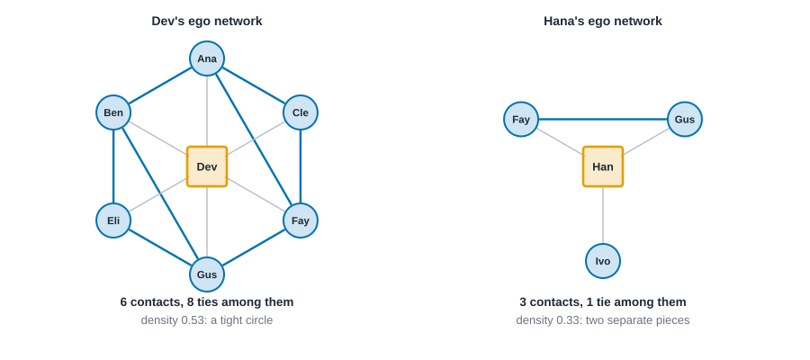
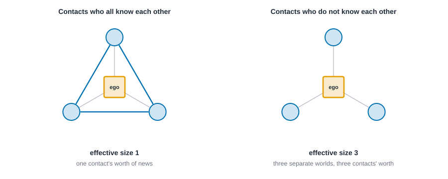
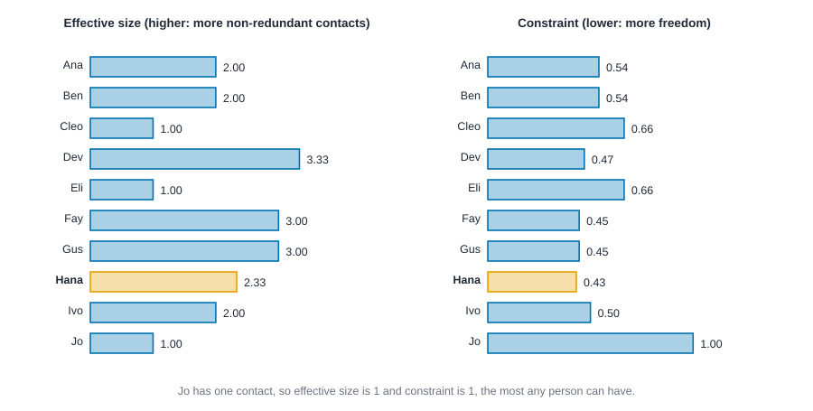
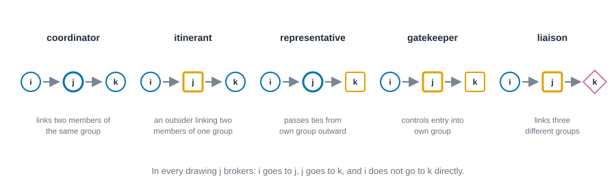
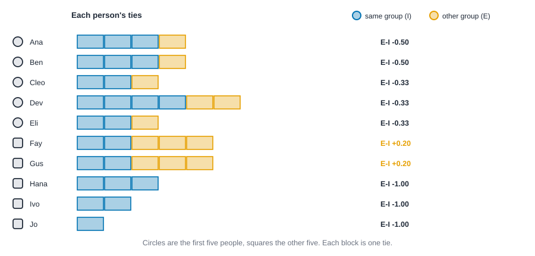

# Ego networks and structural holes {#sec-ego-networks}

::: {.callout-note appearance="simple"}
## Prerequisites
@sec-networks-as-data and @sec-centrality. We use the ten-person friendship network again, and the idea of betweenness from @sec-centrality comes back in a new form. The weak-ties argument from @sec-foundations is the backdrop for the whole chapter.
:::

## The view from one person

::: {.callout-tip appearance="simple"}
## Code lives next to the idea
Each measure comes with its code right where it is explained. The Rust blocks in this chapter run top to bottom as one script: the first builds the friendship network, and later ones reuse it.
:::

Every chapter so far has looked at the network from above, like a map. This one gets down to street level and asks what the network looks like from *one person's* seat. Who do you know? Do the people you know know each other? If you stepped out of the picture, would your contacts still be connected, or would they fall into separate pieces?

Those questions are worth asking because two people with the same number of friends can live in very different worlds. One person's friends are all friends with each other, the way a family at a dinner table is. Another person's friends have never met, and the second person is the only thing connecting them. The first person hears the same news from everyone. The second person hears different news from different worlds, and decides what to pass on.

That difference is the subject of this chapter. We'll start with the simplest way to look at a person's surroundings, the **ego network**. Then we'll meet Ronald Burt's idea of **structural holes**, and two ways of measuring them. Then we'll add the groups people belong to, and ask what kind of broker a person is. We'll finish with a simple index for how much a person's ties stay inside their own group.

## Ego networks

An **ego network** is one person (the *ego*), the people they have ties to (their *alters*), and the ties among those alters. That's all. It's what you'd get if you could only see the network through one person's eyes, and you could also see who their contacts know.

@fig-ego-networks draws two of them from the friendship network of @sec-centrality. Dev has six contacts, and eight ties among them: Dev's friends mostly know each other. Hana has three contacts, and only one tie among them, between Fay and Gus. Ivo, her third contact, isn't tied to either. If Hana stepped out of the picture, Ivo would be cut off from Fay and Gus.

{#fig-ego-networks fig-alt="Two drawings. On the left, Dev, an orange square in the middle, with six contacts in a hexagon around them, joined in a ring by blue ties with two extra blue ties across the ring. On the right, Hana, an orange square, with three contacts: Fay and Gus are joined to each other by a blue tie, and Ivo is not tied to either."}

A handful of numbers summarize an ego network.

- **Size**: how many alters. It's the person's degree, @sec-centrality's simplest measure.
- **Ties among alters**: how many of the alters know each other.
- **Density**: ties among alters, divided by the number of pairs of alters. High density means a tight circle. Low density means a person whose contacts mostly don't know each other.
- **Pieces**: how many separate pieces the alters fall into once ego is removed. More than one means the ego is the only link between them.
- **Ego betweenness**: how often ego lies on the shortest route between two of their own alters, who are not directly tied to each other, *within the ego network* [@everett2005ego]. It's like betweenness (@sec-centrality), but computed using only what ego can see.

Ego networks are also how most surveys see networks. You can't usually interview an entire city, but you can ask a sample of people to name their contacts and to say which of them know each other. That's a name generator, which we'll look at in @sec-collecting-data. A lot of the measures in this chapter work on those data as well as on a whole network.

::: {.panel-tabset group="language"}

## R

```r
library(knappnet)

# The ten-person friendship network. People are numbered from zero in Rust; here the
# ties are written as numbers and turned into names.
names <- c("Ana", "Ben", "Cleo", "Dev", "Eli", "Fay", "Gus", "Hana", "Ivo", "Jo")
from <- c(0, 0, 0, 0, 1, 1, 1, 2, 2, 3, 3, 3, 4, 5, 5, 6, 7, 8)
to <- c(1, 2, 3, 5, 3, 4, 6, 3, 5, 4, 5, 6, 6, 6, 7, 7, 8, 9)
edges <- data.frame(source = names[from + 1], target = names[to + 1])
friends <- net_frame(edges, nodes = data.frame(id = names), directed = FALSE)

# Alters are the people within one step of ego, the default.
ego <- net_ego_summary(friends)
header <- sprintf("%-5s %8s %5s %8s %7s %11s", "", "contacts", "ties", "density", "pieces", "betweenness")
rows <- sprintf("%-5s %8d %5d %8.3f %7d %11.3f", names, as.integer(ego$size),
                as.integer(ego$ties), ego$density, as.integer(ego$components),
                ego$ego_betweenness)
writeLines(c(header, rows))
```

## Python

```python
import networkx as nx

# The ten-person friendship network, people numbered from zero as in Rust.
names = ["Ana", "Ben", "Cleo", "Dev", "Eli", "Fay", "Gus", "Hana", "Ivo", "Jo"]
src = [0, 0, 0, 0, 1, 1, 1, 2, 2, 3, 3, 3, 4, 5, 5, 6, 7, 8]
dst = [1, 2, 3, 5, 3, 4, 6, 3, 5, 4, 5, 6, 6, 6, 7, 7, 8, 9]
friends = nx.Graph()
friends.add_nodes_from(range(len(names)))
friends.add_edges_from(zip(src, dst))

print(f"{'':<5} {'contacts':>8} {'ties':>5} {'density':>8} {'pieces':>7} {'betweenness':>11}")
for i, name in enumerate(names):
    ego = nx.ego_graph(friends, i)          # ego, its alters, and the ties among them
    alters = friends.subgraph(n for n in ego if n != i)
    size, ties = alters.number_of_nodes(), alters.number_of_edges()
    density = ties / (size * (size - 1) / 2) if size > 1 else float("nan")
    density_text = "NaN" if size < 2 else f"{density:.3f}"
    pieces = nx.number_connected_components(alters)
    # Ego betweenness is ordinary betweenness inside the ego network.
    ego_between = nx.betweenness_centrality(ego, normalized=False)[i]
    print(f"{name:<5} {size:>8} {ties:>5} {density_text:>8} {pieces:>7} {ego_between:>11.3f}")
```

## Rust

```rust
use knappnet::metrics::ego::{compute_ego_summary, EgoOptions};
use knappnet::Graph;

// The ten-person friendship network, people numbered from zero.
let names = ["Ana", "Ben", "Cleo", "Dev", "Eli", "Fay", "Gus", "Hana", "Ivo", "Jo"];
let from = [0, 0, 0, 0, 1, 1, 1, 2, 2, 3, 3, 3, 4, 5, 5, 6, 7, 8];
let to = [1, 2, 3, 5, 3, 4, 6, 3, 5, 4, 5, 6, 6, 6, 7, 7, 8, 9];
let friends = Graph::from_edges(names.len(), &from, &to, None, false)?;
println!("{}", friends.describe().with_labels(&names));

// Alters are the people within one step of ego, the default.
let ego = compute_ego_summary(&friends, EgoOptions::default())?;
let ego_between = ego.betweenness.as_ref().unwrap();
println!("{:<5} {:>8} {:>5} {:>8} {:>7} {:>11}", "", "contacts", "ties", "density", "pieces", "betweenness");
for (i, name) in names.iter().enumerate() {
    println!("{:<5} {:>8} {:>5} {:>8.3} {:>7} {:>11.3}",
             name, ego.size[i], ego.ties[i], ego.density[i], ego.components[i], ego_between[i]);
}
```

:::

::: {.code-output}
```text
Undirected network: 10 nodes, 18 ties
  Density           0.400
  Degree            1 to 6, mean 3.60
  Connected pieces  1
  Isolated nodes    0
  Loops, repeats    none
  Busiest           Dev (6), Fay (5), Gus (5)

      contacts  ties  density  pieces betweenness
Ana          4     4    0.667       1       1.000
Ben          4     4    0.667       1       1.000
Cleo         3     3    1.000       1       0.000
Dev          6     8    0.533       1       3.667
Eli          3     3    1.000       1       0.000
Fay          5     5    0.500       1       3.500
Gus          5     5    0.500       1       3.500
Hana         3     1    0.333       2       2.000
Ivo          2     0    0.000       2       1.000
Jo           1     0      NaN       1       0.000
```
:::

Read it against the picture. Dev has six contacts and eight ties among them, density 0.533. Hana has three contacts and one tie, density 0.333, and two pieces: Fay and Gus together, and Ivo alone. Cleo and Eli have density 1.000, because their three friends all know each other, which is the family-dinner-table pattern. And Jo has a single contact, so there are no pairs of alters and the density is undefined (NaN, for "not a number").
## Structural holes

Ronald Burt took the picture of Hana and made an argument out of it [@burt1992structural]. A **structural hole** is a gap between two groups of people who aren't otherwise in touch. Someone whose contacts sit on both sides of a hole can see what each side knows, bring ideas across, and decide who meets whom. Burt's claim is that this is a source of advantage, and that the advantage comes from the *gap*, not from the number of friends. He later reported evidence from managers in one large company that people whose contacts spanned holes were more likely to have ideas their colleagues valued [@burt2004structural]. As with any single study, the finding is a reason to look, not a law.

This ties to Granovetter's classic argument that weak ties carry new information (@sec-foundations). Burt's version moves the weight off the *strength* of the tie and onto the *position*: what matters is whether the person on the other end tells you something your other contacts wouldn't.

### Effective size: how many contacts' worth of access

Counting contacts overcounts, because contacts who know each other tell you the same things. **Effective size** subtracts the redundancy. @fig-holes-idea shows the extremes: three contacts who all know each other add up to one contact's worth of access, and three who don't add up to three.

{#fig-holes-idea fig-alt="Two drawings of a person at the center with three contacts around them. On the left the three contacts are joined to one another by blue ties, a triangle, and the effective size is 1. On the right the three contacts have no ties among themselves and the effective size is 3."}

For a network with no tie strengths, the calculation boils down to a short formula [@borgatti1997structural]. If a person has $n$ contacts and $t$ ties among those contacts,

$$
\text{effective size} = n - \frac{2t}{n}.
$$

Check it on the triangle: $n = 3$ and $t = 3$, so the effective size is $3 - 6/3 = 1$. And on the three strangers, $t = 0$, so it's 3. Hana has three contacts and one tie among them: $3 - 2/3 = 2.33$. Dev has six contacts and eight ties: $6 - 16/6 = 3.33$. **Efficiency** divides effective size by the number of contacts, so it asks what *share* of a person's contacts is non-redundant. A high efficiency means each contact is bringing something new.

::: {.panel-tabset group="language"}

## R

```r
size <- net_effective_size(friends)
efficiency <- net_efficiency(friends)
writeLines(c(sprintf("%-5s %14s %10s", "", "effective size", "efficiency"),
             sprintf("%-5s %14.3f %10.3f", names, size, efficiency)))
```

## Python

```python
size = nx.effective_size(friends)
print(f"{'':<5} {'effective size':>14} {'efficiency':>10}")
for i, name in enumerate(names):
    print(f"{name:<5} {size[i]:>14.3f} {size[i] / friends.degree(i):>10.3f}")
```

## Rust

```rust
use knappnet::metrics::brokerage::{compute_effective_size, compute_efficiency, StructuralHoleOptions};

let size = compute_effective_size(&friends, StructuralHoleOptions::default())?;
let efficiency = compute_efficiency(&friends, StructuralHoleOptions::default())?;
println!("{:<5} {:>14} {:>10}", "", "effective size", "efficiency");
for (i, name) in names.iter().enumerate() {
    println!("{:<5} {:>14.3} {:>10.3}", name, size[i], efficiency[i]);
}
```

:::

::: {.code-output}
```text
      effective size efficiency
Ana            2.000      0.500
Ben            2.000      0.500
Cleo           1.000      0.333
Dev            3.333      0.556
Eli            1.000      0.333
Fay            3.000      0.600
Gus            3.000      0.600
Hana           2.333      0.778
Ivo            2.000      1.000
Jo             1.000      1.000
```
:::

Dev has the largest effective size, 3.333 contacts' worth out of six. Hana's 2.333 is out of three, so her efficiency of 0.778 is among the highest: nearly everyone she knows brings something new. Cleo and Eli sit at 1.000, one contact's worth, because their three friends are all the same circle. Jo's single contact is, trivially, entirely non-redundant.
### Constraint: how boxed in

Effective size counts. **Constraint** weighs. It asks how much of a person's network is tied up in a few contacts who are themselves tied up with each other. Burt's measure starts from the share of a person's time and energy invested in each contact, $p_{ij}$, which in a network without tie strengths is just one divided by the number of contacts. A person is constrained by a contact $j$ directly, through $p_{ij}$, and indirectly, through any of their other contacts $q$ who also tie to $j$:

$$
c_{ij} = \left( p_{ij} + \sum_{q \neq i, j} p_{iq}\, p_{qj} \right)^2, \qquad C_i = \sum_j c_{ij}.
$$

In words: for each contact, add the direct share to the shares routed through your other contacts who also know that contact, square the total, and add them up over all your contacts [@burt1992structural; @burt2004structural]. The squaring means a single dominant contact counts for a lot. Low constraint means freedom. High constraint means your options run through a few people who talk among themselves.

::: {.panel-tabset group="language"}

## R

```r
constraint <- net_constraint(friends)
writeLines(sprintf("%-5s %.3f", names, constraint))
```

## Python

```python
constraint = nx.constraint(friends)
for i, name in enumerate(names):
    print(f"{name:<5} {constraint[i]:.3f}")
```

## Rust

```rust
use knappnet::metrics::brokerage::compute_constraint;

let constraint = compute_constraint(&friends, StructuralHoleOptions::default())?;
for (i, name) in names.iter().enumerate() {
    println!("{name:<5} {:.3}", constraint[i]);
}
```

:::

::: {.code-output}
```text
Ana   0.541
Ben   0.541
Cleo  0.664
Dev   0.470
Eli   0.664
Fay   0.445
Gus   0.445
Hana  0.431
Ivo   0.500
Jo    1.000
```
:::

Hana has the lowest constraint in the network, 0.431, lower than Dev's 0.470 even though Dev has twice as many friends. That is the point of the measure. Dev's friends form a tightly woven circle, so most of what Dev hears comes through people who also hear it from each other. Hana's three contacts live in different parts of the network, so none of them can speak for her whole world. Jo, with a single contact, has the maximum possible constraint of 1.000.
@fig-effective-size-bars puts both measures on the same people. They don't agree on who's on top, and that's the lesson. Effective size rewards having many non-redundant contacts, and Dev wins. Constraint rewards having contacts spread across separate parts of the network, and Hana wins. Neither is "the" measure of brokerage. They answer different questions.

{#fig-effective-size-bars fig-alt="Two horizontal bar charts with the same ten names. Effective size: Dev 3.33, Fay and Gus 3.00, Hana 2.33, Ana and Ben 2.00, Ivo 2.00, Cleo, Eli and Jo 1.00. Constraint: Hana is lowest at 0.43, then Fay and Gus at 0.45, Dev 0.47, Ivo 0.50, Ana and Ben 0.54, Cleo and Eli 0.66, Jo 1.00. Hana's bars are highlighted in orange."}

Burt also defines a third measure, **hierarchy**, for how concentrated a person's constraint is in a single contact. The engine computes it too, but we won't spend time on it here.

## Brokers and the groups they link

Structural holes ask whether a person sits between *people*. Gould and Fernandez asked a finer question: when a person brokers between two others, what *groups* do those people come from? [@gould1989structures] A broker who links two members of one department is doing something different from a broker who links two departments.

The setup is a directed network, plus a group for each person. Person $j$ **brokers** the pair $(i, k)$ when $i$ goes to $j$, $j$ goes to $k$, and $i$ does not go to $k$ directly. Every brokered pair then falls into one of five roles, depending on the groups of $i$, $j$ and $k$, as in @fig-brokerage-roles.

{#fig-brokerage-roles fig-alt="Five panels, each showing three people i, j and k in a row joined by two arrows. Coordinator: all three are blue circles. Itinerant: i and k are blue circles and j is an orange square. Representative: i and j are blue circles and k is an orange square. Gatekeeper: i is a blue circle, j and k are orange squares. Liaison: i is a blue circle, j an orange square and k a purple diamond."}

- A **coordinator** links two members of its own group.
- An **itinerant** (or consultant) is an outsider who links two members of the *same other* group.
- A **representative** passes ties from its own group out to another group.
- A **gatekeeper** controls entry into its own group, from outside.
- A **liaison** links two people from two *different* groups, neither of which is its own.

Here is a small example: nine people in three teams, Design, Build and Sales, and a directed network of who passes work to whom. The code counts, for each person, how many pairs they broker in each role.

::: {.panel-tabset group="language"}

## R

```r
# Design: Ada, Ben, Cy.  Build: Dee, Eve, Flo.  Sales: Gus, Hal, Ivy.
team_names <- c("Ada", "Ben", "Cy", "Dee", "Eve", "Flo", "Gus", "Hal", "Ivy")
team <- c(0, 0, 0, 1, 1, 1, 2, 2, 2)
# An arrow means: passes work to.
wfrom <- c(0, 1, 2, 3, 4, 5, 3, 3, 6, 7)
wto <- c(1, 2, 3, 4, 5, 6, 0, 6, 7, 8)
work_edges <- data.frame(source = team_names[wfrom + 1], target = team_names[wto + 1])
work <- net_frame(work_edges, nodes = data.frame(id = team_names), directed = TRUE)

counts <- net_brokerage(work, groups = team)
roles <- c("coordinator", "itinerant", "representative", "gatekeeper", "liaison", "total")
role_matrix <- as.matrix(counts[roles])
role_cells <- apply(role_matrix, 1, \(r) paste(sprintf("%5d", as.integer(r)), collapse = " "))
writeLines(c(sprintf("%-4s %s", "", paste(sprintf("%5.5s", roles), collapse = " ")),
             sprintf("%-4s %s", team_names, role_cells)))
```

## Python

```python
# Design: Ada, Ben, Cy.  Build: Dee, Eve, Flo.  Sales: Gus, Hal, Ivy.
team_names = ["Ada", "Ben", "Cy", "Dee", "Eve", "Flo", "Gus", "Hal", "Ivy"]
team = [0, 0, 0, 1, 1, 1, 2, 2, 2]
# An arrow means: passes work to.
wsrc = [0, 1, 2, 3, 4, 5, 3, 3, 6, 7]
wdst = [1, 2, 3, 4, 5, 6, 0, 6, 7, 8]
work = nx.DiGraph()
work.add_nodes_from(range(len(team_names)))
work.add_edges_from(zip(wsrc, wdst))

# NetworkX has no brokerage roles. Person j brokers (i, k) when i -> j -> k and
# i does not go to k directly; the groups of the three people give the role.
roles = ["coordinator", "itinerant", "representative", "gatekeeper", "liaison"]
counts = {j: dict.fromkeys(roles, 0) for j in work}
for j in work:
    for i in work.predecessors(j):
        for k in work.successors(j):
            if i == k or work.has_edge(i, k):
                continue
            gi, gj, gk = team[i], team[j], team[k]
            if gi == gj == gk:
                role = "coordinator"
            elif gi == gk:
                role = "itinerant"
            elif gi == gj:
                role = "representative"
            elif gj == gk:
                role = "gatekeeper"
            else:
                role = "liaison"
            counts[j][role] += 1

heads = " ".join(f"{r[:5]:>5}" for r in roles + ["total"])
print(f"{'':<4} {heads}")
for j, name in enumerate(team_names):
    row = [counts[j][r] for r in roles]
    print(f"{name:<4} " + " ".join(f"{v:>5}" for v in row + [sum(row)]))
```

## Rust

```rust
use knappnet::metrics::brokerage::{compute_brokerage, BROKERAGE_ROLES};

// Design: Ada, Ben, Cy.  Build: Dee, Eve, Flo.  Sales: Gus, Hal, Ivy.
let team_names = ["Ada", "Ben", "Cy", "Dee", "Eve", "Flo", "Gus", "Hal", "Ivy"];
let team: [i64; 9] = [0, 0, 0, 1, 1, 1, 2, 2, 2];
// An arrow means: passes work to.
let from = [0, 1, 2, 3, 4, 5, 3, 3, 6, 7];
let to = [1, 2, 3, 4, 5, 6, 0, 6, 7, 8];
let work = Graph::from_edges(team_names.len(), &from, &to, None, true)?;
println!("{}", work.describe().with_labels(&team_names));

let counts = compute_brokerage(&work, &team, 0)?;
println!("{:<4} {}", "", BROKERAGE_ROLES.iter().map(|r| format!("{:>5.5}", r)).collect::<Vec<_>>().join(" "));
for (i, name) in team_names.iter().enumerate() {
    let row: Vec<String> = (0..BROKERAGE_ROLES.len()).map(|r| format!("{:>5}", counts.get(i, r))).collect();
    println!("{:<4} {}", name, row.join(" "));
}
```

:::

::: {.code-output}
```text
Directed network: 9 nodes, 10 ties (arcs)
  Density           0.139
  Out-degree        0 to 3, mean 1.11
  In-degree         1 to 2, mean 1.11
  Reciprocity       0.00 of ties are returned
  Connected pieces  1 weak, 6 strong
  Isolated nodes    0
  Loops, repeats    none
  Busiest           Dee (4), Gus (3), Ada (2)

     coord itine repre gatek liais total
Ada      0     0     0     1     0     1
Ben      1     0     0     0     0     1
Cy       0     0     1     0     0     1
Dee      0     1     0     1     1     3
Eve      1     0     0     0     0     1
Flo      0     0     1     0     0     1
Gus      0     0     0     2     0     2
Hal      1     0     0     0     0     1
Ivy      0     0     0     0     0     0
```
:::

Dee brokers three pairs, one in each of three roles. Cy passes work to Dee, who passes it on to Ada (Dee is an itinerant, an outsider linking two Design people), to Eve (a gatekeeper, controlling entry into Build) and to Gus (a liaison, linking Design to Sales). Gus is a gatekeeper twice over for Sales. Ada is a gatekeeper too, because Dee passes work to Ada, who passes it on to Ben. Cy and Flo are representatives, sending their own team's work outward. Ben, Eve and Hal are coordinators inside their own teams, and Ivy, at the end of the chain, brokers nothing. The column headings are cut to five letters to fit: coord, itine, repre, gatek and liais, then the total.
Remember that these are counts of *pairs*, so a person in a big network with many contacts will tend to have large numbers in every column. As with other counts, compare them against what you'd expect, or at least against people in the same position, before telling a story about them.

## How much stays inside the group?

The last measure is the simplest. Suppose you have groups, such as departments, neighborhoods or the two floors of an office. How much of a person's networking happens inside their own group, and how much reaches outside it? The **E-I index** answers with one number [@krackhardt1988informal]. Count a person's ties that go **e**xternal to their group and the ones that stay **i**nternal, and compute

$$
\text{E-I} = \frac{E - I}{E + I}.
$$

It runs from $-1$, when every tie stays inside the group, to $+1$, when every tie goes outside it. Zero means an even split. You can compute it for a whole network, for each group, or for each person.

For the friendship network, call the first five people (Ana through Eli) one group and the other five (Fay through Jo) another, as in @fig-ei-index.

{#fig-ei-index fig-alt="Ten horizontal bars, one per person, each made of blocks: blue blocks for ties to their own group and orange blocks for ties to the other group. Fay and Gus have three orange blocks and two blue, giving E-I of plus 0.20. Hana, Ivo and Jo have only blue blocks, giving minus 1.00. Ana and Ben have one orange block and three blue, giving minus 0.50."}

::: {.panel-tabset group="language"}

## R

```r
# Group 0 is the first five people, group 1 the other five.
group <- c(0, 0, 0, 0, 0, 1, 1, 1, 1, 1)
by_group <- net_ei_index(friends, group, scope = "group")
by_person <- net_ei_index(friends, group, scope = "node")
writeLines(c(sprintf("whole network  %+.3f", net_ei_index(friends, group, scope = "global")),
             sprintf("group %d        %+.3f", seq_along(by_group) - 1L, by_group),
             sprintf("%-5s          %+.3f", names, by_person)))
```

## Python

```python
# Group 0 is the first five people, group 1 the other five.
group = [0, 0, 0, 0, 0, 1, 1, 1, 1, 1]

def ei(external, internal):
    return (external - internal) / (external + internal)

# Whole network: each tie counts once, as external or internal.
ext = sum(group[u] != group[v] for u, v in friends.edges)
print(f"whole network  {ei(ext, friends.number_of_edges() - ext):+.3f}")

# A group: ties with one end in the group, split by where the other end is.
for g in (0, 1):
    inside = sum(group[u] == group[v] == g for u, v in friends.edges)
    outside = sum(group[u] != group[v] and g in (group[u], group[v]) for u, v in friends.edges)
    print(f"group {g}        {ei(outside, inside):+.3f}")

# A person: their own ties, split the same way.
for i, name in enumerate(names):
    outside = sum(group[j] != group[i] for j in friends[i])
    print(f"{name:<5}          {ei(outside, friends.degree(i) - outside):+.3f}")
```

## Rust

```rust
use knappnet::metrics::mixing::{compute_ei_index, EiCounting, EiScope};
use knappnet::DegreeMode;

// Group 0 is the first five people, group 1 the other five.
let group: [i64; 10] = [0, 0, 0, 0, 0, 1, 1, 1, 1, 1];
let ei = |scope| compute_ei_index(&friends, &group, 2, scope, DegreeMode::All, EiCounting::Standard);
println!("whole network  {:+.3}", ei(EiScope::Global)?[0]);
let by_group = ei(EiScope::Group)?;
println!("group 0        {:+.3}", by_group[0]);
println!("group 1        {:+.3}", by_group[1]);
let by_person = ei(EiScope::Node)?;
for (i, name) in names.iter().enumerate() {
    println!("{name:<5}          {:+.3}", by_person[i]);
}
```

:::

::: {.code-output}
```text
whole network  -0.333
group 0        -0.077
group 1        +0.091
Ana            -0.500
Ben            -0.500
Cleo           -0.333
Dev            -0.333
Eli            -0.333
Fay            +0.200
Gus            +0.200
Hana           -1.000
Ivo            -1.000
Jo             -1.000
```
:::

The whole network scores -0.333: 12 of the 18 ties stay inside a group and 6 cross, which is (6 - 12) / 18. The two groups differ, though. Group 0 has a little more inside than outside (-0.077), and group 1 has a little more outside (+0.091), because Fay and Gus tie across more than they tie within. Hana, Ivo and Jo have every tie inside their own group, so they score -1.000, and this is the place to remember what the index doesn't say: the three of them are at the far end of a chain, not isolated from the other group by choice.
## A cheat sheet

| Measure | Question | Range | Watch out for |
| --- | --- | --- | --- |
| Ego network size and density | How many contacts, and do they know each other? | Density 0 to 1 | Undefined with fewer than two contacts |
| Ego betweenness | How often is ego the route between their own contacts? | 0 upward | Sees only what ego sees |
| Effective size | How many contacts' worth of non-redundant access? | 1 up to the number of contacts | Grows with degree |
| Constraint | How boxed in by interlinked contacts? | Roughly 0 to 1 | Depends on the whole ego network, not just its size |
| Brokerage roles | What kind of broker, given groups? | Counts, 0 upward | Counts grow with degree and depend on how groups are drawn |
| E-I index | Do ties stay inside the group? | -1 to +1 | Depends on group sizes; compare with chance |

## Reading brokers and boundaries honestly

**Position is not performance.** A person sitting between groups has an *opportunity*, and in some settings it pays off [@burt2004structural]. Whether they use it, and who benefits, is another matter. A broker is also stretched across worlds, may be distrusted by both sides, and may have had no say in who they ended up between. A low-constraint person can be a bridge or simply the lonely one nobody else knows what to do with.

**Closure and brokerage are both useful.** Dense circles build trust and make norms enforceable, which is the case Coleman made [@coleman1988social]. Holes bring in new information. The right mix depends on the task. Compare how the two arguments sit side by side in @burt1992structural.

**Check what the ego can see.** Ego network measures assume the person has told you, or you've observed, who their contacts know. People can be unsure about ties between their contacts. A survey that asks only about the ego's own ties cannot give you constraint.

**Compare against chance for E-I.** If five of ten people are in each group and a person picked friends at random, about five of nine possible contacts would be in the other group, which gives an E-I of about +0.11. Judge a value against what the group sizes alone would produce, not against zero.

**Be careful with people at the edge.** A high effective size or an unusual E-I value may mark someone who's a trusted bridge, or someone who's on the margins of two groups and belongs to neither. The numbers can't tell you which.

**Brokers in hidden networks.** Everton's work on dark networks treats brokers as strategically important points for understanding and disrupting a covert network [@everton2012disrupting]. Please read that with the ethics of @sec-collecting-data in mind. A measure of "brokerage" is a statement about a pattern in incomplete data, and not evidence of anyone's intent or guilt.

## Exercises

1. **By hand.** Compute the effective size of Fay with the formula $n - 2t/n$. You'll need Fay's contacts and the ties among them, which you can read off the two lists in the first code block. Check the answer against the output.
2. **By hand.** In the work-passing network, list every pair that Dee brokers and the role each falls into. Do you get the row for Dee in the output?
3. **Design.** You are given a company's email network and want to find people who connect departments. Would you use effective size, constraint, brokerage roles or the E-I index? What would you check the result against, and what would you want to know about how the email data were gathered?
4. **Coding.** Remove Hana from the friendship network and recompute constraint for Ivo. What changes, and why?
5. **Interpretation.** A report says "the people with the lowest constraint are our best innovators; promote them." Write a short, kind reply that says what the measure shows, and what it does not.

## Summary

::: {.callout-tip appearance="simple"}
An ego network is a person, their contacts and the ties among those contacts. Two people with the same number of friends can have very different worlds: a tight circle whose members all hear the same news, or a set of contacts who have never met. Burt's structural holes measure the difference. Effective size counts non-redundant contacts, constraint weighs how boxed in a person is by interlinked contacts, and the two can disagree, as Dev and Hana do. Gould and Fernandez's roles say what kind of broker a person is, given the groups of the people they link. The E-I index says how much of a person's, group's or network's ties cross group lines. All of these describe an *opportunity* in the pattern of ties. Whether anyone uses it, and what it's worth, depends on the setting.
:::

## Further reading

For ego networks and how they're collected, see @marsden1990network and @marsden2002egocentric, and for ego betweenness, @everett2005ego. For structural holes, see @burt1992structural and @burt2004structural, for the effective-size identity, @borgatti1997structural, and for the contrasting argument for closure, @coleman1988social. For weak ties, see @granovetter1973strength. For brokerage roles, see @gould1989structures, and for the E-I index, @krackhardt1988informal. For homophily, the tendency that the E-I index picks up, see @mcpherson2001birds. For brokers in hidden networks, see @everton2012disrupting. To practice in R, Phil Murphy's tutorials on brokerage [@murphyrpubs320424] and the E-I index [@murphyrpubs300606] are good companions.
