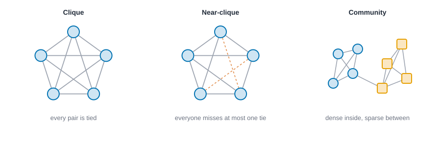
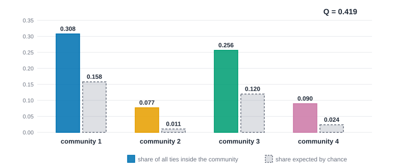
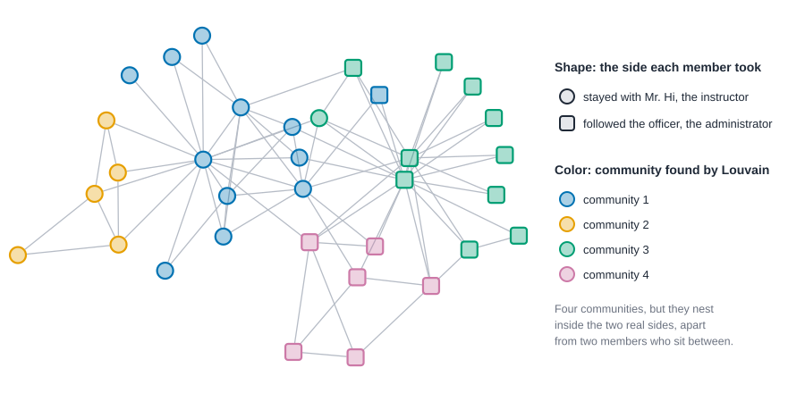
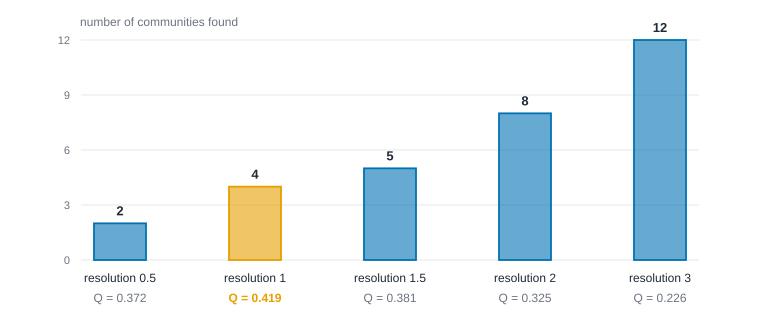

# Subgroups and communities {#sec-subgroups}

::: {.callout-note appearance="simple"}
## Prerequisites
@sec-networks-as-data, @sec-centrality and @sec-paths-and-cohesion. Betweenness (@sec-centrality) and cores (@sec-paths-and-cohesion) both come back here. The configuration model of @sec-small-worlds is the chance model behind modularity.
:::

## Groups inside the network

::: {.callout-note title="The short version"}
Networks clump: people tie mostly to others in their own circle and less to outsiders. This chapter is about finding those circles. There are strict ways (everyone in the group knows everyone else), relaxed ways (nearly everyone does), and a statistical way, called a community, where a group just has more ties inside than you'd expect by chance. The catch is that different methods give different groups on the same network, and a good score doesn't make a grouping true. So the skill is reading what a set of groups does and doesn't tell you.
:::

::: {.callout-tip title="Why you might care"}
Teams, friend circles, factions and online tribes are what people usually want from a network, whether they're studying a club that is about to split, an office whose departments don't talk, or a platform full of echo chambers. Group-finding tools can show you these structures in minutes. Knowing their limits keeps you from announcing "there are four communities" when what you found is one of many equally good ways to slice the same ties.
:::

::: {.callout-tip appearance="simple"}
## Code lives next to the idea
Each idea comes with its code right where it is explained. The Rust blocks in this chapter run top to bottom as one script: the first enters the karate club, and later ones reuse it.
:::

Networks don't just connect people; they clump them. Look at almost any social network and you'll see clusters: people who tie mostly to each other and only a little to everyone else. Teams, cliques of friends, families, factions in a fight. A great deal of social life is about *who belongs with whom*, and a network is one of the few kinds of data that lets you see it without asking people.

The most famous example in the whole field is a karate club. In the early 1970s, the anthropologist Wayne Zachary spent about three years studying a university karate club of 34 members [@zachary1977information]. He recorded who interacted with whom outside the club's activities. Partway through, a dispute between the club's part-time instructor and its administrator split the club in two. Zachary used the network of friendships to predict which side each member would take, and he got all but one member right. A picture of friendship had *foreseen* a fission.

That's the promise of this chapter, and also its risk. There are many ways to define a "group" in a network, and they don't always agree. We'll go from the strictest definitions (everyone ties to everyone) to the loosest (more ties inside than you'd expect by chance), see how to find them, and spend real time on the question that matters most: when an algorithm hands you a set of groups, what has it actually told you?

## Three kinds of tight group

@fig-group-ladder lays out the range.

{#fig-group-ladder fig-alt="Left: five people on a circle with every pair tied. Middle: five people on a circle with two dashed red lines marking the two missing ties, so each person is missing at most one. Right: two small clusters of four, blue circles and orange squares, joined by a single tie."}

### Cliques

A **clique** is a set of people in which *everyone is tied to everyone else*, like a dinner table where every guest already knows every other guest. It's the strictest idea of a group, and it has a long history in sociology. A clique is **maximal** if you can't add anyone without breaking it. Maximal cliques overlap, since one person can belong to several, and that's a feature: it matches the way people really belong to more than one circle.

Cliques are demanding. In a large network, groups that are obviously meaningful to the people in them often have one or two missing ties, and a strict definition would split or discard them. A computer finds all maximal cliques with a classic algorithm [@bron1973algorithm], but on big networks there can be a huge number of them, most of them small and overlapping. The next block lists the cliques of the karate club; look at the size of the biggest one and at how many cliques there are.

::: {.panel-tabset group="language"}

## R

```r
library(knappnet)
library(dplyr)
library(purrr)

# Zachary's karate club: 34 members, 78 friendships. Members 0 to 33 in his numbering.
from <- c(
    0, 0, 0, 0, 0, 0, 0, 0, 0, 0, 0, 0, 0, 0, 0, 0, 1, 1, 1, 1, 1, 1, 1, 1, 2, 2, 2, 2, 2, 2, 2, 2, 3, 3, 3,
    4, 4, 5, 5, 5, 6, 8, 8, 8, 9, 13, 14, 14, 15, 15, 18, 18, 19, 20, 20, 22, 22, 23, 23, 23, 23, 23, 24, 24,
    24, 25, 26, 26, 27, 28, 28, 29, 29, 30, 30, 31, 31, 32)
to <- c(
    1, 2, 3, 4, 5, 6, 7, 8, 10, 11, 12, 13, 17, 19, 21, 31, 2, 3, 7, 13, 17, 19, 21, 30, 3, 7, 8, 9, 13, 27, 28,
    32, 7, 12, 13, 6, 10, 6, 10, 16, 16, 30, 32, 33, 33, 33, 32, 33, 32, 33, 32, 33, 33, 32, 33, 32, 33, 25, 27,
    29, 32, 33, 25, 27, 31, 31, 29, 33, 33, 31, 33, 32, 33, 32, 33, 32, 33, 33)
g <- net_frame(tibble(source = from, target = to),
               nodes = tibble(id = 0:33), directed = FALSE)
g

# Cliques: groups in which everyone is tied to everyone. Skip pairs (min_size = 3).
cliques <- net_max_cliques(g, min_size = 3)
tibble(largest_clique = net_clique_number(g), maximal_cliques = length(cliques))
```

::: {.code-output}
```text
# net_frame: 34 nodes, 78 edges
#   directed:  no        mode: one-mode (34 actors)
#   weights:   unweighted
#   time:      static    space: none
#   simple:    no loops, no parallel edges
#   components: 1    isolates: 0    density: 0.139
#
# Nodes (34 x 1)       Edges (78 x 2)
#   id                   source target
#   <int>                <dbl>  <dbl>
# 1 0                  1 0      1
# 2 1                  2 0      2
# 3 2                  3 0      3
# 4 3                  4 0      4
# 5 4                  5 0      5
# 6 5                  6 0      6
#   ... 28 more rows     ... 72 more rows
# A tibble: 1 × 2
  largest_clique maximal_cliques
           <int>           <int>
1              5              25
```
:::

## Python

```python
import networkx as nx

# Zachary's karate club: 34 members, 78 friendships. Members 0 to 33 in his numbering.
src = [
    0, 0, 0, 0, 0, 0, 0, 0, 0, 0, 0, 0, 0, 0, 0, 0, 1, 1, 1, 1, 1, 1, 1, 1, 2, 2, 2, 2, 2, 2, 2, 2, 3, 3, 3,
    4, 4, 5, 5, 5, 6, 8, 8, 8, 9, 13, 14, 14, 15, 15, 18, 18, 19, 20, 20, 22, 22, 23, 23, 23, 23, 23, 24, 24,
    24, 25, 26, 26, 27, 28, 28, 29, 29, 30, 30, 31, 31, 32,
]
dst = [
    1, 2, 3, 4, 5, 6, 7, 8, 10, 11, 12, 13, 17, 19, 21, 31, 2, 3, 7, 13, 17, 19, 21, 30, 3, 7, 8, 9, 13, 27, 28,
    32, 7, 12, 13, 6, 10, 6, 10, 16, 16, 30, 32, 33, 33, 33, 32, 33, 32, 33, 32, 33, 33, 32, 33, 32, 33, 25, 27,
    29, 32, 33, 25, 27, 31, 31, 29, 33, 33, 31, 33, 32, 33, 32, 33, 32, 33, 33,
]
g = nx.Graph()
g.add_nodes_from(range(34))
g.add_edges_from(zip(src, dst))

# Cliques: groups in which everyone is tied to everyone. Skip pairs (size 3 or more).
cliques = [c for c in nx.find_cliques(g) if len(c) >= 3]
print(f"largest clique   {max(map(len, nx.find_cliques(g)))} people")
print(f"maximal cliques  {len(cliques)} (of 3 or more people)")
```

::: {.code-output}
```text
largest clique   5 people
maximal cliques  25 (of 3 or more people)
```
:::

## Rust

```rust
use knappnet::metrics::cliques::{compute_clique_number, find_max_cliques};
use knappnet::Graph;

// Zachary's karate club: 34 members, 78 friendships, from his study of a club
// that split in two. Positions 0 to 33 are the members in his numbering.
let from = [
    0, 0, 0, 0, 0, 0, 0, 0, 0, 0, 0, 0, 0, 0, 0, 0, 1, 1, 1, 1, 1, 1, 1, 1, 2, 2, 2, 2, 2, 2, 2, 2, 3, 3, 3,
    4, 4, 5, 5, 5, 6, 8, 8, 8, 9, 13, 14, 14, 15, 15, 18, 18, 19, 20, 20, 22, 22, 23, 23, 23, 23, 23, 24, 24,
    24, 25, 26, 26, 27, 28, 28, 29, 29, 30, 30, 31, 31, 32,
];
let to = [
    1, 2, 3, 4, 5, 6, 7, 8, 10, 11, 12, 13, 17, 19, 21, 31, 2, 3, 7, 13, 17, 19, 21, 30, 3, 7, 8, 9, 13, 27, 28,
    32, 7, 12, 13, 6, 10, 6, 10, 16, 16, 30, 32, 33, 33, 33, 32, 33, 32, 33, 32, 33, 33, 32, 33, 32, 33, 25, 27,
    29, 32, 33, 25, 27, 31, 31, 29, 33, 33, 31, 33, 32, 33, 32, 33, 32, 33, 33,
];
let g = Graph::from_edges(34, &from, &to, None, false)?;
println!("{}", g.describe());

// Cliques: groups in which everyone is tied to everyone. The 3 skips pairs; the 0 is the default option.
let cliques = find_max_cliques(&g, 3, 0);
println!("largest clique   {} people", compute_clique_number(&g, 0));
println!("maximal cliques  {} (of 3 or more people)", cliques.len());
```

::: {.code-output}
```text
Undirected network: 34 nodes, 78 ties
  Density           0.139
  Degree            1 to 17, mean 4.59
  Connected pieces  1
  Isolated nodes    0
  Loops, repeats    none
  Busiest           node 33 (17), node 0 (16), node 32 (12)

largest clique   5 people
maximal cliques  25 (of 3 or more people)
```
:::

:::

The biggest clique has five members, and there are 25 maximal cliques of three or more people (a **maximal** clique is one that can't be grown by adding anyone). Cliques exist, but they overlap heavily, and a 34-person club is clearly more than 25 separate little circles.

### Relaxing the rule

Sociologists have long relaxed the clique rule. An **n-clique** allows people to be up to $n$ steps apart rather than one [@luce1950connectivity]. A **k-plex** lets each member miss up to $k - 1$ ties to others in the group [@seidman1978graph]. The k-core from @sec-paths-and-cohesion is another relaxation: everyone has *at least* $k$ ties inside the group, whether or not they know the same people. Each definition is a different idea of what makes a group solid, and it's worth choosing one on purpose, based on what you think holds your groups together.

Here are the definitions precisely, for readers who want them. Each is a different way to answer "how tight does a group have to be?". Write $d(i, j)$ for the number of steps on a shortest path between $i$ and $j$, and let $S$ be a set of $s$ people.

- A **clique** has $d(i, j) = 1$ for every pair in $S$. It is **maximal** when nobody can be added.
- An **n-clique** is a maximal set in which $d(i, j) \le n$ for every pair, with distances measured in the *whole* network [@luce1950connectivity]. A 1-clique is a clique. The odd part is that two members can be close only through someone *outside* the set.
- An **n-clan** repairs that oddity [@mokken1979cliques]. It is an n-clique whose members are within $n$ steps of each other using only paths that stay inside the set.
- A **k-plex** is a set in which each person is tied to at least $s - k$ of the other members, so each person may miss at most $k - 1$ of them [@seidman1978graph]. A 1-plex is a clique.
- A **k-core** is a maximal set in which each person has at least $k$ ties to others in the set [@seidman1983network].
- A **k-truss** is a maximal set of ties in which every tie closes at least $k - 2$ triangles made of ties in the set [@wang2012truss]. The number of triangles a tie closes is its **support**, and a tie's **truss number** is the largest $k$ for which it stays.

::: {.callout-tip title="In plain words"}
Read the list as a ladder of promises. A clique promises that everyone is one step from everyone. An n-clique relaxes that to "within $n$ steps", counting paths through outsiders; an n-clan insists the paths stay inside the group. A k-plex says "each person can miss at most $k - 1$ of the others", so a 1-plex misses none and is a clique. A k-core says "each person has at least $k$ ties inside", and a k-truss says "each tie is backed by at least $k - 2$ shared friends". The letters $i$ and $j$ stand for any two people, $d(i,j)$ for the steps between them, and $s$ for the size of the set. In the seven-person example just below, ABCD is a clique ($d = 1$ for every pair), and A and E are two steps apart, which is why they can't be in a clique together.
:::

Try them on seven people you can check on paper. The block after that runs the same definitions on the computer; look for whether its groups match what you found by hand. A, B, C and D all know each other. E knows C and D. F knows E, and G knows F. By hand: ABCD is a clique of four, and C, D and E make a triangle. G has one tie, so a 2-core peel removes G, then F (now with one tie), and then stops: E still has C and D. The tie C-D sits in three triangles (with A, with B and with E), the tie A-B in two, and E-F in none.

::: {.panel-tabset group="language"}

## R

```r
# Seven people, A to G (ids 0 to 6): a tight foursome ABCD, E tied to C and D, and a tail E-F-G.
hand_ties <- tibble(source = c(0, 0, 0, 1, 1, 2, 2, 3, 4, 5), target = c(1, 2, 3, 2, 3, 3, 4, 4, 5, 6))
hand <- net_frame(hand_ties, nodes = tibble(id = 0:6), directed = FALSE)
spell <- \(sets) sets |> map_chr(\(s) paste(LETTERS[sort(s) + 1], collapse = "")) |> sort() |> paste(collapse = " ")
tibble(
  idea = c("cliques of 3 or more", "2-plexes of 3 or more"),
  members = c(spell(net_max_cliques(hand, min_size = 3)), spell(net_k_plexes(hand, k = 2, min_size = 3)))
)
net_coreness(hand)

# The R package has no k-truss yet. Peel: drop every tie in fewer than k - 2 triangles, until none is dropped.
to_matrix <- \(ties, n) {
  m <- matrix(0, n, n)
  m[cbind(ties$source, ties$target) + 1] <- 1
  m + t(m)
}
peel <- \(m, k) {
  keep <- m * ((m %*% m) >= k - 2)
  if (identical(keep, m)) m else peel(keep, k)
}
map_dbl(3:6, \(k) sum(peel(to_matrix(hand_ties, 7), k)) / 2)

# A six-person ring, 1 to 6: the difference between an n-clique and an n-clan.
hexagon <- net_frame(tibble(source = 1:6, target = c(2:6, 1)), nodes = tibble(id = 1:6), directed = FALSE)
spell_numbers <- \(sets) sets |> map_chr(\(s) paste(sort(s), collapse = "")) |> sort() |> paste(collapse = " ")
tibble(
  idea = c("2-cliques of the ring", "2-clans of the ring"),
  members = c(spell_numbers(net_n_cliques(hexagon, n = 2, min_size = 3)),
              spell_numbers(net_n_clans(hexagon, n = 2, min_size = 3)))
)

# The karate club: pieces, people by core number (1 to 4), people and ties left in the 4-truss and 5-truss.
club_matrix <- to_matrix(tibble(source = from, target = to), 34)
max(net_components(g)$membership)
tabulate(net_coreness(g))
map_dbl(4:5, \(k) sum(rowSums(peel(club_matrix, k)) > 0))
map_dbl(4:5, \(k) sum(peel(club_matrix, k)) / 2)
```

::: {.code-output}
```text
# A tibble: 2 × 2
  idea                  members                   
  <chr>                 <chr>                     
1 cliques of 3 or more  ABCD CDE                  
2 2-plexes of 3 or more ABCD ACDE BCDE CEF DEF EFG
[1] 3 3 3 3 2 1 1
[1] 8 6 0 0
# A tibble: 2 × 2
  idea                  members                        
  <chr>                 <chr>                          
1 2-cliques of the ring 123 126 135 156 234 246 345 456
2 2-clans of the ring   123 126 156 234 345 456        
[1] 1
[1]  1 11 12 10
[1] 12  6
[1] 25 14
```
:::

## Python

```python
import itertools
from collections import Counter

import numpy as np

# Seven people, A to G (positions 0 to 6): a tight foursome ABCD, E tied to C and D, and a tail E-F-G.
hand = nx.Graph([(0, 1), (0, 2), (0, 3), (1, 2), (1, 3), (2, 3), (2, 4), (3, 4), (4, 5), (5, 6)])
letters = lambda sets: " ".join(sorted("".join(sorted("ABCDEFG"[i] for i in s)) for s in sets))

# A k-plex: every member is tied to all but at most k - 1 of the others. Seven people are few enough to try every subset.
def is_plex(s, k):
    return all(sum(not hand.has_edge(u, v) for v in s if v != u) <= k - 1 for u in s)
plexes = [set(s) for size in range(3, 8) for s in itertools.combinations(range(7), size) if is_plex(s, 2)]
print("cliques of 3 or more ", letters([c for c in nx.find_cliques(hand) if len(c) >= 3]))
print("2-plexes of 3 or more", letters([p for p in plexes if not any(p < q for q in plexes)]))
print("coreness ", [nx.core_number(hand)[i] for i in range(7)])
print("ties left in the 3-, 4-, 5- and 6-truss ", [nx.k_truss(hand, k).number_of_edges() for k in range(3, 7)])

# A six-person ring, 1 to 6: the difference between an n-clique and an n-clan. The 2-cliques are the
# maximal cliques of the "square" of the ring, where people two steps apart are tied.
ring = nx.cycle_graph(6)
numbered = lambda sets: " ".join(sorted("".join(str(i + 1) for i in sorted(s)) for s in sets))
two_cliques = [c for c in nx.find_cliques(nx.power(ring, 2)) if len(c) >= 3]
two_clans = [c for c in two_cliques if nx.is_connected(ring.subgraph(c)) and nx.diameter(ring.subgraph(c)) <= 2]
print("2-cliques of the ring ", numbered(two_cliques))
print("2-clans of the ring   ", numbered(two_clans))

# The karate club: pieces, people by core number (1 to 4), people and ties left in the 4-truss and 5-truss.
core_counts = Counter(nx.core_number(g).values())
trusses = [nx.k_truss(g, k) for k in (4, 5)]
print(f"karate: pieces {nx.number_connected_components(g)}; people by core number 1 to 4 {[core_counts[k] for k in (1, 2, 3, 4)]}")
print(f"4-truss {trusses[0].number_of_nodes()} people {trusses[0].number_of_edges()} ties; 5-truss {trusses[1].number_of_nodes()} people {trusses[1].number_of_edges()} ties")
```

::: {.code-output}
```text
cliques of 3 or more  ABCD CDE
2-plexes of 3 or more ABCD ACDE BCDE CEF DEF EFG
coreness  [3, 3, 3, 3, 2, 1, 1]
ties left in the 3-, 4-, 5- and 6-truss  [8, 6, 0, 0]
2-cliques of the ring  123 126 135 156 234 246 345 456
2-clans of the ring    123 126 156 234 345 456
karate: pieces 1; people by core number 1 to 4 [1, 11, 12, 10]
4-truss 12 people 25 ties; 5-truss 6 people 14 ties
```
:::

## Rust

```rust
use knappnet::metrics::cores::{compute_coreness, compute_k_truss, compute_truss_numbers};
use knappnet::metrics::factions::{find_k_plexes, find_n_cliques, find_n_clans, KPlexOptions};
use knappnet::metrics::topography::{find_components, ComponentKind};
use knappnet::{compute_degree, DegreeMode};

// Seven people, A to G (positions 0 to 6): a tight foursome ABCD, E tied to C and D, and a tail E-F-G.
let hand = Graph::from_edges(7, &[0, 0, 0, 1, 1, 2, 2, 3, 4, 5], &[1, 2, 3, 2, 3, 3, 4, 4, 5, 6], None, false)?;
let spell = |sets: Vec<Vec<u32>>, letters: bool| -> String {
    let mut named: Vec<String> = sets.iter().map(|s| {
        let mut s = s.clone();
        s.sort();
        s.iter().map(|&i| if letters { ((b'A' + i as u8) as char).to_string() } else { (i + 1).to_string() }).collect()
    }).collect();
    named.sort();
    named.join(" ")
};
println!("cliques of 3 or more  {}", spell(find_max_cliques(&hand, 3, 0), true));
let plex_options = KPlexOptions { k: 2, min_size: 3, max_steps: 10_000_000, threads: 0 };
println!("2-plexes of 3 or more {}", spell(find_k_plexes(&hand, plex_options)?, true));
println!("coreness  {:?}", compute_coreness(&hand, DegreeMode::All));
let truss = compute_truss_numbers(&hand);
println!("ties left in the 3-, 4-, 5- and 6-truss  {:?}", (3..=6).map(|k| truss.iter().filter(|&&t| t >= k).count()).collect::<Vec<_>>());

// A six-person ring, 1 to 6: the difference between an n-clique and an n-clan.
let ring = Graph::from_edges(6, &[0, 1, 2, 3, 4, 5], &[1, 2, 3, 4, 5, 0], None, false)?;
println!("2-cliques of the ring  {}", spell(find_n_cliques(&ring, 2, 3, 0)?, false));
println!("2-clans of the ring    {}", spell(find_n_clans(&ring, 2, 3, 0)?, false));

// The karate club: pieces, people by core number (1 to 4), people and ties left in the 4-truss and 5-truss.
let coreness = compute_coreness(&g, DegreeMode::All);
println!("karate: pieces {}; people by core number 1 to 4 {:?}", find_components(&g, ComponentKind::Weak).count(),
         (1..=4).map(|k| coreness.iter().filter(|&&c| c == k).count()).collect::<Vec<_>>());
let (ties4, people4) = compute_k_truss(&g, 4);
let (ties5, people5) = compute_k_truss(&g, 5);
println!("4-truss {} people {} ties; 5-truss {} people {} ties", people4.len(), ties4.len(), people5.len(), ties5.len());
```

::: {.code-output}
```text
cliques of 3 or more  ABCD CDE
2-plexes of 3 or more ABCD ACDE BCDE CEF DEF EFG
coreness  [3, 3, 3, 3, 2, 1, 1]
ties left in the 3-, 4-, 5- and 6-truss  [8, 6, 0, 0]
2-cliques of the ring  123 126 135 156 234 246 345 456
2-clans of the ring    123 126 156 234 345 456
karate: pieces 1; people by core number 1 to 4 [1, 11, 12, 10]
4-truss 12 people 25 ties; 5-truss 6 people 14 ties
```
:::

:::

Read the output against the paper, in plain words: the computer finds the same tight group, then shows how each looser rule lets in a few more people. ABCD is the one clique of four, and CDE is a triangle that overlaps it in C and D. The 2-plexes are looser: ACDE is one (A and E don't know each other, but that is the only tie missing for either of them), and so is BCDE, while all of ABCDE is not, because E misses both A and B. Coreness peels from the tail: G, then F, leave first, E keeps two ties and so has core number 2, and ABCD form the 3-core. The truss counts say something finer. Eight ties close at least one triangle, but only the six ties inside ABCD survive to the 4-truss, so E's ties to C and D drop out even though E stays in the 2-core. A core asks for a minimum number of ties, a truss for a minimum number of shared friends, and those are different promises.

The ring shows why a distance rule needs the "clan" repair. People 1, 3 and 5 are each two steps from the others, so they form a 2-clique, but the paths run through 2, 4 and 6, who are outside the set. Inside the set nobody knows anybody. It is a 2-clique and not a 2-clan, and the six sets of three neighbors along the ring are 2-clans.

Which definition to use depends on what you think holds your groups together: reaching each other quickly (n-clique, n-clan), nearly everyone knowing nearly everyone (k-plex), everyone having enough ties inside (k-core), or ties backed by shared friends (k-truss).

### Communities

The loosest and, today, the most used idea is the **community**, which is rather like a neighbourhood: nobody needs to know everyone, but people mostly talk to those nearby. a set of people who have more ties among themselves than you'd expect by chance. There's no demand that every pair be tied, or even that anyone know a minimum number of others. The group only has to be *denser inside than it is to the outside*. That's flexible enough to find groups in networks of millions of people, and it's why community detection has become a standard tool.

### Components, cores and communities

Three words that people mix up, because each cuts a network into pieces and each asks a different question.

| Idea | The question | What you get | What it can't see |
| --- | --- | --- | --- |
| Component | Is there any path between us? | Pieces with no tie between them | How thin the link is: one tie can join two crowds |
| k-core | Does everyone have at least $k$ ties inside? | Nested sets: the 4-core sits inside the 3-core | Who the ties go to: two separate dense groups can make one core |
| Community | Are there more ties inside than chance predicts? | A split of the people into groups (for most methods) | Whether the group is cohesive in any sense you care about |

The karate club in the block above shows how little the three have to do with each other. It's one component of 34 people, so the component question says nothing. The 4-core holds 10 people, and it includes both leaders and members of both sides, so the densest part of the club cuts across the split. The communities, which we get to below, are four circles. Three questions, three different answers on the same ties, and none is wrong.

There is a definition of a community that sits between the strict and the statistical ones. Radicchi and colleagues call a group a community "in the strong sense" if every member has more ties inside the group than outside it, and "in the weak sense" if the group's members have more ties inside than outside in total [@radicchi2004defining]. The strong sense is a clique-like promise about each person, the weak sense is the group-level promise that modularity builds on.

## What "more than chance" means: modularity

This section is the technical heart of the chapter. If the formulas feel heavy, read the "In plain words" boxes, skim to "The karate club, two ways", and you'll still have the main idea: modularity scores a grouping by how many more ties fall inside groups than chance would put there. To make "more ties inside than expected by chance" precise, we need a model of chance. The standard one asks: if we shuffled the ties at random, *keeping every person's number of ties fixed*, how many would land inside each group? People with many ties are more likely to be tied to someone in the group by luck, so the model accounts for that.

**Modularity**, usually written $Q$, is the result. For each group it takes the share of all ties that fall inside it, subtracts the share you'd expect by chance, and adds the differences up [@newman2004finding; @newman2006modularity]. The question it answers is "how much better than random shuffling is this grouping?". For an undirected network with $m$ ties,

$$
Q = \sum_{c} \left[ \frac{L_c}{m} - \left( \frac{d_c}{2m} \right)^2 \right],
$$

where $L_c$ is the number of ties inside group $c$ and $d_c$ is the total number of ties its members have (their degrees added up). A higher $Q$ means the groups hold more ties than chance would put there. Zero means no better than chance. The values for good partitions of real networks are often between about 0.3 and 0.7.

::: {.callout-tip title="In plain words"}
Go group by group. For each group $c$, take the share of all ties that sit inside it ($L_c / m$), then subtract the share you'd expect if ties were shuffled but everybody kept their number of ties. That expected share is the group's total degree $d_c$ divided by twice the number of ties, squared. The big sigma means "add up over all the groups". Example, which we work again below: two triangles joined by one tie, so $m = 7$. One triangle holds 3 ties and its members' degrees add to 7, so it contributes $3/7 - (7/14)^2 = 0.429 - 0.25 = 0.179$. The other triangle does the same, and $Q = 0.357$.
:::

{#fig-modularity-bars fig-alt="A grouped bar chart with four pairs of bars, one pair per community. In every pair the solid bar, the observed share of ties inside the community, is taller than the dashed bar, the share expected by chance."}

@fig-modularity-bars shows this for the karate club. In every community the observed share of ties (solid bar) beats the share expected by chance (dashed bar), and the gaps add up to $Q = 0.419$.

Modularity can also come with a tuning knob, the **resolution**, that makes the groups coarser or finer, like zooming a map in and out [@reichardt2006statistical]. We'll see why that matters in a moment.

::: {.panel-tabset group="language"}

## R

```r
# Which side each member took when the club split (0 = Mr. Hi, 1 = the officer).
sides <- c(
    0, 0, 0, 0, 0, 0, 0, 0, 0, 1, 0, 0, 0, 0, 1, 1, 0, 0, 1, 0, 1, 0, 1, 1, 1, 1, 1, 1, 1, 1, 1, 1, 1, 1)
round(net_modularity(g, sides), 3)
```

::: {.code-output}
```text
[1] 0.358
```
:::

## Python

```python
# Which side each member took when the club split (0 = Mr. Hi, 1 = the officer).
sides = [
    0, 0, 0, 0, 0, 0, 0, 0, 0, 1, 0, 0, 0, 0, 1, 1, 0, 0, 1, 0, 1, 0, 1, 1, 1, 1, 1, 1, 1, 1, 1, 1, 1, 1,
]
def as_groups(labels):
    return [{i for i, l in enumerate(labels) if l == k} for k in sorted(set(labels))]
print(f"modularity of the real split  {nx.community.modularity(g, as_groups(sides)):.3f}")
```

::: {.code-output}
```text
modularity of the real split  0.358
```
:::

## Rust

```rust
use knappnet::metrics::community::compute_modularity;

// Which side each member took when the club split (0 = Mr. Hi, 1 = the officer).
let sides: [i64; 34] = [
    0, 0, 0, 0, 0, 0, 0, 0, 0, 1, 0, 0, 0, 0, 1, 1, 0, 0, 1, 0, 1, 0, 1, 1, 1, 1, 1, 1, 1, 1, 1, 1, 1, 1,
];
// 1.0 is the resolution setting (the standard score); `false` means the ties are unweighted.
let split_q = compute_modularity(&g, &sides, 1.0, false)?;
println!("modularity of the real split  {split_q:.3}");
```

::: {.code-output}
```text
modularity of the real split  0.358
```
:::

:::

A note on reproducibility. Some copies of the karate club data you'll find online carry tie weights, which Zachary also recorded. On those, the modularity of the real split comes out near 0.39 and not 0.358, because the weighted and unweighted versions are different data. The numbers here are for the unweighted version, as stated in the code. Whenever you reproduce a result from someone else's data, check which version you have.

### Where the formula comes from

"More than chance" needs a chance model, and the standard one is the **configuration model** of @sec-small-worlds: give every person as many stubs (half-ties) as their degree $k_i$, pool all $2m$ stubs, and pair them up at random. Person $i$ has $k_i$ stubs and a given stub of person $j$ is one of $2m$ stubs, so the expected number of ties between $i$ and $j$ is about $k_i k_j / 2m$. Add that up over every pair inside a group $c$ and you get $d_c^2 / 4m$ expected ties inside it, which is $(d_c / 2m)^2$ as a share of all $m$ ties. That's the second term in the formula above. The same sum can be written once for every pair of people instead of once per group. This is the version software uses:

$$
Q = \frac{1}{2m} \sum_{i,j} \left( A_{ij} - \gamma \, \frac{k_i k_j}{2m} \right) \delta(c_i, c_j),
$$

::: {.callout-tip title="In plain words"}
For every pair of people, ask "are they tied, and how many ties did chance expect between them?", and keep the difference only when the two are in the same group. Then divide the total by $2m$. In symbols, $A_{ij}$ is 1 for a tie and 0 for none, $k_i k_j / 2m$ is the expected number of ties, $\delta$ ("delta") switches the pair on when they share a group, and $\gamma$ ("gamma") is the resolution knob, set to 1 normally. In the two-triangle example, persons 3 and 4 have three ties each, so chance expects $3 \times 3 / 14 = 0.643$ ties between them; they have one, so that pair is not pulling its weight, which is also why they sit in different groups.
:::

where $A_{ij}$ is 1 if $i$ and $j$ are tied and 0 if not, $\delta(c_i, c_j)$ is 1 when they're in the same group and 0 otherwise, and $\gamma$ is the resolution (1 is the standard score). Each pair inside a group adds "observed minus expected". A few facts follow. One group holding everybody gives $Q = 0$, always: the observed share inside is 1 and so is the expected share. $Q$ can be negative, when the groups hold fewer ties than chance would put there. And $Q$ is below 1, but how high it can get depends on the network, so no fixed number is "high". For directed networks use the version with in- and out-degrees [@leicht2008community], and for weighted ones put weights where the ties were and strengths where the degrees were [@newman2004analysis]. Finding the partition that maximizes $Q$ is hard in the computer-science sense [@brandes2008modularity], which is why the methods below are heuristics.

Now a hand example you can check. Two triangles, 1-2-3 and 4-5-6, are joined by the tie 3-4. That's $m = 7$ ties. Take each triangle as a group: 3 ties inside, and the degrees add to $2 + 2 + 3 = 7$, so each group contributes $3/7 - (7/14)^2 = 0.179$ and $Q = 0.357$. Put everybody in one group: $7/7 - (14/14)^2 = 0$. Put everybody alone: nothing is inside, and the chance terms are $-(2^2 \cdot 4 + 3^2 \cdot 2)/14^2 = -0.173$. People 3 and 4 have three ties each, so chance alone would give them $3 \times 3 / 14 = 0.643$ ties; they have one.

While we're on this graph, two more ways to cut it (skip to the code if you like; you'll still have modularity). The tie 3-4 lies on every shortest path between a person in one triangle and a person in the other, which is $3 \times 3 = 9$ paths. A tie inside a triangle carries far fewer: the tie 1-3 carries the paths from 1 to each of 3, 4, 5 and 6, so 4, and the tie 1-2 only its own pair, so 1. That's the idea of Girvan and Newman: remove the tie with the highest betweenness, recompute, repeat, and keep the partition (among all those the removals produce) with the highest $Q$. The other idea is spectral. Let $D$ be the table that has each person's degree on its diagonal and zeros elsewhere, and $A$ the table of ties (1 if tied, 0 if not). Subtract to get the **Laplacian** $L = D - A$, and look at a special list of numbers attached to it, the eigenvector for the second-smallest eigenvalue, called the Fiedler vector [@fiedler1973algebraic]. (An eigenvector is a pattern of numbers, one per person, that the table only stretches and doesn't twist.) Its signs split the people into two sets joined by few ties relative to their sizes (it relaxes a "ratio cut" problem, see @shi2000normalized for the normalized version). Its eigenvalue, the algebraic connectivity, is larger when the network is harder to cut.

::: {.panel-tabset group="language"}

## R

```r
# Two triangles, 1-2-3 and 4-5-6, joined by the tie 3-4.
tri_ties <- tibble(source = c(1, 1, 2, 4, 4, 5, 3), target = c(2, 3, 3, 5, 6, 6, 4))
tri <- net_frame(tri_ties, nodes = tibble(id = 1:6), directed = FALSE)
tibble(
  partition = c("two triangles", "everyone together", "everyone alone"),
  Q = round(c(net_modularity(tri, c(1, 1, 1, 2, 2, 2)), net_modularity(tri, rep(1, 6)), net_modularity(tri, 1:6)), 3)
)
round(3 * 3 / 14, 3)

# Girvan and Newman: the busiest tie goes first. Then the spectral cut: signs of the Fiedler vector.
net_edge_betweenness(tri)
gn_cut <- net_girvan_newman(tri)
attr(gn_cut, "removed")[1, ]
as.integer(gn_cut)
adjacency <- matrix(0, 6, 6)
adjacency[cbind(tri_ties$source, tri_ties$target)] <- 1
adjacency <- adjacency + t(adjacency)
spectrum <- eigen(diag(rowSums(adjacency)) - adjacency, symmetric = TRUE)
round(spectrum$values[5], 3)
round(spectrum$vectors[, 5], 3)
```

::: {.code-output}
```text
# A tibble: 3 × 2
  partition              Q
  <chr>              <dbl>
1 two triangles      0.357
2 everyone together  0    
3 everyone alone    -0.173
[1] 0.643
[1] 1 4 4 4 4 1 9
  source target
1      3      4
[1] 1 1 1 2 2 2
[1] 0.438
[1]  0.465  0.465  0.261 -0.261 -0.465 -0.465
```
:::

## Python

```python
# Two triangles, 1-2-3 and 4-5-6 (positions 0 to 5), joined by the tie 3-4.
tri_ties = [(0, 1), (0, 2), (1, 2), (3, 4), (3, 5), (4, 5), (2, 3)]
tri = nx.Graph(tri_ties)
for name, groups in [("two triangles", [{0, 1, 2}, {3, 4, 5}]), ("everyone together", [set(range(6))]),
                     ("everyone alone", [{i} for i in range(6)])]:
    print(f"{name:<18}Q = {nx.community.modularity(tri, groups):>6.3f}")
print(f"expected ties between 3 and 4  {3 * 3 / 14:.3f}")

# Girvan and Newman: the busiest tie goes first. Then the spectral cut: signs of the Fiedler vector.
busy = nx.edge_betweenness_centrality(tri, normalized=False)
print("edge betweenness of the seven ties ", [busy.get(t, busy.get(t[::-1])) for t in tri_ties])
cut = next(nx.community.girvan_newman(tri))
print(f"first tie removed {max(busy, key=busy.get)}; groups after it {[sorted(c) for c in cut]}")
values, vectors = np.linalg.eigh(nx.laplacian_matrix(tri, nodelist=range(6)).toarray().astype(float))
print(f"second-smallest eigenvalue {values[1]:.3f}; its eigenvector " + " ".join(f"{v:.3f}" for v in vectors[:, 1]))
```

::: {.code-output}
```text
two triangles     Q =  0.357
everyone together Q =  0.000
everyone alone    Q = -0.173
expected ties between 3 and 4  0.643
edge betweenness of the seven ties  [1.0, 4.0, 4.0, 4.0, 4.0, 1.0, 9.0]
first tie removed (2, 3); groups after it [[0, 1, 2], [3, 4, 5]]
second-smallest eigenvalue 0.438; its eigenvector -0.465 -0.465 -0.261 0.261 0.465 0.465
```
:::

## Rust

```rust
use knappnet::linalg::symmetric_eigen;
use knappnet::matrix::Dense;
use knappnet::metrics::partition::find_girvan_newman_communities;
use knappnet::metrics::reach::{compute_edge_betweenness, EdgeBetweennessOptions};

// Two triangles, 1-2-3 and 4-5-6 (positions 0 to 5), joined by the tie 3-4.
let tri_from = [0usize, 0, 1, 3, 3, 4, 2];
let tri_to = [1usize, 2, 2, 4, 5, 5, 3];
let tri = Graph::from_edges(6, &tri_from.map(|v| v as i64), &tri_to.map(|v| v as i64), None, false)?;
let partitions: [(&str, [i64; 6]); 3] = [
    ("two triangles", [0, 0, 0, 1, 1, 1]),
    ("everyone together", [0, 0, 0, 0, 0, 0]),
    ("everyone alone", [0, 1, 2, 3, 4, 5]),
];
for (name, labels) in partitions {
    println!("{name:<18}Q = {:>6.3}", compute_modularity(&tri, &labels, 1.0, false)?);
}
println!("expected ties between 3 and 4  {:.3}", 3.0 * 3.0 / 14.0);

// Girvan and Newman: the busiest tie goes first. Then the spectral cut: signs of the Fiedler vector.
let busy = compute_edge_betweenness(&tri, EdgeBetweennessOptions::default())?;
println!("edge betweenness of the seven ties  {busy:?}");
let gn = find_girvan_newman_communities(&tri, 0)?;
println!("first tie removed  {:?}; groups at highest modularity  {:?}", gn.removed[0], gn.membership);
let mut laplacian = vec![0.0; 36];
for (&a, &b) in tri_from.iter().zip(tri_to.iter()) {
    laplacian[a * 6 + b] -= 1.0;
    laplacian[b * 6 + a] -= 1.0;
    laplacian[a * 6 + a] += 1.0;
    laplacian[b * 6 + b] += 1.0;
}
let (values, vectors) = symmetric_eigen(&Dense::from_row_major(6, 6, laplacian)?)?;
let fiedler: Vec<String> = (0..6).map(|i| format!("{:.3}", vectors.get(i, 1))).collect();
println!("second-smallest eigenvalue {:.3}; its eigenvector {}", values[1], fiedler.join(" "));
```

::: {.code-output}
```text
two triangles     Q =  0.357
everyone together Q =  0.000
everyone alone    Q = -0.173
expected ties between 3 and 4  0.643
edge betweenness of the seven ties  [1.0, 4.0, 4.0, 4.0, 4.0, 1.0, 9.0]
first tie removed  (2, 3); groups at highest modularity  [0, 0, 0, 1, 1, 1]
second-smallest eigenvalue 0.438; its eigenvector -0.465 -0.465 -0.261 0.261 0.465 0.465
```
:::

:::

In plain words, the code agrees with the paper and shows which tie to cut. The first table matches the paper: 0.357, 0, and $-0.173$. The busiest tie is the bridge, with 9, then the four ties that run from a triangle's corner to the end of the bridge carry 4 each, and the two ties that touch neither person 3 nor person 4 carry 1 each, as counted above. Girvan and Newman cut the bridge first, and the two triangles are what's left. The Fiedler vector gets the same cut a different way: one triangle gets negative entries and the other positive (which one gets which sign depends on the software), and people 3 and 4 have the smallest magnitude, because they sit nearest the seam.

### The resolution limit, with numbers

The chance term has a built-in flaw: it depends on $m$, the number of ties in the *whole* network. Two small groups joined by a single tie are expected to share about $d_c d_{c'} / 2m$ ties by chance. When $m$ is large that is far below one, so one tie counts as "more than chance" and merging the two groups raises $Q$, even though nobody would call them one group. Fortunato and Barthélemy showed this [@fortunato2007resolution], and later work asks which scores can avoid it at all [@traag2011narrow].

Here is their picture, with numbers, and with the small formula from above used three times. Take a ring of 30 cliques, each a group of five people who all know each other (10 ties), and tie each clique to the next one with a single tie. That's $m = 30 \times 10 + 30 = 330$ ties. Every person can see that there are 30 groups. A clique on its own has 10 ties inside and degrees adding to $2 \times 10 + 2 = 22$, so its term is $10/330 - (22/660)^2 = 0.0292$, and 30 of them give $Q = 0.8758$. Merge cliques in pairs: 21 ties inside (the two cliques' 10 plus the tie between them) and degrees adding to 44, so each of 15 groups gives $21/330 - (44/660)^2 = 0.0592$, and $Q = 0.8879$. The *worse* description scores higher. In plain words: modularity would rather have 15 big groups than the 30 groups every person can see, because the whole network is so large that a single tie between two cliques looks like "more than chance".

::: {.panel-tabset group="language"}

## R

```r
# A ring of 30 cliques of 5 people each (150 people), every clique tied to the next by one tie.
inside <- combn(5, 2)
ring_ties <- bind_rows(
  tibble(clique = rep(0:29, each = 10), p = rep(1:10, times = 30)) |>
    transmute(source = 5 * clique + inside[1, p] - 1, target = 5 * clique + inside[2, p] - 1),
  tibble(clique = 0:29) |> transmute(source = 5 * clique + 4, target = 5 * ((clique + 1) %% 30))
)
clique_ring <- net_frame(ring_ties, nodes = tibble(id = 0:149), directed = FALSE)
at_resolution <- \(r) as.integer(net_louvain(clique_ring, resolution = r, seed = 1))
tibble(
  partition = c("each clique on its own", "cliques merged in pairs", "Louvain, resolution 1", "Louvain, resolution 2"),
  groups = c(30, 15, n_distinct(at_resolution(1)), n_distinct(at_resolution(2))),
  Q = sprintf("%.4f", c(net_modularity(clique_ring, (0:149) %/% 5), net_modularity(clique_ring, (0:149) %/% 10),
                        net_modularity(clique_ring, at_resolution(1)), net_modularity(clique_ring, at_resolution(2))))
)
```

::: {.code-output}
```text
# A tibble: 4 × 3
  partition               groups Q     
  <chr>                    <dbl> <chr> 
1 each clique on its own      30 0.8758
2 cliques merged in pairs     15 0.8879
3 Louvain, resolution 1       17 0.8863
4 Louvain, resolution 2       30 0.8758
```
:::

## Python

```python
# A ring of 30 cliques of 5 people each (150 people), every clique tied to the next by one tie.
clique_ring = nx.Graph()
for c in range(30):
    clique_ring.add_edges_from(itertools.combinations(range(5 * c, 5 * c + 5), 2))
    clique_ring.add_edge(5 * c + 4, 5 * ((c + 1) % 30))
alone = [set(range(5 * c, 5 * c + 5)) for c in range(30)]
paired = [alone[2 * c] | alone[2 * c + 1] for c in range(15)]
print(f"ties {clique_ring.number_of_edges()}")
print(f"each clique on its own (30 groups)   Q = {nx.community.modularity(clique_ring, alone):.4f}")
print(f"cliques merged in pairs (15 groups)  Q = {nx.community.modularity(clique_ring, paired):.4f}")
for r in (1, 2):
    f = nx.community.louvain_communities(clique_ring, resolution=r, seed=1)
    print(f"Louvain, resolution {r}: {len(f)} groups, Q = {nx.community.modularity(clique_ring, f):.4f}")
```

::: {.code-output}
```text
ties 330
each clique on its own (30 groups)   Q = 0.8758
cliques merged in pairs (15 groups)  Q = 0.8879
Louvain, resolution 1: 18 groups, Q = 0.8855
Louvain, resolution 2: 30 groups, Q = 0.8758
```
:::

## Rust

```rust
// A ring of 30 cliques of 5 people each (150 people), every clique tied to the next by one tie.
let (mut ring_from, mut ring_to): (Vec<i64>, Vec<i64>) = (Vec::new(), Vec::new());
for c in 0..30i64 {
    for a in 0..5 {
        for b in (a + 1)..5 {
            ring_from.push(5 * c + a);
            ring_to.push(5 * c + b);
        }
    }
    ring_from.push(5 * c + 4);
    ring_to.push(5 * ((c + 1) % 30));
}
let clique_ring = Graph::from_edges(150, &ring_from, &ring_to, None, false)?;
let alone: Vec<i64> = (0..150).map(|i| i / 5).collect();
let paired: Vec<i64> = (0..150).map(|i| i / 10).collect();
println!("ties {}", ring_from.len());
println!("each clique on its own (30 groups)   Q = {:.4}", compute_modularity(&clique_ring, &alone, 1.0, false)?);
println!("cliques merged in pairs (15 groups)  Q = {:.4}", compute_modularity(&clique_ring, &paired, 1.0, false)?);
for r in [1.0, 2.0] {
    let f = find_louvain_communities(&clique_ring, r, false, 1)?;
    let labels: Vec<i64> = f.membership.iter().map(|&m| m as i64).collect();
    println!("Louvain, resolution {r}: {} groups, Q = {:.4}", f.membership.iter().max().unwrap() + 1,
             compute_modularity(&clique_ring, &labels, 1.0, false)?);
}
```

::: {.code-output}
```text
ties 330
each clique on its own (30 groups)   Q = 0.8758
cliques merged in pairs (15 groups)  Q = 0.8879
Louvain, resolution 1: 17 groups, Q = 0.8863
Louvain, resolution 2: 30 groups, Q = 0.8758
```
:::

:::

The two hand scores, 0.8758 and 0.8879, are what the code prints. Louvain at the standard setting doesn't return the 30 cliques either: it returns fewer groups (17 in the Rust run, 18 in NetworkX's) with a modularity above the 30-clique one, and a resolution of 2 brings back all 30. All scores here are measured at resolution 1 so they can be compared. The lesson isn't "turn the knob to 2". On a network of unknown structure you don't know which setting recovers the right scale, so when small groups matter to your question, run several resolutions or a method without this limit, and report what changes.

## Finding communities

Finding the partition with the highest modularity is hard, so people use methods that find good ones quickly. (A **partition** is just a split of everyone into groups, each person in exactly one.) A few worth knowing by name:

- **Girvan and Newman's method** [@girvan2002community] works by *removing* ties. It repeatedly deletes the tie with the highest betweenness (the same idea as @sec-centrality, applied to ties), because ties that bridge groups carry the most routes. As bridges fall away, groups separate. It's intuitive but slow.
- **Louvain** [@blondel2008fast] is fast and popular. It starts with every person in their own group, then moves people one at a time to whichever neighboring group raises modularity most, merges the groups into single nodes, and repeats.
- **Leiden** [@traag2019louvain] improves on Louvain and guarantees that every community it reports is connected. Louvain can occasionally return communities that fall apart internally.
- **Label propagation** [@raghavan2007near] gives each person a label and lets everyone repeatedly adopt the most common label among their neighbors. It's very fast, and different runs can give different answers.
- **Infomap** [@rosvall2008maps] follows a random walker around the network and looks for groups that trap the walker for a long time.
- **Clique percolation** [@palla2005uncovering] builds communities out of overlapping cliques, so a person can belong to several communities. Most of the methods above give each person exactly one.

There are many more, and good surveys [@fortunato2010community]. Another family, stochastic block models, treats community structure as a statistical model, and we meet it in @sec-latent-space.

::: {.panel-tabset group="language"}

## R

```r
# Louvain with resolution 1, unweighted, and seed 1 so the answer can be reproduced.
found <- net_louvain(g, resolution = 1, seed = 1)

# Score the same partition again with the modularity function from before.
tibble(
  communities = n_distinct(found),
  modularity = attr(found, "modularity"),
  scored_again = net_modularity(g, found)
)
```

::: {.code-output}
```text
# A tibble: 1 × 3
  communities modularity scored_again
        <int>      <dbl>        <dbl>
1           4      0.419        0.419
```
:::

## Python

```python
# Louvain with resolution 1, unweighted, and seed 1 so the answer can be reproduced.
found = nx.community.louvain_communities(g, resolution=1, seed=1)
print(f"communities  {len(found)}, modularity {nx.community.modularity(g, found):.3f}")

# Check it: score the same partition with the modularity function from before.
print(f"scored again  {nx.community.modularity(g, found):.3f}")
```

::: {.code-output}
```text
communities  4, modularity 0.419
scored again  0.419
```
:::

## Rust

```rust
use knappnet::metrics::community::find_louvain_communities;

// Louvain with resolution 1.0, unweighted, and seed 1 so the answer can be reproduced.
let found = find_louvain_communities(&g, 1.0, false, 1)?;
let groups = found.membership.iter().max().unwrap() + 1;
println!("communities  {groups}, modularity {:.3}", found.modularity);

// Check it: score the same partition with the modularity function from before.
let labels: Vec<i64> = found.membership.iter().map(|&m| m as i64).collect();
println!("scored again  {:.3}", compute_modularity(&g, &labels, 1.0, false)?);
```

::: {.code-output}
```text
communities  4, modularity 0.419
scored again  0.419
```
:::

:::

Louvain finds four communities with modularity 0.419, higher than the 0.358 of the real two-way split. Scoring the partition again with the separate function gives the same number, which is a good habit: one measure computed two ways.

### Louvain and Leiden

Think of Louvain as people at a party drifting toward whichever table they have the most friends at, then tables merging into bigger tables. Louvain [@blondel2008fast] repeats two phases. In the *local moving* phase it visits people one at a time and moves each to whichever neighboring group raises $Q$ the most, until nobody wants to move. In the *aggregation* phase it shrinks every group to a single node, with the ties between groups added up, and starts over on the smaller network. It stops when a pass changes nothing. It's fast because the change in $Q$ from one move can be worked out from a few counts, and it's greedy: the order in which people are visited matters, which is why the seed matters.

Louvain has a known flaw [@traag2019louvain]. When a person moves out of a group, the group they leave can fall into pieces that no longer touch each other, and Louvain never goes back to check. Leiden adds a *refinement* step between the two phases. Before aggregating, it splits each group into well-connected subgroups and aggregates *those*, so a fragment can find a new home at the next level. Run until it stops changing, Leiden guarantees that every group it reports is connected, and its authors prove stronger properties as well. On small networks like the ones in this chapter the two often return the same partition. The difference shows up on large networks.

One practical trap: Leiden can optimize modularity or a different score, the Constant Potts Model, and tools choose different defaults. We'll see an example below.

### Label propagation

Think of rumor-spreading: everyone starts with their own rumor and adopts what most of their friends say. Give everyone a different label. Then, in a random order, let each person take the label that most of their neighbors carry (ties broken at random), and repeat until every person's label is one of the most common among their neighbors [@raghavan2007near]. Labels that start in a tight cluster spread through it and stop at its edge. There's no score being optimized, which is why it's fast and also why a run has no $Q$ to be judged by: different seeds give different partitions, and on a tight network one label can sweep everything. @sec-case-karate runs it from 200 seeds and gets anywhere from one group to four.

### Infomap and the map equation

This is the most abstract method in the chapter; on a first read you can skim to "The block model view", and you'll still have the idea that a good grouping is one a wandering walker rarely leaves. Picture a random walker who moves from person to person along ties, picking a neighbor at random each step. In a network with communities the walker spends long stretches inside a group before crossing out. Rosvall and Bergstrom's idea [@rosvall2008maps] is to describe the walker's path like an address book. Give each group a name and each person a short name that's only unique within the group, the way two towns can each have a "Main Street". While the walker stays in a group you only spell out person-names. You spend extra bits only when it crosses into another group. A partition that traps the walker for long stretches gives a short description, and the **map equation** is the average number of bits per step of the best such code [@rosvall2009map].

For an undirected, unweighted network, the walker visits person $i$ a share $p_i = k_i / 2m$ of the time. For a partition into modules $c$, let $p_c$ be the sum of the $p_i$ in the module, $q_c$ the share of steps that leave module $c$ (its ties to the outside, divided by $2m$), and $q = \sum_c q_c$. The question the formula answers is "how many bits per step does it take, on average, to say where the walker is?". Writing $\operatorname{plogp}(x) = x \log_2 x$ (a short name for "$x$ times the base-2 logarithm of $x$", which is negative for shares below 1),

$$
L = \operatorname{plogp}(q) - 2 \sum_c \operatorname{plogp}(q_c) - \sum_i \operatorname{plogp}(p_i) + \sum_c \operatorname{plogp}(q_c + p_c).
$$

::: {.callout-tip title="In plain words"}
$L$ is the average length of the walker's address, in bits (a bit is one yes/no answer). The four terms add up the cost of announcing "the walker changed groups" and the cost of naming a person within a group. Symbols: $p_i$ is the share of time spent on person $i$, $p_c$ the share spent in group $c$, $q_c$ the share of steps that leave group $c$, and $q$ the total of those exit shares. With a good grouping the exit shares are small, so $L$ is small. We worked the two-triangle graph by hand for you, with $p_i = 2/14$ or $3/14$, each triangle's $p_c = 7/14$ and exit share $q_c = 1/14$: one big group costs $2.557$ bits per step, and splitting into the two triangles brings it down to $2.321$. A shorter code means a better grouping.
:::

With one module there are no exits, $q = q_c = 0$, and $L$ is just the entropy of the visit shares $-\sum_i p_i \log_2 p_i$. The Infomap method searches for the partition with the smallest $L$. The block below prints $L$ for four partitions of the karate club; look for which partition has the smallest number.

::: {.panel-tabset group="language"}

## R

```r
karate_louvain <- as.integer(net_louvain(g, seed = 1))
infomap <- net_infomap(g, seed = 1)
tibble(
  partition = c("one module", "the two sides", "Louvain", "Infomap"),
  modules = c(1, n_distinct(sides), n_distinct(karate_louvain), n_distinct(infomap)),
  bits = sprintf("%.3f", c(net_map_equation(g, rep(0, 34)), net_map_equation(g, sides),
                           net_map_equation(g, karate_louvain), net_map_equation(g, as.integer(infomap))))
)
# With one module the code length is the entropy of the visit shares.
visits <- net_degree(g) / sum(net_degree(g))
round(-sum(visits * log2(visits)), 3)
```

::: {.code-output}
```text
# A tibble: 4 × 3
  partition     modules bits 
  <chr>           <dbl> <chr>
1 one module          1 4.704
2 the two sides       2 4.462
3 Louvain             4 4.336
4 Infomap             3 4.312
[1] 4.704
```
:::

## Python

```python
# NetworkX has no Infomap, but the map equation for an undirected network is a few lines.
def map_equation(graph, groups):
    plogp = lambda x: x * np.log2(x) if x > 0 else 0.0
    two_m = 2 * graph.number_of_edges()
    visit = {v: d / two_m for v, d in graph.degree()}
    exit_ = [sum(1 for u, v in graph.edges() if (u in c) != (v in c)) / two_m for c in groups]
    stay = [sum(visit[v] for v in c) for c in groups]
    return (plogp(sum(exit_)) - 2 * sum(map(plogp, exit_)) - sum(map(plogp, visit.values()))
            + sum(plogp(q + p) for q, p in zip(exit_, stay)))

louvain_groups = nx.community.louvain_communities(g, seed=1)
for name, groups in [("one module", [set(g)]), ("the two sides", as_groups(sides)), ("Louvain", louvain_groups)]:
    print(f"{name:<15}{len(groups):>2} modules  {map_equation(g, groups):.3f} bits")
```

::: {.code-output}
```text
one module      1 modules  4.704 bits
the two sides   2 modules  4.462 bits
Louvain         4 modules  4.336 bits
```
:::

## Rust

```rust
use knappnet::metrics::partition::{compute_map_equation, find_infomap_communities};

let karate_louvain: Vec<i64> = find_louvain_communities(&g, 1.0, false, 1)?.membership.iter().map(|&m| m as i64).collect();
let infomap = find_infomap_communities(&g, false, None, 10, 1)?;
let infomap_labels: Vec<i64> = infomap.membership.iter().map(|&m| m as i64).collect();
for (name, labels) in [("one module", vec![0i64; 34]), ("the two sides", sides.to_vec()),
                       ("Louvain", karate_louvain), ("Infomap", infomap_labels)] {
    println!("{name:<15}{:>2} modules  {:.3} bits", labels.iter().max().unwrap() + 1,
             compute_map_equation(&g, &labels, false, None)?);
}
// With one module the code length is the entropy of the visit shares.
let degree = compute_degree(&g, DegreeMode::All, true);
let total: f64 = degree.iter().sum();
println!("entropy of the visit shares  {:.3} bits", degree.iter().map(|d| -(d / total) * (d / total).log2()).sum::<f64>());
```

::: {.code-output}
```text
one module      1 modules  4.704 bits
the two sides   2 modules  4.462 bits
Louvain         4 modules  4.336 bits
Infomap         3 modules  4.312 bits
entropy of the visit shares  4.704 bits
```
:::

:::

One module costs 4.704 bits per step, which is the entropy printed on the last line. The real two-side split brings it to 4.462, Louvain's four groups to 4.336, and Infomap's three, which it searched for, to 4.312, the shortest of the four. Notice that the ranking is not the modularity ranking: Louvain has the higher $Q$ and Infomap the shorter code. So in plain words: two reasonable scores disagree about the best grouping. The two scores ask different questions (how many ties are inside versus how long a walker stays), and on directed networks, where Infomap uses the arrows and modularity usually does not, they can differ much more.

### The block model view

A third way to think about communities is as a statistical model, a recipe that could have produced the network. In a **stochastic block model** [@holland1983stochastic] every person belongs to one block, and the chance that two people are tied depends only on their two blocks. "Communities" are the special case where the chance is higher inside a block than between blocks. If you know the blocks, estimating the model is counting ("what share of the possible pairs are tied?"): the best chance for each pair of blocks is the share of its possible pairs that are tied. For the karate club's two real sides, @sec-case-karate counts 35 ties among the 136 possible pairs inside Mr. Hi's side, 32 of 136 inside the officer's side, and 11 of $17 \times 17 = 289$ between. That's densities of 0.257, 0.235 and 0.038, against 0.139 for the whole club. A model that only knows "same side" or "different side" has read the structure off the ties.

What the model adds is a principled answer to "how many groups?" and "how sure?", because it has a likelihood, and models with more groups can be penalized for their extra parameters [@peixoto2014hierarchical]. Plain block models give hubs their own block, which is why the fitted model in @sec-latent-space finds five busy members and then everyone else; the degree-corrected version [@karrer2011stochastic] lets people differ in popularity so that blocks can be groups and not just levels of activity. Which of these is the "community" is again a modeling choice, and @sec-latent-space shows both.

### Nine methods, one marriage network

The Florentine families (15 families, 20 marriages, from @sec-centrality) are small enough to run every method, including the exact optimum. The table gives each method's number of groups, its modularity, and its adjusted Rand index against the best partition (the exact optimum in the R and Rust tabs; NetworkX has no exact optimizer, so its tab compares against the fast greedy partition). In the table, look at whether methods with nearly the same modularity pick the same groups.

::: {.panel-tabset group="language"}

## R

```r
# Florentine families around 1430: a tie means a marriage between two families.
florence <- net_frame(read.csv("data/florentine/edges.csv"), directed = FALSE)
best <- as.integer(net_optimal(florence))
list(
  "Exact optimum" = net_optimal(florence),
  "Louvain" = net_louvain(florence, seed = 1),
  "Leiden" = net_leiden(florence, objective = "modularity", seed = 1),
  "Fast greedy" = net_fast_greedy(florence),
  "Walktrap" = net_walktrap(florence),
  "Label propagation" = net_label_prop(florence, seed = 1),
  "Infomap" = net_infomap(florence, seed = 1),
  "Leading eigenvector" = net_leading_eigen(florence),
  "Girvan-Newman" = net_girvan_newman(florence)
) |>
  map(as.integer) |>
  imap(\(found_by, method) tibble(
    method = method, groups = n_distinct(found_by),
    modularity = round(net_modularity(florence, found_by), 3),
    ari_vs_optimum = round(net_compare_partitions(found_by, best, method = "adjusted_rand"), 3)
  )) |>
  list_rbind()
```

::: {.code-output}
```text
# A tibble: 9 × 4
  method              groups modularity ari_vs_optimum
  <chr>                <int>      <dbl>          <dbl>
1 Exact optimum            3      0.399          1    
2 Louvain                  4      0.397          0.604
3 Leiden                   4      0.397          0.604
4 Fast greedy              3      0.399          1    
5 Walktrap                 4      0.397          0.802
6 Label propagation        2      0.319          0.552
7 Infomap                  4      0.397          0.802
8 Leading eigenvector      3      0.364          0.588
9 Girvan-Newman            4      0.397          0.802
```
:::

## Python

```python
from math import comb

# Florentine families around 1430: a tie means a marriage between two families.
florence = nx.Graph([tuple(line.split(",")) for line in open("data/florentine/edges.csv").read().split()[1:]])
families = list(florence)

def family_labels(groups):
    where = {m: k for k, group in enumerate(groups) for m in group}
    return [where[m] for m in families]

def adjusted_rand_of(a, b):
    joint = Counter(zip(a, b))
    index, rows_, cols_ = (sum(comb(n, 2) for n in c.values()) for c in (joint, Counter(a), Counter(b)))
    expected = rows_ * cols_ / comb(len(a), 2)
    return (index - expected) / ((rows_ + cols_) / 2 - expected)

quality = lambda groups: nx.community.modularity(florence, groups)
found_by = {
    "Louvain": nx.community.louvain_communities(florence, seed=1),
    "Leiden": nx.community.leiden_communities(florence, metric="modularity", seed=1),
    "Fast greedy": nx.community.greedy_modularity_communities(florence),
    "Label propagation": list(nx.community.asyn_lpa_communities(florence, seed=1)),
    "Girvan-Newman": max(nx.community.girvan_newman(florence), key=quality),
}
greedy = family_labels(found_by["Fast greedy"])
print(f"{'method':<19}{'groups':>7}{'modularity':>11}{'ARI vs greedy':>15}")
for method, groups in found_by.items():
    print(f"{method:<19}{len(groups):>7}{quality(groups):>11.3f}{adjusted_rand_of(family_labels(groups), greedy):>15.3f}")
default = nx.community.leiden_communities(florence, seed=1)
print(f"NetworkX Leiden with its default settings: {len(default)} groups, modularity {quality(default):.3f}")
```

::: {.code-output}
```text
method              groups modularity  ARI vs greedy
Louvain                  4      0.398          0.604
Leiden                   4      0.398          0.604
Fast greedy              3      0.399          1.000
Label propagation        5      0.334          0.244
Girvan-Newman            4      0.398          0.802
NetworkX Leiden with its default settings: 15 groups, modularity -0.084
```
:::

## Rust

```rust
use knappnet::metrics::partition::{
    find_fast_greedy_communities, find_label_propagation_communities,
    find_leading_eigen_communities, find_leiden_communities, find_optimal_modularity_communities,
    find_walktrap_communities, LabelPropagationOptions, LeidenObjective, LeidenOptions, LpaMode, LpaVariant,
};

// Florentine families around 1430: a tie means a marriage between two families.
let text = std::fs::read_to_string("data/florentine/edges.csv")?;
let rows: Vec<(&str, &str)> = text.lines().skip(1).map(|line| line.split_once(',').unwrap()).collect();
let mut families: Vec<&str> = Vec::new();
for &(a, b) in &rows {
    for family in [a, b] {
        if !families.contains(&family) {
            families.push(family);
        }
    }
}
let place = |family: &str| families.iter().position(|f| *f == family).unwrap() as i64;
let marry_from: Vec<i64> = rows.iter().map(|row| place(row.0)).collect();
let marry_to: Vec<i64> = rows.iter().map(|row| place(row.1)).collect();
let florence = Graph::from_edges(families.len(), &marry_from, &marry_to, None, false)?;

let as_i64 = |labels: &[usize]| -> Vec<i64> { labels.iter().map(|&l| l as i64).collect() };
let lpa = LabelPropagationOptions {
    variant: LpaVariant::Dominance, mode: LpaMode::All, weighted: false, initial: None, fixed: None, seed: 1,
};
let leiden = LeidenOptions {
    objective: LeidenObjective::Modularity, resolution: 1.0, beta: 0.01, n_iterations: -1,
    weighted: false, node_weights: None, initial: None, seed: 1,
};
let best = find_optimal_modularity_communities(&florence, 1.0, false)?.membership;
let found_by: Vec<(&str, Vec<usize>)> = vec![
    ("Exact optimum", best.clone()),
    ("Louvain", find_louvain_communities(&florence, 1.0, false, 1)?.membership),
    ("Leiden", find_leiden_communities(&florence, &leiden)?.membership),
    ("Fast greedy", find_fast_greedy_communities(&florence, 1.0, false)?.membership),
    ("Walktrap", find_walktrap_communities(&florence, 4, false, 0)?.membership),
    ("Label propagation", find_label_propagation_communities(&florence, &lpa)?),
    ("Infomap", find_infomap_communities(&florence, false, None, 10, 1)?.membership),
    ("Leading eigenvector", find_leading_eigen_communities(&florence, false)?.membership),
    ("Girvan-Newman", find_girvan_newman_communities(&florence, 0)?.membership),
];
println!("{:<21}{:>7}{:>11}{:>15}", "method", "groups", "modularity", "ARI vs optimum");
for (method, labels) in &found_by {
    let groups = labels.iter().collect::<std::collections::BTreeSet<_>>().len();
    println!("{method:<21}{groups:>7}{:>11.3}{:>15.3}", compute_modularity(&florence, &as_i64(labels), 1.0, false)?,
             compare_partitions(&as_i64(labels), &as_i64(&best), CompareMethod::AdjustedRand)?);
}
```

::: {.code-output}
```text
method                groups modularity ARI vs optimum
Exact optimum              3      0.399          1.000
Louvain                    4      0.397          0.604
Leiden                     4      0.397          0.604
Fast greedy                3      0.399          1.000
Walktrap                   4      0.397          0.802
Label propagation          2      0.319          0.552
Infomap                    4      0.397          0.802
Leading eigenvector        3      0.364          0.588
Girvan-Newman              4      0.397          0.802
```
:::

:::

Fast greedy lands on the exact optimum (adjusted Rand 1.000) with three groups and $Q = 0.399$. Louvain, Leiden, Walktrap, Infomap and Girvan-Newman all find four groups with $Q = 0.397$, within 0.002 of the best, but they aren't the same four groups: against the optimum Louvain and Leiden score 0.604, and Walktrap, Infomap and Girvan-Newman 0.802. Label propagation finds two groups with $Q = 0.319$ and the leading eigenvector three with 0.364. In plain words: methods with nearly the same score often disagree about who goes with whom. So almost-equal modularity hides real disagreement about who goes with whom. That is the **degeneracy** of modularity: a great many partitions score close to the maximum, and the maximum itself is not special. If you pick one by its score alone, you pick among near-ties.

The same exercise on bigger classic networks is done in the case studies, and we don't repeat their numbers. @sec-case-karate runs eleven methods on the karate club and gets two, three or four groups, with modularity from 0.358 (the real split, the lowest of all) to 0.420 (the exact optimum). @sec-case-sampson finds three communities in each of Sampson's three liking waves, and their agreement with Sampson's four hand-drawn groups is close to what shuffling the labels would give. Three networks, and three different ways for methods to disagree.

NetworkX's Leiden shows the trap named above: with its default settings it returned 15 groups of one person each, because its default score is the Constant Potts Model and not modularity. Asking for `metric="modularity"`, as the tab does, gives four groups. A tool that runs without complaint and returns something plausible-looking is exactly why you check the score it optimized.

## The karate club, two ways

Here's where it gets interesting. The Louvain method, run on the karate club network, finds **four** communities with $Q = 0.419$. The actual split of the club was into **two** sides, and the modularity of *that* split is only $0.358$. The algorithm found a partition with *higher* modularity than the one that really happened.

@fig-karate-communities puts the two next to each other. Shape shows the side each member took, and color shows the Louvain community.

{#fig-karate-communities fig-alt="A network of 34 people. Circles are members who stayed with the instructor and squares followed the administrator. Four colors mark communities: two colors cover almost only circles, two cover almost only squares, with one circle among the squares' communities and one square among the circles' communities."}

Read the picture before reading the number. Each side of the club splits into two communities, so *merge the communities in pairs and you almost recover the split*. Two members are the exception: their ties point both ways, one to each side, so the algorithm puts them with one crowd, and history put them with the other. A statistic called the adjusted Rand index, which scores how closely two partitions agree (1 is identical, 0 is no better than chance), comes out at 0.39 between the communities and the real sides. That's well above chance, and far from identical, because four groups can never perfectly match two.

Is the four-community answer "wrong"? No. It's a different and finer description of the same network. Whether it's the right one depends on your question: if you want to predict the fission, the two-side description answers it; if you want to see the tight friendship circles inside each side, the four-community one does.

### Turning the dial

The resolution setting makes this explicit. The next block runs Louvain at several settings; look at how the number of groups grows. @fig-resolution-sweep shows what Louvain finds on the same network as the setting rises, a bit like zooming a map from country level down to streets.

{#fig-resolution-sweep fig-alt="A bar chart with five bars for resolution settings 0.5, 1, 1.5, 2 and 3, showing 2, 4, 5, 8 and 12 communities. The bar for resolution 1, four communities, is highlighted because it has the highest modularity, 0.419."}

At a low setting, Louvain finds two communities, which line up closely with the real sides. At the standard setting it finds four. Turn it up and you get eight, then twelve, which break the club into fragments. Each is a legitimate answer to a different question: how fine do you want the groups? The $Q$ values, which are all measured at the same standard setting so they can be compared, peak at four communities, but "highest $Q$" is a statement about the formula and not about the club.

::: {.panel-tabset group="language"}

## R

```r
tibble(resolution = c(0.5, 1, 1.5, 2, 3)) |>
  mutate(
    fit = map(resolution, \(r) net_louvain(g, resolution = r, seed = 1)),
    groups = map_int(fit, n_distinct),
    modularity = map_dbl(fit, \(f) net_modularity(g, f))
  ) |>
  select(-fit)
```

::: {.code-output}
```text
# A tibble: 5 × 3
  resolution groups modularity
       <dbl>  <int>      <dbl>
1        0.5      2      0.372
2        1        4      0.419
3        1.5      5      0.381
4        2        8      0.325
5        3       12      0.226
```
:::

## Python

```python
# R and Python draw different random numbers, so only some rows can agree.
for r in [0.5, 1, 1.5, 2, 3]:
    f = nx.community.louvain_communities(g, resolution=r, seed=1)
    print(f"resolution {r:g}: {len(f):>2} groups, modularity {nx.community.modularity(g, f):.3f}")
```

::: {.code-output}
```text
resolution 0.5:  2 groups, modularity 0.372
resolution 1:  4 groups, modularity 0.419
resolution 1.5:  5 groups, modularity 0.406
resolution 2:  7 groups, modularity 0.369
resolution 3: 11 groups, modularity 0.234
```
:::

## Rust

```rust
for r in [0.5, 1.0, 1.5, 2.0, 3.0] {
    let f = find_louvain_communities(&g, r, false, 1)?;
    let labels: Vec<i64> = f.membership.iter().map(|&m| m as i64).collect();
    let q = compute_modularity(&g, &labels, 1.0, false)?;
    println!("resolution {r}: {:>2} groups, modularity {q:.3}", f.membership.iter().max().unwrap() + 1);
}
```

::: {.code-output}
```text
resolution 0.5:  2 groups, modularity 0.372
resolution 1:  4 groups, modularity 0.419
resolution 1.5:  5 groups, modularity 0.381
resolution 2:  8 groups, modularity 0.325
resolution 3: 12 groups, modularity 0.226
```
:::

:::

In plain words, a higher setting means smaller groups. Turning the dial up gives more and smaller groups: two at 0.5, four at the standard setting of 1, twelve at 3. Scored on the same standard yardstick, the middle setting wins, but note that the winner depends on the yardstick.

The R and Python tabs draw different random numbers from the Rust one, so the middle rows of their sweep can differ in the last digits or by a group.

## Comparing partitions

How do you tell whether two ways of dividing a network agree? (Think of two teachers each splitting the same class into project teams: how alike are their lists?) Several scores exist, and they answer the question slightly differently. The **adjusted Rand index** [@hubert1985comparing] counts pairs of people who are grouped together in both partitions or apart in both, and corrects for the agreement you'd get by chance. The **variation of information** [@meila2007comparing] and **normalized mutual information** measure how much knowing one partition tells you about the other. Adjusted mutual information [@vinh2010information] corrects the latter for chance. The next block computes the adjusted Rand index between the Louvain communities and the real sides. All of them are useful for the same three jobs: checking a method against known groups, checking whether two methods agree, and checking whether one method gives the same answer on repeated runs.

::: {.panel-tabset group="language"}

## R

```r
labels <- net_louvain(g, resolution = 1, seed = 1)
round(net_compare_partitions(labels, sides, method = "adjusted_rand"), 3)
```

::: {.code-output}
```text
[1] 0.392
```
:::

## Python

```python
# Adjusted Rand index, written out from the pair counts (scikit-learn has the same function).
import numpy as np
from math import comb

labels = [0] * 34
for k, members in enumerate(found):
    for i in members:
        labels[i] = k
table = np.zeros((len(found), 2), dtype=int)
for i in range(34):
    table[labels[i], sides[i]] += 1
index = sum(comb(int(n), 2) for n in table.ravel())
rows = sum(comb(int(n), 2) for n in table.sum(axis=1))
cols = sum(comb(int(n), 2) for n in table.sum(axis=0))
expected = rows * cols / comb(34, 2)
ari = (index - expected) / ((rows + cols) / 2 - expected)
print(f"adjusted Rand  {ari:.3f}")
```

::: {.code-output}
```text
adjusted Rand  0.392
```
:::

## Rust

```rust
use knappnet::metrics::partition::compare::{compare_partitions, CompareMethod};

let ari = compare_partitions(&labels, &sides, CompareMethod::AdjustedRand)?;
println!("adjusted Rand  {ari:.3}");
```

::: {.code-output}
```text
adjusted Rand  0.392
```
:::

:::

In plain words, the score says how closely the two splits agree. The adjusted Rand index is 1 for identical partitions and about 0 for agreement no better than chance. At 0.392 the communities agree with the real split a fair amount, which fits the picture: they nest inside the two sides, apart from a few members who sit between.

### Three scores, read off one table

This part has the most formulas in the chapter. On a first read you can skim to the code's output; you'll still have the rule of thumb that 1 means identical and 0 means no better than chance. All three scores come from the same table, the **contingency table** (a grid whose cell counts the people placed in a given group by the first partition and a given group by the second) whose cell $n_{ij}$ counts the people in group $i$ of the first partition and group $j$ of the second. Let $a_i$ be the row sums, $b_j$ the column sums, and $n$ the number of people. Eight people make a table you can do by hand. Partition $X$ puts the first four together and the last four together. Partition $Y$ puts the first three together and the last five together. The table is

$$
\begin{array}{c|cc|c} & Y_1 & Y_2 & \\ \hline X_1 & 3 & 1 & 4 \\ X_2 & 0 & 4 & 4 \\ \hline & 3 & 5 & 8 \end{array}
$$

::: {.callout-tip title="In plain words"}
Rows are the groups of the first partition and columns are the groups of the second. The first row says: of the four people in $X_1$, three are in $Y_1$ and one is in $Y_2$. The right-hand column and bottom row are the row and column totals, written $a_i$ and $b_j$, and 8 in the corner is everybody.
:::

**Adjusted Rand index.** Count pairs of people. There are $\binom{8}{2} = 28$. The pairs that sit together in both partitions are $\sum_{ij} \binom{n_{ij}}{2} = 3 + 0 + 0 + 6 = 9$. The pairs together in $X$ are $\sum_i \binom{a_i}{2} = 6 + 6 = 12$, and in $Y$ they are $\sum_j \binom{b_j}{2} = 3 + 10 = 13$. By chance you'd expect $12 \times 13 / 28 = 5.57$ pairs together in both, and the most possible, averaging the two, is $(12 + 13)/2 = 12.5$. So $\text{ARI} = (9 - 5.57)/(12.5 - 5.57) = 0.495$.

::: {.callout-tip title="In plain words"}
The adjusted Rand index asks, of all pairs of people, how many does the table treat the same way in both partitions, after subtracting what luck would give? The top is "pairs together in both, minus the pairs luck would put together in both", and the bottom is "the most that is possible, minus the same luck figure". With 28 pairs, 9 together in both, and 5.57 expected by luck, the answer is $0.495$: about half-way from chance to perfect agreement.
:::

**Normalized mutual information and variation of information.** Use entropies, $H(X) = -\sum_i (a_i/n) \ln (a_i/n)$ and the same for $Y$, and the mutual information $I = \sum_{ij} (n_{ij}/n) \ln \frac{n \, n_{ij}}{a_i b_j}$, which says how much knowing a person's group in one partition tells you about the other. Here $H(X) = 0.693$, $H(Y) = 0.662$ and $I = 0.380$. Then $\text{NMI} = 2I/(H(X) + H(Y)) = 0.562$ and $\text{VI} = H(X) + H(Y) - 2I = 0.594$. NMI is 1 for identical partitions and 0 for unrelated ones. VI is a distance, 0 for identical partitions, and it obeys the triangle inequality [@meila2007comparing]; here it is in natural-log units.

::: {.callout-tip title="In plain words"}
Entropy, $H$, measures how mixed-up one partition is: $0$ if everyone were in one group, higher with more evenly sized groups. Mutual information, $I$, measures how much knowing someone's group in $X$ narrows down their group in $Y$. NMI rescales $I$ to run from 0 to 1, and VI measures the distance between the two partitions. In our eight-person example, $H(X) = 0.693$ and $H(Y) = 0.662$ and $I = 0.380$, so $\text{NMI} = 2 \times 0.380 / (0.693 + 0.662) = 0.562$, and $\text{VI} = 0.693 + 0.662 - 2 \times 0.380 = 0.594$.
:::

::: {.panel-tabset group="language"}

## R

```r
# Eight people grouped two ways. X: the first four together, the last four together. Y: the first three, the last five.
team_x <- c(1, 1, 1, 1, 2, 2, 2, 2)
team_y <- c(1, 1, 1, 2, 2, 2, 2, 2)
table(team_x, team_y)
c("adjusted_rand", "nmi", "vi") |>
  set_names() |>
  map_dbl(\(m) round(net_compare_partitions(team_x, team_y, method = m), 3))
```

::: {.code-output}
```text
      team_y
team_x 1 2
     1 3 1
     2 0 4
adjusted_rand           nmi            vi 
        0.495         0.562         0.594 
```
:::

## Python

```python
# Eight people grouped two ways, from the table above. Mutual information and entropies in natural logs.
team_x = [0, 0, 0, 0, 1, 1, 1, 1]
team_y = [0, 0, 0, 1, 1, 1, 1, 1]
joint, rows_x, cols_y = Counter(zip(team_x, team_y)), Counter(team_x), Counter(team_y)
print("table (rows X, columns Y) ", [[joint[(i, j)] for j in (0, 1)] for i in (0, 1)])
entropy = lambda counts: -sum(v / 8 * np.log(v / 8) for v in counts.values())
info = sum(v / 8 * np.log(8 * v / (rows_x[i] * cols_y[j])) for (i, j), v in joint.items())
print(f"adjusted Rand                 {adjusted_rand_of(team_x, team_y):.3f}")
print(f"normalized mutual information {2 * info / (entropy(rows_x) + entropy(cols_y)):.3f}")
print(f"variation of information      {entropy(rows_x) + entropy(cols_y) - 2 * info:.3f}")
```

::: {.code-output}
```text
table (rows X, columns Y)  [[3, 1], [0, 4]]
adjusted Rand                 0.495
normalized mutual information 0.562
variation of information      0.594
```
:::

## Rust

```rust
// Eight people grouped two ways. X: the first four together, the last four together. Y: the first three, the last five.
let team_x = [0i64, 0, 0, 0, 1, 1, 1, 1];
let team_y = [0i64, 0, 0, 1, 1, 1, 1, 1];
let mut table = [[0; 2]; 2];
for i in 0..8 {
    table[team_x[i] as usize][team_y[i] as usize] += 1;
}
println!("table (rows X, columns Y)  {table:?}");
for (name, method) in [("adjusted Rand", CompareMethod::AdjustedRand),
                       ("normalized mutual information", CompareMethod::NormalizedMutualInformation),
                       ("variation of information", CompareMethod::VariationOfInformation)] {
    println!("{name:<31}{:.3}", compare_partitions(&team_x, &team_y, method)?);
}
```

::: {.code-output}
```text
table (rows X, columns Y)  [[3, 1], [0, 4]]
adjusted Rand                  0.495
normalized mutual information  0.562
variation of information       0.594
```
:::

:::

In plain words, the computer reproduces the hand numbers. The code agrees with the paper: 0.495, 0.562 and 0.594. Three habits go with these scores. Say which one you used, because they weigh disagreements differently and aren't interchangeable. The adjusted Rand index can go below zero (agreement worse than chance), while NMI can't, and raw NMI tends to rise just because one partition has more groups, which is why Vinh and colleagues built a version corrected for chance [@vinh2010information]. And always ask what the other partition is. Agreement with "known groups" such as departments or the sides in the karate club tells you about how those labels relate to ties, not about whether the algorithm is right, a point the case studies press.

## How stable is a partition?

A partition from one run is a single draw, like photographing a crowd on one afternoon. Three kinds of wobble are worth separating. **Algorithm noise**: the same method with a different seed. **Data noise**: the same method after a few ties are dropped or added, which is how much the answer depends on the exact data you happened to collect. **Scale**: the same method at a different resolution. @sec-case-karate runs the first and third on the karate club (200 seeds, six resolutions), and drops a tenth of the ties in its stress tests. Here we use the Florentine marriages to show how to read the first one.

The standard trick is **consensus clustering**: run the method many times and keep what is stable. Run the method many times. For every pair of people, record the share of runs in which they land in the same group (the *co-association* matrix). Pairs near 1 are together for good, pairs near 0 are apart for good, and pairs in between are the unsettled ones. You can then cluster that matrix once more to get one consensus partition, or just look at which people are unsettled, which is often the more useful finding.

::: {.panel-tabset group="language"}

## R

```r
# Louvain on the marriage network with 100 different seeds.
runs <- map(1:100, \(s) as.integer(net_louvain(florence, seed = s)))
distinct_runs <- unique(runs)
q_of_runs <- map_dbl(distinct_runs, \(l) net_modularity(florence, l))
tibble(distinct_partitions = length(distinct_runs), lowest_q = round(min(q_of_runs), 3), highest_q = round(max(q_of_runs), 3))

# How often is each pair of families in the same group? Always, never, or only in some runs.
together <- rowMeans(simplify2array(map(runs, \(l) outer(l, l, "==") * 1)), dims = 2)
shares <- together[upper.tri(together)]
tibble(pairs = length(shares), always = sum(shares == 1), never = sum(shares == 0), sometimes = sum(shares > 0 & shares < 1))
sort(florence$nodes$id[rowSums(together > 0 & together < 1) > 0])
```

::: {.code-output}
```text
# A tibble: 1 × 3
  distinct_partitions lowest_q highest_q
                <int>    <dbl>     <dbl>
1                   2    0.391     0.397
# A tibble: 1 × 4
  pairs always never sometimes
  <int>  <int> <int>     <int>
1   105     23    72        10
[1] "Acciaiuoli" "Barbadori"  "Medici"     "Pazzi"      "Ridolfi"   
[6] "Salviati"   "Tornabuoni"
```
:::

## Python

```python
# Louvain on the marriage network with 100 different seeds. The same groups can get different numbers, so renumber by first member.
runs = [family_labels(nx.community.louvain_communities(florence, seed=s)) for s in range(1, 101)]
def first_seen(r):
    order = {}
    return tuple(order.setdefault(l, len(order)) for l in r)
distinct_runs = {first_seen(r) for r in runs}
q_of_runs = [quality([{families[i] for i, l in enumerate(r) if l == k} for k in set(r)]) for r in distinct_runs]
print(f"distinct partitions {len(distinct_runs)}; modularity from {min(q_of_runs):.3f} to {max(q_of_runs):.3f}")

# How often is each pair of families in the same group? Always, never, or only in some runs.
labels_by_run = np.array(runs)
together = np.mean(labels_by_run[:, :, None] == labels_by_run[:, None, :], axis=0)
shares = together[np.triu_indices(len(families), 1)]
print(f"of {len(shares)} pairs: always together {(shares == 1).sum()}, never together {(shares == 0).sum()}, sometimes {((shares > 0) & (shares < 1)).sum()}")
print("families in at least one shaky pair ", ", ".join(sorted(f for f, row in zip(families, (together > 0) & (together < 1)) if row.any())))
```

::: {.code-output}
```text
distinct partitions 2; modularity from 0.391 to 0.398
of 105 pairs: always together 23, never together 72, sometimes 10
families in at least one shaky pair  Acciaiuoli, Barbadori, Medici, Pazzi, Ridolfi, Salviati, Tornabuoni
```
:::

## Rust

```rust
use std::collections::{BTreeMap, BTreeSet};

// Louvain on the marriage network with 100 different seeds. Louvain numbers its groups in order of first member,
// so two runs that found the same groups have the same list.
let runs: Vec<Vec<usize>> = (1..=100)
    .map(|s| find_louvain_communities(&florence, 1.0, false, s).map(|f| f.membership))
    .collect::<Result<_, _>>()?;
let mut distinct: BTreeMap<&Vec<usize>, usize> = BTreeMap::new();
for r in &runs {
    *distinct.entry(r).or_insert(0) += 1;
}
let scores: Vec<f64> = distinct.keys().map(|r| compute_modularity(&florence, &as_i64(r), 1.0, false).unwrap()).collect();
println!("distinct partitions {}; modularity from {:.3} to {:.3}", distinct.len(),
         scores.iter().cloned().fold(f64::INFINITY, f64::min), scores.iter().cloned().fold(f64::NEG_INFINITY, f64::max));

// How often is each pair of families in the same group? Always, never, or only in some runs.
let n = families.len();
let (mut always, mut never, mut sometimes) = (0, 0, 0);
let mut shaky = BTreeSet::new();
for i in 0..n {
    for j in (i + 1)..n {
        match runs.iter().filter(|r| r[i] == r[j]).count() {
            100 => always += 1,
            0 => never += 1,
            _ => {
                sometimes += 1;
                shaky.insert(families[i]);
                shaky.insert(families[j]);
            }
        }
    }
}
println!("of {} pairs: always together {always}, never together {never}, sometimes {sometimes}", n * (n - 1) / 2);
println!("families in at least one shaky pair  {}", shaky.into_iter().collect::<Vec<_>>().join(", "));
```

::: {.code-output}
```text
distinct partitions 2; modularity from 0.391 to 0.397
of 105 pairs: always together 23, never together 72, sometimes 10
families in at least one shaky pair  Acciaiuoli, Barbadori, Medici, Pazzi, Ridolfi, Salviati, Tornabuoni
```
:::

:::

Across 100 seeds Louvain finds just two different partitions, with modularity 0.391 and 0.397, so on this small network the algorithm is nearly stable. But look at the pairs: of the 105 pairs of families, 23 are always in the same group, 72 are never, and 10 are together in some runs and apart in others. Those 10 pairs involve seven families: the Medici and six families in or next to their circle (the Acciaiuoli, Barbadori, Pazzi, Ridolfi, Salviati and Tornabuoni). A fair summary of this network would say that the outer groups are settled and the placement of the Medici's neighborhood is not. That's a more useful sentence than "Louvain found four groups".

Seed stability is the easy test. A partition that survives different seeds can still fall apart when ties are dropped, so run that check as well, and report both.

## Do communities exist here?

Every network has a partition with a positive $Q$, and optimization finds structure in noise, the way you can find shapes in clouds. So a high modularity can't be read on its own. The question to ask is whether the network has *more* community structure than a random network with the same degrees would, and the way to ask it is the null comparison of @sec-tests-and-null-models: generate random networks that keep every person's degree (the configuration model of @sec-small-worlds), run the same method on each, and see where the observed score falls.

::: {.panel-tabset group="language"}

## R

```r
# The best modularity Louvain finds in five tries (seeds 1 to 5).
best_of_five <- \(h) max(map_dbl(1:5, \(s) attr(net_louvain(h, seed = s), "modularity")))
obs_q <- best_of_five(florence)
# 200 random marriage networks with every family's number of marriages kept (no loops, no repeats).
draws <- net_random_config(net_degree(florence), simple = TRUE, max_tries = 100000, reps = 200, seed = 1)
null_q <- map_dbl(draws, best_of_five)
tibble(
  observed = round(obs_q, 3), null_mean = round(mean(null_q), 3), null_highest = round(max(null_q), 3),
  share_as_high = mean(null_q >= obs_q - 1e-9)
)
```

::: {.code-output}
```text
# A tibble: 1 × 4
  observed null_mean null_highest share_as_high
     <dbl>     <dbl>        <dbl>         <dbl>
1    0.397     0.374        0.465          0.23
```
:::

## Python

```python
# The best modularity Louvain finds in five tries (seeds 1 to 5).
def best_of_five(h):
    return max(nx.community.modularity(h, nx.community.louvain_communities(h, seed=s)) for s in range(1, 6))

# 200 random marriage networks with every family's number of marriages kept (10 tie swaps per tie).
null_q = []
for s in range(200):
    h = florence.copy()
    nx.double_edge_swap(h, nswap=10 * h.number_of_edges(), max_tries=100_000, seed=s)
    null_q.append(best_of_five(h))
obs_q = best_of_five(florence)
print(f"observed {obs_q:.3f}; same-degree networks: mean {np.mean(null_q):.3f}, highest {max(null_q):.3f}, "
      f"share as high {np.mean(np.array(null_q) >= obs_q - 1e-9):.3f}")
```

::: {.code-output}
```text
observed 0.398; same-degree networks: mean 0.371, highest 0.464, share as high 0.185
```
:::

## Rust

```rust
use knappnet::generate::{sample_configuration, Degrees};

// The best modularity Louvain finds in five tries (seeds 1 to 5).
let best_of_five = |h: &Graph| -> Result<f64, knappnet::Error> {
    let mut best = f64::NEG_INFINITY;
    for s in 1..=5 {
        best = best.max(find_louvain_communities(h, 1.0, false, s)?.modularity);
    }
    Ok(best)
};
// 200 random marriage networks with every family's number of marriages kept (no loops, no repeats).
let stubs: Vec<u64> = compute_degree(&florence, DegreeMode::All, true).iter().map(|&d| d as u64).collect();
let draws = sample_configuration(&Degrees::Undirected(stubs), true, 100_000, 200, 1, 0)?;
let mut null_q = Vec::new();
for d in &draws {
    let f: Vec<i64> = d.from.iter().map(|&x| x as i64).collect();
    let t: Vec<i64> = d.to.iter().map(|&x| x as i64).collect();
    null_q.push(best_of_five(&Graph::from_edges(d.n, &f, &t, None, false)?)?);
}
let obs_q = best_of_five(&florence)?;
println!("observed {obs_q:.3}; same-degree networks: mean {:.3}, highest {:.3}, share as high {:.3}",
         null_q.iter().sum::<f64>() / 200.0, null_q.iter().cloned().fold(f64::NEG_INFINITY, f64::max),
         null_q.iter().filter(|&&q| q >= obs_q - 1e-9).count() as f64 / 200.0);
```

::: {.code-output}
```text
observed 0.397; same-degree networks: mean 0.374, highest 0.465, share as high 0.230
```
:::

:::

The Florentine marriages score 0.397, and random networks with the same degrees score 0.374 on average, with the best of the 200 reaching 0.465. About 23% of the random networks are at least as modular as the real one (Rust run; the R and Python tabs draw different random networks, so their figures differ in the last digits). In plain words: random networks with the same degrees often score about as high, so 0.397 isn't special here. So for this network the high-looking 0.397 is not evidence of community structure beyond what the degrees give. That's a small network, 15 families and 20 marriages, and a modest null, so say it with its limits: the data don't show community structure beyond the degrees, which is not the same as showing there is none.

The karate club passes the same test. In @sec-case-karate the best Louvain score of 0.419 sits against about 0.29 on average, and never above 0.35, in 200 rewired networks. The point isn't that one passes and one fails. It's that the number needs a yardstick before it means anything.

## Directed, weighted and signed networks

Most community methods were written for undirected, unweighted, all-positive ties, and a tool that is handed anything else may quietly convert it. Check what yours did.

**Directed.** The knappnet Louvain and Leiden need an undirected network, so a directed one is symmetrized first: a pair counts as tied if *either* person chose the other, or only if *both* did. Those are different networks. Some tools, NetworkX's Louvain among them, quietly switch to a directed modularity that uses out- and in-degrees instead [@leicht2008community], and Infomap can follow the arrows, since a walker who obeys direction is a different walker.

**Weighted.** Put the weights where the ties were and the strengths where the degrees were [@newman2004analysis]. Which weights? A count of contexts, a frequency of contact and a rank are strengths (bigger means closer). A distance or a cost is the opposite, and treating it as a strength reverses its meaning.

**Signed.** A dislike isn't the absence of a like, so the usual score, which counts only the presence of ties, is the wrong tool. There are signed versions of modularity [@traag2009community], and the balance-theory approach of @sec-signed-and-valued looks for groups with positive ties inside and negative ties between.

The next code shows what changes when ties have directions or weights; look at whether the groups change. Two blocks of numbers. First, Sampson's novices at the third time they were asked whom they like, which @sec-case-sampson studies at length: we symmetrize two ways, and run Infomap on the arrows. Second, the karate club with Zachary's counts of contexts as weights.

::: {.panel-tabset group="language"}

## R

```r
# Sampson's novices, third wave of liking: who chose whom, as pairs of numbers 1 to 18.
novices <- read.csv("data/sampson/nodes.csv")$name
chosen <- read.csv("data/sampson/edges.csv") |>
  filter(relation == "liking", time == 3) |>
  transmute(source = match(from, novices), target = match(to, novices))
# A new column made inside transmute() is visible to the ones after it, so the sorted pair gets its own names.
either <- chosen |>
  transmute(low = pmin(source, target), high = pmax(source, target)) |>
  distinct() |>
  rename(source = low, target = high)
mutual <- chosen |>
  semi_join(chosen, by = c("source" = "target", "target" = "source")) |>
  filter(source < target)
novice_net <- \(ties, directed = FALSE) net_frame(ties, nodes = tibble(id = 1:18), directed = directed, quiet = TRUE)
either_net <- novice_net(either)
mutual_net <- novice_net(mutual)
arrows_net <- novice_net(chosen, directed = TRUE)
louvain_either <- as.integer(net_louvain(either_net, seed = 1))
louvain_mutual <- as.integer(net_louvain(mutual_net, seed = 1))
infomap_arrows <- as.integer(net_infomap(arrows_net, seed = 1))
tibble(
  method = c("Louvain, either way", "Louvain, both ways only", "Infomap, with the arrows"),
  groups = c(n_distinct(louvain_either), n_distinct(louvain_mutual), n_distinct(infomap_arrows)),
  modularity = round(c(net_modularity(either_net, louvain_either), net_modularity(mutual_net, louvain_mutual),
                       net_modularity(either_net, infomap_arrows)), 3)
)
tibble(
  choices = nrow(chosen), pairs_either_way = nrow(either), pairs_both_ways = nrow(mutual),
  ari_either_vs_mutual = round(net_compare_partitions(louvain_either, louvain_mutual, method = "adjusted_rand"), 3),
  ari_either_vs_infomap = round(net_compare_partitions(louvain_either, infomap_arrows, method = "adjusted_rand"), 3)
)

# Karate: the same ties, counted once each or weighted by the number of contexts in which the pair was seen.
valued <- read.csv("data/karate/edges.csv") |>
  net_frame(nodes = tibble(id = 1:34), directed = FALSE, weight = "contexts", weight_type = "strength")
with_weights <- net_louvain(valued, weighted = TRUE, seed = 1)
tibble(
  groups = n_distinct(as.integer(with_weights)), weighted_modularity = round(attr(with_weights, "modularity"), 3),
  real_split_weighted = round(net_modularity(valued, sides, weighted = TRUE), 3),
  real_split_unweighted = round(net_modularity(valued, sides, weighted = FALSE), 3)
)
```

::: {.code-output}
```text
# A tibble: 3 × 3
  method                   groups modularity
  <chr>                     <int>      <dbl>
1 Louvain, either way           3      0.443
2 Louvain, both ways only       6      0.598
3 Infomap, with the arrows      3      0.443
# A tibble: 1 × 5
  choices pairs_either_way pairs_both_ways ari_either_vs_mutual
    <int>            <int>           <int>                <dbl>
1      56               41              15                0.513
# ℹ 1 more variable: ari_either_vs_infomap <dbl>
# A tibble: 1 × 4
  groups weighted_modularity real_split_weighted real_split_unweighted
   <int>               <dbl>               <dbl>                 <dbl>
1      4               0.445               0.391                 0.358
```
:::

## Python

```python
import csv

# Sampson's novices, third wave of liking: who chose whom, as pairs of numbers 0 to 17.
with open("data/sampson/nodes.csv") as f:
    novices = [r["name"] for r in csv.DictReader(f)]
with open("data/sampson/edges.csv") as f:
    chosen = {(novices.index(r["from"]), novices.index(r["to"])) for r in csv.DictReader(f)
              if r["relation"] == "liking" and r["time"] == "3"}
either = {(min(a, b), max(a, b)) for a, b in chosen}
mutual = {(a, b) for a, b in chosen if (b, a) in chosen and a < b}

def louvain_on(pairs):
    h = nx.Graph()
    h.add_nodes_from(range(18))
    h.add_edges_from(pairs)
    return h, nx.community.louvain_communities(h, seed=1)

(h_either, found_either), (h_mutual, found_mutual) = louvain_on(either), louvain_on(mutual)
label_of = lambda groups: [next(k for k, grp in enumerate(groups) if i in grp) for i in range(18)]
print(f"choices {len(chosen)}, pairs with a choice either way {len(either)}, pairs chosen both ways {len(mutual)}")
print(f"Louvain, either way         {len(found_either):>2} groups, modularity {nx.community.modularity(h_either, found_either):.3f}")
print(f"Louvain, both ways only     {len(found_mutual):>2} groups, modularity {nx.community.modularity(h_mutual, found_mutual):.3f}")
print(f"agreement (adjusted Rand), either vs both ways {adjusted_rand_of(label_of(found_either), label_of(found_mutual)):.3f}")
# NetworkX has no Infomap, so there is no run that follows the arrows here.

# Karate: the same ties, counted once each or weighted by the number of contexts in which the pair was seen.
valued = nx.Graph()
with open("data/karate/edges.csv") as f:
    valued.add_weighted_edges_from((int(r["source"]) - 1, int(r["target"]) - 1, int(r["contexts"])) for r in csv.DictReader(f))
with_weights = nx.community.louvain_communities(valued, weight="weight", seed=1)
print(f"karate, weighted by contexts: {len(with_weights)} groups, weighted modularity {nx.community.modularity(valued, with_weights, weight='weight'):.3f}; "
      f"real split scores {nx.community.modularity(valued, as_groups(sides), weight='weight'):.3f} weighted, "
      f"{nx.community.modularity(valued, as_groups(sides), weight=None):.3f} unweighted")
```

::: {.code-output}
```text
choices 56, pairs with a choice either way 41, pairs chosen both ways 15
Louvain, either way          3 groups, modularity 0.443
Louvain, both ways only      6 groups, modularity 0.598
agreement (adjusted Rand), either vs both ways 0.513
karate, weighted by contexts: 4 groups, weighted modularity 0.444; real split scores 0.391 weighted, 0.358 unweighted
```
:::

## Rust

```rust
// Sampson's monastery, the third time his novices were asked whom they like: who chose whom.
let names_text = std::fs::read_to_string("data/sampson/nodes.csv")?;
let novices: Vec<&str> = names_text.lines().skip(1).map(|l| l.split(',').next().unwrap()).collect();
let choices_text = std::fs::read_to_string("data/sampson/edges.csv")?;
let chosen: BTreeSet<(i64, i64)> = choices_text.lines().skip(1).filter_map(|l| {
    let c: Vec<&str> = l.split(',').collect();
    (c[2] == "liking" && c[4] == "3").then(|| (
        novices.iter().position(|n| *n == c[0]).unwrap() as i64, novices.iter().position(|n| *n == c[1]).unwrap() as i64))
}).collect();
let build = |pairs: &BTreeSet<(i64, i64)>, directed: bool| {
    Graph::from_edges(18, &pairs.iter().map(|t| t.0).collect::<Vec<_>>(), &pairs.iter().map(|t| t.1).collect::<Vec<_>>(), None, directed)
};
let either: BTreeSet<(i64, i64)> = chosen.iter().map(|&(a, b)| (a.min(b), a.max(b))).collect();
let mutual: BTreeSet<(i64, i64)> = chosen.iter().filter(|&&(a, b)| chosen.contains(&(b, a)) && a < b).cloned().collect();
let (either_graph, mutual_graph, arrows) = (build(&either, false)?, build(&mutual, false)?, build(&chosen, true)?);
println!("choices {}, pairs with a choice either way {}, pairs chosen both ways {}", chosen.len(), either.len(), mutual.len());

let report = |name: &str, graph: &Graph, labels: &[usize]| -> Result<(), knappnet::Error> {
    println!("{name:<28}{:>2} groups, modularity {:.3}", labels.iter().max().unwrap() + 1,
             compute_modularity(graph, &as_i64(labels), 1.0, false)?);
    Ok(())
};
let louvain_either = find_louvain_communities(&either_graph, 1.0, false, 1)?.membership;
let louvain_mutual = find_louvain_communities(&mutual_graph, 1.0, false, 1)?.membership;
let infomap_arrows = find_infomap_communities(&arrows, false, None, 10, 1)?;
report("Louvain, either way", &either_graph, &louvain_either)?;
report("Louvain, both ways only", &mutual_graph, &louvain_mutual)?;
report("Infomap, with the arrows", &either_graph, &infomap_arrows.membership)?;
println!("agreement (adjusted Rand), either vs both ways {:.3}; either vs Infomap with arrows {:.3}",
         compare_partitions(&as_i64(&louvain_either), &as_i64(&louvain_mutual), CompareMethod::AdjustedRand)?,
         compare_partitions(&as_i64(&louvain_either), &as_i64(&infomap_arrows.membership), CompareMethod::AdjustedRand)?);

// Karate: the same ties, counted once each or weighted by the number of contexts in which the pair was seen.
let karate_text = std::fs::read_to_string("data/karate/edges.csv")?;
let k_rows: Vec<(i64, i64, f64)> = karate_text.lines().skip(1).map(|l| {
    let c: Vec<&str> = l.split(',').collect();
    (c[0].parse::<i64>().unwrap() - 1, c[1].parse::<i64>().unwrap() - 1, c[2].parse().unwrap())
}).collect();
let valued = Graph::from_edges(34, &k_rows.iter().map(|t| t.0).collect::<Vec<_>>(), &k_rows.iter().map(|t| t.1).collect::<Vec<_>>(),
                               Some(&k_rows.iter().map(|t| t.2).collect::<Vec<_>>()), false)?;
let weighted = find_louvain_communities(&valued, 1.0, true, 1)?;
println!("karate, weighted by contexts: {} groups, weighted modularity {:.3}; real split scores {:.3} weighted, {:.3} unweighted",
         weighted.membership.iter().max().unwrap() + 1, weighted.modularity,
         compute_modularity(&valued, &sides, 1.0, true)?, compute_modularity(&valued, &sides, 1.0, false)?);
```

::: {.code-output}
```text
choices 56, pairs with a choice either way 41, pairs chosen both ways 15
Louvain, either way          3 groups, modularity 0.443
Louvain, both ways only      6 groups, modularity 0.598
Infomap, with the arrows     3 groups, modularity 0.443
agreement (adjusted Rand), either vs both ways 0.513; either vs Infomap with arrows 1.000
karate, weighted by contexts: 4 groups, weighted modularity 0.445; real split scores 0.391 weighted, 0.358 unweighted
```
:::

:::

At the third wave the novices made 56 choices, which is 41 pairs with a choice in at least one direction and only 15 pairs where both chose each other. Louvain on the 41 pairs finds three groups ($Q = 0.443$). Louvain on the 15 mutual pairs finds six, with a higher $Q$ of 0.598, but that's a different and much sparser network (three novices have no mutual tie at all and are groups of one), and modularity scores from different networks aren't comparable. The two partitions agree only partly (adjusted Rand 0.513). Infomap, which uses the arrows, finds the same three groups as Louvain on the symmetrized ties (adjusted Rand 1.000), so here the direction changes nothing, though it needn't. That's the lesson: the symmetrization rule is a modeling decision, so state it.

For the karate club, using Zachary's counts of contexts as weights, Louvain still finds four groups and a weighted modularity of 0.445, and the real split scores 0.391 weighted against 0.358 unweighted. That 0.391 is the "near 0.39" of the note on reproducibility above: weights are part of the data, and the two versions answer slightly different questions.

## Overlapping communities

Most of the methods above give each person one group. People don't live that way: a person can be in a work circle, a family and a running club at once, and one tie can belong to several of them. Methods for **overlapping communities** let a person belong to several groups. The best known is clique percolation [@palla2005uncovering]. Call two $k$-cliques adjacent if they share $k - 1$ people. A community is a union of $k$-cliques that you can walk between through adjacent ones, and a person who sits in cliques of two such unions belongs to both. Other approaches give each person a *share* in each group, or group the ties and not the people.

You've already seen the raw material. In the karate club, the biggest clique has five members and there are 25 maximal cliques of three or more people, which overlap heavily: that's why a method that forces one group per person has to choose. The people who sit in many cliques are the natural candidates for belonging to several groups.

Two cautions. A method that allows overlap will find it, so ask whether the overlap is data or a by-product of the threshold, such as the clique size $k$. And the comparison scores in this chapter (adjusted Rand, NMI, VI) are defined for partitions, so scoring overlapping communities needs variants that most tools don't provide.

## Reading communities honestly

A detected community is easy to misread, so keep these in mind.

**A community is a pattern in ties, not necessarily a group of people.** An algorithm looks only at who is tied to whom. It knows nothing about whether those people think of themselves as a group, share goals, meet, or even know that the others exist. Sometimes communities match real groups, as they roughly did in the karate club. Sometimes they reflect something else, like geography or the way the data were collected. Check against what you know about the setting, and against attributes like department, location or role.

**Modularity has a blind spot.** Fortunato and Barthélemy [@fortunato2007resolution] showed that modularity-based methods can miss small communities in large networks, merging them into bigger ones, because the "chance" benchmark depends on the size of the whole network. If small groups matter to your question, check with a different method or a higher resolution.

**The answer depends on choices.** The method, the random seed, and the resolution all change the result. Fix the seed so others can reproduce your answer, as we do in the code below. Run several methods and see what's stable. Communities that appear across methods and seeds deserve more trust than ones that appear only once.

**Don't over-read the boundary.** Where a person is placed matters most when their ties split between groups, as with the two members here. Those people may be the most interesting ones, brokers between circles (@sec-foundations), and not errors to be tidied.

**Hidden networks need extra care.** Covert groups have subgroups too, such as cells, but data on them are incomplete and ties may be deliberately concealed. Everton's *Disrupting Dark Networks* [@everton2012disrupting] applies subgroup detection to such networks, and Cunningham, Everton and Murphy [@cunningham2016understanding] discuss what can be responsibly concluded from them. A community found in partial data is a hypothesis, not a finding.

### Reading communities in three settings

The same partition means different things depending on what the ties are. Three readings, each with what it does *not* show.

**A friendship network (a school year, a club).** A community here is a circle of people who spend time together more than with others. It's the setting where "community" is closest to its everyday meaning. It doesn't show that the members like each other (ties may be proximity or obligation), that the circle is stable over time, or that it caused anything. Circles often follow classes, seating or shared activities, and the algorithm can't tell a friendship from a timetable.

**An organization (who talks to whom, who asks whom for advice).** Communities usually track teams. The interesting finding is where they *don't*: a department that splits in two, or a team whose members talk more to another team. That doesn't show the org chart is wrong, only that the recorded interaction doesn't follow it, and the record may be incomplete (email, but not hallway talk). A low modularity says people talk across boundaries, which can be healthy.

**An online platform (follows, replies, shares).** Ties are cheap and often directed, degrees vary by orders of magnitude, and recommendation systems shape who gets tied to whom. A community may be a topic, a language, a region, or the recommender's doing. It doesn't show shared beliefs or that members read each other, and claims such as "echo chamber" need content and behavior data, not just the shape of the follow graph. Bots and coordinated accounts form tidy communities of their own.

### Common misconceptions

- **"Modularity above 0.3 means there are communities."** The 0.3 to 0.7 range describes many real networks [@newman2004finding], not a test. Small random networks can reach it (the Florentine null above gets as high as 0.465 with the same degrees as the real network).
- **"Higher modularity means a better, or more true, partition."** The karate club's real split scores lower than every other partition in @sec-case-karate's table.
- **"The algorithm finds the number of communities."** The number depends on the method, its seed and its resolution.
- **"Two algorithms that agree have confirmed the structure."** Louvain, Leiden and fast greedy all climb the same score, so they share its blind spots, such as the resolution limit.
- **"A community is a cohesive group."** It is a set that is denser inside than expected. It can contain people who aren't tied to each other at all, and Louvain can return groups that are not even connected.
- **"A k-core is a community."** A core is a minimum-degree rule, and two separate dense groups can make one core. It isn't a partition.
- **"Matching the org chart, or known groups, validates the method."** It tells you how those labels relate to the ties. The case studies show methods missing the labels and still describing the ties well.

### Where tools disagree

What we saw while writing this chapter, so you can recognize it:

- **Random numbers.** The same method with the same seed gives different partitions in different tools. The R and Rust tabs share one engine and its random streams, and the Python tabs use NetworkX's, so they often differ from the other two in the last digits or by a group (17 against 18 groups in the ring of cliques).
- **Leiden's default score.** NetworkX's `leiden_communities` optimizes the Constant Potts Model unless you ask for modularity, and returned 15 singletons on the Florentine marriages at resolution 1. The knappnet engine documents that igraph's default is also the Potts model, so check the objective of every tool you use.
- **Label propagation.** Variants differ (update rules, stopping rules), so a tool's "label propagation" is a family, not one algorithm. NetworkX's version scored 0.385 on the karate club where the Rust engine's scored 0.374 (@sec-case-karate).
- **Weights.** The karate club comes with and without tie weights, and the modularity of its real split is 0.358 on one and 0.391 on the other.
- **Normalizations.** NMI divides the mutual information by a mean of the two entropies. Tools choose different means (this book's engine uses the arithmetic mean, $2I/(H(X) + H(Y))$), and VI may be in nats or bits, so numbers from two tools may not be comparable. Adjusted Rand is the same everywhere.
- **No exact optimizer or Infomap in NetworkX.** The Python tabs have fewer rows because some methods don't exist there.

## A cheat sheet

| Idea | What it asks | Good for | Watch out for |
| --- | --- | --- | --- |
| Clique | Is everyone tied to everyone? | Small, tight, overlapping circles | Too strict for most real groups |
| k-plex, n-clique | Is everyone tied to almost everyone? | Slightly looser groups | Choosing $k$ or $n$ |
| k-core | Does everyone have at least $k$ ties inside? | Finding the dense core | Cores can be one big blob |
| Modularity methods | Are there more ties inside than chance? | Large networks, one group per person | Resolution limit, many near-ties in score |
| Label propagation | What do my neighbors think? | Very large networks, speed | Different runs, different answers |
| Clique percolation | Which cliques overlap? | People in several groups | Needs cliques to exist |
| n-clique, n-clan | Is everyone within $n$ steps of everyone? | Reachability groups | An n-clique can hold people linked only through outsiders |
| k-truss | Does every tie close at least $k - 2$ triangles? | Tight clusters of ties | Needs triangles; stricter than a core |
| Leiden | Louvain, with connected groups | Large networks | Default objective differs between tools |
| Infomap | Does a random walker stay inside? | Flow, directed networks | Needs the walker to mean something |
| Girvan-Newman, spectral | Which ties or splits cut the network? | Small networks, two-way splits | Slow, or one split at a time |
| Block models | Do groups explain who ties to whom? | How many groups, with uncertainty | Plain or degree-corrected changes the answer |

## Exercises

1. **By hand.** In @fig-group-ladder, find every maximal clique of three or more people in the community panel. Which people belong to more than one?
2. **By hand.** Compute modularity for a network of two triangles joined by a single tie, with each triangle as a group. Then compute it for a single group containing everyone. Which is higher, and why?
3. **By hand.** In the seven-person example, add the tie A-E. Which sets are now the maximal cliques of three or more people, what is the coreness of each person, and how many ties are left in the 3-, 4- and 5-truss?
4. **By hand.** Six people. Partition $X$ is $\{1,2,3\}, \{4,5,6\}$ and partition $Y$ is $\{1,2\}, \{3,4\}, \{5,6\}$. Write the contingency table and compute the adjusted Rand index.
5. **By hand.** Take a ring of $c$ triangles (three people each), each linked to the next by one tie. Find $Q$ when each triangle is its own group, and when triangles are merged in pairs ($c$ even). For which $c$ does merging win?
6. **Coding.** Run Louvain on the karate club with five different seeds. Do you always get four communities? Which members change groups?
7. **Coding.** On the karate club, find the 4-core, the 4-truss and the 5-truss. How many people are in each, and which of the two sides of the club do they come from?
8. **Interpretation.** A report says "the algorithm found three departments in our company network, and they match the org chart exactly." Write down two reasons that could be good news and two reasons to be cautious.
9. **Interpretation.** A report says "Louvain found seven communities with modularity 0.62, so the network is strongly clustered." What would you ask before agreeing, and what would you run?
10. **Design.** You want to find the friend groups in a school grade of 200 students. Would you use cliques, a modularity method, or something else? What would you check the result against?

::: {.callout-note collapse="true"}
## Worked answers

1. The community panel is two complete groups of four, joined by one tie. The maximal cliques of three or more are those two groups of four, and nobody belongs to both. The joining tie is a clique of two, which the "three or more" rule leaves out.
2. Splitting into the two triangles scores higher than lumping everyone together. With $m = 7$: each triangle has 3 ties inside and degrees adding to 7, so $Q = 2 (3/7 - (7/14)^2) = 0.357$. One group of everybody has $7/7 - (14/14)^2 = 0$. Two triangles is higher, because the observed share inside (6 of 7 ties) is well above the share degrees alone would put inside.
3. Adding A-E makes a second four-person clique. With A-E added, ACDE is a clique too, so the maximal cliques of three or more are ABCD and ACDE. E now has ties to A, C, D and F. Peeling removes G and then F, and everyone else keeps three ties or more, so coreness is 3 for A to E and 1 for F and G. Every tie inside A to E closes at least two triangles (for instance A-B closes with C and D; B-E isn't a tie), so 9 ties are in the 3-truss and 9 in the 4-truss, and none survives in the 5-truss (the ties with three triangles, A-C, A-D and C-D, lose support once the others are peeled).
4. The two partitions agree on some pairs and not others, and the table shows exactly where. The table has rows $X$ and columns $Y$: $\begin{pmatrix} 2 & 1 & 0 \\ 0 & 1 & 2 \end{pmatrix}$. Pairs together in both: $1 + 0 + 0 + 0 + 0 + 1 = 2$. Pairs together in $X$: $3 + 3 = 6$. In $Y$: $1 + 1 + 1 = 3$. Of $\binom{6}{2} = 15$ pairs, chance gives $6 \times 3 / 15 = 1.2$, and the average is $(6 + 3)/2 = 4.5$. So ARI $= (2 - 1.2)/(4.5 - 1.2) = 0.242$.
5. Merging triangles in pairs wins only when the ring is long, and the algebra shows how long. There are $4c$ ties. A triangle alone has 3 ties inside and degrees adding to $3 \cdot 2 + 2 = 8$, so $Q = c\,[3/(4c) - (8/8c)^2] = 3/4 - 1/c$. A merged pair has $3 + 3 + 1 = 7$ ties inside and degrees adding to 16, so $Q = (c/2)\,[7/(4c) - (16/8c)^2] = 7/8 - 2/c$. Merging wins when $7/8 - 2/c > 3/4 - 1/c$, which is when $c > 8$. At $c = 8$ they tie at 0.625, and at $c = 10$ merging scores 0.675 against 0.65. That is the resolution limit: for a big enough ring the "wrong" grouping scores higher.
6. Almost always yes, four communities each time. In the Rust run of @sec-case-karate, 199 of 200 seeds gave four communities and one gave three. The members that move are the ones whose ties split between circles, and which ones differ by seed, so a list from five seeds will not match a list from another five. Report a share of runs, not a yes or no.
7. The three sets are nested and shrinking, and none of them is a whole side. In this chapter's numbering the 4-core has 10 people, including both leaders and people from both sides. The 4-truss has 12 people and 25 ties, and the 5-truss 6 people (members 0, 1, 2, 3, 7 and 13), all on Mr. Hi's side. A core asks for a number of ties, a truss for shared friends, and the stricter truss finds the tight cluster around one leader.
8. Good news: communication really follows the formal structure; and the method recovered a known structure, which is a sanity check. Caution: the match may come from how the data were collected (a survey sent by department), from tuning the resolution until it matched, or from a run that was not repeated with other seeds. Also, three large groups are easy to match, so ask what agreement a random shuffle gives.
9. Don't agree yet; a score alone isn't a verdict. Ask what the ties are, which method, resolution and seed, and what random networks with the same degrees score (the Florentine marriages score 0.397 where the random average is 0.374, so a score alone is not a verdict). Then run it with several seeds and resolutions, compare against degree-matched random networks, and report which people change group.
10. Start with a modularity method, not cliques. Cliques are too strict, since friend groups have missing ties. A modularity method such as Louvain or Leiden is a reasonable start, run with several seeds and resolutions, plus a null comparison. Check the result against attributes you didn't use (class, activities, seating) and ask the students, since ties from a survey may differ from friendship.
:::

## Summary

::: {.callout-tip appearance="simple"}
Groups in networks can be defined strictly (cliques), loosely (n-cliques, n-clans, k-plexes, k-cores, k-trusses) or statistically (communities, which have more ties inside than chance predicts). Components, cores and communities answer three different questions and rarely line up. Modularity scores a partition against a degree-preserving null model; it has a resolution limit, it is hard to maximize, and many different partitions score almost the same. Louvain and Leiden climb it, label propagation lets neighbors vote, Infomap shortens a random walker's description, and Girvan-Newman and spectral methods cut. On the karate club, Louvain finds four communities that refine the two sides the club split into, with higher modularity than the real split. Partitions are compared with scores such as the adjusted Rand index, NMI and variation of information, which are computed from one contingency table and aren't interchangeable. Before trusting a partition, test its stability across seeds and resolutions, and test whether the network has more community structure than a random one with the same degrees. Directed, weighted and signed ties each need a decision that a tool may have made silently. A community is a pattern in ties and should be checked against what you know about the people.
:::

## Further reading

For the karate club itself, see @zachary1977information. For modularity, see @newman2004finding and @newman2006modularity, and for the resolution parameter and limit, @reichardt2006statistical, @fortunato2007resolution and @traag2011narrow. For the methods, see @girvan2002community, @blondel2008fast, @traag2019louvain, @raghavan2007near, @rosvall2008maps, @rosvall2009map and @palla2005uncovering, and for a broad survey, @fortunato2010community. For cliques and their relaxations, see @bron1973algorithm, @luce1950connectivity, @mokken1979cliques, @seidman1978graph, @seidman1983network and @wang2012truss, and for textbook treatments of cohesive subgroups, @wasserman1994social, @hanneman2005introduction and @newman2018networks. For block models, see @holland1983stochastic, @karrer2011stochastic and @peixoto2014hierarchical. For comparing partitions, see @hubert1985comparing, @meila2007comparing, @danon2005comparing and @vinh2010information. For directed, weighted and signed variants, see @leicht2008community, @newman2004analysis and @traag2009community. For subgroups in networks that hide on purpose, see @everton2012disrupting and @cunningham2016understanding. To practice in R, Phil Murphy's tutorials on cohesive subgroups [@murphyrpubs977746; @murphyrpubs323120] walk through cliques and community detection step by step.
