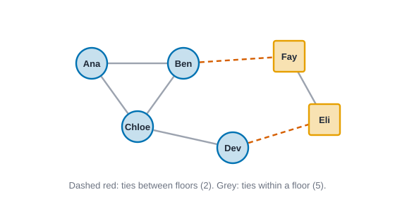
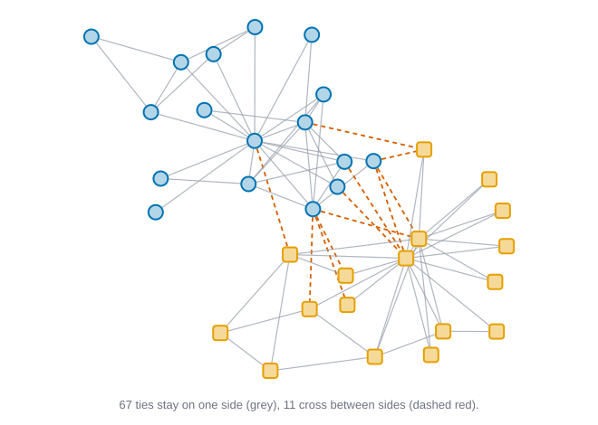
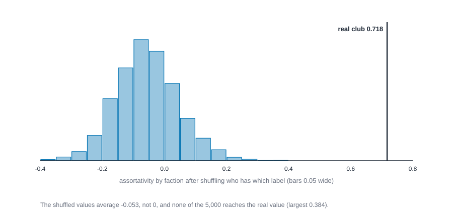
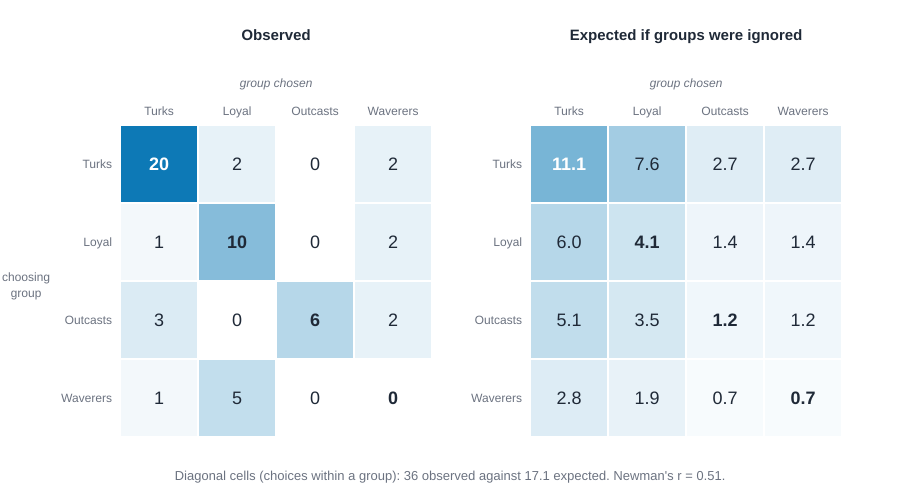

# Homophily, mixing and assortativity {#sec-homophily}

::: {.callout-note appearance="simple"}
## Prerequisites
@sec-networks-as-data for node attributes, @sec-centrality for degree, and @sec-subgroups for the idea of a group. The karate club from @sec-subgroups comes back here. If you've read the E-I index in @sec-ego-networks, this chapter shows where it sits among its relatives.
:::

::: {.callout-note title="The short version"}
People tend to be tied to people who are like them: same age, same workplace, same neighbourhood, same views. This chapter shows how to count that. You make a table of who ties to whom by group, boil it down to one number in a few different ways, and then check by shuffling the labels whether the number is bigger than luck would give. Group sizes matter a lot, because a big group has most of the ties inside it by default. And even a clear pattern doesn't tell you why it's there: choice, opportunity and influence all leave the same trace.
:::

::: {.callout-tip title="Why you might care"}
Whether it's a company with siloed departments, a school with cliques or a platform with echo chambers, people want to know if groups are "closed off". These tools give you an honest answer: how much more do ties stay inside groups than they would by chance? They also stop you from announcing a headline like "80% of ties are within a team" that turns out to be only a fact about team sizes.
:::

## Birds of a feather

Look at who your friends are. Chances are many of them are about your age, went to school where you did, work where you work, live near you, or vote the way you do. Social scientists have noticed this for a long time and given it a name: **homophily**, "love of the like". The word comes from Lazarsfeld and Merton's study of friendship [@lazarsfeld1954friendship], and the pattern turns up in study after study. McPherson, Smith-Lovin and Cook's review gathers decades of evidence for it across age, race, sex, education and many other traits, and across marriage, friendship, work and many other kinds of tie [@mcpherson2001birds].

This chapter asks a plain question: **in this network, do ties join people who are alike more often than they would if nobody paid attention to likeness?** That's a question about a network and an attribute together. You need both. The network says who is tied to whom, and the attribute (a department, a faction, a floor of the building, an age) says who is alike. By the end you'll be able to

- count ties by the attributes at their two ends (the **mixing matrix**),
- turn that table into one number in four different ways, and say what each one answers,
- judge whether a number is more than chance by shuffling the attribute labels, and
- say, in a sentence you can defend, what homophily shows and what it doesn't.

That last part matters most. Homophily is easy to measure and easy to over-read.

## Two stories, one pattern

Suppose a company has two floors and the friendships on each floor stay on that floor. Why? There are at least two stories, and they predict the same table.

**Choice.** People like people who are like them, so given the chance they pick them. Shared interests, shared language and shared experience make conversation easier and trust cheaper. This is **choice homophily**.

**Opportunity.** People mostly meet people who are in the same place. You meet the people on your floor, in your class, on your street, and you can only befriend the people you meet. Even if nobody had any taste for similarity, ties would stay inside the groups that the setting creates. This is sometimes called **induced homophily**, because the setting induces it.

McPherson and colleagues draw the same line differently. **Baseline homophily** is the amount you'd see if people met others at random from the pool available to them. **Inbreeding homophily** is the extra, over and above that baseline [@mcpherson2001birds]. Only the second is a candidate for "preference", and you can't find it without a baseline.

That's the first real difficulty, and it's a counting problem before it's a social one. **Group sizes change what "expected" means.** If 90 percent of a school is in one group, then most ties will be inside that group even if everyone chose their friends by lottery, because most people available to choose are in it. A small group faces the opposite problem: its members can hardly avoid ties to outsiders. A number that doesn't account for this will hand you a "finding" about the sizes of the groups. We'll see that with numbers in a moment, and every measure in this chapter is partly a different answer to "expected compared to what?"

## A six-person office, by hand

Everything in this chapter can be checked on a network small enough to draw on a napkin. Six people work on two floors. Four sit on floor 1 (Ana, Ben, Chloe and Dev) and two on floor 2 (Eli and Fay). Seven pairs talk regularly.

{#fig-homophily-six fig-alt="Six labelled nodes. Ana, Ben, Chloe and Dev are blue circles; Eli and Fay are orange squares. Solid grey lines join Ana, Ben and Chloe in a triangle, Chloe to Dev, and Eli to Fay. Dashed red lines join Dev to Eli and Ben to Fay, the only two ties that cross between floors."}

Five of the seven ties stay within a floor: Ana-Ben, Ana-Chloe, Ben-Chloe, Chloe-Dev and Eli-Fay. Two cross: Dev-Eli and Ben-Fay. Is that homophily? Five of seven *sounds* like a lot. Hold the thought; we'll make it precise.

## The mixing matrix

The raw material of every measure here is a table that counts ties by the groups of the two people they join. It's called the **mixing matrix**. Rows are the group at one end of a tie, columns the group at the other.

For the office, count each tie from both of its ends, so a tie between two people on floor 1 adds 2 to the floor 1 by floor 1 cell, and a tie between floors adds 1 to each of the two off-diagonal cells:

| | to floor 1 | to floor 2 | total |
| --- | ---: | ---: | ---: |
| **from floor 1** | 8 | 2 | 10 |
| **from floor 2** | 2 | 2 | 4 |
| **total** | 10 | 4 | 14 |

The table sums to 14, twice the number of ties, because every tie was counted from both ends. The row totals (10 and 4) are the sums of the degrees on each floor: Ana 2, Ben 3, Chloe 3, Dev 2 make 10, and Eli 2 and Fay 2 make 4.

Divide each cell by 14 and you get **proportions**, written $e_{ij}$: the share of tie-ends that run from group $i$ to group $j$. (A tie-end is one side of a tie; each tie has two.) The row sums are $a_i = \sum_j e_{ij}$ and the column sums are $b_j = \sum_i e_{ij}$, where the sigma means "add up". Here $a = b = (10/14,\ 4/14)$: floor 1 holds 10 of the 14 tie-ends and floor 2 holds 4. The diagonal $e_{11} = 8/14$ and $e_{22} = 2/14$ holds the within-group ties.

Two details trip people up.

**Undirected or directed.** In an undirected network a tie has no "from" and "to", so the table is symmetric (the cell for floor 1 to floor 2 equals the cell for floor 2 to floor 1). Some tools store it *folded*, with the lower triangle zero and the two off-diagonal cells added into one, which is why you'll see 4 where we wrote 2 and 2. In a directed network the table isn't symmetric. Rows are the group of the person who *sends* a tie (names a friend, asks for advice) and columns the group of the person who *receives* it. Each arc counts once, and the shape of the table tells you which group is chosen by which.

**Counting.** If two tools disagree on a mixing matrix, check first whether one counts each tie once and the other twice.

## One table, four numbers

The mixing matrix has one cell for every pair of groups (with $k$ groups, $k^2$ cells). People want one number, and there are four common ones. They're not interchangeable. Each answers a slightly different question, and each uses a different idea of "expected".

### The E-I index: how many ties cross?

The simplest question is "do ties mostly stay inside groups or cross them?". Count ties that cross between groups ($E$ for external) and ties that stay inside ($I$ for internal), and take

$$
\text{E-I} = \frac{E - I}{E + I}.
$$

::: {.callout-tip title="In plain words"}
Subtract the number of ties inside from the number that cross, and divide by the total number of ties. If everything is inside you get $-1$, if everything crosses you get $+1$, and an even split gives 0. In the office, 2 ties cross and 5 stay inside, so $(2 - 5)/(2 + 5) = -3/7 = -0.429$.
:::

Krackhardt and Stern introduced it to study how groups in an organization tie to each other, especially in a crisis [@krackhardt1988informal]. It runs from $-1$ (every tie is inside a group) to $+1$ (every tie crosses). You met the person-level version in @sec-ego-networks. At the level of the whole network, each tie counts once.

In the office, $E = 2$ and $I = 5$, so $\text{E-I} = (2 - 5)/7 = -0.429$. Negative, so more inside than across. But how negative *should* it be with no preference at all? If ties paid no attention to floors, a tie would be between two random distinct people. There are $\binom{6}{2} = 15$ possible pairs, $\binom{4}{2} + \binom{2}{2} = 7$ of them on the same floor and $4 \times 2 = 8$ across. So chance alone puts $8/15$ of ties across, and the expected index is $(8 - 7)/15 = +0.067$. Against that baseline, $-0.429$ is a long way toward the inside.

Notice what the E-I index does *not* do. It treats the two groups' sizes as a fact about the world and doesn't correct for them, so you have to supply the baseline yourself.

### Coleman's index: how much of the possible gap?

James Coleman proposed an index that builds the baseline in [@coleman1958relational]. For a group, let $w$ be the share of its members' ties that stay inside the group, and let $x$ be the share of everyone *else available to them* who belongs to the group, $x = (n_g - 1)/(n - 1)$, the share you'd get by picking contacts at random. A common form of the index answers "how far past what random mixing gives is this group's inward lean?":

$$
H = \frac{w - x}{1 - x} \quad \text{if } w \ge x, \qquad H = \frac{w - x}{x} \quad \text{if } w < x.
$$

::: {.callout-tip title="In plain words"}
$w$ is what the group's members actually did: the share of their ties that stay inside. $x$ is what random mixing would give. The top, $w - x$, is how far above chance they are. The bottom is the room available to go above chance (the most they could reach is 1, so $1 - x$), and below chance the room to fall is $x$. In the office, floor 1 has $w = 0.8$ and $x = 0.6$, so $H = (0.8 - 0.6)/(1 - 0.6) = 0.2/0.4 = 0.5$: halfway from chance to "every tie inside".
:::

Read it as "how far from random toward perfect inbreeding", from $0$ (chance) to $1$ (every tie inside), and from $0$ toward $-1$ (no tie inside) when the group does worse than chance. ("Inbreeding" here is just the sociologists' word for ties staying in the group.)

For floor 1: its members' tie-ends are 10, of which 8 stay inside, so $w = 8/10 = 0.8$. Each person on floor 1 has 3 possible floor-mates among the other 5 people, so $x = 3/5 = 0.6$, and $H = (0.8 - 0.6)/(1 - 0.6) = 0.5$. For floor 2: $w = 2/4 = 0.5$, $x = 1/5 = 0.2$, and $H = (0.5 - 0.2)/(1 - 0.2) = 0.375$. Both floors are inbred beyond what group size alone gives, floor 1 a bit more.

Coleman's index is one number *per group*. That's useful: it shows which groups are drawn inward and which aren't. A group of one has no possible group-mates ($x = 0$ and nothing inside), so its index doesn't exist.

### Newman's assortativity: do alike nodes pair up more than the marginals imply?

Mark Newman's assortativity coefficient [@newman2002assortative; @newman2003mixing] answers "do alike people pair up more often than the group totals alone would predict?". It works directly from the mixing proportions. If ties paid no attention to groups, the share of tie-ends running from group $i$ to group $j$ would be the product of how often group $i$ sends and group $j$ receives: $a_i b_j$. So the share inside groups would be $\sum_i a_i b_i$. Newman compares what we see, $\sum_i e_{ii}$ (the trace of the table), with that, and rescales so that perfect mixing within groups is 1:

$$
r = \frac{\sum_i e_{ii} - \sum_i a_i b_i}{1 - \sum_i a_i b_i}.
$$

::: {.callout-tip title="In plain words"}
Take the share of tie-ends that really stay inside groups (the top-left term), subtract the share you'd get by chance from the group totals, and divide by the most you could possibly gain. Here $e_{ii}$ is the share of tie-ends inside group $i$, and $a_i$ and $b_i$ are the shares sent and received by group $i$, so $a_i b_i$ is the chance share. It's the same "how far past chance, out of how far you could go" recipe as Coleman's index, but for the whole network at once. The office numbers follow just below.
:::

Here $e_{ii}$ is the share of tie-ends inside group $i$, and $a_i$ and $b_i$ are the row and column shares defined above. A value of $r = 1$ means every tie is inside a group, $r = 0$ means no more inside than the marginals imply, and a negative value means ties cross groups more than that. (The minimum is not always $-1$ and depends on the group shares.)

For the office, the share really inside is $\sum_i e_{ii} = 8/14 + 2/14 = 10/14$, and $\sum_i a_i b_i = (10/14)^2 + (4/14)^2 = 116/196$. So

$$
r = \frac{140/196 - 116/196}{1 - 116/196} = \frac{24/196}{80/196} = 0.3.
$$

::: {.callout-tip title="In plain words"}
Of the room above chance (80 out of 196), the office gets 24, so it is 30 percent of the way from "no more inside than expected" to "every tie inside". That's why $r = 0.3$ feels more modest than the E-I index's $-0.429$, which had no baseline in it.
:::

Is that a different story from E-I's? A little. The baseline here comes from how many tie-ends each group has (its total degree), not from how many people it has. A group whose members have many ties is expected, by chance, to send and receive more, so Newman's baseline expects more of its ties to land inside it. Coleman's baseline and the one we worked out for E-I count heads; Newman's counts tie-ends. When every group has about the same average degree the two agree. When they don't, the measures can disagree, and neither is wrong. They ask different questions.

For a *number* (age, tenure, degree) rather than a category, the same idea becomes a correlation. (A correlation is a score from $-1$ to $+1$ for how closely two lists of numbers rise and fall together.) Pair up the two values at the ends of every tie (counting each tie both ways in an undirected network), and take the ordinary Pearson correlation between the two columns [@newman2002assortative]. A positive value means high goes with high and low with low. Applied to degree, it asks whether well-connected people tie to well-connected people (assortative) or to poorly connected ones (disassortative).

For the office, the degrees are Ana 2, Ben 3, Chloe 3, Dev 2, Eli 2, Fay 2. The seven ties, read both ways, give 14 pairs of degrees. The average degree at one end of a tie is $34/14 = 2.43$ (since $\sum d^2 = 34$, and a person with degree $d$ is the end of $d$ ties), $\sum d^3 = 86$, so the variance of the degrees at the two ends is $86/14 - (34/14)^2 = 0.245$. The average product of the two ends is $82/14 = 5.857$ (twice $\sum_{\text{ties}} d_u d_v = 41$, over 14), so the covariance is $5.857 - 2.43^2 = -0.041$. The correlation is $-0.041/0.245 = -0.167$. It's slightly negative: nothing here suggests that well-connected people pair up, though with six people the number is too coarse to read much into. In plain words, we lined up the two ends of every tie, asked whether big goes with big, and found almost no pattern.

### The odds ratio: how much more likely is a same-group tie?

The last view comes from a different tradition, the statistics of tables. Look at every *pair* of people, whether tied or not, and sort the pairs into same-group and different-group. Then ask how much higher the *odds* of a tie are for same-group pairs. (Odds are the number of tied pairs divided by the number of untied pairs, the way a bettor says "three to one".)

In the office, 7 pairs are on the same floor and 5 of them are tied, so 2 are not: odds of $5/2 = 2.5$. Of the 8 pairs on different floors, 2 are tied and 6 are not: odds of $2/6 = 1/3$. The **odds ratio**, which is just one set of odds divided by the other, is $2.5 / (1/3) = 7.5$. In plain words, same-floor pairs have 7.5 times the odds of being tied.

The odds ratio has two merits. It uses the *non*-ties too: it counts the pairs that could have been tied and weren't. And it's the number an ERGM reports for a same-group term (@sec-ergm): in a model with only an edges term and a same-group term, the fitted same-group coefficient *is* the log of this odds ratio. A coefficient of $\log 7.5 = 2.01$ means "7.5 times the odds". Its weakness is that it needs a clear answer to "which pairs could have been tied?"

### Which one?

| Measure | One number for | Baseline it uses | Range | Answers |
| --- | --- | --- | --- | --- |
| E-I index | the network, a group or a person | none: you supply it | $-1$ to $+1$ | Do ties stay inside or cross? |
| Coleman's $H$ | each group | the group's share of the other people | $-1$ to $1$ | How far past chance is this group drawn inward? |
| Newman's $r$ | the network | the groups' shares of tie-ends | up to 1 | Do alike people pair up more than the marginals imply? |
| Odds ratio | the network, one same-or-not split | the number of possible pairs | 0 to $\infty$ | How much more likely is a tie within a group? |

Let's check the hand numbers in code; look for the 14 tie-ends, the $-0.429$, the 0.5 and 0.375, the 0.3, the $-0.167$ and the 7.5. In Rust and R, knappnet computes the mixing matrix, the E-I index, the group shares behind Coleman's index, and both assortativity coefficients. The odds ratio and Coleman's last step are a few lines we write ourselves.

::: {.panel-tabset group="language"}

## R

```r
library(knappnet)
library(dplyr)
library(purrr)
library(tidyr)

# Six people on two floors; seven ties.
people <- c("Ana", "Ben", "Chloe", "Dev", "Eli", "Fay")
floors <- c(1, 1, 1, 1, 2, 2)
office <- tibble(
  source = c("Ana", "Ana", "Ben", "Chloe", "Dev", "Eli", "Ben"),
  target = c("Ben", "Chloe", "Chloe", "Dev", "Eli", "Fay", "Fay")
) |>
  net_frame(nodes = tibble(id = people, floor = floors), directed = FALSE, quiet = TRUE)

# The mixing matrix. For an undirected network knappnet folds it: the diagonal counts
# tie-ends inside a floor, the upper-right cell counts ties between floors from both sides.
net_mixing(office, "floor")

# Coleman's index from the shares of each floor's ties that stay inside.
coleman <- \(observed, expected) {
  if_else(observed >= expected, (observed - expected) / (1 - expected), (observed - expected) / expected)
}
net_homophily(office, "floor") |>
  as_tibble() |>
  mutate(coleman = coleman(observed, expected))

# The odds ratio: odds of a tie between two people in the same group, against two in different groups.
odds_ratio <- \(frame, group) {
  m <- net_mixing(frame, group)
  within <- sum(diag(m)) / 2
  across <- sum(m[upper.tri(m)]) / 2
  pairs_within <- sum(choose(table(group), 2))
  pairs_across <- choose(length(group), 2) - pairs_within
  (within / (pairs_within - within)) / (across / (pairs_across - across))
}

tibble(
  ei = as.vector(net_ei_index(office, "floor")),
  assortativity = net_assort_nominal(office, "floor"),
  degree_assortativity = net_assort_degree(office),
  odds_ratio = odds_ratio(office, floors)
) |>
  mutate(across(everything(), \(x) round(x, 3)))
```

::: {.code-output}
```text
  1 2
1 8 4
2 0 2
# A tibble: 2 × 7
  group  size internal external observed expected coleman
  <chr> <int>    <dbl>    <dbl>    <dbl>    <dbl>   <dbl>
1 1         4        8        2      0.8      0.6   0.5  
2 2         2        2        2      0.5      0.2   0.375
# A tibble: 1 × 4
      ei assortativity degree_assortativity odds_ratio
   <dbl>         <dbl>                <dbl>      <dbl>
1 -0.429           0.3               -0.167        7.5
```
:::

## Python

```python
import networkx as nx
import numpy as np

# Six people on two floors (group 0 is floor 1, group 1 is floor 2); seven ties.
people = ["Ana", "Ben", "Chloe", "Dev", "Eli", "Fay"]
floor = np.array([0, 0, 0, 0, 1, 1])
ties = np.array([(0, 1), (0, 2), (1, 2), (2, 3), (3, 4), (4, 5), (1, 5)])
src, dst = ties[:, 0], ties[:, 1]

def mixing_counts(group, src, dst, k, directed=False):
    """Count ties by the groups at their two ends; an undirected tie counts both ways."""
    m = np.zeros((k, k))
    np.add.at(m, (group[src], group[dst]), 1)
    if not directed:
        np.add.at(m, (group[dst], group[src]), 1)
    return m

def newman_r(m):
    e = m / m.sum()
    a, b = e.sum(axis=1), e.sum(axis=0)
    return (np.trace(e) - a @ b) / (1 - a @ b)

def ei_index(group, src, dst):
    external = np.sum(group[src] != group[dst])
    return (external - (len(src) - external)) / len(src)

def coleman(group, src, dst, k, directed=False):
    m = mixing_counts(group, src, dst, k, directed=directed)
    observed = np.diag(m) / m.sum(axis=1)       # share of a group's tie-ends that stay inside
    size = np.bincount(group, minlength=k)
    expected = (size - 1) / (len(group) - 1)    # share of the other people who are in the group
    h = np.where(observed >= expected, (observed - expected) / (1 - expected), (observed - expected) / expected)
    return observed, expected, h

def odds_ratio(group, src, dst):
    size = np.bincount(group)
    pairs_within = (size * (size - 1) // 2).sum()
    pairs_across = len(group) * (len(group) - 1) // 2 - pairs_within
    within = np.sum(group[src] == group[dst])
    across = len(src) - within
    return (within / (pairs_within - within)) / (across / (pairs_across - across))

print(mixing_counts(floor, src, dst, 2).astype(int))
observed, expected, h = coleman(floor, src, dst, 2)
for g in range(2):
    print(f"floor {g + 1}: inside {observed[g]:.3f}, expected {expected[g]:.3f}, Coleman {h[g]:.3f}")

# Check the formulas against NetworkX.
office = nx.Graph(ties.tolist())
nx.set_node_attributes(office, dict(enumerate(floor)), "floor")
print(f"E-I           {ei_index(floor, src, dst):+.3f}")
print(f"assortativity {newman_r(mixing_counts(floor, src, dst, 2)):.3f} by the formula, "
      f"{nx.attribute_assortativity_coefficient(office, 'floor'):.3f} in NetworkX")
print(f"degree assort {nx.degree_assortativity_coefficient(office):.3f}")
print(f"odds ratio    {odds_ratio(floor, src, dst):.3f}")
```

::: {.code-output}
```text
[[8 2]
 [2 2]]
floor 1: inside 0.800, expected 0.600, Coleman 0.500
floor 2: inside 0.500, expected 0.200, Coleman 0.375
E-I           -0.429
assortativity 0.300 by the formula, 0.300 in NetworkX
degree assort -0.167
odds ratio    7.500
```
:::

## Rust

```rust
use knappnet::metrics::mixing::{
    build_mixing_matrix, compute_assortativity_degree, compute_assortativity_nominal, compute_ei_index,
    compute_group_shares, AssortOptions, EiCounting, EiScope,
};
use knappnet::{DegreeMode, Graph};

// Six people on two floors (group 0 is floor 1, group 1 is floor 2); seven ties.
let floor: [i64; 6] = [0, 0, 0, 0, 1, 1];
let office = Graph::from_edges(6, &[0, 0, 1, 2, 3, 4, 1], &[1, 2, 2, 3, 4, 5, 5], None, false)?;

// The mixing matrix. For an undirected network knappnet folds it: the diagonal counts
// tie-ends inside a floor, the upper-right cell counts ties between floors from both sides.
let m = build_mixing_matrix(&office, &floor, 2, &floor, 2, true, DegreeMode::All)?;
println!("mixing matrix (folded): {:?}", m.counts);

// Coleman's index from the shares of each floor's ties that stay inside.
let coleman = |observed: f64, expected: f64| {
    if observed >= expected { (observed - expected) / (1.0 - expected) } else { (observed - expected) / expected }
};
for (g, s) in compute_group_shares(&office, &floor, 2, DegreeMode::All)?.iter().enumerate() {
    println!("floor {}: inside {:.3}, expected {:.3}, Coleman {:.3}", g + 1, s.observed, s.expected,
             coleman(s.observed, s.expected));
}

// The odds ratio: odds of a tie between two people in the same group, against two in different groups.
let odds_ratio = |graph: &Graph, group: &[i64], k: usize| -> Result<f64, knappnet::Error> {
    let m = build_mixing_matrix(graph, group, k, group, k, true, DegreeMode::All)?;
    let (mut within, mut across) = (0.0, 0.0);
    for i in 0..k {
        for j in i..k {
            if i == j { within += m.counts[i * k + j] / 2.0 } else { across += m.counts[i * k + j] / 2.0 }
        }
    }
    let size: Vec<f64> = (0..k).map(|g| group.iter().filter(|&&x| x as usize == g).count() as f64).collect();
    let pairs_within: f64 = size.iter().map(|s| s * (s - 1.0) / 2.0).sum();
    let n = group.len() as f64;
    let pairs_across = n * (n - 1.0) / 2.0 - pairs_within;
    Ok((within / (pairs_within - within)) / (across / (pairs_across - across)))
};

let opts = AssortOptions::default();
println!("E-I           {:+.3}", compute_ei_index(&office, &floor, 2, EiScope::Global, DegreeMode::All, EiCounting::Standard)?[0]);
println!("assortativity {:.3}", compute_assortativity_nominal(&office, &floor, 2, opts)?);
println!("degree assort {:.3}", compute_assortativity_degree(&office, false, opts)?);
println!("odds ratio    {:.3}", odds_ratio(&office, &floor, 2)?);
```

::: {.code-output}
```text
mixing matrix (folded): [8.0, 4.0, 0.0, 2.0]
floor 1: inside 0.800, expected 0.600, Coleman 0.500
floor 2: inside 0.500, expected 0.200, Coleman 0.375
E-I           -0.429
assortativity 0.300
degree assort -0.167
odds ratio    7.500
```
:::

:::

Every number from the hand work shows up: a mixing table that sums to 14 tie-ends, E-I of $-0.429$, Coleman's index of 0.5 and 0.375, assortativity of 0.3, degree assortativity of $-0.167$ and an odds ratio of 7.5. In Python, the formula for $r$ and NetworkX's function agree. In R and Rust, the folded table has 4 where Python has 2 and 2, as promised.

Now we can answer the question from the start. Five of the seven ties stay on a floor, and that's *more* than chance would give (4 and 2 people on two floors puts about 47 percent of ties inside a floor, against our 71 percent), so there is a leaning toward the own floor in these seven ties. With seven ties, though, there's very little to go on. Hold on to that; it's why the chapter has a shuffle test.

## The trap: group sizes

Before real data, here is the failure that every measure here must be protected from. Suppose ties pay *no* attention to groups at all. What would the measures say by chance alone? If a tie joins two random distinct people, the chance that it stays inside a group is the share of pairs that sit inside one, $\sum_g n_g (n_g - 1) / (n(n - 1))$ for groups of size $n_g$ among $n$ people. The E-I index then expects $1 - 2 \times$ that share.

::: {.callout-tip title="In plain words"}
Count the pairs of people who share a group (each group of $n_g$ people has $n_g(n_g - 1)$ ordered pairs), and divide by all ordered pairs, $n(n-1)$. That's the share of ties inside groups if ties ignore groups. In the six-person office, with floors of 4 and 2, it's $(4 \times 3 + 2 \times 1)/(6 \times 5) = 14/30 = 0.467$, and the expected E-I is $1 - 2 \times 0.467 = 0.067$, as we found before. Unequal groups push the share up: that's the trap.
:::

The next block simulates ties that ignore groups completely, for three different splits of 20 people, and prints what each measure would say by luck alone. Look at the E-I column as the groups get lopsided.

::: {.panel-tabset group="language"}

## R

```r
# Ties that ignore groups completely: what does a raw count say by chance alone?
tibble(big = c(10, 15, 18), small = c(10, 5, 2)) |>
  mutate(
    people = big + small,
    inside = (big * (big - 1) + small * (small - 1)) / (people * (people - 1)),
    ei = 1 - 2 * inside
  ) |>
  mutate(across(c(inside, ei), \(x) round(x, 3)))
```

::: {.code-output}
```text
# A tibble: 3 × 5
    big small people inside     ei
  <dbl> <dbl>  <dbl>  <dbl>  <dbl>
1    10    10     20  0.474  0.053
2    15     5     20  0.605 -0.211
3    18     2     20  0.811 -0.621
```
:::

## Python

```python
# Ties that ignore groups completely: what does a raw count say by chance alone?
for big, small in [(10, 10), (15, 5), (18, 2)]:
    people = big + small
    inside = (big * (big - 1) + small * (small - 1)) / (people * (people - 1))
    print(f"groups of {big} and {small}: share of ties inside a group {inside:.3f}, E-I {1 - 2 * inside:+.3f}")
```

::: {.code-output}
```text
groups of 10 and 10: share of ties inside a group 0.474, E-I +0.053
groups of 15 and 5: share of ties inside a group 0.605, E-I -0.211
groups of 18 and 2: share of ties inside a group 0.811, E-I -0.621
```
:::

## Rust

```rust
// Ties that ignore groups completely: what does a raw count say by chance alone?
for (big, small) in [(10.0, 10.0), (15.0, 5.0), (18.0, 2.0)] {
    let people = big + small;
    let inside = (big * (big - 1.0) + small * (small - 1.0)) / (people * (people - 1.0));
    println!("groups of {big} and {small}: share of ties inside a group {inside:.3}, E-I {:+.3}", 1.0 - 2.0 * inside);
}
```

::: {.code-output}
```text
groups of 10 and 10: share of ties inside a group 0.474, E-I +0.053
groups of 15 and 5: share of ties inside a group 0.605, E-I -0.211
groups of 18 and 2: share of ties inside a group 0.811, E-I -0.621
```
:::

:::

Read the E-I column as a person who didn't know about baselines would. With groups of 10 and 10, ties that ignore groups give an E-I near zero ($+0.05$). With 15 and 5 the same indifferent ties give $-0.21$, and with 18 and 2 they give $-0.62$, with 81 percent of ties inside a group. Nobody chose anything. Most of the people available to choose are in the big group, so most ties are inside it. A report that said "81 percent of ties are within a group, so this community is strongly inward-looking" would be describing the group sizes.

Every measure in the rest of the chapter either builds in a baseline (Coleman's, Newman's, the odds ratio) or is compared with one that you compute (the E-I index, and all of them in the shuffle test).

## The karate club

@sec-subgroups introduced Zachary's karate club: 34 members, 78 friendships, and a split into two sides. Here the attribute is the side each member took, Mr. Hi's or the officer's, 17 members each. Equal group sizes make the baseline easy: a tie between two random members crosses sides 17 times 17 over 561 pairs, or 51.5 percent of the time.

{#fig-homophily-karate fig-alt="A network of 34 nodes in two loose clusters. One cluster of 17 blue circles and one of 17 orange squares. Grey lines run mostly inside each cluster; 11 dashed red lines run between the clusters."}

The next block loads the karate club with its side labels and computes every measure from the office again; look for the share of friendships that stay on one side, and compare each number with its baseline.

::: {.panel-tabset group="language"}

## R

```r
karate_nodes <- as_tibble(read.csv("data/karate/nodes.csv"))
karate_edges <- as_tibble(read.csv("data/karate/edges.csv"))
karate <- karate_edges |>
  select(source, target) |>
  net_frame(nodes = karate_nodes, directed = FALSE, quiet = TRUE)
faction <- karate_nodes$faction

net_mixing(karate, "faction")

net_homophily(karate, "faction") |>
  as_tibble() |>
  mutate(coleman = coleman(observed, expected))

tibble(
  ei = as.vector(net_ei_index(karate, "faction")),
  assortativity = net_assort_nominal(karate, "faction"),
  degree_assortativity = net_assort_degree(karate),
  odds_ratio = odds_ratio(karate, faction)
) |>
  mutate(across(everything(), \(x) round(x, 3)))
```

::: {.code-output}
```text
        Mr. Hi Officer
Mr. Hi      70      22
Officer      0      64
# A tibble: 2 × 7
  group    size internal external observed expected coleman
  <chr>   <int>    <dbl>    <dbl>    <dbl>    <dbl>   <dbl>
1 Mr. Hi     17       70       11    0.864    0.485   0.736
2 Officer    17       64       11    0.853    0.485   0.715
# A tibble: 1 × 4
      ei assortativity degree_assortativity odds_ratio
   <dbl>         <dbl>                <dbl>      <dbl>
1 -0.718         0.718               -0.476       8.26
```
:::

## Python

```python
import csv

with open("data/karate/nodes.csv") as f:
    faction = np.array([0 if row["faction"] == "Mr. Hi" else 1 for row in csv.DictReader(f)])
with open("data/karate/edges.csv") as f:
    edges = np.array([(int(r["source"]) - 1, int(r["target"]) - 1) for r in csv.DictReader(f)])
src, dst = edges[:, 0], edges[:, 1]
karate = nx.Graph(edges.tolist())
nx.set_node_attributes(karate, dict(enumerate(faction)), "faction")

print(mixing_counts(faction, src, dst, 2).astype(int))
observed, expected, h = coleman(faction, src, dst, 2)
for g, side in enumerate(["Mr. Hi", "Officer"]):
    print(f"{side:<8} inside {observed[g]:.3f}, expected {expected[g]:.3f}, Coleman {h[g]:.3f}")
print(f"E-I           {ei_index(faction, src, dst):+.3f}")
print(f"assortativity {newman_r(mixing_counts(faction, src, dst, 2)):.3f} by the formula, "
      f"{nx.attribute_assortativity_coefficient(karate, 'faction'):.3f} in NetworkX")
print(f"degree assort {nx.degree_assortativity_coefficient(karate):.3f}")
print(f"odds ratio    {odds_ratio(faction, src, dst):.3f}")
```

::: {.code-output}
```text
[[70 11]
 [11 64]]
Mr. Hi   inside 0.864, expected 0.485, Coleman 0.736
Officer  inside 0.853, expected 0.485, Coleman 0.715
E-I           -0.718
assortativity 0.718 by the formula, 0.718 in NetworkX
degree assort -0.476
odds ratio    8.260
```
:::

## Rust

```rust
let faction: Vec<i64> = std::fs::read_to_string("data/karate/nodes.csv")?
    .lines().skip(1)
    .map(|line| if line.ends_with("Mr. Hi") { 0 } else { 1 })
    .collect();
let edge_text = std::fs::read_to_string("data/karate/edges.csv")?;
let ends: Vec<(i64, i64)> = edge_text.lines().skip(1).map(|line| {
    let mut cells = line.split(',');
    let mut next = || cells.next().unwrap().parse::<i64>().unwrap() - 1;
    (next(), next())
}).collect();
let (from, to): (Vec<i64>, Vec<i64>) = ends.iter().cloned().unzip();
let karate = Graph::from_edges(34, &from, &to, None, false)?;

let m = build_mixing_matrix(&karate, &faction, 2, &faction, 2, true, DegreeMode::All)?;
println!("mixing matrix (folded): {:?}", m.counts);
for (g, s) in compute_group_shares(&karate, &faction, 2, DegreeMode::All)?.iter().enumerate() {
    println!("{:<8} inside {:.3}, expected {:.3}, Coleman {:.3}", ["Mr. Hi", "Officer"][g], s.observed, s.expected,
             coleman(s.observed, s.expected));
}
println!("E-I           {:+.3}", compute_ei_index(&karate, &faction, 2, EiScope::Global, DegreeMode::All, EiCounting::Standard)?[0]);
println!("assortativity {:.3}", compute_assortativity_nominal(&karate, &faction, 2, opts)?);
println!("degree assort {:.3}", compute_assortativity_degree(&karate, false, opts)?);
println!("odds ratio    {:.3}", odds_ratio(&karate, &faction, 2)?);
```

::: {.code-output}
```text
mixing matrix (folded): [70.0, 22.0, 0.0, 64.0]
Mr. Hi   inside 0.864, expected 0.485, Coleman 0.736
Officer  inside 0.853, expected 0.485, Coleman 0.715
E-I           -0.718
assortativity 0.718
degree assort -0.476
odds ratio    8.260
```
:::

:::

Start with the mixing matrix. The two sides have 70 and 64 tie-ends inside (the Python tab shows the full table, with 11 in each off-diagonal cell; R and Rust show the folded one, where the cell for the two sides adds both directions). Halve the diagonal and you get 35 friendships inside Mr. Hi's side, 32 inside the officer's side and 11 across, 78 in all. So 67 of 78 friendships, 86 percent, stay on one side.

Is 86 percent a lot? That depends on the baseline. With 17 members on each side, a tie between two random members would stay inside 48.5 percent of the time (the pairs inside a side are $2 \times \binom{17}{2} = 272$ of $\binom{34}{2} = 561$), so the expected E-I index is $+0.03$. The observed one is $-0.718$.

Each of the other numbers says the same thing in its own units.

- **Coleman's index** is 0.736 for Mr. Hi's side and 0.715 for the officer's: each side is about three quarters of the way from a random mix to ties that never leave the side. The two sides are drawn inward almost equally.
- **Newman's $r$** is 0.718. Here it's almost exactly the E-I index with its sign flipped, because the two sides have nearly the same number of tie-ends (81 and 75 for the 78 ties), so the group-size baseline and the tie-end baseline almost coincide. That's a feature of this network, not a law.
- **The odds ratio** is 8.26. A pair of members on the same side has about 8 times the odds of being friends compared with a pair on opposite sides.
- **Degree assortativity** is $-0.476$. This is a different question, about *popularity* rather than side: the club's two centers, member 1 (16 friends) and member 34 (17 friends), tie to many people with few friends, so high degree goes with low degree. Many social networks show the opposite, with well-connected people tied to each other [@newman2002assortative]. Whether a network is assortative by degree is something to look at on its own, and here it's a reminder that "assortative" always needs "by what".

## Is it more than chance? Shuffle the labels

A coefficient of 0.72 sounds large, and it is hard to say how large without a yardstick, like knowing a runner's time without knowing the usual times. The standard yardstick in this chapter is a **shuffle test**. Keep the network exactly as it is, with every tie and every person's number of friends. Keep the number of people on each side. Then *deal the side labels out at random* to the 34 members, recompute the coefficient, and repeat thousands of times. Each shuffled value is what you'd see if the label had nothing to do with where a person sits in the network. If the real value is far outside the shuffled ones, the label and the ties are related. If it sits in the middle, they aren't, at least not detectably.

This yardstick has the baseline problem built in. Group sizes and degrees don't change when you shuffle, so a pattern that only reflects them shows up in the shuffled networks too.

The next block deals the side labels out at random 5,000 times, recomputes Newman's coefficient each time and counts how often a shuffle reaches the real value. Look at where 0.718 falls among the shuffled values.

::: {.panel-tabset group="language"}

## R

```r
set.seed(1)
observed <- net_assort_nominal(karate, "faction")
# Shuffle who has which side, 5,000 times; the ties and the group sizes stay put.
shuffled <- map_dbl(1:5000, \(i) net_assort_nominal(karate, sample(faction)))
tibble(
  observed = round(observed, 3),
  shuffled_mean = round(mean(shuffled), 3),
  shuffled_sd = round(sd(shuffled), 3),
  largest_shuffled = round(max(shuffled), 3),
  as_high = sum(shuffled >= observed),
  p = (1 + sum(shuffled >= observed)) / (length(shuffled) + 1)
)
```

::: {.code-output}
```text
# A tibble: 1 × 6
  observed shuffled_mean shuffled_sd largest_shuffled as_high        p
     <dbl>         <dbl>       <dbl>            <dbl>   <int>    <dbl>
1    0.718        -0.052       0.107            0.564       0 0.000200
```
:::

## Python

```python
rng = np.random.default_rng(1)
observed = newman_r(mixing_counts(faction, src, dst, 2))
# Shuffle who has which side, 5,000 times; the ties and the group sizes stay put.
shuffled = np.array([newman_r(mixing_counts(rng.permutation(faction), src, dst, 2)) for _ in range(5000)])
as_high = np.sum(shuffled >= observed)
print(f"observed {observed:.3f}")
print(f"shuffled: mean {shuffled.mean():.3f}, sd {shuffled.std(ddof=1):.3f}, largest {shuffled.max():.3f}")
print(f"{as_high} of 5000 shuffles are as high; p = {(1 + as_high) / (len(shuffled) + 1):.4f}")
```

::: {.code-output}
```text
observed 0.718
shuffled: mean -0.052, sd 0.104, largest 0.430
0 of 5000 shuffles are as high; p = 0.0002
```
:::

## Rust

```rust
use knappnet::rng::Stream;

let observed = compute_assortativity_nominal(&karate, &faction, 2, opts)?;
let mut rng = Stream::new(1, 0);
let mut order = vec![0usize; faction.len()];
let mut shuffled = Vec::new();
for _ in 0..5000 {
    // Shuffle who has which side; the ties and the group sizes stay put.
    rng.fill_permutation(&mut order);
    let labels: Vec<i64> = order.iter().map(|&i| faction[i]).collect();
    shuffled.push(compute_assortativity_nominal(&karate, &labels, 2, opts)?);
}
let mean = shuffled.iter().sum::<f64>() / shuffled.len() as f64;
let sd = (shuffled.iter().map(|r| (r - mean).powi(2)).sum::<f64>() / (shuffled.len() - 1) as f64).sqrt();
let as_high = shuffled.iter().filter(|&&r| r >= observed).count();
println!("observed {observed:.3}");
println!("shuffled: mean {mean:.3}, sd {sd:.3}, largest {:.3}", shuffled.iter().cloned().fold(f64::MIN, f64::max));
println!("{as_high} of 5000 shuffles are as high; p = {:.4}", (1 + as_high) as f64 / (shuffled.len() + 1) as f64);
```

::: {.code-output}
```text
observed 0.718
shuffled: mean -0.053, sd 0.104, largest 0.436
0 of 5000 shuffles are as high; p = 0.0002
```
:::

:::

The shuffled coefficients average about $-0.05$, with a spread (standard deviation) of about 0.10, and none of the 5,000 reaches the real 0.718. A **p-value** is the share of shuffles at least as extreme as the real result. The usual way to turn that into one adds the real value to the pool, so the share is $(1 + 0)/(5000 + 1) = 0.0002$, the smallest this test can report with 5,000 shuffles. Read it as "fewer than one in a few thousand", not as a measured probability.

The shuffled values don't center on zero, and the reason is worth a moment. Nobody is their own friend, so a member's possible friends are the other 33 people, 16 of whom are on their side. A random tie then stays inside a side with probability $16/33 = 0.485$, a little under one half, and the shuffled coefficients sit a little below zero. This is why a coefficient is compared with its shuffled distribution rather than with 0.

{#fig-homophily-null fig-alt="A histogram centred a little below zero, running from about -0.3 to 0.4, with a peak near -0.05. A black vertical line at 0.718 sits far to the right of every bar. The shuffled values average -0.053 and the largest is 0.384."}

Before trusting a number like this, push on it. Two stress checks ask different questions, the way you might test a bridge by both loading it and removing a bolt.

**Would a few missing ties change it?** Friendship data are never complete: someone has to see, or be told about, every tie. Leave out a random 8 of the 78 ties, recompute, and repeat 1,000 times to see how far the coefficient moves.

**Could the number of friends alone explain it?** The shuffle above moved labels. This check moves *ties*. It builds random networks in which every member keeps exactly the number of friends they have, but friends are picked at random (the configuration model of @sec-tests-and-null-models: write each tie-end on a slip of paper, shuffle the slips and pair them). The sides stay with the same people. If the two busiest members hold the sides together simply by having many ties, these networks should show it. (Pairing slips at random can occasionally make a tie from someone to themselves or two ties between one pair. With 34 people that's a small distortion for a quick check, and we let it be.)

The next block runs both stress checks, leaving out 8 ties 1,000 times and building 2,000 random networks with the same numbers of friends per person. Look at how far each result moves, and whether it ever gets near 0.718.

::: {.panel-tabset group="language"}

## R

```r
set.seed(1)
# Stress check 1: leave out a random 8 of the 78 ties, 1,000 times.
left_out <- map_dbl(1:1000, \(i) {
  karate_edges |>
    select(source, target) |>
    slice_sample(n = 70) |>
    net_frame(nodes = karate_nodes, directed = FALSE, quiet = TRUE) |>
    net_assort_nominal("faction")
})

# Stress check 2: random networks in which everyone keeps their number of ties, with the
# ties paired at random. The sides stay with the same people.
paired <- net_random_config(net_degree(karate), reps = 2000, seed = 1) |>
  map_dbl(\(g) net_assort_nominal(g, faction))

tibble(
  check = c("leave out 8 ties", "same degrees, ties paired at random"),
  lowest = c(min(left_out), min(paired)),
  average = c(mean(left_out), mean(paired)),
  highest = c(max(left_out), max(paired))
) |>
  mutate(across(where(is.numeric), \(x) round(x, 3)))
```

::: {.code-output}
```text
# A tibble: 2 × 4
  check                               lowest average highest
  <chr>                                <dbl>   <dbl>   <dbl>
1 leave out 8 ties                     0.68    0.716   0.8  
2 same degrees, ties paired at random -0.361  -0.006   0.358
```
:::

## Python

```python
rng = np.random.default_rng(1)
# Stress check 1: leave out a random 8 of the 78 ties, 1,000 times.
left_out = np.array([
    newman_r(mixing_counts(faction, *edges[rng.choice(78, 70, replace=False)].T, 2)) for _ in range(1000)
])

# Stress check 2: random networks in which everyone keeps their number of ties, with the
# ties paired at random. The sides stay with the same people.
stubs = np.repeat(np.arange(34), np.bincount(np.concatenate([src, dst]), minlength=34))
def paired_r(stubs):
    s = rng.permutation(stubs)
    return newman_r(mixing_counts(faction, s[0::2], s[1::2], 2))

paired = np.array([paired_r(stubs) for _ in range(2000)])
for name, r in [("leave out 8 ties", left_out), ("same degrees, ties paired at random", paired)]:
    print(f"{name:<36} lowest {r.min():.3f}, average {r.mean():.3f}, highest {r.max():.3f}")
```

::: {.code-output}
```text
leave out 8 ties                     lowest 0.678, average 0.717, highest 0.828
same degrees, ties paired at random  lowest -0.361, average -0.008, highest 0.409
```
:::

## Rust

```rust
use knappnet::generate::{sample_configuration, Degrees};
use knappnet::metrics::degree::compute_degree;

let mut rng = Stream::new(2, 0);
// Stress check 1: leave out a random 8 of the 78 ties, 1,000 times.
let mut edge_order = vec![0usize; from.len()];
let mut left_out = Vec::new();
for _ in 0..1000 {
    rng.fill_permutation(&mut edge_order);
    let kept = &edge_order[..70];
    let f: Vec<i64> = kept.iter().map(|&e| from[e]).collect();
    let t: Vec<i64> = kept.iter().map(|&e| to[e]).collect();
    let g = Graph::from_edges(34, &f, &t, None, false)?;
    left_out.push(compute_assortativity_nominal(&g, &faction, 2, opts)?);
}

// Stress check 2: random networks in which everyone keeps their number of ties, with the
// ties paired at random. The sides stay with the same people.
let degrees: Vec<u64> = compute_degree(&karate, DegreeMode::All, true).iter().map(|&d| d as u64).collect();
let mut paired = Vec::new();
for d in sample_configuration(&Degrees::Undirected(degrees), false, 1, 2000, 1, 0)? {
    let f: Vec<i64> = d.from.iter().map(|&x| x as i64).collect();
    let t: Vec<i64> = d.to.iter().map(|&x| x as i64).collect();
    let g = Graph::from_edges(34, &f, &t, None, false)?;
    paired.push(compute_assortativity_nominal(&g, &faction, 2, opts)?);
}
for (name, r) in [("leave out 8 ties", &left_out), ("same degrees, ties paired at random", &paired)] {
    let mean = r.iter().sum::<f64>() / r.len() as f64;
    println!("{name:<36} lowest {:.3}, average {mean:.3}, highest {:.3}",
             r.iter().cloned().fold(f64::MAX, f64::min), r.iter().cloned().fold(f64::MIN, f64::max));
}
```

::: {.code-output}
```text
leave out 8 ties                     lowest 0.678, average 0.719, highest 0.800
same degrees, ties paired at random  lowest -0.361, average -0.006, highest 0.358
```
:::

:::

Leaving out 8 ties moves the coefficient by only a few hundredths: from 0.68 to 0.80 across the 1,000 draws, centered on 0.72. The result doesn't hinge on a handful of ties. Random networks with the same numbers of friends average about 0 (their highest is 0.36), well below 0.718, so the busy members don't explain it. These are random draws, so the Python and R tabs, which draw their own, differ in the last digit or two.

Put together, here is a defensible sentence for the club:

> In this club, 67 of 78 friendships stay within a side. Assortativity by side is 0.72, higher than any of 5,000 reshuffles of the side labels and than any of 2,000 random networks with the same numbers of friends per person, and it stays between 0.68 and 0.80 when 8 ties are left out.

And here is a sentence that goes too far:

> Members chose friends from their own faction, which is why the club split.

The data support the first and not the second. The sides are what members did when the club split, and the friendship network was used to predict them [@zachary1977information]. That's a pattern about who ended up where. It doesn't say why friendships formed, and it can't separate choosing like-minded friends from being drawn together by classes, instructors and schedules.

## Krackhardt's managers: directed ties and four attributes

Krackhardt asked 21 managers of a small manufacturing firm whom they went to for advice and whom they counted as a friend, and the data also hold the formal reporting lines [@krackhardt1987cognitive]. The ties are *directed*: Ana naming Ben as a friend isn't Ben naming Ana. We have four attributes for each manager: department (1 to 4, with 0 for the CEO, who heads none), level (1 for the CEO, 2 for vice presidents, 3 for managers), age and tenure in years. Two of these are categories and two are numbers, so this is a good place to see both versions of Newman's coefficient.

Two warnings about the data before the code. The CEO is the only manager at level 1 and the only one in department 0, so each of those "groups" has one member and can never have a tie inside it. We keep them, and note that this pulls the coefficients down a little. And "ignoring direction" can mean three things, which we'll meet in a moment.

For each relation and attribute, the code prints the coefficient with arcs read as directed, the coefficient when every arc is also counted in reverse, the average of 2,000 shuffles, and the share of shuffles at least as high.

Look at the shuffle columns to see which coefficients are distinguishable from what random labels give.

::: {.panel-tabset group="language"}

## R

```r
managers <- as_tibble(read.csv("data/krackhardt/nodes.csv")) |> rename(id = name)
arcs <- as_tibble(read.csv("data/krackhardt/edges.csv"))
network_of <- \(which) {
  arcs |>
    filter(relation == which) |>
    select(source = from, target = to) |>
    net_frame(nodes = managers, directed = TRUE, quiet = TRUE)
}

set.seed(1)
expand_grid(relation = c("advice", "friendship"), attribute = c("department", "level", "age", "tenure")) |>
  mutate(
    frame = map(relation, network_of),
    values = map(attribute, \(a) managers[[a]]),
    # Categories for department and level, numbers for age and tenure.
    stat = map(attribute, \(a) if (a %in% c("age", "tenure")) net_assortativity else net_assort_nominal),
    r = pmap_dbl(list(stat, frame, values), \(s, f, v) s(f, v)),
    r_ignoring_direction = pmap_dbl(list(stat, frame, values), \(s, f, v) s(f, v, directed = FALSE)),
    shuffled = pmap(list(stat, frame, values), \(s, f, v) map_dbl(1:2000, \(i) s(f, sample(v)))),
    shuffled_mean = map_dbl(shuffled, mean),
    p = map2_dbl(shuffled, r, \(null, r) (1 + sum(null >= r)) / (length(null) + 1))
  ) |>
  select(relation, attribute, r, r_ignoring_direction, shuffled_mean, p) |>
  mutate(across(c(r, r_ignoring_direction, shuffled_mean), \(x) round(x, 3)), p = round(p, 4))
```

::: {.code-output}
```text
# A tibble: 8 × 6
  relation   attribute       r r_ignoring_direction shuffled_mean      p
  <chr>      <chr>       <dbl>                <dbl>         <dbl>  <dbl>
1 advice     department  0.024               -0.01         -0.045 0.005 
2 advice     level       0.008               -0.012        -0.047 0.0825
3 advice     age         0.039                0.037        -0.047 0.0515
4 advice     tenure      0.159                0.079        -0.047 0.001 
5 friendship department  0.159                0.151        -0.053 0.0005
6 friendship level       0.188                0.156        -0.048 0.002 
7 friendship age         0.1                  0.092        -0.053 0.0435
8 friendship tenure     -0.095               -0.096        -0.051 0.677 
```
:::

## Python

```python
with open("data/krackhardt/nodes.csv") as f:
    rows = list(csv.DictReader(f))
attribute = {k: np.array([int(r[k]) for r in rows]) for k in ["department", "level", "age", "tenure"]}
with open("data/krackhardt/edges.csv") as f:
    arcs = [r for r in csv.DictReader(f)]

def arcs_of(relation):
    ends = np.array([(int(r["from"]) - 1, int(r["to"]) - 1) for r in arcs if r["relation"] == relation])
    return ends[:, 0], ends[:, 1]

def assortativity(values, src, dst, numeric, directed=True):
    if numeric:        # correlation of the value at the sending end with the value at the receiving end
        x, y = values[src], values[dst]
        if not directed:
            x, y = np.r_[x, y], np.r_[y, x]
        return np.corrcoef(x, y)[0, 1]
    return newman_r(mixing_counts(values, src, dst, values.max() + 1, directed=directed))

rng = np.random.default_rng(1)
print(f"{'relation':<11}{'attribute':<12}{'r':>7}{'ignoring direction':>20}{'shuffled mean':>15}{'p':>8}")
for relation in ["advice", "friendship"]:
    src, dst = arcs_of(relation)
    for name, values in attribute.items():
        numeric = name in ("age", "tenure")
        r = assortativity(values, src, dst, numeric)
        r_ignoring = assortativity(values, src, dst, numeric, directed=False)
        null = np.array([assortativity(rng.permutation(values), src, dst, numeric) for _ in range(2000)])
        print(f"{relation:<11}{name:<12}{r:>7.3f}{r_ignoring:>20.3f}{null.mean():>15.3f}{(1 + np.sum(null >= r)) / 2001:>8.4f}")

# NetworkX's to_undirected() merges a mutual pair into one tie, which is a third meaning of "ignoring direction".
friendship = nx.DiGraph(zip(*[a + 1 for a in arcs_of("friendship")]))
nx.set_node_attributes(friendship, dict(enumerate(attribute["department"], start=1)), "department")
print(f"friendship, department, mutual ties merged: "
      f"{nx.attribute_assortativity_coefficient(friendship.to_undirected(), 'department'):.3f}")
```

::: {.code-output}
```text
relation   attribute         r  ignoring direction  shuffled mean       p
advice     department    0.024              -0.010         -0.046  0.0055
advice     level         0.008              -0.012         -0.045  0.0960
advice     age           0.039               0.037         -0.046  0.0510
advice     tenure        0.159               0.079         -0.045  0.0010
friendship department    0.159               0.151         -0.053  0.0005
friendship level         0.188               0.156         -0.051  0.0040
friendship age           0.100               0.092         -0.048  0.0590
friendship tenure       -0.095              -0.096         -0.053  0.6777
friendship, department, mutual ties merged: 0.110
```
:::

## Rust

```rust
use knappnet::metrics::mixing::compute_assortativity_values;

let nodes_text = std::fs::read_to_string("data/krackhardt/nodes.csv")?;
let table: Vec<Vec<i64>> = nodes_text.lines().skip(1)
    .map(|line| line.split(',').map(|c| c.parse().unwrap()).collect())
    .collect();
// Columns of the table: name, age, tenure, level, department.
let attribute = [("department", 4), ("level", 3), ("age", 1), ("tenure", 2)];
let arc_text = std::fs::read_to_string("data/krackhardt/edges.csv")?;

println!("{:<11}{:<12}{:>7}{:>20}{:>15}{:>8}", "relation", "attribute", "r", "ignoring direction", "shuffled mean", "p");
let mut rng = Stream::new(3, 0);
let mut order = vec![0usize; 21];
for relation in ["advice", "friendship"] {
    let (mut f, mut t) = (Vec::new(), Vec::new());
    for line in arc_text.lines().skip(1).filter(|l| l.ends_with(relation)) {
        let cells: Vec<&str> = line.split(',').collect();
        f.push(cells[0].parse::<i64>().unwrap() - 1);
        t.push(cells[1].parse::<i64>().unwrap() - 1);
    }
    let g = Graph::from_edges(21, &f, &t, None, true)?;
    for (name, column) in attribute {
        let values: Vec<f64> = table.iter().map(|row| row[column] as f64).collect();
        let numeric = name == "age" || name == "tenure";
        let stat = |v: &[f64], directed: bool| -> Result<f64, knappnet::Error> {
            let o = AssortOptions { directed, ..opts };
            if numeric {
                compute_assortativity_values(&g, v, None, o)
            } else {
                let codes: Vec<i64> = v.iter().map(|&x| x as i64).collect();
                compute_assortativity_nominal(&g, &codes, *codes.iter().max().unwrap() as usize + 1, o)
            }
        };
        let r = stat(&values, true)?;
        let mut null = Vec::new();
        for _ in 0..2000 {
            rng.fill_permutation(&mut order);
            let shuffled: Vec<f64> = order.iter().map(|&i| values[i]).collect();
            null.push(stat(&shuffled, true)?);
        }
        let as_high = null.iter().filter(|&&x| x >= r).count();
        println!("{relation:<11}{name:<12}{r:>7.3}{:>20.3}{:>15.3}{:>8.4}", stat(&values, false)?,
                 null.iter().sum::<f64>() / null.len() as f64, (1 + as_high) as f64 / 2001.0);
    }
}
```

::: {.code-output}
```text
relation   attribute         r  ignoring direction  shuffled mean       p
advice     department    0.024              -0.010         -0.046  0.0075
advice     level         0.008              -0.012         -0.045  0.0930
advice     age           0.039               0.037         -0.046  0.0520
advice     tenure        0.159               0.079         -0.048  0.0005
friendship department    0.159               0.151         -0.052  0.0005
friendship level         0.188               0.156         -0.051  0.0015
friendship age           0.100               0.092         -0.053  0.0440
friendship tenure       -0.095              -0.096         -0.053  0.6777
```
:::

:::

Start with friendship. Managers name friends in their own department a bit more than the shuffles do: $r = 0.16$ by department and 0.19 by level, against shuffled averages near $-0.05$, and fewer than one shuffle in a hundred reaches either. That's real, and it's small. A coefficient of 0.16 is far from the 1 of a network that never crosses a line. Friendship at this firm tilts toward department and level; it doesn't divide along them.

Now advice. The department coefficient is 0.02: advice goes to other departments about as often as the marginals imply, and the shuffle p-value, under 0.01, says only that 0.02 is *detectable*. A small p-value is not a large effect, and this is a good example of the difference. Level (0.01) is not distinguishable from shuffles, and age (0.04) sits right at the edge, with p about 0.05. The surprise is tenure: managers seek advice from people whose tenure resembles theirs ($r = 0.16$, p about 0.001 or less), which is true of advice and not of friendship ($-0.10$, no sign of a pattern). One reading is that long-serving managers consult each other, and newer ones consult each other. Another is that the numbers are picking up a mix of seniority and department that the data can't separate. The coefficient can't choose between them.

The column "ignoring direction" shows why the choice matters. For friendship by department, treating every arc as a pair of arcs gives 0.15 against 0.16. For advice by tenure it gives 0.08 against 0.16: half. And there's a third meaning. NetworkX's `to_undirected()` merges a mutual pair of arcs into a single tie (102 friendship arcs become 79 ties) and then counts each tie in both directions, which gives 0.110 for friendship by department. The same 21 managers and the same 102 arcs give 0.16, 0.15 or 0.11 depending on a word in the method's help page. The honest practice is to say which one you used.

A defensible sentence: "Among the 21 managers, friendship choices run within departments slightly more often than shuffled labels do (assortativity 0.16 against about $-0.05$), while advice choices show no department pattern worth noting (0.02)." An over-claiming one: "Departments are silos here" or "advice follows tenure". The first treats a small coefficient as a wall. The second turns a correlation into a mechanism.

## Sampson's novices: a relation that pushes groups apart

Samuel Sampson lived in a New England monastery as an experimenter and asked the 18 novices to rank the three they liked most, esteemed most and so on, and also the three they disliked, disesteemed and so on [@sampson1968novitiate]. The novices fell into groups, which Sampson called the Young Turks (7 here), the Loyal Opposition (5), the Outcasts (3) and a fourth, interstitial group of Waverers (3). The group labels come with the data of the statnet project (see the data folder's README), and this chapter's `data/sampson_groups` folder holds them.

This is the one dataset here where the same people and the same groups have both positive and negative relations. That lets us see what homophily looks like when the relation is *dislike*. The code reads liking (at the third time it was asked), esteem and disliking, and for each prints how many of the choices stay inside a group, how many would by chance (given the group sizes, $\sum_g n_g(n_g - 1)/(n(n-1))$, which is 0.242 for these groups), the coefficient, and two shuffle p-values: the share of shuffles at least as high and at least as low. It then gives Coleman's index for each group.

Look at how many choices stay inside a group, compared with the chance figure, for each of the three relations.

::: {.panel-tabset group="language"}

## R

```r
sampson_nodes <- as_tibble(read.csv("data/sampson/nodes.csv")) |>
  left_join(as_tibble(read.csv("data/sampson_groups/nodes.csv")), by = "name") |>
  rename(id = name)
sampson_arcs <- as_tibble(read.csv("data/sampson/edges.csv"))
choice_net <- \(which, wave = 3) {
  sampson_arcs |>
    filter(relation == which, time == wave) |>
    select(source = from, target = to) |>
    net_frame(nodes = sampson_nodes, directed = TRUE, quiet = TRUE)
}
sizes <- table(sampson_nodes$group)
by_chance <- sum(sizes * (sizes - 1)) / (18 * 17)

set.seed(1)
tibble(relation = c("liking", "esteem", "disliking")) |>
  mutate(
    frame = map(relation, choice_net),
    choices = map_dbl(frame, \(f) nrow(f$edges)),
    inside = map_dbl(frame, \(f) { m <- net_mixing(f, "group"); sum(diag(m)) / sum(m) }),
    chance = by_chance,
    r = map_dbl(frame, \(f) net_assort_nominal(f, "group")),
    shuffled = map(frame, \(f) map_dbl(1:2000, \(i) net_assort_nominal(f, sample(sampson_nodes$group)))),
    p_high = map2_dbl(shuffled, r, \(null, r) (1 + sum(null >= r)) / (length(null) + 1)),
    p_low = map2_dbl(shuffled, r, \(null, r) (1 + sum(null <= r)) / (length(null) + 1))
  ) |>
  select(relation, choices, inside, chance, r, p_high, p_low) |>
  mutate(across(c(inside, chance, r), \(x) round(x, 3)), across(c(p_high, p_low), \(x) round(x, 4)))

# Coleman's index for each group, for the choices each group makes.
bind_rows(
  net_homophily(choice_net("liking"), "group", direction = "out") |> mutate(relation = "liking"),
  net_homophily(choice_net("esteem"), "group", direction = "out") |> mutate(relation = "esteem")
) |>
  as_tibble() |>
  mutate(coleman = coleman(observed, expected)) |>
  select(relation, group, size, observed, expected, coleman) |>
  mutate(across(where(is.numeric), \(x) round(x, 3)))
```

::: {.code-output}
```text
# A tibble: 3 × 7
  relation  choices inside chance      r p_high  p_low
  <chr>       <dbl>  <dbl>  <dbl>  <dbl>  <dbl>  <dbl>
1 liking         56  0.286  0.242  0.005 0.206  0.795 
2 esteem         54  0.667  0.242  0.512 0.0005 1     
3 disliking      47  0.043  0.242 -0.306 0.998  0.0025
# A tibble: 8 × 6
  relation group     size observed expected coleman
  <chr>    <chr>    <dbl>    <dbl>    <dbl>   <dbl>
1 liking   Waverers     3    0.111    0.118  -0.056
2 liking   Loyal        5    0.312    0.235   0.101
3 liking   Turks        7    0.364    0.353   0.017
4 liking   Outcasts     3    0.222    0.118   0.119
5 esteem   Waverers     3    0        0.118  -1    
6 esteem   Loyal        5    0.769    0.235   0.698
7 esteem   Turks        7    0.833    0.353   0.742
8 esteem   Outcasts     3    0.545    0.118   0.485
```
:::

## Python

```python
with open("data/sampson/nodes.csv") as f:
    names = [r["name"] for r in csv.DictReader(f)]
with open("data/sampson_groups/nodes.csv") as f:
    group_of = {r["name"]: r["group"] for r in csv.DictReader(f)}
labels = sorted(set(group_of.values()))                      # Loyal, Outcasts, Turks, Waverers
group = np.array([labels.index(group_of[n]) for n in names])
with open("data/sampson/edges.csv") as f:
    sampson = [r for r in csv.DictReader(f)]

def choices(relation, wave="3"):
    ends = np.array([(names.index(r["from"]), names.index(r["to"])) for r in sampson
                     if r["relation"] == relation and r["time"] == wave])
    return ends[:, 0], ends[:, 1]

sizes = np.bincount(group)
by_chance = (sizes * (sizes - 1)).sum() / (18 * 17)
rng = np.random.default_rng(1)
print(f"{'relation':<11}{'choices':>8}{'inside':>8}{'chance':>8}{'r':>8}{'p high':>8}{'p low':>8}")
for relation in ["liking", "esteem", "disliking"]:
    s, d = choices(relation)
    m = mixing_counts(group, s, d, 4, directed=True)
    r = newman_r(m)
    null = np.array([newman_r(mixing_counts(rng.permutation(group), s, d, 4, directed=True)) for _ in range(2000)])
    print(f"{relation:<11}{len(s):>8}{np.trace(m) / m.sum():>8.3f}{by_chance:>8.3f}{r:>8.3f}"
          f"{(1 + np.sum(null >= r)) / 2001:>8.3f}{(1 + np.sum(null <= r)) / 2001:>8.3f}")

# Coleman's index for each group, for the choices each group makes.
for relation in ["liking", "esteem"]:
    s, d = choices(relation)
    observed, expected, h = coleman(group, s, d, 4, directed=True)
    for g, label in enumerate(labels):
        print(f"{relation:<8}{label:<10} size {sizes[g]}  inside {observed[g]:.3f}  expected {expected[g]:.3f}  Coleman {h[g]:.3f}")
```

::: {.code-output}
```text
relation    choices  inside  chance       r  p high   p low
liking           56   0.286   0.242   0.005   0.209   0.791
esteem           54   0.667   0.242   0.512   0.000   1.000
disliking        47   0.043   0.242  -0.306   0.996   0.005
liking  Loyal      size 5  inside 0.312  expected 0.235  Coleman 0.101
liking  Outcasts   size 3  inside 0.222  expected 0.118  Coleman 0.119
liking  Turks      size 7  inside 0.364  expected 0.353  Coleman 0.017
liking  Waverers   size 3  inside 0.111  expected 0.118  Coleman -0.056
esteem  Loyal      size 5  inside 0.769  expected 0.235  Coleman 0.698
esteem  Outcasts   size 3  inside 0.545  expected 0.118  Coleman 0.485
esteem  Turks      size 7  inside 0.833  expected 0.353  Coleman 0.742
esteem  Waverers   size 3  inside 0.000  expected 0.118  Coleman -1.000
```
:::

## Rust

```rust
let group_text = std::fs::read_to_string("data/sampson_groups/nodes.csv")?;
let labels = ["Loyal", "Outcasts", "Turks", "Waverers"];
let name_text = std::fs::read_to_string("data/sampson/nodes.csv")?;
let names: Vec<&str> = name_text.lines().skip(1).map(|l| l.split(',').next().unwrap()).collect();
let group: Vec<i64> = names.iter().map(|n| {
    let line = group_text.lines().find(|l| l.starts_with(&format!("{n},"))).unwrap();
    labels.iter().position(|l| line.ends_with(l)).unwrap() as i64
}).collect();
let arc_text = std::fs::read_to_string("data/sampson/edges.csv")?;
let choices = |relation: &str| -> Result<Graph, knappnet::Error> {
    let (mut f, mut t) = (Vec::new(), Vec::new());
    for line in arc_text.lines().skip(1) {
        let cells: Vec<&str> = line.split(',').collect();
        if cells[2] == relation && cells[4] == "3" {
            f.push(names.iter().position(|n| *n == cells[0]).unwrap() as i64);
            t.push(names.iter().position(|n| *n == cells[1]).unwrap() as i64);
        }
    }
    Graph::from_edges(18, &f, &t, None, true)
};
let sizes: Vec<f64> = (0..4).map(|g| group.iter().filter(|&&x| x == g).count() as f64).collect();
let by_chance = sizes.iter().map(|s| s * (s - 1.0)).sum::<f64>() / (18.0 * 17.0);

let mut rng = Stream::new(4, 0);
let mut order = vec![0usize; 18];
println!("{:<11}{:>8}{:>8}{:>8}{:>8}{:>8}{:>8}", "relation", "choices", "inside", "chance", "r", "p high", "p low");
for relation in ["liking", "esteem", "disliking"] {
    let g = choices(relation)?;
    let m = build_mixing_matrix(&g, &group, 4, &group, 4, true, DegreeMode::All)?;
    let inside = (0..4).map(|i| m.counts[i * 4 + i]).sum::<f64>() / m.counts.iter().sum::<f64>();
    let r = compute_assortativity_nominal(&g, &group, 4, opts)?;
    let (mut high, mut low) = (1, 1);
    for _ in 0..2000 {
        rng.fill_permutation(&mut order);
        let shuffled: Vec<i64> = order.iter().map(|&i| group[i]).collect();
        let x = compute_assortativity_nominal(&g, &shuffled, 4, opts)?;
        if x >= r { high += 1 }
        if x <= r { low += 1 }
    }
    println!("{relation:<11}{:>8}{inside:>8.3}{by_chance:>8.3}{r:>8.3}{:>8.3}{:>8.3}", g.edge_count(), high as f64 / 2001.0, low as f64 / 2001.0);
}

// Coleman's index for each group, for the choices each group makes.
for relation in ["liking", "esteem"] {
    let g = choices(relation)?;
    for (i, s) in compute_group_shares(&g, &group, 4, DegreeMode::Out)?.iter().enumerate() {
        println!("{relation:<8}{:<10} size {}  inside {:.3}  expected {:.3}  Coleman {:.3}", labels[i], s.size,
                 s.observed, s.expected, coleman(s.observed, s.expected));
    }
}
```

::: {.code-output}
```text
relation    choices  inside  chance       r  p high   p low
liking           56   0.286   0.242   0.005   0.233   0.769
esteem           54   0.667   0.242   0.512   0.000   1.000
disliking        47   0.043   0.242  -0.306   0.998   0.002
liking  Loyal      size 5  inside 0.312  expected 0.235  Coleman 0.101
liking  Outcasts   size 3  inside 0.222  expected 0.118  Coleman 0.119
liking  Turks      size 7  inside 0.364  expected 0.353  Coleman 0.017
liking  Waverers   size 3  inside 0.111  expected 0.118  Coleman -0.056
esteem  Loyal      size 5  inside 0.769  expected 0.235  Coleman 0.698
esteem  Outcasts   size 3  inside 0.545  expected 0.118  Coleman 0.485
esteem  Turks      size 7  inside 0.833  expected 0.353  Coleman 0.742
esteem  Waverers   size 3  inside 0.000  expected 0.118  Coleman -1.000
```
:::

:::

{#fig-homophily-mixing fig-alt="Two side-by-side four by four tables with rows and columns Turks, Loyal, Outcasts and Waverers. In the left table the diagonal cells hold 20, 10, 6 and 0 and are the darkest. In the right table the diagonal cells hold 11.1, 4.1, 1.2 and 0.7, and no cell is much darker than the others."}

Three relations, three different stories about the same people and the same groups.

- **Esteem** is strongly homophilous. 36 of the 54 choices (67 percent) stay inside a group against 24 percent by chance, and $r = 0.51$, with no shuffle in 2,000 that high. Coleman's index is large and positive for the Turks, the Loyal and the Outcasts (0.74, 0.70, 0.49). The Waverers are the exception: none of their esteem choices go to another Waverer, which gives $-1$. That's what a group defined by being in between should do, and with only three members the number is also fragile.
- **Disliking** is the mirror image. Only 2 of 47 choices (4 percent) stay inside a group, $r = -0.31$, and well under 1 percent of shuffles are that low. Dislike goes across group lines. Negative values are as informative as positive ones, and a sign says which way the relation points.
- **Liking at the third time** shows almost nothing. 16 of 56 choices are inside a group, 29 percent against 24 percent by chance, $r = 0.005$, and shuffles are as high roughly a fifth to a quarter of the time. Coleman's indices are within 0.12 of zero for every group.

So the same groups look strongly homophilous in esteem and barely at all in liking. Homophily belongs to an attribute *and a relation* together. Why the two relations differ, the data can't say. The esteem ratings were collected afterward, once the crisis in the cloister was over, and the files don't say which data Sampson used to draw the groups. Either fact could explain why the groups line up with esteem and dislike more than with early liking, so treat this as a pattern, not an explanation.


## Reading the number in different settings

A coefficient is a fact about one network and one attribute. What it *means* depends on what a tie is, what the groups are, and how the data were collected. Here is how the same number reads in four settings, and what it leaves out.

**A marriage network among families**, grouped by neighborhood or by wealth. A high value says marriages stayed inside the group. In a small city, geography alone does a lot of that, since families marry people they can meet, so the opportunity story is strong before any preference is. A value near zero says marriages crossed the groups as much as the marginals imply, which is the kind of thing a family seeking a new alliance might have arranged. The number doesn't say anyone arranged anything.

**An office**, grouped by department or floor. A high value in an advice or friendship network says work and talk stay inside units. That's often by design, since the org chart, the seating plan and the meeting schedule all push that way, so a high value is expected and a low one is the finding. A low value in an *advice* network can mean healthy cross-unit work, or that the formal units don't describe the real work. It doesn't say which.

**A transport or supply network**, grouped by region or sector. Ties are flows, and cost and distance push them inside regions. A high value says flows stay local. A low value for the whole network says flows cross groups, but a hub-and-spoke system produces that because everything routes through a few places, with no one making a choice. Degree assortativity matters here too: strongly negative values are the signature of hubs joined to many small places.

**An online platform**, grouped by declared interest, party or language. A high value says ties form among accounts with the same label. What produces that includes who chooses to follow whom and also what the platform shows each person and in what order, which the data in your hands may not record. The label's origin matters (self-declared, inferred from behavior, assigned by researchers) and so does what a tie is: a follow, a reply and a mention behave differently. A low value in a reply network can mean cross-group argument, not friendship across groups.

In all four settings, the number reports a pattern of ties. Preference is one possible cause, and it isn't one the number can confirm.

## What homophily can and cannot show

There are three stories behind a homophilous table, and a single network can't pick between them.

**Selection.** People choose similar others. That is choice homophily.

**Opportunity.** The setting puts similar people together. That is induced homophily, and it includes group sizes, the places people meet, and the ties friends of friends make (a friend's friend is likely to share your traits, so closing triangles can turn a modest preference into a stronger pattern). Kossinets and Watts followed a university's email network over time to pry these apart, which requires knowing who had the chance to meet, not just who did [@kossinets2009origins].

**Influence.** Ties make people alike. If friends adopt each other's habits, then a snapshot shows friends who are alike and the arrow runs the other way.

Selection and influence leave the same trace in a snapshot, and Shalizi and Thomas show that in observational network data the two are generically confounded [@shalizi2011homophily]. This matters in practice. Aral, Muchnik and Sundararajan studied the spread of an adoption through a large online network and found that ignoring homophily could substantially overstate how much of it was due to influence [@aral2009distinguishing]. @sec-diffusion takes up what it would take to tell influence from selection, and what's honestly out of reach.

Three consequences for how you write a result.

1. Say what the number is: a pattern in who is tied to whom. Leave "choose", "prefer" and "because" out unless you have evidence about choices.
2. State the baseline. A raw count of within-group ties, or an E-I index, needs the group sizes next to it.
3. State the question the shuffle answers and the one it doesn't. Shuffling labels asks whether the attribute and the ties are related. It doesn't ask why.

When the question needs more than a single coefficient, there are models. An exponential random graph model can include a **nodematch** term, which counts ties between nodes with the same attribute, and a **nodemix** term, which has a separate parameter for each pair of groups, alongside terms for degree and for closure that the simple coefficients don't control for (@sec-ergm). In a model with only edges and a nodematch term, the nodematch coefficient is the log odds ratio from earlier in this chapter. With more terms it becomes a conditional quantity, and it doesn't carry over to a single table. @sec-tests-and-null-models gives the permutation and null-model background, and the regression methods of @sec-network-regression can bring in several attributes at once. None of them separates selection from influence from a single snapshot.

## Where tools disagree

Run the same network through different tools and the numbers can differ for reasons that are conventions, not errors. Ones I ran into:

- **Direction.** We saw it: three ways to "ignore direction" gave 0.16, 0.15 and 0.11 for the same managers. R's igraph (`directed = FALSE`) and knappnet's `directed = FALSE` count every arc in both directions. NetworkX's `to_undirected()` merges mutual arcs first.
- **The mixing matrix.** NetworkX returns the full table, with each undirected tie counted from both ends. knappnet follows the R package homophily [@knapp2019homophily] and *folds* an undirected table into its upper triangle, adding the two off-diagonal cells. Same data, different looking tables; both sum to twice the number of ties.
- **The expected share in Coleman's index.** We used $(n_g - 1)/(n - 1)$, the share of *other* people in the group. Some use $n_g / n$, which counts yourself among the possible contacts. The two differ most in small groups. With three Waverers among 18, the first is 0.118 and the second 0.167.
- **Self-loops.** igraph and homophily count an undirected self-loop as two arcs, and NetworkX as one. On the five-person network in knappnet's help page, where one person is tied to themselves, igraph gives 0.657 for assortativity by team and NetworkX gives 0.607. Remove loops, or say how they're counted.
- **Group-level E-I.** knappnet's default counts a tie between two groups once for each group it touches. The homophily package counts it only for the group listed first. knappnet offers both (`EiCounting`) so you can match either.

For the undirected karate club, igraph, NetworkX and knappnet give the same coefficients as the tabs in this chapter: 0.7175 by side, and $-0.4756$ for degree. For the directed Krackhardt and Sampson relations, igraph and the hand-written Python function agree to six digits, with direction respected or ignored in the same way. When two numbers don't match, check direction, counting and loops first.

## Common mistakes

**"A high coefficient means people prefer their own kind."** It means ties are concentrated inside groups. Preference is one of several explanations.

**"A coefficient near zero means no homophily."** It means no excess over a baseline, which can be cancelled by opportunity or hidden by a poor choice of attribute. Ties across a divide that was built to be crossed (a mentoring program) can hold a real preference at zero.

**"Seventy percent of ties are within a group, so there's homophily."** Check the baseline. With groups of 18 and 2, 81 percent is what a random pairing gives.

**"It's significant, so it's strong."** Significance depends on how many ties you have. Advice by department among Krackhardt's managers has a small p-value and a coefficient of 0.02.

**"The coefficient runs from $-1$ to 1, so 0.3 means thirty percent."** It doesn't mean a percentage of anything. Compare it with the shuffled values, with other attributes on the same network, and with the table.

**"Direction doesn't matter."** It can halve the answer, as in advice by tenure.

**"The groups were found by an algorithm, so I'll test for homophily by them."** Groups found from the ties are inward-looking by construction. Test attributes that were measured separately.

## A cheat sheet

| Measure | Question | Baseline | Watch out for |
| --- | --- | --- | --- |
| Mixing matrix | Who ties to whom? | none | Folded or full; each tie counted once or twice |
| E-I index | How many ties cross groups? | You supply it from group sizes | Sign misread without the baseline; three levels count differently |
| Coleman's $H$ | How far past random is this group drawn inward? | The group's share of the other people | One number per group; fragile for groups of two or three |
| Newman's $r$ (categories) | Do alike nodes pair up more than the marginals imply? | The groups' shares of tie-ends | Lowest possible value depends on the shares; direction handling |
| Newman's $r$ (numbers) | Do high values tie to high values? | The values' own spread | Skewed values; a few extremes can set the sign |
| Odds ratio | How much more likely is a same-group pair to be tied? | The number of possible pairs | Needs a clear set of possible pairs; one split only |
| Shuffle test | Is the pattern more than the labels and degrees give? | The shuffled distribution | Answers whether, not why |

## Exercises

1. **By hand.** In the six-person office, compute the E-I index for Ben alone (his own ties) and for Fay alone. Which of them looks like a bridge between floors?
2. **By hand.** Add a tie between Ana and Eli to the office. Recompute the mixing table, the E-I index, and Newman's $r$. Did the E-I index and $r$ move by the same amount?
3. **By hand.** A star has one center tied to four leaves. Show that its degree assortativity is $-1$. What does that say about reading a negative degree assortativity in a network with one dominant hub?
4. **By hand.** A school year has 10 students, 6 in one club and 4 in another. If friendships ignored clubs, what share of friendships would be inside a club, and what E-I index would you expect?
5. **Coding.** Run the shuffle test on the E-I index of the karate club, not Newman's $r$. Compare the observed index with the shuffled ones. Does the conclusion change?
6. **Coding.** Rerun the Sampson liking test for the first and second times the question was asked. Do the groups show up in either?
7. **Coding.** Compute the assortativity of Krackhardt's advice network by level, once with direction respected and once ignored. Explain the difference in a sentence.
8. **Interpretation.** A report says "our company is homophilous: 80 percent of collaborations are within a department." Write the questions you'd ask before accepting that, in the order you'd ask them.
9. **Interpretation.** A platform says its recommendations don't create echo chambers because assortativity by political label is 0.4, "which is moderate." Say what the number does and doesn't show, and what you'd want to see.
10. **Interpretation.** Rewrite this sentence so you could defend it: "The karate club split because members preferred friends in their own faction."

::: {.callout-tip collapse="true" appearance="simple"}
## Answers

1. Count each person's own ties first. Ben has three ties: Ana and Chloe on his floor, Fay on the other. $E = 1$, $I = 2$, so $\text{E-I} = (1 - 2)/3 = -0.333$. Fay has two: Eli on her floor and Ben across. $E = 1$, $I = 1$, so her index is 0. Fay looks more like a bridge, but with two ties an index says very little.
2. The new tie crosses floors, so both measures should move toward "more mixed". The table becomes 8 inside floor 1, 2 inside floor 2, and 3 in each off-diagonal cell, 16 in all. Now $E = 3$, $I = 5$, so E-I is $-0.25$ (from $-0.429$). For $r$: the tie-ends are 11 and 5, so $\sum a_i b_i = (11^2 + 5^2)/16^2 = 0.570$, $\sum e_{ii} = 10/16 = 0.625$, and $r = (0.625 - 0.570)/(1 - 0.570) = 0.127$ (from 0.300). They moved in opposite directions, as they should (a crossing tie raises E-I and lowers $r$), and by similar amounts here, which is chance and not a rule.
3. In a star, big always goes with small. The four ties give eight pairs of degrees, read both ways: four of $(4, 1)$ and four of $(1, 4)$. Whenever the first value is 4 the second is 1, so the correlation is exactly $-1$. A hub with many leaves forces a strongly negative value. Before reading a negative degree assortativity as a social finding, compare with random networks that have the same degrees.
4. Count the pairs that sit inside a club and divide by all pairs. Pairs inside a club: $\binom{6}{2} + \binom{4}{2} = 15 + 6 = 21$ of 45, 46.7 percent. The expected E-I is $(24 - 21)/45 = +0.067$.
5. No, the conclusion is the same. The observed E-I is $-0.718$. The shuffled values average $+0.03$ with a spread of about 0.10, and none of 5,000 is as low as $-0.718$ (the lowest is about $-0.44$). The conclusion is the same as for $r$. Both use the same shuffles of the same labels.
6. Neither wave shows the groups. Wave 1: 16 of 55 choices inside a group, $r = 0.02$, about 17 percent of shuffles at least as high. Wave 2: $r = -0.03$, about 35 percent. Neither shows the groups, as in wave 3.
7. Both versions are tiny, so direction doesn't matter much here. With direction respected, $r = 0.008$. Ignoring it, $r = -0.012$. Both are tiny, their signs differ, and the shuffle p-value for the directed one is about 0.1, so neither is distinguishable from no pattern. Ignoring direction counts each arc both ways and so gives mutual advice relations double weight.
8. Ask what the number is compared with before accepting it. First, what is a collaboration and who recorded it? Second, how big are the departments? With four departments of five people, 21 percent of ties would be inside one by chance, and with one big department and a few small ones it would be far more. Third, is the pattern what the org chart is meant to produce? Fourth, does it hold when direction is handled differently and when some ties are left out? Fifth, is it more than a shuffle of the labels gives?
9. The number is a pattern, not a verdict on the recommendations. It shows that ties are concentrated among accounts with the same label, to a degree (0.4) that has no meaning until you compare it with a baseline: the shuffled values, other platforms or other times. It says nothing about whether recommendations produce, reduce or leave the pattern alone, since choice, opportunity and the platform all lead to the same table. You'd want to know what a tie is, how the label was assigned, and what the pattern looked like before and after the recommendations changed.
10. Say what the data show and leave out the reason. "In this club, 67 of 78 friendships stay within a side, and assortativity by side is 0.72, higher than any of 5,000 shuffles of the side labels. The friendship network was used to predict which side members took. The data don't say why the friendships formed, or why the club split."
:::

## Summary

::: {.callout-tip appearance="simple"}
Homophily is the tendency of ties to join people who are alike. A network and an attribute together give a mixing matrix, and four numbers summarize it: the E-I index (do ties cross?), Coleman's index (how far past random is each group drawn inward?), Newman's assortativity (do alike nodes pair up more than the marginals imply?) and the odds ratio (how much likelier is a same-group tie?). Each has its own idea of "expected", and group sizes can fool the ones that don't have one built in: with groups of 18 and 2, 81 percent of ties inside a group is what chance gives. Shuffling the labels over the same network gives a fair yardstick, and stress checks (leave out ties, random networks with the same degrees) say how stable a number is. On the karate club, assortativity by side is 0.72 and far above any shuffle. Among Krackhardt's managers, friendship leans a little toward department and advice doesn't. Among Sampson's novices the same groups are strongly homophilous in esteem, absent in early liking, and reversed in dislike. A homophilous pattern is a pattern in who is tied to whom. It fits preference, opportunity and influence alike, and a single network can't tell them apart.
:::

## Further reading

For the idea and its evidence, see @lazarsfeld1954friendship and the review by @mcpherson2001birds, which also gives the baseline and inbreeding distinction. For Coleman's index, see @coleman1958relational, and for the E-I index, @krackhardt1988informal. For assortativity, see @newman2002assortative and @newman2003mixing. For separating choice from opportunity with data over time, see @kossinets2009origins, and for why selection and influence can't be separated from observational data alone, @shalizi2011homophily and @aral2009distinguishing. The karate club is in @zachary1977information, the managers in @krackhardt1987cognitive, and the novices in @sampson1968novitiate. For models with same-group and group-pair terms, see @sec-ergm.
