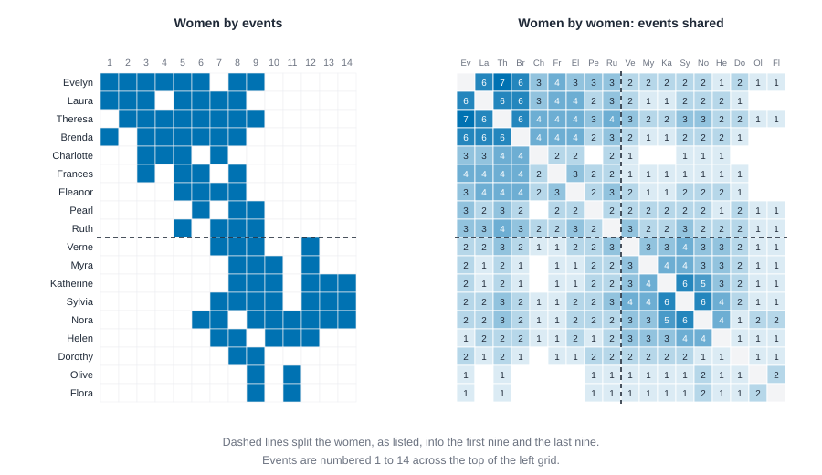
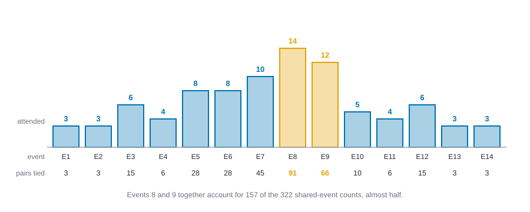

# Two-mode networks {#sec-two-mode}

::: {.callout-note appearance="simple"}
## Prerequisites
@sec-networks-as-data, @sec-subgroups and @sec-tests-and-null-models. We lean on the one-mode and two-mode distinction from @sec-networks-as-data.
:::

## When people are tied through something else

::: {.callout-tip appearance="simple"}
## Code lives next to the idea
Each idea comes with its code right where it is explained. The Rust blocks in this chapter run top to bottom as one script, so later blocks reuse names defined earlier.
:::

Not every tie runs between two people. Two scientists are linked because they wrote the same paper. Two neighbors, because they sit on the same committee. Two members of a town, because they attended the same party. The people are connected *through something else*, and that something else has its own identity, its own size and its own pull.

This chapter has two halves. The first is about **two-mode networks**, where there are two kinds of nodes (people and events, authors and papers) and ties only run *between* the kinds. The second is about **layers**: several kinds of tie among the *same* people, like advice, friendship and lunch.

## Two-mode data

A two-mode network is usually stored as an **incidence matrix**: one row for each node of the first kind, one column for each node of the second, and a 1 where the two are tied. A tiny example: Ana attends Choir and Chess, Ben attends Choir, and Cleo attends Chess.

| | Choir | Chess |
| --- | --- | --- |
| Ana | 1 | 1 |
| Ben | 1 | 0 |
| Cleo | 0 | 1 |

Nobody here is tied to another person, only to an event. To get a network of people we **project**: tie two people when they share an event. Ana and Ben share Choir, Ana and Cleo share Chess, and Ben and Cleo share nothing. Count the shared events and you get a weight on every pair: Ana to Ben is 1, Ana to Cleo is 1, Ben to Cleo is 0. In matrix terms, multiply the incidence matrix by its transpose, $A A^{\top}$, and read off the off-diagonal. Multiply the other way, $A^{\top} A$, and you get the projection onto the events: Choir and Chess are tied by their one shared member, Ana. This is Breiger's *duality of persons and groups* [@breiger1974duality]: each projection tells the other half of the story.

The projection is convenient, because every one-mode tool from earlier chapters then applies. It is also lossy, and sometimes misleading, as we'll see.

### Step 1: the southern women

The classic two-mode dataset comes from a study of social class in a town in the American South in the 1930s. Davis, Gardner and Gardner recorded which of 18 women attended which of 14 social events [@davis1941deep]. It has been analyzed in dozens of papers, because the tie pattern is rich enough to argue about: are there two groups of women, and which events divide them?

::: {.panel-tabset group="language"}

## R

```r
library(knappnet)
library(dplyr)
library(tibble)

# The attendance table: one row per woman-event pair. The file labels differ a little from
# the short names the chapter uses, so we list those, in the file's order.
women <- c("Evelyn", "Laura", "Theresa", "Brenda", "Charlotte", "Frances", "Eleanor", "Pearl", "Ruth",
           "Verne", "Myra", "Katherine", "Sylvia", "Nora", "Helen", "Dorothy", "Olive", "Flora")
events <- paste0("E", 1:14)
edges <- read.csv("data/southern_women/edges.csv") |>
  as_tibble() |>
  mutate(woman = women[match(woman, unique(woman))])

# One network with 32 nodes, women first and then events; the mode column says which is which.
nodes <- tibble(id = c(women, events), mode = rep(c("woman", "event"), c(18, 14)))
club <- net_twomode(edges, nodes = nodes, source = "woman", target = "event")
club

degrees <- club$nodes |>
  mutate(
    attended = net_twomode_degree(club, normalized = FALSE),
    share = round(net_twomode_degree(club), 2)
  )
degrees |> summarise(n = n(), fewest = min(attended), most = max(attended), .by = mode)
net_twomode_density(club) |> round(3)

# The busiest woman and the biggest event.
degrees |> slice_max(attended, n = 1, by = mode, with_ties = FALSE)
```

::: {.code-output}
```text
# net_frame: 32 nodes, 89 edges
#   directed:  no        mode: two-mode (18 woman, 14 event; between modes only)
#   weights:   unweighted
#   time:      static    space: none
#   simple:    no loops, no parallel edges
#   components: 1    isolates: 0    density: 0.179
#
# Nodes (32 x 2)       Edges (89 x 2)
#   id        mode       woman  event
#   <chr>     <chr>      <chr>  <chr>
# 1 Evelyn    woman    1 Evelyn E1
# 2 Laura     woman    2 Evelyn E2
# 3 Theresa   woman    3 Evelyn E3
# 4 Brenda    woman    4 Evelyn E4
# 5 Charlotte woman    5 Evelyn E5
# 6 Frances   woman    6 Evelyn E6
#   ... 26 more rows     ... 83 more rows
# A tibble: 2 × 4
  mode      n fewest  most
  <chr> <int>  <dbl> <dbl>
1 woman    18      2     8
2 event    14      3    14
[1] 0.353
# A tibble: 2 × 4
  id     mode  attended share
  <chr>  <chr>    <dbl> <dbl>
1 Evelyn woman        8  0.57
2 E8     event       14  0.78
```
:::

## Python

```python
import csv
import numpy as np

# The attendance table: one row per woman-event pair. The file labels differ a little from
# the short names the chapter uses, so we list those, in the file's order.
women = ["Evelyn", "Laura", "Theresa", "Brenda", "Charlotte", "Frances", "Eleanor", "Pearl", "Ruth",
         "Verne", "Myra", "Katherine", "Sylvia", "Nora", "Helen", "Dorothy", "Olive", "Flora"]
with open("data/southern_women/edges.csv") as f:
    rows = list(csv.DictReader(f))
labels = list(dict.fromkeys(row["woman"] for row in rows))

# The incidence matrix: 18 women by 14 events, 1 where she attended.
attend = np.zeros((18, 14), dtype=int)
for row in rows:
    attend[labels.index(row["woman"]), int(row["event"][1:]) - 1] = 1

# Two-mode degrees are counts; dividing by the size of the other mode gives shares.
w_count, e_count = attend.sum(axis=1), attend.sum(axis=0)
w_share, e_share = w_count / 14, e_count / 18
print(f"{len(women)} women, 14 events, {attend.sum()} attendances")
print(f"two-mode density {attend.mean():.3f}")
print(f"women attended between {w_count.min()} and {w_count.max()} events")
print(f"events drew between {e_count.min()} and {e_count.max()} women")
busiest, biggest = w_count.argmax(), e_count.argmax()
print(f"{women[busiest]} attended {w_count[busiest]} of 14 events (share {w_share[busiest]:.2f}); "
      f"event {biggest + 1} drew {e_count[biggest]} of 18 women (share {e_share[biggest]:.2f})")
```

::: {.code-output}
```text
18 women, 14 events, 89 attendances
two-mode density 0.353
women attended between 2 and 8 events
events drew between 3 and 14 women
Evelyn attended 8 of 14 events (share 0.57); event 8 drew 14 of 18 women (share 0.78)
```
:::

## Rust

```rust
use knappnet::metrics::bipartite::{compute_twomode_degree, compute_twomode_density};
use knappnet::Graph;

// The southern women: 18 women and the 14 social events each attended. For each woman, the events she attended (event 1 is position 0).
let women = [
    "Evelyn", "Laura", "Theresa", "Brenda", "Charlotte", "Frances", "Eleanor", "Pearl", "Ruth",
    "Verne", "Myra", "Katherine", "Sylvia", "Nora", "Helen", "Dorothy", "Olive", "Flora",
];
let attended: [&[usize]; 18] = [
    &[0, 1, 2, 3, 4, 5, 7, 8], &[0, 1, 2, 4, 5, 6, 7], &[1, 2, 3, 4, 5, 6, 7, 8], &[0, 2, 3, 4, 5, 6, 7],
    &[2, 3, 4, 6], &[2, 4, 5, 7], &[4, 5, 6, 7], &[5, 7, 8], &[4, 6, 7, 8], &[6, 7, 8, 11], &[7, 8, 9, 11],
    &[7, 8, 9, 11, 12, 13], &[6, 7, 8, 9, 11, 12, 13], &[5, 6, 8, 9, 10, 11, 12, 13], &[6, 7, 9, 10, 11],
    &[7, 8], &[8, 10], &[8, 10],
];

// One network with 32 nodes: positions 0 to 17 are the women, 18 to 31 the events. A tie means "attended".
let mut woman = Vec::new();
let mut event = Vec::new();
for (w, events) in attended.iter().enumerate() {
    for &e in events.iter() {
        woman.push(w as i64);
        event.push(18 + e as i64);
    }
}
let club = Graph::from_edges(32, &woman, &event, None, false)?;
println!("{}", club.describe());
// Which mode each node belongs to: false for a woman, true for an event.
let is_event: Vec<bool> = (0..32).map(|node| node >= 18).collect();

println!("{} women, 14 events, {} attendances", women.len(), club.edge_count());
println!("two-mode density {:.3}", compute_twomode_density(&club, &is_event)?);
let counts = compute_twomode_degree(&club, &is_event, false)?;
let shares = compute_twomode_degree(&club, &is_event, true)?;
let busiest = (0..18).max_by(|&a, &b| counts[a].partial_cmp(&counts[b]).unwrap().then(b.cmp(&a))).unwrap();
let biggest = (18..32).max_by(|&a, &b| counts[a].partial_cmp(&counts[b]).unwrap()).unwrap();
println!("women attended between {} and {} events", counts[..18].iter().cloned().fold(f64::MAX, f64::min), counts[..18].iter().cloned().fold(0.0, f64::max));
println!("events drew between {} and {} women", counts[18..].iter().cloned().fold(f64::MAX, f64::min), counts[18..].iter().cloned().fold(0.0, f64::max));
println!("{} attended {} of 14 events (share {:.2}); event {} drew {} of 18 women (share {:.2})", women[busiest], counts[busiest], shares[busiest], biggest - 17, counts[biggest], shares[biggest]);
```

::: {.code-output}
```text
Undirected network: 32 nodes, 89 ties
  Density           0.179
  Degree            2 to 14, mean 5.56
  Connected pieces  1
  Isolated nodes    0
  Loops, repeats    none
  Busiest           node 25 (14), node 26 (12), node 24 (10)

18 women, 14 events, 89 attendances
two-mode density 0.353
women attended between 2 and 8 events
events drew between 3 and 14 women
Evelyn attended 8 of 14 events (share 0.57); event 8 drew 14 of 18 women (share 0.78)
```
:::

:::

The network has 89 attendances. The two-mode density divides 89 by the $18 \times 14 = 252$ possible woman-event ties, about 35 percent. Women attended between 2 and 8 events, and events drew between 3 and 14 women. Two-mode degrees are normalized by the *other* mode's size, because a woman can only attend 14 events and an event can only draw 18 women [@borgatti1997network; @borgatti2011analyzing]: Evelyn attended 8 of 14, a share of 0.57, and event 8 drew 14 of 18, a share of 0.78. Comparing those two numbers, as if "8" and "14" were on one scale, would be a mistake. @fig-davis-matrix draws the data, on the left.

{#fig-davis-matrix fig-alt="Two grids. The left grid has 18 rows for women and 14 columns for events, with 89 blue cells. Blue cells form a band that runs from the upper left, where the first women attended events 1 to 9, to the lower right, where the last women attended events 7 to 14. The right grid has 18 rows and 18 columns shaded by the number of shared events from 0 to 7. Dark shading fills the top-left block of the first nine women and the bottom-right block of the last nine, with lighter shading elsewhere."}

### Step 2: project onto the women

::: {.panel-tabset group="language"}

## R

```r
# Project onto the women: two women are tied when they attended a common event,
# with weight the number of events they shared.
shared <- net_project(club, which = "first", method = "count")$edges |>
  select(source, target, weight) |>
  arrange(desc(weight), match(source, women), match(target, women))
shared |> summarise(pairs = n(), possible = choose(18, 2), total_weight = sum(weight))

# Every event of size k ties k (k - 1) / 2 pairs, so the total can be predicted from the event sizes alone.
degrees |> filter(mode == "event") |> summarise(predicted = sum(attended * (attended - 1) / 2))

# The strongest pair, and how many pairs share each number of events.
head(shared, 1)
count(shared, weight)
```

::: {.code-output}
```text
  pairs possible total_weight
1   139      153          322
# A tibble: 1 × 1
  predicted
      <dbl>
1       322
  source  target weight
1 Evelyn Theresa      7
  weight  n
1      1 44
2      2 49
3      3 22
4      4 15
5      5  1
6      6  7
7      7  1
```
:::

## Python

```python
# Project onto the women: two women are tied when they attended a common event,
# with weight the number of events they shared. This is A times A-transpose.
together = attend @ attend.T
pairs = [(i, j) for i in range(18) for j in range(i + 1, 18) if together[i, j] > 0]
print(f"{len(pairs)} of the 153 possible pairs of women share at least one event")
print(f"total weight {sum(together[i, j] for i, j in pairs)}")

# Every event of size k ties k (k - 1) / 2 pairs, so the total can be predicted from the event sizes alone.
print(f"predicted from the event sizes: {sum(k * (k - 1) // 2 for k in e_count)}")

ranked = sorted(pairs, key=lambda p: (-together[p], p))
top, (a, b) = together[ranked[0]], ranked[0]
print(f"strongest pair: {women[a]} and {women[b]} share {top} events")
print(f"{sum(together[p] == 6 for p in pairs)} pairs share exactly 6 events")
print(f"{sum(together[p] == 1 for p in pairs)} pairs share exactly 1 event")
```

::: {.code-output}
```text
139 of the 153 possible pairs of women share at least one event
total weight 322
predicted from the event sizes: 322
strongest pair: Evelyn and Theresa share 7 events
7 pairs share exactly 6 events
44 pairs share exactly 1 event
```
:::

## Rust

```rust
use knappnet::metrics::bipartite::{project, ProjectionOptions, ProjectionWeight};

// Project onto the women: two women are tied when they attended a common event, with weight the number of events they shared.
let shared = project(&club, &is_event, ProjectionOptions { second: false, weight: ProjectionWeight::Count, ..Default::default() })?;
println!("{} of the 153 possible pairs of women share at least one event", shared.from.len());
println!("total weight {}", shared.weights.iter().sum::<f64>());

// Every event of size k ties k (k - 1) / 2 pairs, so the total can be predicted from the event sizes alone.
let from_sizes: f64 = counts[18..].iter().map(|k| k * (k - 1.0) / 2.0).sum();
println!("predicted from the event sizes: {from_sizes}");

let mut ranked: Vec<(f64, usize, usize)> = (0..shared.from.len())
    .map(|k| (shared.weights[k], shared.from[k] as usize, shared.to[k] as usize))
    .collect();
ranked.sort_by(|a, b| b.0.partial_cmp(&a.0).unwrap().then(a.1.cmp(&b.1)).then(a.2.cmp(&b.2)));
let (top, a, b) = ranked[0];
println!("strongest pair: {} and {} share {} events", women[a], women[b], top);
println!("{} pairs share exactly 6 events", ranked.iter().filter(|p| p.0 == 6.0).count());
println!("{} pairs share exactly 1 event", ranked.iter().filter(|p| p.0 == 1.0).count());
```

::: {.code-output}
```text
139 of the 153 possible pairs of women share at least one event
total weight 322
predicted from the event sizes: 322
strongest pair: Evelyn and Theresa share 7 events
7 pairs share exactly 6 events
44 pairs share exactly 1 event
```
:::

:::

Of 153 possible pairs of women, 139 share at least one event. That is a *very* dense network, 91 percent, built from a two-mode network that was only 35 percent dense. This is the first thing to notice about projections: they make ties out of coincidence. The 322 shared-event counts are completely determined by the event sizes, because an event with $k$ attendees ties $k(k-1)/2$ pairs. Event 8 alone, with 14 women, produces 91 of them. @fig-event-sizes shows how the biggest events dominate.

{#fig-event-sizes fig-alt="A bar chart of 14 events. Attendance is 3, 3, 6, 4, 8, 8, 10, 14, 12, 5, 4, 6, 3 and 3. Beneath each bar is the number of pairs the event ties: 3, 3, 15, 6, 28, 28, 45, 91, 66, 10, 6, 15, 3, 3. Events 8 and 9, with 14 and 12 attendees, are highlighted."}

The right-hand grid in @fig-davis-matrix is this projection. It shows the structure that the plain density number hides: two dense blocks, the first nine women and the last nine, with a thinner bridge between them. The strongest pair is Evelyn and Theresa, who attended 7 events together.

### Step 3: weight the projection with care

Is a pair who shared a crowded event as close as a pair who shared a small one? Probably not: a party of 14 doesn't give two attendees much reason to have talked. Newman proposed weighting each shared event by $1 / (k - 1)$, where $k$ is the event's attendance, so that small events count for more [@newman2001scientific].

::: {.panel-tabset group="language"}

## R

```r
# Newman's weighting: a shared event counts 1 / (attendance - 1), so a small, intimate event
# counts for more than a crowded one.
newman <- net_project(club, which = "first", method = "newman")$edges |>
  select(source, target, weight) |>
  arrange(desc(weight), match(source, women), match(target, women))
bind_rows(shared_count = head(shared, 1), newman = head(newman, 3), .id = "weighting") |>
  mutate(weight = round(weight, 2))
```

::: {.code-output}
```text
     weighting    source  target weight
1 shared_count    Evelyn Theresa   7.00
2       newman    Sylvia    Nora   1.65
3       newman Katherine  Sylvia   1.62
4       newman    Evelyn   Laura   1.56
```
:::

## Python

```python
# Newman's weighting: a shared event counts 1 / (attendance - 1), so a small, intimate event
# counts for more than a crowded one.
newman = (attend / (e_count - 1)) @ attend.T
ranked_newman = sorted(pairs, key=lambda p: (-newman[p], p))
print(f"strongest pairs by shared-event count: {women[a]} and {women[b]} ({top})")
print("strongest pairs by Newman weight:")
for p, q in ranked_newman[:3]:
    print(f"  {women[p]} and {women[q]}: {newman[p, q]:.2f}")
```

::: {.code-output}
```text
strongest pairs by shared-event count: Evelyn and Theresa (7)
strongest pairs by Newman weight:
  Sylvia and Nora: 1.65
  Katherine and Sylvia: 1.62
  Evelyn and Laura: 1.56
```
:::

## Rust

```rust
// Newman's weighting: a shared event counts 1 / (attendance - 1), so a small, intimate event
// counts for more than a crowded one.
let newman = project(&club, &is_event, ProjectionOptions { second: false, weight: ProjectionWeight::Newman, ..Default::default() })?;
let mut ranked_newman: Vec<(f64, usize, usize)> = (0..newman.from.len())
    .map(|k| (newman.weights[k], newman.from[k] as usize, newman.to[k] as usize))
    .collect();
ranked_newman.sort_by(|a, b| b.0.partial_cmp(&a.0).unwrap().then(a.1.cmp(&b.1)).then(a.2.cmp(&b.2)));
println!("strongest pairs by shared-event count: {} and {} ({})", women[a], women[b], top);
println!("strongest pairs by Newman weight:");
for &(weight, p, q) in &ranked_newman[..3] {
    println!("  {} and {}: {:.2}", women[p], women[q], weight);
}
```

::: {.code-output}
```text
strongest pairs by shared-event count: Evelyn and Theresa (7)
strongest pairs by Newman weight:
  Sylvia and Nora: 1.65
  Katherine and Sylvia: 1.62
  Evelyn and Laura: 1.56
```
:::

:::

The ranking changes. By plain counts, the strongest tie is in the first group (Evelyn and Theresa, with 7 events, and seven other pairs at 6). By Newman weight, the two strongest are Sylvia and Nora, and Katherine and Sylvia, in the second group: they shared both of the three-person events (13 and 14) and two other small ones (10 and 12). Neither ranking is wrong. They answer different questions: "who spent the most occasions together?" and "who shared the most occasions that were small enough to make a connection?" Pick the one that matches your theory and say which you used.

### Step 4: are there two groups?

If the women fall into two groups, the events should too: some events draw mostly one group, some the other. Modularity (@sec-subgroups) can be adapted to two-mode data. Barber's version compares the ties *inside* each group with what the degrees of the two modes would produce by chance [@barber2007modularity].

::: {.panel-tabset group="language"}

## R

```r
# Split the women into the first nine and the last nine as listed, then put each event with the group
# that supplied most of its attendees.
B <- net_incidence(club)
group_w <- rep(c("first", "second"), each = 9)
group_e <- if_else(colSums(B[10:18, ]) > colSums(B[1:9, ]), "second", "first")
tibble(event = events, group = group_e) |>
  summarise(events = toString(event), .by = group)

# Modularity for two-mode data (Barber 2007): ties inside groups, compared with what the two
# modes' degrees would give by chance. The package has no function for it, so we write the formula.
m <- sum(B)
expected <- outer(rowSums(B), colSums(B)) / m
inside <- outer(group_w, group_e, "==")
round(sum((B - expected)[inside]) / m, 3)
```

::: {.code-output}
```text
# A tibble: 2 × 2
  group  events                        
  <chr>  <chr>                         
1 first  E1, E2, E3, E4, E5, E6, E7, E8
2 second E9, E10, E11, E12, E13, E14   
[1] 0.318
```
:::

## Python

```python
# Split the women into the first nine and the last nine as listed, then put each event with the group
# that supplied most of its attendees.
group_w = np.array([0] * 9 + [1] * 9)
group_e = (attend[9:].sum(axis=0) > attend[:9].sum(axis=0)).astype(int)
print("first group's events: ", [e + 1 for e in range(14) if group_e[e] == 0])
print("second group's events:", [e + 1 for e in range(14) if group_e[e] == 1])

# Modularity for two-mode data (Barber 2007): ties inside groups, compared with what the two
# modes' degrees would give by chance. NetworkX has only the one-mode version, so we write the formula.
m = attend.sum()
inside = group_w[:, None] == group_e[None, :]
q = ((attend - np.outer(w_count, e_count) / m)[inside]).sum() / m
print(f"two-mode modularity of this split: {q:.3f}")
```

::: {.code-output}
```text
first group's events:  [1, 2, 3, 4, 5, 6, 7, 8]
second group's events: [9, 10, 11, 12, 13, 14]
two-mode modularity of this split: 0.318
```
:::

## Rust

```rust
use knappnet::metrics::bipartite_extra::compute_bipartite_modularity;

// Split the women into the first nine and the last nine as listed, then put each event with the group
// that supplied most of its attendees.
let mut group = vec![0i64; 32];
for w in 9..18 { group[w] = 1; }
for e in 0..14 {
    let from_first = (0..9).filter(|&w| attended[w].contains(&e)).count();
    let from_second = (9..18).filter(|&w| attended[w].contains(&e)).count();
    group[18 + e] = if from_second > from_first { 1 } else { 0 };
}
let events_first: Vec<usize> = (0..14).filter(|&e| group[18 + e] == 0).map(|e| e + 1).collect();
let events_second: Vec<usize> = (0..14).filter(|&e| group[18 + e] == 1).map(|e| e + 1).collect();
println!("first group's events:  {:?}", events_first);
println!("second group's events: {:?}", events_second);

// Modularity for two-mode data: ties inside groups, compared with what the two modes' degrees would give by chance.
let is_woman: Vec<bool> = (0..32).map(|node| node < 18).collect();
let q = compute_bipartite_modularity(&club, &group, &is_woman, 1.0, None);
println!("two-mode modularity of this split: {q:.3}");
```

::: {.code-output}
```text
first group's events:  [1, 2, 3, 4, 5, 6, 7, 8]
second group's events: [9, 10, 11, 12, 13, 14]
two-mode modularity of this split: 0.318
```
:::

:::

Events 1 to 8 go with the first group of women and events 9 to 14 with the second. The modularity of this split is 0.318. A caution: this number isn't on the same footing as one-mode modularity, and you shouldn't compare it with the values from @sec-subgroups. For two-mode data the maximum possible value, and what counts as a high one, depend on the sizes and degrees of both modes. Use it to compare *groupings of the same two-mode network*, as we compared groupings by description length in @sec-latent-space, not to rank networks against each other.

### What a projection loses

Projections are useful but have three costs.

- **They invent ties from coincidence.** Event 8 made 91 ties, and none of them means the women spoke.
- **They lose which event.** Two women who share three small events and two who share three huge ones look identical in a plain count.
- **They lose the other mode.** Events are as interesting as the people, and a projection onto women ignores their structure. The dual projection (events tied by shared women) tells the other half. Everett and Borgatti suggest analyzing both together [@everett2013dual].

When you can, analyze the two-mode network directly (two-mode degree, two-mode groups) and use projections as a *view*, not as the data.

## What this chapter does not cover
This section treats layers one pair at a time. Full multilayer methods, such as models that link a person across layers in a single matrix, centralities that work across layers and community detection for multilayer data, are an active area [@kivela2014multilayer]. The tools in this book's code don't include them yet, so we've stuck to overlap and QAP, which are useful and easy to explain.
:::

## Reading these models honestly

**A projection is a choice.** The same two-mode data gives different one-mode networks depending on the weighting, and different conclusions. Say which you used and why.

**Don't mix the modes.** A one-mode measure applied to a projection can be strongly affected by one big event or one prolific person. Look at event sizes before you read centrality in a projection.

**Two-mode measures have their own scales.** Normalize by the other mode, and don't compare raw numbers across modes.

**Overlap between layers is not influence.** Two layers can overlap because one causes the other, because a third thing causes both, or because the layers are measured in related ways. The overlap says nothing about which.

**Small networks, small power.** With ten people, even a decent correlation between layers can easily happen by chance. Report the test, not only the correlation.

## A cheat sheet

| Piece | What it does | Watch out for |
| --- | --- | --- |
| Incidence matrix | People by events, 1 where attended | Not square; rows and columns are different things |
| Projection | Ties people who share an event | Big events create many coincidental ties |
| Newman weight | Counts a shared event as $1/(k-1)$ | Changes the ranking; state which you used |
| Dual projection | Ties events that share people | Tells the other half of the story |
| Two-mode degree | Share of the other mode attended | Normalize by the other mode's size |
| Two-mode modularity | Groups in a two-mode network | Not comparable with one-mode modularity |
| Layer overlap | Pairs tied in both layers | Jaccard divides by pairs tied in either |
| QAP correlation | Is the overlap more than chance? | Needs enough people to have any power |

## Exercises

1. **By hand.** Four people attend three events: Ana at Choir and Chess, Ben at Choir, Cleo at Chess and Quiz, Dev at Quiz. Write the incidence matrix and find the projection onto the people. Which pairs are tied, and with what weights?
2. **By hand.** Suppose a fifteenth event were attended by 10 of the 18 women. How many pairs of women does it tie together? Could it add any pairs to the 139 that already share an event?
3. **By hand.** Two women share three events. In one case the events had 3, 3 and 4 attendees. In the other they had 12, 12 and 14. Compute Newman's weight for each. Which pair looks closer?
4. **Coding.** Project the southern women onto the *events* instead. How many pairs of events share at least one woman? Which two events share the most women?
5. **Coding.** Move Nora from the second group to the first and recompute the two-mode modularity. Does it go up or down?
6. **Interpretation.** A paper projects a network of authors and papers onto the authors and reports that the most central author is the one with the most co-authors. Write a short, kind reply about what the projection might be hiding.

## Summary

::: {.callout-tip appearance="simple"}
A two-mode network ties one kind of node to another, such as women to the events they attend, and is stored as an incidence matrix. Projecting it onto one mode ties two nodes when they share a partner, which makes every one-mode tool available but turns coincidence into ties: in the southern women data, 35 percent of possible woman-event ties become 91 percent of possible woman-woman ties, and two events alone account for almost half of the shared-event counts. Weighting by Newman's $1/(k-1)$ changes which pairs look strongest, so the weighting is a choice to state. Two-mode degree and modularity need their own normalization. Layers, several kinds of tie among the same people, can be compared by overlap and a QAP correlation, which, with ten people, can't separate a moderate overlap from chance.
:::

## Further reading

For the duality of persons and groups, @breiger1974duality, and for the data, @davis1941deep. For two-mode centrality and its normalization, @borgatti1997network and @borgatti2011analyzing, and for weighted projections, @newman2001scientific. For analyzing both projections together, @everett2013dual, and for two-mode modularity, @barber2007modularity. For multilayer networks, @kivela2014multilayer. In R, Phil Murphy's notes on two-mode networks in igraph and statnet are a good place to practice [@murphyrpubs317838; @murphyrpubs542335].
