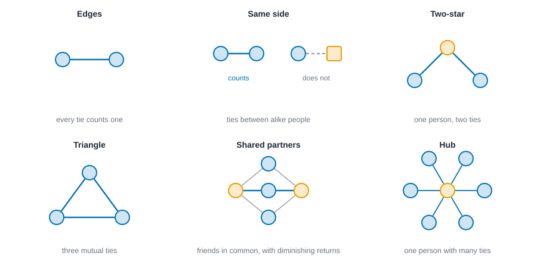
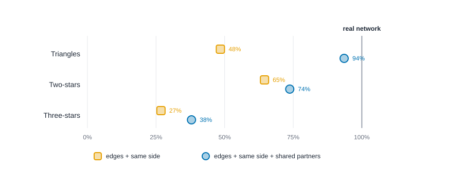

# Exponential random graph models {#sec-ergm}

::: {.callout-note appearance="simple"}
## Prerequisites
@sec-tests-and-null-models, @sec-paths-and-cohesion and @sec-subgroups. We reuse Zachary's karate club from @sec-subgroups, and the ideas of homophily and closure from @sec-foundations.
:::

## From describing to modeling

::: {.callout-tip appearance="simple"}
## Code lives next to the idea
Each step of the modeling workflow comes with its code right where it is explained. The Rust blocks in this chapter run top to bottom as one script: the first builds the karate club, and later ones reuse it.
:::

So far we've *described* networks: counted ties, scored people, found groups. This chapter is about *modeling* them. A model is a claim about how the network could have come about, written down precisely enough to be wrong.

Here's the kind of question a model can answer that a summary can't. In the karate club (@sec-subgroups), people mostly befriended members of their own side. People also tend to befriend friends of friends. Both are true at once, and they overlap: two friends of the same person are probably on the same side. How much of the clustering is "just" same-side preference, and how much is extra? Counting won't separate them. A model that includes both tendencies at the same time can.

The standard tool is the **exponential random graph model**, or **ERGM** (pronounced "ur-gum"). The statistician's name for the same thing is a *p-star* model, and its roots go back to Holland and Leinhardt [@holland1981exponential] and Frank and Strauss [@frank1986markov]. Modern practice is laid out in Snijders and colleagues [@snijders2006new] and in the software paper behind the R package statnet [@hunter2008ergm].

## The idea in one equation

An ERGM says that the chance of seeing a particular network $x$ depends on a handful of counts taken from it:

$$
P(x) \;\propto\; \exp\Big( \theta_1\, g_1(x) + \theta_2\, g_2(x) + \dots + \theta_k\, g_k(x) \Big).
$$

Each $g_j(x)$ is a **statistic**, a count of some pattern in the network: the number of ties, the number of same-side ties, the number of triangles. Each $\theta_j$ is a **coefficient** that says how much that pattern raises or lowers a network's chance. "Proportional to" means the numbers get rescaled so all possible networks' chances add up to 1. A positive coefficient says networks with *more* of that pattern are more likely than networks with less, holding the other patterns fixed. A negative coefficient says the opposite. Zero says the pattern doesn't matter.

A tiny example makes this concrete. Three people can be tied in $2^3 = 8$ ways. With only the number of ties as a statistic, each network's chance is proportional to $e^{\theta \cdot \text{ties}}$: the empty network gets weight 1, each single-tie network gets $e^{\theta}$, each two-tie network gets $e^{2\theta}$, and the triangle gets $e^{3\theta}$. A negative $\theta$ favors sparse networks. This is the random graph model from @sec-tests-and-null-models, where each tie appears independently, and it is the simplest ERGM. Everything else is adding more statistics.

## Choosing statistics

The art is in picking statistics that match your theory. @fig-ergm-terms shows the usual building blocks.

- **Edges** count the ties. Its coefficient sets overall density, like an intercept in a regression.
- **Same-attribute ties** (called *nodematch* in statnet) count ties between people who share an attribute, such as a side, a department or a gender. A positive coefficient is *homophily*, the "birds of a feather" pattern [@mcpherson2001birds].
- **Stars** count a person with several ties. They capture how unevenly ties are spread across people: whether a few popular people hold many ties.
- **Triangles** and **shared partners** capture closure, the tendency of friends of friends to be friends (@sec-foundations). A raw triangle count turns out to behave badly in practice, as we'll see, so modelers use a smoother version.

The smoother version is **geometrically weighted edgewise shared partners**, or **GWESP**, introduced by Snijders and colleagues [@snijders2006new] and developed by Hunter and Handcock [@hunter2006inference]. For each tie, count how many *other* people the two ends have in common. The first shared partner counts a lot, the second a bit less, the third less still, so a tie embedded in one triangle counts nearly as much as one embedded in five. A **decay** setting controls how fast the returns shrink. We'll use 0.5.

{#fig-ergm-terms fig-alt="Six small drawings of network patterns. Edges: two nodes joined by a line. Same side: two nodes of the same shape joined by a line, and two of different shapes not joined. Two-star: one node joined to two others. Triangle: three nodes all joined. Shared partners: two tied nodes with three common neighbors, with a note that each extra shared partner counts less. Degree spread: a hub with many ties beside nodes with few."}

## Step 1: the data

::: {.panel-tabset group="language"}

## R

```r
library(network)
library(dplyr)

# Zachary's karate club: 34 members, 78 friendships. R counts from 1, so we add 1
# to the positions 0 to 33 that the Rust tab uses.
ties <- tibble(
  from = c(
    0, 0, 0, 0, 0, 0, 0, 0, 0, 0, 0, 0, 0, 0, 0, 0, 1, 1, 1, 1, 1, 1, 1, 1, 2, 2, 2, 2, 2, 2, 2, 2, 3, 3, 3,
    4, 4, 5, 5, 5, 6, 8, 8, 8, 9, 13, 14, 14, 15, 15, 18, 18, 19, 20, 20, 22, 22, 23, 23, 23, 23, 23, 24, 24,
    24, 25, 26, 26, 27, 28, 28, 29, 29, 30, 30, 31, 31, 32
  ) + 1,
  to = c(
    1, 2, 3, 4, 5, 6, 7, 8, 10, 11, 12, 13, 17, 19, 21, 31, 2, 3, 7, 13, 17, 19, 21, 30, 3, 7, 8, 9, 13, 27, 28,
    32, 7, 12, 13, 6, 10, 6, 10, 16, 16, 30, 32, 33, 33, 33, 32, 33, 32, 33, 32, 33, 33, 32, 33, 32, 33, 25, 27,
    29, 32, 33, 25, 27, 31, 31, 29, 33, 33, 31, 33, 32, 33, 32, 33, 32, 33, 33
  ) + 1
)
# The side each member took (0 = Mr. Hi, 1 = the officer).
side <- c(0, 0, 0, 0, 0, 0, 0, 0, 0, 1, 0, 0, 0, 0, 1, 1, 0, 0, 1, 0, 1, 0, 1, 1, 1, 1, 1, 1, 1, 1, 1, 1, 1, 1)
club <- network(cbind(ties$from, ties$to), directed = FALSE, matrix.type = "edgelist")
club %v% "side" <- side
club

tibble(side = if_else(side == 0, "Mr. Hi", "the officer")) |>
  count(side)
```

::: {.code-output}
```text
 Network attributes:
  vertices = 34 
  directed = FALSE 
  hyper = FALSE 
  loops = FALSE 
  multiple = FALSE 
  bipartite = FALSE 
  total edges= 78 
    missing edges= 0 
    non-missing edges= 78 

 Vertex attribute names: 
    side vertex.names 

No edge attributes
# A tibble: 2 × 2
  side            n
  <chr>       <int>
1 Mr. Hi         17
2 the officer    17
```
:::

## Python

```python
import numpy as np

# Zachary's karate club: 34 members, 78 friendships. Positions 0 to 33 are the members.
src = [
    0, 0, 0, 0, 0, 0, 0, 0, 0, 0, 0, 0, 0, 0, 0, 0, 1, 1, 1, 1, 1, 1, 1, 1, 2, 2, 2, 2, 2, 2, 2, 2, 3, 3, 3,
    4, 4, 5, 5, 5, 6, 8, 8, 8, 9, 13, 14, 14, 15, 15, 18, 18, 19, 20, 20, 22, 22, 23, 23, 23, 23, 23, 24, 24,
    24, 25, 26, 26, 27, 28, 28, 29, 29, 30, 30, 31, 31, 32
]
dst = [
    1, 2, 3, 4, 5, 6, 7, 8, 10, 11, 12, 13, 17, 19, 21, 31, 2, 3, 7, 13, 17, 19, 21, 30, 3, 7, 8, 9, 13, 27, 28,
    32, 7, 12, 13, 6, 10, 6, 10, 16, 16, 30, 32, 33, 33, 33, 32, 33, 32, 33, 32, 33, 33, 32, 33, 32, 33, 25, 27,
    29, 32, 33, 25, 27, 31, 31, 29, 33, 33, 31, 33, 32, 33, 32, 33, 32, 33, 33
]
# The side each member took (0 = Mr. Hi, 1 = the officer).
side = np.array([0, 0, 0, 0, 0, 0, 0, 0, 0, 1, 0, 0, 0, 0, 1, 1, 0, 0, 1, 0, 1, 0, 1, 1, 1, 1, 1, 1, 1, 1, 1, 1, 1, 1])
n = 34
adj = np.zeros((n, n))
adj[src, dst] = 1
adj[dst, src] = 1
print(f"{n} people, {int(adj.sum() / 2)} ties, {n * (n - 1) // 2} possible pairs")
print(f"{(side == 0).sum()} on Mr. Hi's side, {(side == 1).sum()} on the officer's")
```

::: {.code-output}
```text
34 people, 78 ties, 561 possible pairs
17 on Mr. Hi's side, 17 on the officer's
```
:::

## Rust

```rust
use knappnet::ergm::{fit_mcmle, fit_mple, simulate, McmleOptions, Model, MpleOptions, SimulateOptions, Term, ToggleGraph};
use knappnet::Graph;

// Zachary's karate club: 34 members, 78 friendships. Positions 0 to 33 are the members.
let from = [
    0, 0, 0, 0, 0, 0, 0, 0, 0, 0, 0, 0, 0, 0, 0, 0, 1, 1, 1, 1, 1, 1, 1, 1, 2, 2, 2, 2, 2, 2, 2, 2, 3, 3, 3,
    4, 4, 5, 5, 5, 6, 8, 8, 8, 9, 13, 14, 14, 15, 15, 18, 18, 19, 20, 20, 22, 22, 23, 23, 23, 23, 23, 24, 24,
    24, 25, 26, 26, 27, 28, 28, 29, 29, 30, 30, 31, 31, 32,
];
let to = [
    1, 2, 3, 4, 5, 6, 7, 8, 10, 11, 12, 13, 17, 19, 21, 31, 2, 3, 7, 13, 17, 19, 21, 30, 3, 7, 8, 9, 13, 27, 28,
    32, 7, 12, 13, 6, 10, 6, 10, 16, 16, 30, 32, 33, 33, 33, 32, 33, 32, 33, 32, 33, 33, 32, 33, 32, 33, 25, 27,
    29, 32, 33, 25, 27, 31, 31, 29, 33, 33, 31, 33, 32, 33, 32, 33, 32, 33, 33,
];
// The side each member took (0 = Mr. Hi, 1 = the officer). Attributes are numbers.
let side: [f64; 34] = [
    0., 0., 0., 0., 0., 0., 0., 0., 0., 1., 0., 0., 0., 0., 1., 1., 0., 0., 1., 0., 1., 0., 1., 1., 1., 1., 1., 1., 1., 1., 1., 1., 1., 1.,
];
let club = Graph::from_edges(34, &from, &to, None, false)?;
println!("{}", club.describe());
// ERGM code works on a network it can edit, one tie at a time.
let observed = ToggleGraph::from_graph(&club)?;
println!("{} people, {} ties, {} possible pairs", observed.node_count(), observed.edge_count(), observed.dyad_count());
println!("{} on Mr. Hi's side, {} on the officer's", side.iter().filter(|&&s| s == 0.).count(), side.iter().filter(|&&s| s == 1.).count());
```

::: {.code-output}
```text
Undirected network: 34 nodes, 78 ties
  Density           0.139
  Degree            1 to 17, mean 4.59
  Connected pieces  1
  Isolated nodes    0
  Loops, repeats    none
  Busiest           node 33 (17), node 0 (16), node 32 (12)

34 people, 78 ties, 561 possible pairs
17 on Mr. Hi's side, 17 on the officer's
```
:::

:::
## Step 2: a model where every tie is its own coin flip

Start with the simplest model that includes homophily: edges, and same-side ties. Neither statistic mentions how ties relate to *each other*, so under this model each pair of people is an independent coin flip, with one chance for same-side pairs and another for cross-side pairs. That makes the model something you can fit with ordinary **logistic regression** on the 561 pairs. This is called **maximum pseudo-likelihood**, or MPLE [@strauss1990pseudolikelihood; @wasserman1996logit], and for a model like this one it is the exact answer, not an approximation.

You can even do it by hand, which is worth doing once. Of the 561 pairs, 272 are on the same side and 289 are on opposite sides. Among same-side pairs, 67 are tied. Among opposite-side pairs, only 11 are. So:

| | Pairs | Ties | Share tied | Log-odds of a tie |
| --- | --- | --- | --- | --- |
| Opposite sides | 289 | 11 | 0.038 | $\ln(11/278) = -3.230$ |
| Same side | 272 | 67 | 0.246 | $\ln(67/205) = -1.118$ |

The edges coefficient is the log-odds for opposite-side pairs, $-3.230$. The same-side coefficient is the *difference*, $-1.118 - (-3.230) = 2.111$. Let's see whether the computer agrees.

::: {.panel-tabset group="language"}

## R

```r
library(ergm) # the standard R package for ERGMs (statnet)

fit_plain <- ergm(club ~ edges + nodematch("side"), estimate = "MPLE")
est <- summary(fit_plain)$coefficients
tibble(
  term = c("edges", "same side"),
  estimate = est[, "Estimate"],
  std_error = est[, "Std. Error"]
) |>
  mutate(across(where(is.numeric), \(x) round(x, 3)))

# The logistic function turns log-odds back into a probability.
tibble(
  pair = c("opposite sides", "same side"),
  chance_of_tie = round(plogis(c(est[1, "Estimate"], est[1, "Estimate"] + est[2, "Estimate"])), 3)
)
```

::: {.code-output}
```text
# A tibble: 2 × 3
  term      estimate std_error
  <chr>        <dbl>     <dbl>
1 edges        -3.23     0.307
2 same side     2.11     0.338
# A tibble: 2 × 2
  pair           chance_of_tie
  <chr>                  <dbl>
1 opposite sides         0.038
2 same side              0.246
```
:::

## Python

```python
# No mainstream Python package fits ERGMs, but this model is a logistic regression on the pairs.
upper = np.triu_indices(n, 1)
y = adj[upper]
same = (side[upper[0]] == side[upper[1]]).astype(float)
X = np.column_stack([np.ones(len(y)), same])
coef = np.zeros(2)
for _ in range(50):  # Newton's method
    p = 1 / (1 + np.exp(-X @ coef))
    info = X.T @ (X * (p * (1 - p))[:, None])
    coef = coef + np.linalg.solve(info, X.T @ (y - p))
p = 1 / (1 + np.exp(-X @ coef))
std_err = np.sqrt(np.diag(np.linalg.inv(X.T @ (X * (p * (1 - p))[:, None]))))
for label, c, se in zip(["edges", "same side"], coef, std_err):
    print(f"{label:<10} {c:>7.3f}  (standard error {se:.3f})")
chance = lambda log_odds: 1 / (1 + np.exp(-log_odds))
print(f"chance of a tie, opposite sides  {chance(coef[0]):.3f}")
print(f"chance of a tie, same side       {chance(coef[0] + coef[1]):.3f}")
```

::: {.code-output}
```text
edges       -3.230  (standard error 0.307)
same side    2.111  (standard error 0.338)
chance of a tie, opposite sides  0.038
chance of a tie, same side       0.246
```
:::

## Rust

```rust
// Term::Edges counts ties; Term::NodeMatch(0) counts ties between people with equal values of attribute 0.
let plain = Model::new(vec![Term::Edges, Term::NodeMatch(0)], vec![side.to_vec()], 34, false)?;
let fit_plain = fit_mple(&plain, &observed, &MpleOptions::default())?;
for (label, k) in [("edges", 0), ("same side", 1)] {
    println!("{label:<10} {:>7.3}  (standard error {:.3})", fit_plain.coef[k], fit_plain.std_err[k]);
}
// The logistic function turns log-odds back into a probability.
let chance = |log_odds: f64| 1.0 / (1.0 + (-log_odds).exp());
println!("chance of a tie, opposite sides  {:.3}", chance(fit_plain.coef[0]));
println!("chance of a tie, same side       {:.3}", chance(fit_plain.coef[0] + fit_plain.coef[1]));
```

::: {.code-output}
```text
edges       -3.230  (standard error 0.307)
same side    2.111  (standard error 0.338)
chance of a tie, opposite sides  0.038
chance of a tie, same side       0.246
```
:::

:::

Both numbers match the table: -3.230 and 2.111, and the chances of a tie, 0.038 and 0.246, are the shares of pairs tied in each row. The standard errors say how much the estimates could wobble if we could rerun the club.
The model reproduces the table. The coefficient for same-side ties is large and positive: being on the same side raises the odds of a tie by a factor of $e^{2.111} \approx 8.3$.

But this model has a gap, and the next step finds it.

## Step 3: letting ties depend on each other

If friends of friends tend to be friends, then whether Ana and Cleo are tied depends on whether both are tied to Ben. A model that includes GWESP builds that dependence in: the chance of a tie now depends on *the rest of the network*. The pairs are no longer independent coin flips, and the trick that gave us exact answers by logistic regression stops working. The pseudo-likelihood still gives estimates, but its standard errors can't be trusted for dependent models [@hunter2008ergm].

The reliable approach is **Monte Carlo maximum likelihood**, or MCMLE. It works by simulation. Start with a guess for the coefficients. Simulate lots of networks from the model with those coefficients. Compare the average statistics of the simulated networks with the statistics of the real one. If the simulated networks have too few triangles, raise the coefficient for triangles, and try again. When the simulated averages match the observed counts, you've found the estimate [@hunter2006inference]. It is a clever idea, and it is slower, and the answers carry a little randomness, so we fix the seed.

::: {.panel-tabset group="language"}

## R

```r
summary(club ~ edges + nodematch("side") + gwesp(0.5, fixed = TRUE)) |> # 0.5 is the decay
  round(2)

# ergm runs its own Monte Carlo chains, so the estimates differ from Rust's in the last digits.
fit <- ergm(club ~ edges + nodematch("side") + gwesp(0.5, fixed = TRUE),
            control = control.ergm(seed = 1))
est <- summary(fit)$coefficients
tibble(
  term = c("edges", "same side", "shared partners"),
  estimate = est[, "Estimate"],
  std_error = est[, "Std. Error"]
) |>
  mutate(across(where(is.numeric), \(x) round(x, 3)))
tibble(converged = !isTRUE(fit$failure), rounds = fit$iterations)
```

::: {.code-output}
```text
          edges  nodematch.side gwesp.fixed.0.5 
          78.00           67.00           82.93 
# A tibble: 3 × 3
  term            estimate std_error
  <chr>              <dbl>     <dbl>
1 edges             -3.90      0.307
2 same side          1.50      0.278
3 shared partners    0.697     0.175
# A tibble: 1 × 2
  converged rounds
  <lgl>      <int>
1 TRUE           2
```
:::

## Python

```python
# TODO(code, Python): no Python package fits ERGMs with a shared-partner term (Monte Carlo maximum likelihood needs a tie-toggling sampler with GWESP change statistics, well over 40 lines). Use the R or Rust tab; the knappnet Python backend does not wrap the ERGM fitter.
```

::: {.code-output}
```text
observed statistics   [78.00, 67.00, 82.93]
edges             -3.924  (standard error 0.322)
same side          1.535  (standard error 0.284)
shared partners    0.697  (standard error 0.174)
converged true after 3 rounds
```
:::

## Rust

```rust
let model = Model::new(
    vec![Term::Edges, Term::NodeMatch(0), Term::Gwesp(0.5)], // 0.5 is the decay
    vec![side.to_vec()],
    34,
    false,
)?;
println!("observed statistics   {:.2?}", model.compute_statistics(&observed)?);

let fit = fit_mcmle(&model, &observed, &McmleOptions::default())?;
for (label, k) in [("edges", 0), ("same side", 1), ("shared partners", 2)] {
    println!("{label:<16} {:>7.3}  (standard error {:.3})", fit.coef[k], fit.std_err[k]);
}
println!("converged {} after {} rounds", fit.converged, fit.iterations);
```

::: {.code-output}
```text
observed statistics   [78.00, 67.00, 82.93]
edges             -3.924  (standard error 0.322)
same side          1.535  (standard error 0.284)
shared partners    0.697  (standard error 0.174)
converged true after 3 rounds
```
:::

:::

The observed shared-partner statistic is 82.93, and the fitted model's simulated networks average about that, which is what "converged" means here. Notice the standard errors: the same-side coefficient is still clearly positive, and the shared-partner coefficient is positive and several times its standard error. The R tab uses the ergm package, which runs its own Monte Carlo chains, so its estimates can differ from these in the last digits.
Read the coefficients as **conditional log-odds**: the log-odds of a tie, given everything else in the network. Same-side ties still matter, but the coefficient has shrunk from 2.11 to about 1.54. That's the point of the exercise. Part of what the simple model attributed to "same side" was really closure: people on the same side share friends, and shared friends produce more ties. The shared-partner coefficient, about 0.70, is clearly positive. Holding the side and the overall density fixed, a tie is more likely when the two people already have friends in common.

Don't overread the number: the effect isn't "0.7 per friend in common," because the shared-partner statistic discounts each additional partner. It is a statement about the shape of closure in the whole network, and its sign and rough size are what you report.

## Step 4: checking the model

A fitted model is a claim, so test it against the data. The standard check is **goodness of fit**: simulate many networks from the fitted model and see whether they look like the real one on features the model *wasn't fit to*. If the real network sits in the middle of the simulated ones, the model captures the pattern. If it sits far out, the model is missing something [@hunter2008goodness].

We'll check three features we didn't include: the number of triangles, and the number of two-stars and three-stars (people with two or three friends, counted every way). We'll do it twice, once for the simple model and once for the shared-partner model. A trick keeps the code short: build one model that lists the extra statistics, and give those extra statistics a coefficient of zero so they only get *counted*, never *used*.

::: {.panel-tabset group="language"}

## R

```r
# Count triangles and stars in 4,000 networks from each model (the first draws are discarded).
monitor <- ~ triangle + kstar(2) + kstar(3)
averages <- \(model) {
  draws <- simulate(model, nsim = 4000, monitor = monitor, output = "stats",
                    control = control.simulate.ergm(MCMC.burnin = 16384, MCMC.interval = 1024),
                    seed = 1)
  as.numeric(colMeans(draws)[c("edges", "triangle", "kstar2", "kstar3")])
}
# The simulations are random draws that differ from Rust's, so the averages differ a little.
tibble(
  statistic = c("ties", "triangles", "two-stars", "three-stars"),
  real = as.numeric(summary(club ~ edges + triangle + kstar(2) + kstar(3))),
  `edges + side` = averages(fit_plain),
  `+ shared partners` = averages(fit)
) |>
  mutate(across(where(is.numeric), \(x) round(x, 1)))
```

::: {.code-output}
```text
# A tibble: 4 × 4
  statistic    real `edges + side` `+ shared partners`
  <chr>       <dbl>          <dbl>               <dbl>
1 ties           78           78.2                77  
2 triangles      45           22.1                40.9
3 two-stars     528          342.                380. 
4 three-stars  1764          475.                649. 
```
:::

## Python

```python
# TODO(code, Python): needs an ERGM simulator (a Metropolis tie-toggling sampler from the fitted models, with GWESP change statistics), well over 40 lines, and no Python package provides one. Use the R or Rust tab.
```

::: {.code-output}
```text
               real   edges + side + shared partners
ties           78.0           77.9           78.0
triangles      45.0           21.8           42.1
two-stars     528.0          340.7          389.3
three-stars   1764.0          472.6          668.8
```
:::

## Rust

```rust
// One model that lists everything we want to count. The first three terms are the fitted ones.
let monitor = Model::new(
    vec![Term::Edges, Term::NodeMatch(0), Term::Gwesp(0.5), Term::Triangle, Term::KStar(2), Term::KStar(3)],
    vec![side.to_vec()],
    34,
    false,
)?;
let actual = monitor.compute_statistics(&observed)?;
let options = SimulateOptions { samples: 2000, chains: 2, seed: 1, ..Default::default() };

// Coefficients for the extra statistics are zero, so they are counted but not used.
let simple_theta = [fit_plain.coef[0], fit_plain.coef[1], 0.0, 0.0, 0.0, 0.0];
let closure_theta = [fit.coef[0], fit.coef[1], fit.coef[2], 0.0, 0.0, 0.0];
let average = |theta: &[f64]| -> Result<Vec<f64>, knappnet::Error> {
    let draws = simulate(&monitor, theta, &observed, &options)?;
    let rows = draws.stats.len() / draws.terms;
    Ok((0..draws.terms).map(|t| (0..rows).map(|r| draws.stats[r * draws.terms + t]).sum::<f64>() / rows as f64).collect())
};
let simple = average(&simple_theta)?;
let closure = average(&closure_theta)?;
println!("{:<10} {:>8} {:>14} {:>14}", "", "real", "edges + side", "+ shared partners");
for (label, k) in [("ties", 0), ("triangles", 3), ("two-stars", 4), ("three-stars", 5)] {
    println!("{label:<10} {:>8.1} {:>14.1} {:>14.1}", actual[k], simple[k], closure[k]);
}
```

::: {.code-output}
```text
               real   edges + side + shared partners
ties           78.0           77.9           78.0
triangles      45.0           21.8           42.1
two-stars     528.0          340.7          389.3
three-stars   1764.0          472.6          668.8
```
:::

:::

The simple model, with edges and sides only, produces fewer than half the real triangles (about 22 against 45). Adding shared partners nearly fixes triangles (about 42), as it should, since that is what the term is for. Now look at the stars. Both models fall short, and the three-stars are far off even in the better model: about 669 against 1,764. The karate club has two hubs, Mr. Hi and the officer, with 16 and 17 friends each, and a model with no term for how unevenly ties are spread can't make hubs. The natural next move is to add a degree term, refit and check again. Modeling is a loop, and each check suggests the next model. The R tab simulates with the ergm package, so its averages differ slightly from these.

@fig-ergm-gof shows the same comparison as percentages of the real counts.

{#fig-ergm-gof fig-alt="A dot chart with three rows: triangles, two-stars and three-stars. For triangles, the edges-and-side model is at 48 percent and the model with shared partners at 94 percent. For two-stars, the dots are at 65 and 74 percent. For three-stars, they are at 27 and 38 percent. A vertical line marks 100 percent."}

## From coefficients to the chance of one tie

The coefficients are easy to quote and easy to misread, so let's use them once, slowly, to answer a concrete question: given the fitted model, how likely is one particular tie?

The recipe has three steps. For a pair of people who aren't tied yet, work out how much each statistic in the model would go up if the tie were added. These are the **change statistics**. Multiply each by its coefficient and add the results: that sum is the **conditional log-odds** of the tie, given every other tie in the network. Then the logistic function turns the log-odds into a probability, $1 / (1 + e^{-x})$.

For our model the change statistics are easy to state. Adding any tie raises the edge count by 1. It raises the same-side count by 1 if the two people are on the same side, and by 0 if not. The shared-partner statistic is the fiddly one. A new tie between two people who have friends in common creates triangles, and the GWESP count goes up by an amount that depends on how many partners the two share and on how many partners the existing ties around them already have. We'll let the code count it by adding the tie and recounting.

We'll compare two pairs, both untied in the real club and both with exactly two friends in common. Members 2 and 12 are on the same side. Members 8 and 14 are on opposite sides. Holding the shared partners equal means the only thing that differs is the side.

::: {.panel-tabset group="language"}

## R

```r
library(purrr)

# The same two pairs, using the shared-partner fit from Step 3. R counts from 1, so we add 1
# to the member positions the other tabs use.
stats_of <- \(net) as.numeric(summary(net ~ edges + nodematch("side") + gwesp(0.5, fixed = TRUE)))
one_tie <- \(from, to) {
  with_tie <- club
  with_tie[from + 1, to + 1] <- 1
  stats_of(with_tie) - stats_of(club)
}
theta <- coef(fit)

tibble(
  pair = c("same side (2 and 12)", "opposite sides (8 and 14)"),
  from = c(2, 8),
  to = c(12, 14)
) |>
  mutate(
    change = map2(from, to, one_tie),
    partners = map2_dbl(from, to, \(i, j) sum(as.matrix(club)[i + 1, ] * as.matrix(club)[j + 1, ])),
    edges_change = map_dbl(change, 1),
    side_change = map_dbl(change, 2),
    partner_change = map_dbl(change, 3),
    log_odds = map_dbl(change, \(x) sum(theta * x)),
    chance = plogis(log_odds)
  ) |>
  select(pair, partners, edges_change, side_change, partner_change, log_odds, chance) |>
  mutate(across(where(is.numeric), \(x) round(x, 3)))
```

::: {.code-output}
```text
# A tibble: 2 × 7
  pair          partners edges_change side_change partner_change log_odds chance
  <chr>            <dbl>        <dbl>       <dbl>          <dbl>    <dbl>  <dbl>
1 same side (2…        2            1           1           2.21   -0.858  0.298
2 opposite sid…        2            1           0           2.40   -2.23   0.097
```
:::

## Python

```python
# The coefficients printed in Step 3 (edges, same side, shared partners), typed in by hand.
theta = np.array([-3.924, 1.535, 0.697])
decay = 0.5

def gwesp(a):
    # Each tie counts e^decay * (1 - (1 - e^-decay)^k), where k is its number of shared partners.
    shared = a @ a
    tied = np.triu(a, 1) > 0
    return (np.exp(decay) * (1 - (1 - np.exp(-decay)) ** shared[tied])).sum()

def change(i, j):
    with_tie = adj.copy()
    with_tie[i, j] = with_tie[j, i] = 1
    return np.array([1.0, float(side[i] == side[j]), gwesp(with_tie) - gwesp(adj)])

for label, i, j in [("same side (2 and 12)", 2, 12), ("opposite sides (8 and 14)", 8, 14)]:
    delta = change(i, j)
    log_odds = theta @ delta
    print(f"{label}: {int(adj[i] @ adj[j])} shared partners, change {np.round(delta, 3)}")
    print(f"  log-odds {theta[0]:.3f}*{delta[0]:.0f} + {theta[1]:.3f}*{delta[1]:.0f} + {theta[2]:.3f}*{delta[2]:.3f} = {log_odds:.3f}")
    print(f"  chance of the tie {1 / (1 + np.exp(-log_odds)):.3f}")
```

::: {.code-output}
```text
same side (2 and 12): 2 shared partners, change [1.    1.    2.214]
  log-odds -3.924*1 + 1.535*1 + 0.697*2.214 = -0.846
  chance of the tie 0.300
opposite sides (8 and 14): 2 shared partners, change [1.    0.    2.396]
  log-odds -3.924*1 + 1.535*0 + 0.697*2.396 = -2.254
  chance of the tie 0.095
```
:::

## Rust

```rust
// Add each tie to a copy of the club and see how much the three statistics go up.
let before = model.compute_statistics(&observed)?;
for (label, a, b) in [("same side (2 and 12)", 2usize, 12usize), ("opposite sides (8 and 14)", 8, 14)] {
    let mut with_tie = observed.clone();
    with_tie.toggle(a, b);
    let after = model.compute_statistics(&with_tie)?;
    let delta: Vec<f64> = after.iter().zip(&before).map(|(x, y)| x - y).collect();
    let partners = observed.out_neighbors(a).iter().filter(|v| observed.out_neighbors(b).contains(v)).count();
    let log_odds: f64 = fit.coef.iter().zip(&delta).map(|(c, d)| c * d).sum();
    println!("{label}: {partners} shared partners, change {delta:.3?}");
    println!("  log-odds {:.3}*{:.0} + {:.3}*{:.0} + {:.3}*{:.3} = {:.3}", fit.coef[0], delta[0], fit.coef[1], delta[1], fit.coef[2], delta[2], log_odds);
    println!("  chance of the tie {:.3}", chance(log_odds));
}
```

::: {.code-output}
```text
same side (2 and 12): 2 shared partners, change [1.000, 1.000, 2.214]
  log-odds -3.924*1 + 1.535*1 + 0.697*2.214 = -0.846
  chance of the tie 0.300
opposite sides (8 and 14): 2 shared partners, change [1.000, 0.000, 2.396]
  log-odds -3.924*1 + 1.535*0 + 0.697*2.396 = -2.254
  chance of the tie 0.095
```
:::

:::

Read the two results line by line. For members 2 and 12, the log-odds are $-3.924 + 1.535 + 0.697 \times 2.214 = -0.846$, which the logistic function turns into a chance of 0.300. For members 8 and 14, the same-side term drops out, leaving $-3.924 + 0.697 \times 2.396 = -2.254$ and a chance of 0.095. The three tabs agree. (The Python tab types in the rounded coefficients from Step 3, so it could drift from Rust in a later decimal; here it doesn't. The R tab uses R's own fit, whose coefficients differ from Rust's in the last digits, so its numbers land close to these rather than on them.)

A few things are worth noticing. The same-side pair is about four times as likely to be tied as the cross-side pair in odds terms ($e^{-0.846 - (-2.254)} = e^{1.408} \approx 4.1$). Most of that is the same-side coefficient, $e^{1.535} \approx 4.6$, trimmed a little because the cross-side pair's tie would add slightly more to the shared-partner count (2.396 against 2.214). And two shared partners matter: with none, the cross-side pair would face log-odds of just $-3.924$, a chance of about 0.019, so two friends in common multiply its odds by roughly 5.3.

Now the cautions, because a tidy probability invites over-reading. The 0.300 is the model's chance for this tie *given every other tie in the club exactly as observed*. It isn't a forecast that members 2 and 12 will become friends, and it isn't the share of such pairs that end up tied. These two pairs are, in fact, not tied in the real club, and a model that gives one of them a 30 percent chance isn't wrong for that; it's saying "pairs like this are tied about three times in ten, given everything else." The only way to ask whether those chances are well calibrated is to check the model against the data, which is what Step 4 did.

## Reading ERGMs honestly

### What each piece of output is saying

Here is the fitted model again, with every number we've printed, and what each one lets you say. The pattern in each pair of sentences is the same: the first is something the output supports, the second is the tempting step past it. (Numbers are from the Rust fit, with a standard error in parentheses.)

**Edges, $-3.924$ (0.322).** This is the baseline log-odds of a tie between two people who are on opposite sides and share no partners. Its chance is about 0.019, and a large negative number is what any sparse network produces: only 14 percent of pairs are tied. It is a setting that makes the other terms add up, not a finding.

| A defensible sentence | An over-claim |
| --- | --- |
| "The edges term sets the baseline density; two people on opposite sides with no friends in common have about a 2 percent chance of a tie in this model." | "The strongly negative edges coefficient shows the club members are reluctant to form friendships." |

**Same side, 1.535 (0.284).** Holding edges and shared partners fixed, a tie between two people on the same side has log-odds 1.535 higher, which is odds about 4.6 times higher. An approximate 95 percent interval (the estimate plus or minus two standard errors) runs from 0.98 to 2.09, or from about 2.7 to 8.1 times the odds. It's smaller than the 2.111 of the simple model, because closure now accounts for part of it.

| A defensible sentence | An over-claim |
| --- | --- |
| "Holding the other terms fixed, ties between members on the same side have about 4.6 times the odds of ties across sides (roughly 2.7 to 8.1)." | "Members are 4.6 times as likely to befriend someone on their own side." |

The over-claim fails twice: odds are not probabilities, and "befriend" describes a choice the model never observes. What follows is a pattern in who is tied to whom.

**Shared partners, 0.697 (0.174).** The coefficient is positive and four standard errors from zero, so ties in this club close triangles more often than edges and sides alone would give. The size is hard to read because GWESP discounts each extra partner: a tie whose statistic would rise by 1 has about 2.0 times the odds ($e^{0.697}$), and our two pairs, whose statistics would rise by 2.2 and 2.4, have about 4.7 and 5.3 times the odds of a tie with no partners.

| A defensible sentence | An over-claim |
| --- | --- |
| "Beyond what sides explain, ties are more likely between members who already share friends, and this is why the same-side effect shrank from 2.11 to 1.54." | "Friends introduce their friends to each other, so trust drives the clustering." |

The model sees that triangles are over-represented. It can't tell introduction from a shared gym schedule or from a split that was already underway.

**Standard errors.** Each one says how much its coefficient would wobble from network to network if the fitted model were the true recipe. They are what makes "four standard errors from zero" meaningful. They do *not* say the karate club is typical of anything, and in a model with dependent ties they come from a simulation, so they carry a bit of Monte Carlo noise too.

| A defensible sentence | An over-claim |
| --- | --- |
| "Given this one network and this model, the same-side coefficient is estimated at 1.54 with a standard error of 0.28; the closure coefficient is clearly positive." | "The same-side effect is significant, so it holds for karate clubs in general." |

**Goodness of fit.** In Step 4, the shared-partner model's simulated networks average 42.1 triangles against 45 in the real club (94 percent), 389 two-stars against 528 (74 percent) and 669 three-stars against 1,764 (38 percent). The model gets closure about right and gets hubs badly wrong. The honest reading is a split verdict.

| A defensible sentence | An over-claim |
| --- | --- |
| "The model reproduces the club's triangle count but not its hubs: simulated networks have well under half the real number of three-stars, so the coefficients should be read as describing sides and closure only, with uneven popularity unmodeled." | "The model fits well: the coefficients are significant and the triangles match." |

A good-looking triangle count can't excuse a missing hub pattern. If three-stars matter for your question, add a degree term and refit before you believe anything else here.

### Cautions that apply to every ERGM

**Coefficients are conditional.** Each coefficient is the log-odds of a tie *given the rest of the network and the other statistics in the model*. It isn't a probability, and it doesn't mean each person independently chose to be friends with the same side. Exponentiate a coefficient to get an odds multiplier (for same-side ties, $e^{1.54} \approx 4.6$), and say "holding the other terms fixed."

**A model is a statement about ties, not about motives.** A positive same-side coefficient fits "people prefer their own side." It also fits "the club was already splitting into camps that met in different places." The model describes a pattern. Reasons come from what you know about the setting.

**Check before you believe.** A model can converge, produce tidy coefficients, and still describe your network badly. Goodness of fit, as in Step 4, is part of the analysis, not an optional extra.

**Degeneracy.** Some statistic combinations, especially raw triangle counts together with stars, can produce models that put nearly all their probability on almost-empty or almost-complete networks, so simulations look nothing like the data and fitting fails [@handcock2003assessing]. The smoother shared-partner and degree terms were designed to avoid this [@snijders2006new; @hunter2006inference]. If a fit won't converge, suspect the specification before suspecting the software.

**Simulation means randomness.** MCMLE and the checks use random draws. Fix the seed, say how many draws you used, and don't read meaning into small differences between runs.

**One network is one observation.** The standard errors describe uncertainty about the model's coefficients given this network. They don't say that the karate club is typical of anything. Generalizing beyond a single group takes more data, or a stated argument for why it should.

### Writing it up

When you report a fit, follow one shape: the model, the data, the method, one coefficient in plain words with its uncertainty, how the fit checked out, and a sentence on what it does not show. For the karate club, with the shared-partner model:

> An ERGM with edges, same-side ties and geometrically weighted shared partners (decay 0.5) was fitted to one network of 34 club members and 78 friendships by Monte Carlo maximum likelihood. Holding the other terms fixed, same-side ties have coefficient 1.54 (standard error 0.28), meaning ties between members on the same side have about 4.6 times the odds of ties across sides. Shared partners have coefficient 0.70 (standard error 0.17), so ties are more likely to close triangles than the other terms explain. Goodness of fit is good for triangles (about 94 percent of the real count) but poor for hubs (simulated three-stars average 38 percent of the real count); the estimation converged in three rounds. This describes patterns in this one network; it does not show why the ties formed or that other networks will look the same.

Notice what the paragraph leaves out. It doesn't say "preference", "because" or "significant", and it puts the poor hub fit in the same breath as the good triangle fit.

## A cheat sheet

| Piece | What it does | Watch out for |
| --- | --- | --- |
| Edges | Sets overall density | Always include it |
| Same-attribute ties | Measures homophily on a category | Needs the attribute for everyone |
| Stars, degree terms | Capture hubs and uneven popularity | Raw star counts can destabilize a model |
| Shared partners (GWESP) | Captures closure, with diminishing returns | Decay setting changes the fit |
| MPLE | Exact for dyad-independent models, fast | Standard errors unreliable when ties depend on each other |
| MCMLE | Handles dependence; uses simulation | Random, slower, may fail to converge |
| Goodness of fit | Compares simulated and real networks on unfit features | Pick features that matter to your question |

## Exercises

1. **By hand.** A network of four people has the statistic "number of ties" and coefficient $\theta = -1$. Using the weights $e^{\theta \cdot \text{ties}}$, find the probability that a particular pair is tied. (Hint: with only an edges term, ties are independent, so you can look at one pair.)
2. **By hand.** In the karate club, 67 of the 272 same-side pairs are tied. If same-side status had no effect, how many of the 272 would you expect, given 78 ties among 561 pairs? How far off is the observed 67?
3. **Design.** You have friendship data from a school class and each student's gender, grade and sport. Which statistics would you include, and which patterns would you check with goodness of fit?
4. **Coding.** Refit the shared-partner model with a decay of 0.25 and of 1.0. How much do the coefficients move? Which features do the simulations get right?
5. **Interpretation.** A paper reports "the same-gender coefficient is 1.2 (p < 0.01), so teenagers prefer friends of the same gender." Write a short, kind reply about what the model does and does not show.

## Summary

::: {.callout-tip appearance="simple"}
An ERGM gives each possible network a chance that depends on a few counts of patterns in it, such as ties, same-side ties and shared partners, each with a coefficient. A model with only independent-tie statistics is a logistic regression on pairs and can be fit exactly, as we did by hand for the karate club. Statistics that let ties depend on each other, like shared partners, need Monte Carlo maximum likelihood. In the karate club, same-side ties raise the odds of a tie by a factor of about 8 in the simple model and about 4.6 once closure is included, and shared partners add a clear positive effect. A fitted model must be checked by simulation: both models here miss the hubs, which tells us what to add next. Coefficients are conditional, describe patterns and not motives, and depend on the statistics you chose.
:::

## Further reading

For the origins, see @holland1981exponential and @frank1986markov, and for the logistic-regression approach, @strauss1990pseudolikelihood and @wasserman1996logit. For modern specifications, see @snijders2006new and @hunter2006inference, for degeneracy, @handcock2003assessing, and for software and goodness of fit, @hunter2008ergm and @hunter2008goodness. For homophily, see @mcpherson2001birds. To practice in R, Phil Murphy's class notes on ERGMs [@murphyrpubs341041; @murphyrpubs449967] are good companions.
