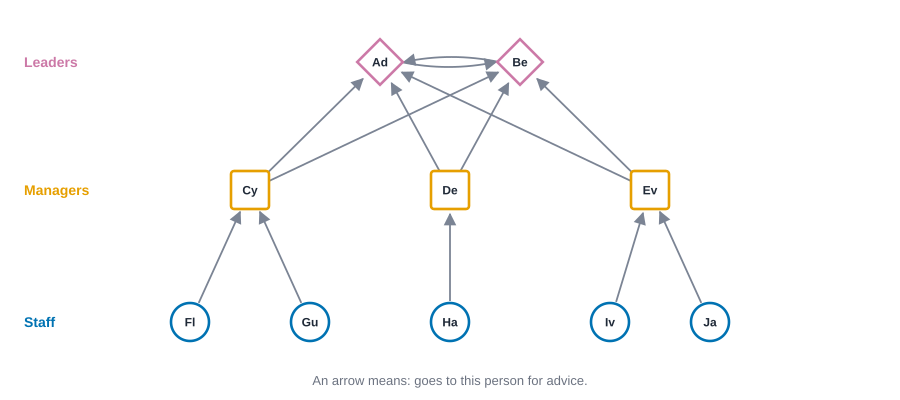
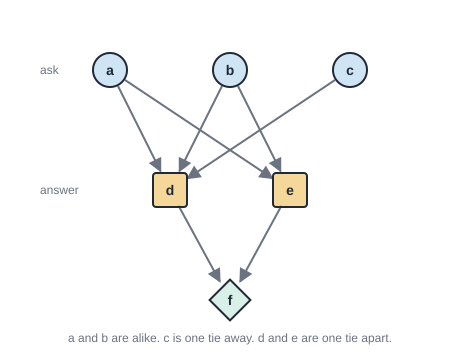
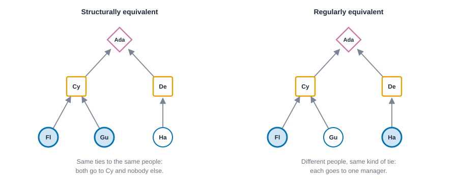
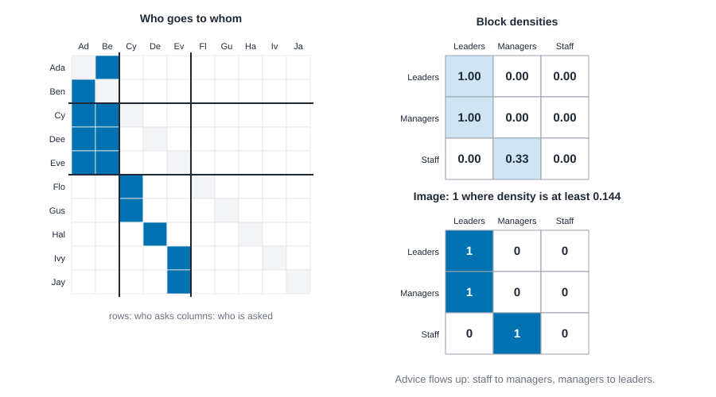

# Positions and roles {#sec-positions-and-roles}

::: {.callout-note appearance="simple"}
## Prerequisites
@sec-networks-as-data, @sec-centrality and @sec-subgroups. Directed ties (@sec-networks-as-data) matter a lot here, and so does the difference between a group of people who tie to each other and a set of people who merely look alike. The later sections borrow the idea of a fair baseline from @sec-tests-and-null-models and refer ahead to @sec-latent-space and @sec-multilayer.
:::

::: {.callout-note title="The short version"}
People who play the same part in a network don't have to know each other. Two cashiers in different stores, or two nurses on different wards, stand in the same pattern of relationships to everyone around them. This chapter gives three ways of saying "the same pattern", from strict to loose, and then shows how to squeeze a whole network down to a small map of the parts people play. The most useful lesson is a warning: the computer proposes positions, and you decide whether they mean anything.
:::

::: {.callout-note title="Why you might care"}
If you want to know who does the same job in practice, and not who has the same title, positions are how you find out. They let you compare organizations of different sizes, spot the person doing a job that isn't on their door, and see which firms in a supply chain play the same tier.
:::

## People who play the same part

::: {.callout-tip appearance="simple"}
## Code lives next to the idea
Each idea comes with its code right where it is explained. The Rust blocks in this chapter run top to bottom as one script: the first builds the office network, and later ones reuse it.
:::

Think about the last place you worked, or the last school you went to. You could probably describe the people there without using a single name. The person who everyone goes to when the printer breaks. The one who passes your questions up to the boss. The new hire who asks a lot of people a little bit each. We describe people by the *part they play*, and the part is defined by who they relate to and how, not by who they are.

That is an old and powerful idea in sociology. Two people can fill the same position without ever meeting. Two nurses on different wards, two shift supervisors at different shops, two aunts in different families: they have never spoken, yet they stand in the same pattern of relationships to everyone else. A network lets us ask this question without waiting for anyone's job title. Who has the *same pattern of ties* as whom?

The last chapter was about groups: sets of people who tie to *each other*. This one is about positions: sets of people who tie to the *same kinds of others*. The difference is easy to blur, so hold onto it. Members of a group talk to one another. Members of a position may never exchange a word. Think of all the cashiers in a supermarket chain. They are not a community, and yet they are alike in a way a network can see.

## Position, role and group: three words that get mixed up

People use these three words loosely, and a lot of confusion in this chapter comes from that. So let's pin them down once.

A **group** is a set of people who tie to *each other*. Cohesion is the point, and the tools for finding groups (@sec-subgroups) look for places where ties are dense inside and sparse outside. A **position** is a set of people who stand in the *same pattern of ties to everyone else*. Members of a position may never exchange a word. A **role**, in the sense White, Boorman and Breiger gave the word [@white1976social], is the pattern of ties *between* positions: "staff go to managers, managers go to leaders." A position is a set of people. A role is a relation among sets. (In everyday speech a role is also a set of expectations about how someone behaves. A network can only see the ties, so we will use the word in the narrow sense.)

| | Group (community) | Position | Role |
| --- | --- | --- | --- |
| What it is | People who tie to each other | People with the same pattern of ties to others | The pattern of ties between positions |
| Do members tie to each other? | Yes, mostly | Not necessarily | Not a set of people at all |
| How you find it | Dense inside, sparse between (@sec-subgroups) | Equivalence of tie patterns (this chapter) | Read the image matrix of a blockmodel |
| In the office below | Nothing tight enough to call a team, apart from the two leaders | Leaders, managers, staff | Staff go to managers, managers go to leaders |

The history is short enough to tell in a paragraph. Lorrain and White introduced structural equivalence in 1971 [@lorrain1971structural]. Burt turned it into a distance you can compute [@burt1976positions]. White, Boorman and Breiger wrote down the blockmodel [@white1976social]. White and Reitz relaxed "the same people" to "the same kinds of people" and called the result regular equivalence [@white1983graph], and Everett, Borgatti and others worked out its relatives and how to find them [@everett1985role; @borgatti1992notions; @borgatti1993two; @everett1994regular]. Doreian, Batagelj and Ferligoj later turned blockmodeling into an optimization problem with several kinds of ideal blocks [@doreian2005generalized]. We will meet each step, in roughly that order.

## A small office

Here's the network we'll use all chapter. It is a ten-person office, drawn in @fig-office-network. Each arrow means "goes to this person for advice." There are two leaders, Ada and Ben, who go to each other. There are three managers, Cy, Dee and Eve, who each go to both leaders. And there are five staff: Flo and Gus go to Cy, Hal goes to Dee, and Ivy and Jay go to Eve.

{#fig-office-network fig-alt="Ten people in three rows. Two leaders at the top, Ada and Ben, point at each other. Three managers in the middle each point at both leaders. Five staff at the bottom each point at one manager: Flo and Gus at Cy, Hal at Dee, and Ivy and Jay at Eve."}

I drew the picture in rows because I already knew the answer, which is cheating a little. Pretend instead that all you had was the list of arrows. Could you work out who plays which part? That's the job of this chapter, and we'll do it in four steps, from the strictest idea of "alike" to the loosest. First the data: the code below builds the office, and in its summary you should see 10 people and 13 arrows.

::: {.panel-tabset group="language"}

## R

```r
library(knappnet)

people <- c("Ada", "Ben", "Cy", "Dee", "Eve", "Flo", "Gus", "Hal", "Ivy", "Jay")
# One position in each list is one tie: from[i] goes to to[i] for advice.
from <- c(0, 1, 2, 2, 3, 3, 4, 4, 5, 6, 7, 8, 9)
to <- c(1, 0, 0, 1, 0, 1, 0, 1, 2, 2, 3, 4, 4)
office <- net_frame(
  data.frame(source = people[from + 1], target = people[to + 1]),
  nodes = data.frame(id = people),
  directed = TRUE
)
office
```

::: {.code-output}
```text
# net_frame: 10 nodes, 13 edges
#   directed:  yes       mode: one-mode (10 actors)
#   weights:   unweighted
#   time:      static    space: none
#   simple:    no loops, no parallel edges
#   components: 1    isolates: 0    density: 0.144
#
# Nodes (10 x 1)      Edges (13 x 2)
#   id                  source target
#   <chr>               <chr>  <chr>
# 1 Ada               1 Ada    Ben
# 2 Ben               2 Ben    Ada
# 3 Cy                3 Cy     Ada
# 4 Dee               4 Cy     Ben
# 5 Eve               5 Dee    Ada
# 6 Flo               6 Dee    Ben
#   ... 4 more rows     ... 7 more rows
```
:::

## Python

```python
import networkx as nx

# People are numbered from zero in Rust; here the ties are written as pairs of numbers
# and the names stay in a list on the side.
names = ["Ada", "Ben", "Cy", "Dee", "Eve", "Flo", "Gus", "Hal", "Ivy", "Jay"]
src = [0, 1, 2, 2, 3, 3, 4, 4, 5, 6, 7, 8, 9]
dst = [1, 0, 0, 1, 0, 1, 0, 1, 2, 2, 3, 4, 4]
office = nx.DiGraph()
office.add_nodes_from(range(len(names)))
office.add_edges_from(zip(src, dst))
print(f"{office.number_of_nodes()} people, {office.number_of_edges()} ties")
```

::: {.code-output}
```text
10 people, 13 ties
```
:::

## Rust

```rust
use knappnet::Graph;

// People are numbered from zero; the names stay in a list on the side.
let names = ["Ada", "Ben", "Cy", "Dee", "Eve", "Flo", "Gus", "Hal", "Ivy", "Jay"];
// One position in each list is one tie: from[i] goes to to[i] for advice.
let from = [0, 1, 2, 2, 3, 3, 4, 4, 5, 6, 7, 8, 9];
let to = [1, 0, 0, 1, 0, 1, 0, 1, 2, 2, 3, 4, 4];
let office = Graph::from_edges(names.len(), &from, &to, None, true)?;
println!("{}", office.describe().with_labels(&names));
println!("{} people, {} ties", office.node_count(), office.edge_count());
```

::: {.code-output}
```text
Directed network: 10 nodes, 13 ties (arcs)
  Density           0.144
  Out-degree        1 to 2, mean 1.30
  In-degree         0 to 4, mean 1.30
  Reciprocity       0.15 of ties are returned
  Connected pieces  1 weak, 9 strong
  Isolated nodes    0
  Loops, repeats    none
  Busiest           Ada (5), Ben (5), Cy (4)

10 people, 13 ties
```
:::

:::

## Structural equivalence: the same ties to the same people

The strictest idea is **structural equivalence**. Two people are structurally equivalent when they have exactly the same ties to exactly the same others [@lorrain1971structural]. Flo and Gus are the example in this office: both go to Cy, and neither goes to, or is gone to by, anyone else. If you swapped their names on the picture, nothing about the network would change. In the matrix, their rows and columns are identical.

That is rarely true to the letter in real data, so we measure *how far* two people are from it. Write down each person's **tie profile**: for every other person, whether they go to that person and whether that person goes to them. Then compare two people's profiles. The question is: in how many places do their two profiles disagree? The most common answer is the **Euclidean distance** [@burt1976positions],

$$
d_{ij} = \sqrt{\sum_{k \neq i, j} \left[ (a_{ik} - a_{jk})^2 + (a_{ki} - a_{kj})^2 \right]},
$$

where $a_{ik}$ is 1 if $i$ has a tie to $k$ and 0 if not. In words: go through everyone else, count how often the two people differ in who they go to and who goes to them, and take a square root. We skip $k = i$ and $k = j$, so the two people's ties to *each other* are not held against them [@wasserman1994social, chap. 9]. Zero means identical profiles. Bigger means more different.

::: {.callout-tip title="In plain words"}
This formula scores how different two people are. Read $d_{ij}$ as "the distance between person $i$ and person $j$", and $a_{ik}$ as "1 if $i$ goes to $k$, otherwise 0". For each other person $k$, the first bracket asks whether $i$ and $j$ differ in going to $k$, and the second asks whether they differ in being gone to by $k$. Squaring turns each difference into a 1 and each match into a 0, so the big sum is just the number of disagreements, and the square root turns that count back into a distance. For Cy and Dee in the office there are three disagreements (Flo and Gus go to Cy and not to Dee, and Hal goes to Dee and not to Cy), so the distance is the square root of 3, which is 1.732, the number you'll see in the output below.
:::

The code below measures every pair of people in the office. Look for zeros, which mean identical profiles, and watch how the distance grows as the profiles drift apart.

::: {.panel-tabset group="language"}

## R

```r
# net_struct_equiv() compares tie profiles by Euclidean distance by default.
dists <- net_struct_equiv(office)

pairs <- cbind(
  a = c("Flo", "Ivy", "Ada", "Flo", "Cy", "Cy"),
  b = c("Gus", "Jay", "Ben", "Hal", "Dee", "Eve")
)
data.frame(pairs, distance = round(dists[pairs], 3))
```

::: {.code-output}
```text
# A tibble: 6 × 3
  a     b     distance
  <chr> <chr>    <dbl>
1 Flo   Gus      0    
2 Ivy   Jay      0    
3 Ada   Ben      0    
4 Flo   Hal      1.414
5 Cy    Dee      1.732
6 Cy    Eve      2    
```
:::

## Python

```python
# TODO(code, Python): needs structural-equivalence distances (the knappnet Python backend runs NetworkX functions only, and NetworkX has none); net_struct_equiv() is in the R and Rust packages only.
```

::: {.code-output}
```text
TODO(output)
```
:::

## Rust

```rust
use knappnet::metrics::equivalence::{compute_structural_equivalence, EquivalenceOptions};

// The default compares profiles by Euclidean distance.
let dist = compute_structural_equivalence(&office, EquivalenceOptions::default())?;
for (a, b) in [(5, 6), (8, 9), (0, 1), (5, 7), (2, 3), (2, 4)] {
    println!("{:<4} and {:<4} {:.3}", names[a], names[b], dist.get(a, b));
}
```

::: {.code-output}
```text
Flo  and Gus  0.000
Ivy  and Jay  0.000
Ada  and Ben  0.000
Flo  and Hal  1.414
Cy   and Dee  1.732
Cy   and Eve  2.000
```
:::

:::

Flo and Gus are at distance 0, and so are Ivy and Jay: identical profiles. Ada and Ben are at 0 as well, which surprises people. They go to each other, but that is the one cell we skip, and every other tie they have is the same. Flo and Hal are at 1.414 (the square root of 2), because Flo goes to Cy and Hal goes to Dee, which is two differences. Cy and Dee are further apart, at 1.732, because Cy has two staff coming to them and Dee has one.
Notice that structural equivalence found the *pairs*, but it hasn't told us "these are the managers." Cy, Dee and Eve are all different from each other, because each has a different set of staff. A strict standard like this is good at spotting near-duplicates and bad at spotting parts. In practice, people take a whole table of these distances and group the people whose rows are close, using a clustering method. That step needs a judgment about how close is close enough, so it is worth being honest that the computer proposes and you decide.


### The definition, exactly

Here is the same idea as a yes-or-no test: are these two people exactly alike in who they connect to? This is the formal part, so on a first read you can skip to the six-person example below and still have the idea.

Let $a_{ik}$ be 1 if person $i$ has a tie to person $k$ and 0 if not. Two people $i$ and $j$ are **structurally equivalent** when

$$
a_{ik} = a_{jk} \quad \text{and} \quad a_{ki} = a_{kj} \quad \text{for every other person } k \neq i, j.
$$

In words: whoever $i$ goes to, $j$ goes to; whoever goes to $i$, goes to $j$. This is the definition of @lorrain1971structural in the form @wasserman1994social give it in chapter 9. Whether the two people's ties to *each other* ($a_{ij}$ and $a_{ji}$) should count is a convention, and this book, like the software it uses, leaves them out.

::: {.callout-tip title="In plain words"}
This is the strict test, written as a sentence. The part $a_{ik} = a_{jk}$ says "$i$ and $j$ go to the same people", the part $a_{ki} = a_{kj}$ says "$i$ and $j$ are gone to by the same people", and "for every other person $k$" means everyone except the two being compared. In the six-person example below, $a$ and $b$ pass: both go to $d$ and $e$, neither goes to $c$ or $f$, and nobody goes to either of them. Persons $a$ and $c$ fail, because $a$ goes to $e$ and $c$ doesn't.
:::

Two things follow. First, if you list people so that equivalent ones sit next to each other, the matrix breaks into blocks that are either all 0 or all 1 (apart from the diagonal). That is the dream picture for a blockmodel, and we will see how rarely real data give it.

Second, the definition has a wrinkle that textbooks tend to skip. With the pair's own ties left out, "structurally equivalent" is not always transitive. Take three people in a pecking order, where $i$ goes to $j$ and to $l$, and $j$ goes to $l$. Then $i$ and $j$ are equivalent (they differ only in the one cell we skip), and so are $j$ and $l$, but $i$ and $l$ are not, because $i$ goes to $j$ and $l$ does not. Exact classes can therefore fail to be clean. One more reason to work with distances, and with clustering, instead of expecting perfect classes.

### A six-person example you can do on paper

Here is a network small enough to check by hand. Six people, $a$ to $f$. Each of $a$, $b$ and $c$ goes to $d$ or $e$ for advice: $a$ and $b$ go to both, $c$ goes only to $d$. Both $d$ and $e$ go to $f$. That is seven arrows: $a \to d$, $a \to e$, $b \to d$, $b \to e$, $c \to d$, $d \to f$, $e \to f$.

{#fig-positions-six fig-alt="Six circles and squares joined by seven arrows. In the top row, a and b each have arrows to both d and e, and c has one arrow to d. In the middle row, d and e each have an arrow to f, the diamond at the bottom."}

Compare $a$ and $b$. Skip $a$ and $b$ themselves, and look at everyone else: $c$, $d$, $e$, $f$. Both go to $d$ and $e$ and to neither $c$ nor $f$; nobody among $c$, $d$, $e$, $f$ goes to either of them. The profiles are identical, so $a$ and $b$ are structurally equivalent, at distance 0.

Compare $a$ and $c$. Skip those two and look at $b$, $d$, $e$, $f$. Person $a$ goes to $d$ and $e$. Person $c$ goes to $d$ but not $e$. That is one difference, so the distance is $\sqrt{1} = 1$.

Compare $d$ and $e$. Skip them and look at $a$, $b$, $c$, $f$. Both go to $f$. Both are gone to by $a$ and $b$, but $c$ goes to $d$ and not to $e$. One difference again, distance 1. The code checks all three, and adds the **correlation** between two profiles, which we need to talk about next.

::: {.panel-tabset group="language"}

## R

```r
# Six people. a, b and c each go to d or e (or both), and d and e both go to f.
six_names <- c("a", "b", "c", "d", "e", "f")
six <- net_frame(
  data.frame(
    source = c("a", "a", "b", "b", "c", "d", "e"),
    target = c("d", "e", "d", "e", "d", "f", "f")
  ),
  nodes = data.frame(id = six_names),
  directed = TRUE,
  quiet = TRUE
)

six_euclid <- net_struct_equiv(six)
six_cor <- net_struct_equiv(six, method = "correlation")

pairs <- cbind(x = c("a", "a", "d", "a", "c"), y = c("b", "c", "e", "d", "d"))
data.frame(
  pairs,
  distance = round(six_euclid[pairs], 3),
  correlation = round(six_cor[pairs], 3)
)
```

::: {.code-output}
```text
# A tibble: 5 × 4
  x     y     distance correlation
  <chr> <chr>    <dbl>       <dbl>
1 a     b        0          1     
2 a     c        1          0.6547
3 d     e        1          0.7746
4 a     d        2         -0.2928
5 c     d        1.732      0     
```
:::

## Python

```python
# TODO(code, Python): needs structural-equivalence distances and correlations (the knappnet Python backend runs NetworkX functions only, and NetworkX has none); net_struct_equiv() is in the R and Rust packages only.
```

::: {.code-output}
```text
TODO(output)
```
:::

## Rust

```rust
use knappnet::metrics::equivalence::EquivalenceMethod;

// Six people, numbered 0 to 5 and called a to f. a, b and c each go to d or e, and d and e go to f.
let six_names = ["a", "b", "c", "d", "e", "f"];
let six = Graph::from_edges(6, &[0, 0, 1, 1, 2, 3, 4], &[3, 4, 3, 4, 3, 5, 5], None, true)?;
let six_euclid = compute_structural_equivalence(&six, EquivalenceOptions::default())?;
let six_cor = compute_structural_equivalence(
    &six,
    EquivalenceOptions { method: EquivalenceMethod::Correlation, ..Default::default() },
)?;
for (x, y) in [(0, 1), (0, 2), (3, 4), (0, 3), (2, 3)] {
    println!("{} and {}  distance {:.3}  correlation {:.3}", six_names[x], six_names[y], six_euclid.get(x, y), six_cor.get(x, y));
}
```

::: {.code-output}
```text
a and b  distance 0.000  correlation 1.000
a and c  distance 1.000  correlation 0.655
d and e  distance 1.000  correlation 0.775
a and d  distance 2.000  correlation -0.293
c and d  distance 1.732  correlation 0.000
```
:::

:::

The three distances match the paper work: 0, 1 and 1. The correlations are 1 for the identical pair and about 0.65 and 0.77 for the two near-misses. The last row, $c$ and $d$, is there for its correlation. Skip $c$ and $d$ and look at $a$, $b$, $e$, $f$: person $c$'s only tie is to $d$, which is the cell we skip, so $c$'s profile has no ties at all. A profile with no variation has no correlation (you can't ask whether two lists rise and fall together when one never moves), and the engine reports 0 for it, which is a convention and not a finding.

### Euclidean distance or correlation?

The distance we have used counts the cells where two profiles differ. It is easy to explain and it has one habit you should know about: it grows with how many ties people have. A person with a hundred ties is far from nearly everyone, and two people with almost no ties are close to each other even if they tie to completely different people. Is that what you want? Sometimes. If you want to know who plays the same part regardless of how busy they are, you want the **correlation** between profiles instead. Write the profile of $i$ as the list of $a_{ik}$ and $a_{ki}$ over $k \neq i, j$, and let $r_{ij}$ be the ordinary Pearson correlation of the two lists. A correlation of 1 means the two profiles go up and down together, and $1 - r_{ij}$ is a distance you can cluster. Notice that `net_struct_equiv()` with `method = "correlation"` returns the correlation itself, not a distance, so take $1 - r$ before you cluster.

::: {.callout-tip title="In plain words"}
Write each person's tie list as a row of 0s and 1s: who they go to and who goes to them. The correlation $r_{ij}$ asks whether two such rows rise and fall together, so 1 means the same pattern no matter how many ties each person has, and $1 - r_{ij}$ is 0 for identical patterns. In the six-person example, $a$ and $b$ have correlation 1 and so distance 0, and the two near-misses have correlations of about 0.65 and 0.77, which makes distances of about 0.35 and 0.23 (one minus each, worked out by hand).
:::

The two usually agree on a clean network and can disagree on a sparse one. We will see a real case in the monastery below.

### From distances to positions: two routes

A table of distances is not a set of positions. To get positions you have to cut the people into groups, and there are two classical ways.

**Hierarchical clustering.** Start with every person alone. Repeatedly merge the two closest groups, where the distance between two groups is the average (or the largest, or the smallest) distance between their members. Stop when $k$ groups are left. That is a cut of the clustering tree, or dendrogram, and the choice of "average" is called a linkage.

**CONCOR.** Breiger, Boorman and Arabie [@breiger1975algorithm] noticed something odd. Take the matrix of profile correlations and correlate its columns with each other. Do it again, and again. Every entry drifts toward $+1$ or $-1$. When they get there, the signs split the people in two. Then you do the same inside each half, which gives up to $2^{\text{depth}}$ blocks (two after the first split, up to four after the second). It needs no distance and no choice of linkage, and it always splits, whether or not there is anything to find.

The code runs both on the six-person network (where we know the answer should be $\{a, b, c\}$, $\{d, e\}$, $\{f\}$) and on the office. For the office we make three groups, the number of positions we know are there, with two linkages, and we run CONCOR to depths one and two. R and Rust use the engine's CONCOR, and R cuts the tree with base R's `hclust()`. The Python tab is a stub: NetworkX has no structural equivalence and no CONCOR, so there is nothing for the Python backend to run yet. The Rust tab also writes a shortcut for the distances (compare the full profiles, then take back the two terms we skip), and the first line of its output checks that it agrees with the engine, so we can use it later in loops.

::: {.panel-tabset group="language"}

## R

```r
d_office <- net_struct_equiv(office)

# Six people first: three groups from the average-linkage tree, numbered from 0.
setNames(cutree(hclust(as.dist(six_euclid), "average"), 3) - 1L, six_names)

# The office: average and complete linkage, and CONCOR at depth 1 and depth 2.
data.frame(
  average = cutree(hclust(as.dist(d_office), "average"), 3) - 1L,
  complete = cutree(hclust(as.dist(d_office), "complete"), 3) - 1L,
  concor_1 = net_concor(office, depth = 1) - 1L,
  concor_2 = net_concor(office, depth = 2) - 1L
)
```

::: {.code-output}
```text
[1] TRUE
# A tibble: 6 × 2
  person group
  <chr>  <int>
1 a          0
2 b          0
3 c          0
4 d          1
5 e          1
6 f          2
# A tibble: 10 × 5
   person average complete concor_1 concor_2
   <chr>    <int>    <int>    <int>    <int>
 1 Ada          0        0        0        0
 2 Ben          0        0        0        0
 3 Cy           1        1        0        1
 4 Dee          1        2        0        1
 5 Eve          2        1        0        1
 6 Flo          1        2        1        2
 7 Gus          1        2        1        2
 8 Hal          1        2        1        2
 9 Ivy          1        2        1        3
10 Jay          1        2        1        3
```
:::

## Python

```python
# TODO(code, Python): needs net_struct_equiv() and net_concor() (the knappnet Python backend runs NetworkX functions only, and NetworkX has none), plus a cut of the clustering tree.
```

::: {.code-output}
```text
TODO(output)
```
:::

## Rust

```rust
use knappnet::metrics::equivalence::{compute_concor, ConcorOptions};

// Hierarchical clustering by hand: merge the two closest groups, over and over, where the distance
// between two groups is the average (or the largest) distance between their members. Stop at k groups.
let cluster = |d: &Vec<Vec<f64>>, k: usize, complete: bool| -> Vec<usize> {
    let mut groups: Vec<Vec<usize>> = (0..d.len()).map(|i| vec![i]).collect();
    while groups.len() > k {
        let (mut best, mut at) = (f64::INFINITY, (0, 1));
        for p in 0..groups.len() {
            for q in p + 1..groups.len() {
                let gaps: Vec<f64> = groups[p].iter().flat_map(|&i| groups[q].iter().map(move |&j| d[i][j])).collect();
                let gap = if complete { gaps.iter().cloned().fold(0.0, f64::max) } else { gaps.iter().sum::<f64>() / gaps.len() as f64 };
                if gap < best - 1e-12 {
                    best = gap;
                    at = (p, q);
                }
            }
        }
        let merged = groups.remove(at.1);
        groups[at.0].extend(merged);
    }
    // Number the groups from 0 in the order their first member appears.
    groups.sort_by_key(|g| *g.iter().min().unwrap());
    let mut label = vec![0; d.len()];
    for (c, g) in groups.iter().enumerate() {
        for &i in g {
            label[i] = c;
        }
    }
    label
};
let to_rows = |m: &knappnet::matrix::Dense, n: usize| -> Vec<Vec<f64>> {
    (0..n).map(|i| (0..n).map(|j| m.get(i, j)).collect()).collect()
};

let as_i64 = |v: &[usize]| -> Vec<i64> { v.iter().map(|&x| x as i64).collect() };

// The office as a table of 0s and 1s, and distances straight from the definition for a list of
// tie tables (several relations can be stacked later).
let d_office = to_rows(&dist, 10);
let mut adj_office = vec![vec![0.0_f64; 10]; 10];
for (&f, &t) in from.iter().zip(to.iter()) {
    adj_office[f as usize][t as usize] = 1.0;
}
let euclid = |layers: &[&Vec<Vec<f64>>]| -> Vec<Vec<f64>> {
    let n = layers[0].len();
    (0..n).map(|i| (0..n).map(|j| {
        layers.iter().map(|m| (0..n).filter(|&k| k != i && k != j)
            .map(|k| (m[i][k] - m[j][k]).powi(2) + (m[k][i] - m[k][j]).powi(2)).sum::<f64>()).sum::<f64>().sqrt()
    }).collect()).collect()
};
let own = euclid(&[&adj_office]);
println!("hand-written distances agree with the engine: {}", (0..10).all(|i| (0..10).all(|j| (own[i][j] - d_office[i][j]).abs() < 1e-9)));

println!("six people, average linkage, 3 groups: {:?}", cluster(&to_rows(&six_euclid, 6), 3, false));
let average = cluster(&d_office, 3, false);
let complete = cluster(&d_office, 3, true);
let concor_1 = compute_concor(&office, ConcorOptions { depth: 1, ..Default::default() })?;
let concor_2 = compute_concor(&office, ConcorOptions { depth: 2, ..Default::default() })?;
println!("{:<5}{:>10}{:>10}{:>10}{:>10}", "", "average", "complete", "CONCOR 1", "CONCOR 2");
for i in 0..10 {
    println!("{:<5}{:>10}{:>10}{:>10}{:>10}", names[i], average[i], complete[i], concor_1.membership[i] - 1, concor_2.membership[i] - 1);
}
```

::: {.code-output}
```text
hand-written distances agree with the engine: true
six people, average linkage, 3 groups: [0, 0, 0, 1, 1, 2]
        average  complete  CONCOR 1  CONCOR 2
Ada           0         0         0         0
Ben           0         0         0         0
Cy            1         1         0         1
Dee           1         2         0         1
Eve           2         1         0         1
Flo           1         2         1         2
Gus           1         2         1         2
Hal           1         2         1         2
Ivy           1         2         1         3
Jay           1         2         1         3
```
:::

:::

The first line of the Rust output says the shortcut and the engine agree, so we can use the shortcut in loops. On the six-person network, average linkage gives $\{a, b, c\}$, $\{d, e\}$ and $\{f\}$: the three positions in @fig-positions-six. The office is less kind.

Average linkage with three groups puts Ada and Ben together, which is right, and then leaves Eve by herself and lumps Cy, Dee and all five staff into one big group. Complete linkage, with the same three groups, puts Cy and Eve together and Dee with the staff. Neither is "the leaders, the managers and the staff". CONCOR at depth one splits Ada, Ben, Cy, Dee and Eve from the five staff, a good first cut between upper and lower. At depth two it gives Ada and Ben, then the three managers, then the staff in two pieces, Flo, Gus and Hal against Ivy and Jay. The first three groups are the positions we know. The staff split follows who they go to.

None of this is a bug, and it is the most useful thing to learn from the office. Structural equivalence asks whether two people go to the *same people*, and the staff mostly don't. It is good at finding near-duplicates (Flo and Gus, Ivy and Jay) and poor at finding parts. Which of the five-staff splits you get also depends on choices that have no right answer: the linkage, the number of groups, the depth. The computer proposes and you decide, and you should say what you decided and why.

## Regular equivalence: the same kinds of ties to the same kinds of people

If we let go of "the same people" and keep "the same *kinds* of people," we get **regular equivalence** [@white1983graph; @everett1994regular]. Two people are regularly equivalent when, for every tie one has to someone, the other has the same kind of tie to someone who is *also* in the same position as that someone. It sounds circular, and it is, in a useful way: positions are defined by their relations to positions.

The managers show it. Cy goes to the leaders and gets visits from staff. So do Dee and Eve. They do not share any staff, so they are not structurally equivalent, but each of them plays the same part: *the person above the staff and below the leaders*. Flo, Gus, Hal, Ivy and Jay are likewise all regularly equivalent. Each goes to one manager, and every manager is, itself, in the same position.

@fig-equivalence-kinds sets the two ideas side by side.

{#fig-equivalence-kinds fig-alt="Two small drawings. In each, Ada at the top receives from two managers, Cy and Dee, and three staff members each point at a manager. On the left, Flo and Gus are highlighted and both point at Cy. On the right, Flo and Hal are highlighted: Flo points at Cy and Hal points at Dee."}

An algorithm for finding the regular equivalence classes is CATREGE [@borgatti1993two]. It starts with everyone in one class, then repeatedly splits each class by the kinds of ties its members have to the classes of their alters, until nothing splits.

::: {.panel-tabset group="language"}

## R

```r
# net_regular_equiv() numbers the classes from 1; the book counts from 0.
regular_office <- as.vector(net_regular_equiv(office)) - 1L
tapply(people, regular_office, paste, collapse = ", ")
```

::: {.code-output}
```text
# A tibble: 3 × 2
  class members                
  <int> <chr>                  
1     0 Ada, Ben               
2     1 Cy, Dee, Eve           
3     2 Flo, Gus, Hal, Ivy, Jay
```
:::

## Python

```python
# TODO(code, Python): needs regular equivalence (the knappnet Python backend runs NetworkX functions only, and NetworkX has none); net_regular_equiv() is in the R and Rust packages only.
```

::: {.code-output}
```text
TODO(output)
```
:::

## Rust

```rust
use knappnet::metrics::regular::{compute_regular_equivalence, RegularOptions};

// `None` means no starting partition: everyone begins in one class.
let classes = compute_regular_equivalence(&office, None, RegularOptions::default())?;
let k = classes.membership.iter().max().unwrap() + 1;
for class in 0..k {
    let members: Vec<&str> = (0..names.len())
        .filter(|&i| classes.membership[i] == class)
        .map(|i| names[i])
        .collect();
    println!("class {class}  {members:?}");
}
```

::: {.code-output}
```text
class 0  ["Ada", "Ben"]
class 1  ["Cy", "Dee", "Eve"]
class 2  ["Flo", "Gus", "Hal", "Ivy", "Jay"]
```
:::

:::

Three classes, and they are exactly the leaders, the managers and the staff. The computer was never told the job titles. It rebuilt them from the arrows alone.
Regular equivalence has a catch. In an *undirected* network, with no way to tell the direction of a tie, the strictest version collapses: everyone with at least one tie ends up in one big class. That is a known property of the method [@borgatti1993two], and the reason this chapter uses a directed example. If your ties have no direction, you will have to bring in other information, such as a starting partition, to get anywhere.

### Why regular equivalence is about roles, not neighbours

It is easy to read "same kinds of ties to the same kinds of people" as "same neighbours, roughly." It isn't, and the difference is the whole point. Here is the precise version. Split the people into classes. The split is a **regular equivalence** when, for every pair of classes $B$ and $C$, and every two people $i$ and $j$ in $B$:

- if $i$ has a tie to someone in $C$, then $j$ has a tie to someone in $C$ too, and
- if someone in $C$ has a tie to $i$, then someone in $C$ has a tie to $j$ too.

Nobody is asked to share a neighbour. Flo goes to Cy and Hal goes to Dee, and that's fine, because Cy and Dee are in the same class. Seen as a table of blocks, the condition says that every block of the matrix is either empty, or has at least one tie in every row and at least one in every column. We will give such a block a name in the next section. It is the reason a block with only a third of its cells filled can still be perfectly "regular."

::: {.callout-tip title="In plain words"}
Swap "the same neighbours" for "neighbours of the same kind". The letters $B$ and $C$ stand for two classes, and the condition says that if one person in class $B$ goes to someone in class $C$, everyone else in $B$ must go to someone in $C$ too, though not necessarily the same someone. In the office, Flo (staff) goes to Cy and Hal (staff) goes to Dee. Those are different people, but both are managers, so the condition holds. It would fail if Hal went to nobody in the manager class.
:::

Two more facts are worth having in your head.

**There are many regular equivalences, and the algorithm returns the coarsest.** Take five people in a path, each tied to the next. Put them into three classes (the two ends, the two next to the ends, the middle person) and the split is regular. Put all five into one class and it is regular too, because everyone has a neighbour in the one class. CATREGE returns the coarsest regular split, the largest equivalence, which on the path is "everyone", and that is not a useful answer. The coarsest regular split is fine for the office because directions give the arrows enough shape to keep leaders, managers and staff apart. For an undirected network it is nearly always too coarse, which is why the chapter's earlier warning matters.

**Regular equivalence is about the kinds of ties, not the number.** A manager with five staff and a manager with one are regularly equivalent. If the number matters, you want automorphic equivalence (next section) or a distance.

### REGE and its relatives

CATREGE treats ties as categories and splits classes exactly. Its older cousin REGE works on valued ties and returns a *similarity* for each pair instead of classes [@borgatti1993two]. The idea is iterative, and you can hold it in your head. Give every pair of people a similarity of 1 to start. Then, in each round, score a pair $(i, j)$ by how well $i$'s ties can be matched with $j$'s ties, where a match between a tie to $k$ and a tie to $l$ is worth the current similarity of $k$ and $l$ (and a tie of different strength is worth less). Pairs whose neighbours are in similar positions score high, and the new scores are the next round's weights. After a few rounds the similarities settle, and you cluster them the way we clustered distances.

knappnet computes the categorical version (CATREGE) and not REGE, so we have no REGE numbers to show. The nearest thing it has for valued ties is to treat each distinct value as a category, and the engine's documentation says so; if your ties have strengths you want to respect, check your result against a package that has REGE before you trust a cluster.


## Automorphic equivalence: the same part, played by different people

Between the strictest idea and the loosest sits a third. Structural equivalence asks for the same ties to the *same people*. That is stricter than it sounds. Look again at the office. Cy goes to both leaders and has two staff, Flo and Gus. Eve goes to both leaders and has two staff, Ivy and Jay. Cy and Eve share no staff, so they are not structurally equivalent. Yet if you swapped Cy with Eve, and at the same time Flo and Gus with Ivy and Jay, every arrow in the picture would land on an arrow. The network cannot tell the two managers apart.

That is **automorphic equivalence** [@everett1985role; @borgatti1992notions]. An **automorphism** is a relabeling of the people that keeps every tie: if $\pi$ sends each person $i$ to a person $\pi(i)$, then $a_{\pi(i)\,\pi(j)} = a_{ij}$ for every pair. Two people are automorphically equivalent when some automorphism sends one to the other. Dee is not equivalent to Cy, because Dee has one staff member and Cy has two, and no relabeling can change how many arrows end at someone.

::: {.callout-tip title="In plain words"}
An automorphism is a shuffle of the names that leaves the picture looking exactly the same. Read $\pi$ as the shuffle and $\pi(i)$ as "the name person $i$ gets after it". The equation says that if $i$ and $j$ were tied before the shuffle, their new names are tied after it, and the same goes for pairs that were not tied. In the office, swapping Cy with Eve while swapping Flo and Gus with Ivy and Jay moves no arrow, so that shuffle is an automorphism and Cy and Eve are automorphically equivalent.
:::

A path of five people in a row is the standard tiny example. The two ends are alike, because reversing the path swaps them. So are the two people next to the ends. The person in the middle is alone. Nobody in the path is structurally equivalent to anyone else (each has a different pair of neighbors), but there are three automorphic classes.

The practical meaning: "the same part, with different people in the supporting cast." The head of a two-person team is like the head of another two-person team, whoever is on the teams. It is a stronger idea than regular equivalence (above) and a weaker one than structural equivalence, and it is what you want when "plays the same part" should include "has the same number of followers".

The engine finds the classes exactly, by a search that tries relabelings; it can be slow on highly symmetric networks (a long ring, say), so it has a step limit and stops with an error instead of running forever. Python's NetworkX can list every relabeling that keeps the ties, which for ten people is cheap, but it does not turn them into classes, and the Python backend has no automorphic or regular equivalence yet, so that tab is a stub.

The code puts three notions side by side for the office: structural classes (people at distance 0), automorphic classes, and the regular classes from the section before this one. Then it checks the ladder, from the strict notion to the loose one, and runs the path of five.

::: {.panel-tabset group="language"}

## R

```r
auto_office <- net_auto_equiv(office) - 1L
# Structural classes: people at distance 0 from each other, numbered from 0 by first member.
structural_office <- cutree(hclust(as.dist(d_office)), h = 1e-9) - 1L

data.frame(structural = structural_office, automorphic = auto_office, regular = regular_office)

# Does every class of the first kind sit inside one class of the second kind?
c(
  structural_inside_automorphic = all(rowSums(table(structural_office, auto_office) > 0) == 1),
  automorphic_inside_regular = all(rowSums(table(auto_office, regular_office) > 0) == 1)
)

# A path of five people: 1 - 2 - 3 - 4 - 5.
path5 <- net_frame(
  data.frame(source = as.character(1:4), target = as.character(2:5)),
  nodes = data.frame(id = as.character(1:5)),
  directed = FALSE,
  quiet = TRUE
)
data.frame(
  automorphic = net_auto_equiv(path5) - 1L,
  regular = as.vector(net_regular_equiv(path5)) - 1L,
  row.names = path5$nodes$id
)
```

::: {.code-output}
```text
# A tibble: 10 × 4
   person structural automorphic regular
   <chr>       <int>       <int>   <int>
 1 Ada             0           0       0
 2 Ben             0           0       0
 3 Cy              1           1       1
 4 Dee             2           2       1
 5 Eve             3           1       1
 6 Flo             4           3       2
 7 Gus             4           3       2
 8 Hal             5           4       2
 9 Ivy             6           3       2
10 Jay             6           3       2
# A tibble: 2 × 2
  claim                                             holds
  <chr>                                             <lgl>
1 structural classes sit inside automorphic classes TRUE 
2 automorphic classes sit inside regular classes    TRUE 
# A tibble: 5 × 3
  node  automorphic regular
  <chr>       <int>   <int>
1 1               0       0
2 2               1       0
3 3               2       0
4 4               1       0
5 5               0       0
```
:::

## Python

```python
# TODO(code, Python): needs automorphic and regular equivalence classes (the knappnet Python backend runs NetworkX functions only, and NetworkX has none; it can only list the relabelings that keep every tie); net_auto_equiv() and net_regular_equiv() are in R and Rust.
```

::: {.code-output}
```text
TODO(output)
```
:::

## Rust

```rust
use knappnet::metrics::regular::compute_automorphic_equivalence;

// Number the classes from 0 in the order their first member appears.
let first_seen = |labels: &[usize]| -> Vec<usize> {
    let mut order: Vec<usize> = Vec::new();
    labels.iter().map(|&v| match order.iter().position(|&o| o == v) {
        Some(p) => p,
        None => { order.push(v); order.len() - 1 }
    }).collect()
};
let as_usize = |v: &[u32]| -> Vec<usize> { v.iter().map(|&x| x as usize).collect() };
let refines = |p: &[usize], q: &[usize]| -> bool {
    (0..p.len()).all(|i| (0..p.len()).all(|j| p[i] != p[j] || q[i] == q[j]))
};

// Structural classes: people at distance 0 from each other.
let first_zero: Vec<usize> = (0..10).map(|i| (0..10).find(|&j| dist.get(i, j) < 1e-9).unwrap()).collect();
let structural = first_seen(&first_zero);
let automorphic = as_usize(&compute_automorphic_equivalence(&office, 1_000_000)?);
let regular = as_usize(&classes.membership);
println!("{:<5}{:>11}{:>13}{:>9}", "", "structural", "automorphic", "regular");
for i in 0..10 {
    println!("{:<5}{:>11}{:>13}{:>9}", names[i], structural[i], automorphic[i], regular[i]);
}
println!("structural classes sit inside automorphic classes: {}", refines(&structural, &automorphic));
println!("automorphic classes sit inside regular classes: {}", refines(&automorphic, &regular));

// A path of five people: 0 - 1 - 2 - 3 - 4.
let path = Graph::from_edges(5, &[0, 1, 2, 3], &[1, 2, 3, 4], None, false)?;
println!("path of five, automorphic: {:?}  regular: {:?}",
    compute_automorphic_equivalence(&path, 1_000_000)?,
    compute_regular_equivalence(&path, None, RegularOptions::default())?.membership);
```

::: {.code-output}
```text
      structural  automorphic  regular
Ada            0            0        0
Ben            0            0        0
Cy             1            1        1
Dee            2            2        1
Eve            3            1        1
Flo            4            3        2
Gus            4            3        2
Hal            5            4        2
Ivy            6            3        2
Jay            6            3        2
structural classes sit inside automorphic classes: true
automorphic classes sit inside regular classes: true
path of five, automorphic: [0, 1, 2, 1, 0]  regular: [0, 0, 0, 0, 0]
```
:::

:::

Read the table from left to right, from the strictest idea to the loosest. Structural equivalence gives seven classes: only Ada and Ben, Flo and Gus, and Ivy and Jay pair up, and Cy, Dee, Eve and Hal are alone. Automorphic equivalence gives five: Ada and Ben, Cy and Eve, Dee, Flo, Gus, Ivy and Jay, and Hal. Hal is alone because Hal is the only staff member who goes to a manager with just one staff, and Dee is alone because Dee is that manager. Regular equivalence gives the three classes we know. The Python tab counts 16 relabelings of the office that keep every arrow: that is $2^4$, from swapping Ada and Ben, swapping Flo and Gus, swapping Ivy and Jay, and swapping the whole group of Cy, Flo and Gus with the group of Eve, Ivy and Jay.

The two lines of `true` (or `True`) are the ladder. In this network every structural class sits inside an automorphic class, and every automorphic class sits inside a regular class. In general that is how the three ideas are related, as long as the two people's own tie to each other does not break the swap [@borgatti1992notions]. A structurally equivalent pair has *the same* ties to the same people, so swapping them changes nothing, and an automorphism maps each person to someone with the same pattern around them, which is what regular equivalence asks for.

The last line is the path of five. Automorphic equivalence finds the three classes you can see (the ends, the next-to-ends, the middle). Regular equivalence, in the coarsest form the engine returns, puts all five in one class, which is the degenerate answer for undirected ties that we warned about.


## Blockmodels: squeezing the network down to its positions

Once you have positions, you can do something lovely: shrink the network. A **blockmodel** takes a partition of people into positions and replaces the network with a much smaller one, with one node per position [@white1976social]. To build it, put the people in order by position and look at the matrix of who goes to whom. It splits into blocks, one for each pair of positions. Then ask, for each block, how dense is it? That is the share of possible ties from the row position to the column position that are actually present.

@fig-blockmodel-matrix shows both. On the left is the office, ordered by position. On the right, the block densities, and below them the **image matrix**: a 1 where the block's density is at least as large as the density of the whole network, and a 0 elsewhere [@arabie1978constructing]. The cutoff is a convention, and the whole network's density is the usual choice.

{#fig-blockmodel-matrix fig-alt="On the left, a ten by ten grid with blue cells where a person asks another for advice, separated by heavy lines into leaders, managers and staff. Blue cells fill the leaders' own block and the managers-to-leaders block, and a scatter in the staff-to-managers block. On the right, a three by three table of block densities with values 1.00 for leaders to leaders and managers to leaders, 0.33 for staff to managers and 0 elsewhere, and below it the image matrix with ones in those three places."}

::: {.panel-tabset group="language"}

## R

```r
# Position of each person: 0 = leaders, 1 = managers, 2 = staff.
positions <- c(0, 0, 1, 1, 1, 2, 2, 2, 2, 2)
model <- net_blockmodel(office, membership = positions)

# One row per ordered pair of positions: the density of ties from the row's block to the column's block,
# and the image (1 when the block is denser than the whole network).
blocks <- net_block_summary(model)[c("from", "to", "density", "image")]
blocks$density <- round(blocks$density, 3)
blocks

round(unlist(model[c("overall_density", "r_squared")]), 4)
```

::: {.code-output}
```text
# A tibble: 9 × 4
   from    to density image
  <dbl> <dbl>   <dbl> <dbl>
1     0     0   1         1
2     1     0   1         1
3     2     0   0         0
4     0     1   0         0
5     1     1   0         0
6     2     1   0.333     1
7     0     2   0         0
8     1     2   0         0
9     2     2   0         0
# A tibble: 1 × 2
  overall_density r_squared
            <dbl>     <dbl>
1          0.1444    0.7003
```
:::

## Python

```python
# TODO(code, Python): needs a blockmodel of a partition (the knappnet Python backend runs NetworkX functions only, and NetworkX has none); net_blockmodel() is in the R and Rust packages only.
```

::: {.code-output}
```text
TODO(output)
```
:::

## Rust

```rust
use knappnet::metrics::blockmodel::{build_block_model, BlockModelOptions};

// Position of each person: 0 = leaders, 1 = managers, 2 = staff.
let positions: [i64; 10] = [0, 0, 1, 1, 1, 2, 2, 2, 2, 2];
let model = build_block_model(&office, &positions, BlockModelOptions::default())?;
let show = |label: &str, m: &knappnet::matrix::Dense| {
    println!("{label} (rows ask, columns are asked)");
    for r in 0..model.blocks() {
        let row: Vec<String> = (0..model.blocks()).map(|c| format!("{:.2}", m.get(r, c))).collect();
        println!("  {}", row.join("  "));
    }
};
println!("whole-network density {:.3}", model.overall);
show("block densities", &model.density);
show("image", &model.build_image(model.overall));
println!("share of tie variation explained {:.3}", model.r_squared);
```

::: {.code-output}
```text
whole-network density 0.144
block densities (rows ask, columns are asked)
  1.00  0.00  0.00
  1.00  0.00  0.00
  0.00  0.33  0.00
image (rows ask, columns are asked)
  1.00  0.00  0.00
  1.00  0.00  0.00
  0.00  1.00  0.00
share of tie variation explained 0.700
```
:::

:::

Read the image like a sentence. Leaders go to leaders (1 in the top left). Managers go to leaders (1 in the second row, first column). Staff go to managers (1 in the bottom row, second column). Nothing else. The last number says the three-position model accounts for 70% of the variation in who goes to whom, which is a lot for ten numbers' worth of description. The whole office reduces to three people-shaped boxes and a staircase of arrows.
A blockmodel is a map of the *structure*, with the individuals taken out. It lets you compare organizations of different sizes, or the same organization at two times, by comparing their images. That is what White, Boorman and Breiger had in mind when they proposed it for studying how social structure could be read off several kinds of ties at once [@white1976social]. For a modern treatment that fits the positions and the pattern together, see generalized blockmodeling [@doreian2005generalized], and we'll meet the statistical version in @sec-latent-space.

### Zeroblocks, oneblocks and regular blocks

The image matrix above uses two kinds of block, and the old names for them are worth knowing. A **zeroblock** is a block where nobody ties to anybody, and a **oneblock** is a block where everybody ties to everybody. A perfect blockmodel for structural equivalence has only zeroblocks and oneblocks, and the idea of an "ideal image" is a table of 0s and 1s the data can be compared against.

The office doesn't have that. The block from staff to managers has only 5 of its 15 cells filled. Is it a zeroblock with five stray ties, or a oneblock with ten missing ones? Neither fits well. What it is, in fact, is a **regular block**: every staff member goes to at least one manager, and every manager is gone to by at least one staff member. Doreian, Batagelj and Ferligoj [@doreian2005generalized] made a list of such ideal blocks and fitted partitions to them. In the form we need, a block (from the people in position $r$, to the people in position $s$) is one of

- **null**: no ties at all,
- **complete**: every possible tie,
- **row-regular**: every person in $r$ has at least one tie into $s$,
- **column-regular**: every person in $s$ has at least one tie from $r$,
- **regular**: both,
- **irregular**: none of the above.

::: {.callout-tip title="In plain words"}
Picture one rectangle of the table, with the people of position $r$ as rows and the people of position $s$ as columns. Null means the rectangle is empty and complete means it is full. Row-regular means every row has at least one tie, column-regular means every column has at least one, and regular means both. In the office, staff to managers has 5 ties among 15 cells, yet every staff member goes to some manager and every manager is gone to by some staff member, so it is regular even though two thirds of it is empty.
:::

A split is a regular equivalence exactly when every block is null or regular (a complete block is regular as a special case). That makes regular equivalence checkable, with ten lines of code, for any partition you like, however it was found. The tab below classifies the blocks of the office, counts how many cells would have to change to make each block all 0 or all 1, and then tests a few splits.

::: {.panel-tabset group="language"}

## R

```r
# TODO(code, R): needs block types (null, complete, regular, row-regular, column-regular) as a column of net_block_summary(), and a check that a partition is a regular equivalence, e.g. net_block_types() and net_is_regular().
```

::: {.code-output}
```text
TODO(output)
```
:::

## Python

```python
# TODO(code, Python): needs block types and a regular-equivalence check on a blockmodel (the knappnet Python backend runs NetworkX functions only, and NetworkX has none).
```

::: {.code-output}
```text
TODO(output)
```
:::

## Rust

```rust
// Block test on tables of 0s and 1s.
let block_kind = |m: &Vec<Vec<f64>>, pos: &[i64], r: i64, s: i64| -> (f64, f64, &'static str) {
    let rows: Vec<usize> = (0..pos.len()).filter(|&i| pos[i] == r).collect();
    let cols: Vec<usize> = (0..pos.len()).filter(|&j| pos[j] == s).collect();
    let pairs = (rows.len() * cols.len() - if r == s { rows.len() } else { 0 }) as f64;
    let ties: f64 = rows.iter().map(|&i| cols.iter().map(|&j| m[i][j]).sum::<f64>()).sum();
    let rows_ok = rows.iter().all(|&i| cols.iter().any(|&j| m[i][j] > 0.0));
    let cols_ok = cols.iter().all(|&j| rows.iter().any(|&i| m[i][j] > 0.0));
    let kind = if ties == 0.0 { "null" } else if ties == pairs { "complete" }
        else if rows_ok && cols_ok { "regular" } else if rows_ok { "row-regular" }
        else if cols_ok { "column-regular" } else { "irregular" };
    (ties, pairs, kind)
};
let is_regular = |m: &Vec<Vec<f64>>, pos: &[i64]| -> bool {
    let k = *pos.iter().max().unwrap() + 1;
    (0..k).all(|r| (0..k).all(|s| ["null", "complete", "regular"].contains(&block_kind(m, pos, r, s).2)))
};

println!("{:<5}{:<4}{:>5}{:>6}  {:<15}{:>6}", "from", "to", "ties", "pairs", "kind", "errors");
for r in 0..3 {
    for s in 0..3 {
        let (ties, pairs, kind) = block_kind(&adj_office, &positions, r, s);
        println!("{:<5}{:<4}{:>5}{:>6}  {:<15}{:>6}", r, s, ties, pairs, kind, ties.min(pairs - ties));
    }
}
let splits: Vec<(&str, Vec<i64>)> = vec![
    ("leaders, managers, staff", positions.to_vec()),
    ("everyone in one block", vec![0; 10]),
    ("Flo moved in with the managers", vec![0, 0, 1, 1, 1, 1, 2, 2, 2, 2]),
    ("structural classes (7)", as_i64(&structural)),
    ("automorphic classes (5)", as_i64(&automorphic)),
];
for (label, split) in &splits {
    println!("regular? {:<32}{}", label, is_regular(&adj_office, split));
}
```

::: {.code-output}
```text
from to   ties pairs  kind           errors
0    0       2     2  complete            0
0    1       0     6  null                0
0    2       0    10  null                0
1    0       6     6  complete            0
1    1       0     6  null                0
1    2       0    15  null                0
2    0       0    10  null                0
2    1       5    15  regular             5
2    2       0    20  null                0
regular? leaders, managers, staff        true
regular? everyone in one block           false
regular? Flo moved in with the managers  false
regular? structural classes (7)          true
regular? automorphic classes (5)         true
```
:::

:::

Read the table first. Leaders to leaders is complete (both ties present), managers to leaders is complete, and staff to managers is *regular*: 5 ties out of 15 possible, with every staff member going to someone and every manager gone to by someone. The other six blocks are null. So the three-position split is a regular equivalence, which the tests below the table confirm. Putting everyone in one block is not (the block is row-regular but not column-regular, because Flo is gone to by nobody), and neither is moving Flo in with the managers. The structural classes and the automorphic classes are, since pure blocks are null or complete.

Look at the last column too. If you insist that every block be all 0 or all 1, the staff-to-managers block costs 5 mistakes: its 5 ties against 10 missing ties make it closer to a zeroblock. That is not what the image matrix a few pages back said. There, the block counted as a 1, because its density, 0.33, is at least the density of the whole network, 0.144. Neither is wrong. They are different conventions, and the first shows why the "density at least the overall density" rule is only a convention. A cutoff of one half minimises the mistakes. A cutoff at the overall density says "more tied than the average block", which is a good description of this block. The regular-block view says "the right kind of block": each staff member reaches the manager position, and each manager is reached from the staff position.

Two cautions. A split being regular does not make it a *good* split. Putting everyone in their own block is trivially regular, and so is the coarsest split of the path of five. And the test is all-or-nothing: one missing tie in one block can turn a regular split into an irregular one, so for real data you will want a count of how far from regular a block is, which is where the mistakes come back in.

### Directed ties

In a directed network the block from position $r$ to position $s$ and the block from $s$ to $r$ are different blocks, and the image has two cells where an undirected one would have one. The office image is a staircase because the arrows run one way: staff to managers has density 0.33, and managers to staff has none. In an undirected network the table is symmetric, so the image is too, and "staff to managers" cannot be told from "managers to staff". That is why directed ties give regular equivalence its grip, and why it collapses without them. A mutual tie and a one-way tie are also different kinds of tie to CATREGE, so a manager who is asked by a staff member and asks them back is not in the same position as one who is only asked. If your ties are undirected you can still look for positions, with structural or automorphic equivalence, but expect fewer distinctions.

### How well does a blockmodel fit?

A blockmodel is a claim: "these positions, and this image, describe the network." How would you check it? Count the mistakes. Take the image, which says each block should be all 0 or all 1, and count the cells where the real matrix disagrees. For one block, the fewest mistakes you can make is the smaller of its ties and its missing ties (call a block a zeroblock if it has fewer ties than non-ties, a oneblock otherwise), and the total over blocks is the **error count** of the blockmodel. It runs from 0 (perfect) up to a ceiling that depends on how sparse the network is.

::: {.callout-tip title="In plain words"}
For each block, count its ties and its missing ties, and the smaller of the two is the number of mistakes you can't avoid. Add that up over all blocks. In the office, staff to managers has 5 ties and 10 missing ones, so it costs 5 mistakes, every other block is empty or full and costs none, and the total is 5.
:::

That number needs a baseline. One is the empty image, with every block a zeroblock, which makes one mistake per tie. Another is a **null model for the labels**: keep the network exactly as it is, keep the sizes of the positions, and deal the people into positions at random. If random splits make about as few mistakes as yours, your split is not saying much.

For the office the null can be exact. Ten people into positions of size 2, 3 and 5 can be dealt in $\binom{10}{2}\binom{8}{3} = 2520$ ways, and the code tries all of them. The same code prints the **log-likelihood** of the split, which needs a short word about stochastic blockmodels. If every pair in block $(r, s)$ is tied with the same probability $p_{rs}$, the likelihood of the network is $\prod p_{rs}^{t_{rs}} (1 - p_{rs})^{n_{rs} - t_{rs}}$, with $t_{rs}$ the ties and $n_{rs}$ the pairs in the block. It is largest when $p_{rs}$ is the block's density. That is the **stochastic blockmodel** of Holland, Laskey and Leinhardt [@holland1983stochastic], and a blockmodel's block densities are exactly its maximum-likelihood probabilities. The difference is what they do next: the stochastic version asks how likely the whole network is, and (as we'll see in @sec-latent-space) estimates the positions too.

::: {.callout-tip title="In plain words"}
The likelihood asks: if every pair in a block were tied by the same coin flip, how likely is the exact network we saw? Here $p_{rs}$ is the chance of a tie in the block from position $r$ to position $s$, $t_{rs}$ is how many ties it holds and $n_{rs}$ how many pairs it has. The product multiplies the chance of each tie being there ($p$) or missing ($1 - p$), and it is largest when $p_{rs}$ equals the block's observed density. For the staff-to-managers block that is 5 out of 15, or 0.33, the density in the table. The log-likelihood is the logarithm of that product, so it is negative and closer to zero is better. The count of 2,520 deals is a short sum: 45 ways to pick the two leaders, then 56 ways to pick three managers from the other eight, and 45 times 56 is 2,520. This is the hardest paragraph in the chapter. On a first read you can skip to the next heading and still have the error count, which carries the same message.
:::

::: {.panel-tabset group="language"}

## R

```r
# TODO(code, R): needs fit measures for a blockmodel (mistakes against the best image, log-likelihood) and a null that deals the people into positions of the same sizes again, e.g. net_blockmodel_fit() and net_permute_labels().
```

::: {.code-output}
```text
TODO(output)
```
:::

## Python

```python
# TODO(code, Python): needs blockmodel fit measures and a label-permutation null (the knappnet Python backend runs NetworkX functions only, and NetworkX has none).
```

::: {.code-output}
```text
TODO(output)
```
:::

## Rust

```rust
// Mistakes against the best all-0 or all-1 image, and the log-likelihood of the block densities.
let block_errors = |m: &Vec<Vec<f64>>, pos: &[i64]| -> f64 {
    let k = *pos.iter().max().unwrap() + 1;
    (0..k).flat_map(|r| (0..k).map(move |s| (r, s)))
        .map(|(r, s)| { let (ties, pairs, _) = block_kind(m, pos, r, s); ties.min(pairs - ties) })
        .sum()
};
let log_lik = |m: &Vec<Vec<f64>>, pos: &[i64]| -> f64 {
    let k = *pos.iter().max().unwrap() + 1;
    (0..k).flat_map(|r| (0..k).map(move |s| (r, s))).map(|(r, s)| {
        let (ties, pairs, _) = block_kind(m, pos, r, s);
        let p = if pairs > 0.0 { ties / pairs } else { 0.0 };
        (if ties > 0.0 { ties * p.ln() } else { 0.0 }) + (if pairs - ties > 0.0 { (pairs - ties) * (1.0 - p).ln() } else { 0.0 })
    }).sum()
};

// Every way to deal ten people into positions of size 2 (leaders), 3 (managers) and 5 (staff).
let mut null_errors: Vec<f64> = Vec::new();
for l1 in 0..10 {
    for l2 in l1 + 1..10 {
        for m1 in 0..10 {
            for m2 in m1 + 1..10 {
                for m3 in m2 + 1..10 {
                    if [l1, l2].iter().any(|l| [m1, m2, m3].contains(l)) {
                        continue;
                    }
                    let mut pos = [2_i64; 10];
                    for i in [l1, l2] { pos[i] = 0; }
                    for i in [m1, m2, m3] { pos[i] = 1; }
                    null_errors.push(block_errors(&adj_office, &pos));
                }
            }
        }
    }
}
let observed = block_errors(&adj_office, &positions);
println!("mistakes, three positions            {observed}");
println!("mistakes, empty image                {}", adj_office.iter().flatten().sum::<f64>());
println!("ways to deal the people              {}", null_errors.len());
println!("dealings at least as good            {}", null_errors.iter().filter(|&&e| e <= observed).count());
println!("average mistakes over all dealings   {:.2}", null_errors.iter().sum::<f64>() / null_errors.len() as f64);
println!("log-likelihood, three positions      {:.2}", log_lik(&adj_office, &positions));
println!("log-likelihood, one block            {:.2}", log_lik(&adj_office, &[0; 10]));
```

::: {.code-output}
```text
mistakes, three positions            5
mistakes, empty image                13
ways to deal the people              2520
dealings at least as good            1
average mistakes over all dealings   12.87
log-likelihood, three positions      -9.55
log-likelihood, one block            -37.17
```
:::

:::

Three positions make 5 mistakes, against 13 for the empty image (one per tie). Of the 2,520 ways to deal the people, one makes so few, and it is the real one, so the exact probability that a random split does as well is $1 / 2520 \approx 0.0004$. A typical random dealing makes about 13 mistakes, as many as the empty image. The log-likelihood tells the same story from the other side: $-9.55$ for the three positions against $-37.17$ for one block. Eight more probabilities were estimated to gain about 27.6 in the log-likelihood, which is a lot.

Be careful what that tells you, though. We decided on these positions after looking at the ties, and then asked whether a random split could match them. It could not, and it never could: any split picked from the ties will beat a random one. The test is a floor and not a verdict, and the next two sections do the fair version, which repeats the whole search on networks with no positions in them.

Be careful, too, about what the error count can see. If every block has density under one half, as in a sparse network with many positions, the best image is all zeros and the number of mistakes equals the number of ties, whatever the split. Then the count cannot tell a good split from a bad one, and you need the likelihood (or the density cutoff) instead.

### The stochastic cousin

The likelihood above is the bridge to the *stochastic* blockmodel. A blockmodel describes the network you have. A stochastic blockmodel is a model that could have produced it: people belong to blocks, and the chance of a tie depends only on the two blocks [@holland1983stochastic]. Fit it and you get what we got by hand (block densities as tie probabilities) and two things we did not: the positions are estimated too, and the number of blocks is chosen by a penalty on complexity. A refinement lets people in a block differ in how many ties they have, so that a lopsided degree does not get mistaken for a position [@karrer2011stochastic], and a description-length criterion chooses the number of blocks without a fixed cutoff [@peixoto2017nonparametric]. @sec-latent-space runs these on the karate club and shows what they find and where they stop agreeing. The plain blockmodel in this chapter is the version you can do on paper, and every number it prints you can check by hand.


## Core and periphery

One more position pattern is so common it gets its own model. Many networks have a **core**, a set of people who are well connected to each other, and a **periphery**, a set of people who are connected to the core, or to no one, but not to each other. Think of a research field with a few central labs that cite one another and a ring of smaller groups that cite the central labs. Borgatti and Everett [@borgatti1999models] turned that picture into a model you can fit.

The idea is to compare the network with an *ideal pattern*: the core is tied to itself, the periphery is not tied to itself, and the pairs that cross from core to periphery are left out of the comparison, because they can go either way. Split the people into core and periphery in every possible way, and keep the split whose ideal pattern correlates best with the real ties. @fig-core-periphery shows the pattern, and the answer we are about to compute for the friendship network from @sec-centrality.

{#fig-core-periphery fig-alt="On the left, the ten-person friendship network with five people drawn as blue circles in the dense middle and five drawn as orange squares around the edge. On the right, a ten by ten grid ordered core first: the upper-left five by five block is blue, the lower-right block is white, and the two off-diagonal blocks are gray."}

Trying every split is out of reach for big networks (there are over a thousand for ten people and over a billion for thirty), so the engine uses a search that tries many starting points and keeps the best. It's a heuristic, and like any heuristic it can miss the best answer, so the fit is checked against exhaustive search on small networks. Set a seed so you can reproduce the result.

::: {.panel-tabset group="language"}

## R

```r
# The friendship network from the centrality chapter.
friend_names <- c("Ana", "Ben", "Cleo", "Dev", "Eli", "Fay", "Gus", "Hana", "Ivo", "Jo")
ffrom <- c(0, 0, 0, 0, 1, 1, 1, 2, 2, 3, 3, 3, 4, 5, 5, 6, 7, 8)
fto <- c(1, 2, 3, 5, 3, 4, 6, 3, 5, 4, 5, 6, 6, 6, 7, 7, 8, 9)
friends <- net_frame(
  data.frame(source = friend_names[ffrom + 1], target = friend_names[fto + 1]),
  nodes = data.frame(id = friend_names),
  directed = FALSE
)
friends

fitted <- net_core_periphery(friends, method = "discrete", seed = 1)
data.frame(in_core = fitted$core, row.names = friend_names)
c(correlation = fitted$correlation)
```

::: {.code-output}
```text
# net_frame: 10 nodes, 18 edges
#   directed:  no        mode: one-mode (10 actors)
#   weights:   unweighted
#   time:      static    space: none
#   simple:    no loops, no parallel edges
#   components: 1    isolates: 0    density: 0.400
#
# Nodes (10 x 1)      Edges (18 x 2)
#   id                  source target
#   <chr>               <chr>  <chr>
# 1 Ana               1 Ana    Ben
# 2 Ben               2 Ana    Cleo
# 3 Cleo              3 Ana    Dev
# 4 Dev               4 Ana    Fay
# 5 Eli               5 Ben    Dev
# 6 Fay               6 Ben    Eli
#   ... 4 more rows     ... 12 more rows
# A tibble: 10 × 2
   id    in_core
   <chr> <lgl>  
 1 Ana   TRUE   
 2 Ben   TRUE   
 3 Cleo  FALSE  
 4 Dev   TRUE   
 5 Eli   FALSE  
 6 Fay   TRUE   
 7 Gus   TRUE   
 8 Hana  FALSE  
 9 Ivo   FALSE  
10 Jo    FALSE  
# A tibble: 1 × 1
  correlation
        <dbl>
1         0.6
```
:::

## Python

```python
# TODO(code, Python): needs a core-periphery fit (the knappnet Python backend runs NetworkX functions only, and NetworkX has none); net_core_periphery() is in the R and Rust packages only.
```

::: {.code-output}
```text
TODO(output)
```
:::

## Rust

```rust
use knappnet::metrics::coreperiphery::{fit_core_periphery, CorePeripheryOptions};

// The friendship network from the centrality chapter.
let friend_names = ["Ana", "Ben", "Cleo", "Dev", "Eli", "Fay", "Gus", "Hana", "Ivo", "Jo"];
let ffrom = [0, 0, 0, 0, 1, 1, 1, 2, 2, 3, 3, 3, 4, 5, 5, 6, 7, 8];
let fto = [1, 2, 3, 5, 3, 4, 6, 3, 5, 4, 5, 6, 6, 6, 7, 7, 8, 9];
let friends = Graph::from_edges(friend_names.len(), &ffrom, &fto, None, false)?;
println!("{}", friends.describe().with_labels(&friend_names));

let fitted = fit_core_periphery(&friends, CorePeripheryOptions::default())?;
let core: Vec<&str> = (0..friend_names.len()).filter(|&i| fitted.core[i]).map(|i| friend_names[i]).collect();
println!("core  {core:?}");
println!("correlation with the ideal pattern  {:.3}", fitted.correlation);
```

::: {.code-output}
```text
Undirected network: 10 nodes, 18 ties
  Density           0.400
  Degree            1 to 6, mean 3.60
  Connected pieces  1
  Isolated nodes    0
  Loops, repeats    none
  Busiest           Dev (6), Fay (5), Gus (5)

core  ["Ana", "Ben", "Dev", "Fay", "Gus"]
correlation with the ideal pattern  0.600
```
:::

:::

The core is Ana, Ben, Dev, Fay and Gus, the five people at the dense center, and Hana lands in the periphery. That echoes the centrality chapter: Hana held the most betweenness, but she is a bridge out of the dense group and not a member of it. The fit is 0.6, respectable but not perfect, and you can see why. Eight of the ten possible ties inside the core are present, and two of the ten pairs among the periphery are tied (Hana to Ivo, and Ivo to Jo), because the tail of the network is a chain.
Be careful not to confuse this with the k-core from @sec-paths-and-cohesion. A k-core is defined by a rule about how many ties each person has *inside the group*, and it is found by peeling. The core in a core-periphery model is whatever split fits the ideal pattern best, and it may include a person with fewer ties and exclude one with more. They often overlap, but they answer different questions.

## Worked example: Krackhardt's managers

Time to use all of this on a real organization. The 21 managers of the firm in @sec-case-krackhardt named whom they go to for advice, and we also know each manager's level (1 for the CEO, 2 for the four vice presidents, 3 for everyone else) and department. That gives us a check, of a modest kind. If advice positions simply repeated the organization chart, the groups we find would line up with the levels. We have no reason to expect it, and no reason to rule it out. The case chapter describes the data and its limits; here we ask one question of them:

> **Do the managers fall into a few positions in the advice network, and are those positions the organization chart?**

The plan (we compare groupings with the **adjusted Rand index**, where 1 means identical groupings and about 0 means no more agreement than chance): distances between advice profiles (@sec-case-krackhardt has 190 advice ties among 21 managers), an average-linkage tree cut into four positions, a table of positions against level and department, the blockmodel of the four positions, and a second opinion from CONCOR. Why four? Because it is a tree cut with a visible kink in the number of mistakes (we'll check that two sections from now), and because it is small enough to read. It is a choice, and a different reader could make a different one.

::: {.panel-tabset group="language"}

## R

```r
nodes_k <- read.csv("data/krackhardt/nodes.csv")
edges_k <- read.csv("data/krackhardt/edges.csv")
advice_ties <- edges_k[edges_k$relation == "advice", ]
advice <- matrix(0, 21, 21)
advice[cbind(advice_ties$from, advice_ties$to)] <- 1
dimnames(advice) <- list(1:21, 1:21)
advice_net <- as_net_frame(advice, directed = TRUE, quiet = TRUE)
c(managers = nrow(advice), ties = sum(advice), density = round(sum(advice) / (21 * 20), 3))

d_advice <- net_struct_equiv(advice_net)
positions_k <- cutree(hclust(as.dist(d_advice), "average"), 4) - 1L
table(position = positions_k, level = nodes_k$level)
table(position = positions_k, department = nodes_k$department)
c(
  level = net_compare_partitions(positions_k, nodes_k$level, "adjusted_rand"),
  department = net_compare_partitions(positions_k, nodes_k$department, "adjusted_rand")
) |> round(3)

# The blockmodel of the four positions, and a second opinion from CONCOR (depth 2, four blocks).
bm_k <- net_blockmodel(advice_net, membership = positions_k)
round(bm_k$density, 2)
concor_k <- net_concor(advice_net, depth = 2) - 1L
bm_concor <- net_blockmodel(advice_net, membership = concor_k)

# Mistakes: ties that sit in sparse blocks or gaps that sit in dense ones, whichever is fewer.
c(
  mistakes_average_linkage = sum(pmin(bm_k$ties, bm_k$pairs - bm_k$ties)),
  mistakes_concor = sum(pmin(bm_concor$ties, bm_concor$pairs - bm_concor$ties)),
  adjusted_rand_between = round(net_compare_partitions(positions_k, concor_k, "adjusted_rand"), 3)
)
```

::: {.code-output}
```text
# A tibble: 1 × 3
  managers  ties density
     <int> <dbl>   <dbl>
1       21   190   0.452
        level
position 1 2 3
       0 0 2 7
       1 0 0 8
       2 1 1 0
       3 0 1 1
        department
position 0 1 2 3 4
       0 0 4 1 1 3
       1 0 0 7 0 1
       2 1 1 0 0 0
       3 0 0 0 2 0
# A tibble: 2 × 2
  compared_with adjusted_rand
  <chr>                 <dbl>
1 level                 0.184
2 department            0.389
     0    1    2    3
0 0.19 0.04 0.72 0.33
1 0.81 0.38 0.69 0.88
2 0.67 0.19 1.00 0.50
3 0.67 0.94 0.50 1.00
# A tibble: 2 × 3
  split                        mistakes adjusted_rand_with_the_other
  <chr>                           <dbl>                        <dbl>
1 average linkage, 4 positions       90                         0.47
2 CONCOR, 4 blocks                  100                         0.47
```
:::

## Python

```python
# TODO(code, Python): needs structural-equivalence distances, a blockmodel and an adjusted Rand score (the knappnet Python backend runs NetworkX functions only, and NetworkX has none).
```

::: {.code-output}
```text
TODO(output)
```
:::

## Rust

```rust
use knappnet::metrics::partition::compare::{compare_partitions, CompareMethod};

let node_text = std::fs::read_to_string("data/krackhardt/nodes.csv")?;
let level_k: Vec<i64> = node_text.lines().skip(1).map(|l| l.split(',').nth(3).unwrap().parse().unwrap()).collect();
let dept_k: Vec<i64> = node_text.lines().skip(1).map(|l| l.split(',').nth(4).unwrap().parse().unwrap()).collect();
let edge_text = std::fs::read_to_string("data/krackhardt/edges.csv")?;
let (mut advice_from, mut advice_to) = (Vec::new(), Vec::new());
let mut advice = vec![vec![0.0_f64; 21]; 21];
for line in edge_text.lines().skip(1) {
    let p: Vec<&str> = line.split(',').collect();
    if p[2] == "advice" {
        let (f, t) = (p[0].parse::<i64>().unwrap() - 1, p[1].parse::<i64>().unwrap() - 1);
        advice_from.push(f);
        advice_to.push(t);
        advice[f as usize][t as usize] = 1.0;
    }
}
let advice_net = Graph::from_edges(21, &advice_from, &advice_to, None, true)?;
let advice_ties: f64 = advice.iter().flatten().sum();
println!("managers 21, ties {advice_ties}, density {:.3}", advice_ties / (21.0 * 20.0));

let d_advice = to_rows(&compute_structural_equivalence(&advice_net, EquivalenceOptions::default())?, 21);
let positions_k = as_i64(&cluster(&d_advice, 4, false));
let crosstab = |p: &[i64], q: &[i64], heading: &str| {
    println!("position, by {heading}");
    let mut values: Vec<i64> = q.to_vec();
    values.sort();
    values.dedup();
    println!("          {}", values.iter().map(|v| format!("{v:>4}")).collect::<String>());
    for g in 0..=*p.iter().max().unwrap() {
        println!("{g:>10}{}", values.iter().map(|&v| format!("{:>4}", (0..p.len()).filter(|&i| p[i] == g && q[i] == v).count())).collect::<String>());
    }
};
crosstab(&positions_k, &level_k, "level");
crosstab(&positions_k, &dept_k, "department");
println!("adjusted Rand with level {:.3}, with department {:.3}",
    compare_partitions(&positions_k, &level_k, CompareMethod::AdjustedRand)?,
    compare_partitions(&positions_k, &dept_k, CompareMethod::AdjustedRand)?);

let model_k = build_block_model(&advice_net, &positions_k, BlockModelOptions::default())?;
println!("block densities (rows ask, columns are asked)");
for r in 0..model_k.blocks() {
    println!("  {}", (0..model_k.blocks()).map(|c| format!("{:.2}", model_k.density.get(r, c))).collect::<Vec<_>>().join("  "));
}
let concor_k: Vec<i64> = compute_concor(&advice_net, ConcorOptions { depth: 2, ..Default::default() })?.membership.iter().map(|&b| b - 1).collect();
println!("mistakes: average linkage {}, CONCOR {}", block_errors(&advice, &positions_k), block_errors(&advice, &concor_k));
println!("adjusted Rand between the two splits {:.3}", compare_partitions(&positions_k, &concor_k, CompareMethod::AdjustedRand)?);
```

::: {.code-output}
```text
managers 21, ties 190, density 0.452
position, by level
             1   2   3
         0   0   2   7
         1   0   0   8
         2   1   1   0
         3   0   1   1
position, by department
             0   1   2   3   4
         0   0   4   1   1   3
         1   0   0   7   0   1
         2   1   1   0   0   0
         3   0   0   0   2   0
adjusted Rand with level 0.184, with department 0.389
block densities (rows ask, columns are asked)
  0.19  0.04  0.72  0.33
  0.81  0.38  0.69  0.88
  0.67  0.19  1.00  0.50
  0.67  0.94  0.50  1.00
mistakes: average linkage 90, CONCOR 100
adjusted Rand between the two splits 0.470
```
:::

:::

The first line is the quick check: 21 managers, 190 advice ties, a density of 0.452. Dense, as advice networks tend to be, and not a network where "has a tie" separates people sharply.

Four positions, of 9, 8, 2 and 2 managers. Against level, they are not the chart: all eight managers of position 1 are level 3, but position 0 mixes two vice presidents with seven managers, and the CEO shares position 2 with a vice president. The adjusted Rand index with level is 0.18 and with department 0.39. Department does better: seven of the eight managers in position 1 are in department 2, which has eight managers. The blockmodel (@fig-positions-krackhardt) says what the positions are. The two large ones differ in direction. Position 1 asks position 0 (density 0.81) and position 0 hardly asks position 1 (0.04). The two small positions are pairs who ask each other (density 1.00) and who are asked by many.

{#fig-positions-krackhardt fig-alt="A 21 by 21 grid of cells, blue where a manager goes to another for advice, with heavy lines dividing the managers into four positions of 9, 8, 2 and 2 managers. On the right, a four by four table of block densities. The two diagonal blocks of the last two positions have densities 1.00 and 1.00, the block from position 3 to position 1 has 0.94, and the block from position 0 to position 1 has 0.04. The densities run from 0.04 to 1.00, so most blocks are neither empty nor full."}

The best all-0 or all-1 image of these positions makes 90 mistakes, where one block makes 190. CONCOR with four blocks makes 100 and agrees with the tree cut only moderately (adjusted Rand 0.47), so even on this one network the two classical routes give different positions.

Two sentences, one you could defend and one you couldn't.

> **Defensible.** "In the 190 advice ties of 21 managers, an average-linkage cut of structural-equivalence distances gives four positions of 9, 8, 2 and 2 managers. They follow department partly (adjusted Rand 0.39) and level hardly at all (0.18), and the best all-0 or all-1 image of them makes 90 mistakes, against 190 for one block."

> **Over-claiming.** "Advice in this firm is organized into four roles, with the CEO and a vice president at the top." The number of positions was our choice, the CEO's position is a pair that asks each other and is asked a lot (which is not the same as being "at the top"), and one firm's self-reported advice at one moment does not describe what the managers did with each other's advice.

What the data cannot show is why a pair asks each other, whether they are asked because of their rank or their knowledge, or whether the same four positions would show up in a different question, such as friendship (in this firm, friendship gives positions that look nothing like these, as the first exercise at the end of the chapter lets you check).


## How many positions? The number-of-blocks problem

Nothing in the last section told us to stop at four. Every extra position lets the blockmodel fit the ties a little better, and the mistakes fall to zero once everyone has a position of their own. So "fewer mistakes" cannot choose the number of positions by itself. What you need is something to compare the mistakes against.

There are two baselines, and they answer different questions.

**Shuffle the labels.** Keep the network and the sizes of the positions, and deal people into positions at random. This asks: *is this split better than a random split of the same sizes?* It is the null we used for the office. The trouble is that our positions were not chosen at random. We looked at the ties, found the people whose ties looked alike, and grouped them. Of course that beats a random split, and the comparison says very little.

**Shuffle the ties, and redo everything.** Make a random network that keeps what you think is boring about yours, run the whole procedure on it (distances, tree, cut into $k$ groups, count mistakes), and do that many times. This asks: *how few mistakes does the same procedure find in a network with no positions in it?* That is a fair test of the method. What is "boring" is a choice, and here we keep each manager's out-degree: every manager names as many people as before, but names them at random. A manager who names many people looks alike to others who name many, whether or not any pattern exists, and we don't want to count that as a position.

The table below gives, for 1 to 6 positions, the mistakes of the real tree cut, the average mistakes when the labels are shuffled, and the average and the best (fewest) mistakes of the procedure on 300 networks with shuffled ties. Shuffling is random, so the exact numbers move with the seed and the tool. What to read is the pattern.

::: {.panel-tabset group="language"}

## R

```r
# TODO(code, R): needs a degree-preserving randomizer for directed ties (deal each row of the tie table out again, keeping every out-degree) and a way to refit positions on each draw, e.g. net_random_rewire(preserve = "out") with net_struct_equiv().
```

::: {.code-output}
```text
TODO(output)
```
:::

## Python

```python
# TODO(code, Python): needs a degree-preserving randomizer for directed ties and a refit of positions on each draw (the knappnet Python backend runs NetworkX functions only, and NetworkX has none).
```

::: {.code-output}
```text
TODO(output)
```
:::

## Rust

```rust
use knappnet::rng::Stream;

let ks = 1..=6usize;
let real_errors: Vec<f64> = ks.clone().map(|k| block_errors(&advice, &as_i64(&cluster(&d_advice, k, false)))).collect();
let label_errors: Vec<f64> = ks.clone().map(|k| {
    let pos = as_i64(&cluster(&d_advice, k, false));
    let mut total = 0.0;
    for draw in 0..1000u64 {
        let mut order = vec![0usize; 21];
        Stream::new(1, draw).fill_permutation(&mut order);
        let shuffled: Vec<i64> = order.iter().map(|&i| pos[i]).collect();
        total += block_errors(&advice, &shuffled);
    }
    total / 1000.0
}).collect();

// Networks that keep every manager's out-degree: each row's entries are dealt out again at random.
let (mut refit_total, mut refit_best) = (vec![0.0_f64; 6], vec![f64::INFINITY; 6]);
for draw in 0..300u64 {
    let mut shuffled = vec![vec![0.0_f64; 21]; 21];
    for i in 0..21 {
        let others: Vec<usize> = (0..21).filter(|&j| j != i).collect();
        let mut order = vec![0usize; 20];
        Stream::new(2, draw * 21 + i as u64).fill_permutation(&mut order);
        for (t, &j) in others.iter().enumerate() {
            shuffled[i][j] = advice[i][others[order[t]]];
        }
    }
    let d = euclid(&[&shuffled]);
    for (idx, k) in ks.clone().enumerate() {
        let e = block_errors(&shuffled, &as_i64(&cluster(&d, k, false)));
        refit_total[idx] += e;
        refit_best[idx] = refit_best[idx].min(e);
    }
}
println!("{:>9}{:>10}{:>17}{:>12}{:>12}", "positions", "mistakes", "labels shuffled", "refit mean", "refit best");
for (idx, k) in ks.enumerate() {
    println!("{:>9}{:>10}{:>17.1}{:>12.1}{:>12}", k, real_errors[idx], label_errors[idx], refit_total[idx] / 300.0, refit_best[idx]);
}
```

::: {.code-output}
```text
positions  mistakes  labels shuffled  refit mean  refit best
        1       190            190.0       190.0         190
        2       120            179.6       119.1         110
        3       106            170.9       113.0         102
        4        90            162.7       108.8          97
        5        84            154.8       104.1          92
        6        76            146.0        99.2          89
```
:::

:::

The real mistakes (190, 120, 106, 90, 84, 76) are the same however you count them, because nothing random goes into them. Shuffled labels (average between about 180 for two positions and 146 for six) sit far above them at every size, so by that baseline every split looks good. The fair baseline is the refit. Its average falls to about 118 mistakes at two positions and about 99 at six, and the best of the 300 refits makes 110 mistakes at two positions and about 95 to 97 at four (the Rust tab shows the shuffled baselines; another random draw would differ by a few mistakes). @fig-positions-blocks-curve draws the same comparison from the figure code's own shuffles.

{#fig-positions-blocks-curve fig-alt="A line chart of mistakes against one to six positions. The real network, a solid blue line, falls from 190 with one position to 120 with two, 90 with four and 76 with six. A grey dashed line for shuffled labels stays well above it. Two lines for networks that keep each manager's out-degree and are clustered again, one for the mean and one for the best of 100 draws, run close to the real line at two and three positions. From four positions on the real line is below the best of the redone draws."}

Read it from left to right. The big drop from one position to two, from 190 to 120, is not special: networks that only keep each manager's out-degree drop nearly as far, because the first split of almost any such network separates the managers who name many people from those who name few. At two and three positions the real network is no better than the best of the refits (120 against 110, and 106 against 100 to 104). Only from four positions does it beat the best of 300, with 90 mistakes against 95 to 97, and the gap grows a little as positions are added. That is the evidence behind choosing four, and it is modest. It says the four-position split finds something beyond who names many people, and it does not say that four is the true number or that the positions mean anything beyond the pattern.

So the **number-of-blocks problem** comes down to three habits. Plot the mistakes (or the log-likelihood) against the number of positions, and look for where the real curve leaves the baseline, not for where it flattens. Use a fair baseline, one that repeats the whole procedure. And remember that every extra position costs a row and a column of parameters ($k^2$ densities for $k$ positions), so a model with more blocks than your network can support will fit it by memorizing, as the latent-space chapter warns (@sec-latent-space).


## Several relations at once: blockmodels of more than one tie

Blockmodels were invented for several relations at once. White, Boorman and Breiger's paper has "Social structure from multiple networks" in its title [@white1976social], and they used Sampson's monastery as the example. The idea is natural. A person's position is how they stand to others in *every* relation we measured: who they like, who they respect, who they take advice from. Two novices who look alike in liking alone may look different once respect is added, and the other way round.

To compare people across relations, stack their profiles. If $a^{(1)}, a^{(2)}, \dots$ are the tie tables of the relations, the profile of $i$ is its row and its column in each of them, one after another, and the squared distance between two people is the sum over relations of the squared distances (the terms we skip are the same in every relation, so nothing new is needed to define it). That is the same arithmetic as before with a longer profile. Our `se_dist()` already takes a list of tie tables, and the Rust version takes a list too.

::: {.callout-tip title="In plain words"}
Stacking means laying each person's profiles from the different relations end to end, like sentences joined into one long one, and then counting disagreements along the whole length. If Flo and Hal differ in 2 cells of advice (distance 1.414) and, in an imagined second relation, in 1 more cell, the squared distances add up to 2 + 1 = 3, and the distance is the square root of 3. More relations only make the profile longer; the arithmetic stays the same.
:::

We do it for Sampson's monastery, the 18 novices of @sec-case-sampson, at the third wave, where the data hold eight relations: liking, esteem, positive influence and praise, and their negative twins (disliking, disesteem, negative influence and blame). The case chapter found that the communities in liking are *not* Sampson's groups. Positions are a different question: not "who likes whom" but "who stands where among everyone's choices." So we ask it three times: with liking alone, with the four positive relations, and with all eight. Then we compare each answer with the four groups Sampson described (Young Turks, Loyal Opposition, Outcasts and Waverers) using the adjusted Rand index, and look at 3 and 4 positions. Every combination is printed: choosing the best-looking row afterwards would be cheating.

::: {.panel-tabset group="language"}

## R

```r
# TODO(code, R): needs net_struct_equiv() to take several relations at once (stacked tie tables, or a multilayer net_frame) and a way to pick one wave of one relation.
```

::: {.code-output}
```text
TODO(output)
```
:::

## Python

```python
# TODO(code, Python): needs structural equivalence over several relations at once (the knappnet Python backend runs NetworkX functions only, and NetworkX has none).
```

::: {.code-output}
```text
TODO(output)
```
:::

## Rust

```rust
let sn_text = std::fs::read_to_string("data/sampson/nodes.csv")?;
let novices: Vec<&str> = sn_text.lines().skip(1).map(|l| l.split(',').next().unwrap()).collect();
let sg_text = std::fs::read_to_string("data/sampson_groups/nodes.csv")?;
let group_names = ["Turks", "Loyal", "Outcasts", "Waverers"];
let sampson_group: Vec<i64> = novices.iter().map(|n| {
    let line = sg_text.lines().find(|l| l.starts_with(&format!("{n},"))).unwrap();
    group_names.iter().position(|g| line.ends_with(g)).unwrap() as i64
}).collect();
let se_text = std::fs::read_to_string("data/sampson/edges.csv")?;

// An 18 x 18 table of 0s and 1s for a relation at a given wave (the choices a novice named).
let layer_s = |rel: &str, wave: &str| -> Vec<Vec<f64>> {
    let mut m = vec![vec![0.0_f64; 18]; 18];
    for line in se_text.lines().skip(1) {
        let c: Vec<&str> = line.split(',').collect();
        if c[2] == rel && c[4] == wave {
            let at = |name: &str| novices.iter().position(|n| *n == name).unwrap();
            m[at(c[0])][at(c[1])] = 1.0;
        }
    }
    m
};
let positive = ["liking", "esteem", "positive_influence", "praise"];
let all_eight = ["liking", "esteem", "positive_influence", "praise", "disliking", "disesteem", "negative_influence", "blame"];
let relation_sets: Vec<(&str, Vec<&str>)> = vec![
    ("liking only", vec!["liking"]),
    ("four positive relations", positive.to_vec()),
    ("all eight relations", all_eight.to_vec()),
];
println!("{:<25}{:>10}  {:<12}{:>14}", "relations", "positions", "sizes", "adjusted Rand");
for (label, rels) in &relation_sets {
    let layers: Vec<Vec<Vec<f64>>> = rels.iter().map(|r| layer_s(r, "3")).collect();
    let d = euclid(&layers.iter().collect::<Vec<_>>());
    for k in [3, 4] {
        let split = as_i64(&cluster(&d, k, false));
        let sizes: Vec<String> = (0..k as i64).map(|g| split.iter().filter(|&&x| x == g).count().to_string()).collect();
        println!("{:<25}{:>10}  {:<12}{:>14.3}", label, k, sizes.join(" "), compare_partitions(&split, &sampson_group, CompareMethod::AdjustedRand)?);
    }
}
```

::: {.code-output}
```text
relations                 positions  sizes        adjusted Rand
liking only                       3  7 4 7                0.077
liking only                       4  2 5 4 7              0.064
four positive relations           3  8 3 7                0.577
four positive relations           4  8 3 5 2              0.370
all eight relations               3  12 3 3               0.366
all eight relations               4  10 3 2 3             0.264
```
:::

:::

The adjusted Rand index is about zero when two partitions agree no more than chance. Liking at the third wave alone gives 0.08 for three positions and 0.06 for four: nothing. The four positive relations together give 0.58 for three positions, which is substantial agreement, and 0.37 for four. All eight relations, negative twins included, give 0.37 and 0.26.

Why would stacking help? Each novice named only three people per relation, so each relation is a very sparse profile and a single one cannot say much. Eight relations give eight times the profile, and the positions that emerge are the ones that show up across relations. Notice also what stacking *all eight* does: it gets worse than the four positive ones. The negative relations tie people to different others than the positive ones do, and a dislike is a tie like any other as far as the profile is concerned, so adding them mixes a second pattern into the first. That is not a defect of the method. It is the question changing: positions in the positive relations, or positions in everything.

Four cautions. First, we chose the relations and the number of positions, and we printed every combination so that you can see the choice. Second, the case chapter found that communities of liking are not Sampson's groups, and this is consistent with it: liking alone gives positions that don't line up with the groups either. What the stacked relations show is that *positions* in several relations come much closer to the groups than the *communities* of liking did. That is a different question from the one the case chapter asked, and it doesn't overturn its answer. Third, the groups in the data folder were drawn from the literature, and how Sampson drew them is not in these files. Fourth, none of this reproduces the White, Boorman and Breiger analysis [@white1976social], which used its own choices of relations, method and number of blocks. For more on keeping relations apart or flattening them, see @sec-multilayer.


## Breaking it on purpose

Positions are fragile in ways that centrality scores usually aren't, so it is worth breaking a few on purpose. Four small experiments, each with a number.

**One forgotten tie.** In the office, suppose Flo forgets to say that Flo goes to Cy. Flo and Gus were at distance 0. What are they now, and where does the regular split put Flo?

**Take away the direction.** Replace each arrow in the office by an undirected tie. Regular equivalence collapses, as the earlier warning said. What does automorphic equivalence do?

**Drop each tie in turn.** In the managers' advice network, remove one tie at a time (190 times), redo the four-position split, and compare with the original by the adjusted Rand index. This is the leave-one-out idea behind the jackknife [@efron1979bootstrap]. How often does a single missing tie change the positions, and how much at worst?

**Two distances, one network.** In the monastery's first liking wave, cut three positions twice: once from Euclidean distances and once from one minus the correlation. Do they agree?

::: {.panel-tabset group="language"}

## R

```r
# One forgotten tie: remove Flo -> Cy.
office_missing <- net_frame(
  subset(office$edges, !(source == "Flo" & target == "Cy")),
  nodes = office$nodes,
  directed = TRUE,
  quiet = TRUE
)
data.frame(
  regular_before = regular_office,
  regular_after = as.vector(net_regular_equiv(office_missing)) - 1L,
  row.names = people
)
c(
  distance_before = d_office["Flo", "Gus"],
  distance_after = net_struct_equiv(office_missing)["Flo", "Gus"]
)

# Take away the direction: one undirected tie for every pair that has an arrow either way.
office_undirected <- net_frame(
  unique(data.frame(
    source = pmin(office$edges$source, office$edges$target),
    target = pmax(office$edges$source, office$edges$target)
  )),
  nodes = office$nodes,
  directed = FALSE,
  quiet = TRUE
)
data.frame(
  regular = as.vector(net_regular_equiv(office_undirected)) - 1L,
  automorphic = net_auto_equiv(office_undirected) - 1L,
  row.names = people
)

# TODO(code, R): leaving each of the 190 advice ties out in turn and refitting needs a leave-one-tie-out helper (net_stability()) and net_struct_equiv() on a tie table

# Two distances on the first liking wave.
sampson_edges <- read.csv("data/sampson/edges.csv")
novices <- read.csv("data/sampson/nodes.csv")$name
liking_1 <- sampson_edges[sampson_edges$relation == "liking" & sampson_edges$time == 1, ]
liking_net <- net_frame(
  data.frame(source = liking_1$from, target = liking_1$to),
  nodes = data.frame(id = novices),
  directed = TRUE,
  quiet = TRUE
)
by_distance <- list(
  euclidean = cutree(hclust(as.dist(net_struct_equiv(liking_net)), "average"), 3) - 1L,
  correlation = cutree(hclust(as.dist(1 - net_struct_equiv(liking_net, method = "correlation")), "average"), 3) - 1L
)
lapply(by_distance, table)
net_compare_partitions(by_distance$euclidean, by_distance$correlation, "adjusted_rand")

# The same comparison for the managers' advice, with four positions.
advice_by_correlation <- cutree(hclust(as.dist(1 - net_struct_equiv(advice_net, method = "correlation")), "average"), 4) - 1L
net_compare_partitions(positions_k, advice_by_correlation, "adjusted_rand")
```

::: {.code-output}
```text
# A tibble: 10 × 3
   person regular_before regular_after
   <chr>           <int>         <int>
 1 Ada                 0             0
 2 Ben                 0             0
 3 Cy                  1             1
 4 Dee                 1             1
 5 Eve                 1             1
 6 Flo                 2             2
 7 Gus                 2             3
 8 Hal                 2             3
 9 Ivy                 2             3
10 Jay                 2             3
# A tibble: 1 × 3
  pair        distance_before distance_after
  <chr>                 <dbl>          <dbl>
1 Flo and Gus               0              1
# A tibble: 10 × 3
   person regular automorphic
   <chr>    <int>       <int>
 1 Ada          0           0
 2 Ben          0           0
 3 Cy           0           1
 4 Dee          0           2
 5 Eve          0           1
 6 Flo          0           3
 7 Gus          0           3
 8 Hal          0           4
 9 Ivy          0           3
10 Jay          0           3
# A tibble: 1 × 3
  ties_dropped positions_unchanged lowest_adjusted_rand
         <int>               <int>                <dbl>
1          190                 182                0.671
# A tibble: 2 × 2
  distance    sizes 
  <chr>       <chr> 
1 euclidean   2 15 1
2 correlation 10 5 3
[1] -0.123945
[1] 1
```
:::

## Python

```python
# TODO(code, Python): needs regular equivalence and structural-equivalence distances after a tie is removed (the knappnet Python backend runs NetworkX functions only, and NetworkX has none).
```

::: {.code-output}
```text
TODO(output)
```
:::

## Rust

```rust
// One forgotten tie: remove Flo -> Cy (Flo is person 5, Cy is person 2).
let (kept_from, kept_to): (Vec<i64>, Vec<i64>) = from.iter().zip(to.iter()).filter(|&(&f, &t)| !(f == 5 && t == 2)).map(|(&f, &t)| (f, t)).unzip();
let office_missing = Graph::from_edges(10, &kept_from, &kept_to, None, true)?;
let after = compute_structural_equivalence(&office_missing, EquivalenceOptions::default())?;
println!("Flo and Gus: distance {:.3} before, {:.3} after", dist.get(5, 6), after.get(5, 6));
println!("regular classes before: {:?}", classes.membership);
println!("regular classes after:  {:?}", compute_regular_equivalence(&office_missing, None, RegularOptions::default())?.membership);

// Take away the direction: one undirected tie for every pair that has an arrow either way.
let mut pairs: Vec<(i64, i64)> = from.iter().zip(to.iter()).map(|(&f, &t)| (f.min(t), f.max(t))).collect();
pairs.sort();
pairs.dedup();
let (u_from, u_to): (Vec<i64>, Vec<i64>) = pairs.into_iter().unzip();
let office_undirected = Graph::from_edges(10, &u_from, &u_to, None, false)?;
println!("undirected, regular:    {:?}", compute_regular_equivalence(&office_undirected, None, RegularOptions::default())?.membership);
println!("undirected, automorphic: {:?}", compute_automorphic_equivalence(&office_undirected, 1_000_000)?);

// Drop each advice tie in turn, redo the four-position split, and compare with the original.
let mut dropped: Vec<f64> = Vec::new();
for i in 0..21 {
    for j in 0..21 {
        if advice[i][j] == 1.0 {
            let mut m = advice.clone();
            m[i][j] = 0.0;
            let split = as_i64(&cluster(&euclid(&[&m]), 4, false));
            dropped.push(compare_partitions(&split, &positions_k, CompareMethod::AdjustedRand)?);
        }
    }
}
println!("ties dropped {}, positions unchanged {}, lowest adjusted Rand {:.3}",
    dropped.len(), dropped.iter().filter(|&&x| x > 1.0 - 1e-9).count(), dropped.iter().cloned().fold(f64::INFINITY, f64::min));

// Two distances on the first liking wave.
let liking_1 = layer_s("liking", "1");
let mut edge_from = Vec::new();
let mut edge_to = Vec::new();
for i in 0..18 {
    for j in 0..18 {
        if liking_1[i][j] == 1.0 {
            edge_from.push(i as i64);
            edge_to.push(j as i64);
        }
    }
}
let liking_net = Graph::from_edges(18, &edge_from, &edge_to, None, true)?;
let correlations = to_rows(&compute_structural_equivalence(&liking_net, EquivalenceOptions { method: EquivalenceMethod::Correlation, ..Default::default() })?, 18);
let one_minus = |m: &Vec<Vec<f64>>| -> Vec<Vec<f64>> { m.iter().map(|row| row.iter().map(|r| 1.0 - r).collect()).collect() };
let by_euclid = as_i64(&cluster(&euclid(&[&liking_1]), 3, false));
let by_correlation = as_i64(&cluster(&one_minus(&correlations), 3, false));
for (name, g) in [("euclidean", &by_euclid), ("correlation", &by_correlation)] {
    println!("{:<12}sizes {}", name, (0..3).map(|k| g.iter().filter(|&&x| x == k).count().to_string()).collect::<Vec<_>>().join(" "));
}
println!("adjusted Rand between them {:.3}", compare_partitions(&by_euclid, &by_correlation, CompareMethod::AdjustedRand)?);

// The same comparison for the managers' advice, with four positions.
let advice_cor = to_rows(&compute_structural_equivalence(&advice_net, EquivalenceOptions { method: EquivalenceMethod::Correlation, ..Default::default() })?, 21);
let advice_by_correlation = as_i64(&cluster(&one_minus(&advice_cor), 4, false));
println!("managers' advice, four positions: adjusted Rand between the two distances {:.3}", compare_partitions(&positions_k, &advice_by_correlation, CompareMethod::AdjustedRand)?);
```

::: {.code-output}
```text
Flo and Gus: distance 0.000 before, 1.000 after
regular classes before: [0, 0, 1, 1, 1, 2, 2, 2, 2, 2]
regular classes after:  [0, 0, 1, 1, 1, 2, 3, 3, 3, 3]
undirected, regular:    [0, 0, 0, 0, 0, 0, 0, 0, 0, 0]
undirected, automorphic: [0, 0, 1, 2, 1, 3, 3, 4, 3, 3]
ties dropped 190, positions unchanged 182, lowest adjusted Rand 0.671
euclidean   sizes 2 15 1
correlation sizes 10 5 3
adjusted Rand between them -0.124
managers' advice, four positions: adjusted Rand between the two distances 1.000
```
:::

:::

**One forgotten tie.** Flo and Gus go from a distance of 0 to a distance of 1, which is the whole size of the change, and the regular classes show where it lands. Flo, who now has no ties at all, is a position of one, and the other four staff (Gus, Hal, Ivy and Jay) stay together. Nothing else moves, but one new class appeared for a person who isn't tied to anyone. Isolates are always their own position, whether a person truly has no ties or just didn't report any, which is a reason to look at who has no ties before you look at positions.

**No direction.** With the arrows turned into undirected ties, regular equivalence puts everyone in one class, exactly as the earlier warning said. Automorphic equivalence is unaffected. It still finds the five classes of the directed office, because the shape of the network (who has how many leaders and staff around them) is still there. If your ties have no direction, automorphic equivalence or a distance-based method is the tool that still has something to say.

**One tie at a time.** Dropping each of the 190 advice ties in turn leaves the four positions exactly as they were in 182 of the 190 cases. In the other 8, the positions change, and in the worst of them the adjusted Rand index with the original is 0.67, which is a visible reshuffle caused by a single tie. So these positions are fairly, and not perfectly, stable to one missing tie. If your network has been collected by questionnaire, you should expect more than one tie to be missing, and you can run the same loop with several ties dropped at once.

**Two distances.** On the first liking wave, Euclidean distance puts 15 of the 18 novices in one group and cuts off two small ones, and one minus the correlation gives 10, 5 and 3. The two partitions agree no better than chance (adjusted Rand $-0.12$). A likely reason is that each novice named three people, so two profiles are close in Euclidean distance whether or not their three names overlap, while the correlation looks for the overlap. For the denser managers' network the two agree (they give the same four positions). The lesson is not that one distance is right. It is that on sparse data the choice of distance can decide the answer, so say which you used and try the other.

The same exercise works for any method in this chapter: change one thing that should not matter, and see whether your answer moves.


## A cheat sheet

| Idea | Two people are alike if... | Needs | Watch out for |
| --- | --- | --- | --- |
| Structural equivalence | They have the same ties to the same people | Distances, then clustering | Rarely exact; Euclidean distance depends on degree; not always transitive |
| Automorphic equivalence | Some relabeling that keeps every tie swaps them | Exact search (fast unless the network is very symmetric) | Cares about how many ties, so a small change in degree splits classes |
| Regular equivalence | They have the same kinds of ties to the same kinds of people | A directed or labeled relation | Collapses in undirected networks; the coarsest split can be too coarse |
| Blockmodel | They are in the same position you chose | A partition from any method | The image depends on the cutoff; the error count needs a fair baseline |
| Core-periphery | They are both in the core, or both outside it | A dense center and a sparse edge | A heuristic search; not every network has this shape |

## Reading positions in different settings

A position is a pattern, and what it means depends on what a tie means. The same blockmodel read in four settings:

**An organization (advice, email, who reports to whom).** A position is a part in the working life of the place: the people others go to, the people who go to many others, the pairs that lean on each other. A position that follows the org chart says the formal and the informal agree. A position that does not, as in the managers' advice network where level hardly predicts position, is not "wrong". It says that advice does not flow along the chart, and the interesting question is *who is doing a job that isn't on their door*. What it does not show is who has authority, who is trusted, or who is good at the job.

**A supply chain (who buys from whom).** Here regular equivalence is the natural idea, and structural equivalence usually isn't. Two retailers in different cities buy from different distributors, so they share no one, and yet they play the same part: a retailer is someone who buys from some distributor, who buys from some manufacturer. A split that puts the retailers together has found a *tier*. What it does not show is dependence or risk: two firms in one tier may differ enormously in how much they would suffer if one supplier failed.

**An ecosystem (who eats whom).** The same logic gives roles instead of tiers. Two grazers in different meadows eat different plants and are eaten by different predators, but they are alike in eating producers and being eaten by predators, and the idea of the regular position captures that. Whether the result matches an ecologist's idea of a trophic role depends on the ties recorded, which are usually what was observed and not what could happen, so a rare feeding link that went unseen can move a species into the wrong position.

**An online platform (follows, replies, shares).** Positions here might be accounts that are followed by many and follow few, accounts that mostly reply, accounts that mostly amplify. The pattern is real; what produced it is not in the ties. A position built from reply behaviour can contain a celebrity, a customer-service account and a bot, because they stand the same way to the rest, and the ties cannot tell a person from a script. Do not name a position after the kind of account you expect to find in it.

In every setting, say which relation the positions come from. Positions from advice, friendship and reporting are three different answers about the same people, and the blockmodel of one is not the blockmodel of another. The monastery section showed it: liking alone said almost nothing about the groups, and several relations together said more.

## Reading positions honestly

**A position is a pattern, not a job title.** Nothing in the algorithm knows who is a manager. It rebuilds the idea from arrows, which is why it is useful, and also why it can disagree with the org chart. When it does, the interesting question is usually "who is doing a job that isn't on their door?"

**Same position does not mean same group.** Flo and Gus are alike but may never speak. Don't tell a story about teamwork, loyalty or friendship from a set of positions. That is the job of the group measures in @sec-subgroups, and the two answers can differ completely.

**Strict definitions meet messy data.** Real networks are missing ties and have extra ones. Structural equivalence in particular is fragile: one missing tie moves two people apart. When you cluster profiles, try more than one distance, and check whether the positions survive small changes to the data.

**The tie matters.** A blockmodel of advice ties and a blockmodel of friendship in the same office can look nothing alike, and both are right. Always say which relation the positions are built from.

**Roles in hidden networks are hypotheses.** Work on covert groups sometimes looks for roles such as leaders, brokers and foot soldiers [@everton2012disrupting; @cunningham2016understanding]. The data are incomplete and the ties are chosen for the sake of concealment, so a position found there is a lead to follow up, never a verdict about a person.

## Common misconceptions

**"Positions are groups."** Two people can be in the same position and never have met. A group is defined by ties inside, a position by the pattern of ties to everyone else. Communities and positions can overlap or be unrelated (@sec-subgroups).

**"If the algorithm returns four clusters, there are four roles."** The number of clusters is yours. Hierarchical clustering returns any number you ask for, and CONCOR always splits in two. The fair way to choose is to compare the fit against a baseline that repeats the whole search on networks with no positions in them, as we did in the number-of-blocks section.

**"A good fit proves the positions are real."** A blockmodel fitted to ties will usually beat a random split of the same sizes. In the managers' network the first split, from one position to two, was nearly as good on networks that keep only how many people each manager names (about 118 mistakes against our 120). Even with four positions such a network, clustered the same way, makes about 109 mistakes against our 90.

**"Regular equivalence is a loose version of structural equivalence."** It is a different idea. Structural equivalence is about *who*, regular equivalence about *what kind*. Two regularly equivalent people may share no one at all.

**"Equivalent people are interchangeable."** Equivalent in the network, which is all the ties can say. Two structurally equivalent people have the same ties to the same people, not the same skills, tenure or authority.

**"The image matrix shows a hierarchy."** It shows a pattern of dense and sparse blocks. A staircase of ones is compatible with a hierarchy, and also with a lot of other things, including who answers more questions. The image also changes with the cutoff.

**"More blocks is better."** More blocks always fit better, and they cost $k^2$ densities. They stop being a description at some point and become a copy.

## Where the tools disagree

Everything below was seen in the chapter's own code.

- **Euclidean distance against correlation.** In the managers' advice network they give identical positions (adjusted Rand 1.000). In the monastery's first liking wave they are no better than chance (adjusted Rand $-0.12$): Euclidean distance lumps 15 novices in one group, correlation does not.
- **Linkage.** On the office with three groups, average linkage leaves Eve alone, and complete linkage puts Cy and Eve together. The linkage is a choice, not a detail.
- **Classical routes.** On the managers, CONCOR with four blocks and average linkage with four positions agree only moderately (adjusted Rand 0.47) and make 100 and 90 mistakes.
- **The three equivalences.** On the office they give 7, 5 and 3 classes. They are not three estimates of one thing. They are three different definitions, nested.
- **Randomness.** The shuffled baselines differ by a few mistakes from one random draw to the next (the best of 300 refits at four positions was 95 in earlier R and Python runs and 97 in Rust, say), because each language draws its own random numbers; only the Rust tab shows them now. The conclusions don't change, and the third decimal of anything random is noise.
- **Ties in distances.** The chapter's networks have many exactly equal distances, and when two merges are tied, a clustering routine has to pick one. We checked, in earlier runs, that the SciPy and hand-written Rust clusterings agree on all the cuts we show. A different routine can break ties differently.
- **Conventions.** Programs differ in whether the two people's own ties count, whether a profile is the row only or the row and column, and whether they cluster distances or correlations. Read the documentation of whatever you run, and report which you used.

## Reporting a blockmodel

A short checklist, in the order a reader will need it.

1. Say which relation, how it was collected, and whether it is directed and binary (or how you made it so).
2. Say how positions were found (distance, linkage, number of groups, or CONCOR depth, or a given partition) and why that number.
3. Give the image or the block densities, and the mistakes or log-likelihood against a fair baseline.
4. Say how stable the positions are to dropping or adding ties, and to the distance you chose.
5. Say what the positions are *not*: groups, titles, friendships, or evidence about what anyone did.

A defensible sentence has all of that in it. For the monastery: "Stacking four positive relations at the third wave, an average-linkage cut into three positions agrees with Sampson's four groups moderately (adjusted Rand 0.58); liking alone does not (0.08). The choices of relations and number of positions were ours, and all of them are reported." An over-claiming one: "The monastery was organized into three roles."

## Exercises

1. **By hand.** In the office network, write out the profile of Cy and the profile of Dee (who each of them goes to, and who goes to each of them). List the cells where they differ. There should be three, and the square root of three is the distance 1.732 in the output.
2. **By hand.** Add one tie: Gus goes to Hal. Which pairs of staff are still structurally equivalent? Is the regular equivalence structure changed?
3. **Design.** You have a network of who emails whom in a company of 400 people. Would you look for positions with structural equivalence, regular equivalence or a blockmodel? What would you check the result against?
4. **Coding.** Compute the structural equivalence distances with the Hamming option and compare them with the Euclidean ones. When do they agree?
5. **Interpretation.** A colleague writes: "The blockmodel shows that staff don't talk to each other, so the team has no culture." Using what the image matrix does and does not show, write a short, kind reply.
6. **By hand.** Three people form a pecking order: $i$ goes to $j$ and to $l$, and $j$ goes to $l$. Compute the structural-equivalence distances between each pair (leave out the two people's own ties). Which pairs are at distance 0? Why does that make "structurally equivalent" not transitive?
7. **By hand.** In the path of five people, $1 - 2 - 3 - 4 - 5$, is the split $\{1, 5\}, \{2, 4\}, \{3\}$ a regular equivalence? Is the split with everyone in one class? Which one would CATREGE return, and why is that not a good answer here?
8. **By hand.** In the six-person network, put the people into the positions $\{a, b, c\}$, $\{d, e\}$, $\{f\}$. Count the mistakes against the best all-0 or all-1 image. Is the split a regular equivalence?
9. **Coding.** Repeat the managers' analysis for the *friendship* relation (102 ties) instead of advice: four positions from average linkage, their sizes and mistakes, and the adjusted Rand index between the friendship positions and the advice positions. Do the two relations give the same positions?
10. **Interpretation.** A report on an email network of 300 staff says: "A blockmodel with 8 positions explains 80% of who emails whom, so the company has eight roles." Write the questions you would ask before agreeing, and say what you would run to answer them.

::: {.callout-note collapse="true"}
## Worked answers

1. Count the cells where the two profiles disagree, then take the square root. Cy goes to Ada and Ben, and is gone to by Flo and Gus. Dee goes to Ada and Ben, and is gone to by Hal. Skipping Cy and Dee themselves, the cells that differ are: Gus's tie to Cy against none to Dee, Flo's tie to Cy against none to Dee, and Hal's tie to Dee against none to Cy. That is three cells, so the distance is $\sqrt{3} = 1.732$.
2. One new arrow is enough to break the tidy picture. With Gus going to Hal as well, Flo and Gus differ in one cell and are at distance 1. Gus and Hal are at distance $\sqrt{2}$. Only Ada and Ben (distance 0) and Ivy and Jay (distance 0) are structurally equivalent now. The regular split changes a lot. Gus now has a tie to a staff member, and Hal one from a staff member, so each leaves the staff class, and then Cy, Dee and Eve no longer see the same classes among their staff either. The coarsest regular split has 8 classes: Ada and Ben, Cy, Dee, Eve, Flo, Gus, Hal, and Ivy and Jay. One tie dissolved a clean three-position structure.
3. Structural equivalence asks for the same people, and in a company of 400, two assistants in different departments email different people. Regular equivalence is closer to "plays the same part", but with undirected or dense email ties it may be too coarse, so you would want directed ties (who writes to whom) and perhaps a starting partition. A blockmodel needs positions from somewhere: use clustering of distances or CONCOR and then fit and judge it. Check the result against the org chart (adjusted Rand with department and level), against a fair baseline (refit on networks with the same out-degrees), and against dropping a tenth of the messages.
4. For 0s and 1s the two distances tell the same story. Hamming distance counts differing cells and Euclidean distance takes the square root of the sum of squared differences. In a network of 0s and 1s every difference is 1, so the Euclidean distance is the square root of the Hamming distance, and the two order the pairs identically. They differ for weighted ties, where a difference can be bigger than 1. Single and complete linkage then give the same tree from either, but average linkage can differ, because the average of square roots is not the square root of the average.
5. A kind reply: "The image matrix shows that staff to managers is the only block with ties, and that nothing flows from staff to staff. It describes advice (or whatever the tie is), not how the team feels about each other. Staff may talk plenty about other things. A culture is not in this table. If you want to know about teamwork, ask about teamwork, with a measure of ties between staff on a relation that fits, such as who they work with day to day."
6. Check each pair in turn, and one pair breaks the pattern. Skip each pair in turn. For $i$ and $j$, the only other person is $l$: $i$ goes to $l$ and $j$ goes to $l$, and $l$ goes to neither, so the profiles match and the distance is 0. For $j$ and $l$, the only other person is $i$: $i$ goes to both of them and neither goes to $i$, so again 0. For $i$ and $l$, the only other person is $j$: $i$ goes to $j$ but $l$ does not, and $j$ goes to $l$ but not to $i$. That is two differing cells, and the distance is $\sqrt{2}$. So $i \equiv j$ and $j \equiv l$, but $i \not\equiv l$, and the relation is not transitive.
7. Both splits pass the test, and the computer would hand you the useless one. Yes, $\{1, 5\}, \{2, 4\}, \{3\}$ is regular: the ends each have a neighbour in the next-to-ends class and in no other class, and the next-to-ends have one neighbour in the ends class and one in the middle class. Everyone in one class is regular as well, because everyone has a neighbour in that class. CATREGE returns the coarsest regular split, which is everyone in one class. The code earlier shows exactly this, and it is not a good answer because it says the path has one position, when its ends clearly differ from its middle.
8. Only one cell is out of place, and the split passes the regular test. Two blocks have ties. From $\{a, b, c\}$ to $\{d, e\}$ there are 5 ties among 6 pairs, because $c$ has no tie to $e$, so that block is a oneblock with 1 mistake. From $\{d, e\}$ to $\{f\}$ both ties are present, and every other block is null. The total is 1 mistake. The split is a regular equivalence: every person in the first position has a tie into the second, every person in the second is reached from the first, and the same holds from the second to $\{f\}$.
9. The two relations put these managers in very different places. The friendship network has 102 ties, so the best image makes about 73 mistakes with four positions against 102 for one block. The positions are very unbalanced (one position holds 16 of the 21 managers, and two positions hold one manager each), and the adjusted Rand index with the advice positions is about $-0.05$, which is no agreement. That is the point of saying which relation positions come from: friendship and advice put these managers in different places.
10. Ask what the 80% is measured against, and whether the eight was chosen fairly. Ask: is 80% a share of ties explained or a squared correlation, and what is the baseline (the empty image alone explains nothing but a sparse network is mostly zeros, so a high share of pairs can be right with no positions at all)? How was 8 chosen, and does the fit leave the best of many shuffled networks behind when the whole search is repeated? Were the positions found on the same ties they are tested on? What do the positions line up with: department, level, floor? Do they survive dropping a tenth of the messages? And "roles" is a word for what people do: an email pattern says who wrote to whom. To answer, run the number-of-blocks comparison against refit networks, compare the positions with the org chart, and re-fit on random halves of the messages and report how much the positions move.
:::

## Summary

::: {.callout-tip appearance="simple"}
A position is a set of people who stand in the same pattern of ties to everyone else, whether or not they know each other, and a role is the pattern of ties among positions. Structural equivalence is the strictest version: same ties to the same people, measured by the distance between tie profiles and turned into positions by clustering or CONCOR. Automorphic equivalence asks only that some relabeling of the people swap two of them, and regular equivalence relaxes it to the same kinds of ties to the same kinds of people. On the office network they give 7, 5 and 3 classes, and the third recovers leaders, managers and staff from the arrows alone, while average-linkage clustering of structural distances does not. A blockmodel squeezes the network down to one box per position and one 0, 1 or "regular" per pair of boxes, and its fit is the count of mistakes against the ideal image, judged against a baseline that repeats the whole search on networks with no positions. In Krackhardt's advice network four positions fit well beyond what out-degree alone gives, but they follow department only partly and level hardly at all, and the first split is mostly about who names many people. Stacking relations changes the answer: in the monastery, four positive relations give positions that agree with Sampson's groups, and liking alone does not. Positions are patterns in ties, not groups, titles or friendships, they are fragile (one added tie can break a regular split into eight classes), and the number of positions is a choice you must defend.
:::

## Further reading

For the origin of structural equivalence, see @lorrain1971structural, and for the distance measure, @burt1976positions. For CONCOR, see @breiger1975algorithm. For automorphic equivalence and the relations among the three kinds of equivalence, see @everett1985role and @borgatti1992notions. For regular equivalence and how to find it, see @white1983graph, @everett1994regular and @borgatti1993two. For blockmodels, see @white1976social and @arabie1978constructing, and for a textbook treatment of all of this, chapters 9 and 10 of @wasserman1994social. For generalized blockmodeling, with its list of ideal blocks, see @doreian2005generalized. For the stochastic version, see @holland1983stochastic, @karrer2011stochastic and @peixoto2017nonparametric, and for a statistical overview, @kolaczyk2009statistical. For comparing partitions, see @hubert1985comparing. For core-periphery structure, see @borgatti1999models. For work on hidden networks, see @everton2012disrupting and @cunningham2016understanding. For software tutorials with positions and blockmodels, see @hanneman2005introduction and @borgatti2022analyzing. To practice structural equivalence in R, see Phil Murphy's tutorial [@murphyrpubs325575].
