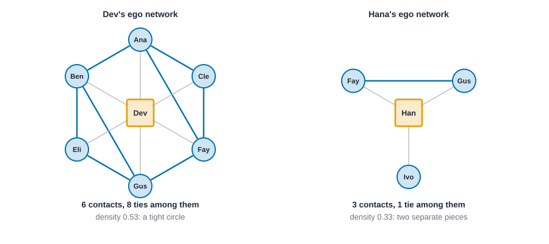
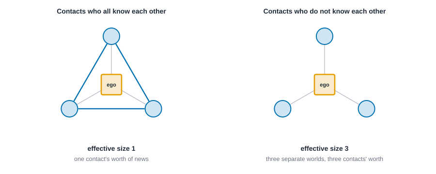
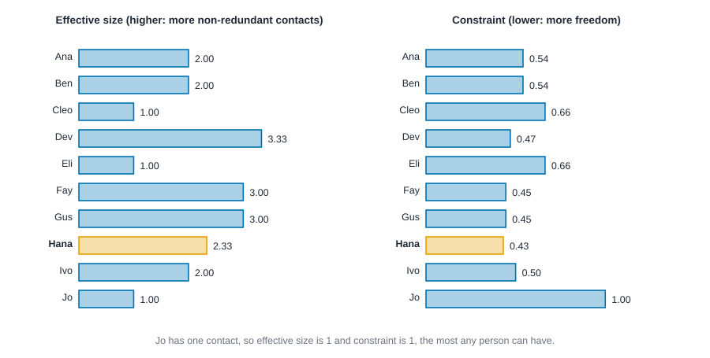
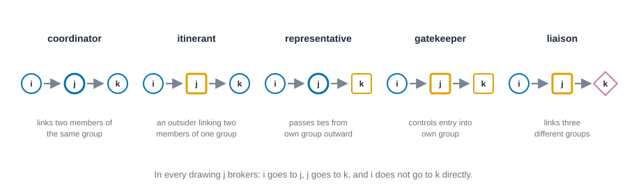
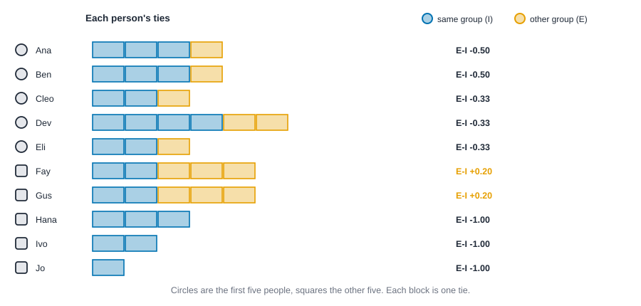
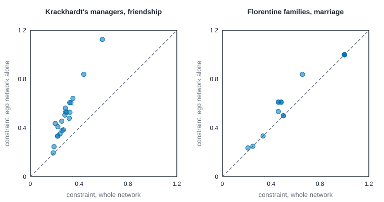
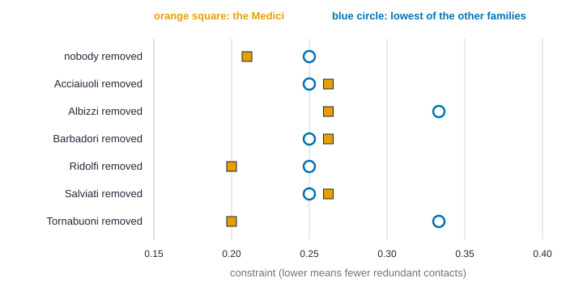

# Ego networks and structural holes {#sec-ego-networks}

::: {.callout-note appearance="simple"}
## Prerequisites
@sec-networks-as-data and @sec-centrality. We use the ten-person friendship network again, and the idea of betweenness from @sec-centrality comes back in a new form. The weak-ties argument from @sec-foundations is the backdrop for the whole chapter. Later sections use three classic data sets (Krackhardt's managers, the Florentine families and the karate club) and the idea of a null network from @sec-tests-and-null-models. The organization example is worked in full in @sec-case-krackhardt; here the managers serve only to check ego measures.
:::

::: {.callout-note title="The short version"}
Two people with the same number of friends can live in very different worlds. One person's friends all know each other, like a family at a dinner table, and everyone repeats the same news. Another person's friends have never met, and that person is the only link between them. This chapter looks at the network from one person's seat and gives you simple ways to measure which kind of world they sit in, and what kind of go-between they are. The numbers describe an opportunity in the pattern of ties, never proof that anyone used it.
:::

::: {.callout-note title="Why you might care"}
If you want to know who can carry news between teams, who is boxed in by a tight clique, or who really links two departments, these are the tools. They also tell you what you can and can't learn from a survey that only asks people to name their own contacts.
:::

## The view from one person

::: {.callout-tip appearance="simple"}
## Code lives next to the idea
Each measure comes with its code right where it is explained. The Rust blocks in this chapter run top to bottom as one script: the first builds the friendship network, and later ones reuse it.
:::

Every chapter so far has looked at the network from above, like a map. This one gets down to street level and asks what the network looks like from *one person's* seat. Who do you know? Do the people you know know each other? If you stepped out of the picture, would your contacts still be connected, or would they fall into separate pieces?

Those questions are worth asking because two people with the same number of friends can live in very different worlds. One person's friends are all friends with each other, the way a family at a dinner table is. Another person's friends have never met, and the second person is the only thing connecting them. The first person hears the same news from everyone. The second person hears different news from different worlds, and decides what to pass on.

That difference is the subject of this chapter. We'll start with the simplest way to look at a person's surroundings, the **ego network**. Then we'll meet Ronald Burt's idea of **structural holes**, and two ways of measuring them. Then we'll add the groups people belong to, and ask what kind of broker a person is. We'll finish with a simple index for how much a person's ties stay inside their own group. Along the way we check the formulas by hand, ask what survives when you see only a sample of egos, and try to break a classic result with stress checks.

## Ego networks

An **ego network** is one person (the *ego*), the people they have ties to (their *alters*), and the ties among those alters. That's all. It's what you'd get if you could only see the network through one person's eyes, and you could also see who their contacts know.

@fig-ego-networks draws two of them from the friendship network of @sec-centrality. Dev has six contacts, and eight ties among them: Dev's friends mostly know each other. Hana has three contacts, and only one tie among them, between Fay and Gus. Ivo, her third contact, isn't tied to either. If Hana stepped out of the picture, Ivo would be cut off from Fay and Gus.

{#fig-ego-networks fig-alt="Two drawings. On the left, Dev, an orange square in the middle, with six contacts in a hexagon around them, joined in a ring by blue ties with two extra blue ties across the ring. On the right, Hana, an orange square, with three contacts: Fay and Gus are joined to each other by a blue tie, and Ivo is not tied to either."}

A handful of numbers summarize an ego network.

- **Size**: how many alters. It's the person's degree, @sec-centrality's simplest measure.
- **Ties among alters**: how many of the alters know each other.
- **Density**: ties among alters, divided by the number of pairs of alters. High density means a tight circle. Low density means a person whose contacts mostly don't know each other.
- **Pieces**: how many separate pieces the alters fall into once ego is removed. More than one means the ego is the only link between them.
- **Ego betweenness**: how often ego lies on the shortest route between two of their own alters, who are not directly tied to each other, *within the ego network* [@everett2005ego]. It's like betweenness (@sec-centrality), but computed using only what ego can see.

Ego networks are also how most surveys see networks. You can't usually interview an entire city, but you can ask a sample of people to name their contacts and to say which of them know each other. That's a name generator, which we'll look at in @sec-collecting-data. A lot of the measures in this chapter work on those data as well as on a whole network.

The code below builds the ten-person friendship network and prints these five numbers for everyone. Look for Dev's six contacts and Hana's two pieces.

::: {.panel-tabset group="language"}

## R

```r
library(knappnet)

# The ten-person friendship network. People are numbered from zero in Rust; here the
# ties are written as those numbers and turned into names.
people <- c("Ana", "Ben", "Cleo", "Dev", "Eli", "Fay", "Gus", "Hana", "Ivo", "Jo")
from <- c(0, 0, 0, 0, 1, 1, 1, 2, 2, 3, 3, 3, 4, 5, 5, 6, 7, 8)
to <- c(1, 2, 3, 5, 3, 4, 6, 3, 5, 4, 5, 6, 6, 6, 7, 7, 8, 9)
friends <- net_frame(
  data.frame(source = people[from + 1], target = people[to + 1]),
  nodes = data.frame(id = people),
  directed = FALSE
)
friends

# Alters are the people within one step of ego, the default.
ego <- net_ego_summary(friends)
round(data.frame(
  contacts = ego$size, ties = ego$ties, density = ego$density,
  pieces = ego$components, betweenness = ego$ego_betweenness,
  row.names = ego$node
), 3)
```

::: {.code-output}
```text
# net_frame: 10 nodes, 18 edges
#   directed:  no        mode: one-mode (10 actors)
#   weights:   unweighted
#   time:      static    space: none
#   simple:    no loops, no parallel edges
#   components: 1    isolates: 0    density: 0.400
#
# Nodes (10 x 1)      Edges (18 x 2)
#   id                  source target
#   <chr>               <chr>  <chr>
# 1 Ana               1 Ana    Ben
# 2 Ben               2 Ana    Cleo
# 3 Cleo              3 Ana    Dev
# 4 Dev               4 Ana    Fay
# 5 Eli               5 Ben    Dev
# 6 Fay               6 Ben    Eli
#   ... 4 more rows     ... 12 more rows
# A tibble: 10 × 6
   person contacts  ties density pieces betweenness
   <chr>     <dbl> <dbl>   <dbl>  <dbl>       <dbl>
 1 Ana           4     4   0.667      1        1   
 2 Ben           4     4   0.667      1        1   
 3 Cleo          3     3   1          1        0   
 4 Dev           6     8   0.533      1        3.67
 5 Eli           3     3   1          1        0   
 6 Fay           5     5   0.5        1        3.5 
 7 Gus           5     5   0.5        1        3.5 
 8 Hana          3     1   0.333      2        2   
 9 Ivo           2     0   0          2        1   
10 Jo            1     0 NaN          1        0   
```
:::

## Python

```python
import networkx as nx
# The ten-person friendship network, people numbered from zero as in Rust.
names = ["Ana", "Ben", "Cleo", "Dev", "Eli", "Fay", "Gus", "Hana", "Ivo", "Jo"]
src = [0, 0, 0, 0, 1, 1, 1, 2, 2, 3, 3, 3, 4, 5, 5, 6, 7, 8]
dst = [1, 2, 3, 5, 3, 4, 6, 3, 5, 4, 5, 6, 6, 6, 7, 7, 8, 9]
friends = nx.Graph()
friends.add_nodes_from(range(len(names)))
friends.add_edges_from(zip(src, dst))
print(friends)
# TODO(code, Python): the ego summary table (contacts, ties among them, density, pieces, ego betweenness) needs net_ego_summary(); NetworkX only has ego_graph() to build each ego network.
```

::: {.code-output}
```text
Graph with 10 nodes and 18 edges
```
:::

## Rust

```rust
use knappnet::metrics::ego::{compute_ego_summary, EgoOptions};
use knappnet::Graph;

// The ten-person friendship network, people numbered from zero.
let names = ["Ana", "Ben", "Cleo", "Dev", "Eli", "Fay", "Gus", "Hana", "Ivo", "Jo"];
let from = [0, 0, 0, 0, 1, 1, 1, 2, 2, 3, 3, 3, 4, 5, 5, 6, 7, 8];
let to = [1, 2, 3, 5, 3, 4, 6, 3, 5, 4, 5, 6, 6, 6, 7, 7, 8, 9];
let friends = Graph::from_edges(names.len(), &from, &to, None, false)?;
println!("{}", friends.describe().with_labels(&names));

// Alters are the people within one step of ego, the default.
let ego = compute_ego_summary(&friends, EgoOptions::default())?;
let ego_between = ego.betweenness.as_ref().unwrap();
println!("{:<5} {:>8} {:>5} {:>8} {:>7} {:>11}", "", "contacts", "ties", "density", "pieces", "betweenness");
for (i, name) in names.iter().enumerate() {
    println!("{:<5} {:>8} {:>5} {:>8.3} {:>7} {:>11.3}",
             name, ego.size[i], ego.ties[i], ego.density[i], ego.components[i], ego_between[i]);
}
```

::: {.code-output}
```text
Undirected network: 10 nodes, 18 ties
  Density           0.400
  Degree            1 to 6, mean 3.60
  Connected pieces  1
  Isolated nodes    0
  Loops, repeats    none
  Busiest           Dev (6), Fay (5), Gus (5)

      contacts  ties  density  pieces betweenness
Ana          4     4    0.667       1       1.000
Ben          4     4    0.667       1       1.000
Cleo         3     3    1.000       1       0.000
Dev          6     8    0.533       1       3.667
Eli          3     3    1.000       1       0.000
Fay          5     5    0.500       1       3.500
Gus          5     5    0.500       1       3.500
Hana         3     1    0.333       2       2.000
Ivo          2     0    0.000       2       1.000
Jo           1     0      NaN       1       0.000
```
:::

:::

Read it against the picture. Dev has six contacts and eight ties among them, density 0.533. Hana has three contacts and one tie, density 0.333, and two pieces: Fay and Gus together, and Ivo alone. Cleo and Eli have density 1.000, because their three friends all know each other, which is the family-dinner-table pattern. And Jo has a single contact, so there are no pairs of alters and the density is undefined (NaN, for "not a number").

### How far out does an ego network reach?

"The ego network" hides a choice, and books don't all make it the same way, so here are the three versions this chapter uses. Take Hana from @fig-ego-networks.

- The **1-step** network is the star: Hana, her three alters, and the three ties between her and each of them. Nothing else.
- The **1.5-step** network adds the ties *among* the alters. For Hana that is one more tie, between Fay and Gus. This is the version drawn in @fig-ego-networks and summarized in the table above. It is also what a survey gets when it asks the respondent "which of these people know each other?".
- The **2-step** network adds the alters' own contacts: everyone within two steps of ego, and every tie among all of them.

Some authors give these labels differently (a few call the middle one "1-step"), so check what a paper means. For Hana the 2-step network has nine alters and 15 ties among them. Add Hana, and that is everyone in the network. In a ten-person network two steps reach nearly everybody, which is a warning about the 2-step view: in a small or dense network it stops being "your neighborhood" and turns into the whole network.

Whether ego counts as one of the people changes the density too, so the question is: what share of the possible ties is actually there? With $n$ alters and $t$ ties among them, the density *without* ego is

$$
\text{density} = \frac{t}{\binom{n}{2}} = \frac{2t}{n(n-1)},
$$

the share of possible pairs of alters that are tied. It is undefined when $n < 2$, because there are no pairs. If you count ego as a member, every alter is tied to ego, so there are $t + n$ ties among $n + 1$ people:

$$
\text{density with ego} = \frac{t + n}{\binom{n+1}{2}}.
$$

This is never smaller than the first, because it adds $n$ ties to the count and $n$ pairs to the possible pairs, and every one of those pairs is tied. For Hana, $n = 3$ and $t = 1$, so the density is $1/3 = 0.333$ without ego and $4/6 = 0.667$ with ego. The "with ego" version says mostly how small the network is, so use it only when you know which one a source means.

::: {.callout-tip title="In plain words"}
Density is "ties that exist, divided by ties that could exist". Call the number of alters $n$ and the number of ties among them $t$. Among $n$ alters there are $n(n-1)/2$ possible pairs, which is what $\binom{n}{2}$ ("$n$ choose 2", the number of ways to pick two of them) means, so the first formula is simply $t$ divided by the number of pairs. For Hana, $n = 3$ gives 3 possible pairs and $t = 1$ gives a density of $1/3$. The second formula counts ego as a member: ego is tied to every alter, which adds $n$ ties and $n$ pairs, and for Hana that gives $(1 + 3)/6 = 4/6$.
:::

**Ego betweenness** has a short formula too. Two alters $j$ and $k$ who are not tied to each other are two steps apart inside the ego network, and the routes of that length run through ego and through any other alter who knows both. If $m_{jk}$ is the number of such alters, ego sits on a share $1/(1 + m_{jk})$ of the shortest routes between $j$ and $k$, and adding over the pairs gives

$$
B_i = \sum_{\{j,k\}:\ a_{jk} = 0} \frac{1}{1 + m_{jk}},
$$

where $a_{jk} = 1$ when $j$ and $k$ are tied [@everett2005ego]. Hana's alters Fay and Gus are tied, so that pair adds nothing. Ivo is not tied to either of them and nobody else links him to them, so each of those two pairs adds 1, and $B = 2$, which is what the table says.

::: {.callout-tip title="In plain words"}
Ego betweenness counts how often ego is the go-between for two of their own contacts. Go through every pair of alters $j$ and $k$ who aren't tied (that is what the condition under the sum says). For each such pair, $m_{jk}$ counts the other alters who could also sit in the middle, so ego is one of $1 + m_{jk}$ possible go-betweens and gets credit $1/(1 + m_{jk})$. Then add up the credits. For Hana, the pair Fay and Gus is tied and is skipped, while Ivo with Fay and Ivo with Gus each have nobody else in the middle, so each gives credit 1, and the total is 2.
:::

::: {.panel-tabset group="language"}

## R

```r
# The 1.5-step network is what net_ego_summary() measures by default; order = 2 gives the 2-step network.
one <- net_ego_summary(friends, betweenness = FALSE)
two <- net_ego_summary(friends, order = 2, betweenness = FALSE)
round(data.frame(
  alters = one$size, ties = one$ties, density = one$density,
  density_with_ego = (one$ties + one$size) / choose(one$size + 1, 2),
  alters_2step = two$size, ties_2step = two$ties, density_2step = two$density,
  row.names = people
), 3)
```

::: {.code-output}
```text
# A tibble: 10 × 8
   person alters  ties density density_with_ego alters_2step ties_2step
   <chr>   <dbl> <dbl>   <dbl>            <dbl>        <dbl>      <dbl>
 1 Ana         4     4   0.667            0.8              7         12
 2 Ben         4     4   0.667            0.8              7         12
 3 Cleo        3     3   1                1                7         13
 4 Dev         6     8   0.533            0.667            7         10
 5 Eli         3     3   1                1                7         13
 6 Fay         5     5   0.5              0.667            8         12
 7 Gus         5     5   0.5              0.667            8         12
 8 Hana        3     1   0.333            0.667            9         15
 9 Ivo         2     0   0                0.667            4          3
10 Jo          1     0 NaN                1                2          1
# ℹ 1 more variable: density_2step <dbl>
```
:::

## Python

```python
# TODO(code, Python): needs the 1.5-step and 2-step ego summaries (net_ego_summary(order = 2)); NetworkX only has ego_graph() to build each ego network.
```

::: {.code-output}
```text
TODO(output)
```
:::

## Rust

```rust
// The 1.5-step network is what the summary measures by default; order 2 gives the 2-step network.
let one = compute_ego_summary(&friends, EgoOptions { betweenness: false, ..EgoOptions::default() })?;
let two = compute_ego_summary(&friends, EgoOptions { order: 2, betweenness: false, ..EgoOptions::default() })?;
println!("{:<5} {:>6} {:>5} {:>8} {:>9} | {:>6} {:>5} {:>8}", "", "alters", "ties", "density", "with ego", "alters", "ties", "density");
for (i, name) in names.iter().enumerate() {
    let with_ego = (one.ties[i] + one.size[i]) / ((one.size[i] + 1.0) * one.size[i] / 2.0);
    println!("{:<5} {:>6} {:>5} {:>8.3} {:>9.3} | {:>6} {:>5} {:>8.3}",
             name, one.size[i], one.ties[i], one.density[i], with_ego, two.size[i], two.ties[i], two.density[i]);
}
```

::: {.code-output}
```text
      alters  ties  density  with ego | alters  ties  density
Ana        4     4    0.667     0.800 |      7    12    0.571
Ben        4     4    0.667     0.800 |      7    12    0.571
Cleo       3     3    1.000     1.000 |      7    13    0.619
Dev        6     8    0.533     0.667 |      7    10    0.476
Eli        3     3    1.000     1.000 |      7    13    0.619
Fay        5     5    0.500     0.667 |      8    12    0.429
Gus        5     5    0.500     0.667 |      8    12    0.429
Hana       3     1    0.333     0.667 |      9    15    0.417
Ivo        2     0    0.000     0.667 |      4     3    0.500
Jo         1     0      NaN     1.000 |      2     1    1.000
```
:::

:::

The left half of the table is the 1.5-step network, the right half the 2-step network. Counting ego raises every density: Dev goes from 0.533 to 0.667, and Jo, whose density was undefined, gets 1.000, because a person and one friend are a complete pair. Widening the view lowers the density of most people, and the changes are not even: Ana's falls from 0.667 to 0.571, while Ivo's rises from 0.000 to 0.500, because the extra people in his two-step circle, Fay and Gus, are tied to each other and to Hana.

## Where ego-network data come from

There are two ways to get an ego network. You can cut it out of a whole network you already have, as we have been doing. Or you can collect it from the egos themselves, which is how most surveys do it, because nobody can interview a whole city. The second way has a few moving parts, and each one shapes what you can measure. @sec-collecting-data covers data collection in general; here is what matters for ego measures.

**The name generator.** A *name generator* is the question that asks a respondent to list their alters: "Who do you discuss important matters with?", "Who would you ask to look after your home?", "Who did you talk to in the last week?". The wording defines the network. Different generators give different ego networks for the same person, and a generator about advice, one about support and one about contact are three different relations, not three ways to see one [@marsden1990network; @perry2018egocentric]. Burt discusses how such items can be put into a general survey [@burt1984network].

**The name interpreters.** After the names come the *interpreters*: questions about each alter, such as how the two know each other, how close they are, and the alter's age, sex or group. These attributes are what let you compute the composition of an ego's contacts, as in the section on Blau's index below, and they are what lets you say whether the alters are like ego.

**Ties among alters.** To get density, effective size or constraint, someone has to say which alters know each other. Usually that is ego, and asking costs more than it looks like it should: with $k$ alters there are $k(k-1)/2$ pairs to ask about, which is 10 pairs for 5 alters, 45 for 10, 105 for 15 and 190 for 20. Respondents tire, and they can be unsure about ties they did not see. Those are reasons studies keep $k$ small and why the ties among alters are the least reliable part of ego data.

**Boundary and size limits.** The boundary question of @sec-collecting-data comes back for every ego: which kind of contact counts, in which time window, and how close it must be. A *size limit* makes it sharper. If the generator accepts at most $k$ names, nobody can have more than $k$ alters, so size, and effective size with it, can't go above $k$ however many contacts a person really has. A cap also changes who is dropped. If respondents name their closest contacts first, and close contacts often know each other [@granovetter1973strength], the alters you keep may be more tightly knit than the ones you lose. That is a plausible direction, not a measured size, so check your own data before you lean on it.

**What an ego sample cannot see.** It sees the alters and, if you asked, the ties among them. It doesn't see the alters' other contacts, so it can't give whole-network betweenness or closeness, and it doesn't see how many contacts each alter has unless you ask. That matters for constraint, as the section on sampling shows. It also means that the same person can look different depending on the width of the network (the previous section) and on the generator.

## Structural holes

Ronald Burt took the picture of Hana and made an argument out of it [@burt1992structural]. A **structural hole** is a gap between two groups of people who aren't otherwise in touch. Someone whose contacts sit on both sides of a hole can see what each side knows, bring ideas across, and decide who meets whom. Burt's claim is that this is a source of advantage, and that the advantage comes from the *gap*, not from the number of friends. He later reported evidence from managers in one large company that people whose contacts spanned holes were more likely to have ideas their colleagues valued [@burt2004structural]. As with any single study, the finding is a reason to look, not a law.

This ties to Granovetter's classic argument that weak ties carry new information (@sec-foundations). Burt's version moves the weight off the *strength* of the tie and onto the *position*: what matters is whether the person on the other end tells you something your other contacts wouldn't.

### Effective size: how many contacts' worth of access

Counting contacts overcounts, because contacts who know each other tell you the same things. **Effective size** subtracts the redundancy. @fig-holes-idea shows the extremes: three contacts who all know each other add up to one contact's worth of access, and three who don't add up to three.

{#fig-holes-idea fig-alt="Two drawings of a person at the center with three contacts around them. On the left the three contacts are joined to one another by blue ties, a triangle, and the effective size is 1. On the right the three contacts have no ties among themselves and the effective size is 3."}

The question is how many contacts' worth of fresh information a person gets. For a network with no tie strengths, the calculation boils down to a short formula [@borgatti1997structural]. If a person has $n$ contacts and $t$ ties among those contacts,

$$
\text{effective size} = n - \frac{2t}{n}.
$$

Check it on the triangle: $n = 3$ and $t = 3$, so the effective size is $3 - 6/3 = 1$. And on the three strangers, $t = 0$, so it's 3. Hana has three contacts and one tie among them: $3 - 2/3 = 2.33$. Dev has six contacts and eight ties: $6 - 16/6 = 3.33$. **Efficiency** divides effective size by the number of contacts, so it asks what *share* of a person's contacts is non-redundant. A high efficiency means each contact is bringing something new.

::: {.callout-tip title="In plain words"}
Start with the number of contacts, $n$, and take away a penalty for redundancy. The number $t$ counts the ties among the contacts, so the penalty $2t/n$ grows as the contacts know each other more. Think of three friends who all repeat the same gossip: you hear one story, not three. For Hana, $n = 3$ contacts and $t = 1$ tie give $3 - 2/3 = 2.33$.
:::

::: {.panel-tabset group="language"}

## R

```r
round(data.frame(
  effective_size = net_effective_size(friends),
  efficiency = net_efficiency(friends),
  row.names = people
), 3)
```

::: {.code-output}
```text
# A tibble: 10 × 3
   person effective_size efficiency
   <chr>           <dbl>      <dbl>
 1 Ana              2         0.5  
 2 Ben              2         0.5  
 3 Cleo             1         0.333
 4 Dev              3.33      0.556
 5 Eli              1         0.333
 6 Fay              3         0.6  
 7 Gus              3         0.6  
 8 Hana             2.33      0.778
 9 Ivo              2         1    
10 Jo               1         1    
```
:::

## Python

```python
size = nx.effective_size(friends)
print(f"{'':<5} {'effective size':>14} {'efficiency':>10}")
for i, name in enumerate(names):
    print(f"{name:<5} {size[i]:>14.3f} {size[i] / friends.degree(i):>10.3f}")
```

::: {.code-output}
```text
      effective size efficiency
Ana            2.000      0.500
Ben            2.000      0.500
Cleo           1.000      0.333
Dev            3.333      0.556
Eli            1.000      0.333
Fay            3.000      0.600
Gus            3.000      0.600
Hana           2.333      0.778
Ivo            2.000      1.000
Jo             1.000      1.000
```
:::

## Rust

```rust
use knappnet::metrics::brokerage::{compute_effective_size, compute_efficiency, StructuralHoleOptions};

let size = compute_effective_size(&friends, StructuralHoleOptions::default())?;
let efficiency = compute_efficiency(&friends, StructuralHoleOptions::default())?;
println!("{:<5} {:>14} {:>10}", "", "effective size", "efficiency");
for (i, name) in names.iter().enumerate() {
    println!("{:<5} {:>14.3} {:>10.3}", name, size[i], efficiency[i]);
}
```

::: {.code-output}
```text
      effective size efficiency
Ana            2.000      0.500
Ben            2.000      0.500
Cleo           1.000      0.333
Dev            3.333      0.556
Eli            1.000      0.333
Fay            3.000      0.600
Gus            3.000      0.600
Hana           2.333      0.778
Ivo            2.000      1.000
Jo             1.000      1.000
```
:::

:::

Dev has the largest effective size, 3.333 contacts' worth out of six. Hana's 2.333 is out of three, so her efficiency of 0.778 is among the highest: nearly everyone she knows brings something new. Cleo and Eli sit at 1.000, one contact's worth, because their three friends are all the same circle. Jo's single contact is, trivially, entirely non-redundant.
### Constraint: how boxed in

Effective size counts. **Constraint** weighs. It asks how much of a person's network is tied up in a few contacts who are themselves tied up with each other. Burt's measure starts from the share of a person's time and energy invested in each contact, $p_{ij}$, which in a network without tie strengths is just one divided by the number of contacts. A person is constrained by a contact $j$ directly, through $p_{ij}$, and indirectly, through any of their other contacts $q$ who also tie to $j$:

::: {.callout-tip title="In plain words"}
Constraint adds up, over all your contacts, how much you depend on each one. The number $p_{ij}$ is the share of your attention that goes to contact $j$, which is 1/3 for each of Hana's three contacts. A contact matters directly (the $p_{ij}$ part) and also through the friends you share with them (the sum, which multiplies your share for a shared friend $q$ by $q$'s share for $j$). Add the two, square the total so that one big dependence counts for extra, and you have $c_{ij}$. Then $C_i$ is the total over all contacts $j$. For Hana's contact Ivo, nobody links him to anyone else in her circle, so his term is just $(1/3)^2 = 0.111$, as the hand calculation in the Rust tab below shows. This is the hardest formula in the chapter. On a first read you can skip to the hand calculation and still keep the idea: low constraint means freedom, high constraint means your options run through a few people who talk among themselves.
:::

$$
c_{ij} = \left( p_{ij} + \sum_{q \neq i, j} p_{iq}\, p_{qj} \right)^2, \qquad C_i = \sum_j c_{ij}.
$$

In words: for each contact, add the direct share to the shares routed through your other contacts who also know that contact, square the total, and add them up over all your contacts [@burt1992structural; @burt2004structural]. The squaring means a single dominant contact counts for a lot. Low constraint means freedom. High constraint means your options run through a few people who talk among themselves.

::: {.panel-tabset group="language"}

## R

```r
setNames(round(net_constraint(friends), 3), people)
```

::: {.code-output}
```text
# A tibble: 10 × 2
   person constraint
   <chr>       <dbl>
 1 Ana         0.541
 2 Ben         0.541
 3 Cleo        0.664
 4 Dev         0.47 
 5 Eli         0.664
 6 Fay         0.445
 7 Gus         0.445
 8 Hana        0.431
 9 Ivo         0.5  
10 Jo          1    
```
:::

## Python

```python
constraint = nx.constraint(friends)
for i, name in enumerate(names):
    print(f"{name:<5} {constraint[i]:.3f}")
```

::: {.code-output}
```text
Ana   0.541
Ben   0.541
Cleo  0.664
Dev   0.470
Eli   0.664
Fay   0.445
Gus   0.445
Hana  0.431
Ivo   0.500
Jo    1.000
```
:::

## Rust

```rust
use knappnet::metrics::brokerage::compute_constraint;

let constraint = compute_constraint(&friends, StructuralHoleOptions::default())?;
for (i, name) in names.iter().enumerate() {
    println!("{name:<5} {:.3}", constraint[i]);
}
```

::: {.code-output}
```text
Ana   0.541
Ben   0.541
Cleo  0.664
Dev   0.470
Eli   0.664
Fay   0.445
Gus   0.445
Hana  0.431
Ivo   0.500
Jo    1.000
```
:::

:::

Hana has the lowest constraint in the network, 0.431, lower than Dev's 0.470 even though Dev has twice as many friends. That is the point of the measure. Dev's friends form a tightly woven circle, so most of what Dev hears comes through people who also hear it from each other. Hana's three contacts live in different parts of the network, so none of them can speak for her whole world. Jo, with a single contact, has the maximum possible constraint of 1.000.

To see where Hana's 0.431 comes from, do it by hand. She has three contacts, so each gets a share $p = 1/3$. Nobody else in her circle is tied to Ivo, so Ivo's term is just $(1/3)^2 = 0.111$. Fay is different. Fay is tied to Gus, who is also Hana's contact, and Gus gives Fay one fifth of his attention (he has five contacts), so the indirect part is $\tfrac13 \cdot \tfrac15$ and Fay's term is $(\tfrac13 + \tfrac1{15})^2 = 0.16$. Gus's term is the same, because Fay also has five contacts. The total is $0.111 + 0.16 + 0.16 = 0.431$.

@fig-effective-size-bars puts both measures on the same people. They don't agree on who's on top, and that's the lesson. Effective size rewards having many non-redundant contacts, and Dev wins. Constraint rewards having contacts spread across separate parts of the network, and Hana wins. Neither is "the" measure of brokerage. They answer different questions.

{#fig-effective-size-bars fig-alt="Two horizontal bar charts with the same ten names. Effective size: Dev 3.33, Fay and Gus 3.00, Hana 2.33, Ana and Ben 2.00, Ivo 2.00, Cleo, Eli and Jo 1.00. Constraint: Hana is lowest at 0.43, then Fay and Gus at 0.45, Dev 0.47, Ivo 0.50, Ana and Ben 0.54, Cleo and Eli 0.66, Jo 1.00. Hana's bars are highlighted in orange."}


### Hierarchy: is the constraint all in one contact?

Constraint adds up how boxed in a person is, but not whether one contact is to blame. **Hierarchy** asks how that constraint is *spread* over the contacts. Write $c_{ij}$ for the squared term that contact $j$ contributes to $i$'s constraint, so $C_i = \sum_j c_{ij}$. With $N$ contacts, an even split would give each one $C_i / N$. Let $r_j = c_{ij} / (C_i / N)$ be each contact's share relative to that even split. Burt's hierarchy is

$$
H_i = \frac{\sum_j r_j \ln r_j}{N \ln N}.
$$

It is 0 when every contact constrains $i$ equally and approaches 1 when the constraint sits in a single contact [@burt1992structural]. (It is the Coleman-Theil disorder index of the $c_{ij}$.) With a single contact the formula is 0/0, so hierarchy is undefined, and knappnet returns NaN there. Some programs return a number instead, so check before you compare tools.

::: {.callout-tip title="In plain words"}
Hierarchy asks whether the boxed-in feeling comes from one contact or is spread out evenly. Here $c_{ij}$ is how much contact $j$ constrains $i$, $C_i$ is the total, and $N$ is the number of contacts, so $C_i/N$ is what an even split would give each one. The ratio $r_j$ compares contact $j$ with that even split: 1 means average, 2 means twice as much. The formula measures how uneven those ratios are, using the logarithm (the standard way, from the Coleman-Theil index of how uneven a set of shares is), and divides by its largest possible value, $N \ln N$, so the result runs from 0 to 1. In the kite below, an even split of E's 0.840 would be 0.280 each. A's term is 0.444, about 1.59 times that, and B's and C's are about 0.71 times (worked out by hand), so the split is uneven and hierarchy is above zero. Hierarchy is the least used of Burt's measures, so on a first read you can skip it.
:::

To watch it move, take a four-person network I'll call the kite. E is tied to A, B and C, and A is also tied to B and C. E gives each contact a third of their attention. A has three contacts and B and C have two each, so the paths through them are worth different amounts:

- through A: $c_{EA} = \left(\tfrac13 + \tfrac13\cdot\tfrac12 + \tfrac13\cdot\tfrac12\right)^2 = (2/3)^2 = 0.444$, because B and C each give half their attention to A;
- through B: $c_{EB} = \left(\tfrac13 + \tfrac13\cdot\tfrac13\right)^2 = (4/9)^2 = 0.198$, because A gives B a third of A's attention, and the same for C.

E's constraint is $0.444 + 0.198 + 0.198 = 0.840$, and A carries more than half of it, so hierarchy is above zero. Contrast Cleo or Eli in the friendship network, whose three friends are all tied to each other and constrain them about equally.

### Checking the formulas by hand

Every number above came from a function. Here is the same work done from the definitions, using only a table of 0s and 1s. The matrix $P$ holds the $p_{ij}$ (each row divided by its sum). Then $c_{ij}$ is $(P + P^2)$ squared cell by cell, kept for the tied pairs, and effective size is $n - 2t/n$ with $t$ read off the table. The block checks them against the library on the friendship network and then runs the kite.

::: {.panel-tabset group="language"}

## R

```r
# The kite: E is tied to A, B and C, and A is also tied to B and C.
kite <- net_frame(
  data.frame(source = c("E", "E", "E", "A", "A"), target = c("A", "B", "C", "B", "C")),
  nodes = data.frame(id = c("E", "A", "B", "C")),
  directed = FALSE,
  quiet = TRUE
)
round(data.frame(
  constraint = net_constraint(kite),
  effective_size = net_effective_size(kite),
  hierarchy = net_hierarchy(kite),
  row.names = c("E", "A", "B", "C")
), 3)

# The largest hierarchy among the ten friends.
round(max(net_hierarchy(friends), na.rm = TRUE), 3)

# TODO(code, R): the hand calculation (each contact's share p, the squared terms c_ij, the ratios r_j) needs net_constraint(detail = TRUE) to return the contact-by-contact pieces
```

::: {.code-output}
```text
    constraint effective_size      hierarchy 
          TRUE           TRUE           TRUE 
[1] 0.034
$from_each_contact
    E     A     B     C 
0.000 0.444 0.198 0.198 

$by_hand
    constraint effective_size      hierarchy 
         0.840          1.667          0.074 

$engine
    constraint effective_size      hierarchy 
         0.840          1.667          0.074 
```
:::

## Python

```python
# The kite: E is tied to A, B and C, and A is also tied to B and C.
kite = nx.Graph()
kite.add_nodes_from(["E", "A", "B", "C"])
kite.add_edges_from([("E", "A"), ("E", "B"), ("E", "C"), ("A", "B"), ("A", "C")])
print(f"E in NetworkX: constraint {nx.constraint(kite)['E']:.3f}, effective size {nx.effective_size(kite)['E']:.3f}")
# TODO(code, Python): hierarchy needs net_hierarchy(); NetworkX has no function for it.
```

::: {.code-output}
```text
E in NetworkX: constraint 0.840, effective size 1.667
```
:::

## Rust

```rust
use knappnet::metrics::brokerage::compute_hierarchy;

// Constraint, effective size and hierarchy from their definitions, one row per person, from a table of 0s and 1s.
fn by_hand(a: &Vec<Vec<f64>>) -> Vec<[f64; 3]> {
    let n = a.len();
    let degree: Vec<f64> = a.iter().map(|row| row.iter().sum()).collect();
    // p[i][j]: the share of i's attention that goes to j
    let p: Vec<Vec<f64>> = (0..n).map(|i| (0..n).map(|j| a[i][j] / degree[i]).collect()).collect();
    (0..n).map(|i| {
        let contacts: Vec<usize> = (0..n).filter(|&j| a[i][j] > 0.0).collect();
        // c_ij = (p_ij + sum_q p_iq p_qj)^2 for each contact j of i
        let c: Vec<f64> = contacts.iter()
            .map(|&j| (p[i][j] + (0..n).map(|q| p[i][q] * p[q][j]).sum::<f64>()).powi(2)).collect();
        let total: f64 = c.iter().sum();
        let m = contacts.len() as f64;
        // ties among the contacts, each counted once
        let among = contacts.iter().flat_map(|&j| contacts.iter().map(move |&k| (j, k)))
            .filter(|&(j, k)| j < k && a[j][k] > 0.0).count() as f64;
        let hierarchy = c.iter().map(|&x| { let r = x / (total / m); r * r.ln() }).sum::<f64>() / (m * m.ln());
        [total, m - 2.0 * among / m, hierarchy]
    }).collect()
}

let mut adj = vec![vec![0.0; names.len()]; names.len()];
for (&u, &v) in from.iter().zip(&to) {
    adj[u as usize][v as usize] = 1.0;
    adj[v as usize][u as usize] = 1.0;
}
let hand = by_hand(&adj);

// Does it agree with the engine? Not-a-number must match not-a-number.
let hierarchy = compute_hierarchy(&friends, StructuralHoleOptions::default())?;
let agree = |k: usize, engine: &[f64]| hand.iter().zip(engine).all(|(h, e)| (h[k].is_nan() && e.is_nan()) || (h[k] - e).abs() < 1e-9);
println!("hand and engine agree: constraint {}, effective size {}, hierarchy {}",
         agree(0, &constraint[..]), agree(1, &size[..]), agree(2, &hierarchy[..]));
println!("largest hierarchy among the ten people: {:.3}",
         hand.iter().map(|h| h[2]).filter(|h| !h.is_nan()).fold(0.0, f64::max));

// The kite: E is tied to A, B and C, and A is also tied to B and C.
let kite = Graph::from_edges(4, &[0, 0, 0, 1, 1], &[1, 2, 3, 2, 3], None, false)?;
let kite_adj = vec![vec![0.0, 1.0, 1.0, 1.0], vec![1.0, 0.0, 1.0, 1.0], vec![1.0, 1.0, 0.0, 0.0], vec![1.0, 1.0, 0.0, 0.0]];
let by_kite = by_hand(&kite_adj);
println!("E by hand: constraint {:.3}, effective size {:.3}, hierarchy {:.3}", by_kite[0][0], by_kite[0][1], by_kite[0][2]);
println!("E in the engine: constraint {:.3}, effective size {:.3}, hierarchy {:.3}",
         compute_constraint(&kite, StructuralHoleOptions::default())?[0],
         compute_effective_size(&kite, StructuralHoleOptions::default())?[0],
         compute_hierarchy(&kite, StructuralHoleOptions::default())?[0]);
```

::: {.code-output}
```text
hand and engine agree: constraint true, effective size true, hierarchy true
largest hierarchy among the ten people: 0.034
E by hand: constraint 0.840, effective size 1.667, hierarchy 0.074
E in the engine: constraint 0.840, effective size 1.667, hierarchy 0.074
```
:::

:::

In the Rust tab the hand calculation and the functions agree on every person (the R and Python tabs show only the function calls, and Python has no hierarchy). In the friendship network no hierarchy is above about 0.03, because every ego network is small and its constraint is spread fairly evenly. In the kite, E's hierarchy is 0.074 and its constraint 0.840, with A carrying the largest share. Hierarchy is the least used of Burt's measures, and with so few contacts a value of a few hundredths shouldn't be read as a finding.

### Weak ties and structural holes: what is claimed, and what has been found

It is easy to turn these two ideas into slogans, so here is what each one actually says.

**Granovetter's argument** [@granovetter1973strength]. If Ana is strongly tied to Ben and to Cleo, then Ben and Cleo are likely to know each other, at least a little. Strong ties therefore pile up inside tight circles, and the ties that reach *between* circles tend to be weak. Those between-circle ties are where news from outside your circle arrives. Two cautions. The claim is about *bridging*, not about weakness for its own sake: most weak ties sit inside a circle and bring nothing new, and some strong ties do bridge. And the 1973 paper is mainly a reasoned argument with some supporting studies. It is not a test.

**Burt's argument** [@burt1992structural]. People on two sides of a structural hole live in different streams of information, so a person who spans the hole gets early access, hears about opportunities, and can pass things across. What matters is the *redundancy* of a person's contacts, which is what effective size and constraint measure, and not their number. The empirical claim is that such positions go with better outcomes. Burt's study of managers in one large company found that managers whose contacts spanned holes were more likely to have ideas their colleagues valued [@burt2004structural].

What has been found since is mixed, and the mix is the honest summary.

- **Some studies find what the arguments predict.** In a very large mobile-phone dataset, the friendship circles of two people overlapped less when the tie between them was weak [@onnela2007structure]. In randomized experiments on a professional networking site, people were more likely to move jobs through contacts that were *moderately* weak than through the weakest ones, a rise and then a fall with tie strength and not a straight line [@rajkumar2022causal].
- **Some find the opposite.** A study of firms' collaboration networks in one industry reported that structural holes went with *less* innovation, not more [@ahuja2000collaboration]. A study of Broadway musical teams found that musicals did best when the team network had an intermediate amount of small-world structure, and not at either extreme [@uzzi2005collaboration]. Coleman's case for closure fits both: dense circles make it easier to trust and to enforce promises [@coleman1988social].
- **The usual criticisms apply.** Many studies describe one firm or one industry at one time, so selection is an open question: people who already have good ideas, skills or standing may end up in bridging positions, and the position may follow the outcome. Constraint also tracks how many contacts a person has: in @sec-case-krackhardt the rank correlation (a score from $-1$ to $1$ for how alike two orderings of the same people are) between constraint and the number of contacts is about $-0.9$, so "low constraint" can mostly mean "many contacts". And everything depends on who was counted as a contact and who was asked. Burt himself later wrote about how brokerage and closure work *together* [@burt2005brokerage].

So treat the measures as describing an *opportunity* in the pattern of ties, and treat "brokers do better" as a hypothesis for your setting. If you have outcome data, test it there, with the stress checks below, and say which studies point which way.

## Brokers and the groups they link

Structural holes ask whether a person sits between *people*. Gould and Fernandez asked a finer question: when a person brokers between two others, what *groups* do those people come from? [@gould1989structures] A broker who links two members of one department is doing something different from a broker who links two departments.

The setup is a directed network, plus a group for each person. Person $j$ **brokers** the pair $(i, k)$ when $i$ goes to $j$, $j$ goes to $k$, and $i$ does not go to $k$ directly. Every brokered pair then falls into one of five roles, depending on the groups of $i$, $j$ and $k$, as in @fig-brokerage-roles.

::: {.callout-tip title="In plain words"}
A broker is the middle person of a relay. If $i$ passes work to $j$, and $j$ passes it on to $k$, and $i$ has no direct line to $k$, then $j$ is the only route and brokers the pair. Think of a manager who forwards a request from their team to another department. In the example below, Cy passes work to Dee and Dee passes it to Eve, and Cy has no arrow to Eve, so Dee brokers the pair (Cy, Eve).
:::

{#fig-brokerage-roles fig-alt="Five panels, each showing three people i, j and k in a row joined by two arrows. Coordinator: all three are blue circles. Itinerant: i and k are blue circles and j is an orange square. Representative: i and j are blue circles and k is an orange square. Gatekeeper: i is a blue circle, j and k are orange squares. Liaison: i is a blue circle, j an orange square and k a purple diamond."}

- A **coordinator** links two members of its own group.
- An **itinerant** (or consultant) is an outsider who links two members of the *same other* group.
- A **representative** passes ties from its own group out to another group.
- A **gatekeeper** controls entry into its own group, from outside.
- A **liaison** links two people from two *different* groups, neither of which is its own.

Here is a small example: nine people in three teams, Design, Build and Sales, and a directed network of who passes work to whom. The code counts, for each person, how many pairs they broker in each role.

::: {.panel-tabset group="language"}

## R

```r
# Design: Ada, Ben, Cy.  Build: Dee, Eve, Flo.  Sales: Gus, Hal, Ivy.
team_names <- c("Ada", "Ben", "Cy", "Dee", "Eve", "Flo", "Gus", "Hal", "Ivy")
# An arrow means: passes work to.
from <- c(0, 1, 2, 3, 4, 5, 3, 3, 6, 7)
to <- c(1, 2, 3, 4, 5, 6, 0, 6, 7, 8)
work <- net_frame(
  data.frame(source = team_names[from + 1], target = team_names[to + 1]),
  nodes = data.frame(id = team_names, team = rep(0:2, each = 3)),
  directed = TRUE
)
work

# Counts of each brokerage role per person, using the team column as the groups.
net_brokerage(work, "team")
```

::: {.code-output}
```text
# net_frame: 9 nodes, 10 edges
#   directed:  yes       mode: one-mode (9 actors)
#   weights:   unweighted
#   time:      static    space: none
#   simple:    no loops, no parallel edges
#   components: 1    isolates: 0    density: 0.139
#
# Nodes (9 x 2)       Edges (10 x 2)
#   id    team          source target
#   <chr> <int>         <chr>  <chr>
# 1 Ada   0           1 Ada    Ben
# 2 Ben   0           2 Ben    Cy
# 3 Cy    0           3 Cy     Dee
# 4 Dee   1           4 Dee    Eve
# 5 Eve   1           5 Eve    Flo
# 6 Flo   1           6 Flo    Gus
#   ... 3 more rows     ... 4 more rows
# A tibble: 9 × 7
  node  coordinator itinerant representative gatekeeper liaison total
  <chr>       <dbl>     <dbl>          <dbl>      <dbl>   <dbl> <dbl>
1 Ada             0         0              0          1       0     1
2 Ben             1         0              0          0       0     1
3 Cy              0         0              1          0       0     1
4 Dee             0         1              0          1       1     3
5 Eve             1         0              0          0       0     1
6 Flo             0         0              1          0       0     1
7 Gus             0         0              0          2       0     2
8 Hal             1         0              0          0       0     1
9 Ivy             0         0              0          0       0     0
```
:::

## Python

```python
# TODO(code, Python): needs brokerage roles (net_brokerage()); NetworkX has none.
```

::: {.code-output}
```text
TODO(output)
```
:::

## Rust

```rust
use knappnet::metrics::brokerage::{compute_brokerage, BROKERAGE_ROLES};

// Design: Ada, Ben, Cy.  Build: Dee, Eve, Flo.  Sales: Gus, Hal, Ivy.
let team_names = ["Ada", "Ben", "Cy", "Dee", "Eve", "Flo", "Gus", "Hal", "Ivy"];
let team: [i64; 9] = [0, 0, 0, 1, 1, 1, 2, 2, 2];
// An arrow means: passes work to.
let from = [0, 1, 2, 3, 4, 5, 3, 3, 6, 7];
let to = [1, 2, 3, 4, 5, 6, 0, 6, 7, 8];
let work = Graph::from_edges(team_names.len(), &from, &to, None, true)?;
println!("{}", work.describe().with_labels(&team_names));

let counts = compute_brokerage(&work, &team, 0)?;
println!("{:<4} {}", "", BROKERAGE_ROLES.iter().map(|r| format!("{:>5.5}", r)).collect::<Vec<_>>().join(" "));
for (i, name) in team_names.iter().enumerate() {
    let row: Vec<String> = (0..BROKERAGE_ROLES.len()).map(|r| format!("{:>5}", counts.get(i, r))).collect();
    println!("{:<4} {}", name, row.join(" "));
}
```

::: {.code-output}
```text
Directed network: 9 nodes, 10 ties (arcs)
  Density           0.139
  Out-degree        0 to 3, mean 1.11
  In-degree         1 to 2, mean 1.11
  Reciprocity       0.00 of ties are returned
  Connected pieces  1 weak, 6 strong
  Isolated nodes    0
  Loops, repeats    none
  Busiest           Dee (4), Gus (3), Ada (2)

     coord itine repre gatek liais total
Ada      0     0     0     1     0     1
Ben      1     0     0     0     0     1
Cy       0     0     1     0     0     1
Dee      0     1     0     1     1     3
Eve      1     0     0     0     0     1
Flo      0     0     1     0     0     1
Gus      0     0     0     2     0     2
Hal      1     0     0     0     0     1
Ivy      0     0     0     0     0     0
```
:::

:::

Dee brokers three pairs, one in each of three roles. Cy passes work to Dee, who passes it on to Ada (Dee is an itinerant, an outsider linking two Design people), to Eve (a gatekeeper, controlling entry into Build) and to Gus (a liaison, linking Design to Sales). Gus is a gatekeeper twice over for Sales. Ada is a gatekeeper too, because Dee passes work to Ada, who passes it on to Ben. Cy and Flo are representatives, sending their own team's work outward. Ben, Eve and Hal are coordinators inside their own teams, and Ivy, at the end of the chain, brokers nothing. The column headings are cut to five letters to fit: coord, itine, repre, gatek and liais, then the total.
Remember that these are counts of *pairs*, so a person in a big network with many contacts will tend to have large numbers in every column. As with other counts, compare them against what you'd expect, or at least against people in the same position, before telling a story about them.

To check the counts by hand, list every chain $i \to j \to k$ where $i$ has no arrow to $k$. There are 11, and each one is one count in the table above. Teams are D (Design), B (Build) and S (Sales).

| Chain | Teams of $i$, $j$, $k$ | Broker $j$ | Role |
| --- | --- | --- | --- |
| Ada $\to$ Ben $\to$ Cy | D, D, D | Ben | coordinator |
| Ben $\to$ Cy $\to$ Dee | D, D, B | Cy | representative |
| Cy $\to$ Dee $\to$ Eve | D, B, B | Dee | gatekeeper |
| Cy $\to$ Dee $\to$ Ada | D, B, D | Dee | itinerant |
| Cy $\to$ Dee $\to$ Gus | D, B, S | Dee | liaison |
| Dee $\to$ Eve $\to$ Flo | B, B, B | Eve | coordinator |
| Eve $\to$ Flo $\to$ Gus | B, B, S | Flo | representative |
| Dee $\to$ Ada $\to$ Ben | B, D, D | Ada | gatekeeper |
| Flo $\to$ Gus $\to$ Hal | B, S, S | Gus | gatekeeper |
| Dee $\to$ Gus $\to$ Hal | B, S, S | Gus | gatekeeper |
| Gus $\to$ Hal $\to$ Ivy | S, S, S | Hal | coordinator |

Each role is read off the pattern of equal and different teams: all three equal is a coordinator, the ends equal and the broker different is an itinerant, the first two equal is a representative, the last two equal is a gatekeeper, and all three different is a liaison. Two conventions are worth knowing before you compare tools. The counts here are for *ordered* pairs on a *binary* network, so the tie weights are ignored. And knappnet's documentation says that on an undirected network each tie is read as two arrows, one each way, so a broker of two untied friends is counted twice, once for each direction. I did not run that case here, so check how your own tool treats it.

## How much stays inside the group?

The last measure is the simplest. Suppose you have groups, such as departments, neighborhoods or the two floors of an office. How much of a person's networking happens inside their own group, and how much reaches outside it? The **E-I index** answers with one number [@krackhardt1988informal]. Count a person's ties that go **e**xternal to their group and the ones that stay **i**nternal, and compute

$$
\text{E-I} = \frac{E - I}{E + I}.
$$

It runs from $-1$, when every tie stays inside the group, to $+1$, when every tie goes outside it. Zero means an even split. You can compute it for a whole network, for each group, or for each person.

::: {.callout-tip title="In plain words"}
Read $E$ as the number of ties that go outside the group and $I$ as the number that stay inside. The top, $E - I$, is positive when more ties leave and negative when more stay, and dividing by all the ties, $E + I$, squeezes the answer into the range from $-1$ to $+1$. Fay has three ties to the other group and two inside her own, so her index is $(3 - 2)/5 = +0.20$, the number in the figure below.
:::

For the friendship network, call the first five people (Ana through Eli) one group and the other five (Fay through Jo) another, as in @fig-ei-index.

{#fig-ei-index fig-alt="Ten horizontal bars, one per person, each made of blocks: blue blocks for ties to their own group and orange blocks for ties to the other group. Fay and Gus have three orange blocks and two blue, giving E-I of plus 0.20. Hana, Ivo and Jo have only blue blocks, giving minus 1.00. Ana and Ben have one orange block and three blue, giving minus 0.50."}

::: {.panel-tabset group="language"}

## R

```r
# Group 0 is the first five people, group 1 the other five.
group <- rep(0:1, each = 5)
ei <- c(
  net_ei_index(friends, group, scope = "global"),
  net_ei_index(friends, group, scope = "group"),
  net_ei_index(friends, group, scope = "node")
)
data.frame(
  scope = c("whole network", "group 0", "group 1", people),
  ei = round(as.vector(ei), 3)
)
```

::: {.code-output}
```text
# A tibble: 13 × 2
   scope             ei
   <chr>          <dbl>
 1 whole network -0.333
 2 group 0       -0.077
 3 group 1        0.091
 4 Ana           -0.5  
 5 Ben           -0.5  
 6 Cleo          -0.333
 7 Dev           -0.333
 8 Eli           -0.333
 9 Fay            0.2  
10 Gus            0.2  
11 Hana          -1    
12 Ivo           -1    
13 Jo            -1    
```
:::

## Python

```python
# TODO(code, Python): needs the E-I index (net_ei_index()) by whole network, group and person; NetworkX has none.
```

::: {.code-output}
```text
TODO(output)
```
:::

## Rust

```rust
use knappnet::metrics::mixing::{compute_ei_index, EiCounting, EiScope};
use knappnet::DegreeMode;

// Group 0 is the first five people, group 1 the other five.
let group: [i64; 10] = [0, 0, 0, 0, 0, 1, 1, 1, 1, 1];
let ei = |scope| compute_ei_index(&friends, &group, 2, scope, DegreeMode::All, EiCounting::Standard);
println!("whole network  {:+.3}", ei(EiScope::Global)?[0]);
let by_group = ei(EiScope::Group)?;
println!("group 0        {:+.3}", by_group[0]);
println!("group 1        {:+.3}", by_group[1]);
let by_person = ei(EiScope::Node)?;
for (i, name) in names.iter().enumerate() {
    println!("{name:<5}          {:+.3}", by_person[i]);
}
```

::: {.code-output}
```text
whole network  -0.333
group 0        -0.077
group 1        +0.091
Ana            -0.500
Ben            -0.500
Cleo           -0.333
Dev            -0.333
Eli            -0.333
Fay            +0.200
Gus            +0.200
Hana           -1.000
Ivo            -1.000
Jo             -1.000
```
:::

:::

The whole network scores -0.333: 12 of the 18 ties stay inside a group and 6 cross, which is (6 - 12) / 18. The two groups differ, though. Group 0 has a little more inside than outside (-0.077), and group 1 has a little more outside (+0.091), because Fay and Gus tie across more than they tie within. Hana, Ivo and Jo have every tie inside their own group, so they score -1.000, and this is the place to remember what the index doesn't say: the three of them are at the far end of a chain, not isolated from the other group by choice.

## The mix of an ego's contacts

The E-I index asks one question about one group. Often you want the *composition* of an ego's contacts: how many are like ego, and how mixed they are overall. Let ego $i$ have $n_i$ alters, $n_{ig}$ of them in group $g$, so $p_{ig} = n_{ig} / n_i$, and let there be $K$ groups in all.

- **Proportion in own group**, $s_i = p_{i,g(i)}$, where $g(i)$ is ego's own group. It is the E-I index in other clothes: $\text{E-I}_i = 1 - 2 s_i$.
- **Blau's heterogeneity index**, $B_i = 1 - \sum_g p_{ig}^2$ [@blau1977inequality]. It is the chance that two alters drawn at random, with replacement, belong to different groups. It is 0 when all alters share a group, and its largest possible value is $1 - 1/K$.
- **The index of qualitative variation (IQV)**, $B_i / (1 - 1/K)$ [@agresti1978statistical]. It is Blau's index rescaled to run from 0 to 1 whatever the number of groups, which makes studies with different numbers of categories comparable.

::: {.callout-tip title="In plain words"}
Sort ego's contacts into groups. The number $p_{ig}$ is the share of contacts in group $g$, and the own-group share $s_i$ is the share in ego's own group. Blau's index asks: if I pick two contacts at random, putting the first back, what is the chance they come from different groups? To get it, square each group's share (the chance both picks land in that group), add those up (the chance both land in the same group) and subtract from 1. The IQV rescales by the largest possible value so it runs from 0 to 1. For Fay, two groups, shares 0.6 and 0.4: $1 - (0.36 + 0.16) = 0.48$, and $0.48 / (1 - 1/2) = 0.96$, the values in the output below. For Ana, $s_i = 0.75$, so her E-I is $1 - 2(0.75) = -0.5$.
:::

They answer different questions. The share in own group looks only at ego's own group. Blau's index and the IQV ignore which group ego is in. A person whose five contacts all come from *one other* group has $s_i = 0$ (E-I of $+1$) and a Blau index of 0: the contacts are alike, and unlike ego. And the share in own group should be judged against chance. If ego's contacts were drawn at random from everyone else, the expected share in ego's own group is $(N_g - 1)/(N - 1)$, where $N_g$ is the size of ego's group and $N$ the size of the network. For the friendship network that is $(5 - 1)/(10 - 1) = 0.444$. @sec-homophily does this comparison for whole networks.

::: {.panel-tabset group="language"}

## R

```r
# TODO(code, R): needs the diversity of an ego's alters by group (Blau index, IQV, share in own group), e.g. net_ego_diversity(x, groups).
```

::: {.code-output}
```text
TODO(output)
```
:::

## Python

```python
# TODO(code, Python): needs the diversity of an ego's alters by group (Blau index, IQV, share in own group); NetworkX has none.
```

::: {.code-output}
```text
TODO(output)
```
:::

## Rust

```rust
// Groups as in the E-I block: the first five people and the other five.
println!("{:<5} {:>6} {:>6} {:>6} {:>9}", "", "alters", "Blau", "IQV", "own group");
for (i, name) in names.iter().enumerate() {
    let counts = [0, 1].map(|g| (0..names.len()).filter(|&j| adj[i][j] > 0.0 && group[j] == g).count() as f64);
    let alters = counts[0] + counts[1];
    let p = counts.map(|c| c / alters);
    let blau = 1.0 - p[0] * p[0] - p[1] * p[1];
    println!("{:<5} {:>6} {:>6.3} {:>6.3} {:>9.3}", name, alters, blau, blau / (1.0 - 1.0 / 2.0), p[group[i] as usize]);
}

// Share in own group if contacts were drawn at random from everyone else: (5 - 1) / (10 - 1).
println!("expected share in own group at random: {:.3}", (5.0 - 1.0) / (names.len() as f64 - 1.0));
```

::: {.code-output}
```text
      alters   Blau    IQV own group
Ana        4  0.375  0.750     0.750
Ben        4  0.375  0.750     0.750
Cleo       3  0.444  0.889     0.667
Dev        6  0.444  0.889     0.667
Eli        3  0.444  0.889     0.667
Fay        5  0.480  0.960     0.400
Gus        5  0.480  0.960     0.400
Hana       3  0.000  0.000     1.000
Ivo        2  0.000  0.000     1.000
Jo         1  0.000  0.000     1.000
expected share in own group at random: 0.444
```
:::

:::

Ana has four alters, three of them in her own group, so her share in own group is 0.750, well above the 0.444 that random choice would give. Her E-I of $1 - 2(0.75) = -0.5$ is the value in the E-I block above, as the identity promises. Fay and Gus have the most mixed circles: three alters in the other group and two in their own give a Blau index of 0.480 and an IQV of 0.960, and an own-group share of only 0.400, below chance. Hana, Ivo and Jo have every alter in their own group, so Blau and IQV are 0 and the own-group share is 1.000. Two warnings. A Blau index of 0 would equally describe someone whose alters were all in the *other* group, so read it together with the own-group share. And with one alter (Jo) the index is 0 by construction. Composition from three or four alters is a sketch, and one more alter moves the numbers a lot.

## Directed and valued ties, and what differs between tools

Burt's measures were written for symmetric strengths, so a program has to decide what to do with arrows and weights, and the decisions change numbers. The usual way, which NetworkX and knappnet both follow (the tabs below agree), starts from the *mutual tie* $z_{ij} = a_{ij} + a_{ji}$, the total of what goes from $i$ to $j$ and from $j$ to $i$, and then takes $p_{ij} = z_{ij} / \sum_k z_{ik}$.

::: {.callout-tip title="In plain words"}
For each pair of people, add up the arrows between them: $z_{ij}$ is 2 if they name each other, 1 if only one names the other, and 0 if neither does. Then $p_{ij}$ is person $i$'s share of attention for $j$, which is this pair's total divided by the sum of all of $i$'s totals. As a made-up check, someone with one mutual friend ($z = 2$) and one one-way friend ($z = 1$) gives shares $2/3$ and $1/3$.
:::

Four things follow.

- **Direction matters only through reciprocation.** A pair who name each other have $z = 2$ and a one-way tie has $z = 1$. A person's contacts are everyone they name *and* everyone who names them. A survey that records only the ego's own choices never sees the second group.
- **Weights are read as strengths.** A heavier tie takes a bigger share $p_{ij}$ of a person's attention. Some measures read weights the other way, as distances (betweenness does, in @sec-centrality), so check each function.
- **With weights, effective size is no longer $n - 2t/n$.** It then uses each contact's ties relative to that contact's strongest tie.
- **Someone with no contacts has no constraint.** The answer is undefined, and the functions return NaN.

There are three common ways to simplify a directed network, and they give three answers. Keep every arc and count it both ways, as the functions do. Merge the arcs into one tie when *either* person names the other. Or keep only the ties that are *mutual*. The next block runs all three on the managers' friendship relation from Krackhardt's study [@krackhardt1987cognitive; the organization is worked in @sec-case-krackhardt].

::: {.panel-tabset group="language"}

## R

```r
# Krackhardt's friendship relation: row i, column j is 1 when manager i names manager j as a friend.
edges_k <- read.csv("data/krackhardt/edges.csv")
friendship <- edges_k[edges_k$relation == "friendship", ]
named <- matrix(0, 21, 21)
named[cbind(friendship$from, friendship$to)] <- 1
either <- pmax(named, t(named)) # a tie if either manager names the other
both <- named * t(named)        # a tie only if both name each other

c_arcs <- net_constraint(as_net_frame(named, directed = TRUE, quiet = TRUE))
c_either <- net_constraint(as_net_frame(either, directed = FALSE, quiet = TRUE))
c_both <- net_constraint(as_net_frame(both, directed = FALSE, quiet = TRUE))

round(c(
  arcs = sum(named), pairs_either = sum(either) / 2, pairs_both = sum(both) / 2,
  rank_cor_arcs_vs_either = cor(c_arcs, c_either, method = "spearman"),
  mean_gap = mean(abs(c_arcs - c_either)), largest_gap = max(abs(c_arcs - c_either)),
  no_mutual_friend = sum(is.na(c_both))
), 3)

# The three least constrained managers (not-a-number sorts last).
data.frame(arcs = order(c_arcs)[1:3], either = order(c_either)[1:3], both = order(c_both)[1:3])
```

::: {.code-output}
```text
# A tibble: 1 × 7
   arcs pairs_either pairs_both rank_cor_arcs_vs_either mean_gap largest_gap
  <dbl>        <dbl>      <dbl>                   <dbl>    <dbl>       <dbl>
1   102           79         23                   0.977     0.03       0.089
# ℹ 1 more variable: no_mutual_friend <dbl>
$arcs
[1] 17 10 11

$either
[1] 17 11 10

$both
[1] 17  1  2
```
:::

## Python

```python
import csv
import numpy as np
from scipy.stats import spearmanr

# Krackhardt's friendship relation: an arc i -> j means manager i names manager j as a friend.
with open("data/krackhardt/edges.csv") as f:
    arcs = [(int(r["from"]) - 1, int(r["to"]) - 1) for r in csv.DictReader(f) if r["relation"] == "friendship"]
named = nx.DiGraph()
named.add_nodes_from(range(21))
named.add_edges_from(arcs)
either = named.to_undirected()   # a tie if either manager names the other
both = nx.Graph()
both.add_nodes_from(range(21))
both.add_edges_from((u, v) for u, v in arcs if named.has_edge(v, u))   # a tie only if both name each other
c_arcs, c_either, c_both = (np.array(list(nx.constraint(g).values())) for g in (named, either, both))
# Managers numbered from 1, smallest first; not-a-number sorts last.
least = lambda x, k=3: [int(i) + 1 for i in np.argsort(x, kind="stable")[:k]]
print(f"{named.number_of_edges()} arcs; {either.number_of_edges()} pairs tied by either manager, {both.number_of_edges()} by both")
print(f"rank correlation of constraint, arcs vs either: {spearmanr(c_arcs, c_either)[0]:.3f}")
print(f"gap between the two: mean {np.abs(c_arcs - c_either).mean():.3f}, largest {np.abs(c_arcs - c_either).max():.3f}")
print(f"managers with no mutual friend, so no constraint: {int(np.isnan(c_both).sum())}")
print(f"three least constrained managers: arcs {least(c_arcs)}, either {least(c_either)}, both {least(c_both)}")
```

::: {.code-output}
```text
102 arcs; 79 pairs tied by either manager, 23 by both
rank correlation of constraint, arcs vs either: 0.977
gap between the two: mean 0.030, largest 0.089
managers with no mutual friend, so no constraint: 4
three least constrained managers: arcs [17, 10, 11], either [17, 11, 10], both [17, 1, 2]
```
:::

## Rust

```rust
let kr_text = std::fs::read_to_string("data/krackhardt/edges.csv")?;
// Friendship arcs: an arc i -> j means manager i names manager j as a friend. Managers are 0 to 20 here.
let arcs: Vec<(usize, usize)> = kr_text.lines().skip(1)
    .map(|l| l.split(',').collect::<Vec<&str>>())
    .filter(|p| p[2] == "friendship")
    .map(|p| (p[0].parse::<usize>().unwrap() - 1, p[1].parse::<usize>().unwrap() - 1))
    .collect();
let mut named = vec![vec![0.0; 21]; 21];
for &(i, j) in &arcs {
    named[i][j] = 1.0;
}
let either: Vec<Vec<f64>> = (0..21).map(|i| (0..21).map(|j| f64::max(named[i][j], named[j][i])).collect()).collect();
let both: Vec<Vec<f64>> = (0..21).map(|i| (0..21).map(|j| named[i][j] * named[j][i]).collect()).collect();

// A network from a table of 0s and 1s: every arc, or the ties above the diagonal.
let graph_of = |m: &Vec<Vec<f64>>, directed: bool| -> Result<Graph, knappnet::Error> {
    let n = m.len();
    let (from, to): (Vec<i64>, Vec<i64>) = (0..n).flat_map(|i| (0..n).map(move |j| (i, j)))
        .filter(|&(i, j)| m[i][j] > 0.0 && (directed || i < j))
        .map(|(i, j)| (i as i64, j as i64))
        .unzip();
    Graph::from_edges(n, &from, &to, None, directed)
};
let (g_arcs, g_either, g_both) = (graph_of(&named, true)?, graph_of(&either, false)?, graph_of(&both, false)?);
let c_arcs = compute_constraint(&g_arcs, StructuralHoleOptions::default())?;
let c_either = compute_constraint(&g_either, StructuralHoleOptions::default())?;
let c_both = compute_constraint(&g_both, StructuralHoleOptions::default())?;

// Average ranks (tied values share the mean of their ranks) and the rank correlation.
let ranks = |x: &[f64]| -> Vec<f64> {
    x.iter().map(|&v| x.iter().filter(|&&u| u < v).count() as f64
        + (x.iter().filter(|&&u| u == v).count() as f64 + 1.0) / 2.0).collect()
};
let spearman = |x: &[f64], y: &[f64]| -> f64 {
    let (rx, ry) = (ranks(x), ranks(y));
    let (mx, my) = (rx.iter().sum::<f64>() / rx.len() as f64, ry.iter().sum::<f64>() / ry.len() as f64);
    let cov: f64 = rx.iter().zip(&ry).map(|(a, b)| (a - mx) * (b - my)).sum();
    cov / (rx.iter().map(|a| (a - mx).powi(2)).sum::<f64>() * ry.iter().map(|b| (b - my).powi(2)).sum::<f64>()).sqrt()
};
let least = |x: &[f64], k: usize| -> Vec<usize> {
    let mut order: Vec<usize> = (0..x.len()).filter(|&i| !x[i].is_nan()).collect();
    order.sort_by(|&a, &b| x[a].partial_cmp(&x[b]).unwrap().then(a.cmp(&b)));
    order.iter().take(k).map(|i| i + 1).collect()
};
let gap: Vec<f64> = c_arcs.iter().zip(&c_either).map(|(a, b)| (a - b).abs()).collect();

println!("{} arcs; {} pairs tied by either manager, {} by both", arcs.len(), g_either.edge_count(), g_both.edge_count());
println!("rank correlation of constraint, arcs vs either: {:.3}", spearman(&c_arcs, &c_either));
println!("gap between the two: mean {:.3}, largest {:.3}", gap.iter().sum::<f64>() / gap.len() as f64, gap.iter().cloned().fold(0.0, f64::max));
println!("managers with no mutual friend, so no constraint: {}", c_both.iter().filter(|c| c.is_nan()).count());
println!("three least constrained managers: arcs {:?}, either {:?}, both {:?}", least(&c_arcs, 3), least(&c_either, 3), least(&c_both, 3));
```

::: {.code-output}
```text
102 arcs; 79 pairs tied by either manager, 23 by both
rank correlation of constraint, arcs vs either: 0.977
gap between the two: mean 0.030, largest 0.089
managers with no mutual friend, so no constraint: 4
three least constrained managers: arcs [17, 10, 11], either [17, 11, 10], both [17, 1, 2]
```
:::

:::

The managers named 102 friendship arcs. Merged, they make 79 pairs, and only 23 of those pairs are mutual. Counting arcs both ways or merging them into single ties barely changes the picture: the rank correlation of constraint is 0.977, the mean gap is 0.030 and manager 17 is the least constrained either way, though the next two swap places. Keeping only mutual friendships changes the story. Four managers (7, 9, 10 and 20) have no mutual friend, so their constraint is undefined and they drop out of the ranking, and the three least constrained become 17, 1 and 2. The convention that matters most is therefore *what counts as a tie*. Two programs that both print "constraint" can disagree because one merges by union and the other by reciprocity.

The same question for tie strength: Zachary's karate club comes with the number of contexts in which each pair was seen together, from 1 to 7. The next block gives constraint with and without those strengths.

::: {.panel-tabset group="language"}

## R

```r
# Zachary's karate club with the number of contexts in which each pair was seen together as the tie strength.
contexts <- read.csv("data/karate/edges.csv")
strength <- matrix(0, 34, 34)
strength[cbind(contexts$source, contexts$target)] <- contexts$contexts
strength <- pmax(strength, t(strength))
club <- as_net_frame(strength, directed = FALSE, weighted = TRUE, quiet = TRUE)
c_plain <- net_constraint(club, weighted = FALSE) # every tie counts as 1
c_valued <- net_constraint(club, weighted = TRUE) # ties weighted by contexts

c(
  ties = nrow(contexts), fewest_contexts = min(contexts$contexts), most_contexts = max(contexts$contexts),
  rank_cor = round(cor(c_plain, c_valued, method = "spearman"), 3)
)
data.frame(plain = order(c_plain)[1:4], valued = order(c_valued)[1:4]) # the four least constrained
member <- c(1, 34, 3)
round(data.frame(plain = c_plain[member], valued = c_valued[member], row.names = paste("member", member)), 3)
```

::: {.code-output}
```text
$ties
[1] 78

$contexts
[1] 1 7

$rank_cor
[1] 0.97

$four_least_constrained
$four_least_constrained$plain
[1]  1 34  3 32

$four_least_constrained$valued
[1] 34  1  3 33


# A tibble: 3 × 3
  member plain valued
   <dbl> <dbl>  <dbl>
1      1 0.155  0.191
2     34 0.156  0.186
3      3 0.185  0.256
```
:::

## Python

```python
# Zachary's karate club with the number of contexts in which each pair was seen together as the tie strength.
with open("data/karate/edges.csv") as f:
    contexts = [(int(r["source"]) - 1, int(r["target"]) - 1, float(r["contexts"])) for r in csv.DictReader(f)]
club = nx.Graph()
club.add_nodes_from(range(34))
club.add_weighted_edges_from(contexts)
c_plain = np.array(list(nx.constraint(club).values()))                    # every tie counts as 1
c_valued = np.array(list(nx.constraint(club, weight="weight").values()))  # ties weighted by contexts
print(f"{len(contexts)} ties, contexts from {min(c[2] for c in contexts):.0f} to {max(c[2] for c in contexts):.0f}")
print(f"rank correlation of constraint, plain vs valued: {spearmanr(c_plain, c_valued)[0]:.3f}")
print(f"four least constrained members: plain {least(c_plain, 4)}, valued {least(c_valued, 4)}")
for member in (1, 34, 3):
    print(f"member {member}: constraint {c_plain[member - 1]:.3f} plain, {c_valued[member - 1]:.3f} valued")
```

::: {.code-output}
```text
78 ties, contexts from 1 to 7
rank correlation of constraint, plain vs valued: 0.970
four least constrained members: plain [1, 34, 3, 32], valued [34, 1, 3, 33]
member 1: constraint 0.155 plain, 0.191 valued
member 34: constraint 0.156 plain, 0.186 valued
member 3: constraint 0.185 plain, 0.256 valued
```
:::

## Rust

```rust
// Zachary's karate club with the number of contexts in which each pair was seen together as the tie strength.
let club_text = std::fs::read_to_string("data/karate/edges.csv")?;
let rows: Vec<Vec<f64>> = club_text.lines().skip(1).map(|l| l.split(',').map(|x| x.parse().unwrap()).collect()).collect();
let (from, to): (Vec<i64>, Vec<i64>) = rows.iter().map(|r| (r[0] as i64 - 1, r[1] as i64 - 1)).unzip();
let contexts: Vec<f64> = rows.iter().map(|r| r[2]).collect();
let club = Graph::from_edges(34, &from, &to, Some(&contexts), false)?;
let c_plain = compute_constraint(&club, StructuralHoleOptions::default())?;                                    // every tie counts as 1
let c_valued = compute_constraint(&club, StructuralHoleOptions { weighted: true, ..StructuralHoleOptions::default() })?; // ties weighted by contexts

println!("{} ties, contexts from {:.0} to {:.0}", rows.len(), contexts.iter().cloned().fold(f64::MAX, f64::min), contexts.iter().cloned().fold(0.0, f64::max));
println!("rank correlation of constraint, plain vs valued: {:.3}", spearman(&c_plain, &c_valued));
println!("four least constrained members: plain {:?}, valued {:?}", least(&c_plain, 4), least(&c_valued, 4));
for member in [1usize, 34, 3] {
    println!("member {member}: constraint {:.3} plain, {:.3} valued", c_plain[member - 1], c_valued[member - 1]);
}
```

::: {.code-output}
```text
78 ties, contexts from 1 to 7
rank correlation of constraint, plain vs valued: 0.970
four least constrained members: plain [1, 34, 3, 32], valued [34, 1, 3, 33]
member 1: constraint 0.155 plain, 0.191 valued
member 34: constraint 0.156 plain, 0.186 valued
member 3: constraint 0.185 plain, 0.256 valued
```
:::

:::

Strengths change levels more than order: the rank correlation is 0.970, and three of the four least constrained members are the same, although member 32 gives way to member 33. The levels move because shares are squared. When a few ties are heavy, a person's attention piles onto them, the shares are uneven, and the sum of squares goes up, so members 1, 34 and 3 all get a higher constraint once strengths count (member 3 goes from 0.185 to 0.256). Whether strengths *should* count depends on the question. If "a tie" means "a pair who ever met", count ties. If it means "how much of their time", count the strengths, and say which.

**Where tools differ.** What I observed: NetworkX and knappnet give the same constraint on the directed friendship network and on the valued karate club (compare the Python and Rust tabs), and both read weights as strengths. NetworkX has no function for hierarchy, so the hand calculation in the Rust tab earlier was the only check there. Past what I ran, knappnet's documentation lists two places where programs disagree. One is self-loops, which NetworkX counts in the row sums and knappnet and igraph ignore. The other is nodes without contacts, where knappnet returns NaN and igraph returns 0 for a node with only loops. I did not run igraph, the R sna package or UCINET for this chapter, so I can't say how they differ here. Before you compare numbers across programs, run each on the ten-person network, whose values are all printed above, and write down the convention you used.

## Seen through a sample of egos

Suppose you could not collect the whole network, only ego networks: for each person you know the alters and the ties among them (the 1.5-step network). How much of the whole-network picture survives? We can find out on two networks where we *do* have the whole thing: the 21 managers' friendships (a tie if either manager names the other) and the 15 Florentine families' marriages.

Three things can go wrong, and the block checks each on both networks.

1. *Can the measure be computed from ego networks at all?* Size, density and ego betweenness are defined on the ego network. Effective size, $n - 2t/n$, needs only $n$ and the ties among alters, so it can be too. Constraint also needs each alter's *total* number of contacts, which an ego network doesn't show, so the best it can do is count only the contacts it sees. I'll call that the **ego-only constraint**.
2. *If you compute it anyway, how far off is it?* The block compares the ego-only value with the whole-network value for every person.
3. *How noisy is a sample of egos, and does it matter who is sampled?* If $m$ of the $N$ people are chosen at random, the mean of an ego measure is unbiased for the whole-network mean, and its standard error is $s\sqrt{(1 - m/N)/m}$, where $s$ is the standard deviation across all $N$ people. If egos are found by following ties (ask a respondent to name someone, then interview that person), a person with $d$ contacts is reached $d$ times as often. The average number of contacts of the people you reach is then $\sum d^2 / \sum d$, which is never smaller than the mean degree.

::: {.callout-tip title="In plain words"}
The standard error is the typical distance between the average of a random sample of $m$ people and the true average of all $N$. It shrinks as the sample grows, and the $1 - m/N$ part makes it hit zero when you sample everyone ($s$ is how spread out the people are). "Unbiased" means the sample average is right on average. The last formula says that following ties over-samples popular people: a person with $d$ contacts is reached $d$ times as often. As a made-up check, three people with 1, 1 and 4 contacts have a mean of 2, but the people you reach by following ties average $18 / 6 = 3$.
:::

The two networks are small enough to see all of it, so the numbers below are exact calculations, not simulations.

::: {.panel-tabset group="language"}

## R

```r
# TODO(code, R): needs ego-network versions of constraint, effective size and betweenness (each measure computed on a person's own ego network alone), e.g. net_ego_measures(x, measure) or net_egos() with a measure argument.
```

::: {.code-output}
```text
TODO(output)
```
:::

## Python

```python
# TODO(code, Python): needs ego-network versions of constraint, effective size and betweenness (each measure computed on a person's own ego network alone); NetworkX only has ego_graph().
```

::: {.code-output}
```text
TODO(output)
```
:::

## Rust

```rust
use knappnet::{compute_betweenness, BetweennessOptions};

// The Florentine families: a tie means a marriage. Positions are in order of first appearance.
let fl_text = std::fs::read_to_string("data/florentine/edges.csv")?;
let fl_rows: Vec<(&str, &str)> = fl_text.lines().skip(1).map(|line| line.split_once(',').unwrap()).collect();
let mut families: Vec<&str> = Vec::new();
for &(a, b) in &fl_rows {
    for family in [a, b] {
        if !families.contains(&family) {
            families.push(family);
        }
    }
}
let place = |family: &str| families.iter().position(|f| *f == family).unwrap();
let mut marriages = vec![vec![0.0; families.len()]; families.len()];
for &(a, b) in &fl_rows {
    marriages[place(a)][place(b)] = 1.0;
    marriages[place(b)][place(a)] = 1.0;
}
// The rows and columns of a table that belong to some of the people.
let sub_table = |m: &Vec<Vec<f64>>, keep: &[usize]| -> Vec<Vec<f64>> {
    keep.iter().map(|&a| keep.iter().map(|&b| m[a][b]).collect()).collect()
};

// What an ego-network study can compute for every person, next to the whole-network value.
let seen_from_egos = |m: &Vec<Vec<f64>>, sample: f64| -> Result<Vec<f64>, knappnet::Error> {
    let n = m.len();
    let nf = n as f64;
    let opts = StructuralHoleOptions::default();
    let whole = graph_of(m, false)?;
    let (w_con, w_size) = (compute_constraint(&whole, opts)?, compute_effective_size(&whole, opts)?);
    let w_btw = compute_betweenness(&whole, BetweennessOptions::default())?;
    let e_btw = compute_ego_summary(&whole, EgoOptions::default())?.betweenness.unwrap();
    // A measure computed on the ego network alone: ego, its alters, and the ties among the alters.
    let (mut e_con, mut e_size) = (Vec::new(), Vec::new());
    for i in 0..n {
        let keep: Vec<usize> = (0..n).filter(|&j| j == i || m[i][j] > 0.0).collect();
        let at = keep.iter().position(|&j| j == i).unwrap();
        let ego = graph_of(&sub_table(m, &keep), false)?;
        e_con.push(compute_constraint(&ego, opts)?[at]);
        e_size.push(compute_effective_size(&ego, opts)?[at]);
    }
    let mean = |x: &[f64]| x.iter().sum::<f64>() / x.len() as f64;
    let degree: Vec<f64> = m.iter().map(|row| row.iter().sum()).collect();
    let sd = (w_size.iter().map(|v| (v - mean(&w_size)).powi(2)).sum::<f64>() / (nf - 1.0)).sqrt();
    Ok(vec![
        nf,
        mean(&degree),
        degree.iter().map(|d| d * d).sum::<f64>() / degree.iter().sum::<f64>(),
        degree.iter().filter(|&&d| d > 5.0).count() as f64 / nf,
        e_size.iter().zip(&w_size).map(|(a, b)| (a - b).abs()).fold(0.0, f64::max),
        mean(&w_con),
        mean(&e_con),
        e_con.iter().zip(&w_con).filter(|&(a, b)| *a > *b + 1e-12).count() as f64 / nf,
        spearman(&e_con, &w_con),
        spearman(&e_btw, &w_btw),
        mean(&w_size),
        sd * ((1.0 - sample / nf) / sample).sqrt(),
    ])
};

let quantities = ["people", "mean contacts", "mean contacts, person reached by a tie", "share with more than 5 contacts",
    "eff. size, largest gap ego vs whole", "constraint, mean, whole network", "constraint, mean, ego networks alone",
    "constraint, share higher from ego alone", "constraint, rank cor. ego alone vs whole",
    "ego betweenness vs betweenness, rank cor.", "effective size, mean", "effective size, SE of mean of 5 people"];
let (k, f) = (seen_from_egos(&either, 5.0)?, seen_from_egos(&marriages, 5.0)?);
println!("{:<42} {:>10} {:>10}", "", "Krackhardt", "Florentine");
for (i, q) in quantities.iter().enumerate() {
    let digits = if i == 0 { 0 } else { 3 };
    println!("{:<42} {:>10.d$} {:>10.d$}", q, k[i], f[i], d = digits);
}
```

::: {.code-output}
```text
                                           Krackhardt Florentine
people                                             21         15
mean contacts                                   7.524      2.667
mean contacts, person reached by a tie          9.215      3.350
share with more than 5 contacts                 0.714      0.067
eff. size, largest gap ego vs whole             0.000      0.000
constraint, mean, whole network                 0.292      0.586
constraint, mean, ego networks alone            0.499      0.643
constraint, share higher from ego alone         1.000      0.467
constraint, rank cor. ego alone vs whole        0.917      0.864
ego betweenness vs betweenness, rank cor.       0.977      0.871
effective size, mean                            4.194      2.311
effective size, SE of mean of 5 people          1.005      0.463
```
:::

:::

Read the table in three parts.

**What survives exactly.** Effective size from the ego network alone matches the whole-network value for every person in both networks (largest gap 0.000). Density and ego betweenness are defined on the ego network, so they carry over too. These are the measures an ego-network study can report without a caveat about the missing whole.

**What does not.** Constraint from ego networks alone comes out higher: the mean is 0.499 against 0.292 for the managers, and 0.643 against 0.586 for the families. It can't come out lower. Counting only the contacts it sees, an ego network makes each contact $q$ look as if it has fewer contacts, so $p_{qj} = 1/\deg(q)$ is larger and the indirect part of every term grows. For ties without direction or weights, the ego-only value is therefore at least the whole-network value. For every manager it is strictly higher (a share of 1.000). For the families the share is 0.467, and the rest are equal, for example the four families with a single partner, whose constraint is 1 either way. The *order* mostly survives, with rank correlations of 0.917 and 0.864. Ego-only constraint ranks people roughly right and gets the level wrong, so don't set it beside values from whole-network studies, or between samples where alters' contacts were counted differently. @fig-ego-vs-whole shows the gap.

{#fig-ego-vs-whole fig-alt="Two scatter plots, each with a dashed diagonal. Left, the 21 managers of Krackhardt's firm: whole-network constraint runs from 0.19 to 0.59 and ego-network constraint from 0.20 to 1.12, and 0 of the 21 points lie on the diagonal. Right, the 15 Florentine families: whole-network constraint runs from 0.21 to 1.00 and ego-network constraint from 0.24 to 1.00, and 8 of the 15 points lie on the diagonal. In both plots every other point lies above the diagonal."}

**Sampling.** Ego betweenness tracks whole-network betweenness, with rank correlations of 0.977 for the managers and 0.871 for the families. That is the kind of question @marsden2002egocentric asks for several centralities, and @costenbader2003stability asks for how centralities hold up when nodes or ties are sampled, and the answer depends on the measure and the network. Two networks are not a rule. A random sample of five people pins the mean effective size down only loosely: the standard error is 1.005 against a mean of 4.194 for the managers, and 0.463 against 2.311 for the families, roughly a quarter and a fifth of the mean. *Who* you sample matters as well. Reached by following a tie, a manager has 9.215 contacts on average, against 7.524 for all managers; for the families the figures are 3.350 and 2.667. This is the friendship paradox: your friends have more friends than you do, on average, because popular people are on many people's lists. Finally, 15 of the 21 managers (0.714) have more than five friends, so a five-name cap would cut off most of them, while only one of the 15 families (0.067) would lose anything.

## Stress checks

Before you report that a person is a broker, try to break the result. Three checks fit ego measures, and we run them on one claim from the Florentine families: *the Medici have the lowest constraint of the 15 families.* They have six marriage partners and the lowest constraint, 0.210.

1. **Drop an alter.** Remove each of the Medici's six partners from the data in turn, as if the family had been missed or the marriage unreported, and recompute.
2. **Drop a tie.** Remove each of the 20 marriages in turn and ask who has the lowest constraint now.
3. **Compare with chance.** Draw networks that keep every family's number of marriages but shuffle who is married to whom, and see where the Medici's 0.210 falls. This is the degree-preserving null of @sec-tests-and-null-models.

::: {.panel-tabset group="language"}

## R

```r
# The Florentine families: a tie means a marriage.
florence <- read.csv("data/florentine/edges.csv")
ids <- sort(unique(c(florence$source, florence$target)))
marriages <- matrix(0, length(ids), length(ids), dimnames = list(ids, ids))
marriages[cbind(florence$source, florence$target)] <- 1
marriages <- pmax(marriages, t(marriages))
families <- as_net_frame(marriages, directed = FALSE, quiet = TRUE)
medici <- which(ids == "Medici")

# TODO(code, R): 1. dropping one alter at a time and 2. dropping one marriage at a time need a leave-one-out helper (net_stability()) that refits a measure after each removal

# 3. Random networks with every family's degree, and the Medici's constraint in each.
observed <- unname(net_constraint(families))[medici]
draws <- net_random_config(unname(rowSums(marriages)), simple = TRUE, max_tries = 100000, reps = 500, seed = 1)
null <- sapply(draws, \(h) unname(net_constraint(h))[medici])
round(c(
  draws = length(null), observed = observed, null_mean = mean(null),
  share_at_or_below_observed = mean(null <= observed + 1e-12)
), 3)
```

::: {.code-output}
```text
# A tibble: 7 × 4
  removed    constraint effective_size least_constrained
  <chr>           <dbl>          <dbl> <chr>            
1 (nobody)        0.21            5.67 Medici           
2 Acciaiuoli      0.262           4.6  Guadagni         
3 Albizzi         0.262           4.6  Medici           
4 Barbadori       0.262           4.6  Guadagni         
5 Ridolfi         0.2             5    Medici           
6 Salviati        0.262           4.6  Guadagni         
7 Tornabuoni      0.2             5    Medici           

Guadagni   Medici 
       4       16 
# A tibble: 1 × 4
  draws observed null_mean share_at_or_below_observed
  <dbl>    <dbl>     <dbl>                      <dbl>
1   500     0.21     0.246                      0.322
```
:::

## Python

```python
# The Florentine families: a tie means a marriage.
with open("data/florentine/edges.csv") as f:
    marriages = nx.Graph([tuple(r) for r in list(csv.reader(f))[1:]])
# TODO(code, Python): 1. dropping one alter at a time and 2. dropping one marriage at a time need a leave-one-out helper (net_stability()) that refits a measure after each removal.
# 3. Random networks with every family's degree (ten accepted swaps per marriage), and the Medici's constraint in each.
observed = nx.constraint(marriages)["Medici"]
null = []
for seed in range(500):
    h = marriages.copy()
    nx.double_edge_swap(h, nswap=200, max_tries=10_000_000, seed=seed)
    null.append(nx.constraint(h)["Medici"])
print(f"{len(null)} random networks with the same degrees: mean {np.mean(null):.3f}; "
      f"share at or below the observed {observed:.3f}: {np.mean(np.array(null) <= observed + 1e-12):.3f}")
```

::: {.code-output}
```text
500 random networks with the same degrees: mean 0.244; share at or below the observed 0.210: 0.344
```
:::

## Rust

```rust
use knappnet::generate::{sample_configuration, Degrees};

// The Medici's constraint and effective size in a marriage table, and the family with the lowest constraint.
let medici = place("Medici");
let profile = |m: &Vec<Vec<f64>>| -> Result<(Vec<f64>, Vec<f64>), knappnet::Error> {
    let g = graph_of(m, false)?;
    Ok((compute_constraint(&g, StructuralHoleOptions::default())?, compute_effective_size(&g, StructuralHoleOptions::default())?))
};
let lowest = |c: &[f64]| -> usize {
    (0..c.len()).filter(|&i| !c[i].is_nan())
        .min_by(|&a, &b| c[a].partial_cmp(&c[b]).unwrap().then(a.cmp(&b))).unwrap()
};

// 1. Drop one alter at a time.
let (c0, s0) = profile(&marriages)?;
println!("{:<13} {:>10} {:>9}  {}", "removed", "constraint", "eff. size", "least constrained");
println!("{:<13} {:>10.3} {:>9.3}  {}", "(nobody)", c0[medici], s0[medici], families[lowest(&c0)]);
let mut partners: Vec<usize> = (0..families.len()).filter(|&j| marriages[medici][j] > 0.0).collect();
partners.sort_by_key(|&j| families[j]);
for &a in &partners {
    let keep: Vec<usize> = (0..families.len()).filter(|&i| i != a).collect();
    let at = keep.iter().position(|&i| i == medici).unwrap();
    let (c, s) = profile(&sub_table(&marriages, &keep))?;
    println!("{:<13} {:>10.3} {:>9.3}  {}", families[a], c[at], s[at], families[keep[lowest(&c)]]);
}

// 2. Drop one marriage at a time.
let mut winners = std::collections::BTreeMap::new();
for &(a, b) in &fl_rows {
    let mut m = marriages.clone();
    m[place(a)][place(b)] = 0.0;
    m[place(b)][place(a)] = 0.0;
    let (c, _) = profile(&m)?;
    *winners.entry(families[lowest(&c)]).or_insert(0) += 1;
}
let mut counts: Vec<(&str, i32)> = winners.into_iter().collect();
counts.sort_by(|x, y| y.1.cmp(&x.1));
println!("least constrained after dropping each marriage in turn: {}",
         counts.iter().map(|(k, n)| format!("{k} {n}")).collect::<Vec<_>>().join(", "));

// 3. Random networks with every family's degree, and the Medici's constraint in each.
let degrees: Vec<u64> = marriages.iter().map(|row| row.iter().sum::<f64>() as u64).collect();
let null: Vec<f64> = sample_configuration(&Degrees::Undirected(degrees), true, 100_000, 500, 1, 0)?
    .iter()
    .map(|d| {
        let (from, to): (Vec<i64>, Vec<i64>) = d.from.iter().zip(&d.to).map(|(&a, &b)| (a as i64, b as i64)).unzip();
        let g = Graph::from_edges(families.len(), &from, &to, None, false).unwrap();
        compute_constraint(&g, StructuralHoleOptions::default()).unwrap()[medici]
    })
    .collect();
println!("{} random networks with the same degrees: mean {:.3}; share at or below the observed {:.3}: {:.3}",
         null.len(), null.iter().sum::<f64>() / null.len() as f64, c0[medici],
         null.iter().filter(|&&x| x <= c0[medici] + 1e-12).count() as f64 / null.len() as f64);
```

::: {.code-output}
```text
removed       constraint eff. size  least constrained
(nobody)           0.210     5.667  Medici
Acciaiuoli         0.262     4.600  Guadagni
Albizzi            0.262     4.600  Medici
Barbadori          0.262     4.600  Guadagni
Ridolfi            0.200     5.000  Medici
Salviati           0.262     4.600  Guadagni
Tornabuoni         0.200     5.000  Medici
least constrained after dropping each marriage in turn: Medici 16, Guadagni 4
500 random networks with the same degrees: mean 0.245; share at or below the observed 0.210: 0.338
```
:::

:::

Read the three results together.

- **Dropping an alter.** With all the data the Medici's constraint is 0.210 and their effective size 5.667, and they are the least constrained family, ahead of Guadagni at 0.250. Remove any one of their six partners and the Medici's constraint lands between 0.200 and 0.262. They stay the least constrained in three of the six cases (without Albizzi, Ridolfi or Tornabuoni), and Guadagni overtakes them in the other three (without Acciaiuoli, Barbadori or Salviati). Without Ridolfi or Tornabuoni the Medici become *less* constrained, 0.200, because those two families are tied to each other and each was redundant with the other. @fig-medici-stress shows every case.
- **Dropping a tie.** Remove each of the 20 marriages in turn and the Medici stay the least constrained 16 times, with Guadagni taking over four times. So the label survives most single losses and not all of them, and the margin over Guadagni (0.210 against 0.250) is small.
- **Chance.** Among 500 random networks in which every family keeps its number of marriages, the family in the Medici's place (six partners) has a constraint of 0.245 on average, and about a third of the draws (0.338) reach 0.210 or lower. Having six partners goes a long way toward a low constraint. The R and Python tabs draw different random networks, so their digits differ a little.

{#fig-medici-stress fig-alt="Seven rows, each with an orange square for the Medici and a blue circle for the family with the lowest constraint among the others. nobody removed: Medici 0.210, Guadagni 0.250; Acciaiuoli removed: Medici 0.262, Guadagni 0.250; Albizzi removed: Medici 0.262, Guadagni 0.333; Barbadori removed: Medici 0.262, Guadagni 0.250; Ridolfi removed: Medici 0.200, Guadagni 0.250; Salviati removed: Medici 0.262, Guadagni 0.250; Tornabuoni removed: Medici 0.200, Albizzi 0.333. The Medici have the lowest constraint in 4 of the 7 rows."}

One sentence this evidence supports: *In the marriage network of 15 leading Florentine families around 1430, the Medici have the lowest constraint (0.210), which is about what a family with six marriage partners would have, and the position holds up when most single partners or marriages are left out, but not all.* One it does not support: *the Medici's brokerage position explains their rise.* The data are a snapshot of marriages. They say nothing about what the family did with the position or which came first. Padgett and Ansell used marriage ties together with other relations in a much richer account of the Medici's rise [@padgett1993robust]. That is the kind of evidence a causal claim needs.

## Several readings of the same number

A number means something only inside a setting. Here are three, and for each the two ends of a measure. The last row is the warning, because the same value can come from different stories.

| Reading | Office (who asks whom for help) | Online platform (who replies to whom) | Neighborhood (who helps whom) |
| --- | --- | --- | --- |
| **Low constraint, large effective size** | Someone whose contacts sit in different teams, who is placed to carry news across. Or someone whose job simply requires talking to everyone. | An account whose repliers come from different communities, who sees different streams. Or a public figure whose repliers have never met and never will. | A neighbor who knows people on several streets and passes things between them. Or a newcomer who belongs to no circle yet. |
| **High constraint, small effective size** | Someone whose few contacts all know each other: a close team, with trust and quick agreement and little news from outside. Or someone stuck behind one gatekeeper. | An account inside a closed community, such as one group chat, where everyone hears the same things. | A household inside one close-knit set of families, with strong mutual help and few links beyond it. |
| **Dense ego network** | Everyone you ask also asks each other, so norms are enforced and gossip travels fast. | Your repliers reply to each other: a community, where a message is seen many times. | A tight block, with mutual aid and also social pressure. |
| **Mostly contacts in own group** | Mostly your own department or level. | Mostly your own community or topic. | Mostly your own street or congregation. |
| **What it does not show** | Whether the help was good, wanted or formal. | Whether ties are people, bots or one-click follows. | Who was left out of the survey. |

None of these readings is a finding until the stress checks above hold up and the data came from a design you can describe.

## A cheat sheet

| Measure | Question | Range | Watch out for |
| --- | --- | --- | --- |
| Ego network size and density | How many contacts, and do they know each other? | Density 0 to 1 | Undefined with fewer than two contacts |
| Ego betweenness | How often is ego the route between their own contacts? | 0 upward | Sees only what ego sees |
| Effective size | How many contacts' worth of non-redundant access? | 1 up to the number of contacts | Grows with degree |
| Constraint | How boxed in by interlinked contacts? | Roughly 0 to 1 | Depends on the whole ego network, not just its size |
| Brokerage roles | What kind of broker, given groups? | Counts, 0 upward | Counts grow with degree and depend on how groups are drawn |
| E-I index | Do ties stay inside the group? | -1 to +1 | Depends on group sizes; compare with chance |

## Reading brokers and boundaries honestly

**Position is not performance.** A person sitting between groups has an *opportunity*, and in some settings it pays off [@burt2004structural]. Whether they use it, and who benefits, is another matter. A broker is also stretched across worlds, may be distrusted by both sides, and may have had no say in who they ended up between. A low-constraint person can be a bridge or simply the lonely one nobody else knows what to do with.

**Closure and brokerage are both useful.** Dense circles build trust and make norms enforceable, which is the case Coleman made [@coleman1988social]. Holes bring in new information. The right mix depends on the task. Compare how the two arguments sit side by side in @burt1992structural.

**Check what the ego can see.** Ego network measures assume the person has told you, or you've observed, who their contacts know. People can be unsure about ties between their contacts. A survey that asks only about the ego's own ties cannot give you constraint.

**Compare against chance for E-I.** If five of ten people are in each group and a person picked friends at random, about five of nine possible contacts would be in the other group, which gives an E-I of about +0.11. Judge a value against what the group sizes alone would produce, not against zero.

**Be careful with people at the edge.** A high effective size or an unusual E-I value may mark someone who's a trusted bridge, or someone who's on the margins of two groups and belongs to neither. The numbers can't tell you which.

**Brokers in hidden networks.** Everton's work on dark networks treats brokers as strategically important points for understanding and disrupting a covert network [@everton2012disrupting]. Please read that with the ethics of @sec-collecting-data in mind. A measure of "brokerage" is a statement about a pattern in incomplete data, and not evidence of anyone's intent or guilt.

**Misconceptions to drop.**

- *"Low constraint means power or influence."* It means a pattern of ties that leaves room to broker. Whether anyone uses it is a different question, and the structural-holes literature is mixed on whether it pays.
- *"Effective size is just degree."* It is when no one's contacts know each other, and it is much smaller in a tight circle: Dev has six contacts and an effective size of 3.333.
- *"Weak ties are always the useful ones."* The argument is about weak ties that *bridge*. Most weak ties sit inside a circle, and one set of experiments found moderately weak ties more useful than the weakest.
- *"An ego survey gives the same numbers as the whole network."* Effective size and density carry over exactly, but constraint computed from an ego network alone is higher for most people, with a shifted level, as the sampling section shows.
- *"Brokerage counts measure skill."* They count brokered pairs, which grow with the number of contacts, and they depend on how the groups were drawn.
- *"Keeping only mutual ties is the cleaner choice."* It removes whoever nobody reciprocated: four of the 21 managers have no mutual friend and vanish from the ranking.
- *"A measure belongs to the person."* It belongs to a person *in a measured network*. Leave out one alter, one marriage or one question of the name generator, and it can move, as the stress checks show.

## Exercises

1. **By hand.** Compute the effective size of Fay with the formula $n - 2t/n$. You'll need Fay's contacts and the ties among them, which you can read off the two lists in the first code block. Check the answer against the output.
2. **By hand.** In the work-passing network, list every pair that Dee brokers and the role each falls into. Do you get the row for Dee in the output?
3. **Design.** You are given a company's email network and want to find people who connect departments. Would you use effective size, constraint, brokerage roles or the E-I index? What would you check the result against, and what would you want to know about how the email data were gathered?
4. **Coding.** Remove Hana from the friendship network and recompute constraint for Ivo. What changes, and why?
5. **Interpretation.** A report says "the people with the lowest constraint are our best innovators; promote them." Write a short, kind reply that says what the measure shows, and what it does not.
6. **By hand.** Ego has four alters, $a$, $b$, $c$ and $d$. The ties among them are $a$-$b$, $b$-$c$ and $c$-$d$, a path. Use the formula for ego betweenness to compute it, pair by pair.
7. **By hand.** Five alters fall into three groups, three in one, one in another and one in the third. Compute Blau's index and the IQV. What is the largest Blau index three groups allow?
8. **Coding.** Rebuild the "both" network for Krackhardt's friendship relation. Which managers have no mutual friend, and what does it do to a ranking by constraint if you drop them?
9. **Coding.** Change the sample size in the sampling block from 5 to 10. What happens to the standard error of the mean effective size for the managers? About how many of the 21 managers would you have to sample to bring it down to 0.25, and why is it not simply a matter of the square root of the sample size?
10. **Design.** A survey of 500 people asks each to name up to five people they discuss important matters with, and then which of those five know each other. List what you can compute from it, what you can't, and what you would say about the size limit when you report.

::: {.callout-note collapse="true"}
## Worked answers

1. Count Fay's contacts and the ties among them, then plug in. Fay's five contacts are Ana, Cleo, Dev, Gus and Hana. The ties among them are Ana-Cleo, Ana-Dev, Cleo-Dev, Dev-Gus and Gus-Hana, so $t = 5$ and the effective size is $5 - 2 \cdot 5 / 5 = 3$, the 3.000 in the output.
2. List the chains that run through Dee, then read each role off the teams. Dee has one incoming arrow, from Cy, and three outgoing, to Eve, Ada and Gus. So there are three chains, Cy to Dee to each of them, and none of the three has an arrow from Cy straight to the end. Cy and Ada are both in Design, so Cy to Dee to Ada is an itinerant. Dee and Eve are both in Build and Cy is not, so Cy to Dee to Eve is a gatekeeper. Gus is in Sales, a third team, so Cy to Dee to Gus is a liaison. That is the row 0, 1, 0, 1, 1 and a total of 3 (coordinator 0, itinerant 1, representative 0, gatekeeper 1, liaison 1).
3. Pick the tool that looks at groups. Brokerage roles, with departments as the groups, because the question is about linking *groups*: liaisons, representatives and gatekeepers are the roles that link departments. Effective size and constraint say a person's contacts are not redundant, not that they cross departments, and the E-I index describes ties of a person but not who links whom. Check the result against how the roles change when a few percent of emails are dropped, and against the same counts in random networks that keep everyone's number of emails. Ask what the email data were (all mail, or only direct mail, a one-month window or a year, whether mailing lists and automated messages were removed), who is in and who is out, whether departments are the right groups, and whether the people know their email is being used this way (@sec-collecting-data).
4. Ivo loses his only other contact, so his constraint goes up. With Hana in the network, Ivo has two contacts, Hana and Jo, who are not tied to each other, so each gets $p = 1/2$ and the constraint is $(1/2)^2 + (1/2)^2 = 0.5$. Without Hana, Ivo has one contact, Jo, who gets all of Ivo's attention, so the constraint is $1^2 = 1$. The measure changed because the network around Ivo changed: his only other world disappeared.
5. A kind reply could be: "Thanks for looking at the network. Low constraint means a person's contacts don't know each other, which gives them a chance to carry news between groups, and in one company managers like that were more likely to have ideas their colleagues valued. It doesn't show that these people are innovators, that they use the chance, or that moving someone to a different post would help. It also follows closely how many contacts a person has, and it comes from a snapshot. Could we look at actual outcomes for these people, check that the list holds up if we leave out a few ties, and use the numbers to start conversations, not to decide?"
6. Check each pair of alters who aren't tied, one at a time. The pairs that are not tied are $(a,c)$, $(a,d)$ and $(b,d)$. For $(a,c)$, alter $b$ is tied to both, so $m = 1$ and the pair adds $1/2$. For $(a,d)$ no alter is tied to both, so it adds $1$. For $(b,d)$, alter $c$ is tied to both, so it adds $1/2$. The ego betweenness is $0.5 + 1 + 0.5 = 2$.
7. Turn the group sizes into shares, then plug them in. The shares are 0.6, 0.2 and 0.2. Blau's index is $1 - (0.36 + 0.04 + 0.04) = 0.56$, and the IQV is $0.56 / (1 - 1/3) = 0.84$. The largest Blau index with three groups is $1 - 1/3 = 0.667$, reached when the alters split evenly.
8. Managers 7, 9, 10 and 20 have no mutual friend. Their constraint is undefined, so a ranking of constraint in the "both" network covers only 17 managers, and the least constrained three change from 17, 11 and 10 (merged ties) to 17, 1 and 2. Whether to drop people or to keep them with a different tie rule is part of the analysis, and you should say which you did.
9. A bigger sample shrinks the error, but not in a straight line. With $m = 10$ the standard error is about $2.575 \sqrt{(1 - 10/21)/10} = 0.589$, down from 1.005 at $m = 5$ (the 2.575 is the standard deviation of effective size over the 21 managers, which you can get from the block). Setting $2.575\sqrt{(1 - m/21)/m} = 0.25$ gives $m \approx 17.5$, so about 18 of the 21. The square-root rule alone would say $m = 5 \times (1.005/0.25)^2 \approx 81$, more people than there are managers. The factor $1 - m/N$ is what makes the error shrink to zero as you sample everyone.
10. You can compute most things, except what needs the wider network. You can compute size (capped at 5), density among alters, effective size and efficiency (they need only the ties among alters), ego betweenness, and composition (Blau index, IQV, own-group share) if you also asked about each alter's group, in a name interpreter. You can't compute constraint exactly, because it needs how many contacts each named person has outside the five; an ego-only version is available but its level is too high. You have no whole-network measures such as betweenness or closeness, and no brokerage roles unless you know the direction of ties and the groups of the alters. In the report, say that the cap is 5 and what share of respondents named five (those people may have more contacts), that the ties among alters are the respondent's report, and that the numbers describe people's reports of up to five discussion partners, not everyone they know.
:::

## Summary

::: {.callout-tip appearance="simple"}
An ego network is a person, their contacts and the ties among those contacts, and it comes in a 1-step, a 1.5-step and a 2-step version. Two people with the same number of friends can have very different worlds: a tight circle whose members all hear the same news, or a set of contacts who have never met. Burt's structural holes measure the difference. Effective size ($n - 2t/n$ for unweighted ties) counts non-redundant contacts, constraint weighs how boxed in a person is by interlinked contacts, hierarchy asks whether that constraint sits in one contact, and the measures can disagree, as Dev and Hana do. Gould and Fernandez's roles say what kind of broker a person is, given the groups of the people they link. The E-I index, Blau's index and the IQV describe the mix of a person's contacts. All of these describe an *opportunity* in the pattern of ties, and whether anyone uses it, and what it is worth, depends on the setting. The evidence for structural holes and weak ties is mixed, and the defensible reading is a hypothesis for your setting. From ego networks alone you can compute effective size, density and ego betweenness exactly, but constraint comes out too high, and what you can compute depends on the name generator, the size limit and who is sampled. Convention differences matter: what counts as a tie in a directed network, whether weights are strengths, and how nodes without contacts are handled. Stress-test any claim by dropping alters, dropping ties and comparing with a network that keeps the degrees: the Medici's low constraint survives most of these but is about what six marriage partners give.
:::

## Further reading

For ego networks and how they're collected, see @marsden1990network, @marsden2002egocentric and the book-length treatment in @perry2018egocentric, and for network items in a general survey, @burt1984network. For ego betweenness, see @everett2005ego. For structural holes, see @burt1992structural and @burt2004structural, for the effective-size identity, @borgatti1997structural, and for how brokerage and closure work together, @burt2005brokerage. For the contrasting argument for closure, see @coleman1988social. For weak ties, see @granovetter1973strength, and for later evidence, @onnela2007structure, @rajkumar2022causal, @ahuja2000collaboration and @uzzi2005collaboration. For brokerage roles, see @gould1989structures, and for the E-I index, @krackhardt1988informal. For composition measures, see @blau1977inequality and @agresti1978statistical. For homophily, the tendency that the E-I index picks up, see @mcpherson2001birds. For how centralities survive sampling, see @costenbader2003stability. For brokers in hidden networks, see @everton2012disrupting. For textbook treatments, see @wasserman1994social and @hanneman2005introduction. To practice in R, Phil Murphy's tutorials on brokerage [@murphyrpubs320424] and the E-I index [@murphyrpubs300606] are good companions.
