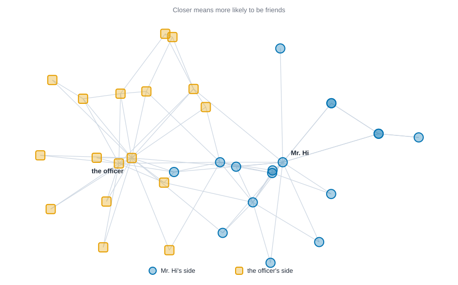
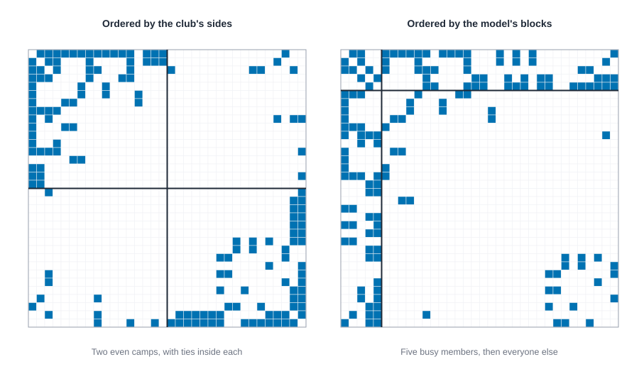
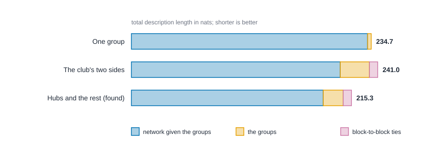

# Latent space and stochastic block models {#sec-latent-space}

::: {.callout-note appearance="simple"}
## Prerequisites
@sec-tests-and-null-models and @sec-ergm. We reuse Zachary's karate club from @sec-subgroups, and the idea of positions from @sec-positions-and-roles.
:::

## Two ways to say "these people are alike"

::: {.callout-tip appearance="simple"}
## Code lives next to the idea
Each step comes with its code right where it is explained. The Rust blocks in this chapter run top to bottom as one script: the first builds the karate club, and later ones reuse it.
:::

In @sec-ergm we modeled ties by counting patterns: ties, triangles, same-side pairs. That works well when you know which patterns matter. This chapter takes the opposite road. Instead of choosing patterns, we ask the network to *show us* who is alike, and we let that likeness explain the ties.

There are two classic answers, and they are two different pictures of "alike."

- **Latent space models** say that every person lives somewhere on an invisible map, and the closer two people are, the more likely they are to be tied. "Alike" means *near*. This is the idea of Hoff, Raftery and Handcock [@hoff2002latent].
- **Stochastic block models** say that every person belongs to a group, and the chance of a tie depends only on the two people's groups. "Alike" means *same group*. The idea goes back to Holland, Laskey and Leinhardt [@holland1983stochastic], and it is the statistical cousin of the blockmodels in @sec-positions-and-roles.

Both are *latent* models, because the map or the groups are never observed. They are estimated from the ties. Both also ask a question the earlier chapters couldn't: does the network have hidden structure at all, and how much?

## Latent space: closer means more likely

Give every person a position $z_i$ on a map, a pair of numbers if the map is flat. Then say the log-odds that $i$ and $j$ are tied is a baseline minus the distance between them:

$$
\log \frac{P(\text{tie between } i \text{ and } j)}{1 - P(\text{tie between } i \text{ and } j)} \;=\; \alpha \;-\; \lVert z_i - z_j \rVert .
$$

The number $\alpha$ is the log-odds of a tie between two people standing on the same spot. Every step apart lowers the log-odds by one. Given the map, ties are independent coin flips, one per pair.

A tiny example by hand. Put Ana at 0, Ben at 1 and Cleo at 4 on a line, with $\alpha = 2$.

| Pair | Distance | Log-odds ($2 - \text{distance}$) | Chance of a tie |
| --- | --- | --- | --- |
| Ana and Ben | 1 | 1 | 0.73 |
| Ben and Cleo | 3 | $-1$ | 0.27 |
| Ana and Cleo | 4 | $-2$ | 0.12 |

Ana and Ben are probably friends. Ben and Cleo are a toss-up leaning no, and Ana and Cleo probably aren't. Notice something useful: because distance obeys the triangle inequality (going from Ana to Cleo through Ben is never shorter than going straight), the model builds in a taste for *transitivity*. If Ana is near Ben and Ben is near Cleo, then Ana can't be very far from Cleo. Friends of friends tend to be friends, without a triangle term anywhere in the model.

### Step 1: the data

::: {.panel-tabset group="language"}

## R

```r
library(knappnet)

# Positions 1 to 34 are the members (the files number them from 1).
edges <- read.csv("data/karate/edges.csv")
nodes <- read.csv("data/karate/nodes.csv")
club <- net_frame(edges[, c("source", "target")], nodes = nodes, directed = FALSE)
# The side each member took when the club split (0 = Mr. Hi, 1 = the officer).
side <- as.integer(nodes$faction != "Mr. Hi")
cat(sprintf("%d members, %d friendships\n", nrow(club$nodes), nrow(club$edges)))
```

## Python

```python
import numpy as np
import pandas as pd
import networkx as nx

# Positions 0 to 33 are the members; the files number them from 1.
edges = pd.read_csv("data/karate/edges.csv")
nodes = pd.read_csv("data/karate/nodes.csv")
club = nx.Graph()
club.add_nodes_from(range(34))
club.add_edges_from(zip(edges["source"] - 1, edges["target"] - 1))
# The side each member took when the club split (0 = Mr. Hi, 1 = the officer).
side = (nodes["faction"] != "Mr. Hi").astype(int).to_numpy()
print(club.number_of_nodes(), "members,", club.number_of_edges(), "friendships")
```

## Rust

```rust
use knappnet::latent_space::{fit as fit_map, LatentOptions};
use knappnet::sbm::{compute_description_length, fit as fit_blocks, move_delta, SbmOptions};
use knappnet::Graph;

// Zachary's karate club again: 34 members, 78 friendships. Positions 0 to 33 are the members.
let from = [
    0, 0, 0, 0, 0, 0, 0, 0, 0, 0, 0, 0, 0, 0, 0, 0, 1, 1, 1, 1, 1, 1, 1, 1, 2, 2, 2, 2, 2, 2, 2, 2, 3, 3, 3,
    4, 4, 5, 5, 5, 6, 8, 8, 8, 9, 13, 14, 14, 15, 15, 18, 18, 19, 20, 20, 22, 22, 23, 23, 23, 23, 23, 24, 24,
    24, 25, 26, 26, 27, 28, 28, 29, 29, 30, 30, 31, 31, 32,
];
let to = [
    1, 2, 3, 4, 5, 6, 7, 8, 10, 11, 12, 13, 17, 19, 21, 31, 2, 3, 7, 13, 17, 19, 21, 30, 3, 7, 8, 9, 13, 27, 28,
    32, 7, 12, 13, 6, 10, 6, 10, 16, 16, 30, 32, 33, 33, 33, 32, 33, 32, 33, 32, 33, 33, 32, 33, 32, 33, 25, 27,
    29, 32, 33, 25, 27, 31, 31, 29, 33, 33, 31, 33, 32, 33, 32, 33, 32, 33, 33,
];
// The side each member took when the club split (0 = Mr. Hi, 1 = the officer).
let side: [u32; 34] = [
    0, 0, 0, 0, 0, 0, 0, 0, 0, 1, 0, 0, 0, 0, 1, 1, 0, 0, 1, 0, 1, 0, 1, 1, 1, 1, 1, 1, 1, 1, 1, 1, 1, 1,
];
let club = Graph::from_edges(34, &from, &to, None, false)?;
println!("{}", club.describe());
println!("{} members, {} friendships", club.node_count(), club.edge_count());
```

:::

::: {.code-output}
```text
Undirected network: 34 nodes, 78 ties
  Density           0.139
  Degree            1 to 17, mean 4.59
  Connected pieces  1
  Isolated nodes    0
  Loops, repeats    none
  Busiest           node 33 (17), node 0 (16), node 32 (12)

34 members, 78 friendships
```
:::

### Step 2: fit a map

Fitting means finding the positions and the baseline $\alpha$ that make the observed ties most likely. That is maximum likelihood again, as in @sec-ergm, but here the unknowns are the 34 positions. A two-dimensional map has $34 \times 2 = 68$ position numbers plus $\alpha$. Estimation starts from a map built by multidimensional scaling of path distances and then climbs the likelihood [@hoff2002latent; @gower1966some].

::: {.panel-tabset group="language"}

## R

```r
# latentnet is the standard R package for latent space models. It reads a network object,
# which we build from the 0/1 adjacency matrix.
library(latentnet)

A <- matrix(0, 34, 34)
A[cbind(edges$source, edges$target)] <- 1
A <- A + t(A)
karate <- network::network(A, directed = FALSE)

# The likelihood has many hills, and latentnet's search climbs a different one than Rust's
# does, so the numbers below differ in the first decimals. R and Python also differ.
# CHECK: stop
set.seed(1)
map <- ergmm(karate ~ euclidean(d = 2), tofit = "mle")
positions <- map$mle$Z
cat(sprintf("baseline log-odds (alpha): %.3f\n", map$mle$beta))
cat(sprintf("log-likelihood: %.2f\n", map$mle$lpY))
cat(sprintf("Mr. Hi at (%.2f, %.2f), the officer at (%.2f, %.2f)\n",
            positions[1, 1], positions[1, 2], positions[34, 1], positions[34, 2]))
```

## Python

```python
from scipy.optimize import minimize
from scipy.sparse.csgraph import shortest_path

A = nx.to_numpy_array(club, nodelist=range(34))
pair_i, pair_j = np.triu_indices(34, 1)
tied = A[pair_i, pair_j]

def fit_map(dim):
    # Start from classical scaling of the path distances, then climb the likelihood.
    D = shortest_path(A, unweighted=True)
    J = np.eye(34) - 1 / 34
    w, v = np.linalg.eigh(-0.5 * J @ D**2 @ J)
    start = v[:, ::-1][:, :dim] * np.sqrt(w[::-1][:dim])

    def negloglik(par):
        z, alpha = par[:-1].reshape(34, dim), par[-1]
        diff = z[pair_i] - z[pair_j]
        dist = np.sqrt((diff**2).sum(axis=1) + 1e-12)
        eta = alpha - dist
        resid = tied - 1 / (1 + np.exp(-eta))
        grad = np.zeros((34, dim))
        step = (-resid / dist)[:, None] * diff
        np.add.at(grad, pair_i, step)
        np.add.at(grad, pair_j, -step)
        loglik = (tied * eta - np.logaddexp(0, eta)).sum()
        return -loglik, -np.append(grad.ravel(), resid.sum())

    res = minimize(negloglik, np.append(start.ravel(), 0.0), jac=True, method="L-BFGS-B",
                   options={"maxiter": 5000, "ftol": 1e-14})
    return res.x[:-1].reshape(34, dim), res.x[-1], -res.fun, res

# The likelihood has many hills, and scipy's search climbs a different one than Rust's
# does, so the numbers below differ in the first decimals. R and Python also differ.
# CHECK: stop
positions, alpha, loglik, res = fit_map(2)
print(f"baseline log-odds (alpha): {alpha:.3f}")
print(f"log-likelihood: {loglik:.2f}")
print(f"search steps: {res.nit}, converged: {str(res.success).lower()}")
print(f"Mr. Hi at ({positions[0, 0]:.2f}, {positions[0, 1]:.2f}), the officer at ({positions[33, 0]:.2f}, {positions[33, 1]:.2f})")
```

## Rust

```rust
// Ask for a two-dimensional map. The default options start from classical scaling of the path distances.
let map = fit_map(&club, &LatentOptions { dim: 2, ..Default::default() })?;
println!("baseline log-odds (alpha): {:.3}", map.alpha);
println!("log-likelihood: {:.2}", map.loglik);
println!("search steps: {}, converged: {}", map.iterations, map.converged);
println!("Mr. Hi at ({:.2}, {:.2}), the officer at ({:.2}, {:.2})",
    map.positions[0], map.positions[1], map.positions[66], map.positions[67]);
```

:::

::: {.code-output}
```text
baseline log-odds (alpha): 3.063
log-likelihood: -122.33
search steps: 850, converged: true
Mr. Hi at (3.64, -0.52), the officer at (-3.78, -0.31)
```
:::

The R and Python tabs fit the same model with their own optimizers, which climb a different hill of the likelihood than the Rust search does, so their digits differ from the ones shown here.

The log-likelihood of $-122.33$ is a score for how well this map explains the 78 ties and 483 non-ties: closer to zero is better. The baseline of 3.06 says two members standing on top of each other would have a chance of a tie of about 96 percent. @fig-latent-map draws the map.

{#fig-latent-map fig-alt="A scatter of 34 markers joined by light grey lines for the 78 friendships. Blue circles for Mr. Hi's side sit mostly on the right, with Mr. Hi near the middle. Orange squares for the officer's side sit mostly on the left, around the officer. A few blue circles sit near the center, between the two groups."}

Nobody told the model about the two sides. It only saw who was friends with whom, and the map still pulls the officer's side to one end and Mr. Hi's to the other, with a few members in between.

### Step 3: read the map

A map is a picture. To use it, turn it back into numbers: how likely is each pair to be tied, and do distances line up with the club's sides?

::: {.panel-tabset group="language"}

## R

```r
# Distances come from the map, so they differ a little from Rust's.
# CHECK: stop
# Turn the map into tie probabilities: log-odds = alpha - distance.
alpha <- map$mle$beta[1]
distance <- as.matrix(dist(positions))
upper <- upper.tri(distance)
p <- 1 / (1 + exp(distance[upper] - alpha))
tied <- A[upper] == 1
same_side <- outer(side, side, "==")[upper]
cat(sprintf("expected ties %.1f (observed %d)\n", sum(p), sum(tied)))
cat(sprintf("average chance of a tie: %.3f for pairs that are tied, %.3f for pairs that are not\n",
            mean(p[tied]), mean(p[!tied])))
cat(sprintf("average distance: %.2f within a side, %.2f between sides\n",
            mean(distance[upper][same_side]), mean(distance[upper][!same_side])))
```

## Python

```python
# Distances come from the map, so they differ a little from Rust's.
# CHECK: stop
# Turn the map into tie probabilities: log-odds = alpha - distance.
dist = np.linalg.norm(positions[pair_i] - positions[pair_j], axis=1)
p = 1 / (1 + np.exp(dist - alpha))
same_side = side[pair_i] == side[pair_j]
print(f"expected ties {p.sum():.1f} (observed {int(tied.sum())})")
print(f"average chance of a tie: {p[tied == 1].mean():.3f} for pairs that are tied, {p[tied == 0].mean():.3f} for pairs that are not")
print(f"average distance: {dist[same_side].mean():.2f} within a side, {dist[~same_side].mean():.2f} between sides")
```

## Rust

```rust
// Turn the map into tie probabilities: log-odds = alpha - distance.
let spot = |i: usize| (map.positions[2 * i], map.positions[2 * i + 1]);
let distance = |i: usize, j: usize| ((spot(i).0 - spot(j).0).powi(2) + (spot(i).1 - spot(j).1).powi(2)).sqrt();
let mut tied = vec![vec![false; 34]; 34];
for (&a, &b) in from.iter().zip(to.iter()) {
    tied[a as usize][b as usize] = true;
    tied[b as usize][a as usize] = true;
}
let (mut expected, mut p_tie, mut p_none, mut n_tie, mut n_none) = (0.0, 0.0, 0.0, 0, 0);
let (mut within, mut between, mut n_within, mut n_between) = (0.0, 0.0, 0, 0);
for i in 0..34 {
    for j in (i + 1)..34 {
        let p = 1.0 / (1.0 + (distance(i, j) - map.alpha).exp());
        expected += p;
        if tied[i][j] { p_tie += p; n_tie += 1 } else { p_none += p; n_none += 1 }
        if side[i] == side[j] { within += distance(i, j); n_within += 1 } else { between += distance(i, j); n_between += 1 }
    }
}
println!("expected ties {:.1} (observed {})", expected, n_tie);
println!("average chance of a tie: {:.3} for pairs that are tied, {:.3} for pairs that are not", p_tie / n_tie as f64, p_none / n_none as f64);
println!("average distance: {:.2} within a side, {:.2} between sides", within / n_within as f64, between / n_between as f64);
```

:::

::: {.code-output}
```text
expected ties 78.0 (observed 78)
average chance of a tie: 0.502 for pairs that are tied, 0.080 for pairs that are not
average distance: 5.27 within a side, 9.47 between sides
```
:::

Because the R and Python maps differ a little from the Rust map, the averages they print differ in the first decimals too.

Three things to see. First, the model's expected number of ties is 78.0, exactly the observed number. That is not luck: the likelihood is maximized, among other things, over $\alpha$, and at the maximum the expected number of ties must equal the observed one, the same property an intercept gives an ordinary logistic regression. Second, pairs that are tied get an average chance of about 0.50 and pairs that aren't get about 0.08, so the map separates ties from non-ties, though far from perfectly, as it should for friendships that no map can fully predict. Third, members of the same side are on average 5.3 apart and members of different sides 9.5, so the map found the split on its own.

::: {.callout-warning appearance="simple"}
## A map is one of many
The likelihood of a latent space model has many hills, and the search stops at the first one it climbs. A check with 40 random starting points found that the best ten maps had log-likelihoods from about $-126$ to $-121$, so the map above, at $-122.33$, is good but not the best one found. The pictures differed in their details, yet in every one of the best three the same-side distances averaged between 5.1 and 5.3 and the between-side distances between 9.2 and 9.8. Trust what the maps agree on (the split, the hubs in the middle of their camps), and don't read meaning into the small details of any one picture.
:::

### Step 4: how many dimensions?

Why two dimensions? Mostly because we can draw two. More dimensions always fit at least as well, so the question is where to stop.

::: {.panel-tabset group="language"}

## R

```r
# CHECK: stop
for (dim in 1:3) {
  m <- ergmm(karate ~ euclidean(d = dim), tofit = "mle")
  cat(sprintf("%d dimension(s): log-likelihood %8.2f, alpha %6.2f\n", dim, m$mle$lpY, m$mle$beta[1]))
}
```

## Python

```python
# CHECK: stop
for dim in (1, 2, 3):
    _, a, ll, _ = fit_map(dim)
    print(f"{dim} dimension(s): log-likelihood {ll:8.2f}, alpha {a:6.2f}")
```

## Rust

```rust
for dim in 1..=3 {
    let m = fit_map(&club, &LatentOptions { dim, ..Default::default() })?;
    println!("{dim} dimension(s): log-likelihood {:>8.2}, alpha {:>6.2}", m.loglik, m.alpha);
}
```

:::

::: {.code-output}
```text
1 dimension(s): log-likelihood  -160.17, alpha   0.37
2 dimension(s): log-likelihood  -122.33, alpha   3.06
3 dimension(s): log-likelihood   -83.66, alpha  13.75
```
:::

Again, the R and Python optimizers end at different hills, so their log-likelihoods and baselines differ from these, most of all in three dimensions, where the search runs off along the ridge described below.

Going from one dimension to two raises the log-likelihood from $-160$ to $-122$, a big gain for 34 more numbers. Three dimensions look better still, at $-84$, but look at $\alpha$: it jumped to nearly 14. That is a warning sign. With enough room, the model can place members so that ties and non-ties separate almost perfectly, and then the likelihood has no peak: it keeps rising as the positions spread out and $\alpha$ grows. In a longer search it climbed past $-59$ with $\alpha$ near 100. A fit like that is memorizing the network, and a map that memorizes tells you nothing. With only 34 people, two dimensions is as far as the data will carry us. In larger networks you would compare models by how well they predict ties left out of the fit.

## Stochastic block models: same group, same story

Now the second picture. Suppose every member belongs to one of a few groups, and the chance that two members are tied depends only on their groups. Maybe the groups are tied closely inside and sparsely between, like the two camps in the karate club. Maybe one group is a set of hubs that everybody else ties to. A block model allows any pattern of rates between groups.

This is the same object as the blockmodel in @sec-positions-and-roles, with one important difference. There, we chose the groups by hand or from similarity scores. Here, a statistical model decides *how many groups there are* and *who is in them*, by asking which grouping gives the most economical account of the network.

### The idea: shortest description wins

Imagine you must send the karate club's ties to a friend over a slow connection, using as few bits as possible. One way is to list all 78 pairs. A smarter way is to first say "there are two groups, here is who is in each, and here is how dense the ties are within and between," and then send only the details that remain. If the groups capture real structure, the second message is shorter. If they don't, you've spent bits describing groups that didn't help.

The length of the best such message is the **description length** of a grouping [@peixoto2017nonparametric], measured here in nats (a natural-log version of bits). It has three parts:

1. **The network given the groups.** How many bits remain to say exactly which pairs are tied, once you know the groups and their ties-per-block counts. Good groupings make this smaller.
2. **The groups themselves.** The cost of saying who is in which group. More groups, more cost.
3. **The block-to-block ties.** The cost of stating how many ties run between each pair of groups.

This builds in a fair penalty for complexity. A grouping must pay for itself, and the model chooses the number of groups for you instead of asking you to guess. The shortest total wins.

### Step 5: find the best grouping

::: {.panel-tabset group="language"}

## R

```r
# Peixoto's description length has no R package that works from a plain network, so we write
# it out: the cost in nats of the network given the groups, of the groups, and of the ties between them.
m_ties <- sum(A) / 2
degree <- rowSums(A)
ln_fact <- function(k) lgamma(k + 1)
ln_multiset <- function(bins, items) {
  if (items == 0) 0 else ln_fact(bins + items - 1) - ln_fact(items) - ln_fact(bins - 1)
}

description_length <- function(blocks, degree_corrected = FALSE) {
  labels <- sort(unique(blocks))
  n <- length(blocks)
  k <- length(labels)
  member <- outer(blocks, labels, "==") * 1
  between <- t(member) %*% A %*% member   # ties between groups, counted twice inside a group
  size <- colSums(member)
  stubs <- colSums(member * degree)
  network <- 0
  for (r in 1:k) {
    for (s in r:k) {
      count <- if (r == s) between[r, s] / 2 else between[r, s]
      network <- network - ln_fact(count)
      if (r == s) network <- network - count * log(2)
    }
  }
  groups <- log(n) + ln_fact(n) - sum(ln_fact(size)) + ln_fact(n - 1) - ln_fact(k - 1) - ln_fact(n - k)
  if (degree_corrected) {
    network <- network + sum(ln_fact(stubs)) - sum(ln_fact(degree))
    popularity <- sum(mapply(ln_multiset, size, stubs))
  } else {
    network <- network + sum(stubs * log(size))
    popularity <- 0
  }
  ties <- ln_multiset(k * (k + 1) / 2, m_ties)
  c(network = network, groups = groups, ties = ties, popularity = popularity,
    total = network + groups + ties + popularity)
}

fit_blocks <- function(degree_corrected, restarts = 5, max_groups = 6) {
  # Greedy search: move one member at a time to the group that shortens the description most.
  best <- NULL
  best_len <- Inf
  for (k in 1:max_groups) {
    for (restart in 1:restarts) {
      blocks <- sample((0:33) %% k)
      current <- description_length(blocks, degree_corrected)[["total"]]
      improved <- TRUE
      while (improved) {
        improved <- FALSE
        for (v in sample(34)) {
          for (g in 0:(k - 1)) {
            trial <- blocks
            trial[v] <- g
            trial_len <- description_length(trial, degree_corrected)[["total"]]
            if (trial_len < current - 1e-9) {
              blocks <- trial
              current <- trial_len
              improved <- TRUE
            }
          }
        }
      }
      if (current < best_len - 1e-9) {
        best <- blocks
        best_len <- current
      }
    }
  }
  # Name the groups in order of their first member.
  match(best, unique(best)) - 1
}

set.seed(1)
found <- fit_blocks(FALSE)
cat(sprintf("%d groups found\n", max(found) + 1))
for (g in 0:max(found)) {
  members <- which(found == g) - 1
  cat(sprintf("group %d (%d members): [%s]\n", g, length(members), paste(members, collapse = ", ")))
}
```

## Python

```python
from math import lgamma, log

m = club.number_of_edges()
degree = A.sum(axis=1)

def ln_fact(k):
    return lgamma(k + 1)

def ln_multiset(bins, items):
    return ln_fact(bins + items - 1) - ln_fact(items) - ln_fact(bins - 1) if items else 0.0

def description_length(blocks, degree_corrected=False):
    """Peixoto's description length in nats: network, groups, ties, member popularities, total."""
    blocks = np.asarray(blocks)
    labels = np.unique(blocks)
    n, k = len(blocks), len(labels)
    member = (blocks[:, None] == labels[None, :]).astype(float)
    between = member.T @ A @ member          # ties between groups, counted twice inside a group
    size, stubs = member.sum(axis=0), member.T @ degree
    network = 0.0
    for r in range(k):
        for s in range(r, k):
            count = int(between[r, s] / 2 if r == s else between[r, s])
            network -= ln_fact(count) + (count * log(2) if r == s else 0.0)
    groups = log(n) + ln_fact(n) - sum(ln_fact(int(x)) for x in size)
    groups += ln_fact(n - 1) - ln_fact(k - 1) - ln_fact(n - k)
    if degree_corrected:
        network += sum(ln_fact(int(x)) for x in stubs) - sum(ln_fact(int(x)) for x in degree)
        popularity = sum(ln_multiset(int(x), int(t)) for x, t in zip(size, stubs))
    else:
        network += sum(t * log(x) for x, t in zip(size, stubs))
        popularity = 0.0
    ties = ln_multiset(k * (k + 1) // 2, m)
    return network, groups, ties, popularity, network + groups + ties + popularity

def fit_blocks(degree_corrected, restarts=5, seed=1, max_groups=6):
    # Greedy search: move one member at a time to the group that shortens the description most.
    rng = np.random.default_rng(seed)
    best, best_len = None, np.inf
    for k in range(1, max_groups + 1):
        for _ in range(restarts):
            blocks = rng.permutation(np.arange(34) % k)
            length = description_length(blocks, degree_corrected)[-1]
            improved = True
            while improved:
                improved = False
                for v in rng.permutation(34):
                    for g in range(k):
                        trial = blocks.copy()
                        trial[v] = g
                        trial_len = description_length(trial, degree_corrected)[-1]
                        if trial_len < length - 1e-9:
                            blocks, length, improved = trial, trial_len, True
            if length < best_len - 1e-9:
                best, best_len = blocks, length
    # Name the groups in order of their first member.
    _, first, inverse = np.unique(best, return_index=True, return_inverse=True)
    return np.argsort(np.argsort(first))[inverse]

found = fit_blocks(False)
print(f"{found.max() + 1} groups found")
for g in range(found.max() + 1):
    members = [int(i) for i in np.flatnonzero(found == g)]
    print(f"group {g} ({len(members)} members): {members}")
```

## Rust

```rust
// Find the grouping that gives the shortest description of the network. Five restarts guard against a poor start.
let plain = SbmOptions { degree_corrected: false, seed: 1, restarts: 5, ..Default::default() };
let found = fit_blocks(&club, &plain)?;
println!("{} groups found", found.groups);
for g in 0..found.groups as u32 {
    let members: Vec<usize> = (0..34).filter(|&i| found.blocks[i] == g).collect();
    println!("group {g} ({} members): {:?}", members.len(), members);
}
```

:::

::: {.code-output}
```text
2 groups found
group 0 (5 members): [0, 1, 2, 32, 33]
group 1 (29 members): [3, 4, 5, 6, 7, 8, 9, 10, 11, 12, 13, 14, 15, 16, 17, 18, 19, 20, 21, 22, 23, 24, 25, 26, 27, 28, 29, 30, 31]
```
:::

This is a surprise, and a useful one. The model did not find the two camps. It found five members, 0, 1, 2, 32 and 33, and then everyone else. Those five are the club's busiest people, including Mr. Hi (0) and the officer (33) themselves. @fig-sbm-matrix shows what the model sees.

{#fig-sbm-matrix fig-alt="Two 34 by 34 grids of cells, blue where two members are friends. The left grid is split into two equal halves by heavy lines, with blue cells concentrated in the two diagonal blocks and few in the off-diagonal blocks. The right grid is split after the first five rows and columns. Its small top-left block and its top and left strips are dense, and the large lower-right block is sparse."}

On the left, the sides do divide the network: dense blocks along the diagonal and a thin scatter between. On the right, the model's grouping shows a different pattern: a small, dense block of hubs, strips of ties running from the hubs to everyone, and a big, sparse block of everyone else. Both are real structure. The question is which is *more* of the story, and the description length answers it.

### Step 6: compare groupings

::: {.panel-tabset group="language"}

## R

```r
# Score three groupings with the same yardstick. Shorter is better.
cat(sprintf("%-26s %8s %8s %8s %8s\n", "", "network", "groups", "ties", "total"))
groupings <- list("one group" = rep(0, 34), "the club's two sides" = side,
                  "hubs and the rest (found)" = found)
for (label in names(groupings)) {
  d <- description_length(groupings[[label]])
  cat(sprintf("%-26s %8.1f %8.1f %8.1f %8.1f\n", label, d[["network"]], d[["groups"]], d[["ties"]], d[["total"]]))
}
```

## Python

```python
# Score three groupings with the same yardstick. Shorter is better.
print(f"{'':<26} {'network':>8} {'groups':>8} {'ties':>8} {'total':>8}")
for label, blocks in [("one group", np.zeros(34, dtype=int)), ("the club's two sides", side),
                      ("hubs and the rest (found)", found)]:
    network, groups, ties, _, total = description_length(blocks)
    print(f"{label:<26} {network:8.1f} {groups:8.1f} {ties:8.1f} {total:8.1f}")
```

## Rust

```rust
// Score three groupings with the same yardstick. Shorter is better.
let one_group = [0u32; 34];
println!("{:<26} {:>8} {:>8} {:>8} {:>8}", "", "network", "groups", "ties", "total");
for (label, blocks) in [("one group", &one_group[..]), ("the club's two sides", &side[..]), ("hubs and the rest (found)", &found.blocks[..])] {
    let d = compute_description_length(&club, blocks, false)?;
    println!("{label:<26} {:>8.1} {:>8.1} {:>8.1} {:>8.1}", d.adjacency, d.partition, d.edges, d.total);
}
```

:::

::: {.code-output}
```text
                            network   groups     ties    total
one group                     231.1      3.5      0.0    234.7
the club's two sides          204.3     28.6      8.1    241.0
hubs and the rest (found)     187.7     19.6      8.1    215.3
```
:::

@fig-dl-bars draws the same table. Look at the first column of numbers. Splitting by sides makes the network cheaper to describe given the groups (204.3, against 231.1 for no groups at all), but it costs 28.6 to say who is on which side and 8.1 to state the ties between the sides, and the total ends up *worse* than having one group (241.0 against 234.7). The hubs-and-the-rest grouping pays less for describing its groups and finds more structure to exploit, and wins by a wide margin at 215.3.

{#fig-dl-bars fig-alt="Three horizontal stacked bars. One group: 231.1 for the network given the groups, 3.5 for the groups, total 234.7. The club's two sides: 204.3, 28.6 and 8.1, total 241.0. Hubs and the rest: 187.7, 19.6 and 8.1, total 215.3."}

This does not mean the two sides are fake. They are real, and Zachary recorded them. It means that, from the ties alone and with only 34 people, the sides are a *softer* signal than the hubs: 11 of 78 ties cross the divide, and the cost of describing the split is steep. A model that must pay for every group it draws isn't impressed by a split that leaves that many ties across it.

### Step 7: how sure is the grouping?

Is the hubs-and-the-rest grouping a solid winner or a close call? One way to ask is to find out what moving a single member would cost.

::: {.panel-tabset group="language"}

## R

```r
# What would it cost to move one member into the other group? Positive means the description gets longer.
base <- description_length(found)[["total"]]
for (member in c(0, 2, 5, 9)) {
  target <- 1 - found[member + 1]
  moved <- found
  moved[member + 1] <- target
  cost <- description_length(moved)[["total"]] - base
  cat(sprintf("move member %2d to group %d: %+.2f\n", member, target, cost))
}
```

## Python

```python
# What would it cost to move one member into the other group? Positive means the description gets longer.
base = description_length(found)[-1]
for member in [0, 2, 5, 9]:
    target = 1 - found[member]
    moved = found.copy()
    moved[member] = target
    cost = description_length(moved)[-1] - base
    print(f"move member {member:>2} to group {target}: {cost:+.2f}")
```

## Rust

```rust
// What would it cost to move one member into the other group? Positive means the description gets longer.
for member in [0, 2, 5, 9] {
    let target = 1 - found.blocks[member];
    let cost = move_delta(&club, &found.blocks, false, member, target)?;
    println!("move member {member:>2} to group {target}: {cost:+.2}");
}
```

:::

::: {.code-output}
```text
move member  0 to group 1: +14.80
move member  2 to group 1: +2.44
move member  5 to group 0: +4.08
move member  9 to group 0: +9.77
```
:::

Under the model, a grouping whose description is $d$ nats longer is about $e^{d}$ times less probable. Moving Mr. Hi (member 0) into the big group costs 14.8 nats, which makes the grouping millions of times less probable, so he is firmly a hub. Moving member 9, who is tied only to two hubs, costs 9.8, about 17,000 times less probable. Moving member 2 costs just 2.4 nats, about 11 times less probable, the cheapest of any member we tried. Member 2 has friends among the hubs (0, 1 and 32) and outside them (7, for one), so that member sits closest to the boundary, and a different run or a bit more data could easily put member 2 in the other group. A grouping like this one is a best guess with a boundary, not a fact.

### Step 8: let popularity vary

The hubs group exists because some members have many more friends than others. But popularity is a *member* property, and block models usually don't separate "this person is in a busy group" from "this person is just popular." The **degree-corrected** block model gives each person their own popularity on top of their group [@karrer2011stochastic]. Then hubs no longer need a group of their own.

::: {.panel-tabset group="language"}

## R

```r
# Degree-corrected blocks let each member have their own popularity, so hubs no longer need a group of their own.
corrected <- fit_blocks(TRUE)
d <- description_length(corrected, TRUE)
cat(sprintf("%d group found, description length %.1f\n", max(corrected) + 1, d[["total"]]))
cat(sprintf("(network %.1f, groups %.1f, member popularities %.1f)\n", d[["network"]], d[["groups"]], d[["popularity"]]))
cat(sprintf("hubs-and-the-rest, degree-corrected: %.1f\n", description_length(found, TRUE)[["total"]]))
```

## Python

```python
# Degree-corrected blocks let each member have their own popularity, so hubs no longer need a group of their own.
corrected = fit_blocks(True)
network, groups, _, popularity, total = description_length(corrected, True)
print(f"{corrected.max() + 1} group found, description length {total:.1f}")
print(f"(network {network:.1f}, groups {groups:.1f}, member popularities {popularity:.1f})")
print(f"hubs-and-the-rest, degree-corrected: {description_length(found, True)[-1]:.1f}")
```

## Rust

```rust
// Degree-corrected blocks let each member have their own popularity, so hubs no longer need a group of their own.
let corrected = fit_blocks(&club, &SbmOptions { degree_corrected: true, seed: 1, restarts: 5, ..Default::default() })?;
let d = corrected.description_length;
println!("{} group found, description length {:.1}", corrected.groups, d.total);
println!("(network {:.1}, groups {:.1}, member popularities {:.1})", d.adjacency, d.partition, d.degrees);
let ours = compute_description_length(&club, &found.blocks, true)?;
println!("hubs-and-the-rest, degree-corrected: {:.1}", ours.total);
```

:::

::: {.code-output}
```text
1 group found, description length 227.7
(network 139.2, groups 3.5, member popularities 85.0)
hubs-and-the-rest, degree-corrected: 234.2
```
:::

With popularity handled member by member, the model finds *no* groups at all: one group, and the structure is explained by who is popular. Notice what that costs, though. Writing down every member's popularity takes 85.0 nats, so the total is 227.7. That is longer than the 215.3 of the plain model's hubs-and-the-rest grouping, and the same grouping scored by the degree-corrected model comes out at 234.2. Description lengths are measured in the same units whichever model computes them, so they can be compared: for this club, the plain model's short story ("five hubs and everyone else") beats the degree-corrected model's longer one ("each member has their own popularity").

Both models agree on the part that matters here: they found no evidence, among these 34 people, that the two sides are worth a group each. That is not a statement about the club's history. It is a statement about how much structure ties alone can support. A larger network, or one with fewer ties across the divide, would give a different answer.

## Which one to use

The two models answer different questions.

- **Latent space** asks "how near are people?" It gives you a *picture* and a continuous sense of closeness. It builds in transitivity. It struggles with very large networks and with strongly hub-dominated ones, and its maps are only defined up to rotation and flipping.
- **Block models** ask "which groups are there?" They give you a *partition* and a small table of rates between groups. They choose the number of groups for you. They struggle when likeness is a gradient and not a set of boxes.
- **ERGMs** (@sec-ergm) ask "which local patterns drive ties?" They suit a theory about mechanisms such as closure and homophily, and they need you to name the patterns.

The three are not rivals. A common workflow fits an ERGM when you have a mechanism in mind, and a latent space or block model when you want to see what structure is there, or to control for hidden structure before testing something else.

## Reading these models honestly

**Structure is not cause.** A map or a grouping describes a pattern in the ties. People can sit near each other or in the same group because they like each other, because they share an office, or because someone introduced them. The model can't tell these apart.

**There is no single right map or grouping.** Latent space fits have many local peaks, as we saw. Block-model fits are searches too, which is why we asked for five restarts. Report how many restarts you ran and whether they agreed.

**The result depends on the model.** Plain and degree-corrected block models tell different stories about the same club. Their description lengths are comparable, so report both and say which was shorter, and which you used.

**More flexible is not better.** A model with enough dimensions or groups can memorize any network. Description length charges a fair price for groups. Latent space models need you to supply your own discipline, such as holding out ties and checking predictions.

**One network is one observation.** As with ERGMs, a finding about the karate club is a finding about the karate club.

## A cheat sheet

| Piece | What it does | Watch out for |
| --- | --- | --- |
| Latent position | A spot on an invisible map | Axes are arbitrary; only distances matter |
| $\alpha$ | Baseline log-odds of a tie at zero distance | Very large $\alpha$ is a warning that the fit is memorizing |
| Dimension | How many axes the map has | More always fits better; choose by prediction |
| Block | A group whose members behave alike | Groups may be hubs, camps, or something else |
| Description length | Total cost of describing the network with a grouping | Compare only on the same network; shorter wins |
| Degree correction | Lets each member have their own popularity | Removes groups that were only popularity |
| Restarts | Repeated searches from different starts | Report how many agreed |

## Exercises

1. **By hand.** Put Ana at 0, Ben at 2 and Cleo at 3 on a line, with $\alpha = 2$. Find the chance of a tie for each pair. Which pair is the most likely, and which is the least?
2. **By hand.** With $\alpha = 3.06$, a pair of members at distance 3 has log-odds $0.06$. What is their chance of a tie? What happens at distance 6?
3. **Interpretation.** The block model split the karate club into a hub group and everyone else, not into the two sides. A reader says "so the model got the club wrong." Write a short reply.
4. **Coding.** Refit the plain block model with `seed: 2` and `restarts: 1`. Do you get the same grouping and the same description length? What does your answer say about restarts?
5. **Coding.** Compute the description length of the grouping that puts members 0 and 33 alone in one group and everyone else in another. How does it compare with the fitted grouping?
6. **Design.** You have a friendship network of 300 students and their grades. How would you use a latent space or block model to ask whether friendships follow grade level, and how would you guard against a model that memorizes?

## Summary

::: {.callout-tip appearance="simple"}
Latent models let the network reveal who is alike instead of making you choose the patterns. A latent space model gives each person a position and makes ties likelier the closer people are, so friends of friends tend to be friends automatically. A stochastic block model sorts people into groups and chooses the number of groups by finding the shortest description of the network. In the karate club, a two-dimensional map pulls the two sides apart on its own, while the block model, charged for every group it draws, prefers a group of five hubs over the two sides. The degree-corrected version finds no groups at all, but its description is longer than the plain model's. Both are searches that can stop at a local best, so report restarts, check what several runs agree on, and treat any single map or grouping as a good guess, not a fact.
:::

## Further reading

For latent space models, see @hoff2002latent, and for fitting them to large networks, @raftery2012fast. For the block model's roots, see @holland1983stochastic, for its degree-corrected form, @karrer2011stochastic, and for the description-length approach used here, @peixoto2017nonparametric and the search methods in @peixoto2014efficient. For classical scaling, which starts the latent space fit, see @gower1966some. For positions and blockmodels in the earlier sense, see @white1976social and @sec-positions-and-roles.
