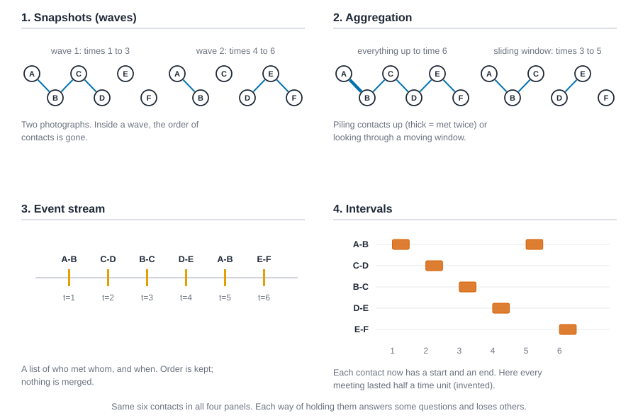
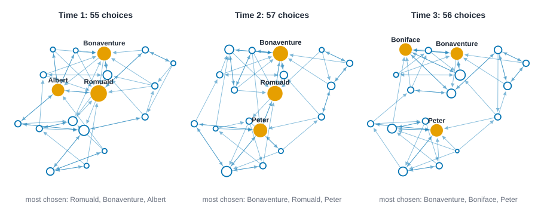
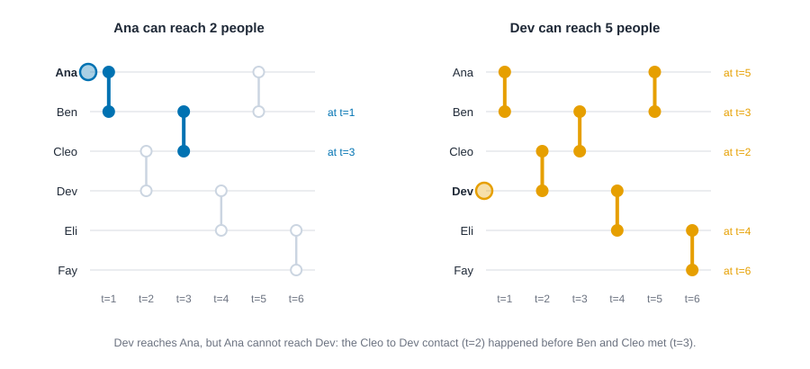
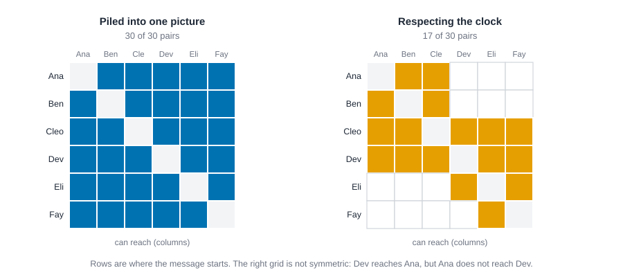
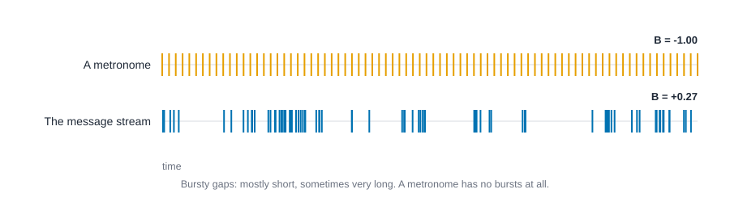

# Networks in time {#sec-time}

::: {.callout-note appearance="simple"}
## Prerequisites
@sec-networks-as-data, @sec-paths-and-cohesion and @sec-centrality (we use in-degree). This chapter describes networks that change; it does not fit models of change. For those, see @sec-dynamics.
:::

## Introduction

Suppose a friend hands you two files. One is a survey: every autumn for three years, a class of students named the classmates they like. The other is a log: who emailed whom, with a timestamp on every message. Both are "networks over time". But they answer different questions, and if you treat them the same way you can get answers that sound sensible and are wrong.

With the survey, you can ask whether the class looks different in year three than in year one. With the log, you can ask something sharper: if one person had news at nine o'clock, who could have heard it by the end of the day? That second question depends on the *order* in which things happened, and a photograph of the network can't answer it.

This chapter is about how to think about time before you reach for any model. Time makes a network richer, and it also gives you new ways to fool yourself. By the end you will be able to:

- say which of four ways of holding time your data uses, and what that choice leaves out;
- cut a network into windows and describe each one, without mistaking the window for the network;
- find out who can reach whom when contacts have to happen in order;
- tell whether events arrive in bursts;
- and report a temporal result with the caveats it needs.

Everything here is description. Models that explain *why* ties form and fade come later, in @sec-dynamics.

## Four ways to hold time

Take six people and six contacts. At time 1 Ana meets Ben, at time 2 Cleo meets Dev, at time 3 Ben meets Cleo, at time 4 Dev meets Eli, at time 5 Ana meets Ben again, and at time 6 Eli meets Fay. These six meetings are all the data. There are four common ways to write them down, and @fig-time-four-ways shows each one.

{#fig-time-four-ways fig-alt="Four panels, each showing the same six contacts among Ana, Ben, Cleo, Dev, Eli and Fay. Panel 1 shows two small networks, times 1 to 3 with three ties and times 4 to 6 with three ties. Panel 2 shows one network of everything up to time 6 with five ties, the Ana-Ben tie drawn thick because they met twice, and a sliding window of times 3 to 5 with three ties. Panel 3 is a timeline with six ticks labeled A-B at 1, C-D at 2, B-C at 3, D-E at 4, A-B at 5 and E-F at 6. Panel 4 shows five rows of pairs with a short bar for each meeting, A-B twice, at times 1 and 5."}

**Snapshots, or waves.** You cut time into a few chunks and keep one network per chunk. This is what a survey gives you naturally: everyone fills it in at the same few moments. A snapshot says who was tied in that chunk. It doesn't say what order things happened inside it.

**Aggregation.** You pile contacts together into one weighted network. *Cumulative* aggregation piles up everything so far: by time 6, Ana and Ben are tied with weight 2 because they met twice. A *sliding window* piles up only the most recent stretch, say the last three time units, and moves along. Aggregation is how most people turn a log into a picture, because it gives you an ordinary network that all the usual tools accept.

**Event stream.** You keep every contact as a row: who, with whom, and when. Nothing is merged and nothing is rounded. This is the richest form, and the one the tools later in this chapter work on.

**Intervals, or spells.** Each contact or tie has a start and an end. This suits phone calls, which last, or friendships, which begin and end. An event stream is the special case where every interval has length zero.

The same six contacts, held these four ways, in code. For the intervals we make something up: we suppose each meeting lasted half a time unit.

::: {.panel-tabset group="language"}

## R

```r
library(knappnet)
library(dplyr)
library(tidyr)
library(purrr)

people <- c("Ana", "Ben", "Cleo", "Dev", "Eli", "Fay")

# An event stream: one row per contact, with the time it happened.
contacts <- tibble(
  source = people[c(1, 3, 2, 4, 1, 5)],
  target = people[c(2, 4, 3, 5, 2, 6)],
  time = 1:6
)
g <- net_temporal(contacts, nodes = tibble(id = people), directed = FALSE)
contacts

# Snapshots: two waves, times 1 to 3 and times 4 to 6. How many contacts fall in each?
tibble(wave = 1:2, from = c(1, 4)) |>
  mutate(contacts = map_int(from, \(a) nrow(net_window(g, a, a + 3)$edges)))

# Cumulative aggregation: everything up to time 3, and everything up to time 6.
tibble(up_to = c(3, 6)) |>
  mutate(
    piled = map(up_to, \(t) net_aggregate(g, from = 1, to = t + 0.5)$edges),
    contacts = map_dbl(piled, \(e) sum(e$count)),
    pairs = map_int(piled, nrow)
  ) |>
  select(-piled)

# Intervals: suppose each meeting lasted half a time unit. Who is meeting at time 3.2?
spells <- contacts |>
  mutate(end = time + 0.5) |>
  net_temporal(nodes = tibble(id = people), end = "end", directed = FALSE)
net_at(spells, 3.2)$edges
```

::: {.code-output}
```text
TODO
```
:::

## Python

```python
import csv

import networkx as nx
import numpy as np

names = ["Ana", "Ben", "Cleo", "Dev", "Eli", "Fay"]
person_a = [0, 2, 1, 3, 0, 4]
person_b = [1, 3, 2, 4, 1, 5]
when = [1.0, 2.0, 3.0, 4.0, 5.0, 6.0]

# An event stream: one row per contact, with the time it happened.
contacts = sorted(zip(when, person_a, person_b))
print(f"event stream: {len(contacts)} contacts")
for t, a, b in contacts:
    print(f"  t={t:g}  {names[a]} - {names[b]}")

# Snapshots: two waves, times 1 to 3 and times 4 to 6.
in_wave = [sum(lo <= t < lo + 3 for t, _, _ in contacts) for lo in (1, 4)]
print(f"snapshots: {in_wave[0]} contacts in wave 1, {in_wave[1]} in wave 2")

# Cumulative aggregation: everything up to time 3, and everything up to time 6.
for up_to in (3, 6):
    so_far = [(a, b) for t, a, b in contacts if t <= up_to]
    print(f"up to time {up_to}: {len(so_far)} contacts, {len({frozenset(p) for p in so_far})} distinct pairs")

# Intervals: suppose each meeting lasted half a time unit. Who is meeting at time 3.2?
meeting = [(names[a], names[b]) for t, a, b in contacts if t <= 3.2 < t + 0.5]
print(f"at time 3.2: {meeting[0][0]} - {meeting[0][1]}")
```

::: {.code-output}
```text
event stream: 6 contacts
  t=1  Ana - Ben
  t=2  Cleo - Dev
  t=3  Ben - Cleo
  t=4  Dev - Eli
  t=5  Ana - Ben
  t=6  Eli - Fay
snapshots: 3 contacts in wave 1, 3 in wave 2
up to time 3: 3 contacts, 3 distinct pairs
up to time 6: 6 contacts, 5 distinct pairs
at time 3.2: Ben - Cleo
```
:::

## Rust

```rust
use knappnet::temporal::windows::{combine_contacts_by_pair, find_contacts_at, find_contacts_in_windows};
use knappnet::temporal::{count_temporal_reach, Direction, PathOptions, TemporalNetwork};

// Six people and six contacts, invented for this chapter. Each contact is one instant: who met whom, and when.
let names = ["Ana", "Ben", "Cleo", "Dev", "Eli", "Fay"];
let person_a = [0, 2, 1, 3, 0, 4];
let person_b = [1, 3, 2, 4, 1, 5];
let when = [1.0, 2.0, 3.0, 4.0, 5.0, 6.0];

// An event stream: one row per contact, with the time it happened.
let contacts = TemporalNetwork::new(6, &person_a, &person_b, &when, None, false)?;
println!("event stream: {} contacts", contacts.contact_count());
for k in 0..6 {
    println!("  t={}  {} - {}", when[k], names[person_a[k] as usize], names[person_b[k] as usize]);
}

// Snapshots: two waves, times 1 to 3 and times 4 to 6.
let waves = find_contacts_in_windows(&contacts, &[1.0, 4.0], &[4.0, 7.0])?;
println!("snapshots: {} contacts in wave 1, {} in wave 2", waves.offsets[1] - waves.offsets[0], waves.offsets[2] - waves.offsets[1]);

// Cumulative aggregation: everything up to time 3, and everything up to time 6.
for up_to in [3.0, 6.0] {
    let piled = combine_contacts_by_pair(&contacts, Some((1.0, up_to + 0.5)))?;
    println!("up to time {up_to}: {} contacts, {} distinct pairs", piled.count.iter().sum::<f64>(), piled.from.len());
}

// Intervals: suppose each meeting lasted half a time unit. Who is meeting at time 3.2?
let ends: Vec<f64> = when.iter().map(|t| t + 0.5).collect();
let spells = TemporalNetwork::new(6, &person_a, &person_b, &when, Some(&ends), false)?;
for k in find_contacts_at(&spells, 3.2)? {
    println!("at time 3.2: {} - {}", names[person_a[k] as usize], names[person_b[k] as usize]);
}
```

::: {.code-output}
```text
event stream: 6 contacts
  t=1  Ana - Ben
  t=2  Cleo - Dev
  t=3  Ben - Cleo
  t=4  Dev - Eli
  t=5  Ana - Ben
  t=6  Eli - Fay
snapshots: 3 contacts in wave 1, 3 in wave 2
up to time 3: 3 contacts, 3 distinct pairs
up to time 6: 6 contacts, 5 distinct pairs
at time 3.2: Ben - Cleo
```
:::

:::

Four lines of numbers don't make a case for any of these, so here is the question to ask of each: *what does it let me ask, and what does it throw away?*

| Way of holding time | Fits data like | Lets you ask | Throws away |
| --- | --- | --- | --- |
| Snapshots | Surveys, yearly records | How did the network look at each wave? What changed between waves? | The order of anything inside a wave |
| Aggregation | Logs you want to draw or measure with ordinary tools | Who is tied, how strongly, in this stretch? | Order, and when each tie happened |
| Event stream | Emails, calls, meetings with timestamps | Who could have passed something on to whom? How bursty is activity? | Nothing, but it needs exact times |
| Intervals | Calls, friendships, jobs that start and end | Who was tied at a given moment? For how long? | Contacts inside a spell, if you only record start and end |

## What each choice costs

The costs are not small, and they are not obvious until you see them once.

**Aggregation can invent paths that never existed.** Pile the six contacts together and you get a chain: Ana to Ben to Cleo to Dev to Eli to Fay. In that picture, Ana is connected to Fay. But Ana's contact with Ben happened at time 1 and again at 5; Ben's contact with Cleo at 3; Cleo's with Dev at 2, *before* Ben and Cleo met. A message that leaves Ana can't get past Cleo. The chain in the picture is a path in *space* that was never a path in *time*. The effect grows with the density of the log: the more contacts you pile together, the more paths you invent.

**Snapshots hide order inside a wave.** In the first wave (times 1 to 3), Ana, Ben, Cleo and Dev form one connected piece, so a snapshot says any of them can get news to any other. But in time Dev can get news to Cleo and Ben, and Ana can't get it to Dev. The photograph doesn't know which contact came first.

**Aggregation also inflates density.** A network made of everything that happened in a year has more ties than any single week of that year contained. If you compare its density with that of a survey wave, you are comparing a year of activity with a moment. We'll see this with real data in a moment.

**Event streams need a clock you can trust.** If two contacts are stamped with the same day, you can't tell which came first, and whether news can pass along both changes the answer. We return to this at the end of the chapter.

**Intervals assume a tie is *there* the whole time.** A friendship recorded as "from 2019 to 2022" says nothing about whether the friends spoke in 2021.

None of this makes one representation the right one. It means you should choose the representation that matches your question, and say what it throws away when you report a result.

## A worked example: Sampson's novices at three times

For a real case, we'll use a classic. Samuel Sampson lived in a New England monastery as an experimenter, asked 18 novices (men in training to become monks) about their relationships, and wrote up the results in his 1968 dissertation [@sampson1968novitiate]. The data have been analyzed many times since, for example by White, Boorman and Breiger [@white1976social]. Among the questions was a liking one: name the three novices you like most. The answers were collected at three points in time, which the data file calls times 1, 2 and 3. That's what we use: three waves of one relation, "likes".

Two things to keep in mind before we count anything. First, each novice was asked for his *top three*, so almost everyone names exactly three people (a few gave tied ranks and so named four). That means the number of choices *made* is fixed by the questionnaire, and any number built from it, such as density, can't move much. Second, we know the waves happened in order, but the file doesn't tell us how far apart they were, so we'll treat time as an order and not a clock.

In each wave we'll compute: the number of choices, the density (the share of possible choices that were made), the share of choices that were returned, the number of connected pieces (ignoring direction), and how many novices nobody chose. Then we'll ask how stable the ranking by popularity is from one wave to the next, using the **Spearman correlation**, which compares two rankings and runs from $-1$ (reversed) through 0 (unrelated) to $+1$ (identical). Last, we'll see what piling the three waves together does.

::: {.panel-tabset group="language"}

## R

```r
# Sampson's 18 novices: the "liking" choices at times 1, 2 and 3.
sampson <- read.csv("data/sampson/edges.csv") |>
  as_tibble() |>
  filter(relation == "liking") |>
  select(source = from, target = to, wave = time)
novices <- tibble(id = sort(unique(c(sampson$source, sampson$target))))
panel <- net_temporal(sampson, nodes = novices, wave = "wave", directed = TRUE)
waves <- net_waves(panel)

# Describe each wave on its own.
waves |>
  map(\(h) tibble(
    ties = nrow(h$edges),
    density = net_density(h),
    returned = net_reciprocity(h),
    pieces = max(net_components(h, mode = "weak")$membership),
    nobody_chose = sum(net_degree(h, mode = "in") == 0)
  )) |>
  list_rbind(names_to = "wave") |>
  mutate(across(c(density, returned), \(x) round(x, 3)))

# Who is most chosen in each wave?
chosen <- waves |>
  map(\(h) mutate(h$nodes, received = net_degree(h, mode = "in"))) |>
  list_rbind(names_to = "wave") |>
  rename(novice = id)
chosen |>
  group_by(wave) |>
  slice_max(received, n = 3, with_ties = FALSE)

# How stable is the ranking by popularity? Spearman correlation of in-degree between waves.
received <- pivot_wider(chosen, names_from = wave, values_from = received, id_cols = novice)
list(c("1", "2"), c("2", "3"), c("1", "3")) |>
  map_dbl(\(w) cor(received[[w[1]]], received[[w[2]]], method = "spearman")) |>
  set_names(c("1 vs 2", "2 vs 3", "1 vs 3")) |>
  round(2)

# How many choices carry over, and what happens when we pile the waves together?
kept <- waves |> map(\(h) paste(h$edges$source, h$edges$target))
c(
  kept_1_to_2 = length(intersect(kept[[1]], kept[[2]])),
  kept_2_to_3 = length(intersect(kept[[2]], kept[[3]]))
)
piled <- net_aggregate(panel)
tibble(
  ties = nrow(piled$edges),
  density = round(net_density(piled), 3),
  in_all_three = sum(piled$edges$count == 3)
)
```

::: {.code-output}
```text
TODO
```
:::

## Python

```python
import pandas as pd
from scipy.stats import spearmanr

# Sampson's 18 novices: the "liking" choices at times 1, 2 and 3.
with open("data/sampson/edges.csv") as f:
    liking = [r for r in csv.DictReader(f) if r["relation"] == "liking"]
novices = sorted({r["from"] for r in liking} | {r["to"] for r in liking})

def wave_graph(k):
    g = nx.DiGraph()
    g.add_nodes_from(novices)
    g.add_edges_from((r["from"], r["to"]) for r in liking if int(r["time"]) == k)
    return g

waves = {k: wave_graph(k) for k in (1, 2, 3)}

# Describe each wave on its own.
print("wave  ties  density  returned  pieces  nobody chose")
for k, g in waves.items():
    nobody = sum(d == 0 for _, d in g.in_degree())
    print(f"{k:<5} {g.number_of_edges():<5} {nx.density(g):<8.3f} {nx.reciprocity(g):<9.3f} "
          f"{nx.number_weakly_connected_components(g):<7} {nobody}")

# Who is most chosen in each wave?
received = pd.DataFrame({k: dict(g.in_degree()) for k, g in waves.items()})
for k in waves:
    top = received[k].sort_values(ascending=False, kind="stable").head(3)
    print(f"most chosen, wave {k}: " + ", ".join(f"{n} ({d})" for n, d in top.items()))

# How stable is the ranking by popularity? Spearman correlation of in-degree between waves.
pairs = [(1, 2), (2, 3), (1, 3)]
print("rank correlation of in-degree: " + ", ".join(f"{a} vs {b} {spearmanr(received[a], received[b])[0]:.2f}" for a, b in pairs))

# How many choices carry over, and what happens when we pile the waves together?
ties = {k: set(g.edges) for k, g in waves.items()}
print(f"carried over: {len(ties[1] & ties[2])} of {len(ties[1])} from wave 1 to 2, "
      f"{len(ties[2] & ties[3])} of {len(ties[2])} from wave 2 to 3")
piled = nx.DiGraph()
piled.add_nodes_from(novices)
piled.add_edges_from(ties[1] | ties[2] | ties[3])
print(f"all three waves piled together: {piled.number_of_edges()} ties, density {nx.density(piled):.3f}, "
      f"{len(ties[1] & ties[2] & ties[3])} present in all three")
```

::: {.code-output}
```text
wave  ties  density  returned  pieces  nobody chose
1     55    0.180    0.509     1       0
2     57    0.186    0.526     1       0
3     56    0.183    0.536     1       1
most chosen, wave 1: Romuald (9), Bonaventure (7), Albert (6)
most chosen, wave 2: Bonaventure (8), Romuald (8), Peter (7)
most chosen, wave 3: Bonaventure (6), Boniface (6), Peter (6)
rank correlation of in-degree: 1 vs 2 0.55, 2 vs 3 0.68, 1 vs 3 0.45
carried over: 35 of 55 from wave 1 to 2, 40 of 57 from wave 2 to 3
all three waves piled together: 88 ties, density 0.288, 30 present in all three
```
:::

## Rust

```rust
use knappnet::metrics::degree::{compute_degree, DegreeMode};
use knappnet::metrics::descriptive::{compute_reciprocity, ReciprocityMode};
use knappnet::metrics::topography::{compute_density, find_components, ComponentKind};
use knappnet::Graph;
use std::collections::BTreeSet;

// Sampson's 18 novices: the "liking" choices at times 1, 2 and 3. Novices are numbered 0 to 17 in name order.
let text = std::fs::read_to_string("data/sampson/edges.csv")?;
let liking: Vec<Vec<&str>> = text.lines().skip(1).map(|line| line.split(',').collect()).filter(|p: &Vec<&str>| p[2] == "liking").collect();
let novices: Vec<&str> = liking.iter().flat_map(|p| [p[0], p[1]]).collect::<BTreeSet<_>>().into_iter().collect();
let id = |name: &str| novices.iter().position(|&x| x == name).unwrap() as i64;
let mut ties: Vec<BTreeSet<(i64, i64)>> = vec![BTreeSet::new(); 3];
for p in &liking {
    ties[p[4].parse::<usize>().unwrap() - 1].insert((id(p[0]), id(p[1])));
}
let graph_of = |set: &BTreeSet<(i64, i64)>| -> Result<Graph, knappnet::Error> {
    let who: Vec<i64> = set.iter().map(|t| t.0).collect();
    let whom: Vec<i64> = set.iter().map(|t| t.1).collect();
    Graph::from_edges(18, &who, &whom, None, true)
};
let waves = ties.iter().map(graph_of).collect::<Result<Vec<_>, _>>()?;
let received: Vec<Vec<f64>> = waves.iter().map(|g| compute_degree(g, DegreeMode::In, true)).collect();

// Describe each wave on its own.
println!("wave  ties  density  returned  pieces  nobody chose");
for (k, g) in waves.iter().enumerate() {
    println!("{:<5} {:<5} {:<8.3} {:<9.3} {:<7} {}", k + 1, g.edge_count(), compute_density(g, false),
        compute_reciprocity(g, ReciprocityMode::Default), find_components(g, ComponentKind::Weak).count(),
        received[k].iter().filter(|&&d| d == 0.0).count());
}

// Who is most chosen in each wave?
for (k, got) in received.iter().enumerate() {
    let mut order: Vec<usize> = (0..18).collect();
    order.sort_by(|&a, &b| got[b].partial_cmp(&got[a]).unwrap().then(a.cmp(&b)));
    let top: Vec<String> = order[..3].iter().map(|&i| format!("{} ({})", novices[i], got[i])).collect();
    println!("most chosen, wave {}: {}", k + 1, top.join(", "));
}

// How stable is the ranking by popularity? Spearman correlation of in-degree between waves:
// rank each wave (tied novices share their average rank), then correlate the ranks.
let ranks = |x: &[f64]| -> Vec<f64> {
    x.iter().map(|&v| {
        let below = x.iter().filter(|&&w| w < v).count() as f64;
        let same = x.iter().filter(|&&w| w == v).count() as f64;
        below + (same + 1.0) / 2.0
    }).collect()
};
let spearman = |a: &[f64], b: &[f64]| -> f64 {
    let (ra, rb) = (ranks(a), ranks(b));
    let (ma, mb) = (ra.iter().sum::<f64>() / 18.0, rb.iter().sum::<f64>() / 18.0);
    let cross: f64 = ra.iter().zip(&rb).map(|(x, y)| (x - ma) * (y - mb)).sum();
    let (sa, sb): (f64, f64) = (ra.iter().map(|x| (x - ma).powi(2)).sum(), rb.iter().map(|y| (y - mb).powi(2)).sum());
    cross / (sa * sb).sqrt()
};
println!("rank correlation of in-degree: 1 vs 2 {:.2}, 2 vs 3 {:.2}, 1 vs 3 {:.2}",
    spearman(&received[0], &received[1]), spearman(&received[1], &received[2]), spearman(&received[0], &received[2]));

// How many choices carry over, and what happens when we pile the waves together?
println!("carried over: {} of {} from wave 1 to 2, {} of {} from wave 2 to 3",
    ties[0].intersection(&ties[1]).count(), ties[0].len(), ties[1].intersection(&ties[2]).count(), ties[1].len());
let everything: BTreeSet<(i64, i64)> = ties.iter().flatten().copied().collect();
let piled = graph_of(&everything)?;
println!("all three waves piled together: {} ties, density {:.3}, {} present in all three",
    piled.edge_count(), compute_density(&piled, false),
    ties[0].iter().filter(|t| ties[1].contains(t) && ties[2].contains(t)).count());
```

::: {.code-output}
```text
wave  ties  density  returned  pieces  nobody chose
1     55    0.180    0.509     1       0
2     57    0.186    0.526     1       0
3     56    0.183    0.536     1       1
most chosen, wave 1: Romuald (9), Bonaventure (7), Albert (6)
most chosen, wave 2: Bonaventure (8), Romuald (8), Peter (7)
most chosen, wave 3: Bonaventure (6), Boniface (6), Peter (6)
rank correlation of in-degree: 1 vs 2 0.55, 2 vs 3 0.68, 1 vs 3 0.45
carried over: 35 of 55 from wave 1 to 2, 40 of 57 from wave 2 to 3
all three waves piled together: 88 ties, density 0.288, 30 present in all three
```
:::

:::

@fig-sampson-waves draws the three waves in the same places, so that you can compare them by eye.

{#fig-sampson-waves fig-alt="Three copies of the same 18 dots joined by arrows, with 55 arrows at time 1, 57 at time 2 and 56 at time 3. Filled dots mark the three most chosen novices. At time 1 they are Romuald, Bonaventure, Albert. At time 2 they are Bonaventure, Romuald, Peter. At time 3 they are Bonaventure, Boniface, Peter."}

### What the numbers say

The first four columns of the table barely move. There are 55, 57 and 56 choices; the density is 0.18 or 0.19 every time; everyone is in one connected piece in every wave. As we said, that is mostly the questionnaire talking, because everyone was asked for three names. A reader who sees "density stayed constant" and concludes "the monastery's social structure was stable" has been fooled by the instrument. Density can't tell these waves apart *by design*.

What does move is *who* is chosen. The share of choices that were returned is about a half in every wave (0.51, 0.53, 0.54), so mutual liking is common and may be creeping up, but three waves are far too few to call that a trend. Only about two thirds of the choices carry over: 35 of the 55 from wave 1 to wave 2, 40 of 57 from wave 2 to wave 3. And the most chosen novices change: Bonaventure is in the top three every time, Romuald in the first two waves, Peter in the last two, Albert in the first only, Boniface in the third only.

Popularity ranks are moderately stable, not locked: the Spearman correlation of in-degree is 0.55 between waves 1 and 2, 0.68 between 2 and 3, and 0.45 between 1 and 3. That is a pattern we'd expect if popularity drifts. It's not proof of drift, and with 18 novices, many of whom were chosen once or twice, small differences in the middle of the ranking are noise.

Now look at the last line. Piled together, the three waves hold 88 distinct choices, a density of 0.29, against 0.18 for any single wave. Only 30 choices appear in all three. Nobody *had* 88 friends-worth of liking at one moment: this network exists only as a summary. It says "these pairs were ever named", and it is the aggregation cost from the last section, in real data.

### What these results do not show

- They don't say *why* a tie changed. A novice who dropped out of someone's top three may have liked him less, or may have found someone else to add.
- They don't say *when* between waves a change happened.
- They don't say that a novice who was chosen more was *more liked* in any absolute sense. In-degree here counts how many of the others put him in their top three, and each of them has only three slots.
- Sampson collected most of the data after the monastery went through a crisis in which several novices were expelled, and many of the others then left. The data are retrospective in parts. The three times of the liking question are a window onto a community in motion, not a controlled experiment [@sampson1968novitiate].

## Time-respecting paths: who can reach whom?

Now go back to the event stream and ask the question only an event stream can answer. Ana has news at time 1. Who can she tell?

Ana tells Ben at time 1. Ben meets Cleo at time 3, so Cleo hears at time 3. But Cleo's meeting with Dev was at time 2, which is *over* by the time Cleo hears. The news stops with Cleo. Ana reaches Ben and Cleo and nobody else.

Dev's story is different. Dev tells Cleo at time 2, who tells Ben at 3, who tells Ana at 5. Dev also tells Eli at 4, who tells Fay at 6. Dev reaches all five. That asymmetry is the point: **reachability depends on the order of events**, it doesn't have to be symmetric, and a static picture can't show it. A path that respects the order of contacts is called a **time-respecting path**, and the set of people it reaches is a person's **influence set** [@kempe2002connectivity; @holme2005network].

{#fig-time-respecting fig-alt="Two timelines side by side, with six horizontal lines for Ana, Ben, Cleo, Dev, Eli and Fay and vertical bars for six contacts at times 1 to 6. On the left, only the contacts at times 1 (Ana and Ben) and 3 (Ben and Cleo) are highlighted. On the right, all six contacts are highlighted and each person is labeled with the time Dev's message reaches them: Cleo 2, Ben 3, Eli 4, Ana 5, Fay 6."}

### Counting reach, and what time throws away

For each person we count how many others they can reach, in four ways. *Time-respecting* is the real thing. *Piled up* is the reach in the aggregated picture, where a message can use any contact in any order. Then the same two again for the first wave only (times 1 to 3): time-respecting within the wave, and the photograph of that wave, where a person reaches whoever is in their connected piece.

::: {.panel-tabset group="language"}

## R

```r
# For every person, how many others can a message reach if it only moves forward in time?
# Compare with the same contacts piled into one picture, and with the first wave only.
piece_size <- \(h) {
  membership <- net_components(h, mode = "weak")$membership
  as.vector(table(membership)[membership]) - 1
}
g$nodes |>
  mutate(
    time_respecting = net_temporal_reach(g),
    piled_up = piece_size(net_aggregate(g)),
    wave1_time_respecting = net_temporal_reach(g, start = 1, end = 3),
    wave1_photo = piece_size(net_window(g, 1, 4))
  )
```

::: {.code-output}
```text
TODO
```
:::

## Python

```python
# NetworkX has no time-respecting paths, so we walk the contacts in time order: a contact passes
# the message on if one of its two people already has it. When several contacts share a time,
# we keep going until nothing changes (unless strict, which forbids chaining within one time).
def earliest_arrival(root, contacts, directed=False, start=-np.inf, end=np.inf, strict=False):
    arrive = {root: -np.inf}
    for t in sorted({c[0] for c in contacts if start <= c[0] <= end}):
        moved = True
        while moved:
            moved = False
            for when_, a, b in contacts:
                if when_ != t:
                    continue
                for u, v in ([(a, b)] if directed else [(a, b), (b, a)]):
                    ready = u in arrive and (arrive[u] < t if strict else arrive[u] <= t)
                    if ready and t < arrive.get(v, np.inf):
                        arrive[v] = t
                        moved = True
    return arrive

def piece_size(pairs, n=6):
    g = nx.Graph()
    g.add_nodes_from(range(n))
    g.add_edges_from(pairs)
    return [len(nx.node_connected_component(g, k)) - 1 for k in range(n)]

# For every person, how many others can a message reach if it only moves forward in time?
# Compare with the same contacts piled into one picture, and with the first wave only.
time_respecting = [len(earliest_arrival(k, contacts)) - 1 for k in range(6)]
wave1_time_respecting = [len(earliest_arrival(k, contacts, start=1, end=3)) - 1 for k in range(6)]
piled_up = piece_size([(a, b) for _, a, b in contacts])
wave1_photo = piece_size([(a, b) for t, a, b in contacts if t <= 3])
print(f"{'':<5} {'time-respecting':>15} {'piled up':>9} {'wave 1 time-respecting':>23} {'wave 1 photo':>13}")
for k, name in enumerate(names):
    print(f"{name:<5} {time_respecting[k]:>15} {piled_up[k]:>9} {wave1_time_respecting[k]:>23} {wave1_photo[k]:>13}")
```

::: {.code-output}
```text
      time-respecting  piled up  wave 1 time-respecting  wave 1 photo
Ana                 2         5                       2             3
Ben                 2         5                       2             3
Cleo                5         5                       2             3
Dev                 5         5                       2             3
Eli                 2         5                       0             0
Fay                 1         5                       0             0
```
:::

## Rust

```rust
// For every person, how many others can a message reach if it only moves forward in time?
// Compare with the same contacts piled into one picture, and with the first wave only.
let time_respecting = count_temporal_reach(&contacts, Direction::Out, &PathOptions::default())?;
let first_wave = PathOptions { start: Some(1.0), end: Some(3.0), ..PathOptions::default() };
let wave1_time_respecting = count_temporal_reach(&contacts, Direction::Out, &first_wave)?;
let piece_size = |from: &[i64], to: &[i64]| -> Result<Vec<usize>, knappnet::Error> {
    let picture = Graph::from_edges(6, from, to, None, false)?;
    let parts = find_components(&picture, ComponentKind::Weak);
    Ok(parts.membership.iter().map(|&m| parts.sizes[m as usize] - 1).collect())
};
let piled_up = piece_size(&person_a, &person_b)?;
let wave1_photo = piece_size(&person_a[..3], &person_b[..3])?;
println!("{:<5} {:>15} {:>9} {:>23} {:>13}", "", "time-respecting", "piled up", "wave 1 time-respecting", "wave 1 photo");
for (k, name) in names.iter().enumerate() {
    println!("{name:<5} {:>15} {:>9} {:>23} {:>13}", time_respecting[k], piled_up[k], wave1_time_respecting[k], wave1_photo[k]);
}
```

::: {.code-output}
```text
      time-respecting  piled up  wave 1 time-respecting  wave 1 photo
Ana                 2         5                       2             3
Ben                 2         5                       2             3
Cleo                5         5                       2             3
Dev                 5         5                       2             3
Eli                 2         5                       0             0
Fay                 1         5                       0             0
```
:::

:::

Read the first two columns first. In the piled-up picture everyone reaches 5 people: 30 of 30 ordered pairs. With time respected, Ana, Ben and Eli reach two each, Fay reaches one, Cleo and Dev reach five: 17 of 30. So the aggregate invented 13 of the 30 paths, @fig-reach-static-vs-time shows which.

{#fig-reach-static-vs-time fig-alt="Two six by six grids with people in rows and columns. The left grid has every off-diagonal cell filled, 30 of 30 pairs. The right grid has 17 of 30 cells filled. Ana's row has Ben and Cleo filled, Ben's row has Ana and Cleo, Cleo's and Dev's rows have all five others, Eli's row has Dev and Fay, and Fay's row has only Eli."}

The last two columns are the snapshot cost. In the photograph of wave 1, Ana, Ben, Cleo and Dev are in one piece, so each seems to reach three others. Respecting the order inside the wave, each reaches two. The photograph can't tell that a contact came too early to be used.

### How fast?

Reaching someone isn't the same as reaching them quickly. The **earliest arrival** time from a person to everyone else tells us when the news first gets there.

::: {.panel-tabset group="language"}

## R

```r
# The earliest moment a message from Ana, and from Dev, can arrive at everyone else.
# Inf means never.
net_temporal_distances(g, from = c("Ana", "Dev")) |>
  as_tibble(rownames = "from") |>
  pivot_longer(-from, names_to = "to", values_to = "arrives") |>
  filter(from != to)
```

::: {.code-output}
```text
TODO
```
:::

## Python

```python
for who, root in [("Ana", 0), ("Dev", 3)]:
    arrive = earliest_arrival(root, contacts)
    line = f"from {who}:"
    for k, name in enumerate(names):
        if k != root:
            line += f"  {name} at t={arrive[k]:g}" if k in arrive else f"  {name} never"
    print(line)
```

::: {.code-output}
```text
from Ana:  Ben at t=1  Cleo at t=3  Dev never  Eli never  Fay never
from Dev:  Ana at t=5  Ben at t=3  Cleo at t=2  Eli at t=4  Fay at t=6
```
:::

## Rust

```rust
use knappnet::temporal::{find_temporal_paths, Criterion};

// The earliest moment a message from Ana (0), and from Dev (3), can arrive at everyone else.
let from_ana_and_dev = find_temporal_paths(&contacts, Criterion::EarliestArrival, Direction::Out, &[0, 3], &PathOptions::default())?;
for (who, root) in [("Ana", 0), ("Dev", 3)] {
    print!("from {who}:");
    for (k, name) in names.iter().enumerate().filter(|&(k, _)| k != root) {
        let t = from_ana_and_dev[(if root == 0 { 0 } else { 1 }) * 6 + k];
        if t.is_finite() { print!("  {name} at t={t}") } else { print!("  {name} never") }
    }
    println!();
}
```

::: {.code-output}
```text
from Ana:  Ben at t=1  Cleo at t=3  Dev never  Eli never  Fay never
from Dev:  Ana at t=5  Ben at t=3  Cleo at t=2  Eli at t=4  Fay at t=6
```
:::

:::

These match @fig-time-respecting: Dev's message gets to Cleo at 2, Ben at 3, Eli at 4, Ana at 5 and Fay at 6, and Ana's message never gets past Cleo. Other kinds of "shortest" matter too. The *fastest* path minimizes the elapsed time between leaving and arriving, and the *shortest* path counts contacts used. They can disagree, and which one you want depends on whether you care about speed, effort or risk. Pan and Saramäki [@pan2011path] turn average arrival times into a temporal version of closeness centrality.

### Reading a reach number

A reach count is a *possibility*. It says "given these recorded contacts, a message could have gone from here to there". It doesn't say the message did, or that anyone passed it on. Several readings are reasonable, depending on what moves:

- **Information or gossip.** A person with high reach is well placed to be heard, early or late. Pair reach with arrival times: reaching everyone at time 90 is a different position from reaching everyone at time 6.
- **Infection.** Reach is an upper bound on how far one case could spread, *if* every contact transmits. Real transmission is a fraction of contacts, so reach overstates it.
- **Resources that are used up.** If what moves can't be copied, like a physical object, reach says little, because it counts paths and not who ends up holding it.

And a note on reading *low* reach: a person at the end of the log, like Fay, has low reach simply because few contacts come after theirs. We'll come back to that when we discuss the edges of the observation window.

## Bursty contacts and waiting times

Contact data has a second feature that static networks can't show: *when* events happen. People don't write emails like a metronome. They send a flurry, then go quiet. Goh and Barabási [@goh2008burstiness] gave a simple number for this. Take the waiting times between events, the *gaps* (also called inter-event times), and compare their spread to their average:

$$
B \;=\; \frac{\sigma - \mu}{\sigma + \mu},
$$

where $\mu$ is the mean gap and $\sigma$ its standard deviation. If events come at perfectly even intervals, $\sigma = 0$ and $B = -1$. If they arrive at random with no memory, $B$ is around 0. If they come in clumps separated by long silences, $\sigma$ is large and $B$ approaches $+1$. A second number, $M$, is the correlation between each gap and the next, and measures *memory*: whether short gaps tend to follow short gaps.

::: {.panel-tabset group="language"}

## R

```r
# Eighty messages among eight coworkers, invented for this chapter. Times are in hours.
times <- c(
  0.3, 0.8, 3.3, 4.8, 6.8, 25.4, 28.4, 33.4, 35.2, 36.8,
  37.0, 38.0, 43.6, 44.5, 46.3, 46.6, 48.2, 49.0, 49.3, 50.1,
  50.4, 50.7, 52.4, 52.7, 53.3, 55.0, 56.0, 56.9, 57.8, 58.6,
  58.8, 63.3, 64.5, 64.6, 65.6, 77.9, 78.0, 85.1, 98.6, 99.4,
  99.7, 102.9, 105.4, 106.1, 107.1, 107.2, 108.0, 128.2, 128.6, 128.8,
  129.2, 130.8, 134.5, 135.2, 148.1, 149.0, 149.3, 176.8, 182.2, 182.4,
  182.6, 182.8, 183.1, 183.6, 184.6, 185.9, 193.0, 195.1, 196.2, 202.8,
  203.2, 204.4, 204.7, 205.8, 206.1, 208.4, 208.5, 214.4, 215.2, 217.3
)
gaps <- diff(times)

# Treat the whole log as one stream of events (a single node with a self-loop per message)
# and ask for its burstiness B and memory M.
stream_stats <- \(t) {
  net_temporal(tibble(source = "all", target = "all", time = t), directed = TRUE) |>
    net_burstiness()
}
tibble(n_gaps = length(gaps), shortest = min(gaps), longest = max(gaps)) |>
  bind_cols(stream_stats(times) |> select(burstiness, memory)) |>
  mutate(across(where(is.numeric), \(x) round(x, 2)))

# Compare with a metronome: the same number of events, perfectly evenly spaced.
stream_stats(2.75 * 1:80)$burstiness |> round(2)
```

::: {.code-output}
```text
# A tibble: 1 × 5
  n_gaps shortest longest burstiness memory
   <dbl>    <dbl>   <dbl>      <dbl>  <dbl>
1     79      0.1    27.5       0.27  -0.03
[1] -1
```
:::

## Python

```python
times = np.array([
    0.3, 0.8, 3.3, 4.8, 6.8, 25.4, 28.4, 33.4, 35.2, 36.8,
    37.0, 38.0, 43.6, 44.5, 46.3, 46.6, 48.2, 49.0, 49.3, 50.1,
    50.4, 50.7, 52.4, 52.7, 53.3, 55.0, 56.0, 56.9, 57.8, 58.6,
    58.8, 63.3, 64.5, 64.6, 65.6, 77.9, 78.0, 85.1, 98.6, 99.4,
    99.7, 102.9, 105.4, 106.1, 107.1, 107.2, 108.0, 128.2, 128.6, 128.8,
    129.2, 130.8, 134.5, 135.2, 148.1, 149.0, 149.3, 176.8, 182.2, 182.4,
    182.6, 182.8, 183.1, 183.6, 184.6, 185.9, 193.0, 195.1, 196.2, 202.8,
    203.2, 204.4, 204.7, 205.8, 206.1, 208.4, 208.5, 214.4, 215.2, 217.3,
])
gaps = np.diff(times)

def burstiness_memory(gaps):
    b = (gaps.std() - gaps.mean()) / (gaps.std() + gaps.mean())
    m = np.corrcoef(gaps[:-1], gaps[1:])[0, 1] if gaps[:-1].std() > 0 else np.nan
    return b, m

burstiness, memory = burstiness_memory(gaps)
print(f"{len(gaps)} gaps, shortest {gaps.min():.1f} hours, longest {gaps.max():.1f} hours")
print(f"burstiness B = {burstiness:.2f}, memory M = {memory:.2f}")
b_regular, _ = burstiness_memory(np.full(79, 2.75))
print(f"evenly spaced: B = {b_regular:.2f}")
```

::: {.code-output}
```text
79 gaps, shortest 0.1 hours, longest 27.5 hours
burstiness B = 0.27, memory M = -0.03
evenly spaced: B = -1.00
```
:::

## Rust

```rust
use knappnet::temporal::events::compute_burstiness_memory;

// Eighty messages among eight coworkers, invented for this chapter. Times are in hours.
let times: [f64; 80] = [
    0.3, 0.8, 3.3, 4.8, 6.8, 25.4, 28.4, 33.4, 35.2, 36.8,
    37.0, 38.0, 43.6, 44.5, 46.3, 46.6, 48.2, 49.0, 49.3, 50.1,
    50.4, 50.7, 52.4, 52.7, 53.3, 55.0, 56.0, 56.9, 57.8, 58.6,
    58.8, 63.3, 64.5, 64.6, 65.6, 77.9, 78.0, 85.1, 98.6, 99.4,
    99.7, 102.9, 105.4, 106.1, 107.1, 107.2, 108.0, 128.2, 128.6, 128.8,
    129.2, 130.8, 134.5, 135.2, 148.1, 149.0, 149.3, 176.8, 182.2, 182.4,
    182.6, 182.8, 183.1, 183.6, 184.6, 185.9, 193.0, 195.1, 196.2, 202.8,
    203.2, 204.4, 204.7, 205.8, 206.1, 208.4, 208.5, 214.4, 215.2, 217.3,
];
let gaps: Vec<f64> = times.windows(2).map(|pair| pair[1] - pair[0]).collect();

let (burstiness, memory) = compute_burstiness_memory(&gaps);
println!("{} gaps, shortest {:.1} hours, longest {:.1} hours", gaps.len(), gaps.iter().cloned().fold(f64::MAX, f64::min), gaps.iter().cloned().fold(0.0, f64::max));
println!("burstiness B = {burstiness:.2}, memory M = {memory:.2}");

// Compare with a metronome: the same number of events, perfectly evenly spaced.
let (b_regular, _) = compute_burstiness_memory(&vec![2.75; 79]);
println!("evenly spaced: B = {b_regular:.2}");
```

::: {.code-output}
```text
79 gaps, shortest 0.1 hours, longest 27.5 hours
burstiness B = 0.27, memory M = -0.03
evenly spaced: B = -1.00
```
:::

:::

Our invented messages have $B = 0.27$, so they are bursty: gaps range from 0.1 hours to 27.5 hours, with long silences between flurries. The memory $M$ is about $-0.03$, essentially zero, so a short gap doesn't make the next gap any shorter or longer. A metronome would have $B = -1$. @fig-burst-ticks shows the two side by side.

{#fig-burst-ticks fig-alt="Two rows of vertical tick marks across a timeline. The top row, labeled a metronome with B of minus 1, has ticks at equal spacing. The bottom row, labeled the message stream with B of 0.27, has 80 ticks gathered into clumps separated by long empty stretches."}

Burstiness matters for flow. Bursts can speed up spreading within a flurry and slow it down across the silences. Two cautions: with few events, $B$ is noisy, and it isn't corrected for the number of events [@kim2016measuring], so compare people or pairs with similar activity. And a log with a daily rhythm (nobody writes at night) will look bursty because of the clock, not because of the people. Before reading $B$ as a trait of a person, ask whether everyone shares the same quiet hours.

## Reading temporal results honestly

Everything in this chapter has a knob you can turn, and the answers move when you turn it. This section shows how much, using the eighty messages from the last section. This time we also keep track of who wrote to whom, among eight coworkers numbered 1 to 8. They are invented, as before, so that every number can be checked.

### The window is part of the answer

Cut the log into windows and the same network produces different descriptions. We measure two things. First, the density of each window: the share of the 56 possible sender-to-receiver pairs that appear at least once. Windows start at hour 0 and the last one is cut short by the end of the log. Second, the **reach ratio**: the share of ordered pairs of coworkers where a message from the first can reach the second by a time-respecting path, using only the messages inside the window. We take three consecutive windows of 72 hours.

::: {.panel-tabset group="language"}

## R

```r
# Who wrote to whom, with the eight coworkers numbered 1 to 8. The times are the ones from above.
sender <- c(
  6, 2, 5, 7, 4, 4, 6, 5, 3, 4, 6, 0, 5, 6, 2, 3, 1, 5, 7, 2,
  3, 7, 4, 3, 5, 0, 1, 7, 1, 0, 7, 5, 7, 5, 6, 2, 5, 1, 6, 5,
  2, 1, 1, 6, 4, 2, 4, 5, 5, 7, 6, 3, 0, 2, 0, 6, 6, 2, 7, 3,
  3, 4, 7, 7, 1, 6, 1, 6, 4, 1, 0, 7, 0, 1, 7, 4, 3, 3, 4, 3
) + 1
receiver <- c(
  4, 7, 4, 0, 7, 5, 1, 6, 6, 6, 3, 4, 2, 1, 5, 7, 6, 3, 5, 3,
  5, 2, 2, 2, 3, 3, 3, 1, 5, 3, 3, 4, 4, 2, 7, 7, 6, 6, 5, 3,
  0, 7, 6, 2, 6, 6, 7, 2, 1, 6, 4, 1, 4, 4, 7, 1, 1, 4, 3, 0,
  5, 0, 6, 0, 2, 7, 6, 2, 5, 3, 4, 2, 1, 4, 4, 2, 7, 1, 0, 0
) + 1
coworkers <- tibble(id = as.character(1:8))
messages <- net_temporal(
  tibble(source = as.character(sender), target = as.character(receiver), time = times),
  nodes = coworkers, directed = TRUE
)

# Density of a window, averaged over windows of the same width.
tibble(width = c(12, 24, 72, 220)) |>
  mutate(
    windows = ceiling(220 / width),
    mean_density = map2_dbl(width, windows, \(w, k) {
      seq_len(k) |>
        map_dbl(\(i) net_density(net_aggregate(messages, from = (i - 1) * w, to = i * w))) |>
        mean()
    }) |> round(3)
  )

# Reach ratio in three consecutive windows of 72 hours.
tibble(from = c(0, 72, 144), to = from + 72) |>
  mutate(reach_ratio = map2_dbl(from, to, \(a, b) net_reach_ratio(messages, start = a, end = b)) |> round(3))
```

::: {.code-output}
```text
TODO
```
:::

## Python

```python
sender = np.array([
    6, 2, 5, 7, 4, 4, 6, 5, 3, 4, 6, 0, 5, 6, 2, 3, 1, 5, 7, 2,
    3, 7, 4, 3, 5, 0, 1, 7, 1, 0, 7, 5, 7, 5, 6, 2, 5, 1, 6, 5,
    2, 1, 1, 6, 4, 2, 4, 5, 5, 7, 6, 3, 0, 2, 0, 6, 6, 2, 7, 3,
    3, 4, 7, 7, 1, 6, 1, 6, 4, 1, 0, 7, 0, 1, 7, 4, 3, 3, 4, 3,
])
receiver = np.array([
    4, 7, 4, 0, 7, 5, 1, 6, 6, 6, 3, 4, 2, 1, 5, 7, 6, 3, 5, 3,
    5, 2, 2, 2, 3, 3, 3, 1, 5, 3, 3, 4, 4, 2, 7, 7, 6, 6, 5, 3,
    0, 7, 6, 2, 6, 6, 7, 2, 1, 6, 4, 1, 4, 4, 7, 1, 1, 4, 3, 0,
    5, 0, 6, 0, 2, 7, 6, 2, 5, 3, 4, 2, 1, 4, 4, 2, 7, 1, 0, 0,
])
messages = sorted(zip(times.tolist(), sender.tolist(), receiver.tolist()))

def reach_ratio(log, n=8, **window):
    reached = sum(len(earliest_arrival(k, log, directed=True, **window)) - 1 for k in range(n))
    return reached / (n * (n - 1))

# Density of a window, averaged over windows of the same width.
for width in (12, 24, 72, 220):
    windows = int(np.ceil(220 / width))
    density = [len({(a, b) for t, a, b in messages if i * width <= t < (i + 1) * width}) / 56 for i in range(windows)]
    print(f"width {width:>3} hours: {windows:>2} windows, mean density {np.mean(density):.3f}")

# Reach ratio in three consecutive windows of 72 hours.
for lo in (0, 72, 144):
    print(f"hours {lo:>3} to {lo + 72:>3}: reach ratio {reach_ratio(messages, start=lo, end=lo + 72):.3f}")
```

::: {.code-output}
```text
width  12 hours: 19 windows, mean density 0.072
width  24 hours: 10 windows, mean density 0.136
width  72 hours:  4 windows, mean density 0.321
width 220 hours:  1 windows, mean density 0.804
hours   0 to  72: reach ratio 0.804
hours  72 to 144: reach ratio 0.464
hours 144 to 216: reach ratio 0.714
```
:::

## Rust

```rust
// Who wrote to whom, with the eight coworkers at positions 0 to 7. The times are the ones from above.
let sender: [i64; 80] = [
    6, 2, 5, 7, 4, 4, 6, 5, 3, 4, 6, 0, 5, 6, 2, 3, 1, 5, 7, 2,
    3, 7, 4, 3, 5, 0, 1, 7, 1, 0, 7, 5, 7, 5, 6, 2, 5, 1, 6, 5,
    2, 1, 1, 6, 4, 2, 4, 5, 5, 7, 6, 3, 0, 2, 0, 6, 6, 2, 7, 3,
    3, 4, 7, 7, 1, 6, 1, 6, 4, 1, 0, 7, 0, 1, 7, 4, 3, 3, 4, 3,
];
let receiver: [i64; 80] = [
    4, 7, 4, 0, 7, 5, 1, 6, 6, 6, 3, 4, 2, 1, 5, 7, 6, 3, 5, 3,
    5, 2, 2, 2, 3, 3, 3, 1, 5, 3, 3, 4, 4, 2, 7, 7, 6, 6, 5, 3,
    0, 7, 6, 2, 6, 6, 7, 2, 1, 6, 4, 1, 4, 4, 7, 1, 1, 4, 3, 0,
    5, 0, 6, 0, 2, 7, 6, 2, 5, 3, 4, 2, 1, 4, 4, 2, 7, 1, 0, 0,
];
let messages = TemporalNetwork::new(8, &sender, &receiver, &times, None, true)?;
let reach_ratio = |net: &TemporalNetwork, start: f64, end: f64| -> Result<f64, knappnet::Error> {
    let window = PathOptions { start: Some(start), end: Some(end), ..PathOptions::default() };
    Ok(count_temporal_reach(net, Direction::Out, &window)?.iter().sum::<f64>() / 56.0)
};

// Density of a window, averaged over windows of the same width.
for width in [12.0, 24.0, 72.0, 220.0] {
    let windows = (220.0f64 / width).ceil() as usize;
    let mut total = 0.0;
    for i in 0..windows {
        let piled = combine_contacts_by_pair(&messages, Some((i as f64 * width, (i + 1) as f64 * width)))?;
        total += piled.from.len() as f64 / 56.0;
    }
    println!("width {width:>3} hours: {windows:>2} windows, mean density {:.3}", total / windows as f64);
}

// Reach ratio in three consecutive windows of 72 hours.
for lo in [0.0, 72.0, 144.0] {
    println!("hours {lo:>3} to {:>3}: reach ratio {:.3}", lo + 72.0, reach_ratio(&messages, lo, lo + 72.0)?);
}
```

::: {.code-output}
```text
width  12 hours: 19 windows, mean density 0.072
width  24 hours: 10 windows, mean density 0.136
width  72 hours:  4 windows, mean density 0.321
width 220 hours:  1 windows, mean density 0.804
hours   0 to  72: reach ratio 0.804
hours  72 to 144: reach ratio 0.464
hours 144 to 216: reach ratio 0.714
```
:::

:::

Windows of 12 hours show a network about 7% dense; windows of three days, about 32%; the whole log, about 80%. None of these is *the* density of the office. Each is the density of a stretch of time of that length. If you quote one, quote the width.

The reach ratio swings too: 0.80 in the first three days, 0.46 in the next three, 0.71 in the three after that. Yet over the whole log every coworker can reach every other (a ratio of 1). A team that looks "poorly connected" in one three-day window and "fully connected" in the whole log is not two different teams. It is one team seen through two windows. A different cut of the same log gives a different answer, and none of them is wrong.

### The edges of the observation window

Your data begin and end somewhere, and the world doesn't. This is called **censoring**. The practical effect is that things near the edges look different from things in the middle:

- A message chain that began before the log started is missing its first links.
- At the end of the log, a path can't continue past the last contact. Someone who happens to be involved in few late contacts has low reach, because the log stopped, not because they are isolated.
- A tie that started before the window looks like it started on the first day.
- A long gap that straddles the window's end can't be measured, so burstiness near the edge is biased.

You can see the effect on reach by letting the observation window grow.

::: {.panel-tabset group="language"}

## R

```r
# Reach ratio when we only watch the first part of the log.
tibble(watched_hours = c(54, 108, 163, 218)) |>
  mutate(reach_ratio = map_dbl(watched_hours, \(h) net_reach_ratio(messages, start = 0, end = h)) |> round(3))
```

::: {.code-output}
```text
TODO
```
:::

## Python

```python
# Reach ratio when we only watch the first part of the log.
for hours in (54, 108, 163, 218):
    print(f"first {hours:>3} hours watched: reach ratio {reach_ratio(messages, start=0, end=hours):.3f}")
```

::: {.code-output}
```text
first  54 hours watched: reach ratio 0.643
first 108 hours watched: reach ratio 0.964
first 163 hours watched: reach ratio 0.982
first 218 hours watched: reach ratio 1.000
```
:::

## Rust

```rust
// Reach ratio when we only watch the first part of the log.
for hours in [54.0, 108.0, 163.0, 218.0] {
    println!("first {hours:>3} hours watched: reach ratio {:.3}", reach_ratio(&messages, 0.0, hours)?);
}
```

::: {.code-output}
```text
first  54 hours watched: reach ratio 0.643
first 108 hours watched: reach ratio 0.964
first 163 hours watched: reach ratio 0.982
first 218 hours watched: reach ratio 1.000
```
:::

:::

Watching 54 hours, we'd say about 64% of pairs can reach each other. Watching 108 hours, 96%. Watching it all, 100%. If you only had the first two days, you would be tempted to say this office is badly connected. You'd really be saying you haven't watched it for long enough.

### Clock time and event time

A timestamp has a resolution, and the resolution is a choice. Suppose the same log had been recorded only to the day, so every message is stamped with the day number: hours 0 to 24 are day 0, hours 24 to 48 are day 1, and so on. Messages sent on the same day now tie. Whether news can travel along *two* messages with the same stamp is a decision. If you allow it, the news can chain through the whole day; if you forbid it, a day passes between steps. The true answer lies somewhere between the two. We use the first two days.

::: {.panel-tabset group="language"}

## R

```r
# The same messages, recorded only to the day. Day 0 is hours 0 to 24, and so on.
messages_by_day <- net_temporal(
  tibble(source = as.character(sender), target = as.character(receiver), time = floor(times / 24)),
  nodes = coworkers, directed = TRUE
)
# Reach ratio over the first two days: with the hours, and with days where same-day messages can
# chain, and where they cannot.
c(
  hours = net_reach_ratio(messages, start = 0, end = 48),
  days_chaining_allowed = net_reach_ratio(messages_by_day, start = 0, end = 1),
  days_no_chaining = net_reach_ratio(messages_by_day, start = 0, end = 1, strict = TRUE)
) |> round(3)
```

::: {.code-output}
```text
TODO
```
:::

## Python

```python
# The same messages, recorded only to the day. Day 0 is hours 0 to 24, and so on.
by_day = [(float(np.floor(t / 24)), a, b) for t, a, b in messages]
# Reach ratio over the first two days: with the hours, and with days where same-day messages can
# chain, and where they cannot.
print(f"hours: {reach_ratio(messages, start=0, end=48):.3f}")
print(f"days, chaining allowed: {reach_ratio(by_day, start=0, end=1):.3f}")
print(f"days, no chaining: {reach_ratio(by_day, start=0, end=1, strict=True):.3f}")
```

::: {.code-output}
```text
hours: 0.500
days, chaining allowed: 0.804
days, no chaining: 0.304
```
:::

## Rust

```rust
// The same messages, recorded only to the day. Day 0 is hours 0 to 24, and so on.
let days: Vec<f64> = times.iter().map(|t| (t / 24.0).floor()).collect();
let messages_by_day = TemporalNetwork::new(8, &sender, &receiver, &days, None, true)?;
// Reach ratio over the first two days: with the hours, and with days where same-day messages can
// chain, and where they cannot.
println!("hours: {:.3}", reach_ratio(&messages, 0.0, 48.0)?);
println!("days, chaining allowed: {:.3}", reach_ratio(&messages_by_day, 0.0, 1.0)?);
let no_chaining = PathOptions { start: Some(0.0), end: Some(1.0), strict: true, ..PathOptions::default() };
println!("days, no chaining: {:.3}", count_temporal_reach(&messages_by_day, Direction::Out, &no_chaining)?.iter().sum::<f64>() / 56.0);
```

::: {.code-output}
```text
hours: 0.500
days, chaining allowed: 0.804
days, no chaining: 0.304
```
:::

:::

With the hours, half of all pairs can reach each other in the first two days. With the day-level record, the answer is anywhere from 30% to 80%, depending on a rule that the data don't settle. So the *resolution* of your clock puts a floor and a ceiling on what you can say. It also means that "event time", the order of events with no clock at all, is a different thing from clock time. Reachability depends only on the order (as long as you don't cap how long someone can wait before passing something on), but the moment you say "within a day" or "within a week", the clock enters.

### Three quick checks

Before you report any temporal result, three checks are cheap and catch most trouble.

1. **Move the window.** Rerun with the window shifted, halved and doubled. If the conclusion changes, report the range, not one number.
2. **Change the rule for ties in time.** If your timestamps are coarse, compute the result both with simultaneous contacts allowed to chain and with them forbidden. Report both.
3. **Trim the edges.** Drop the first and last tenth of the observation period and rerun. If the people or pairs at the top of your ranking change, they were edge effects. If you want to know whether the order of events matters at all, also shuffle the timestamps among the contacts and recompute; the logic of that comparison is the subject of @sec-tests-and-null-models.

### What a temporal result can and cannot show

- It shows what the recorded contacts *allow*. It doesn't show what happened.
- It says nothing about contacts that weren't recorded. If people also talk by phone and you only logged email, reach is understated.
- Description is not explanation. Knowing that a network is bursty, or that reach is lopsided, doesn't say why. Models that try to say why, such as the stochastic actor-oriented model for waves and the relational event model for event streams, are the subject of @sec-dynamics.

::: {.callout-tip appearance="simple"}
## A sentence you can defend
"In the first 48 hours of the log, 50% of ordered pairs among the eight coworkers were connected by a time-respecting path. Recorded to the day instead of the hour, that figure would be between 30% and 80%, depending on whether same-day messages can chain. Over the full 217 hours it was 100%. These are possibilities given the recorded messages, not measured transmission."
:::

## Exercises

1. **By hand.** Add a seventh contact to the six-person example: Cleo meets Dev again at time 7. Who can Ana reach now? Who can Eli reach? Does Dev's reach change?
2. **By hand.** In the first wave of the six-person example (times 1 to 3), Ana and Dev are in the same piece of the snapshot. Can a message get from Ana to Dev inside that wave? From Dev to Ana? What does the photograph claim, and what is true?
3. **By hand.** The gaps between six events are 1, 1, 1, 1, 1 and 7. Find $\mu$, $\sigma$ and $B$. (Use the standard deviation with $n$, not $n - 1$.)
4. **Coding.** For Sampson's novices, find the share of novices whose in-degree changes by two or more between time 1 and time 3. Then say whether you would call the popularity ranking stable, and why one correlation is not enough to decide.
5. **Coding.** On the eighty messages, compute the mean density for windows of 6 and 48 hours. Where do they fall between the values we found, and why?
6. **Interpretation.** A report says: "The density of the monastery network stayed at 0.18 across three waves, so its social structure was stable." Reply kindly: what is the number really measuring here, and what else would you look at?
7. **Interpretation.** A colleague computes reach on the first week of a six-month log and writes: "Only 46% of people can reach each other, so the team is poorly connected." Which of the three checks would you ask for first, and what would you say about the sentence?

## Summary

::: {.callout-tip appearance="simple"}
Time can be held four ways: as snapshots, as aggregated or windowed networks, as an event stream, or as intervals. Each answers some questions and loses others. Aggregation can invent paths and density that no moment contained: Sampson's three waves each have about 56 choices, but piled together they hold 88. Snapshots hide the order inside a wave. With an event stream, a time-respecting path must follow the order of contacts, so reach can be lopsided: in our six-person example Dev reaches everyone and Ana only two, though the picture without time shows everyone connected. Burstiness measures whether events arrive in clumps. The answers move with the window, with the edges of the observation period and with the resolution of the clock, so report a range and say how you cut the data. Takeaway: a temporal number is a statement about the data *and* the way you sliced them.
:::

## Further reading

For a survey of temporal networks, @holme2012temporal, and for a book-length guide, @masuda2016guide. For other formal ways of holding time, @casteigts2012time on time-varying graphs and @latapy2018stream on stream graphs. For reach and influence sets, @kempe2002connectivity and @holme2005network, and for temporal closeness, @pan2011path. For burstiness, @goh2008burstiness and the correction in @kim2016measuring. For how to draw networks that change, @moody2005dynamic. For the effect of missing data on network measures, @kossinets2006effects. For Sampson's monastery, @sampson1968novitiate, and for an analysis of it, @white1976social. For models of change, go on to @sec-dynamics.
