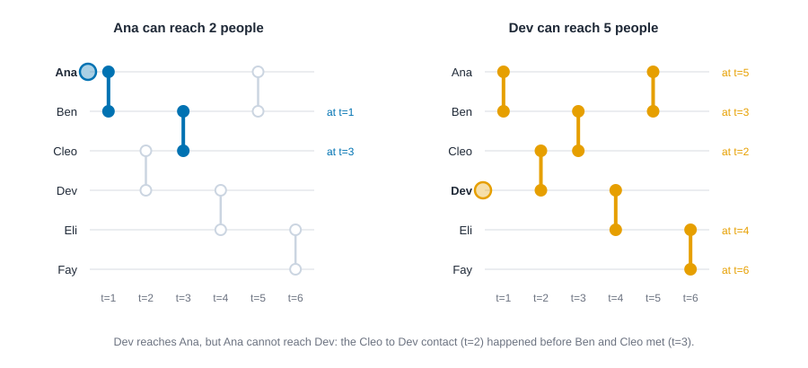
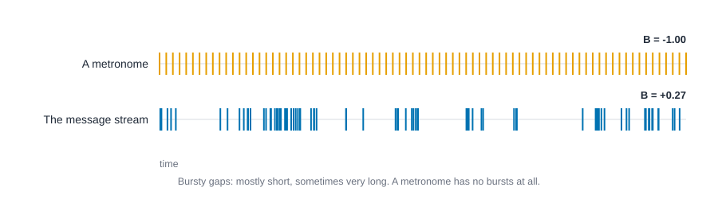
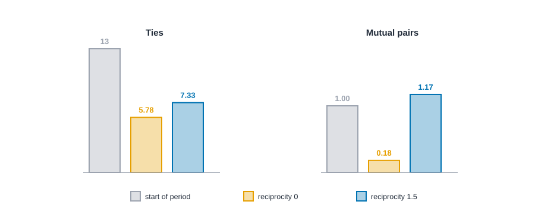

# Longitudinal and temporal networks {#sec-dynamics}

::: {.callout-note appearance="simple"}
## Prerequisites
@sec-paths-and-cohesion and @sec-ergm. We reuse the office advice network from @sec-positions-and-roles.
:::

## Networks change

::: {.callout-tip appearance="simple"}
## Code lives next to the idea
Each idea comes with its code right where it is explained. The Rust blocks in this chapter run top to bottom as one script, so later blocks reuse names defined earlier. The people, contacts and messages are invented for this chapter, so that we can show every number and, in one case, check an estimate against the truth.
:::

Everything so far treated a network as a photograph. But friendships form and fade, emails fly back and forth, diseases spread along contacts that happen in a certain order. A single photograph hides all of that. This chapter is about what changes when time is part of the data.

Time can enter in three shapes, and they call for different tools.

- **Contacts with times.** We know who met whom and when: phone calls, face-to-face meetings, emails. The question is often *flow*: who could have passed something on to whom? The tools are **time-respecting paths** and measures of **burstiness**.
- **Snapshots.** We observe the whole network at a few moments, such as a school class surveyed each autumn. The question is how ties *change* between waves and why. The tool is the **stochastic actor-oriented model**, or **SAOM** [@snijders2001statistical; @snijders2010introduction].
- **Event streams.** We observe a long sequence of timed, directed events: who wrote to whom, in what order. The question is what makes the *next* event likely. The tool is the **relational event model**, or **REM** [@butts2008relational; @perry2013point].

A good overview of the first shape is Holme and Saramäki [@holme2012temporal]. We'll take the three in turn.

## Contacts in time: who can reach whom?

Take six people and six contacts. At time 1 Ana meets Ben, at time 2 Cleo meets Dev, at time 3 Ben meets Cleo, at time 4 Dev meets Eli, at time 5 Ana meets Ben again, and at time 6 Eli meets Fay. Draw it without time and you get a chain, Ana to Ben to Cleo to Dev to Eli to Fay, and everyone can reach everyone: if Ana has news, it can surely get to Fay.

Now respect the clock. Ana tells Ben at time 1. Ben meets Cleo at time 3, so Cleo hears at time 3. But Cleo's meeting with Dev was at time 2, which is *over* by the time Cleo hears. The news stops with Cleo. Ana reaches Ben and Cleo and nobody else.

Dev's story is different. Dev tells Cleo at time 2, who tells Ben at 3, who tells Ana at 5. Dev also tells Eli at 4, who tells Fay at 6. Dev reaches all five. That asymmetry is the point: **reachability depends on the order of events**, it doesn't have to be symmetric, and a static picture can't show it. A path that respects the order of contacts is called a **time-respecting path**, and the set of people it reaches is a person's **influence set** [@kempe2002connectivity; @holme2005network].

{#fig-time-respecting fig-alt="Two timelines side by side, with six horizontal lines for Ana, Ben, Cleo, Dev, Eli and Fay and vertical bars for six contacts at times 1 to 6. On the left, only the contacts at times 1 (Ana and Ben) and 3 (Ben and Cleo) are highlighted. On the right, all six contacts are highlighted and each person is labeled with the time Dev's message reaches them: Cleo 2, Ben 3, Eli 4, Ana 5, Fay 6."}

### Step 1: count who can reach whom

::: {.panel-tabset group="language"}

## R

```r
library(knappnet)
library(dplyr)
library(tidyr)
library(purrr)

people <- c("Ana", "Ben", "Cleo", "Dev", "Eli", "Fay")
contacts <- tibble(
  source = people[c(1, 3, 2, 4, 1, 5)],
  target = people[c(2, 4, 3, 5, 2, 6)],
  time = 1:6
)
# Contacts are undirected instants: who met whom, and when.
g <- net_temporal(contacts, nodes = tibble(id = people), directed = FALSE)
g

# For every person, how many others can a message reach if it only moves forward in time?
g$nodes |> mutate(reach = net_temporal_reach(g))
```

::: {.code-output}
```text
# temporal_net_frame: 6 nodes, 6 edges
#   directed:  no        mode: one-mode (6 actors)
#   weights:   unweighted
#   time:      contacts (6 events, 1 to 6)
#   space:     none
#   clock:     numbers
#   simple:    no loops, no parallel edges
#   components: 1    isolates: 0    density: 0.400
#
# Nodes (6 x 1)   Edges (6 x 3)
#   id              source target time
#   <chr>           <chr>  <chr>  <int>
# 1 Ana           1 Ana    Ben    1
# 2 Ben           2 Cleo   Dev    2
# 3 Cleo          3 Ben    Cleo   3
# 4 Dev           4 Dev    Eli    4
# 5 Eli           5 Ana    Ben    5
# 6 Fay           6 Eli    Fay    6
# A tibble: 6 × 2
  id    reach
  <chr> <dbl>
1 Ana       2
2 Ben       2
3 Cleo      5
4 Dev       5
5 Eli       2
6 Fay       1
```
:::

## Python

```python
import numpy as np

names = ["Ana", "Ben", "Cleo", "Dev", "Eli", "Fay"]
person_a = [0, 2, 1, 3, 0, 4]
person_b = [1, 3, 2, 4, 1, 5]
when = [1.0, 2.0, 3.0, 4.0, 5.0, 6.0]
# NetworkX has no time-respecting paths, so we walk the contacts in time order:
# a contact passes the message on if one of its two people already has it.
contacts = sorted(zip(when, person_a, person_b))

def earliest_arrival(root):
    arrive = {root: -np.inf}
    for t, a, b in contacts:
        for u, v in ((a, b), (b, a)):
            if u in arrive and arrive[u] <= t and t < arrive.get(v, np.inf):
                arrive[v] = t
    return arrive

for k, name in enumerate(names):
    count = len(earliest_arrival(k)) - 1
    print(f"{name:<5} can reach {count} of the 5 others")
```

::: {.code-output}
```text
Ana   can reach 2 of the 5 others
Ben   can reach 2 of the 5 others
Cleo  can reach 5 of the 5 others
Dev   can reach 5 of the 5 others
Eli   can reach 2 of the 5 others
Fay   can reach 1 of the 5 others
```
:::

## Rust

```rust
use knappnet::temporal::{count_temporal_reach, Direction, PathOptions, TemporalNetwork};

// Six people and six contacts, invented for this chapter. Each contact is one instant: who met whom, and when.
let names = ["Ana", "Ben", "Cleo", "Dev", "Eli", "Fay"];
let person_a = [0, 2, 1, 3, 0, 4];
let person_b = [1, 3, 2, 4, 1, 5];
let when = [1.0, 2.0, 3.0, 4.0, 5.0, 6.0];
let contacts = TemporalNetwork::new(6, &person_a, &person_b, &when, None, false)?;

// For every person, how many others can a message reach if it only moves forward in time?
let reach = count_temporal_reach(&contacts, Direction::Out, &PathOptions::default())?;
for (name, count) in names.iter().zip(&reach) {
    println!("{name:<5} can reach {count} of the 5 others");
}
```

::: {.code-output}
```text
Ana   can reach 2 of the 5 others
Ben   can reach 2 of the 5 others
Cleo  can reach 5 of the 5 others
Dev   can reach 5 of the 5 others
Eli   can reach 2 of the 5 others
Fay   can reach 1 of the 5 others
```
:::

:::

Ana, Ben and Eli reach two people each, Fay reaches only Eli (their one contact comes last), and Cleo and Dev reach all five. A static graph of the same contacts says everyone reaches 5. The time-respecting count says four of the six can reach fewer than half the group.

### Step 2: how fast?

Reaching someone isn't the same as reaching them quickly. The **earliest arrival** time from a person to everyone else tells us when the news first gets there.

::: {.panel-tabset group="language"}

## R

```r
# The earliest moment a message from Ana, and from Dev, can arrive at everyone else.
# Inf means never.
net_temporal_distances(g, from = c("Ana", "Dev")) |>
  as_tibble(rownames = "from") |>
  pivot_longer(-from, names_to = "to", values_to = "arrives") |>
  filter(from != to)
```

::: {.code-output}
```text
# A tibble: 10 × 3
   from  to    arrives
   <chr> <chr>   <dbl>
 1 Ana   Ben         1
 2 Ana   Cleo        3
 3 Ana   Dev       Inf
 4 Ana   Eli       Inf
 5 Ana   Fay       Inf
 6 Dev   Ana         5
 7 Dev   Ben         3
 8 Dev   Cleo        2
 9 Dev   Eli         4
10 Dev   Fay         6
```
:::

## Python

```python
for who, root in [("Ana", 0), ("Dev", 3)]:
    arrive = earliest_arrival(root)
    line = f"from {who}:"
    for k, name in enumerate(names):
        if k != root:
            line += f"  {name} at t={arrive[k]:g}" if k in arrive else f"  {name} never"
    print(line)
```

::: {.code-output}
```text
from Ana:  Ben at t=1  Cleo at t=3  Dev never  Eli never  Fay never
from Dev:  Ana at t=5  Ben at t=3  Cleo at t=2  Eli at t=4  Fay at t=6
```
:::

## Rust

```rust
use knappnet::temporal::{find_temporal_paths, Criterion};

// The earliest moment a message from Ana (0), and from Dev (3), can arrive at everyone else.
let from_ana_and_dev = find_temporal_paths(&contacts, Criterion::EarliestArrival, Direction::Out, &[0, 3], &PathOptions::default())?;
for (who, root) in [("Ana", 0), ("Dev", 3)] {
    print!("from {who}:");
    for (k, name) in names.iter().enumerate().filter(|&(k, _)| k != root) {
        let t = from_ana_and_dev[(if root == 0 { 0 } else { 1 }) * 6 + k];
        if t.is_finite() { print!("  {name} at t={t}") } else { print!("  {name} never") }
    }
    println!();
}
```

::: {.code-output}
```text
from Ana:  Ben at t=1  Cleo at t=3  Dev never  Eli never  Fay never
from Dev:  Ana at t=5  Ben at t=3  Cleo at t=2  Eli at t=4  Fay at t=6
```
:::

:::

These match @fig-time-respecting: Dev's message gets to Cleo at 2, Ben at 3, Eli at 4, Ana at 5 and Fay at 6, and Ana's message never gets past Cleo. Other kinds of "shortest" matter too. The *fastest* path minimizes the elapsed time between leaving and arriving, and the *shortest* path counts contacts used. They can disagree, and which one you want depends on whether you care about speed, effort or risk. Pan and Saramäki [@pan2011path] turn average arrival times into a temporal version of closeness centrality.

### Step 3: are contacts bursty?

Contact data has a second feature that static networks can't show: *when* events happen. People don't write emails like a metronome. They send a flurry, then go quiet. Goh and Barabási [@goh2008burstiness] gave a simple number for this. Take the waiting times between events, the *gaps*, and compare their spread to their average:

$$
B \;=\; \frac{\sigma - \mu}{\sigma + \mu},
$$

where $\mu$ is the mean gap and $\sigma$ its standard deviation. If events come at perfectly even intervals, $\sigma = 0$ and $B = -1$. If they arrive at random with no memory, $B$ is around 0. If they come in clumps separated by long silences, $\sigma$ is large and $B$ approaches $+1$. A second number, $M$, is the correlation between each gap and the next, and measures *memory*: whether short gaps tend to follow short gaps.

::: {.panel-tabset group="language"}

## R

```r
# Eighty messages among eight coworkers, invented for this chapter. Times are in hours.
times <- c(
  0.3, 0.8, 3.3, 4.8, 6.8, 25.4, 28.4, 33.4, 35.2, 36.8,
  37.0, 38.0, 43.6, 44.5, 46.3, 46.6, 48.2, 49.0, 49.3, 50.1,
  50.4, 50.7, 52.4, 52.7, 53.3, 55.0, 56.0, 56.9, 57.8, 58.6,
  58.8, 63.3, 64.5, 64.6, 65.6, 77.9, 78.0, 85.1, 98.6, 99.4,
  99.7, 102.9, 105.4, 106.1, 107.1, 107.2, 108.0, 128.2, 128.6, 128.8,
  129.2, 130.8, 134.5, 135.2, 148.1, 149.0, 149.3, 176.8, 182.2, 182.4,
  182.6, 182.8, 183.1, 183.6, 184.6, 185.9, 193.0, 195.1, 196.2, 202.8,
  203.2, 204.4, 204.7, 205.8, 206.1, 208.4, 208.5, 214.4, 215.2, 217.3
)
gaps <- diff(times)

# Treat the whole log as one stream of events (a single node with a self-loop per message)
# and ask for its burstiness B and memory M.
stream_stats <- \(t) {
  net_temporal(tibble(source = "all", target = "all", time = t), directed = TRUE) |>
    net_burstiness()
}
tibble(n_gaps = length(gaps), shortest = min(gaps), longest = max(gaps)) |>
  bind_cols(stream_stats(times) |> select(burstiness, memory)) |>
  mutate(across(where(is.numeric), \(x) round(x, 2)))

# Compare with a metronome: the same number of events, perfectly evenly spaced.
stream_stats(2.75 * 1:80)$burstiness |> round(2)
```

::: {.code-output}
```text
# A tibble: 1 × 5
  n_gaps shortest longest burstiness memory
   <dbl>    <dbl>   <dbl>      <dbl>  <dbl>
1     79      0.1    27.5       0.27  -0.03
[1] -1
```
:::

## Python

```python
times = np.array([
    0.3, 0.8, 3.3, 4.8, 6.8, 25.4, 28.4, 33.4, 35.2, 36.8,
    37.0, 38.0, 43.6, 44.5, 46.3, 46.6, 48.2, 49.0, 49.3, 50.1,
    50.4, 50.7, 52.4, 52.7, 53.3, 55.0, 56.0, 56.9, 57.8, 58.6,
    58.8, 63.3, 64.5, 64.6, 65.6, 77.9, 78.0, 85.1, 98.6, 99.4,
    99.7, 102.9, 105.4, 106.1, 107.1, 107.2, 108.0, 128.2, 128.6, 128.8,
    129.2, 130.8, 134.5, 135.2, 148.1, 149.0, 149.3, 176.8, 182.2, 182.4,
    182.6, 182.8, 183.1, 183.6, 184.6, 185.9, 193.0, 195.1, 196.2, 202.8,
    203.2, 204.4, 204.7, 205.8, 206.1, 208.4, 208.5, 214.4, 215.2, 217.3,
])
gaps = np.diff(times)

def burstiness_memory(gaps):
    b = (gaps.std() - gaps.mean()) / (gaps.std() + gaps.mean())
    m = np.corrcoef(gaps[:-1], gaps[1:])[0, 1] if gaps[:-1].std() > 0 else np.nan
    return b, m

burstiness, memory = burstiness_memory(gaps)
print(f"{len(gaps)} gaps, shortest {gaps.min():.1f} hours, longest {gaps.max():.1f} hours")
print(f"burstiness B = {burstiness:.2f}, memory M = {memory:.2f}")
b_regular, _ = burstiness_memory(np.full(79, 2.75))
print(f"evenly spaced: B = {b_regular:.2f}")
```

::: {.code-output}
```text
79 gaps, shortest 0.1 hours, longest 27.5 hours
burstiness B = 0.27, memory M = -0.03
evenly spaced: B = -1.00
```
:::

## Rust

```rust
use knappnet::temporal::events::compute_burstiness_memory;

// Eighty messages among eight coworkers, invented for this chapter. Times are in hours.
let times: [f64; 80] = [
    0.3, 0.8, 3.3, 4.8, 6.8, 25.4, 28.4, 33.4, 35.2, 36.8,
    37.0, 38.0, 43.6, 44.5, 46.3, 46.6, 48.2, 49.0, 49.3, 50.1,
    50.4, 50.7, 52.4, 52.7, 53.3, 55.0, 56.0, 56.9, 57.8, 58.6,
    58.8, 63.3, 64.5, 64.6, 65.6, 77.9, 78.0, 85.1, 98.6, 99.4,
    99.7, 102.9, 105.4, 106.1, 107.1, 107.2, 108.0, 128.2, 128.6, 128.8,
    129.2, 130.8, 134.5, 135.2, 148.1, 149.0, 149.3, 176.8, 182.2, 182.4,
    182.6, 182.8, 183.1, 183.6, 184.6, 185.9, 193.0, 195.1, 196.2, 202.8,
    203.2, 204.4, 204.7, 205.8, 206.1, 208.4, 208.5, 214.4, 215.2, 217.3,
];
let gaps: Vec<f64> = times.windows(2).map(|pair| pair[1] - pair[0]).collect();

let (burstiness, memory) = compute_burstiness_memory(&gaps);
println!("{} gaps, shortest {:.1} hours, longest {:.1} hours", gaps.len(), gaps.iter().cloned().fold(f64::MAX, f64::min), gaps.iter().cloned().fold(0.0, f64::max));
println!("burstiness B = {burstiness:.2}, memory M = {memory:.2}");

// Compare with a metronome: the same number of events, perfectly evenly spaced.
let (b_regular, _) = compute_burstiness_memory(&vec![2.75; 79]);
println!("evenly spaced: B = {b_regular:.2}");
```

::: {.code-output}
```text
79 gaps, shortest 0.1 hours, longest 27.5 hours
burstiness B = 0.27, memory M = -0.03
evenly spaced: B = -1.00
```
:::

:::

Our invented messages have $B = 0.27$, so they are bursty: gaps range from 0.1 hours to 27.5 hours, with long silences between flurries. The memory $M$ is about $-0.03$, essentially zero, so a short gap doesn't make the next gap any shorter or longer. A metronome would have $B = -1$. @fig-burst-ticks shows the two side by side.

{#fig-burst-ticks fig-alt="Two rows of vertical tick marks across a timeline. The top row, labeled a metronome with B of minus 1, has ticks at equal spacing. The bottom row, labeled the message stream with B of 0.27, has 80 ticks gathered into clumps separated by long empty stretches."}

Burstiness matters for flow. Bursts can speed up spreading within a flurry and slow it down across the silences. Two caveats: with few events, $B$ is noisy, and it isn't corrected for the number of events [@kim2016measuring], so compare people or pairs with similar activity.

## Snapshots: how do ties change?

Suppose you surveyed a class in autumn and again in spring, and asked each student who they turn to for advice. Between the two waves, some ties dropped, some formed, and some stayed. You can't see the order in which things happened, or whether one change caused another. The SAOM supplies a story that is detailed enough to simulate.

### The story: one actor, one change at a time

In a SAOM, the network changes one tie at a time, in continuous time, and the people themselves make the changes [@snijders2001statistical]. Every actor gets chances to change, at some average **rate** per period. At a chance, an actor looks at their $n$ options: toggle the tie to one of the $n - 1$ others, or change nothing. Each option has an **objective function** value, a score of how attractive the resulting network is *to that actor*, built from effects like the ones in @sec-ergm. The actor picks an option with probability

$$
p_j \;=\; \frac{\exp(\text{gain from option } j)}{\sum_h \exp(\text{gain from option } h)},
$$

where "no change" has gain 0. Better options are likelier but never certain: people don't perfectly maximize.

We'll use two effects. **Outdegree** is a cost (coefficient $-2$) for every tie an actor keeps, so ties don't survive for free. **Reciprocity** is a bonus (coefficient $+1.5$) for a tie that is returned. So for an actor, starting a tie to someone who already asks them for advice has gain $-2 + 1.5 = -0.5$, and starting a tie to someone who doesn't has gain $-2$. Dropping an existing tie to someone who doesn't reciprocate has gain $+2$, since the cost goes away, and dropping a reciprocated tie has gain $+2 - 1.5 = +0.5$.

### Step 4: one ministep by hand and by code

Take Cy in the office network. Cy asks Ada and Ben for advice, and Flo and Gus ask Cy. Nobody Cy asks asks back. With the gains above:

| Option | Gain | Weight $e^{\text{gain}}$ |
| --- | --- | --- |
| Do nothing | 0 | 1.000 |
| Drop the tie to Ada (not reciprocated) | $+2$ | 7.389 |
| Drop the tie to Ben (not reciprocated) | $+2$ | 7.389 |
| Start asking Flo, who asks Cy | $-0.5$ | 0.607 |
| Start asking Gus, who asks Cy | $-0.5$ | 0.607 |
| Start asking any of the other five | $-2$ | 0.135 each |

The weights add to $1 + 14.778 + 1.213 + 0.677 = 17.668$. So the chance Cy drops the tie to Ada is $7.389 / 17.668 = 0.418$.

::: {.panel-tabset group="language"}

## R

```r
office_names <- c("Ada", "Ben", "Cy", "Dee", "Eve", "Flo", "Gus", "Hal", "Ivy", "Jay")
asks <- c(0, 1, 2, 2, 3, 3, 4, 4, 5, 6, 7, 8, 9) + 1
is_asked <- c(1, 0, 0, 1, 0, 1, 0, 1, 2, 2, 3, 4, 4) + 1
office <- net_frame(
  tibble(source = office_names[asks], target = office_names[is_asked]),
  nodes = tibble(id = office_names), directed = TRUE
)
office
start <- as.matrix(office)

# Two effects: outdegree (a cost for every tie an actor keeps) and reciprocity (a bonus for mutual ties).
# RSiena estimates these models but has no call for a single change opportunity, so we work it out:
# the gain of toggling the tie from the actor to j is the change in outdegree and in reciprocity.
beta <- c(-2, 1.5)
ministep_probabilities <- \(x, actor, beta) {
  gain <- ifelse(x[actor, ] == 1, -1, 1) * (beta[1] + beta[2] * x[, actor])
  gain[actor] <- 0
  prop.table(exp(gain))
}

# Cy gets a chance to change. What are Cy's options, and how likely is each?
chances <- tibble(person = office_names, chance = ministep_probabilities(start, "Cy", beta)) |>
  mutate(
    move = case_when(
      person == "Cy" ~ "change nothing",
      start["Cy", person] == 1 ~ "drop the tie to",
      .default = "start asking"
    ),
    .before = 1
  )
chances |> mutate(chance = round(chance, 3))
sum(chances$chance)
```

::: {.code-output}
```text
# net_frame: 10 nodes, 13 edges
#   directed:  yes       mode: one-mode (10 actors)
#   weights:   unweighted
#   time:      static    space: none
#   simple:    no loops, no parallel edges
#   components: 1    isolates: 0    density: 0.144
#
# Nodes (10 x 1)      Edges (13 x 2)
#   id                  source target
#   <chr>               <chr>  <chr>
# 1 Ada               1 Ada    Ben
# 2 Ben               2 Ben    Ada
# 3 Cy                3 Cy     Ada
# 4 Dee               4 Cy     Ben
# 5 Eve               5 Dee    Ada
# 6 Flo               6 Dee    Ben
#   ... 4 more rows     ... 7 more rows
# A tibble: 10 × 3
   move            person chance
   <chr>           <chr>   <dbl>
 1 drop the tie to Ada     0.418
 2 drop the tie to Ben     0.418
 3 change nothing  Cy      0.057
 4 start asking    Dee     0.008
 5 start asking    Eve     0.008
 6 start asking    Flo     0.034
 7 start asking    Gus     0.034
 8 start asking    Hal     0.008
 9 start asking    Ivy     0.008
10 start asking    Jay     0.008
[1] 1
```
:::

## Python

```python
office_names = ["Ada", "Ben", "Cy", "Dee", "Eve", "Flo", "Gus", "Hal", "Ivy", "Jay"]
asks = [0, 1, 2, 2, 3, 3, 4, 4, 5, 6, 7, 8, 9]
is_asked = [1, 0, 0, 1, 0, 1, 0, 1, 2, 2, 3, 4, 4]
start = np.zeros((10, 10), dtype=int)
start[asks, is_asked] = 1

# Two effects: outdegree (a cost for every tie kept) and reciprocity (a bonus for mutual ties).
beta = np.array([-2.0, 1.5])

def ministep_probabilities(x, actor, beta):
    # Gain of toggling the tie from actor to j: the change in outdegree and in reciprocity.
    sign = np.where(x[actor] == 1, -1.0, 1.0)
    gain = sign * (beta[0] + beta[1] * x[:, actor])
    gain[actor] = 0.0
    weight = np.exp(gain)
    return weight / weight.sum()

chances = ministep_probabilities(start, 2, beta)
for j, chance in enumerate(chances):
    if j == 2:
        what = "change nothing"
    elif start[2, j] == 1:
        what = f"drop the tie to {office_names[j]}"
    else:
        what = f"start asking {office_names[j]}"
    print(f"{what:<22} {chance:.3f}")
print(f"total {chances.sum():.3f}")
```

::: {.code-output}
```text
drop the tie to Ada    0.418
drop the tie to Ben    0.418
change nothing         0.057
start asking Dee       0.008
start asking Eve       0.008
start asking Flo       0.034
start asking Gus       0.034
start asking Hal       0.008
start asking Ivy       0.008
start asking Jay       0.008
total 1.000
```
:::

## Rust

```rust
use knappnet::ergm::ToggleGraph;
use knappnet::saom::{compute_ministep_probabilities, Effect, SaomModel};
use knappnet::Graph;

// The ten-person office from the positions chapter: who asks whom for advice. Positions 0 to 9 are Ada to Jay.
let office_names = ["Ada", "Ben", "Cy", "Dee", "Eve", "Flo", "Gus", "Hal", "Ivy", "Jay"];
let asks = [0, 1, 2, 2, 3, 3, 4, 4, 5, 6, 7, 8, 9];
let is_asked = [1, 0, 0, 1, 0, 1, 0, 1, 2, 2, 3, 4, 4];
let office = Graph::from_edges(10, &asks, &is_asked, None, true)?;
println!("{}", office.describe());
let start = ToggleGraph::from_graph(&office)?;

// Two effects: outdegree (a cost for every tie an actor keeps) and reciprocity (a bonus for mutual ties).
let model = SaomModel::new(vec![Effect::Outdegree, Effect::Reciprocity], vec![], 10)?;
let beta = [-2.0, 1.5];

// Cy (position 2) gets a chance to change. What are Cy's options, and how likely is each?
let chances = compute_ministep_probabilities(&model, &start, &beta, 2)?;
for (j, chance) in chances.iter().enumerate() {
    let what = if j == 2 { "change nothing".to_string() }
        else if asks.iter().zip(&is_asked).any(|(&a, &b)| a == 2 && b == j as i64) { format!("drop the tie to {}", office_names[j]) }
        else { format!("start asking {}", office_names[j]) };
    println!("{what:<22} {chance:.3}");
}
println!("total {:.3}", chances.iter().sum::<f64>());
```

::: {.code-output}
```text
Directed network: 10 nodes, 13 ties (arcs)
  Density           0.144
  Out-degree        1 to 2, mean 1.30
  In-degree         0 to 4, mean 1.30
  Reciprocity       0.15 of ties are returned
  Connected pieces  1 weak, 9 strong
  Isolated nodes    0
  Loops, repeats    none
  Busiest           node 0 (5), node 1 (5), node 2 (4)

drop the tie to Ada    0.418
drop the tie to Ben    0.418
change nothing         0.057
start asking Dee       0.008
start asking Eve       0.008
start asking Flo       0.034
start asking Gus       0.034
start asking Hal       0.008
start asking Ivy       0.008
start asking Jay       0.008
total 1.000
```
:::

:::

The code agrees: 0.418 each for dropping Cy's two ties, 0.034 for starting to ask Flo or Gus, 0.008 for starting any of the other five, and 0.057 for doing nothing. With these coefficients, Cy is much likelier to drop a tie than to do anything else. That is what a negative outdegree coefficient means.

### Step 5: simulate a period

The real power of the SAOM story is that it can be *run*. Start from the observed network, let every actor have chances at rate 3 per period, and see where the network ends up.

::: {.panel-tabset group="language"}

## R

```r
tibble(ties = sum(start), mutual_pairs = sum(start * t(start)) / 2)

# The simulation draws random numbers, and R and Python draw different ones, so the
# averages below differ from Rust's in the last digit or two.
set.seed(1)
# Each change opportunity arrives after an exponential wait; the recursion stops once the period is over.
run_until_one <- \(x, beta, rate, time) {
  if (time >= 1) {
    return(x)
  }
  actor <- sample(rownames(x), 1)
  j <- sample(colnames(x), 1, prob = ministep_probabilities(x, actor, beta))
  if (j != actor) x[actor, j] <- 1 - x[actor, j]
  run_until_one(x, beta, rate, time + rexp(1, 10 * rate))
}

simulate_period <- \(x0, beta, rate = 3) {
  x <- run_until_one(x0, beta, rate, rexp(1, 10 * rate))
  tibble(ties = sum(x), mutual_pairs = sum(x * t(x)) / 2, changed = sum(x != x0))
}

# Run the office forward one period, 2,000 times, with and without the reciprocity bonus.
tibble(reciprocity = c(0, 1.5)) |>
  mutate(averages = map(reciprocity, \(r) {
    map(1:2000, \(i) simulate_period(start, c(-2, r))) |>
      list_rbind() |>
      summarise(across(everything(), mean))
  })) |>
  unnest(averages) |>
  mutate(across(where(is.numeric), \(x) round(x, 2)))
```

::: {.code-output}
```text
# A tibble: 1 × 2
   ties mutual_pairs
  <dbl>        <dbl>
1    13            1
# A tibble: 2 × 4
  reciprocity  ties mutual_pairs changed
        <dbl> <dbl>        <dbl>   <dbl>
1         0    5.78         0.19    13.9
2         1.5  7.19         1.16    14.1
```
:::

## Python

```python
print(f"start: {start.sum()} ties, {(start * start.T).sum() // 2} mutual pairs")

# The simulation draws random numbers, and R and Python draw different ones, so the
# averages below differ from Rust's in the last digit or two.
rng = np.random.default_rng(1)

def simulate_period(x0, beta, rate=3.0):
    x, time = x0.copy(), 0.0
    while True:
        time += rng.exponential(1 / (10 * rate))
        if time >= 1:
            break
        actor = rng.integers(10)
        j = rng.choice(10, p=ministep_probabilities(x, actor, beta))
        if j != actor:
            x[actor, j] = 1 - x[actor, j]
    return x.sum(), (x * x.T).sum() / 2, (x != x0).sum()

for reciprocity in [0.0, 1.5]:
    sims = np.array([simulate_period(start, np.array([-2.0, reciprocity])) for _ in range(2000)])
    ties, mutual, changed = sims.mean(axis=0)
    print(f"reciprocity {reciprocity:g}: {ties:.2f} ties, {mutual:.2f} mutual pairs, {changed:.2f} ties changed")
```

::: {.code-output}
```text
start: 13 ties, 1 mutual pairs
reciprocity 0: 5.64 ties, 0.17 mutual pairs, 13.96 ties changed
reciprocity 1.5: 7.22 ties, 1.17 mutual pairs, 14.07 ties changed
```
:::

## Rust

```rust
use knappnet::saom::{simulate_period, SaomOptions};

// Run the office forward one period, 2,000 times, with and without the reciprocity bonus.
// The statistics come back as: ties kept, reciprocated ties, ties that changed.
let options = SaomOptions { rate: 3.0, runs: 2000, seed: 1, threads: 1 };
println!("start: {} ties, {} mutual pairs", start.edge_count(), model.compute_statistics(&start)?[1] / 2.0);
for reciprocity in [0.0, 1.5] {
    let sim = simulate_period(&model, &[-2.0, reciprocity], &start, &options)?;
    let average = |column: usize| (0..2000).map(|run| sim.stats[run * 3 + column]).sum::<f64>() / 2000.0;
    println!("reciprocity {reciprocity}: {:.2} ties, {:.2} mutual pairs, {:.2} ties changed", average(0), average(1) / 2.0, average(2));
}
```

::: {.code-output}
```text
start: 13 ties, 1 mutual pairs
reciprocity 0: 5.78 ties, 0.18 mutual pairs, 13.94 ties changed
reciprocity 1.5: 7.33 ties, 1.17 mutual pairs, 14.11 ties changed
```
:::

:::

The R and Python tabs draw different random numbers than Rust does, so their averages differ from these in the last digit or two.

Both settings lose many ties, because the outdegree cost is high. But look at what survives. With no reciprocity bonus, only 0.18 mutual pairs remain on average (the network started with 1). With the bonus, 1.17 remain, and more ties survive overall (7.3 against 5.8). Reciprocity doesn't create ties here, it keeps the returned ones. @fig-saom-sim shows both settings.

{#fig-saom-sim fig-alt="Two groups of three bars. In the Ties group, the start has 13 ties, the run without reciprocity averages 5.78 and the run with reciprocity 1.5 averages 7.33. In the Mutual pairs group, the start has 1, the run without reciprocity 0.18, and the run with reciprocity 1.17."}

::: {.callout-warning appearance="simple"}
## What this code does not do
We picked the coefficients here to show how the model behaves. In a real study you *estimate* them from two or more observed waves, by finding the values for which simulated networks match the observed changes. Estimation also needs a bit more care: the model is fit to waves in a long panel, checked with goodness of fit, and compared across effects. This chapter shows the forward model, which is the part that explains what the coefficients mean. For estimation in practice, Phil Murphy's class notes walk through RSiena step by step [@murphyrpubs701832], and Snijders and colleagues give the full account [@snijders2010introduction].
:::

## Event streams: what makes the next message likely?

Sometimes we don't have waves at all, we have a log: at hour 0.3, person 6 wrote to person 4; at hour 0.8, person 2 wrote to person 7; and so on. The relational event model treats each message as a draw: at every moment, every ordered pair of people has a *rate* of sending the next message, that depends on what happened before [@butts2008relational; @perry2013point].

### The idea: what history makes a pair likelier?

For a sender $s$ and receiver $r$, the rate of the next message is $\exp(\beta_1 x_1 + \beta_2 x_2 + \dots)$, where each $x_k$ is a count taken from the *past*. Two natural ones:

- **Inertia**: how many times $s$ has already written to $r$. A positive coefficient says people repeat themselves, a negative coefficient says they spread their messages around.
- **Reciprocity**: how many times $r$ has already written to $s$. A positive coefficient says people reply.

The model takes each event in order and asks: given everything before, how likely was it that *this* pair, out of all possible pairs, was the one that came next? The product of those probabilities is the **partial likelihood** [@cox1972regression], and it is maximized to estimate $\beta$. Only the *order* of the events matters in this version, not the exact timing.

### Step 6: fit the model

We use our eighty messages. They weren't recorded from real people: we generated them from a known rule, in which each reply is more likely than a fresh message, and repeating the same message to the same person is less likely than average. Using invented data lets us do something real data never allows: compare the estimates with the truth.

::: {.panel-tabset group="language"}

## R

```r
# Who wrote to whom, with the eight coworkers numbered 1 to 8.
sender <- c(
  6, 2, 5, 7, 4, 4, 6, 5, 3, 4, 6, 0, 5, 6, 2, 3, 1, 5, 7, 2,
  3, 7, 4, 3, 5, 0, 1, 7, 1, 0, 7, 5, 7, 5, 6, 2, 5, 1, 6, 5,
  2, 1, 1, 6, 4, 2, 4, 5, 5, 7, 6, 3, 0, 2, 0, 6, 6, 2, 7, 3,
  3, 4, 7, 7, 1, 6, 1, 6, 4, 1, 0, 7, 0, 1, 7, 4, 3, 3, 4, 3
) + 1
receiver <- c(
  4, 7, 4, 0, 7, 5, 1, 6, 6, 6, 3, 4, 2, 1, 5, 7, 6, 3, 5, 3,
  5, 2, 2, 2, 3, 3, 3, 1, 5, 3, 3, 4, 4, 2, 7, 7, 6, 6, 5, 3,
  0, 7, 6, 2, 6, 6, 7, 2, 1, 6, 4, 1, 4, 4, 7, 1, 1, 4, 3, 0,
  5, 0, 6, 0, 2, 7, 6, 2, 5, 3, 4, 2, 1, 4, 4, 2, 7, 1, 0, 0
) + 1

# relevent::rem.dyad() fits this model too; here the partial likelihood is a few lines, so we write it out.
# Number the ordered pairs 1 to 64, then count the past messages of every pair before each event
# with a running sum: inertia is s -> r again, reciprocity is r -> s.
pair_id <- \(s, r) s + 8 * (r - 1)
at_risk <- expand_grid(s = 1:8, r = 1:8) |> filter(s != r)
one_hot <- diag(64)[pair_id(sender, receiver), ]
past <- apply(one_hot, 2, cumsum) - one_hot
inertia <- past[, pair_id(at_risk$s, at_risk$r)]
reply <- past[, pair_id(at_risk$r, at_risk$s)]
chosen <- match(pair_id(sender, receiver), pair_id(at_risk$s, at_risk$r))

loglik <- \(b) {
  score <- inertia * b[1] + reply * b[2]
  sum(score[cbind(seq_along(chosen), chosen)] - log(rowSums(exp(score))))
}

model_fit <- optim(c(0, 0), \(b) -loglik(b), method = "BFGS", hessian = TRUE,
                   control = list(reltol = 1e-12))
tibble(
  effect = c("repeating a pair", "replying to a pair"),
  coefficient = model_fit$par,
  se = sqrt(diag(solve(model_fit$hessian))),
  rate_multiplier = exp(coefficient)
) |>
  mutate(across(where(is.numeric), \(x) round(x, 3)))

c(fitted = -model_fit$value, no_effects = loglik(c(0, 0))) |> round(1)
```

::: {.code-output}
```text
# A tibble: 2 × 4
  effect             coefficient    se rate_multiplier
  <chr>                    <dbl> <dbl>           <dbl>
1 repeating a pair        -0.754 0.205            0.47
2 replying to a pair       0.758 0.16             2.13
    fitted no_effects 
    -309.5     -322.0 
```
:::

## Python

```python
from scipy.optimize import minimize

sender = np.array([
    6, 2, 5, 7, 4, 4, 6, 5, 3, 4, 6, 0, 5, 6, 2, 3, 1, 5, 7, 2,
    3, 7, 4, 3, 5, 0, 1, 7, 1, 0, 7, 5, 7, 5, 6, 2, 5, 1, 6, 5,
    2, 1, 1, 6, 4, 2, 4, 5, 5, 7, 6, 3, 0, 2, 0, 6, 6, 2, 7, 3,
    3, 4, 7, 7, 1, 6, 1, 6, 4, 1, 0, 7, 0, 1, 7, 4, 3, 3, 4, 3,
])
receiver = np.array([
    4, 7, 4, 0, 7, 5, 1, 6, 6, 6, 3, 4, 2, 1, 5, 7, 6, 3, 5, 3,
    5, 2, 2, 2, 3, 3, 3, 1, 5, 3, 3, 4, 4, 2, 7, 7, 6, 6, 5, 3,
    0, 7, 6, 2, 6, 6, 7, 2, 1, 6, 4, 1, 4, 4, 7, 1, 1, 4, 3, 0,
    5, 0, 6, 0, 2, 7, 6, 2, 5, 3, 4, 2, 1, 4, 4, 2, 7, 1, 0, 0,
])

# Before each message, count the past messages s -> r (inertia) and r -> s (reciprocity)
# for every ordered pair in the risk set. No package does this for us, so it is a few lines.
pairs = [(s, r) for s in range(8) for r in range(8) if s != r]
past = np.zeros((8, 8))
design, chosen = [], []
for s, r in zip(sender, receiver):
    design.append([[past[i, j], past[j, i]] for i, j in pairs])
    chosen.append(pairs.index((s, r)))
    past[s, r] += 1
design, chosen = np.array(design), np.array(chosen)

def loglik(b):
    score = design @ b
    return (score[np.arange(80), chosen] - np.logaddexp.reduce(score, axis=1)).sum()

fit = minimize(lambda b: -loglik(b), np.zeros(2), method="BFGS", options={"gtol": 1e-10})
# Standard errors from the observed information: the spread of the statistics under the fitted
# choice probabilities, summed over the events.
score = design @ fit.x
prob = np.exp(score - np.logaddexp.reduce(score, axis=1, keepdims=True))
mean = (prob[:, :, None] * design).sum(axis=1)
info = np.einsum("kp,kpa,kpb->ab", prob, design, design) - mean.T @ mean
se = np.sqrt(np.diag(np.linalg.inv(info)))
for label, coef, err in zip(["repeating a pair", "replying to a pair"], fit.x, se):
    print(f"{label:<20} coefficient {coef:+.3f} (se {err:.3f}), rate multiplier {np.exp(coef):.2f}")
print(f"log-likelihood {-fit.fun:.1f}, against {loglik(np.zeros(2)):.1f} with no effects")
```

::: {.code-output}
```text
repeating a pair     coefficient -0.754 (se 0.205), rate multiplier 0.47
replying to a pair   coefficient +0.758 (se 0.160), rate multiplier 2.13
log-likelihood -309.5, against -322.0 with no effects
```
:::

## Rust

```rust
use knappnet::temporal::rem::{compute_rem_statistics, fit, EventStream, FitOptions, RemOptions, RemStat, StatSpec};

// The same eighty messages, now with who sent each one to whom (positions 0 to 7).
let sender: [i64; 80] = [
    6, 2, 5, 7, 4, 4, 6, 5, 3, 4, 6, 0, 5, 6, 2, 3, 1, 5, 7, 2,
    3, 7, 4, 3, 5, 0, 1, 7, 1, 0, 7, 5, 7, 5, 6, 2, 5, 1, 6, 5,
    2, 1, 1, 6, 4, 2, 4, 5, 5, 7, 6, 3, 0, 2, 0, 6, 6, 2, 7, 3,
    3, 4, 7, 7, 1, 6, 1, 6, 4, 1, 0, 7, 0, 1, 7, 4, 3, 3, 4, 3,
];
let receiver: [i64; 80] = [
    4, 7, 4, 0, 7, 5, 1, 6, 6, 6, 3, 4, 2, 1, 5, 7, 6, 3, 5, 3,
    5, 2, 2, 2, 3, 3, 3, 1, 5, 3, 3, 4, 4, 2, 7, 7, 6, 6, 5, 3,
    0, 7, 6, 2, 6, 6, 7, 2, 1, 6, 4, 1, 4, 4, 7, 1, 1, 4, 3, 0,
    5, 0, 6, 0, 2, 7, 6, 2, 5, 3, 4, 2, 1, 4, 4, 2, 7, 1, 0, 0,
];
let stream = EventStream::new(8, &sender, &receiver, &times, None, None)?;

// Before each message, count how often this sender already wrote to this receiver (inertia)
// and how often the receiver already wrote to the sender (reciprocity).
let statistics = [
    StatSpec { stat: RemStat::Inertia, event_type: None },
    StatSpec { stat: RemStat::Reciprocity, event_type: None },
];
let design = compute_rem_statistics(&stream, &statistics, &RemOptions::default())?;
let model_fit = fit(&design, &FitOptions::default())?;
for (label, (coef, se)) in ["repeating a pair", "replying to a pair"].iter().zip(model_fit.coef.iter().zip(&model_fit.se)) {
    println!("{label:<20} coefficient {coef:+.3} (se {se:.3}), rate multiplier {:.2}", coef.exp());
}
println!("log-likelihood {:.1}, against {:.1} with no effects", model_fit.loglik, model_fit.null_loglik);
```

::: {.code-output}
```text
repeating a pair     coefficient -0.754 (se 0.205), rate multiplier 0.47
replying to a pair   coefficient +0.758 (se 0.160), rate multiplier 2.13
log-likelihood -309.5, against -322.0 with no effects
```
:::

:::

Read the coefficients as multipliers on the rate. Each earlier message a sender has already sent to a receiver *multiplies* the rate of another by about 0.47, so people avoid repeating themselves. Each earlier message from the receiver multiplies the rate by about 2.13, so replies are about twice as likely as a first message. Both are clearly different from zero: they sit about 3.7 and 4.7 standard errors away from it. The log-likelihood rises from $-322.0$ with no effects to $-309.5$ with both.

The truth we used was $-1.0$ and $+1.0$. The estimates ($-0.75$ and $+0.76$) are within about 1.2 and 1.5 standard errors of them, which is what we'd expect from a stream of 80 events. Eighty events is not a lot. The estimates carry real uncertainty, and the standard errors say how much.

## Reading dynamic models honestly

**Order is data, but only the order you recorded.** A time-respecting path assumes that a contact is the *only* way something can move. Real spreading can happen between contacts. A path says what is *possible* under the recorded events, not what *happened*.

**Time resolution changes the answer.** Contacts that happen "at the same time" in a day-level log may have happened in any order. Whether simultaneous contacts can chain is a modeling choice, and results can change with it.

**The SAOM story is a story.** Actors who "decide" one tie at a time are a modeling device. It lets us simulate and estimate, but it doesn't claim that people reason that way or that changes are never coordinated.

**Histories can feed on themselves.** In an event model, effects like repetition and reciprocity can reinforce each other, so a pair that chats a lot gets even more likely to chat. We saw that while building our example: when we made both repeating and replying more likely, a single pair ended up writing nearly all the messages. Check whether a few pairs dominate before reading too much into the coefficients.

**Waves are not events.** Two waves of the same survey are a very different kind of data from a log of timed messages. A SAOM uses the first, a REM the second, and you can't swap one for the other.

## A cheat sheet

| Piece | What it does | Watch out for |
| --- | --- | --- |
| Time-respecting path | A path whose contacts happen in order | Not symmetric; depends on the order of events |
| Influence set (reach) | Everyone a person's message could reach | Counts possibility, not probability |
| Earliest arrival | When a message first gets to someone | Not the same as fastest or shortest |
| Burstiness $B$ | Clumpiness of waiting times, from $-1$ to $+1$ | Noisy with few events |
| Memory $M$ | Whether short gaps follow short gaps | Needs at least three gaps |
| SAOM ministep | One actor, one tie change, chosen by gain | Coefficients are per actor choices, not network totals |
| SAOM simulation | Runs the network forward a period | Needs coefficients: they must be estimated |
| REM coefficient | Log multiplier on a pair's rate | Check that a few pairs don't dominate |

## Exercises

1. **By hand.** Add a seventh contact to the six-person example: Cleo meets Dev again at time 7. Who can Ana reach now? Who can Eli reach? Does Dev's reach change?
2. **By hand.** An actor's options have gains $+1$, $0$ (no change) and $-1$. What is the probability of each?
3. **By hand.** The gaps between six events are 1, 1, 1, 1, 1 and 7. Find $\mu$, $\sigma$ and $B$. (Use the standard deviation with $n$, not $n - 1$.)
4. **Coding.** Change the order of contacts in the six-person example, for instance by swapping the times of the contacts at 2 and 3. How do the reach counts change?
5. **Coding.** Rerun the simulation with a reciprocity coefficient of 3. How many mutual pairs remain? Why might the number of ties changed also go up?
6. **Interpretation.** A reader sees "each earlier message in the other direction multiplies the rate by 2.13" and writes "so people are 2.13 times more likely to reply than to send a first message, because they are polite." Reply kindly: what does the coefficient say, and what does it not say?

## Summary

::: {.callout-tip appearance="simple"}
Time changes what a network can tell us. For timed contacts, a time-respecting path must follow the order of events, so reach can be unequal and asymmetric: in our example Dev reaches everyone but Ana reaches only two people, though the drawing without time shows everyone connected. Burstiness measures whether events arrive in clumps, from $-1$ for a metronome to near $+1$ for flurries and silences. For snapshots, the stochastic actor-oriented model has actors change one tie at a time, with probabilities set by the gain from each option, and it can be simulated forward to see what a coefficient does. For event streams, the relational event model gives each pair a rate that depends on the past, and we fit it by partial likelihood. In our invented messages it recovered a rate multiplier of about 0.47 for repeating and 2.13 for replying. All three describe patterns in recorded data, not the reasons behind them.
:::

## Further reading

For temporal networks in general, @holme2012temporal. For reach and influence sets, @kempe2002connectivity and @holme2005network, and for temporal closeness, @pan2011path. For burstiness, @goh2008burstiness and the correction in @kim2016measuring. For the SAOM, @snijders2001statistical and @snijders2010introduction, and for practice, Phil Murphy's RSiena class notes [@murphyrpubs701832]. For relational events, @butts2008relational, @perry2013point and @vu2015relational, and for the dynamic network actor model, @stadtfeld2017interactions. For the partial likelihood behind the REM, @cox1972regression.
