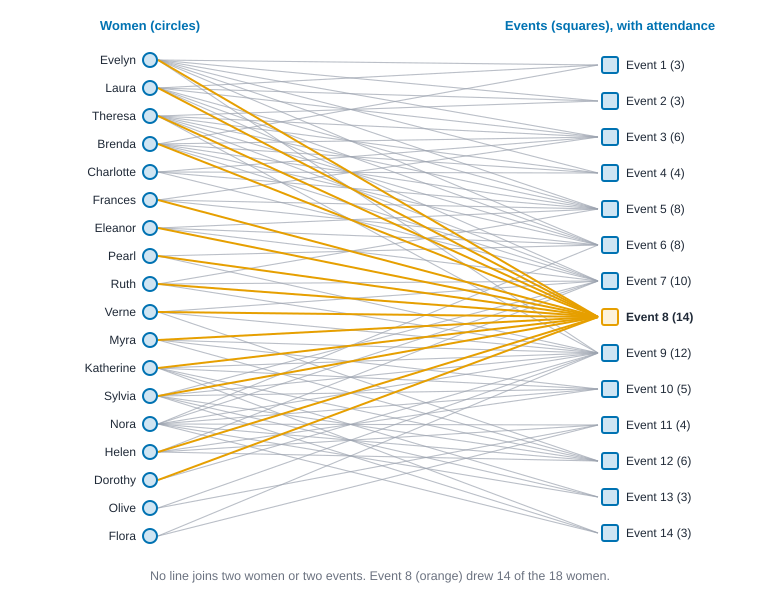
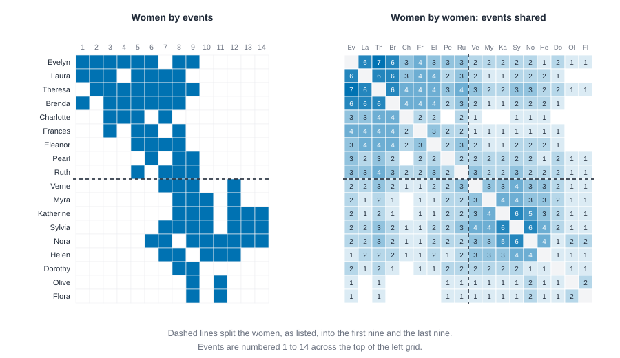
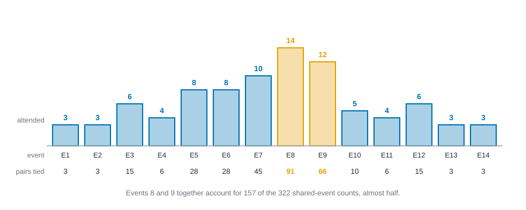
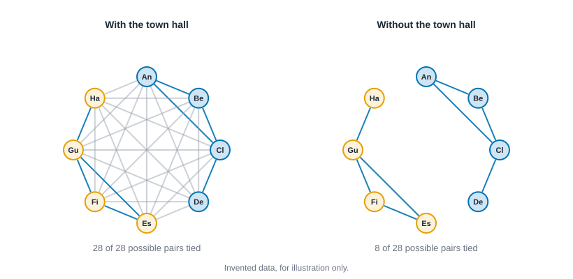

# Two-mode networks {#sec-two-mode}

::: {.callout-note appearance="simple"}
## Prerequisites
@sec-networks-as-data, for the difference between one-mode and two-mode data, and @sec-centrality and @sec-paths-and-cohesion, for degree, closeness, betweenness and clustering. No statistics are needed yet.
:::

## When people are tied through something else

::: {.callout-tip appearance="simple"}
## Code lives next to the idea
Each idea comes with its code right where it is explained. The blocks in this chapter run top to bottom as one script, so later blocks reuse names defined earlier.
:::

Not every tie runs between two people. Two scientists are linked because they wrote the same paper. Two neighbors, because they sit on the same committee. Two women in a town, because both went to the same party. The people are connected *through something else*, and that something else has its own identity, its own size and its own pull.

This chapter is about data of that shape, called **two-mode** data. We'll learn to store it, draw it, measure it directly, and (when it helps) squash it into the people-to-people networks you already know how to analyze. Squashing is where most of the traps are, so we'll spend time on what it keeps and what it throws away.

Our guide is the most famous small dataset in network analysis. In the 1930s, Allison Davis, Burleigh Gardner and Mary Gardner studied social class in a town in the American South, and recorded which of 18 women attended which of 14 social events [@davis1941deep]. Nobody wrote down who talked to whom. All we have is who turned up where. @fig-southern-bipartite draws it: women on the left, events on the right, and a line for every attendance.

{#fig-southern-bipartite fig-alt="Eighteen women in a left column and fourteen events in a right column, joined by 89 lines. Event 8 has 14 lines, drawn in orange, and event 9 has 12. The first nine women attend only events 1 to 9, and the last nine women mostly attend events 7 to 14. No line joins two women or two events."}

The picture is already a little busy, and that is the point. Eighty-nine lines among 32 nodes is a lot to read by eye, and the question people have argued about for decades is whether the women fall into groups. We'll get there.

## Two kinds of node

Two words to settle before anything else. A **mode** is a kind of node. A **two-mode network** has two modes, and ties run only *between* them, never within one. You'll also hear **bipartite network** (the graph theorist's name for the same shape), **affiliation network** (when one mode is people and the other is groups they belong to) and **membership data**.

Other examples are everywhere once you look: authors and the papers they wrote, patients and the hospitals they visited, accounts and the hashtags they used, directors and the boards they sit on, customers and the products they bought. In each, we'll call the first mode the "people" and the second mode the "events" whenever we want a single vocabulary, but remember that "events" can be clubs, papers, boards or products.

Three things follow from the shape, and each will matter later.

- **Counts mean different things in each mode.** A woman's degree is how many events she attended. An event's degree is how many women were there. Those are different quantities, even though both are "number of ties".
- **Some ties are impossible.** A woman can't be tied to another woman, so only $18 \times 14 = 252$ of the node pairs could ever be tied.
- **Each mode has a different maximum.** A woman can attend at most 14 events. An event can draw at most 18 women.

## Where the idea comes from

The southern women data were collected for a study of class in a town, not for network analysis [@davis1941deep], and it has been reanalyzed many times since because it can be read so many ways. The idea that turned a table of memberships into a network problem is Breiger's: people and groups define each other, so the same table can be read from either side [@breiger1974duality]. Textbook treatments such as @wasserman1994social gave affiliation data its standard notation, the incidence matrix and its two products. @borgatti1997network carried degree, closeness and betweenness over to two modes, with normalizations that respect the two sizes. Newman's weighting came out of co-authorship data, on the thought that the authors of a short paper probably know each other better than the authors of a huge one [@newman2001scientific]. And Robins and Alexander built their clustering coefficient for bipartite graphs because triangles cannot occur there [@robins2004small]. Each answers a complaint about the one before it, and we'll meet them in that order.

## The incidence matrix

A two-mode network is usually stored as an **incidence matrix**: one row for each node of the first mode, one column for each node of the second, and a 1 where the two are tied. A tiny example: Ana attends Choir and Chess, Ben attends Choir, and Cleo attends Chess.

| | Choir | Chess |
| --- | --- | --- |
| Ana | 1 | 1 |
| Ben | 1 | 0 |
| Cleo | 0 | 1 |

It isn't square (here, 3 rows and 2 columns), and its rows and columns are different kinds of thing. That is the whole difference from the adjacency matrix of @sec-networks-as-data, where rows and columns are the same people in the same order.

### Loading the southern women

The attendance data is a two-column table, one row per attendance. In knappnet you build a two-mode network from it by saying which column is the first mode and which is the second.

::: {.panel-tabset group="language"}

## R

```r
library(knappnet)
library(dplyr)
library(tibble)

# The attendance table: one row per woman-event pair. The file labels differ a little from
# the short names the chapter uses, so we list those, in the file's order.
women <- c("Evelyn", "Laura", "Theresa", "Brenda", "Charlotte", "Frances", "Eleanor", "Pearl", "Ruth",
           "Verne", "Myra", "Katherine", "Sylvia", "Nora", "Helen", "Dorothy", "Olive", "Flora")
events <- paste0("E", 1:14)
edges <- read.csv("data/southern_women/edges.csv") |>
  as_tibble() |>
  mutate(woman = women[match(woman, unique(woman))])

# One network with 32 nodes, women first and then events; the mode column says which is which.
nodes <- tibble(id = c(women, events), mode = rep(c("woman", "event"), c(18, 14)))
club <- net_twomode(edges, nodes = nodes, source = "woman", target = "event")
club

# The incidence matrix: 18 women (rows) by 14 events (columns).
B <- net_incidence(club)
dim(B)

degrees <- club$nodes |>
  mutate(
    attended = net_twomode_degree(club, normalized = FALSE),
    share = round(net_twomode_degree(club), 2)
  )
degrees |> summarise(n = n(), fewest = min(attended), most = max(attended), .by = mode)
net_twomode_density(club) |> round(3)

# The busiest woman and the biggest event.
degrees |> slice_max(attended, n = 1, by = mode, with_ties = FALSE)
```

::: {.code-output}
```text
# net_frame: 32 nodes, 89 edges
#   directed:  no        mode: two-mode (18 woman, 14 event; between modes only)
#   weights:   unweighted
#   time:      static    space: none
#   simple:    no loops, no parallel edges
#   components: 1    isolates: 0    density: 0.179
#
# Nodes (32 x 2)       Edges (89 x 2)
#   id        mode       woman  event
#   <chr>     <chr>      <chr>  <chr>
# 1 Evelyn    woman    1 Evelyn E1
# 2 Laura     woman    2 Evelyn E2
# 3 Theresa   woman    3 Evelyn E3
# 4 Brenda    woman    4 Evelyn E4
# 5 Charlotte woman    5 Evelyn E5
# 6 Frances   woman    6 Evelyn E6
#   ... 26 more rows     ... 83 more rows
[1] 18 14
# A tibble: 2 × 4
  mode      n fewest  most
  <chr> <int>  <dbl> <dbl>
1 woman    18      2     8
2 event    14      3    14
[1] 0.353
# A tibble: 2 × 4
  id     mode  attended share
  <chr>  <chr>    <dbl> <dbl>
1 Evelyn woman        8  0.57
2 E8     event       14  0.78
```
:::

## Python

```python
import csv
import numpy as np

# The attendance table: one row per woman-event pair. The file labels differ a little from
# the short names the chapter uses, so we list those, in the file's order.
women = ["Evelyn", "Laura", "Theresa", "Brenda", "Charlotte", "Frances", "Eleanor", "Pearl", "Ruth",
         "Verne", "Myra", "Katherine", "Sylvia", "Nora", "Helen", "Dorothy", "Olive", "Flora"]
with open("data/southern_women/edges.csv") as f:
    rows = list(csv.DictReader(f))
labels = list(dict.fromkeys(row["woman"] for row in rows))

# The incidence matrix: 18 women by 14 events, 1 where she attended.
attend = np.zeros((18, 14), dtype=int)
for row in rows:
    attend[labels.index(row["woman"]), int(row["event"][1:]) - 1] = 1
print(f"incidence matrix: {attend.shape[0]} rows (women) by {attend.shape[1]} columns (events)")

# Two-mode degrees are counts; dividing by the size of the other mode gives shares.
w_count, e_count = attend.sum(axis=1), attend.sum(axis=0)
w_share, e_share = w_count / 14, e_count / 18
print(f"{len(women)} women, 14 events, {attend.sum()} attendances")
print(f"two-mode density {attend.mean():.3f}")
print(f"women attended between {w_count.min()} and {w_count.max()} events")
print(f"events drew between {e_count.min()} and {e_count.max()} women")
busiest, biggest = w_count.argmax(), e_count.argmax()
print(f"{women[busiest]} attended {w_count[busiest]} of 14 events (share {w_share[busiest]:.2f}); "
      f"event {biggest + 1} drew {e_count[biggest]} of 18 women (share {e_share[biggest]:.2f})")
```

::: {.code-output}
```text
incidence matrix: 18 rows (women) by 14 columns (events)
18 women, 14 events, 89 attendances
two-mode density 0.353
women attended between 2 and 8 events
events drew between 3 and 14 women
Evelyn attended 8 of 14 events (share 0.57); event 8 drew 14 of 18 women (share 0.78)
```
:::

## Rust

```rust
use knappnet::metrics::bipartite::{compute_twomode_degree, compute_twomode_density};
use knappnet::Graph;

// The southern women: 18 women and the 14 social events each attended. For each woman, the events she attended (event 1 is position 0).
let women = [
    "Evelyn", "Laura", "Theresa", "Brenda", "Charlotte", "Frances", "Eleanor", "Pearl", "Ruth",
    "Verne", "Myra", "Katherine", "Sylvia", "Nora", "Helen", "Dorothy", "Olive", "Flora",
];
let attended: [&[usize]; 18] = [
    &[0, 1, 2, 3, 4, 5, 7, 8], &[0, 1, 2, 4, 5, 6, 7], &[1, 2, 3, 4, 5, 6, 7, 8], &[0, 2, 3, 4, 5, 6, 7],
    &[2, 3, 4, 6], &[2, 4, 5, 7], &[4, 5, 6, 7], &[5, 7, 8], &[4, 6, 7, 8], &[6, 7, 8, 11], &[7, 8, 9, 11],
    &[7, 8, 9, 11, 12, 13], &[6, 7, 8, 9, 11, 12, 13], &[5, 6, 8, 9, 10, 11, 12, 13], &[6, 7, 9, 10, 11],
    &[7, 8], &[8, 10], &[8, 10],
];

// One network with 32 nodes: positions 0 to 17 are the women, 18 to 31 the events. A tie means "attended".
let mut woman = Vec::new();
let mut event = Vec::new();
for (w, events) in attended.iter().enumerate() {
    for &e in events.iter() {
        woman.push(w as i64);
        event.push(18 + e as i64);
    }
}
let club = Graph::from_edges(32, &woman, &event, None, false)?;
println!("{}", club.describe());
// Which mode each node belongs to: false for a woman, true for an event.
let is_event: Vec<bool> = (0..32).map(|node| node >= 18).collect();

println!("{} women, 14 events, {} attendances", women.len(), club.edge_count());
println!("two-mode density {:.3}", compute_twomode_density(&club, &is_event)?);
let counts = compute_twomode_degree(&club, &is_event, false)?;
let shares = compute_twomode_degree(&club, &is_event, true)?;
let busiest = (0..18).max_by(|&a, &b| counts[a].partial_cmp(&counts[b]).unwrap().then(b.cmp(&a))).unwrap();
let biggest = (18..32).max_by(|&a, &b| counts[a].partial_cmp(&counts[b]).unwrap()).unwrap();
println!("women attended between {} and {} events", counts[..18].iter().cloned().fold(f64::MAX, f64::min), counts[..18].iter().cloned().fold(0.0, f64::max));
println!("events drew between {} and {} women", counts[18..].iter().cloned().fold(f64::MAX, f64::min), counts[18..].iter().cloned().fold(0.0, f64::max));
println!("{} attended {} of 14 events (share {:.2}); event {} drew {} of 18 women (share {:.2})", women[busiest], counts[busiest], shares[busiest], biggest - 17, counts[biggest], shares[biggest]);
```

::: {.code-output}
```text
Undirected network: 32 nodes, 89 ties
  Density           0.179
  Degree            2 to 14, mean 5.56
  Connected pieces  1
  Isolated nodes    0
  Loops, repeats    none
  Busiest           node 25 (14), node 26 (12), node 24 (10)

18 women, 14 events, 89 attendances
two-mode density 0.353
women attended between 2 and 8 events
events drew between 3 and 14 women
Evelyn attended 8 of 14 events (share 0.57); event 8 drew 14 of 18 women (share 0.78)
```
:::

:::

The network has 89 attendances. The **two-mode density** divides 89 by the $18 \times 14 = 252$ possible woman-event ties, about 35 percent. Women attended between 2 and 8 events, and events drew between 3 and 14 women. @fig-incidence-heatmap draws the incidence matrix with those totals on its margins.

{#fig-incidence-heatmap fig-alt="A grid of 18 rows, one for each woman, and 14 columns, one for each event, with 89 blue cells. Row totals on the right run from 2 to 8. Column totals underneath are 3, 3, 6, 4, 8, 8, 10, 14, 12, 5, 4, 6, 3, 3, with the 14 and the 12 for events 8 and 9 in orange. Blue cells run in a band from the upper left to the lower right."}

Two-mode degrees are normalized by the *other* mode's size [@borgatti1997network; @borgatti2011analyzing]: Evelyn attended 8 of 14 events, a share of 0.57, and event 8 drew 14 of 18 women, a share of 0.78. Comparing "8" and "14" directly, as if they were on one scale, would be a mistake. One is a count out of 14 possible events, the other a count out of 18 possible women.

Notice, too, that "the busiest woman" is a slightly unfair thing to ask. Evelyn, Theresa and Nora all attended 8 events. The code reports one of them because it has to report something. When you see a single name at the top of a ranking, check for ties before you tell a story about it.

## Why not just treat it as one-mode?

You *can* feed the 32 nodes to any one-mode tool: a two-mode network is a legal network. The software won't complain. It will just answer slightly different questions from the ones you meant to ask.

::: {.panel-tabset group="language"}

## R

```r
# Pretend all 32 nodes are one kind. The density then counts all 496 pairs as possible ties.
tibble(
  one_mode_density = 2 * nrow(edges) / (32 * 31),
  two_mode_density = nrow(edges) / (18 * 14)
) |>
  mutate(across(everything(), \(x) round(x, 3)))

# The average degree blends two different things.
degrees |> summarise(mean_degree = round(mean(attended), 2), .by = mode)
mean(degrees$attended) |> round(2)

# One-mode clustering asks whether friends of friends are friends. Here it can never be so.
net_transitivity(club)
```

::: {.code-output}
```text
# A tibble: 1 × 2
  one_mode_density two_mode_density
             <dbl>            <dbl>
1            0.179            0.353
# A tibble: 2 × 2
  mode  mean_degree
  <chr>       <dbl>
1 woman        4.94
2 event        6.36
[1] 5.56
[1] 0
```
:::

## Python

```python
# Pretend all 32 nodes are one kind. The density then counts all 496 pairs as possible ties.
print(f"one-mode density {2 * attend.sum() / (32 * 31):.3f}")
print(f"two-mode density {attend.sum() / (18 * 14):.3f}")

# The average degree blends two different things.
print(f"mean degree: women {w_count.mean():.2f}, events {e_count.mean():.2f}, all 32 nodes {2 * attend.sum() / 32:.2f}")

# One-mode clustering asks whether friends of friends are friends. Here it can never be so:
# a triangle needs three nodes that are all tied, and two women (or two events) never are.
full = np.block([[np.zeros((18, 18), dtype=int), attend], [attend.T, np.zeros((14, 14), dtype=int)]])
print(f"triangles in the network: {np.trace(full @ full @ full) // 6}")
```

::: {.code-output}
```text
one-mode density 0.179
two-mode density 0.353
mean degree: women 4.94, events 6.36, all 32 nodes 5.56
triangles in the network: 0
```
:::

## Rust

```rust
use knappnet::metrics::descriptive::{compute_transitivity, ClusteringOptions};

// Pretend all 32 nodes are one kind. The density then counts all 496 pairs as possible ties.
let edges = club.edge_count() as f64;
println!("one-mode density {:.3}", 2.0 * edges / (32.0 * 31.0));
println!("two-mode density {:.3}", edges / (18.0 * 14.0));

// The average degree blends two different things.
let mean_of = |scores: &[f64]| scores.iter().sum::<f64>() / scores.len() as f64;
println!("mean degree: women {:.2}, events {:.2}, all 32 nodes {:.2}", mean_of(&counts[..18]), mean_of(&counts[18..]), mean_of(&counts));

// One-mode clustering asks whether friends of friends are friends. Here it can never be so.
println!("transitivity {:.3}", compute_transitivity(&club, ClusteringOptions::default()));
```

::: {.code-output}
```text
one-mode density 0.179
two-mode density 0.353
mean degree: women 4.94, events 6.36, all 32 nodes 5.56
transitivity 0.000
```
:::

:::

Three things go wrong. The density is too low, because it counts 244 woman-woman and event-event pairs that could never be tied. The average degree describes nobody: women have a mean of 4.94 attendances and events a mean of 6.36, and 5.56 is neither. And clustering, which asks whether your contacts are tied to each other, is exactly zero by construction. A triangle needs three nodes that are all tied to one another, and in a two-mode network two nodes of the same mode never are. That zero isn't a finding. It's the shape of the data.

The same warning covers anything built from triangles, and it is why two-mode data has its own measures, which we'll meet below.

## Projection: the people-to-people view

Often you want a network of the women themselves. To get one we **project**: tie two women when they share an event. In the tiny example, Ana and Ben share Choir, Ana and Cleo share Chess, and Ben and Cleo share nothing. Count the shared events and every pair gets a weight: Ana to Ben is 1, Ana to Cleo is 1, Ben to Cleo is 0.

In matrix terms, multiply the incidence matrix $A$ by its transpose, $A A^{\top}$, and read off the off-diagonal. Cell $(i, j)$ of $A A^{\top}$ adds up, over every event, "did $i$ attend" times "did $j$ attend", which is the number of events they shared. (The diagonal holds each woman's own number of events, and we ignore it.) Multiply the other way, $A^{\top} A$, and you get the projection onto the *events*: Choir and Chess are tied by their one shared member, Ana. This is Breiger's *duality of persons and groups* [@breiger1974duality]: each projection tells the other half of the story.

::: {.panel-tabset group="language"}

## R

```r
# Project onto the women: two women are tied when they attended a common event,
# with weight the number of events they shared.
shared <- net_project(club, which = "first", method = "count")$edges |>
  select(source, target, weight) |>
  arrange(desc(weight), match(source, women), match(target, women))
shared |> summarise(pairs = n(), possible = choose(18, 2), total_weight = sum(weight))

# Every event of size k ties k (k - 1) / 2 pairs, so the total can be predicted from the event sizes alone.
degrees |> filter(mode == "event") |> summarise(predicted = sum(attended * (attended - 1) / 2))

# The strongest pair, and how many pairs share each number of events.
head(shared, 1)
count(shared, weight)

# The other projection: events tied by shared women.
dual <- net_project(club, which = "second", method = "count")$edges |>
  select(source, target, weight) |>
  arrange(desc(weight))
dual |> summarise(pairs = n(), possible = choose(14, 2))
head(dual, 1)
```

::: {.code-output}
```text
  pairs possible total_weight
1   139      153          322
# A tibble: 1 × 1
  predicted
      <dbl>
1       322
  source  target weight
1 Evelyn Theresa      7
  weight  n
1      1 44
2      2 49
3      3 22
4      4 15
5      5  1
6      6  7
7      7  1
  pairs possible
1    66       91
  source target weight
1     E8     E9      9
```
:::

## Python

```python
# Project onto the women: two women are tied when they attended a common event,
# with weight the number of events they shared. This is A times A-transpose.
together = attend @ attend.T
pairs = [(i, j) for i in range(18) for j in range(i + 1, 18) if together[i, j] > 0]
print(f"{len(pairs)} of the 153 possible pairs of women share at least one event")
print(f"total weight {sum(together[i, j] for i, j in pairs)}")

# Every event of size k ties k (k - 1) / 2 pairs, so the total can be predicted from the event sizes alone.
print(f"predicted from the event sizes: {sum(k * (k - 1) // 2 for k in e_count)}")

ranked = sorted(pairs, key=lambda p: (-together[p], p))
top, (a, b) = together[ranked[0]], ranked[0]
print(f"strongest pair: {women[a]} and {women[b]} share {top} events")
print(f"{sum(together[p] == 6 for p in pairs)} pairs share exactly 6 events")
print(f"{sum(together[p] == 1 for p in pairs)} pairs share exactly 1 event")

# The other projection: events tied by shared women, A-transpose times A.
among_events = attend.T @ attend
event_pairs = [(i, j) for i in range(14) for j in range(i + 1, 14) if among_events[i, j] > 0]
best = max(event_pairs, key=lambda p: (among_events[p], -p[0]))
print(f"{len(event_pairs)} of the 91 possible pairs of events share at least one woman")
print(f"strongest pair: events {best[0] + 1} and {best[1] + 1} share {among_events[best]} women")
```

::: {.code-output}
```text
139 of the 153 possible pairs of women share at least one event
total weight 322
predicted from the event sizes: 322
strongest pair: Evelyn and Theresa share 7 events
7 pairs share exactly 6 events
44 pairs share exactly 1 event
66 of the 91 possible pairs of events share at least one woman
strongest pair: events 8 and 9 share 9 women
```
:::

## Rust

```rust
use knappnet::metrics::bipartite::{project, ProjectionOptions, ProjectionWeight};

// Project onto the women: two women are tied when they attended a common event, with weight the number of events they shared.
let shared = project(&club, &is_event, ProjectionOptions { second: false, weight: ProjectionWeight::Count, ..Default::default() })?;
println!("{} of the 153 possible pairs of women share at least one event", shared.from.len());
println!("total weight {}", shared.weights.iter().sum::<f64>());

// Every event of size k ties k (k - 1) / 2 pairs, so the total can be predicted from the event sizes alone.
let from_sizes: f64 = counts[18..].iter().map(|k| k * (k - 1.0) / 2.0).sum();
println!("predicted from the event sizes: {from_sizes}");

let mut ranked: Vec<(f64, usize, usize)> = (0..shared.from.len())
    .map(|k| (shared.weights[k], shared.from[k] as usize, shared.to[k] as usize))
    .collect();
ranked.sort_by(|a, b| b.0.partial_cmp(&a.0).unwrap().then(a.1.cmp(&b.1)).then(a.2.cmp(&b.2)));
let (top, a, b) = ranked[0];
println!("strongest pair: {} and {} share {} events", women[a], women[b], top);
println!("{} pairs share exactly 6 events", ranked.iter().filter(|p| p.0 == 6.0).count());
println!("{} pairs share exactly 1 event", ranked.iter().filter(|p| p.0 == 1.0).count());

// The other projection: events tied by shared women.
let among_events = project(&club, &is_event, ProjectionOptions { second: true, weight: ProjectionWeight::Count, ..Default::default() })?;
let best = (0..among_events.from.len())
    .max_by(|&x, &y| among_events.weights[x].partial_cmp(&among_events.weights[y]).unwrap().then(y.cmp(&x)))
    .unwrap();
println!("{} of the 91 possible pairs of events share at least one woman", among_events.from.len());
println!("strongest pair: events {} and {} share {} women", among_events.from[best] - 17, among_events.to[best] - 17, among_events.weights[best]);
```

::: {.code-output}
```text
139 of the 153 possible pairs of women share at least one event
total weight 322
predicted from the event sizes: 322
strongest pair: Evelyn and Theresa share 7 events
7 pairs share exactly 6 events
44 pairs share exactly 1 event
66 of the 91 possible pairs of events share at least one woman
strongest pair: events 8 and 9 share 9 women
```
:::

:::

Of 153 possible pairs of women, 139 share at least one event. That is a *very* dense network, 91 percent, built from a two-mode network that was only 35 percent dense. This is the first thing to notice about projections: they make ties out of coincidence. The strongest pair is Evelyn and Theresa, who attended 7 events together. The projection onto the events is dense too: 66 of the 91 possible pairs share a woman, and events 8 and 9 share the most, 9 women.

@fig-davis-matrix shows the data twice, the incidence matrix on the left and the projection onto the women on the right.

{#fig-davis-matrix fig-alt="Two grids. The left grid has 18 rows for women and 14 columns for events, with 89 blue cells. Blue cells form a band that runs from the upper left, where the first women attended events 1 to 9, to the lower right, where the last women attended events 7 to 14. The right grid has 18 rows and 18 columns shaded by the number of shared events from 0 to 7. Dark shading fills the top-left block of the first nine women and the bottom-right block of the last nine, with lighter shading elsewhere."}

The right-hand grid shows the structure that the plain density number hides: two dense blocks, the first nine women and the last nine, with a thinner bridge between them. @fig-projection-network shows the same thing as a network. Drawn with every tie, it's a hairball. Drawn with only the 24 pairs that shared four or more events, two groups appear.

{#fig-projection-network fig-alt="Two rings of the same 18 women, with the first nine in blue and the last nine in orange. The left ring has 139 gray lines, so many that individual ties cannot be told apart. The right ring has 24 blue lines, thicker for pairs that shared more events, and every one of them joins two women of the same color. Four women, Dorothy, Olive, Flora and Pearl, have no line."}

Hold on to that contrast. The projection is convenient, because every one-mode tool from earlier chapters then applies. It is also a lossy and sometimes misleading summary, and the next section puts numbers on how.

## What a projection loses

Here is a fact worth saying slowly. An event with $k$ attendees creates $k(k-1)/2$ ties in the projection. That grows with the *square* of the attendance. A party of 14 makes 91 ties. A party of 3 makes 3. So the 322 shared-event counts in the southern women data are completely determined by the event sizes, and a few big events do most of the talking. @fig-event-sizes shows how.

{#fig-event-sizes fig-alt="A bar chart of 14 events. Attendance is 3, 3, 6, 4, 8, 8, 10, 14, 12, 5, 4, 6, 3 and 3. Beneath each bar is the number of pairs the event ties: 3, 3, 15, 6, 28, 28, 45, 91, 66, 10, 6, 15, 3, 3. Events 8 and 9, with 14 and 12 attendees, are highlighted."}

How much of the projection depends on the biggest events? One way to find out: leave them out, project again, and see what remains.

::: {.panel-tabset group="language"}

## R

```r
# How much of the projection do the two biggest events produce?
event_pairs <- degrees |>
  filter(mode == "event") |>
  mutate(pairs = attended * (attended - 1) / 2)
event_pairs |>
  slice_max(pairs, n = 2) |>
  summarise(events = toString(id), pairs = sum(pairs), total = sum(event_pairs$pairs), share = round(pairs / total, 2))

# Leave events out and project again: how many of the 153 pairs of women are still tied?
library(purrr)
drops <- list(`all events` = character(), `without event 8` = "E8", `without events 8 and 9` = c("E8", "E9"))
drops |>
  imap(\(drop, label) {
    kept <- net_twomode(filter(edges, !event %in% drop), nodes = nodes, source = "woman", target = "event")
    tibble(dropped = label, tied = nrow(net_project(kept, which = "first")$edges))
  }) |>
  list_rbind() |>
  mutate(share = round(tied / 153, 2))
```

::: {.code-output}
```text
# A tibble: 1 × 4
  events pairs total share
  <chr>  <dbl> <dbl> <dbl>
1 E8, E9   157   322  0.49
# A tibble: 3 × 3
  dropped                 tied share
  <chr>                  <int> <dbl>
1 all events               139  0.91
2 without event 8          121  0.79
3 without events 8 and 9    81  0.53
```
:::

## Python

```python
# How much of the projection do the two biggest events produce?
pairs_by_event = e_count * (e_count - 1) // 2
two_biggest = np.argsort(-pairs_by_event)[:2]
made = pairs_by_event[two_biggest].sum()
print(f"events {two_biggest[0] + 1} and {two_biggest[1] + 1} produce {made} of the {pairs_by_event.sum()} "
      f"shared-event counts ({made / pairs_by_event.sum():.0%})")

# Leave events out and project again: how many of the 153 pairs of women are still tied?
for label, drop in [("all events", []), ("without event 8", [7]), ("without events 8 and 9", [7, 8])]:
    kept = np.delete(attend, drop, axis=1)
    together_kept = kept @ kept.T
    np.fill_diagonal(together_kept, 0)
    tied = (together_kept > 0).sum() // 2
    print(f"{label:22} {tied} pairs tied ({tied / 153:.0%})")
```

::: {.code-output}
```text
events 8 and 9 produce 157 of the 322 shared-event counts (49%)
all events             139 pairs tied (91%)
without event 8        121 pairs tied (79%)
without events 8 and 9 81 pairs tied (53%)
```
:::

## Rust

```rust
// How much of the projection do the two biggest events produce?
let pair_counts: Vec<f64> = counts[18..].iter().map(|k| k * (k - 1.0) / 2.0).collect();
let total_pairs: f64 = pair_counts.iter().sum();
let mut by_size: Vec<usize> = (0..14).collect();
by_size.sort_by(|&x, &y| pair_counts[y].partial_cmp(&pair_counts[x]).unwrap());
let made = pair_counts[by_size[0]] + pair_counts[by_size[1]];
println!("events {} and {} produce {} of the {} shared-event counts ({:.0}%)", by_size[0] + 1, by_size[1] + 1, made, total_pairs, 100.0 * made / total_pairs);

// Leave events out and project again: how many of the 153 pairs of women are still tied?
let versions: [(&str, Vec<usize>); 3] = [("all events", vec![]), ("without event 8", vec![7]), ("without events 8 and 9", vec![7, 8])];
for (label, dropped) in versions.iter() {
    let mut from = Vec::new();
    let mut to = Vec::new();
    for (w, events) in attended.iter().enumerate() {
        for &e in events.iter() {
            if !dropped.contains(&e) {
                from.push(w as i64);
                to.push(18 + e as i64);
            }
        }
    }
    let kept = Graph::from_edges(32, &from, &to, None, false)?;
    let tied = project(&kept, &is_event, ProjectionOptions { second: false, weight: ProjectionWeight::Count, ..Default::default() })?.from.len();
    println!("{:22} {} pairs tied ({:.0}%)", label, tied, 100.0 * tied as f64 / 153.0);
}
```

::: {.code-output}
```text
events 8 and 9 produce 157 of the 322 shared-event counts (49%)
all events             139 pairs tied (91%)
without event 8        121 pairs tied (79%)
without events 8 and 9 81 pairs tied (53%)
```
:::

:::

Events 8 and 9 alone produce 157 of the 322 shared-event counts, almost half. Leave out event 8 and the share of tied pairs drops from 91 to 79 percent. Leave out events 8 and 9 and only 53 percent of the pairs are still tied: Dorothy, who attended just those two events, is now tied to nobody. Whatever the projection says about "who is close to whom" depends heavily on a couple of crowded occasions, and nothing in a projection tells you that.

### A hairball you can check by hand

The southern women are real, and real data is hard to verify by eye. So here is a tiny invented one. **These people and events are made up**, to show one effect cleanly. Eight people, Ana to Hana, go to four small events: Choir (Ana, Ben, Cleo), Chess (Cleo, Dev), Quiz (Esi, Finn, Gus) and Garden (Gus, Hana). Then, one evening, all eight go to the Town hall.

::: {.panel-tabset group="language"}

## R

```r
library(tidyr)

# An invented town: eight people, five events. The town hall is attended by everyone.
people <- c("Ana", "Ben", "Cleo", "Dev", "Esi", "Finn", "Gus", "Hana")
groups <- list(Choir = c("Ana", "Ben", "Cleo"), Chess = c("Cleo", "Dev"), Quiz = c("Esi", "Finn", "Gus"),
               Garden = c("Gus", "Hana"), `Town hall` = people)
town_edges <- enframe(groups, name = "event", value = "person") |> unnest(person)
town_nodes <- tibble(id = c(people, names(groups)), mode = rep(c("person", "event"), c(8, 5)))
build <- \(x) net_twomode(x, nodes = town_nodes, source = "person", target = "event")
town <- build(town_edges)

# With and without the town hall: how many of the 28 pairs of people are tied?
tied <- \(x) nrow(net_project(build(x), which = "first")$edges)
tibble(
  version = c("with the town hall", "without the town hall"),
  tied = c(tied(town_edges), tied(filter(town_edges, event != "Town hall"))),
  possible = choose(8, 2)
)

# Two pairs: both tied in either version, but very differently. Count and Newman weights (see below).
list(count = "count", newman = "newman") |>
  map(\(method) net_project(town, which = "first", method = method)$edges) |>
  list_rbind(names_to = "weighting") |>
  filter(source == "Ana", target %in% c("Ben", "Esi")) |>
  select(weighting, source, target, weight) |>
  mutate(weight = round(weight, 2))
```

::: {.code-output}
```text
# A tibble: 2 × 3
  version                tied possible
  <chr>                 <int>    <dbl>
1 with the town hall       28       28
2 without the town hall     8       28
  weighting source target weight
1     count    Ana    Ben   2.00
2     count    Ana    Esi   1.00
3    newman    Ana    Ben   0.64
4    newman    Ana    Esi   0.14
```
:::

## Python

```python
# An invented town: eight people, five events. The town hall is attended by everyone.
people = ["Ana", "Ben", "Cleo", "Dev", "Esi", "Finn", "Gus", "Hana"]
groups = {"Choir": ["Ana", "Ben", "Cleo"], "Chess": ["Cleo", "Dev"], "Quiz": ["Esi", "Finn", "Gus"],
          "Garden": ["Gus", "Hana"], "Town hall": people}
town = np.array([[person in members for members in groups.values()] for person in people], dtype=int)
town_sizes = town.sum(axis=0)

# With and without the town hall: how many of the 28 pairs of people are tied?
def tied_pairs(incidence):
    both = incidence @ incidence.T
    np.fill_diagonal(both, 0)
    return (both > 0).sum() // 2

print(f"with the town hall:    {tied_pairs(town)} of 28 pairs tied")
print(f"without the town hall: {tied_pairs(town[:, :4])} of 28 pairs tied")

# Two pairs: both tied in either version, but very differently. Count and Newman weights (see below).
town_count = town @ town.T
town_newman = (town / (town_sizes - 1)) @ town.T
for first, second in [("Ana", "Ben"), ("Ana", "Esi")]:
    i, j = people.index(first), people.index(second)
    print(f"{first} and {second}: count {town_count[i, j]}, Newman weight {town_newman[i, j]:.2f}")
```

::: {.code-output}
```text
with the town hall:    28 of 28 pairs tied
without the town hall: 8 of 28 pairs tied
Ana and Ben: count 2, Newman weight 0.64
Ana and Esi: count 1, Newman weight 0.14
```
:::

## Rust

```rust
// An invented town: eight people (nodes 0 to 7), five events (nodes 8 to 12). The town hall is attended by everyone.
let people = ["Ana", "Ben", "Cleo", "Dev", "Esi", "Finn", "Gus", "Hana"];
let groups: [&[usize]; 5] = [&[0, 1, 2], &[2, 3], &[4, 5, 6], &[6, 7], &[0, 1, 2, 3, 4, 5, 6, 7]];
let town_types: Vec<bool> = (0..13).map(|node| node >= 8).collect();
let town_graph = |events_kept: usize| {
    let mut from = Vec::new();
    let mut to = Vec::new();
    for (event, members) in groups.iter().enumerate().take(events_kept) {
        for &person in members.iter() {
            from.push(person as i64);
            to.push(8 + event as i64);
        }
    }
    Graph::from_edges(13, &from, &to, None, false).unwrap()
};
let town_project = |graph: &Graph, weight: ProjectionWeight| {
    project(graph, &town_types, ProjectionOptions { second: false, weight, ..Default::default() }).unwrap()
};

// With and without the town hall: how many of the 28 pairs of people are tied?
println!("with the town hall:    {} of 28 pairs tied", town_project(&town_graph(5), ProjectionWeight::Count).from.len());
println!("without the town hall: {} of 28 pairs tied", town_project(&town_graph(4), ProjectionWeight::Count).from.len());

// Two pairs: both tied in either version, but very differently. Count and Newman weights (see below).
let town_count = town_project(&town_graph(5), ProjectionWeight::Count);
let town_newman = town_project(&town_graph(5), ProjectionWeight::Newman);
let weight_of = |p: &knappnet::metrics::bipartite::Projection, a: u32, b: u32| {
    (0..p.from.len()).find(|&k| p.from[k] == a && p.to[k] == b).map(|k| p.weights[k]).unwrap()
};
for (first, second) in [(0u32, 1u32), (0, 4)] {
    println!("{} and {}: count {}, Newman weight {:.2}", people[first as usize], people[second as usize], weight_of(&town_count, first, second), weight_of(&town_newman, first, second));
}
```

::: {.code-output}
```text
with the town hall:    28 of 28 pairs tied
without the town hall: 8 of 28 pairs tied
Ana and Ben: count 2, Newman weight 0.64
Ana and Esi: count 1, Newman weight 0.14
```
:::

:::

With the town hall, all 28 pairs are tied, a complete network in which every person looks equally close to every other. Without it, 8 pairs remain, in two clusters of four. The town hall alone supplies 28 of the 36 shared-event counts. @fig-town-hall draws both versions.

{#fig-town-hall fig-alt="Two rings of the same eight people, Ana to Hana, invented for illustration. The left ring has 28 lines, one for every pair. The right ring has 8 blue lines forming two separate clusters: Ana, Ben, Cleo and Dev in one, Esi, Finn, Gus and Hana in the other."}

The plain count already hints at the fix. Ana and Ben share two events and Ana and Esi share one, so Ana and Ben look closer. But *which* events? Ana and Esi share only the town hall. Ana and Ben share the town hall *and* an intimate choir. A better weighting would notice that the second pair has something the first lacks.

### Three costs

A projection has three costs, and the examples above showed the first two.

- **It invents ties from coincidence.** The town hall made 28 ties, and none of them means anyone spoke.
- **It loses which event.** Two women who share three small events and two who share three huge ones look identical in a plain count.
- **It loses the other mode.** Events are as interesting as the people, and a projection onto women ignores their structure. The dual projection (events tied by shared women) tells the other half. Everett and Borgatti suggest analyzing both together [@everett2013dual].

There is a fourth, subtler cost. Many different two-mode networks have the *same* projection. Three people could all attend one meeting, or could pair up across three separate meetings, and the projection is a triangle either way. Once you've projected, you can't tell which happened.

## Weighting a projection with care

Is a pair who shared a crowded event as close as a pair who shared a small one? Probably not: a party of 14 doesn't give two attendees much reason to have talked. Newman proposed weighting each shared event by $1 / (k - 1)$, where $k$ is the event's attendance, so that small events count for more [@newman2001scientific]. In the town, the choir (3 people) counts $1/2$ for each pair of its members, and the town hall (8 people) counts $1/7$. Ana and Ben share both, for $1/2 + 1/7 = 0.64$. Ana and Esi share only the town hall, for $1/7 = 0.14$.

::: {.panel-tabset group="language"}

## R

```r
# Newman's weighting: a shared event counts 1 / (attendance - 1), so a small, intimate event
# counts for more than a crowded one.
newman <- net_project(club, which = "first", method = "newman")$edges |>
  select(source, target, weight) |>
  arrange(desc(weight), match(source, women), match(target, women))
bind_rows(shared_count = head(shared, 1), newman = head(newman, 3), .id = "weighting") |>
  mutate(weight = round(weight, 2))
```

::: {.code-output}
```text
     weighting    source  target weight
1 shared_count    Evelyn Theresa   7.00
2       newman    Sylvia    Nora   1.65
3       newman Katherine  Sylvia   1.62
4       newman    Evelyn   Laura   1.56
```
:::

## Python

```python
# Newman's weighting: a shared event counts 1 / (attendance - 1), so a small, intimate event
# counts for more than a crowded one.
newman = (attend / (e_count - 1)) @ attend.T
ranked_newman = sorted(pairs, key=lambda p: (-newman[p], p))
print(f"strongest pairs by shared-event count: {women[a]} and {women[b]} ({top})")
print("strongest pairs by Newman weight:")
for p, q in ranked_newman[:3]:
    print(f"  {women[p]} and {women[q]}: {newman[p, q]:.2f}")
```

::: {.code-output}
```text
strongest pairs by shared-event count: Evelyn and Theresa (7)
strongest pairs by Newman weight:
  Sylvia and Nora: 1.65
  Katherine and Sylvia: 1.62
  Evelyn and Laura: 1.56
```
:::

## Rust

```rust
// Newman's weighting: a shared event counts 1 / (attendance - 1), so a small, intimate event
// counts for more than a crowded one.
let newman = project(&club, &is_event, ProjectionOptions { second: false, weight: ProjectionWeight::Newman, ..Default::default() })?;
let mut ranked_newman: Vec<(f64, usize, usize)> = (0..newman.from.len())
    .map(|k| (newman.weights[k], newman.from[k] as usize, newman.to[k] as usize))
    .collect();
ranked_newman.sort_by(|a, b| b.0.partial_cmp(&a.0).unwrap().then(a.1.cmp(&b.1)).then(a.2.cmp(&b.2)));
println!("strongest pairs by shared-event count: {} and {} ({})", women[a], women[b], top);
println!("strongest pairs by Newman weight:");
for &(weight, p, q) in &ranked_newman[..3] {
    println!("  {} and {}: {:.2}", women[p], women[q], weight);
}
```

::: {.code-output}
```text
strongest pairs by shared-event count: Evelyn and Theresa (7)
strongest pairs by Newman weight:
  Sylvia and Nora: 1.65
  Katherine and Sylvia: 1.62
  Evelyn and Laura: 1.56
```
:::

:::

The ranking changes. By plain counts, the strongest tie is in the first group (Evelyn and Theresa, with 7 events, and seven other pairs at 6). By Newman weight, the two strongest are Sylvia and Nora, and Katherine and Sylvia, in the second group: they shared both of the three-person events (13 and 14) and two other small ones (10 and 12). @fig-weight-compare shows every pair under both weightings.

{#fig-weight-compare fig-alt="A scatter plot of 139 dots. The horizontal axis is shared events from 0 to 7 and the vertical axis is Newman weight from 0 to 2. Dots with the same count are spread vertically: pairs with 3 shared events have Newman weights from 0.28 to 0.68. Two dots are orange and labeled: Evelyn and Theresa at 7 shared events, and Sylvia and Nora with the highest Newman weight."}

Neither ranking is wrong. They answer different questions: "who spent the most occasions together?" and "who shared the most occasions that were small enough to make a connection?" Pick the one that matches your theory and say which you used. Newman weighting also assumes that people at a small event are more likely to have interacted. That's an assumption about the world, not a fact about the matrix, and for some data (a lecture hall, say, or a mailing list) it may be wrong.

## Centrality for two-mode data

You don't have to project to find the important nodes. Degree, closeness and betweenness all make sense in a two-mode network. A woman is close to events, and through them to other women. Only the normalization changes, because a node can be tied only to the other mode, so the largest possible score depends on how big both modes are [@borgatti1997network; @borgatti2011analyzing]. That is why you shouldn't read a woman's score against an event's.

::: {.panel-tabset group="language"}

## R

```r
library(tidyr)

# Three centralities, each normalized for two-mode data. Round first so near-ties count as ties.
club$nodes |>
  mutate(
    degree = net_twomode_degree(club),
    closeness = net_twomode_closeness(club),
    betweenness = net_twomode_betweenness(club)
  ) |>
  pivot_longer(degree:betweenness, names_to = "measure") |>
  mutate(value = round(value, 3)) |>
  slice_max(value, n = 3, by = c(measure, mode), with_ties = FALSE) |>
  summarise(top_three = toString(paste(id, sprintf("%.2f", value))), .by = c(measure, mode))
```

::: {.code-output}
```text
# A tibble: 6 × 3
  measure     mode  top_three                           
  <chr>       <chr> <chr>                               
1 degree      woman Evelyn 0.57, Theresa 0.57, Nora 0.57
2 closeness   woman Evelyn 0.80, Theresa 0.80, Nora 0.80
3 betweenness woman Nora 0.11, Evelyn 0.10, Theresa 0.09
4 degree      event E8 0.78, E9 0.67, E7 0.56           
5 closeness   event E8 0.85, E9 0.79, E7 0.73           
6 betweenness event E8 0.24, E9 0.23, E7 0.13           
```
:::

## Python

```python
import networkx as nx
from networkx.algorithms import bipartite

# The same network as a NetworkX graph: women are nodes 0 to 17, events are nodes 18 to 31.
club_nx = nx.from_numpy_array(full)
first_mode = set(range(18))
names = women + [f"E{e + 1}" for e in range(14)]
measures = {"degree": bipartite.degree_centrality(club_nx, first_mode),
            "closeness": bipartite.closeness_centrality(club_nx, first_mode),
            "betweenness": bipartite.betweenness_centrality(club_nx, first_mode)}

# Three centralities, each normalized for two-mode data. Round first so near-ties count as ties.
for measure, scores in measures.items():
    for kind, nodes in (("women", range(18)), ("events", range(18, 32))):
        best = sorted(nodes, key=lambda v: (-round(scores[v], 3), v))[:3]
        print(f"{measure:11} {kind:6} " + ", ".join(f"{names[v]} {scores[v]:.2f}" for v in best))
```

::: {.code-output}
```text
degree      women  Evelyn 0.57, Theresa 0.57, Nora 0.57
degree      events E8 0.78, E9 0.67, E7 0.56
closeness   women  Evelyn 0.80, Theresa 0.80, Nora 0.80
closeness   events E8 0.85, E9 0.79, E7 0.73
betweenness women  Nora 0.11, Evelyn 0.10, Theresa 0.09
betweenness events E8 0.24, E9 0.23, E7 0.13
```
:::

## Rust

```rust
use knappnet::metrics::bipartite::{compute_twomode_betweenness, compute_twomode_closeness, TwoModeClosenessOptions};

let names: Vec<String> = women.iter().map(|w| w.to_string()).chain((1..=14).map(|e| format!("E{e}"))).collect();
let measures = [
    ("degree", compute_twomode_degree(&club, &is_event, true)?),
    ("closeness", compute_twomode_closeness(&club, &is_event, TwoModeClosenessOptions::default())?),
    ("betweenness", compute_twomode_betweenness(&club, &is_event, true, 0)?),
];

// Three centralities, each normalized for two-mode data. Round first so near-ties count as ties.
for (measure, scores) in measures.iter() {
    for (kind, lo, hi) in [("women", 0, 18), ("events", 18, 32)] {
        let mut ids: Vec<usize> = (lo..hi).collect();
        ids.sort_by(|&x, &y| (scores[y] * 1000.0).round().partial_cmp(&(scores[x] * 1000.0).round()).unwrap().then(x.cmp(&y)));
        let best: Vec<String> = ids[..3].iter().map(|&v| format!("{} {:.2}", names[v], scores[v])).collect();
        println!("{:11} {:6} {}", measure, kind, best.join(", "));
    }
}
```

::: {.code-output}
```text
degree      women  Evelyn 0.57, Theresa 0.57, Nora 0.57
degree      events E8 0.78, E9 0.67, E7 0.56
closeness   women  Evelyn 0.80, Theresa 0.80, Nora 0.80
closeness   events E8 0.85, E9 0.79, E7 0.73
betweenness women  Nora 0.11, Evelyn 0.10, Theresa 0.09
betweenness events E8 0.24, E9 0.23, E7 0.13
```
:::

:::

Read the three lines for the women together. By degree, three women tie at the top. Closeness cannot separate them either. Only betweenness picks one, Nora, and her score is modest (0.11 of the most any woman in a network this size could have). The events tell the same story more strongly: events 8 and 9 top all three lists, so they are the hubs through which the women reach one another.

What each reading means depends on context. A high-degree event is a *popular* event, one that many people chose. A high-betweenness event is a *bridge*, one that connects people who otherwise share little. In a club the first is a big party and the second might be a mixer that brings two circles together. In a hospital-and-patients network, the first is a busy hospital and the second a referral center. The measures are the same, and the stories differ.

## Cohesion: four-cycles and groups

In one-mode networks, we ask how closed the neighborhoods are by counting triangles. We just saw that a two-mode network has none, so the smallest closed shape is a **four-cycle**: two women who both attended the same two events. Network scientists sometimes call it a **butterfly**. If the same pair of women keeps turning up together at different events, the network has many four-cycles.

A pair of women who shared $s$ events makes $s(s-1)/2$ four-cycles, one for each pair of those events. Evelyn and Theresa, who shared 7, make 21 on their own. Robins and Alexander built a clustering coefficient for two-mode data on this idea: four times the number of four-cycles, divided by the number of three-step paths (woman, event, woman, event) in the network [@robins2004small]. Each four-cycle contains four such paths, hence the 4. In words: of all the ways to walk woman, event, woman, event, what share are closed by the first woman also having attended that last event? The ratio runs from 0 to 1.

::: {.panel-tabset group="language"}

## R

```r
# Four-cycles: a pair of women who shared s events makes s (s - 1) / 2 of them, and each is
# counted once from each of its two women. The package has no function for this, so we use the matrix.
S <- B %*% t(B)
diag(S) <- 0
four_cycles <- sum(choose(S, 2)) / 2

# Three-step paths: for every attendance, (events she attended - 1) times (women at the event - 1).
three_paths <- sum(B * outer(rowSums(B) - 1, colSums(B) - 1))

# Robins and Alexander: four times the four-cycles, divided by the three-step paths.
tibble(four_cycles, three_paths, clustering = round(4 * four_cycles / three_paths, 3))
```

::: {.code-output}
```text
# A tibble: 1 × 3
  four_cycles three_paths clustering
        <dbl>       <dbl>      <dbl>
1         341        2916      0.468
```
:::

## Python

```python
# Four-cycles: a pair of women who shared s events makes s (s - 1) / 2 of them, and each is
# counted once from each of its two women.
off = together - np.diag(np.diag(together))
four_cycles = int((off * (off - 1) // 2).sum() // 2)

# Three-step paths: for every attendance, (events she attended - 1) times (women at the event - 1).
three_paths = int((attend * np.outer(w_count - 1, e_count - 1)).sum())

# Robins and Alexander: four times the four-cycles, divided by the three-step paths.
print(f"{four_cycles} four-cycles, {three_paths} three-step paths")
print(f"clustering {4 * four_cycles / three_paths:.3f}")
print(f"NetworkX agrees: {bipartite.robins_alexander_clustering(club_nx):.3f}")
```

::: {.code-output}
```text
341 four-cycles, 2916 three-step paths
clustering 0.468
NetworkX agrees: 0.468
```
:::

## Rust

```rust
use knappnet::metrics::bipartite_extra::{count_butterflies, count_three_paths};

// Four-cycles, counted for every node; each has two women and two events, so the total is the sum over all nodes divided by four.
let per_node = count_butterflies(&club).to_u128();
let four_cycles = per_node.iter().sum::<u128>() / 4;
let three_paths = count_three_paths(&club);

// Robins and Alexander: four times the four-cycles, divided by the three-step paths.
println!("{} four-cycles, {} three-step paths", four_cycles, three_paths);
println!("clustering {:.3}", 4.0 * four_cycles as f64 / three_paths);
```

::: {.code-output}
```text
341 four-cycles, 2916 three-step paths
clustering 0.468
```
:::

:::

There are 341 four-cycles, and a clustering coefficient of 0.468: close to half of the three-step paths close into a four-cycle. That sounds high, but a number like 0.468 means little on its own: how high it looks depends on how many events people attend and how big those events are. It only means something against a comparison, and the next section builds one by shuffling the network while keeping every woman's and every event's degree. NetworkX and knappnet's Rust engine also offer a per-node version of two-mode clustering, from Latapy, Magnien and Del Vecchio [@latapy2008basic], which asks, for each node, how much of its list of partners it has in common with the nodes two steps away. Cycles in two-mode data are studied in more depth by @lind2005cycles.

### Are there two groups?

If the women fall into two groups, the events should too: some events draw mostly one group, some the other. Modularity (@sec-subgroups) can be adapted to two-mode data. Barber's version compares the ties *inside* each group with what the degrees of the two modes would produce by chance [@barber2007modularity].

::: {.panel-tabset group="language"}

## R

```r
# Split the women into the first nine and the last nine as listed, then put each event with the group
# that supplied most of its attendees.
group_w <- rep(c("first", "second"), each = 9)
group_e <- if_else(colSums(B[10:18, ]) > colSums(B[1:9, ]), "second", "first")
tibble(event = events, group = group_e) |>
  summarise(events = toString(event), .by = group)

# Modularity for two-mode data (Barber 2007): ties inside groups, compared with what the two
# modes' degrees would give by chance. The package has no function for it, so we write the formula.
m <- sum(B)
expected <- outer(rowSums(B), colSums(B)) / m
inside <- outer(group_w, group_e, "==")
round(sum((B - expected)[inside]) / m, 3)
```

::: {.code-output}
```text
# A tibble: 2 × 2
  group  events                        
  <chr>  <chr>                         
1 first  E1, E2, E3, E4, E5, E6, E7, E8
2 second E9, E10, E11, E12, E13, E14   
[1] 0.318
```
:::

## Python

```python
# Split the women into the first nine and the last nine as listed, then put each event with the group
# that supplied most of its attendees.
group_w = np.array([0] * 9 + [1] * 9)
group_e = (attend[9:].sum(axis=0) > attend[:9].sum(axis=0)).astype(int)
print("first group's events: ", [e + 1 for e in range(14) if group_e[e] == 0])
print("second group's events:", [e + 1 for e in range(14) if group_e[e] == 1])

# Modularity for two-mode data (Barber 2007): ties inside groups, compared with what the two
# modes' degrees would give by chance. NetworkX has only the one-mode version, so we write the formula.
m = attend.sum()
inside = group_w[:, None] == group_e[None, :]
q = ((attend - np.outer(w_count, e_count) / m)[inside]).sum() / m
print(f"two-mode modularity of this split: {q:.3f}")
```

::: {.code-output}
```text
first group's events:  [1, 2, 3, 4, 5, 6, 7, 8]
second group's events: [9, 10, 11, 12, 13, 14]
two-mode modularity of this split: 0.318
```
:::

## Rust

```rust
use knappnet::metrics::bipartite_extra::compute_bipartite_modularity;

// Split the women into the first nine and the last nine as listed, then put each event with the group
// that supplied most of its attendees.
let mut group = vec![0i64; 32];
for w in 9..18 { group[w] = 1; }
for e in 0..14 {
    let from_first = (0..9).filter(|&w| attended[w].contains(&e)).count();
    let from_second = (9..18).filter(|&w| attended[w].contains(&e)).count();
    group[18 + e] = if from_second > from_first { 1 } else { 0 };
}
let events_first: Vec<usize> = (0..14).filter(|&e| group[18 + e] == 0).map(|e| e + 1).collect();
let events_second: Vec<usize> = (0..14).filter(|&e| group[18 + e] == 1).map(|e| e + 1).collect();
println!("first group's events:  {:?}", events_first);
println!("second group's events: {:?}", events_second);

// Modularity for two-mode data: ties inside groups, compared with what the two modes' degrees would give by chance.
let is_woman: Vec<bool> = (0..32).map(|node| node < 18).collect();
let q = compute_bipartite_modularity(&club, &group, &is_woman, 1.0, None);
println!("two-mode modularity of this split: {q:.3}");
```

::: {.code-output}
```text
first group's events:  [1, 2, 3, 4, 5, 6, 7, 8]
second group's events: [9, 10, 11, 12, 13, 14]
two-mode modularity of this split: 0.318
```
:::

:::

Events 1 to 8 go with the first group of women and events 9 to 14 with the second. The modularity of this split is 0.318. A caution: this number isn't on the same footing as one-mode modularity, and you shouldn't compare it with the values from @sec-subgroups. For two-mode data the maximum possible value, and what counts as a high one, depend on the sizes and degrees of both modes. Use it to compare *groupings of the same two-mode network*, such as this split against a different one, not to rank networks against each other.

We chose the split ("first nine and last nine") by looking at the picture. That is fine for illustration, but a split chosen by eye will always look good on the data it was chosen from. Treat 0.318 as a description of this grouping, not as evidence that the groups are real.

## Is it more than chance?

A clustering of 0.468 has no scale. High compared with what? A **null model** answers: draw many random two-mode networks that keep something of yours fixed, compute the same number on each, and see where the real one falls. @sec-tests-and-null-models makes the full argument; here we need one recipe. We keep every woman's number of events and every event's number of women, and shuffle who went to what.

The shuffling move is a **swap**. Pick two women and two events. If the first woman went to the first event and the second to the second, and neither went to the other's event, exchange them: now the first woman went to the second event and the second to the first. Every woman and every event has the same degree as before, so the same swaps that scramble the network leave both margins alone. The chain of swaps is a Markov chain, so we throw away a long stretch at the start and keep one network every so often, as @sec-tests-and-null-models does for one-mode networks. knappnet has no two-mode swap yet, so all three tabs write it by hand, with the same Park-Miller random numbers as that chapter, which is why they print the same digits.

Before the real data, the smallest case you can check on paper. Ana and Ben attended both Choir and Chess, and Cleo attended only Choir. There is one four-cycle, Ana-Choir-Ben-Chess. There are six three-step paths (woman, event, woman, event): each attendance contributes (the woman's other events) times (the event's other women), which is $1 \times 2$ for Ana at Choir, $1 \times 1$ for Ana at Chess, the same two for Ben, and $0 \times 2$ for Cleo. Four of the six close, so the clustering is $4 / 6 = 0.667$. The first lines of the block check this, then the real network gets the same function.

::: {.panel-tabset group="language"}

## R

```r
# Four-cycles, three-step paths and their ratio, for any incidence matrix (rows people, columns events).
cycles <- \(m) {
  s <- m %*% t(m)
  diag(s) <- 0
  four <- sum(choose(s, 2)) / 2
  paths <- sum(m * outer(rowSums(m) - 1, colSums(m) - 1))
  tibble(four_cycles = four, three_paths = paths, clustering = four * 4 / paths)
}

# By hand: Ana and Ben attended both events, Cleo only the first.
tiny <- rbind(Ana = c(1, 1), Ben = c(1, 1), Cleo = c(1, 0))
list(`tiny example` = tiny, `southern women` = B) |>
  map(cycles) |>
  list_rbind(names_to = "network") |>
  mutate(clustering = round(clustering, 3))

# Park-Miller pseudo-random numbers, identical in every language.
stream <- \(seed, k) accumulate(seq_len(k), \(s, i) (16807 * s) %% 2147483647, .init = seed)[-1] / 2147483647

# One try: two women and two events from four random numbers. A 2-by-2 block that reads 10/01 or 01/10 is flipped.
swap_step <- \(m, u) {
  r <- floor(u[1:2] * 18) + 1
  k <- floor(u[3:4] * 14) + 1
  block <- m[r, k]
  swappable <- r[1] != r[2] && k[1] != k[2] && block[1, 1] == block[2, 2] && block[1, 2] == block[2, 1] && block[1, 1] != block[1, 2]
  if (swappable) m[r, k] <- 1 - block
  m
}

# Burn in, then keep a network every `gap` tries and measure it.
null_chain <- \(seed, burn = 5000, gap = 2000, draws = 200) {
  u <- matrix(stream(seed, 4 * (burn + gap * draws)), ncol = 4, byrow = TRUE)
  tries <- \(m, rows) reduce(rows, \(m, i) swap_step(m, u[i, ]), .init = m)
  states <- split(burn + seq_len(gap * draws), rep(seq_len(draws), each = gap)) |>
    accumulate(tries, .init = tries(B, seq_len(burn)))
  map(states[-1], cycles) |> list_rbind()
}

# Two chains from different seeds. The p-value is (1 + draws at least as high) / (draws + 1).
observed <- cycles(B) |> select(four_cycles, clustering) |> unlist()
c(14, 15) |>
  set_names() |>
  map(\(seed) null_chain(seed) |> select(four_cycles, clustering) |> pivot_longer(everything(), names_to = "statistic")) |>
  list_rbind(names_to = "seed") |>
  summarise(
    mean = mean(value), low = min(value), high = max(value),
    p = (1 + sum(value >= observed[[statistic[1]]] - 1e-9)) / (n() + 1),
    .by = c(seed, statistic)
  ) |>
  mutate(across(mean:p, \(x) round(x, 3)))
```

::: {.code-output}
```text
# A tibble: 2 × 4
  network        four_cycles three_paths clustering
  <chr>                <dbl>       <dbl>      <dbl>
1 tiny example             1           6      0.667
2 southern women         341        2916      0.468
# A tibble: 4 × 6
  seed  statistic      mean     low    high     p
  <chr> <chr>         <dbl>   <dbl>   <dbl> <dbl>
1 14    four_cycles 314.    272     360     0.065
2 14    clustering    0.42    0.382   0.469 0.01 
3 15    four_cycles 310     264     359     0.03 
4 15    clustering    0.416   0.368   0.464 0.005
```
:::

## Python

```python
def cycles(m):
    """Four-cycles, three-step paths and their ratio for an incidence matrix (rows people, columns events)."""
    s = m @ m.T
    np.fill_diagonal(s, 0)
    four = int((s * (s - 1) // 2).sum() // 2)
    paths = int((m * np.outer(m.sum(axis=1) - 1, m.sum(axis=0) - 1)).sum())
    return four, paths, 4 * four / paths

# By hand: Ana and Ben attended both events, Cleo only the first.
tiny = np.array([[1, 1], [1, 1], [1, 0]])
print("tiny example: %d four-cycle, %d three-step paths, clustering %.3f" % cycles(tiny))
print("southern women: %d four-cycles, %d three-step paths, clustering %.3f" % cycles(attend))

def stream(seed, k):
    """k pseudo-random numbers in (0, 1): Park-Miller, identical in every language."""
    out, s = np.empty(k), seed
    for i in range(k):
        s = 16807 * s % 2147483647
        out[i] = s / 2147483647
    return out

def swap_step(m, u):
    """One try: two women and two events from four random numbers. A 2-by-2 block that reads 10/01 or 01/10 is flipped."""
    r, c = (u[:2] * 18).astype(int), (u[2:] * 14).astype(int)
    if r[0] != r[1] and c[0] != c[1]:
        block = m[np.ix_(r, c)]
        if block[0, 0] == block[1, 1] and block[0, 1] == block[1, 0] and block[0, 0] != block[0, 1]:
            m[np.ix_(r, c)] = 1 - block

def null_chain(seed, burn=5000, gap=2000, draws=200):
    """Burn in, then keep a network every `gap` tries and measure it: (four-cycles, clustering) per draw."""
    u = stream(seed, 4 * (burn + gap * draws)).reshape(-1, 4)
    m, kept = attend.copy(), []
    for k, row in enumerate(u, start=1):
        swap_step(m, row)
        if k > burn and (k - burn) % gap == 0:
            four, _, clustering = cycles(m)
            kept.append((four, clustering))
    return np.array(kept)

# Two chains from different seeds. The p-value is (1 + draws at least as high) / (draws + 1).
observed = {"four-cycles": cycles(attend)[0], "clustering": cycles(attend)[2]}
for seed in (14, 15):
    kept = null_chain(seed)
    for column, (name, value) in enumerate(observed.items()):
        v = kept[:, column]
        p = (1 + (v >= value - 1e-9).sum()) / (len(v) + 1)
        print(f"seed {seed}  {name:11} mean {v.mean():8.3f}  low {v.min():8.3f}  high {v.max():8.3f}  p {p:.3f}")
```

::: {.code-output}
```text
tiny example: 1 four-cycle, 6 three-step paths, clustering 0.667
southern women: 341 four-cycles, 2916 three-step paths, clustering 0.468
seed 14  four-cycles mean  313.555  low  272.000  high  360.000  p 0.065
seed 14  clustering  mean    0.420  low    0.382  high    0.469  p 0.010
seed 15  four-cycles mean  310.000  low  264.000  high  359.000  p 0.030
seed 15  clustering  mean    0.416  low    0.368  high    0.464  p 0.005
```
:::

## Rust

```rust
// The southern women as a plain 18 by 14 matrix, and one function for four-cycles, three-step paths and their ratio.
let incidence: Vec<Vec<u8>> = attended.iter().map(|events| (0..14).map(|e| events.contains(&e) as u8).collect()).collect();
let cycles = |m: &Vec<Vec<u8>>| -> (f64, f64, f64) {
    let (rows, cols) = (m.len(), m[0].len());
    let women_at: Vec<f64> = (0..cols).map(|e| (0..rows).filter(|&a| m[a][e] == 1).count() as f64).collect();
    let events_of: Vec<f64> = m.iter().map(|row| row.iter().filter(|&&x| x == 1).count() as f64).collect();
    let mut four = 0.0;
    for a in 0..rows {
        for b in a + 1..rows {
            let s = (0..cols).filter(|&e| m[a][e] == 1 && m[b][e] == 1).count() as f64;
            four += s * (s - 1.0) / 2.0;
        }
    }
    let mut paths = 0.0;
    for a in 0..rows {
        for e in (0..cols).filter(|&e| m[a][e] == 1) {
            paths += (events_of[a] - 1.0) * (women_at[e] - 1.0);
        }
    }
    (four, paths, 4.0 * four / paths)
};

// By hand: Ana and Ben attended both events, Cleo only the first.
let tiny = cycles(&vec![vec![1u8, 1], vec![1, 1], vec![1, 0]]);
println!("tiny example: {} four-cycle, {} three-step paths, clustering {:.3}", tiny.0, tiny.1, tiny.2);
let real = cycles(&incidence);
println!("southern women: {} four-cycles, {} three-step paths, clustering {:.3}", real.0, real.1, real.2);

// The same Park-Miller stream as the other tabs, so all three print the same numbers.
let pm_stream = |seed: u64, k: usize| -> Vec<f64> {
    let mut s = seed;
    (0..k).map(|_| { s = 16807 * s % 2147483647; s as f64 / 2147483647.0 }).collect()
};

// Burn in, then keep a network every `gap` tries and measure it: (four-cycles, clustering) per draw.
let null_chain = |seed: u64| -> Vec<(f64, f64)> {
    let (burn, gap, draws) = (5000usize, 2000usize, 200usize);
    let u = pm_stream(seed, 4 * (burn + gap * draws));
    let mut m = incidence.clone();
    let mut kept = Vec::new();
    for k in 1..=burn + gap * draws {
        let r = [(u[4 * k - 4] * 18.0) as usize, (u[4 * k - 3] * 18.0) as usize];
        let c = [(u[4 * k - 2] * 14.0) as usize, (u[4 * k - 1] * 14.0) as usize];
        // One try: a 2-by-2 block that reads 10/01 or 01/10 is flipped.
        if r[0] != r[1] && c[0] != c[1] {
            let (p, q, s, t) = (m[r[0]][c[0]], m[r[0]][c[1]], m[r[1]][c[0]], m[r[1]][c[1]]);
            if p == t && q == s && p != q {
                m[r[0]][c[0]] = q;
                m[r[0]][c[1]] = p;
                m[r[1]][c[0]] = t;
                m[r[1]][c[1]] = s;
            }
        }
        if k > burn && (k - burn) % gap == 0 {
            let now = cycles(&m);
            kept.push((now.0, now.2));
        }
    }
    kept
};

// Two chains from different seeds. The p-value is (1 + draws at least as high) / (draws + 1).
for seed in [14u64, 15] {
    let kept = null_chain(seed);
    for (name, v, value) in [("four-cycles", kept.iter().map(|d| d.0).collect::<Vec<f64>>(), real.0), ("clustering", kept.iter().map(|d| d.1).collect(), real.2)] {
        let mean = v.iter().sum::<f64>() / v.len() as f64;
        let low = v.iter().cloned().fold(f64::MAX, f64::min);
        let high = v.iter().cloned().fold(f64::MIN, f64::max);
        let hits = v.iter().filter(|&&x| x >= value - 1e-9).count();
        println!("seed {seed}  {name:11} mean {mean:8.3}  low {low:8.3}  high {high:8.3}  p {:.3}", (1 + hits) as f64 / (v.len() + 1) as f64);
    }
}
```

::: {.code-output}
```text
tiny example: 1 four-cycle, 6 three-step paths, clustering 0.667
southern women: 341 four-cycles, 2916 three-step paths, clustering 0.468
seed 14  four-cycles mean  313.555  low  272.000  high  360.000  p 0.065
seed 14  clustering  mean    0.420  low    0.382  high    0.469  p 0.010
seed 15  four-cycles mean  310.000  low  264.000  high  359.000  p 0.030
seed 15  clustering  mean    0.416  low    0.368  high    0.464  p 0.005
```
:::

:::

The real network has 341 four-cycles. Across 200 shuffled networks with the same degrees, the count averaged about 313 (it ranged from 264 to 360 over the two chains), and the real 341 gets a p-value of 0.065 from one chain and 0.030 from the other. The clustering of 0.468 sits further out: the shuffles averaged about 0.42, the highest value in either chain was 0.469, and the p-values are 0.010 and 0.005, the smallest that 200 draws can give.

Three things to take from this. First, the count and the ratio disagree about how surprising the network is. The ratio also divides by the three-step paths, which the shuffles do not hold fixed, so choose your statistic before you look, not after. Second, the two chains give p-values for the count that differ by a factor of two. That is the Monte Carlo noise @sec-tests-and-null-models describes, and it is why you say "about 5 percent" and not "0.03". Third, the effect is modest: 0.468 against a typical 0.42. These women's attendance is somewhat more clustered than their degrees alone would produce, not wildly so. And the null only says "more than these degrees produce". It says nothing about why.

### One event at a time

A null model asks about chance. A second stress check asks about fragility: if one event had been missing from the records, would the story change? Leave each of the 14 events out in turn and recompute the four-cycles, the clustering, and whether Sylvia and Nora (the strongest pair by Newman weight) are still the strongest. We print the extremes, and event 8.

::: {.panel-tabset group="language"}

## R

```r
# Leave each event out in turn.
versions <- map(1:14, \(e) {
  kept <- B[, -e]
  weights <- sweep(kept, 2, colSums(kept) - 1, "/") %*% t(kept)
  diag(weights) <- 0
  top <- weights[match("Sylvia", women), match("Nora", women)] >= max(weights) - 1e-9
  cycles(kept) |> mutate(without = e, sylvia_nora_top = top)
}) |>
  list_rbind() |>
  select(without, four_cycles, clustering, sylvia_nora_top)

# The extremes, and event 8; then every version in which Sylvia and Nora are still on top.
versions |>
  filter(four_cycles %in% range(four_cycles) | clustering %in% range(clustering) | without == 8) |>
  mutate(clustering = round(clustering, 3))
versions |> summarise(strongest_without_events = toString(without[sylvia_nora_top]))
```

::: {.code-output}
```text
# A tibble: 4 × 4
  without four_cycles clustering sylvia_nora_top
    <int>       <dbl>      <dbl> <lgl>          
1       5         260      0.438 TRUE           
2       8         198      0.444 TRUE           
3       9         258      0.488 FALSE          
4      11         335      0.481 TRUE           
# A tibble: 1 × 1
  strongest_without_events
  <chr>                   
1 1, 2, 3, 4, 5, 6, 8, 11 
```
:::

## Python

```python
# Leave each event out in turn.
sylvia, nora = women.index("Sylvia"), women.index("Nora")
versions = []
for e in range(14):
    kept = np.delete(attend, e, axis=1)
    four, _, clustering = cycles(kept)
    weights = (kept / (kept.sum(axis=0) - 1)) @ kept.T
    np.fill_diagonal(weights, 0)
    versions.append((e + 1, four, clustering, weights[sylvia, nora] >= weights.max() - 1e-9))

# The extremes, and event 8; then every version in which Sylvia and Nora are still on top.
fours, ratios = [v[1] for v in versions], [v[2] for v in versions]
print("without  four-cycles  clustering  Sylvia and Nora strongest")
for e, four, clustering, top in versions:
    if four in (min(fours), max(fours)) or clustering in (min(ratios), max(ratios)) or e == 8:
        print(f"{e:7} {four:12} {clustering:11.3f}  {top}")
print("Sylvia and Nora are the strongest pair without events", ", ".join(str(v[0]) for v in versions if v[3]))
```

::: {.code-output}
```text
without  four-cycles  clustering  Sylvia and Nora strongest
      5          260       0.438  True
      8          198       0.444  True
      9          258       0.488  False
     11          335       0.481  True
Sylvia and Nora are the strongest pair without events 1, 2, 3, 4, 5, 6, 8, 11
```
:::

## Rust

```rust
// Leave each event out in turn.
let (sylvia, nora) = (women.iter().position(|&x| x == "Sylvia").unwrap(), women.iter().position(|&x| x == "Nora").unwrap());
let mut versions = Vec::new();
for e in 0..14 {
    let kept: Vec<Vec<u8>> = incidence.iter().map(|row| (0..14).filter(|&c| c != e).map(|c| row[c]).collect()).collect();
    let now = cycles(&kept);
    let sizes: Vec<f64> = (0..13).map(|c| kept.iter().map(|row| row[c] as f64).sum()).collect();
    let weight = |a: usize, b: usize| -> f64 { (0..13).filter(|&c| kept[a][c] == 1 && kept[b][c] == 1).map(|c| 1.0 / (sizes[c] - 1.0)).sum() };
    let strongest = (0..18).flat_map(|a| (a + 1..18).map(move |b| (a, b))).map(|(a, b)| weight(a, b)).fold(0.0, f64::max);
    versions.push((e + 1, now.0, now.2, weight(sylvia, nora) >= strongest - 1e-9));
}

// The extremes, and event 8; then every version in which Sylvia and Nora are still on top.
let fours: Vec<f64> = versions.iter().map(|v| v.1).collect();
let ratios: Vec<f64> = versions.iter().map(|v| v.2).collect();
let (min_four, max_four) = (fours.iter().cloned().fold(f64::MAX, f64::min), fours.iter().cloned().fold(0.0, f64::max));
let (min_ratio, max_ratio) = (ratios.iter().cloned().fold(f64::MAX, f64::min), ratios.iter().cloned().fold(0.0, f64::max));
println!("without  four-cycles  clustering  Sylvia and Nora strongest");
for &(e, four, clustering, top) in &versions {
    if four == min_four || four == max_four || clustering == min_ratio || clustering == max_ratio || e == 8 {
        println!("{:7} {:12} {:11.3}  {}", e, four, clustering, top);
    }
}
let still: Vec<String> = versions.iter().filter(|v| v.3).map(|v| v.0.to_string()).collect();
println!("Sylvia and Nora are the strongest pair without events {}", still.join(", "));
```

::: {.code-output}
```text
without  four-cycles  clustering  Sylvia and Nora strongest
      5          260       0.438  true
      8          198       0.444  true
      9          258       0.488  false
     11          335       0.481  true
Sylvia and Nora are the strongest pair without events 1, 2, 3, 4, 5, 6, 8, 11
```
:::

:::

Leaving out event 8, the biggest, cuts the four-cycles from 341 to 198, a drop of more than 40 percent, while the clustering hardly moves (0.444 against 0.468). Over the 14 versions the count ranges from 198 to 335 and the clustering from 0.438 to 0.488. The ratio is the steadier summary, so if you doubt that your list of events is complete, it is the safer one to report. The strongest Newman pair is less steady: Sylvia and Nora stay on top in 8 of the 14 versions and lose the top spot when event 7, 9, 10, 12, 13 or 14 is left out. A claim about one "closest pair" is fragile. Report it as one of several close pairs, not as the winner.

### Which projected ties beat coincidence?

The same logic can be applied one pair at a time. Two women who each attended 8 of the 14 events will share about $8 \times 8 / 14 = 4.6$ events by luck alone, so Evelyn and Theresa sharing 7 is less surprising than it sounds. Fix the number of events $a$ for one woman and $b$ for the other. If the second woman's $b$ events were a random choice among the 14, the chance that she shares at least $s$ of the first woman's is

$$
P(\text{shared} \ge s) = \sum_{x \ge s} \frac{\binom{a}{x} \binom{14 - a}{b - x}}{\binom{14}{b}},
$$

where $\binom{n}{k}$ is "$n$ choose $k$", the number of ways to pick $k$ things from $n$. This is the hypergeometric distribution, and it is the idea behind "backbone" extraction from projections [@tumminello2011statistically; @neal2014backbone]. By hand: two women with 2 events each out of 4 share both with probability $\binom{2}{2}\binom{2}{0} / \binom{4}{2} = 1/6$. With 139 pairs tested, some will look unlikely by luck, so we compare the number of small p-values with what luck predicts, and with a Bonferroni cutoff (divide 0.05 by the 153 possible pairs; see @sec-tests-and-null-models).

::: {.panel-tabset group="language"}

## R

```r
# Chance of sharing at least s events, if the second woman's b events were a random draw from the 14.
chance <- \(s, a, b, n_events = 14) phyper(s - 1, a, n_events - a, b, lower.tail = FALSE)
chance(2, 2, 2, n_events = 4)

events_of <- set_names(rowSums(B), women)
pair_p <- shared |>
  mutate(
    a = unname(events_of[source]), b = unname(events_of[target]),
    expected = a * b / 14, p = chance(weight, a, b),
    same_group = group_w[match(source, women)] == group_w[match(target, women)]
  )
pair_p |>
  summarise(tested = n(), below_05 = sum(p < 0.05), below_bonferroni = sum(p < 0.05 / 153), of_those_same_group = sum(p < 0.05 & same_group))

# The three smallest p-values, and the pair with the most shared events.
bind_rows(slice_min(pair_p, p, n = 3), filter(pair_p, source == "Evelyn", target == "Theresa")) |>
  select(source, target, shared = weight, expected, p) |>
  mutate(expected = round(expected, 1), p = round(p, 4))
```

::: {.code-output}
```text
[1] 0.1666667
  tested below_05 below_bonferroni of_those_same_group
1    139       17                0                  15
     source  target shared expected      p
1 Katherine  Sylvia      6      3.0 0.0023
2     Olive   Flora      2      0.3 0.0110
3     Laura  Brenda      6      3.5 0.0146
4    Evelyn Theresa      7      4.6 0.0163
```
:::

## Python

```python
from math import comb

def chance(s, a, b, n_events=14):
    """Chance of sharing at least s events, if the second woman's b events were a random draw from the 14."""
    return sum(comb(a, x) * comb(n_events - a, b - x) for x in range(s, min(a, b) + 1)) / comb(n_events, b)

print(f"by hand: {chance(2, 2, 2, 4):.3f}")
pair_p = {(i, j): chance(together[i, j], w_count[i], w_count[j]) for i, j in pairs}
below = [pair for pair, p in pair_p.items() if p < 0.05]
print(f"{len(pair_p)} pairs tested, {len(below)} with p below 0.05, {sum(p < 0.05 / 153 for p in pair_p.values())} below the Bonferroni cutoff")
print(f"of the {len(below)}, {sum(group_w[i] == group_w[j] for i, j in below)} are inside one of the two groups")

# The three smallest p-values, and the pair with the most shared events.
for i, j in sorted(pair_p, key=pair_p.get)[:3] + [(women.index("Evelyn"), women.index("Theresa"))]:
    print(f"{women[i]} and {women[j]}: shared {together[i, j]}, expected {w_count[i] * w_count[j] / 14:.1f}, p {pair_p[i, j]:.4f}")
```

::: {.code-output}
```text
by hand: 0.167
139 pairs tested, 17 with p below 0.05, 0 below the Bonferroni cutoff
of the 17, 15 are inside one of the two groups
Katherine and Sylvia: shared 6, expected 3.0, p 0.0023
Olive and Flora: shared 2, expected 0.3, p 0.0110
Laura and Brenda: shared 6, expected 3.5, p 0.0146
Evelyn and Theresa: shared 7, expected 4.6, p 0.0163
```
:::

## Rust

```rust
// Chance of sharing at least s events, if the second woman's b events were a random draw from the 14.
let choose = |n: u32, k: u32| -> f64 { if k > n { 0.0 } else { (0..k).fold(1.0, |acc, i| acc * (n - i) as f64 / (i + 1) as f64) } };
let chance = |s: u32, a: u32, b: u32, n_events: u32| -> f64 {
    (s..=a.min(b)).map(|x| choose(a, x) * choose(n_events - a, b - x)).sum::<f64>() / choose(n_events, b)
};
println!("by hand: {:.3}", chance(2, 2, 2, 4));
let mut pair_p: Vec<(f64, usize, usize, f64)> = (0..shared.from.len())
    .map(|k| {
        let (i, j) = (shared.from[k] as usize, shared.to[k] as usize);
        (chance(shared.weights[k] as u32, counts[i] as u32, counts[j] as u32, 14), i, j, shared.weights[k])
    })
    .collect();
let below: Vec<&(f64, usize, usize, f64)> = pair_p.iter().filter(|p| p.0 < 0.05).collect();
println!("{} pairs tested, {} with p below 0.05, {} below the Bonferroni cutoff", pair_p.len(), below.len(), pair_p.iter().filter(|p| p.0 < 0.05 / 153.0).count());
println!("of the {}, {} are inside one of the two groups", below.len(), below.iter().filter(|p| group[p.1] == group[p.2]).count());

// The three smallest p-values, and the pair with the most shared events.
pair_p.sort_by(|x, y| x.0.partial_cmp(&y.0).unwrap());
let most = pair_p.iter().position(|p| women[p.1] == "Evelyn" && women[p.2] == "Theresa").unwrap();
for k in [0, 1, 2, most] {
    let (p, i, j, s) = pair_p[k];
    println!("{} and {}: shared {}, expected {:.1}, p {:.4}", women[i], women[j], s, counts[i] * counts[j] / 14.0, p);
}
```

::: {.code-output}
```text
by hand: 0.167
139 pairs tested, 17 with p below 0.05, 0 below the Bonferroni cutoff
of the 17, 15 are inside one of the two groups
Katherine and Sylvia: shared 6, expected 3.0, p 0.0023
Olive and Flora: shared 2, expected 0.3, p 0.0110
Laura and Brenda: shared 6, expected 3.5, p 0.0146
Evelyn and Theresa: shared 7, expected 4.6, p 0.0163
```
:::

:::

Of the 139 tied pairs, 17 have a p-value below 0.05. If nothing but each woman's number of events mattered, and the tests were independent, we would expect about 7 (5 percent of 139). None clears the Bonferroni cutoff of $0.05 / 153 = 0.00033$. The smallest p-value belongs to Katherine and Sylvia, who shared 6 events where 3.0 are expected (p of 0.0023). Evelyn and Theresa, the pair with the most shared events, shared 7 against 4.6 expected (p of 0.016). Of the 17 pairs, 15 lie inside one of the two groups, which fits what we saw earlier.

So most of the projection's 139 ties are about what each woman's own number of events would give, and only a thin set of pairs stand out at conventional levels. Two caveats. This null keeps only the two women's degrees and gives every event the same chance of being chosen, but popular events like 8 and 9 make overlaps more likely than that. So these p-values are, if anything, too small, and a null that keeps both margins (the swaps above, applied pair by pair) is the fairer one [@neal2014backbone]. And the 139 tests are not independent, so "about 7" is a rough guide. Beating coincidence is still not the same as knowing each other.

## Reading two-mode results honestly

Two-mode results are easy to over-read, because both the data and the projection invite stories the numbers can't carry. Here are the habits that keep you honest.

### What a high degree means

A woman with high degree attended many events. That's all the data says. It could mean she was socially active, or well-liked, or had the time, or lived nearby, or that her attendance was recorded more carefully than other people's. An event with high degree drew many women. It might be popular, or open to everyone, or large by design. Neither number tells you who talked to whom at the event. **Attendance is not interaction.** The ties are *co-presence*, and treating co-presence as a relationship is a modeling choice you should state out loud.

### The projection is a choice, and not a neutral one

The same two-mode data gives different one-mode networks depending on the weighting, and different conclusions. We've seen three versions of the southern women: plain counts, Newman weights, and thresholded counts. Say which you used and why, and say that you projected, because readers who skip that step will treat the projected ties as observed.

### Compare the projection with the two-mode answer

Whenever you compute something on a projection, compute its two-mode counterpart and see whether they agree. When they don't, the projection is adding something.

::: {.panel-tabset group="language"}

## R

```r
# Two ways to ask "how connected is each woman": her two-mode degree (events attended), the number of
# other women she shares an event with in the projection, and her Newman strength (sum of Newman weights).
S <- B %*% t(B)
diag(S) <- 0
N <- sweep(B, 2, colSums(B) - 1, "/") %*% t(B)
diag(N) <- 0
tibble(woman = women, events = rowSums(B), shares_with = rowSums(S > 0), newman_strength = rowSums(N)) |>
  filter(woman %in% c("Dorothy", "Charlotte"))

# A curiosity: summed over every other woman, Newman weights add back up to the number of events attended.
all.equal(unname(rowSums(N)), unname(rowSums(B)))
```

::: {.code-output}
```text
# A tibble: 2 × 4
  woman     events shares_with newman_strength
  <chr>      <dbl>       <dbl>           <dbl>
1 Charlotte      4          11               4
2 Dorothy        2          16               2
[1] TRUE
```
:::

## Python

```python
# Two ways to ask "how connected is each woman": her two-mode degree (events attended), the number of
# other women she shares an event with in the projection, and her Newman strength (sum of Newman weights).
shares_with = (off > 0).sum(axis=1)
newman_off = newman - np.diag(np.diag(newman))
for name in ("Dorothy", "Charlotte"):
    w = women.index(name)
    print(f"{name} attended {w_count[w]} events and shares an event with {shares_with[w]} of the 17 other women")

# A curiosity: summed over every other woman, Newman weights add back up to the number of events attended.
print(f"Newman strength equals events attended for every woman: {np.allclose(newman_off.sum(axis=1), w_count)}")
```

::: {.code-output}
```text
Dorothy attended 2 events and shares an event with 16 of the 17 other women
Charlotte attended 4 events and shares an event with 11 of the 17 other women
Newman strength equals events attended for every woman: True
```
:::

## Rust

```rust
// Two ways to ask "how connected is each woman": her two-mode degree (events attended), the number of
// other women she shares an event with in the projection, and her Newman strength (sum of Newman weights).
let mut shares_with = vec![0usize; 18];
for k in 0..shared.from.len() {
    shares_with[shared.from[k] as usize] += 1;
    shares_with[shared.to[k] as usize] += 1;
}
let mut strength = vec![0.0f64; 18];
for k in 0..newman.from.len() {
    strength[newman.from[k] as usize] += newman.weights[k];
    strength[newman.to[k] as usize] += newman.weights[k];
}
for name in ["Dorothy", "Charlotte"] {
    let w = women.iter().position(|&x| x == name).unwrap();
    println!("{} attended {} events and shares an event with {} of the 17 other women", name, counts[w], shares_with[w]);
}

// A curiosity: summed over every other woman, Newman weights add back up to the number of events attended.
let same = (0..18).all(|w| (strength[w] - counts[w]).abs() < 1e-9);
println!("Newman strength equals events attended for every woman: {same}");
```

::: {.code-output}
```text
Dorothy attended 2 events and shares an event with 16 of the 17 other women
Charlotte attended 4 events and shares an event with 11 of the 17 other women
Newman strength equals events attended for every woman: true
```
:::

:::

Dorothy attended 2 events and Charlotte attended 4. In the two-mode data, Charlotte is plainly the more active. In the projection, Dorothy shares an event with 16 of the 17 other women and Charlotte with only 11, so a one-mode tool would call Dorothy *better connected*. She is, in one sense: both of her events were the biggest of the season. But she attended just two events, and a reader told that she is the most connected woman in town would picture someone quite different.

The curiosity at the end is no accident. Each event a woman attended gives her $k - 1$ co-attendees at weight $1/(k-1)$ apiece, which adds to exactly 1 per event, whatever its size. So a woman's Newman strength is her two-mode degree. Newman's weighting, in other words, quietly undoes the big-event inflation in the one measure where it can.

### Misconceptions, and where tools differ

- **"A projection is just a friendlier view of the same data."** It is a summary with a cost: which event, the other mode and the size of each event are all folded into one number.
- **"A thicker projected tie is a closer relationship."** It is a larger overlap in attendance, which big events inflate.
- **"A clustering of zero means nothing closes."** On two-mode data it is zero by construction, as we saw. Use four-cycles.
- **"Two-mode degrees can be ranked across modes."** A woman's share of events and an event's share of women are fractions of different totals.
- **"Bipartite clustering" names two things.** Robins and Alexander's coefficient (above) is one global number from four-cycles. Latapy, Magnien and Del Vecchio's is a value for each node. NetworkX offers both, under different function names, so check which one a tool means before comparing numbers.
- **Ties at the top are broken arbitrarily.** The tabs of this chapter report the same busiest woman only because we fixed a rule (the first listed). Another tool may name Theresa or Nora, and all three are right.

### The same numbers in other settings

The southern women are one setting. The same measures read differently elsewhere, and so does the projected tie.

| Setting | A person's degree | An event's degree | A projected tie | What it does not show |
| --- | --- | --- | --- | --- |
| Authors and papers | Papers written | Authors on the paper | Wrote a paper together (count, or Newman weight) | Whether they worked closely. One 50-author paper ties 1,225 pairs |
| Directors and boards | Boards served on | Board size | Sit on a board together (an "interlock") | Any contact outside meetings, or who invited whom |
| Accounts and hashtags | Hashtags used | Accounts using the hashtag | Used the same hashtag | That they saw each other's posts. A trending tag ties thousands by coincidence, and by automation |
| Customers and products | Products bought | Buyers of a product | Bought the same product | Shared taste. A bestseller ties almost everyone |

A shared paper is a fair, if rough, trace of working together. A shared hashtag usually is not. The data have the same shape and the evidence is of very different quality, so say what the event *is* before you interpret a projected tie.

### Four quick checks

Before you report anything from a projection, run these four. Each takes a few lines.

1. **Leave out the biggest event.** Re-project without it, as we did above, and see whether your conclusion survives. If one event moves it, say so.
2. **Try both weightings.** Compute plain counts and Newman weights. If your top results change (as ours did, from Evelyn and Theresa to Sylvia and Nora), report both, or say why one fits your question better.
3. **Compare with the two-mode measure.** Pair a projected number with its two-mode counterpart, as we did for Dorothy and Charlotte. A disagreement is a finding about the projection, not about the people.
4. **Shuffle with the degrees fixed.** Compare your statistic with the swap null of the previous section, and say how many draws and which seed. For single projected ties, compare the shared count with its hypergeometric p-value.

### What these data cannot show

Even a clean two-mode analysis can't tell you whether the women knew each other, whether an event's attendance list is complete, or whether the 14 events are a fair sample of the town's social life. One defensible sentence about the shuffles: "The clustering of the attendance pattern is 0.468. Across 200 shuffles that keep every woman's and every event's degree it averages about 0.42, and at most one shuffle in 200 reaches 0.468, so these women's attendance is somewhat more clustered than their degrees alone produce; the four-cycle count (341) is within the range of the shuffles." One that over-claims: "The women formed tight cliques who chose their events together." Choice, cliques and togetherness are not in the data, only who was at which event. Two small notes on the invented town as well: its eight people and five events were chosen to make a point, and no real town was measured. When your own data come from logs or membership lists, ask how someone ended up on the list, and who is missing from it.

## A cheat sheet

| Piece | What it does | Watch out for |
| --- | --- | --- |
| Incidence matrix | People by events, 1 where attended | Not square; rows and columns are different things |
| Two-mode density | Ties divided by people times events | Don't use the one-mode density formula |
| Two-mode degree | Share of the other mode attended | Normalize by the other mode's size; check for ties at the top |
| Projection | Ties people who share an event | Big events create many coincidental ties |
| Newman weight | Counts a shared event as $1/(k-1)$ | Changes the ranking; state which you used |
| Dual projection | Ties events that share people | Tells the other half of the story |
| Four-cycles | Pairs of people sharing two events | Compare with a null model before calling it high |
| Two-mode modularity | Groups in a two-mode network | Not comparable with one-mode modularity |
| Swap null | Shuffles attendance, keeping every degree | Needs a burn-in and many draws; report both and the seed |
| Pairwise hypergeometric test | Is a shared-event count more than chance given both degrees? | Ignores event sizes; 139 tests need a correction |

## Exercises

1. **By hand.** Four people attend three events: Ana at Choir and Chess, Ben at Choir, Cleo at Chess and Quiz, Dev at Quiz. Write the incidence matrix and find the projection onto the people. Which pairs are tied, and with what weights? Then project onto the events instead.
2. **By hand.** Suppose a fifteenth event were attended by 10 of the 18 women. How many pairs of women does it tie together? Could it add any pairs to the 139 that already share an event?
3. **By hand.** Two women share three events. In one case the events had 3, 3 and 4 attendees. In the other they had 12, 12 and 14. Compute Newman's weight for each. Which pair looks closer?
4. **By hand.** Three people could all attend one meeting, or could pair up across three separate meetings: Ana and Ben at the first, Ben and Cleo at the second, Ana and Cleo at the third. Draw both two-mode networks and show that the plain projections are the same triangle. What would tell them apart?
5. **Coding.** Project the southern women onto the *events* with both weightings. The rule is the same, with a woman's number of events playing the part of $k$. Which two events are strongest under each weighting?
6. **Coding.** Move Nora from the second group to the first and recompute the two-mode modularity. Does it go up or down?
7. **Coding.** In the invented town, drop the Town hall and add one new event attended by Ana, Cleo, Esi and Gus. How many pairs are tied now, and do the two clusters survive?
8. **Interpretation.** A paper projects a network of authors and papers onto the authors and reports that the most central author is the one with the most co-authors. Write a short, kind reply about what the projection might be hiding, using what Dorothy and Charlotte taught us.
9. **Coding.** Rerun the shuffling block with seed 16, a burn-in of 10,000 tries, 6,000 tries between kept networks and 100 draws. Do the two p-values change much?
10. **Interpretation.** Write one defensible and one over-claiming sentence about the pairwise test: 17 of the 139 tied pairs have p below 0.05, 15 of them inside one group, and none passes the Bonferroni cutoff.

::: {.callout-note collapse="true"}
## Worked answers

1. The rows of the incidence matrix are Ana (1, 1, 0), Ben (1, 0, 0), Cleo (0, 1, 1) and Dev (0, 0, 1), with columns Choir, Chess, Quiz. Projected onto the people: Ana and Ben share Choir, Ana and Cleo share Chess, Cleo and Dev share Quiz, each with weight 1, and every other pair is 0. That is a path, Ben - Ana - Cleo - Dev. Projected onto the events: Choir and Chess share Ana, Chess and Quiz share Cleo, and Choir and Quiz share nobody, another path.
2. An event of 10 women ties $10 \times 9 / 2 = 45$ pairs. It adds a new pair only when both women of a pair that shares nothing are among the ten. There are $153 - 139 = 14$ such pairs, so it adds at most 14, and at least 31 of its 45 pairs were already tied.
3. For the small events, $1/2 + 1/2 + 1/3 = 1.33$. For the big ones, $1/11 + 1/11 + 1/13 = 0.26$. The first pair looks about five times closer, though both share three events.
4. In the one-meeting version all three people attend one event, so every pair shares one event. In the three-meeting version each pair shares exactly one meeting. Both projections are a triangle of weight-1 ties. The two-mode data tell them apart: one event of size 3 against three events of size 2, and the event projections (a single node against a triangle). Newman weights differ too: $1/(3-1) = 0.5$ per pair against $1/(2-1) = 1$.
5. By plain count the strongest pair of events is 8 and 9 (9 women), then 7 and 8 (8 women). By Newman weight, with a woman's number of events as $k$, events 8 and 9 are first again (3.15), but the second pair is 9 and 11 (2.14), then 7 and 8 (1.89).
6. With the event groups unchanged, moving Nora to the first group lowers the modularity from 0.318 to 0.250. Most of her events (6, 7, 9, 10, 11, 12, 13 and 14) belong to the second group, so more of her ties now cross groups.
7. Twelve pairs are tied (the eight from before and four new ones), and the network is now one connected piece. The new event ties Ana and Cleo, from the first cluster, to Esi and Gus, from the second, so the two clusters no longer separate.
8. A reply might run: "Counting co-authors is a degree in the projection, and it grows with the size of the papers, not only with the number of papers. One 50-author paper gives each author 49 co-authors. Could you report the number of papers (the two-mode degree) next to it, or the Newman strength, which equals the number of papers, and show that the ranking survives leaving out the biggest paper?"
9. With those settings the p-values are about 0.07 for the four-cycle count and 0.02 for the clustering, close to the chapter's, which is the check you want: the answer does not depend on the seed or on how long the chain ran. (Each p-value still wobbles by a couple of hundredths with 100 draws.)
10. Defensible: "Of the 139 pairs of women who shared at least one event, 17 shared more than a random draw of each woman's events would give at the 5 percent level, against about 7 expected by chance, and none passes a Bonferroni correction; 15 of the 17 lie inside one of the two groups." Over-claiming: "Seventeen pairs of women were close friends." The test compares counts with a null that ignores event sizes. It says nothing about friendship, and it would not survive a stricter null.
:::

## Summary

::: {.callout-tip appearance="simple"}
A two-mode network ties one kind of node to another, such as women to the events they attend, and is stored as an incidence matrix. Treating it as one-mode gives a density that is too low, an average degree that describes nobody and a clustering of exactly zero. Projecting it onto one mode ties two nodes when they share a partner, which makes every one-mode tool available but turns coincidence into ties: in the southern women data, 35 percent of possible woman-event ties become 91 percent of possible woman-woman ties, and two events alone account for almost half of the shared-event counts. Leaving out the biggest events shrinks the projection fast. Weighting by Newman's $1/(k-1)$ changes which pairs look strongest, so the weighting is a choice to state. Two-mode degree, centrality, four-cycles and modularity need their own normalizations, and each should be compared with something (the other mode, a null model, a rival grouping) before it's reported. Attendance is co-presence, not interaction. Shuffling the attendance while keeping every degree shows that the clustering of 0.468 is somewhat above chance (the shuffles average 0.42), that the raw four-cycle count is not clearly so, and a pairwise test shows that most projected ties are what each woman's number of events would give. Several kinds of tie among the same people are the subject of @sec-multilayer, and ties that change over time of @sec-time.
:::

## Further reading

For the duality of persons and groups, @breiger1974duality, and for the data, @davis1941deep. For two-mode centrality and its normalization, @borgatti1997network and @borgatti2011analyzing, and for weighted projections, @newman2001scientific. For analyzing both projections together, @everett2013dual, and for two-mode modularity, @barber2007modularity. For two-mode clustering, @robins2004small, @latapy2008basic and @lind2005cycles, and for testing projected ties against chance, @tumminello2011statistically and @neal2014backbone. In R, Phil Murphy's notes on two-mode networks in igraph and statnet are a good place to practice [@murphyrpubs317838; @murphyrpubs542335].
