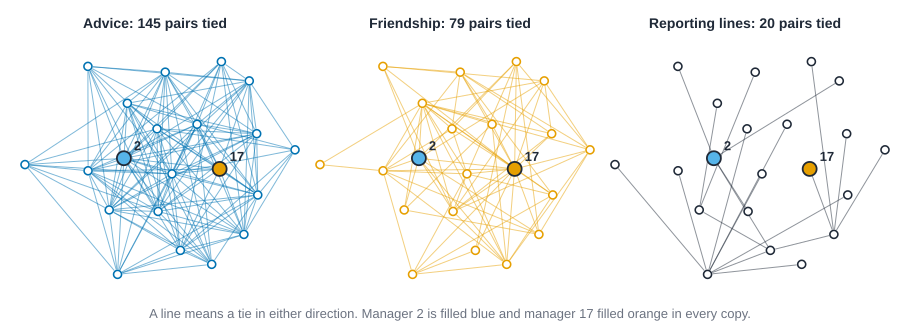
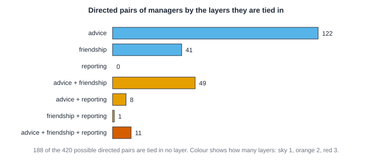

# Multiplex and multilayer networks {#sec-multilayer}

::: {.callout-note appearance="simple"}
## Prerequisites
@sec-networks-as-data, @sec-centrality and @sec-paths-and-cohesion. We use degree, betweenness, density and reciprocity, and we meet QAP, which @sec-tests-and-null-models explains properly.
:::

## One kind of tie is rarely the whole story

Ask a colleague who they trust and you get one network. Ask who they go to for advice and you get another. Look at the org chart and you get a third. Same people, three different pictures, and each one is a fair answer to a fair question.

Most of the book so far has treated a network as one set of ties. That is a sensible place to start, and it is also a simplification. People are tied to each other in many ways at once: they work together, live on the same street, text each other, owe each other money. A **layer** is one of those kinds of tie, a network of its own on the same people. When you keep the layers apart instead of mixing them, you can ask questions a single network can't answer.

- Do the same pairs show up in every layer, or does each layer have its own pairs?
- If you know two people are tied in one layer, how much more likely is a tie in another?
- Is someone central in every layer, or only in one? Does the answer change who you'd call "the key person"?
- What do you lose when you flatten the layers into one network?

This chapter works through those questions on a classic dataset, then on a second one that behaves quite differently, and ends with the ways reading several layers at once can go wrong. We stay with simple tools: overlap, conditional probability, and the single-network measures you already know, applied layer by layer. They get you a long way, and they make the limits of fancier methods easier to see.

## Krackhardt's managers

David Krackhardt studied the 21 managers of a small manufacturing firm. He asked each of them two questions, "to whom do you go for advice?" and "who is your friend?", and took a third network from the company's records: who reports to whom [@krackhardt1987cognitive]. The data are in the book's `data/krackhardt` folder. The ties we use are the ones each manager reported about himself, which the data's README calls the locally aggregated structure.

That makes three layers on one set of 21 people. Every tie points from one manager to another: an advice tie goes from the person who asks to the person asked, a friendship tie from the person who names to the person named, and a reporting tie from a manager to their boss. @fig-multilayer-layers draws all three on one shared layout, so every manager stays in the same place and you can watch a single person across the layers.

{#fig-multilayer-layers fig-alt="Three copies of the same 21 dots in the same positions. The left copy, advice, has 145 lines and is dense. The middle copy, friendship, has 79 lines. The right copy, reporting lines, has 20 lines and forms a tree. Two dots are larger and filled in every copy: manager 2 in blue and manager 17 in orange."}

The three pictures look nothing alike. Advice is a thicket, friendship is airier, and reporting is a tree with a few managers collecting most of the lines. Before comparing them, take each layer's basic numbers: how many ties, how dense, and how many are reciprocated. Each layer is stored as a 21 by 21 table of 0s and 1s, where a 1 in row $i$ and column $j$ means manager $i$ names manager $j$.

::: {.panel-tabset group="language"}

## R

```r
library(knappnet)
library(dplyr)
library(purrr)

# Krackhardt's 21 managers: one 21 x 21 table of 0s and 1s per layer.
# A 1 in row i, column j means manager i names manager j.
kr <- read.csv("data/krackhardt/edges.csv")
layer <- kr |>
  split(~relation) |>
  map(\(e) {
    m <- matrix(0, 21, 21)
    m[cbind(e$from, e$to)] <- 1
    m
  })

tibble(
  relation = names(layer),
  arcs = map_dbl(layer, sum),
  density = round(arcs / (21 * 20), 3),
  reciprocated = round(map_dbl(layer, \(m) sum(m * t(m)) / sum(m)), 2)
)
```

::: {.code-output}
```text
# A tibble: 3 × 4
  relation    arcs density reciprocated
  <chr>      <dbl>   <dbl>        <dbl>
1 advice       190   0.452         0.47
2 friendship   102   0.243         0.45
3 reports_to    20   0.048         0   
```
:::

## Python

```python
import csv

import networkx as nx
import numpy as np

# Krackhardt's 21 managers: one 21 x 21 table of 0s and 1s per layer.
# A 1 in row i, column j means manager i names manager j.
with open("data/krackhardt/edges.csv") as f:
    rows = list(csv.DictReader(f))
names = ["advice", "friendship", "reports_to"]
layer = {k: np.zeros((21, 21), dtype=int) for k in names}
for r in rows:
    layer[r["relation"]][int(r["from"]) - 1, int(r["to"]) - 1] = 1

for k in names:
    m = layer[k]
    arcs = int(m.sum())
    print(f"{k:<11} {arcs:>4} arcs, density {arcs / 420:.3f}, reciprocated {(m * m.T).sum() / arcs:.2f}")
```

::: {.code-output}
```text
advice       190 arcs, density 0.452, reciprocated 0.47
friendship   102 arcs, density 0.243, reciprocated 0.45
reports_to    20 arcs, density 0.048, reciprocated 0.00
```
:::

## Rust

```rust
use knappnet::Graph;

// Krackhardt's 21 managers: one 21 x 21 table of 0s and 1s per layer.
// A 1 in row i, column j means manager i names manager j. Managers are numbered 1 to 21; positions are 0 to 20.
let names = ["advice", "friendship", "reports_to"];
let mut layer = [[[0u8; 21]; 21]; 3];
let text = std::fs::read_to_string("data/krackhardt/edges.csv")?;
for line in text.lines().skip(1) {
    let p: Vec<&str> = line.split(',').collect();
    let k = names.iter().position(|&n| n == p[2]).unwrap();
    layer[k][p[0].parse::<usize>().unwrap() - 1][p[1].parse::<usize>().unwrap() - 1] = 1;
}

for k in 0..3 {
    let arcs: usize = layer[k].iter().flatten().filter(|&&x| x == 1).count();
    let mutual = (0..21).flat_map(|i| (0..21).map(move |j| (i, j))).filter(|&(i, j)| layer[k][i][j] == 1 && layer[k][j][i] == 1).count();
    println!("{:<11} {:>4} arcs, density {:.3}, reciprocated {:.2}", names[k], arcs, arcs as f64 / 420.0, mutual as f64 / arcs as f64);
}
```

::: {.code-output}
```text
advice       190 arcs, density 0.452, reciprocated 0.47
friendship   102 arcs, density 0.243, reciprocated 0.45
reports_to    20 arcs, density 0.048, reciprocated 0.00
```
:::

:::

Advice has 190 arcs, nearly half of the 420 possible ones, and 47 percent of them are returned. Friendship has 102 arcs and about as much reciprocity (45 percent). Reporting lines have 20 arcs, one for every manager but the CEO, and none is returned: no boss reports to the person who reports to them. These three layers differ in size, in density and in what a direction *means*. Hold on to that; it will matter when we compare them.

## Words for several layers

The vocabulary here is not fully settled, so it helps to say what each word covers.

A **multigraph** is a single network that is allowed to have several ties between the same two nodes. Nothing says what the parallel ties are. Two people who exchanged ten emails might be drawn as ten parallel lines.

A **multiplex network** has the same nodes in every layer, and each layer is one kind of tie. The ties only run within a layer. Krackhardt's managers are multiplex: 21 people, three kinds of tie.

A **multilayer network** is the general case [@kivela2014multilayer]. Layers can be kinds of tie, but also times, places or platforms. A person need not appear in every layer, and ties can run *between* layers, for example from a person on one platform to a different person on another. Ties inside a layer are *intralayer* ties. A tie that links a person to *themselves* in another layer is a *coupling*. A multiplex network is the special case with the same nodes everywhere and couplings only. A formal treatment of all of this is in @dedomenico2013mathematical.

You will also meet the word **multiplexity**, usually meaning how many layers a pair of people share. We use it that way.

A tiny example you can check by hand. Three people, Ana, Ben and Cleo, and two layers.

| Pair | In advice? | In lunch? |
| --- | --- | --- |
| Ana and Ben | yes | yes |
| Ben and Cleo | yes | no |
| Ana and Cleo | no | no |

Two pairs are tied in advice, one pair in lunch, and one pair (Ana and Ben) in both. Three words from this chapter fit on that table. The *overlap* is the count of pairs in both layers, here 1. The **Jaccard index** divides the overlap by the number of pairs tied in either layer, here 1 out of 2, so 0.5. And a *conditional probability* asks about one layer given the other: of the two advice pairs, one is also a lunch pair, so the chance of lunch given advice is 1 in 2, while of the one lunch pair, every one is an advice pair, so the chance of advice given lunch is 1.

Now the same ideas with symbols, so they still work when the layers are big. Write $a_{ij}$ for 1 when person $i$ names person $j$ in the first layer and 0 otherwise, and $b_{ij}$ for the same in the second. Let $N$ be the number of pairs that could be tied: $n(n-1)$ ordered pairs, or $n(n-1)/2$ when direction doesn't matter. Then

$$
m_A = \sum_{i \ne j} a_{ij}, \qquad
o = \sum_{i \ne j} a_{ij}\, b_{ij}, \qquad
J = \frac{o}{m_A + m_B - o}, \qquad
P(B \mid A) = \frac{o}{m_A}.
$$

Here $m_A$ and $m_B$ count the ties in each layer, $o$ is the overlap, $J$ is the Jaccard index and $P(B \mid A)$ is the share of the first layer's ties that are also in the second. Three more quantities will earn their keep. The *base rate* of the second layer is $m_B / N$. The **lift** is $P(B \mid A)$ divided by that base rate: how many times more likely a second tie is where a first one sits than at a random pair. And if the ties of the two layers were scattered independently, the overlap you'd *expect* is $m_A m_B / N$.

Check them on the table. Here $N = 3$, $m_A = 2$, $m_B = 1$ and $o = 1$, so $J = 1/2$, $P(\text{lunch} \mid \text{advice}) = 1/2$, the base rate of lunch is $1/3$ and the lift is $1.5$. The overlap expected by luck is $2 \times 1 / 3 = 0.67$, so the observed 1 is a little more than luck, though with three pairs nothing could be called surprising. One more fact, which matters later: two layers with $m_A$ and $m_B$ ties can share at most $\min(m_A, m_B)$ of them, so $J$ can never be higher than $\min(m_A, m_B) / \max(m_A, m_B)$, a **ceiling**. Here the ceiling is $1/2$, and Ana, Ben and Cleo sit right at it.

Comparing several relations among the same people has a long history in sociology. White, Boorman and Breiger built their blockmodels of roles and positions from several networks at once [@white1976social], and Breiger and Pattison studied compound relations such as "friend of a boss" as the building blocks of roles [@breiger1986cumulated]. The newer network-science literature added the vocabulary of layers and measures such as edge overlap [@battiston2014structural], inside a general framework [@kivela2014multilayer]. The arithmetic above is the common core.

Is the knappnet code for this a multilayer object? It can be. In R a multiplex network with a `relation` role is split into layers with `net_split_relations()`, and `net_as_multilayer()` adds the coupling ties for the general case. Below we mostly use plain tables, one per layer, because each step is then visible.

## Overlap and redundancy

Here is the first real question. Do the same pairs of managers appear in advice, friendship and reporting? Two numbers answer it from different angles.

The **overlap** of two layers is the number of ties present in both. The **Jaccard index** turns that into a share by dividing by the number of ties present in *either*, so it runs from 0 (nothing in common) to 1 (identical layers). Because it divides by the union, it does not reward a big layer for simply containing a small one.

The Jaccard index says how alike the layers are overall. A **conditional probability** asks a more pointed question. Pick an advice tie at random. How likely is it that the same ordered pair is also a friendship tie? To judge a number like that you have to compare it with how common friendship ties are among *all* ordered pairs, which is the **base rate**. If friendship is in 24 percent of all ordered pairs, and 32 percent of advice pairs, then advice pairs are a little more likely than a random pair to also be friends. The ratio of the two, here about 1.3, is how many times more likely.

::: {.panel-tabset group="language"}

## R

```r
pairs <- tribble(
  ~a, ~b,
  "advice", "friendship",
  "advice", "reports_to",
  "friendship", "reports_to"
)
total <- \(k) sum(layer[[k]])
any_direction <- \(k) pmax(layer[[k]], t(layer[[k]]))[upper.tri(layer[[k]])]

# Overlap and Jaccard, counting arcs, and again when a tie in either direction counts.
pairs |>
  mutate(
    both = map2_dbl(a, b, \(x, y) sum(layer[[x]] * layer[[y]])),
    jaccard = round(both / (map_dbl(a, total) + map_dbl(b, total) - both), 2),
    jaccard_either_direction = round(
      map2_dbl(a, b, \(x, y) sum(any_direction(x) * any_direction(y)) / sum(pmax(any_direction(x), any_direction(y)))),
      2
    )
  )

# Given a tie in one layer, how likely is the same pair in another? Compared with the base rate.
tribble(
  ~given, ~then,
  "advice", "friendship",
  "friendship", "advice",
  "reports_to", "advice",
  "advice", "reports_to"
) |>
  mutate(
    p_given = map2_dbl(given, then, \(g, t) sum(layer[[g]] * layer[[t]]) / total(g)),
    p_overall = map_dbl(then, total) / 420,
    ratio = p_given / p_overall
  ) |>
  mutate(across(c(p_given, p_overall), \(x) round(x, 3)), ratio = round(ratio, 2))
```

::: {.code-output}
```text
# A tibble: 3 × 5
  a          b           both jaccard jaccard_either_direction
  <chr>      <chr>      <dbl>   <dbl>                    <dbl>
1 advice     friendship    60    0.26                     0.41
2 advice     reports_to    19    0.1                      0.14
3 friendship reports_to    12    0.11                     0.14
# A tibble: 4 × 5
  given      then       p_given p_overall ratio
  <chr>      <chr>        <dbl>     <dbl> <dbl>
1 advice     friendship   0.316     0.243   1.3
2 friendship advice       0.588     0.452   1.3
3 reports_to advice       0.95      0.452   2.1
4 advice     reports_to   0.1       0.048   2.1
```
:::

## Python

```python
pairs = [("advice", "friendship"), ("advice", "reports_to"), ("friendship", "reports_to")]
upper = np.triu_indices(21, k=1)

def either_direction(m):
    # a pair counts as tied if either manager names the other
    return (m | m.T)[upper]

# Overlap and Jaccard, counting arcs, and again when a tie in either direction counts.
print("layers                       both  Jaccard  Jaccard, either direction")
for a, b in pairs:
    both = int((layer[a] & layer[b]).sum())
    jaccard = both / (layer[a] | layer[b]).sum()
    x, y = either_direction(layer[a]), either_direction(layer[b])
    print(f"{a + ' & ' + b:<27} {both:>5} {jaccard:>8.2f} {(x & y).sum() / (x | y).sum():>26.2f}")

# Given a tie in one layer, how likely is the same pair in another? Compared with the base rate.
print("given         then          P(then | given)  P(then) overall  ratio")
for given, then in [("advice", "friendship"), ("friendship", "advice"), ("reports_to", "advice"), ("advice", "reports_to")]:
    p_given = (layer[given] & layer[then]).sum() / layer[given].sum()
    p_overall = layer[then].sum() / 420
    print(f"{given:<13} {then:<13} {p_given:>15.3f} {p_overall:>16.3f} {p_given / p_overall:>7.2f}")
```

::: {.code-output}
```text
layers                       both  Jaccard  Jaccard, either direction
advice & friendship            60     0.26                       0.41
advice & reports_to            19     0.10                       0.14
friendship & reports_to        12     0.11                       0.14
given         then          P(then | given)  P(then) overall  ratio
advice        friendship              0.316            0.243    1.30
friendship    advice                  0.588            0.452    1.30
reports_to    advice                  0.950            0.452    2.10
advice        reports_to              0.100            0.048    2.10
```
:::

## Rust

```rust
let pairs = [(0, 1), (0, 2), (1, 2)];
let arcs = |k: usize| layer[k].iter().flatten().filter(|&&x| x == 1).count();
let in_both = |a: usize, b: usize| (0..21).flat_map(|i| (0..21).map(move |j| (i, j))).filter(|&(i, j)| layer[a][i][j] == 1 && layer[b][i][j] == 1).count();
// Overlap and Jaccard, counting arcs, and again when a tie in either direction counts.
println!("layers                       both  Jaccard  Jaccard, either direction");
for (a, b) in pairs {
    let both = in_both(a, b);
    let tied = |k: usize, i: usize, j: usize| layer[k][i][j] == 1 || layer[k][j][i] == 1;
    let upper: Vec<(usize, usize)> = (0..21).flat_map(|i| ((i + 1)..21).map(move |j| (i, j))).collect();
    let both_any = upper.iter().filter(|&&(i, j)| tied(a, i, j) && tied(b, i, j)).count();
    let either_any = upper.iter().filter(|&&(i, j)| tied(a, i, j) || tied(b, i, j)).count();
    println!("{:<27} {:>5} {:>8.2} {:>26.2}", format!("{} & {}", names[a], names[b]), both,
             both as f64 / (arcs(a) + arcs(b) - both) as f64, both_any as f64 / either_any as f64);
}

// Given a tie in one layer, how likely is the same pair in another? Compared with the base rate.
println!("given         then          P(then | given)  P(then) overall  ratio");
for (given, then) in [(0, 1), (1, 0), (2, 0), (0, 2)] {
    let p_given = in_both(given, then) as f64 / arcs(given) as f64;
    let p_overall = arcs(then) as f64 / 420.0;
    println!("{:<13} {:<13} {:>15.3} {:>16.3} {:>7.2}", names[given], names[then], p_given, p_overall, p_given / p_overall);
}
```

::: {.code-output}
```text
layers                       both  Jaccard  Jaccard, either direction
advice & friendship            60     0.26                       0.41
advice & reports_to            19     0.10                       0.14
friendship & reports_to        12     0.11                       0.14
given         then          P(then | given)  P(then) overall  ratio
advice        friendship              0.316            0.243    1.30
friendship    advice                  0.588            0.452    1.30
reports_to    advice                  0.950            0.452    2.10
advice        reports_to              0.100            0.048    2.10
```
:::

:::

Look at the first table. Advice and friendship share 60 arcs, a Jaccard of 0.26, so about a quarter of the pairs tied in either layer are tied in both. Advice and reporting share 19 arcs, and friendship and reporting 12. Now look at what happens when direction stops mattering: a tie counts if *either* manager names the other, and the Jaccard of advice and friendship goes up to 0.41. Same data, a different answer, because the question changed. We'll come back to that.

The second table is more interesting. Of the 190 advice arcs, about 32 percent are also friendship arcs, against 24 percent of all ordered pairs. Advice arcs are somewhat more likely than a random pair to be friendship arcs, about 1.3 times more likely, and not dramatically so. Turn it around and the same ratio shows up: of the 102 friendship arcs, 59 percent are advice arcs, against 45 percent overall. (The ratio is the same in both directions. That's not a coincidence: both are the overlap divided by what you'd expect if the layers were unrelated.)

Reporting is the outlier. Of the 20 reporting arcs, 19 are advice arcs: a manager very nearly always goes to their own boss for advice. That is 95 percent against a base rate of 45 percent, a ratio of about 2.1. Read it the other way and the ratio is the same, but now it says something different. Only 10 percent of advice arcs are reporting arcs, which is also twice the 5 percent of ordered pairs that are reporting arcs. Most advice goes sideways or across the firm, not up the chain.

::: {.callout-warning appearance="simple"}
## What a conditional probability does and does not say
"Given advice, how likely is friendship?" describes how the two layers sit together *in this firm at this moment*. It doesn't say that advice leads to friendship, or friendship to advice, or that either is the reason for the other. The 95 percent for reporting is mostly the firm's design: a manager's boss is the person they are supposed to turn to. Overlap is a fact about the data. Explaining it takes more than the data.
:::

**Redundancy** is the idea behind this arithmetic. Two layers are redundant when one tells you what the other would. If advice and friendship were identical, you'd only need to ask one question. The overlap numbers say they're neither identical nor independent. Whether the overlap is high enough to treat the layers as one is not a statistical question. It depends on what you're about to do with the answer.

### Two yardsticks for an overlap number

A Jaccard of 0.26 sounds low, and 0.10 sounds lower. But how high *could* it be, and how high would it be by luck? Both answers come from the symbols above and need no simulation. The code prints, for every pair of layers, the two layer sizes, the overlap, the overlap expected by luck ($m_A m_B / N$), the lift, the Jaccard index, its ceiling and the share of the smaller layer found in the larger one ($o / \min(m_A, m_B)$).

::: {.panel-tabset group="language"}

## R

```r
off <- \(m) m[row(m) != col(m)]
budget <- \(x, y) {
  x <- off(x)
  y <- off(y)
  both <- sum(x * y)
  expected <- sum(x) * sum(y) / length(x)
  tibble(
    in_a = sum(x), in_b = sum(y), both,
    expected = round(expected, 1),
    lift = round(both / expected, 2),
    jaccard = round(both / (sum(x) + sum(y) - both), 2),
    ceiling = round(min(sum(x), sum(y)) / max(sum(x), sum(y)), 2),
    share_of_smaller = round(both / min(sum(x), sum(y)), 2)
  )
}

pairs |>
  bind_cols(map2(pairs$a, pairs$b, \(x, y) budget(layer[[x]], layer[[y]])) |> list_rbind())
```

::: {.code-output}
```text
```
:::

## Python

```python
off = ~np.eye(21, dtype=bool)
head = "layers                      in A  in B  both  expected  lift  Jaccard  ceiling  share of smaller"

def budget(name, x, y):
    # x and y hold a 0 or 1 for every ordered pair of people
    mx, my, both = x.sum(), y.sum(), (x & y).sum()
    expected = mx * my / len(x)
    print(f"{name:<27} {mx:>4} {my:>5} {both:>5} {expected:>9.1f} {both / expected:>5.2f} "
          f"{both / (mx + my - both):>8.2f} {min(mx, my) / max(mx, my):>8.2f} {both / min(mx, my):>9.2f}")

print(head)
for a, b in pairs:
    budget(f"{a} & {b}", layer[a][off], layer[b][off])
```

::: {.code-output}
```text
layers                      in A  in B  both  expected  lift  Jaccard  ceiling  share of smaller
advice & friendship          190   102    60      46.1  1.30     0.26     0.54      0.59
advice & reports_to          190    20    19       9.0  2.10     0.10     0.11      0.95
friendship & reports_to      102    20    12       4.9  2.47     0.11     0.20      0.60
```
:::

## Rust

```rust
// Every ordered pair of managers, 1 if tied in the layer.
let flat = |k: usize| -> Vec<f64> {
    (0..21).flat_map(|i| (0..21).map(move |j| (i, j))).filter(|&(i, j)| i != j).map(|(i, j)| layer[k][i][j] as f64).collect()
};
let head = "layers                      in A  in B  both  expected  lift  Jaccard  ceiling  share of smaller";
let budget = |name: String, x: &[f64], y: &[f64]| {
    let (mx, my) = (x.iter().sum::<f64>(), y.iter().sum::<f64>());
    let both: f64 = x.iter().zip(y).map(|(a, b)| a * b).sum();
    let expected = mx * my / x.len() as f64;
    println!("{:<27} {:>4} {:>5} {:>5} {:>9.1} {:>5.2} {:>8.2} {:>8.2} {:>9.2}", name, mx, my, both, expected, both / expected,
             both / (mx + my - both), mx.min(my) / mx.max(my), both / mx.min(my));
};

println!("{head}");
for (a, b) in pairs {
    budget(format!("{} & {}", names[a], names[b]), &flat(a), &flat(b));
}
```

::: {.code-output}
```text
```
:::

:::

Read the ceiling column first. Advice and reporting have a Jaccard of 0.10, which sounds like almost no overlap. But reporting has only 20 arcs, so no layer of 190 arcs could share more than 20 of them with it, and the highest Jaccard possible is 0.11. The observed 0.10 is within a hair of that. The last column says the same thing in a way that survives unequal sizes: 95 percent of the reporting arcs are advice arcs. When one layer is much smaller than the other, the Jaccard index is bound to look small, and the share of the smaller layer found in the larger is the more honest number. Advice and friendship are the opposite case: a ceiling of 0.54 and an observed 0.26, so about half the room is used.

Now the luck column. If advice and friendship were scattered independently over the 420 ordered pairs, they would share about 46 arcs. They share 60, the lift of 1.3 we met before. Advice and reporting would share about 9 and share 19; friendship and reporting would share about 5 and share 12. Notice what the lift does and doesn't do: it is large for the two pairs involving reporting, but that is partly because reporting is a small layer, where a handful of extra shared arcs moves the ratio a lot. Big lifts on small layers are easy to get and hard to interpret. The QAP test later in the chapter asks the better question, of whether the overlap beats what relabeling the people gives.

### What overlap means in different settings

The same number can mean different things depending on what the layers are. Here are four settings, with what a high and a low overlap would suggest and what neither one shows.

| Setting | High overlap | Low overlap | What it does not show |
| --- | --- | --- | --- |
| Families bound by marriage and by business (the kind of setting studied in @padgett1993robust) | The same pairs are bound in more than one way, so one kind of tie may reinforce the other. | Each kind of tie links different pairs, so together they reach more of the network. | Which tie came first, or whether either was chosen for the sake of the other. |
| An office: advice, friendship and reporting lines (this chapter) | The formal chart and the informal routes coincide, as with advice and reporting here. | Informal routes run around the chart. | Whether the overlap is choice or design: a boss is the person you are meant to ask. |
| Transport or supply: rail and road links between towns, or two kinds of contract between firms | Redundancy. If the layers fail independently, one can cover for the other. | The layers complement each other, and losing one loses connections the other doesn't have. | Whether the layers share a weak point such as the same bridge or the same supplier. Redundancy is a claim to test, not to assume. |
| An online platform: following, replying, sharing | Accounts that follow each other also interact, so the follow ties carry real contact. | Following is mostly one-way broadcast, with little interaction behind it. | What the ties mean to people. The interface, which suggests who to follow and who to reply to, shapes the overlap. |

In every row, compare the number with the ceiling and with what luck gives before reading it.

## Flattening: union and sum

You have three layers and a method that handles one network. The easy move is to merge them. There are two simple ways.

The **union** says a pair is tied if it is tied in *any* layer. You end up with a single ordinary network. The **sum** (or weighted aggregate) keeps a count: the weight on a pair is the number of layers it is tied in. The union is the sum with every weight above 0 squashed to 1.

How much does each merge keep? Code each ordered pair of managers by *which* layers tie it, and count.

::: {.panel-tabset group="language"}

## R

```r
# Code each ordered pair by the layers that tie it: advice 1, friendship 2, reporting 4.
code <- (layer$advice + 2 * layer$friendship + 4 * layer$reports_to)[row(layer$advice) != col(layer$advice)]
labels <- c("no layer", "advice only", "friendship only", "advice + friendship",
            "reporting only", "advice + reporting", "friendship + reporting", "all three")

tibble(code = factor(code, levels = 0:7)) |>
  count(code, .drop = FALSE) |>
  mutate(tied_in = labels, .before = 1) |>
  select(tied_in, pairs = n)

# What each merge keeps.
tibble(union_arcs = sum(code > 0), in_two_or_more = sum(code %in% c(3, 5, 6, 7)))
```

::: {.code-output}
```text
# A tibble: 8 × 2
  tied_in                pairs
  <chr>                  <int>
1 no layer                 188
2 advice only              122
3 friendship only           41
4 advice + friendship       49
5 reporting only             0
6 advice + reporting         8
7 friendship + reporting     1
8 all three                 11
# A tibble: 1 × 2
  union_arcs in_two_or_more
       <int>          <int>
1        232             69
```
:::

## Python

```python
# Code each ordered pair by the layers that tie it: advice 1, friendship 2, reporting 4.
code = (layer["advice"] + 2 * layer["friendship"] + 4 * layer["reports_to"])[~np.eye(21, dtype=bool)]
labels = ["no layer", "advice only", "friendship only", "advice + friendship", "reporting only",
          "advice + reporting", "friendship + reporting", "all three"]
for c, label in enumerate(labels):
    print(f"{label:<24} {(code == c).sum():>4}")

# What each merge keeps.
print(f"union keeps {(code > 0).sum()} arcs; {np.isin(code, [3, 5, 6, 7]).sum()} of them are in two or more layers")
```

::: {.code-output}
```text
no layer                  188
advice only               122
friendship only            41
advice + friendship        49
reporting only              0
advice + reporting          8
friendship + reporting      1
all three                  11
union keeps 232 arcs; 69 of them are in two or more layers
```
:::

## Rust

```rust
// Code each ordered pair by the layers that tie it: advice 1, friendship 2, reporting 4.
let code: Vec<u8> = (0..21).flat_map(|i| (0..21).map(move |j| (i, j))).filter(|&(i, j)| i != j)
    .map(|(i, j)| layer[0][i][j] + 2 * layer[1][i][j] + 4 * layer[2][i][j]).collect();
let labels = ["no layer", "advice only", "friendship only", "advice + friendship", "reporting only",
              "advice + reporting", "friendship + reporting", "all three"];
for (c, label) in labels.iter().enumerate() {
    println!("{:<24} {:>4}", label, code.iter().filter(|&&x| x as usize == c).count());
}

// What each merge keeps.
println!("union keeps {} arcs; {} of them are in two or more layers",
         code.iter().filter(|&&x| x > 0).count(), code.iter().filter(|&&x| [3, 5, 6, 7].contains(&x)).count());
```

::: {.code-output}
```text
no layer                  188
advice only               122
friendship only            41
advice + friendship        49
reporting only              0
advice + reporting          8
friendship + reporting      1
all three                  11
union keeps 232 arcs; 69 of them are in two or more layers
```
:::

:::

@fig-multilayer-overlap draws the same counts.

{#fig-multilayer-overlap fig-alt="Horizontal bars, one for each combination of layers. advice: 122. friendship: 41. reporting: 0. advice + friendship: 49. advice + reporting: 8. friendship + reporting: 1. advice + friendship + reporting: 11. A note under the bars says 188 of the 420 directed pairs are tied in no layer."}

Of 420 ordered pairs, 188 are tied in no layer at all, and 232 are tied in at least one. The union keeps all 232 as ties. Only 69 of them are tied in two or more layers, so if you take the union, 163 of its 232 arcs (70 percent) are a tie from exactly one layer, and the merged network can't say which. A merged tie might be a friendship, a request for advice, or a boss. Those are different kinds of thing. The sum is more careful: a weight of 3 marks the 11 pairs where the boss is also an advisor and a friend. But adding assumes that one layer's tie is worth the same as another's, which has to be argued, not assumed.

::: {.callout-tip appearance="simple"}
## What flattening hides
Which layer a tie came from. Whether two ties between the same pair agree in direction. Whether a person's ties are all of one kind. A sparse layer disappears beside a dense one. If a question is about one kind of tie, such as who people trust with a secret, answer it from that layer. Flatten only when your question is really about "connected in any way."
:::

## Layer by layer: degree and centrality

So far we've compared the *ties*. The other question is about the *people*. Is the manager who is sought out for advice the same one who is named a friend? That is a question about how a person's degree in one layer relates to their degree in another, which Battiston and colleagues call the inter-layer degree correlation [@battiston2014structural]. Take each manager's in-degree in each layer (how many people name them) and correlate.

Two correlations are worth printing. The ordinary Pearson one is sensitive to a few extreme values. Spearman's $\rho$ is the same correlation computed on ranks, so one very popular person can't dominate it.

::: {.panel-tabset group="language"}

## R

```r
indeg <- map(layer, colSums)
outdeg <- map(layer, rowSums)
pairs |>
  mutate(
    in_degree_r = map2_dbl(a, b, \(x, y) cor(indeg[[x]], indeg[[y]])),
    in_degree_rho = map2_dbl(a, b, \(x, y) cor(indeg[[x]], indeg[[y]], method = "spearman")),
    out_degree_r = map2_dbl(a, b, \(x, y) cor(outdeg[[x]], outdeg[[y]]))
  ) |>
  mutate(across(where(is.numeric), \(x) round(x, 2)))
```

::: {.code-output}
```text
# A tibble: 3 × 5
  a          b          in_degree_r in_degree_rho out_degree_r
  <chr>      <chr>            <dbl>         <dbl>        <dbl>
1 advice     friendship        0.31          0.14        -0.11
2 advice     reports_to        0.54          0.65         0.04
3 friendship reports_to        0.09          0            0.25
```
:::

## Python

```python
def ranks(x):
    # 1 for the smallest; tied values share the average of their ranks
    return np.array([(x < v).sum() + ((x == v).sum() + 1) / 2 for v in x])

def corr(x, y):
    return np.corrcoef(x, y)[0, 1]

print("layers                      in-degree r  in-degree rho  out-degree r")
for a, b in pairs:
    ia, ib = layer[a].sum(axis=0), layer[b].sum(axis=0)
    oa, ob = layer[a].sum(axis=1), layer[b].sum(axis=1)
    print(f"{a + ' & ' + b:<27} {corr(ia, ib):>9.2f} {corr(ranks(ia), ranks(ib)):>14.2f} {corr(oa, ob):>13.2f}")
```

::: {.code-output}
```text
layers                      in-degree r  in-degree rho  out-degree r
advice & friendship              0.31           0.14         -0.11
advice & reports_to              0.54           0.65          0.04
friendship & reports_to          0.09           0.00          0.25
```
:::

## Rust

```rust
use knappnet::{compute_degree, DegreeMode};

// Each layer as a directed network, so knappnet can count who names whom.
let directed = |k: usize| -> Result<Graph, knappnet::Error> {
    let arcs: Vec<(i64, i64)> = (0..21).flat_map(|i| (0..21).map(move |j| (i, j))).filter(|&(i, j)| layer[k][i][j] == 1).map(|(i, j)| (i as i64, j as i64)).collect();
    let from: Vec<i64> = arcs.iter().map(|a| a.0).collect();
    let to: Vec<i64> = arcs.iter().map(|a| a.1).collect();
    Graph::from_edges(21, &from, &to, None, true)
};
let g = [directed(0)?, directed(1)?, directed(2)?];
let ranks = |x: &[f64]| -> Vec<f64> {
    x.iter().map(|&v| x.iter().filter(|&&u| u < v).count() as f64 + (x.iter().filter(|&&u| u == v).count() as f64 + 1.0) / 2.0).collect()
};
let corr = |x: &[f64], y: &[f64]| -> f64 {
    let (mx, my) = (x.iter().sum::<f64>() / x.len() as f64, y.iter().sum::<f64>() / y.len() as f64);
    let sxy: f64 = x.iter().zip(y).map(|(a, b)| (a - mx) * (b - my)).sum();
    sxy / (x.iter().map(|a| (a - mx).powi(2)).sum::<f64>() * y.iter().map(|b| (b - my).powi(2)).sum::<f64>()).sqrt()
};

println!("layers                      in-degree r  in-degree rho  out-degree r");
for (a, b) in pairs {
    let (ia, ib) = (compute_degree(&g[a], DegreeMode::In, true), compute_degree(&g[b], DegreeMode::In, true));
    let (oa, ob) = (compute_degree(&g[a], DegreeMode::Out, true), compute_degree(&g[b], DegreeMode::Out, true));
    println!("{:<27} {:>9.2} {:>14.2} {:>13.2}", format!("{} & {}", names[a], names[b]), corr(&ia, &ib), corr(&ranks(&ia), &ranks(&ib)), corr(&oa, &ob));
}
```

::: {.code-output}
```text
layers                      in-degree r  in-degree rho  out-degree r
advice & friendship              0.31           0.14         -0.11
advice & reports_to              0.54           0.65          0.04
friendship & reports_to          0.09           0.00          0.25
```
:::

:::

Read the in-degree columns together. Advice and friendship have an in-degree correlation of 0.31 but a rank correlation of only 0.14, which says that the Pearson figure leans on a few managers and that for most of the firm, being sought for advice and being named a friend have little to do with each other. Advice and reporting come out higher (0.54 and 0.65). That fits the firm's shape: the managers named as bosses are the ones sought for advice. The out-degree for advice and friendship is slightly negative (-0.11): the managers who go to many people for advice are not the ones who name many friends. Treat the out-degree for reporting with care: every manager but the CEO has exactly one boss, so there is almost nothing to correlate. That number comes from how the data were made, not from how the firm works.

Now the personal version of the question. Take betweenness, the share of shortest routes that pass through a person (see @sec-centrality), and compute it in the advice layer, the friendship layer, and the merged network (the union of all three). We ignore direction here, so that a pair is tied if either manager names the other. For each layer we print the managers in the top three of any of them.

::: {.panel-tabset group="language"}

## R

```r
sym <- \(m) pmax(m, t(m))
union <- pmin(layer$advice + layer$friendship + layer$reports_to, 1)
between <- \(m) net_betweenness(as_net_frame(sym(m), directed = FALSE))

scores <- tibble(
  manager = 1:21,
  advice = between(layer$advice),
  friendship = between(layer$friendship),
  all_ties = between(union)
) |>
  mutate(across(c(advice, friendship, all_ties), \(x) rank(-x), .names = "{.col}_rank"))

scores |>
  filter(if_any(ends_with("_rank"), \(r) r <= 3)) |>
  mutate(across(c(advice, friendship, all_ties), \(x) round(x, 1))) |>
  select(manager, advice, advice_rank, friendship, friendship_rank, all_ties, all_ties_rank)

# A check: keep only friendships that both managers name.
mutual <- between(layer$friendship * t(layer$friendship))
tibble(manager = 17, betweenness = round(mutual[17], 1), rank = rank(-mutual)[17])
```

::: {.code-output}
```text
# A tibble: 6 × 7
  manager advice advice_rank friendship friendship_rank all_ties all_ties_rank
    <int>  <dbl>       <dbl>      <dbl>           <dbl>    <dbl>         <dbl>
1       2    6.4           3        9.5               4      4.8             2
2       5    5.1           5       12.1               3      3.9             4
3       9    6.5           2        1.3              15      4.1             3
4      11    1.1          15       28                 2      2.5            11
5      15    9.1           1        4.3               8      5.7             1
6      17    0.8          16       43.9               1      3.7             5
# A tibble: 1 × 3
  manager betweenness  rank
    <dbl>       <dbl> <dbl>
1      17          72     1
```
:::

## Python

```python
union = layer["advice"] | layer["friendship"] | layer["reports_to"]

def between(m):
    # ignore direction: a pair is tied if either manager names the other
    g = nx.from_numpy_array(m | m.T)
    b = nx.betweenness_centrality(g, normalized=False)
    return np.array([b[i] for i in range(21)])

score = {"advice": between(layer["advice"]), "friendship": between(layer["friendship"]), "all ties": between(union)}
rank = {k: ranks(-v) for k, v in score.items()}  # 1 = most between

top = [i for i in range(21) if any(r[i] <= 3 for r in rank.values())]
print("manager    advice (rank)   friendship (rank)   all ties (rank)")
for i in top:
    print(f"{i + 1:>7}  " + "   ".join(f"{score[k][i]:>8.1f} ({rank[k][i]:>2.0f})" for k in score))

# A check: keep only friendships that both managers name.
mutual = between(layer["friendship"] & layer["friendship"].T)
print(f"manager 17 with only mutual friendships: betweenness {mutual[16]:.1f}, rank {ranks(-mutual)[16]:.0f}")
```

::: {.code-output}
```text
manager    advice (rank)   friendship (rank)   all ties (rank)
      2       6.4 ( 3)        9.5 ( 4)        4.8 ( 2)
      5       5.1 ( 5)       12.1 ( 3)        3.9 ( 4)
      9       6.5 ( 2)        1.3 (15)        4.1 ( 3)
     11       1.1 (15)       28.0 ( 2)        2.5 (11)
     15       9.1 ( 1)        4.3 ( 8)        5.7 ( 1)
     17       0.8 (16)       43.9 ( 1)        3.7 ( 5)
manager 17 with only mutual friendships: betweenness 72.0, rank 1
```
:::

## Rust

```rust
use knappnet::{compute_betweenness, BetweennessOptions};

let mut union = [[0u8; 21]; 21];
for i in 0..21 { for j in 0..21 { union[i][j] = layer[0][i][j].max(layer[1][i][j]).max(layer[2][i][j]); } }

// Ignore direction: a pair is tied if either manager names the other.
let between = |m: &[[u8; 21]; 21]| -> Result<Vec<f64>, knappnet::Error> {
    let pairs: Vec<(i64, i64)> = (0..21).flat_map(|i| ((i + 1)..21).map(move |j| (i, j))).filter(|&(i, j)| m[i][j] == 1 || m[j][i] == 1).map(|(i, j)| (i as i64, j as i64)).collect();
    let from: Vec<i64> = pairs.iter().map(|p| p.0).collect();
    let to: Vec<i64> = pairs.iter().map(|p| p.1).collect();
    compute_betweenness(&Graph::from_edges(21, &from, &to, None, false)?, BetweennessOptions::default())
};
let score = [between(&layer[0])?, between(&layer[1])?, between(&union)?];
let rank: Vec<Vec<f64>> = score.iter().map(|s| ranks(&s.iter().map(|v| -v).collect::<Vec<f64>>())).collect();

println!("manager    advice (rank)   friendship (rank)   all ties (rank)");
for i in (0..21).filter(|&i| rank.iter().any(|r| r[i] <= 3.0)) {
    let cells: Vec<String> = (0..3).map(|k| format!("{:>8.1} ({:>2.0})", score[k][i], rank[k][i])).collect();
    println!("{:>7}  {}", i + 1, cells.join("   "));
}

// A check: keep only friendships that both managers name.
let mut mutual_layer = [[0u8; 21]; 21];
for i in 0..21 { for j in 0..21 { mutual_layer[i][j] = layer[1][i][j] * layer[1][j][i]; } }
let mutual = between(&mutual_layer)?;
let mutual_rank = ranks(&mutual.iter().map(|v| -v).collect::<Vec<f64>>());
println!("manager 17 with only mutual friendships: betweenness {:.1}, rank {:.0}", mutual[16], mutual_rank[16]);
```

::: {.code-output}
```text
manager    advice (rank)   friendship (rank)   all ties (rank)
      2       6.4 ( 3)        9.5 ( 4)        4.8 ( 2)
      5       5.1 ( 5)       12.1 ( 3)        3.9 ( 4)
      9       6.5 ( 2)        1.3 (15)        4.1 ( 3)
     11       1.1 (15)       28.0 ( 2)        2.5 (11)
     15       9.1 ( 1)        4.3 ( 8)        5.7 ( 1)
     17       0.8 (16)       43.9 ( 1)        3.7 ( 5)
manager 17 with only mutual friendships: betweenness 72.0, rank 1
```
:::

:::

Manager 17 is the one to look at. In the friendship layer he has by far the largest betweenness, 43.9, and ranks first. In the advice layer he scores 0.8 and ranks 16th out of 21. Manager 2, by contrast, is near the top in advice and still high in friendship. @fig-multilayer-ranks puts every manager on one picture: manager 17 is the dot far from the diagonal.

{#fig-multilayer-ranks fig-alt="A square scatter plot with 21 dots and a dashed diagonal. The other 20 dots are blue. The orange dot for manager 17 sits at the top of the plot, rank 1 on the friendship axis, and at rank 16 of 21 on the advice axis, far from the diagonal."}

Why does this matter? Pick any one layer to ask "who is the key person?" and you can get a different answer from each. Here the answer from the merged network happens to land near the advice layer's, because the advice layer has nearly twice as many ties as the friendship layer and dominates the union. Manager 17 slips to fifth. If your question was who connects the *social* circles, the merged network has buried the answer. This is the practical cost of flattening: not that the numbers are wrong, but that the sparse layer is drowned out. Betweenness values are also not comparable *across* layers as raw numbers. A sparse layer has longer routes, so its values run larger. That is why we compare ranks.

What does it say about manager 17? Not much by itself. He names 18 friends, the most of anyone, and is named by six. Because we ignore direction, all 18 count as ties, so it's fair to ask whether his position rests on friendships nobody returned. The last line of the output is that check: keep only friendships both managers name, and he is still first. That makes the finding sturdier. It still describes a position in one layer. It does not say that he is influential, liked or trusted.

### Does the finding survive losing someone?

A ranking from one survey of 21 people could change a good deal if one person's answers were different. Here is a cheap stress test that needs no random numbers. Take each manager out in turn, so that none of their ties count in any layer, and rerun the analysis. If a conclusion rests on one person, it will show here. (@sec-tests-and-null-models covers the random stress tests.)

::: {.panel-tabset group="language"}

## R

```r
# Take each manager out in turn: none of their ties count, in any layer.
without <- \(i) map(layer, \(m) {
  m[i, ] <- 0
  m[, i] <- 0
  m
})

stability <- tibble(dropped = 1:21) |>
  mutate(
    kept = map(dropped, without),
    top_friendship = map_int(kept, \(k) which.max(between(k$friendship))),
    top_advice = map_int(kept, \(k) which.max(between(k$advice))),
    jaccard = map_dbl(kept, \(k) sum(k$advice * k$friendship) / sum(pmax(k$advice, k$friendship)))
  )

# Who has the highest betweenness once someone else is out? (Manager 17 and 15 are skipped in their own tables.)
stability |> filter(dropped != 17) |> count(top_friendship)
stability |> filter(dropped != 15) |> count(top_advice)
stability |> filter(dropped != 15, top_advice != 15) |> select(dropped, top_advice)
stability |> summarise(lowest_jaccard = round(min(jaccard), 3), highest_jaccard = round(max(jaccard), 3))
```

::: {.code-output}
```text
```
:::

## Python

```python
def without(i):
    # take manager i out: none of their ties count, in any layer
    kept = {k: m.copy() for k, m in layer.items()}
    for m in kept.values():
        m[i, :] = 0
        m[:, i] = 0
    return kept

runs = []
for i in range(21):
    kept = without(i)
    both = (kept["advice"] & kept["friendship"]).sum()
    runs.append((i + 1, int(between(kept["friendship"]).argmax()) + 1, int(between(kept["advice"]).argmax()) + 1,
                 both / (kept["advice"] | kept["friendship"]).sum()))

friendship = [top for out, top, _, _ in runs if out != 17]
advice = [(out, top) for out, _, top, _ in runs if out != 15]
print(f"friendship: manager 17 has the highest betweenness in {friendship.count(17)} of {len(friendship)} drops")
print(f"advice: manager 15 has it in {sum(t == 15 for _, t in advice)} of {len(advice)} drops; others (dropped, leader): {[a for a in advice if a[1] != 15]}")
print(f"Jaccard of advice and friendship: lowest {min(r[3] for r in runs):.3f}, highest {max(r[3] for r in runs):.3f}")
```

::: {.code-output}
```text
friendship: manager 17 has the highest betweenness in 20 of 20 drops
advice: manager 15 has it in 19 of 20 drops; others (dropped, leader): [(12, 2)]
Jaccard of advice and friendship: lowest 0.235, highest 0.288
```
:::

## Rust

```rust
// Take each manager out in turn: none of their ties count, in any layer.
let argmax = |v: &[f64]| (0..v.len()).fold(0, |best, i| if v[i] > v[best] { i } else { best });
let mut runs: Vec<(usize, usize, usize, f64)> = vec![];
for out in 0..21 {
    let mut kept = layer;
    for m in kept.iter_mut() {
        for i in 0..21 {
            m[out][i] = 0;
            m[i][out] = 0;
        }
    }
    let cells: Vec<(usize, usize)> = (0..21).flat_map(|i| (0..21).map(move |j| (i, j))).collect();
    let both = cells.iter().filter(|&&(i, j)| kept[0][i][j] == 1 && kept[1][i][j] == 1).count();
    let either = cells.iter().filter(|&&(i, j)| kept[0][i][j] == 1 || kept[1][i][j] == 1).count();
    runs.push((out + 1, argmax(&between(&kept[1])?) + 1, argmax(&between(&kept[0])?) + 1, both as f64 / either as f64));
}

let friendship: Vec<usize> = runs.iter().filter(|r| r.0 != 17).map(|r| r.1).collect();
let advice: Vec<(usize, usize)> = runs.iter().filter(|r| r.0 != 15).map(|r| (r.0, r.2)).collect();
println!("friendship: manager 17 has the highest betweenness in {} of {} drops", friendship.iter().filter(|&&t| t == 17).count(), friendship.len());
println!("advice: manager 15 has it in {} of {} drops; others (dropped, leader): {:?}", advice.iter().filter(|a| a.1 == 15).count(), advice.len(),
         advice.iter().filter(|a| a.1 != 15).collect::<Vec<_>>());
println!("Jaccard of advice and friendship: lowest {:.3}, highest {:.3}", runs.iter().map(|r| r.3).fold(f64::INFINITY, f64::min), runs.iter().map(|r| r.3).fold(0.0, f64::max));
```

::: {.code-output}
```text
```
:::

:::

Manager 17 keeps the highest friendship betweenness whichever of the other 20 managers is removed, so that finding doesn't hang on one other person's answers. The advice finding is slightly softer: manager 15 leads in 19 of 20 drops, and when manager 12 is removed manager 2 takes the lead, so the advice layer's "most between" person is a close call between two. The advice and friendship Jaccard index moves between 0.235 and 0.288 around its full-data value of 0.259, a modest range. Removing one manager is a blunt probe, since it takes out all of that person's ties at once, and it says nothing about errors in the ties themselves.

Here are two sentences about manager 17, one defensible and one not. *Defensible:* "In the friendships the 21 managers reported, manager 17 has the highest betweenness whichever one other manager is left out, and when only mutually named friendships are kept; in the advice ties he ranks 16th." *Over-claiming:* "Manager 17 is the key person in the firm." The data show a position in one layer, and the other layer disagrees. What "key" means is a question about your purpose, not a number.

## Layer-aware paths

Everything so far looked at layers one at a time, or after merging them. A method that treats the layers as *one* structure is a different kind of tool. The usual approach is a **supra-adjacency matrix**: stack the layers into one big table, with each layer's adjacency table on the diagonal and, off the diagonal, couplings that link each person to their own copy in the other layers [@kivela2014multilayer; @dedomenico2013mathematical].

A hand-checkable case. Take Ana, Ben and Cleo again, with advice tying Ana and Ben, and lunch tying Ben and Cleo. The supra network has six nodes: each person once in each layer. The couplings join Ana-in-advice to Ana-in-lunch, and likewise for Ben and Cleo. Now ask how far Ana is from Cleo. In the merged network, two steps: Ana to Ben to Cleo. In the supra network, if switching layers costs a step, it takes three: Ana to Ben within advice, Ben from advice to lunch, Ben to Cleo within lunch. That extra step is the price of changing the *kind* of tie, which is sometimes exactly the thing you want to measure. Passing a work request along an advice chain and then having to switch to a social tie to pass on a favour are different acts.

As far as I have checked, none of the three tools used here has a ready-made layer-aware path measure. (In R, knappnet can hold a multilayer network and adds the coupling ties for you with `net_as_multilayer()`, but I haven't verified a path measure that uses them.) So we build the supra network by hand, for two layers at a time, after the Sampson data, where the layers are sparser and the comparison has more to show. If you need these measures for larger problems, look at tools built for the job: @magnani2021analysis describes an R package for multiplex social networks and @nurmi2024pymnet a Python library for multilayer networks. For community detection that spans layers, see @mucha2010community. Check what each one assumes about the couplings before you trust its output.

## A second set of layers: Sampson's novices

Krackhardt's layers are three different *kinds of tie*, all asked of the same people at about the same time. Sampson's monastery data are a good contrast. Samuel Sampson lived with a group of 18 novices in a New England monastery and asked each of them to rank the three novices they liked best, esteemed most and so on, for several relations, in a positive and a negative version of each [@sampson1968novitiate]. Liking was recorded at three times. The data are in the book's `data/sampson` folder.

We use ten layers: liking at three times, then esteem, praise and positive influence, then disliking, disesteem, blame and negative influence. For each pair of layers we correlate the two tables of 0s and 1s over all 306 ordered pairs of novices. The code first prints how many ties each layer has and the fewest and most any novice names, which will turn out to matter.

::: {.panel-tabset group="language"}

## R

```r
sn <- read.csv("data/sampson/nodes.csv")
number <- set_names(sn$number, sn$name)
order <- c("liking_t1", "liking_t2", "liking_t3", "esteem", "praise", "positive_influence",
           "disliking", "disesteem", "blame", "negative_influence")
short <- c("like1", "like2", "like3", "esteem", "praise", "influ+", "dislike", "disest", "blame", "influ-")

sampson <- read.csv("data/sampson/edges.csv") |>
  mutate(key = if_else(relation == "liking", paste0("liking_t", time), relation)) |>
  split(~key) |>
  map(\(e) {
    m <- matrix(0, 18, 18)
    m[cbind(unname(number[e$from]), unname(number[e$to]))] <- 1
    m
  })

# How many ties, and how many does one novice name at the fewest and the most?
tibble(
  layer = order,
  ties = map_dbl(sampson[order], sum),
  fewest = map_dbl(sampson[order], \(m) min(rowSums(m))),
  most = map_dbl(sampson[order], \(m) max(rowSums(m)))
)

# Correlation between layers over all ordered pairs of novices.
sampson[order] |>
  map(\(m) m[row(m) != col(m)]) |>
  set_names(short) |>
  as_tibble() |>
  cor() |>
  round(2)
```

::: {.code-output}
```text
# A tibble: 10 × 4
   layer               ties fewest  most
   <chr>              <dbl>  <dbl> <dbl>
 1 liking_t1             55      3     4
 2 liking_t2             57      3     4
 3 liking_t3             56      3     4
 4 esteem                54      0     4
 5 praise                39      0     4
 6 positive_influence    53      0     4
 7 disliking             47      0     4
 8 disesteem             58      0     5
 9 blame                 41      0     5
10 negative_influence    50      0     5
        like1 like2 like3 esteem praise influ+ dislike disest blame influ-
like1    1.00  0.54  0.55   0.01   0.03   0.01    0.04  -0.03 -0.01  -0.07
like2    0.54  1.00  0.64   0.02   0.04   0.00    0.01  -0.06 -0.04  -0.05
like3    0.55  0.64  1.00   0.07   0.12   0.07    0.03  -0.03 -0.06  -0.03
esteem   0.01  0.02  0.07   1.00   0.54   0.67   -0.17  -0.22 -0.16  -0.20
praise   0.03  0.04  0.12   0.54   1.00   0.58   -0.16  -0.16 -0.15  -0.17
influ+   0.01  0.00  0.07   0.67   0.58   1.00   -0.12  -0.18 -0.18  -0.20
dislike  0.04  0.01  0.03  -0.17  -0.16  -0.12    1.00   0.65  0.28   0.55
disest  -0.03 -0.06 -0.03  -0.22  -0.16  -0.18    0.65   1.00  0.37   0.58
blame   -0.01 -0.04 -0.06  -0.16  -0.15  -0.18    0.28   0.37  1.00   0.35
influ-  -0.07 -0.05 -0.03  -0.20  -0.17  -0.20    0.55   0.58  0.35   1.00
```
:::

## Python

```python
with open("data/sampson/nodes.csv") as f:
    number = {r["name"]: int(r["number"]) - 1 for r in csv.DictReader(f)}
with open("data/sampson/edges.csv") as f:
    sampson_rows = list(csv.DictReader(f))
order = ["liking_t1", "liking_t2", "liking_t3", "esteem", "praise", "positive_influence",
         "disliking", "disesteem", "blame", "negative_influence"]
short = ["like1", "like2", "like3", "esteem", "praise", "influ+", "dislike", "disest", "blame", "influ-"]

sampson = {k: np.zeros((18, 18), dtype=int) for k in order}
for r in sampson_rows:
    key = r["relation"] + (f"_t{r['time']}" if r["relation"] == "liking" else "")
    sampson[key][number[r["from"]], number[r["to"]]] = 1

# How many ties, and how many does one novice name at the fewest and the most?
for k in order:
    m = sampson[k]
    print(f"{k:<19} {m.sum():>3} ties, fewest named {m.sum(axis=1).min()}, most {m.sum(axis=1).max()}")

# Correlation between layers over all ordered pairs of novices.
off = ~np.eye(18, dtype=bool)
table = np.corrcoef(np.array([sampson[k][off] for k in order]))
print(" " * 8 + "".join(f"{s:>8}" for s in short))
for s, row in zip(short, table):
    print(f"{s:<8}" + "".join(f"{v:>8.2f}" for v in row))
```

::: {.code-output}
```text
liking_t1            55 ties, fewest named 3, most 4
liking_t2            57 ties, fewest named 3, most 4
liking_t3            56 ties, fewest named 3, most 4
esteem               54 ties, fewest named 0, most 4
praise               39 ties, fewest named 0, most 4
positive_influence   53 ties, fewest named 0, most 4
disliking            47 ties, fewest named 0, most 4
disesteem            58 ties, fewest named 0, most 5
blame                41 ties, fewest named 0, most 5
negative_influence   50 ties, fewest named 0, most 5
           like1   like2   like3  esteem  praise  influ+ dislike  disest   blame  influ-
like1       1.00    0.54    0.55    0.01    0.03    0.01    0.04   -0.03   -0.01   -0.07
like2       0.54    1.00    0.64    0.02    0.04    0.00    0.01   -0.06   -0.04   -0.05
like3       0.55    0.64    1.00    0.07    0.12    0.07    0.03   -0.03   -0.06   -0.03
esteem      0.01    0.02    0.07    1.00    0.54    0.67   -0.17   -0.22   -0.16   -0.20
praise      0.03    0.04    0.12    0.54    1.00    0.58   -0.16   -0.16   -0.15   -0.17
influ+      0.01    0.00    0.07    0.67    0.58    1.00   -0.12   -0.18   -0.18   -0.20
dislike     0.04    0.01    0.03   -0.17   -0.16   -0.12    1.00    0.65    0.28    0.55
disest     -0.03   -0.06   -0.03   -0.22   -0.16   -0.18    0.65    1.00    0.37    0.58
blame      -0.01   -0.04   -0.06   -0.16   -0.15   -0.18    0.28    0.37    1.00    0.35
influ-     -0.07   -0.05   -0.03   -0.20   -0.17   -0.20    0.55    0.58    0.35    1.00
```
:::

## Rust

```rust
use std::collections::HashMap;

let nodes = std::fs::read_to_string("data/sampson/nodes.csv")?;
let number: HashMap<&str, usize> = nodes.lines().skip(1).map(|l| { let p: Vec<&str> = l.split(',').collect(); (p[0], p[1].parse::<usize>().unwrap() - 1) }).collect();
let order = ["liking_t1", "liking_t2", "liking_t3", "esteem", "praise", "positive_influence",
             "disliking", "disesteem", "blame", "negative_influence"];
let short = ["like1", "like2", "like3", "esteem", "praise", "influ+", "dislike", "disest", "blame", "influ-"];

let mut sampson = vec![[[0u8; 18]; 18]; 10];
let edges = std::fs::read_to_string("data/sampson/edges.csv")?;
for line in edges.lines().skip(1) {
    let p: Vec<&str> = line.split(',').collect(); // from, to, relation, sign, time, rank
    let key = if p[2] == "liking" { format!("liking_t{}", p[4]) } else { p[2].to_string() };
    let k = order.iter().position(|&o| o == key).unwrap();
    sampson[k][number[p[0]]][number[p[1]]] = 1;
}

// How many ties, and how many does one novice name at the fewest and the most?
for (k, name) in order.iter().enumerate() {
    let named: Vec<usize> = (0..18).map(|i| sampson[k][i].iter().filter(|&&x| x == 1).count()).collect();
    println!("{:<19} {:>3} ties, fewest named {}, most {}", name, named.iter().sum::<usize>(), named.iter().min().unwrap(), named.iter().max().unwrap());
}

// Correlation between layers over all ordered pairs of novices.
let cells: Vec<Vec<f64>> = (0..10).map(|k| (0..18).flat_map(|i| (0..18).map(move |j| (i, j))).filter(|&(i, j)| i != j).map(|(i, j)| sampson[k][i][j] as f64).collect()).collect();
print!("{:8}", "");
for s in short { print!("{:>8}", s); }
println!();
for a in 0..10 {
    print!("{:<8}", short[a]);
    for b in 0..10 { print!("{:>8.2}", corr(&cells[a], &cells[b])); }
    println!();
}
```

::: {.code-output}
```text
liking_t1            55 ties, fewest named 3, most 4
liking_t2            57 ties, fewest named 3, most 4
liking_t3            56 ties, fewest named 3, most 4
esteem               54 ties, fewest named 0, most 4
praise               39 ties, fewest named 0, most 4
positive_influence   53 ties, fewest named 0, most 4
disliking            47 ties, fewest named 0, most 4
disesteem            58 ties, fewest named 0, most 5
blame                41 ties, fewest named 0, most 5
negative_influence   50 ties, fewest named 0, most 5
           like1   like2   like3  esteem  praise  influ+ dislike  disest   blame  influ-
like1       1.00    0.54    0.55    0.01    0.03    0.01    0.04   -0.03   -0.01   -0.07
like2       0.54    1.00    0.64    0.02    0.04    0.00    0.01   -0.06   -0.04   -0.05
like3       0.55    0.64    1.00    0.07    0.12    0.07    0.03   -0.03   -0.06   -0.03
esteem      0.01    0.02    0.07    1.00    0.54    0.67   -0.17   -0.22   -0.16   -0.20
praise      0.03    0.04    0.12    0.54    1.00    0.58   -0.16   -0.16   -0.15   -0.17
influ+      0.01    0.00    0.07    0.67    0.58    1.00   -0.12   -0.18   -0.18   -0.20
dislike     0.04    0.01    0.03   -0.17   -0.16   -0.12    1.00    0.65    0.28    0.55
disest     -0.03   -0.06   -0.03   -0.22   -0.16   -0.18    0.65    1.00    0.37    0.58
blame      -0.01   -0.04   -0.06   -0.16   -0.15   -0.18    0.28    0.37    1.00    0.35
influ-     -0.07   -0.05   -0.03   -0.20   -0.17   -0.20    0.55    0.58    0.35    1.00
```
:::

:::

@fig-multilayer-sampson draws that table of correlations.

{#fig-multilayer-sampson fig-alt="A ten by ten grid of numbers shaded blue for positive and red for negative correlations. The three liking rows form a blue block with values from 0.54 to 0.64. Esteem, praise and positive influence form a second blue block from 0.54 to 0.67. The four negative relations form a third blue block from 0.28 to 0.65. Between the second and third blocks every value is red, from -0.22 to -0.12. Liking at time 3 against esteem is only 0.07."}

Three things stand out, and none of them is visible in Krackhardt's data.

First, **layers can be waves.** The three liking layers are the same question asked at three times, and they correlate at 0.54 to 0.64 with each other: who likes whom is fairly stable, but not fixed. That is a hint at the time dimension that @sec-time takes up properly.

Second, **layers can be unrelated.** Liking correlates with esteem, praise and influence at essentially nothing (0.01 to 0.12). Whom a novice *likes* and whom he *esteems* are different groups of people. A single "positive ties" network built from the union would mix two different structures.

Third, **the negative layers are not the absence of the positive ones.** Esteem and disesteem are mildly negatively correlated (-0.22), as you'd hope, but liking and disliking at time 3 are not related at all (0.03). Not being among someone's three favourites does not make you one of the people they dislike, and nothing in a table of 0s and 1s can tell those apart unless you kept the negative layer.

Now look at the first printout. Every novice named three or four people in each of the three liking layers, and no one named more than four or five in any layer, because each question asked for a ranking of the top three (with a few ties). That is a feature of how the data were collected. It means out-degree in these layers is set by the questionnaire and not by the novices, and it means correlations between layers are partly shaped by the same cap. We come back to this below.

### How much of the overlap is luck?

The correlations say the waves go together. The yardsticks from earlier say how much. Each novice named only three or four people, so a layer has 55 to 57 ties among 306 ordered pairs, and two such layers would share only about ten by luck. Here is the same table as for Krackhardt's managers, for the first two liking waves, the second and third, and then liking at time 3 against esteem and against disliking.

::: {.panel-tabset group="language"}

## R

```r
waves <- tribble(
  ~a, ~b,
  "liking_t1", "liking_t2",
  "liking_t2", "liking_t3",
  "liking_t3", "esteem",
  "liking_t3", "disliking"
)
waves |>
  bind_cols(map2(waves$a, waves$b, \(x, y) budget(sampson[[x]], sampson[[y]])) |> list_rbind())
```

::: {.code-output}
```text
```
:::

## Python

```python
print(head)
for a, b in [("liking_t1", "liking_t2"), ("liking_t2", "liking_t3"), ("liking_t3", "esteem"), ("liking_t3", "disliking")]:
    budget(f"{a} & {b}", sampson[a][off], sampson[b][off])
```

::: {.code-output}
```text
layers                      in A  in B  both  expected  lift  Jaccard  ceiling  share of smaller
liking_t1 & liking_t2         55    57    35      10.2  3.42     0.45     0.96      0.64
liking_t2 & liking_t3         57    56    40      10.4  3.83     0.55     0.98      0.71
liking_t3 & esteem            56    54    13       9.9  1.32     0.13     0.96      0.24
liking_t3 & disliking         56    47    10       8.6  1.16     0.11     0.84      0.21
```
:::

## Rust

```rust
println!("{head}");
for (a, b) in [(0, 1), (1, 2), (2, 3), (2, 6)] {
    budget(format!("{} & {}", order[a], order[b]), &cells[a], &cells[b]);
}
```

::: {.code-output}
```text
```
:::

:::

Of the 55 ties in the first wave, 35 are repeated in the second, about two thirds, where luck would give about ten. Waves two and three share 40 of 57 and 56. The lifts of 3.4 and 3.8 are far larger than anything between Krackhardt's advice and friendship, and the waves are the same question asked of the same people, so that is what you'd hope to see. In contrast, liking at time 3 shares 13 ties with esteem and 10 with disliking, against about 10 and 9 expected: close to what scattering the ties independently would give, which agrees with the correlations near zero. The questionnaire's cap of about three ties per person matters here: it is why the expected overlap is so small, and why a few shared ties show up as a sizeable lift.

{#fig-multilayer-ceiling fig-alt="Seven rows, each with a blue bar, a dashed box and an orange tick. advice & friendship: observed 0.26, ceiling 0.54, by luck 0.19. advice & reports to: observed 0.10, ceiling 0.11, by luck 0.05. friendship & reports to: observed 0.11, ceiling 0.20, by luck 0.04. liking t1 & liking t2: observed 0.45, ceiling 0.96, by luck 0.10. liking t2 & liking t3: observed 0.55, ceiling 0.98, by luck 0.10. liking t3 & esteem: observed 0.13, ceiling 0.96, by luck 0.10. liking t3 & disliking: observed 0.11, ceiling 0.84, by luck 0.09."}

@fig-multilayer-ceiling puts all seven pairs on one picture. A Jaccard index is only readable against the two yardsticks: how far it is from the dashed ceiling, and how far above the orange tick.

### Layer-aware paths, on real layers

Now the supra network, built by hand for two layers at a time. It has $2n$ nodes, one copy of each person per layer. The two layers' ties sit on the diagonal blocks, and each person is tied to their own copy in the other layer, so that changing layers costs one step, the same as one tie. A person-to-person distance is the shortest path from either copy of $i$ to either copy of $j$, so you can start and finish in whichever layer suits. Compare it with the flattened network, where changing layers is free. The flat distance can never be longer than the supra distance. We try the Ana, Ben and Cleo case first (advice ties Ana and Ben, lunch ties Ben and Cleo), then Krackhardt's advice and friendship and Sampson's liking at time 3 and esteem, ignoring direction in each.

::: {.panel-tabset group="language"}

## R

```r
supra_vs_flat <- \(x, y) {
  n <- nrow(x)
  flat <- net_distances(as_net_frame(pmax(x, y), directed = FALSE))
  # The supra network: the layers side by side, each person tied to their own copy.
  d <- net_distances(as_net_frame(rbind(cbind(x, diag(n)), cbind(diag(n), y)), directed = FALSE))
  # A person-to-person distance may start and end in whichever copy is quickest.
  supra <- pmin(d[1:n, 1:n], d[1:n, n + 1:n], d[n + 1:n, 1:n], d[n + 1:n, n + 1:n])
  between_people <- row(flat) != col(flat)
  tibble(
    mean_flat = round(mean(flat[between_people]), 3),
    mean_supra = round(mean(supra[between_people]), 3),
    farther = round(mean(supra[between_people] > flat[between_people]), 3),
    diameter_flat = max(flat),
    diameter_supra = max(supra)
  )
}

list(
  "Ana, Ben, Cleo" = list(rbind(c(0, 1, 0), c(1, 0, 0), c(0, 0, 0)), rbind(c(0, 0, 0), c(0, 0, 1), c(0, 1, 0))),
  "managers: advice, friendship" = list(sym(layer$advice), sym(layer$friendship)),
  "novices: liking 3, esteem" = list(sym(sampson$liking_t3), sym(sampson$esteem))
) |>
  map(\(l) supra_vs_flat(l[[1]], l[[2]])) |>
  list_rbind(names_to = "layers")
```

::: {.code-output}
```text
```
:::

## Python

```python
def distances(m):
    d = dict(nx.all_pairs_shortest_path_length(nx.from_numpy_array(m)))
    return np.array([[d[i][j] for j in range(len(m))] for i in range(len(m))])

def supra_vs_flat(x, y):
    n = len(x)
    flat = distances(x | y)
    # The supra network: the layers side by side, each person tied to their own copy.
    supra = distances(np.block([[x, np.eye(n, dtype=int)], [np.eye(n, dtype=int), y]]))
    # A person-to-person distance may start and end in whichever copy is quickest.
    person = np.minimum.reduce([supra[:n, :n], supra[:n, n:], supra[n:, :n], supra[n:, n:]])
    between_people = ~np.eye(n, dtype=bool)
    return (flat[between_people].mean(), person[between_people].mean(),
            (person[between_people] > flat[between_people]).mean(), flat.max(), person.max())

either = lambda m: m | m.T
cases = {
    "Ana, Ben, Cleo": (np.array([[0, 1, 0], [1, 0, 0], [0, 0, 0]]), np.array([[0, 0, 0], [0, 0, 1], [0, 1, 0]])),
    "managers: advice, friendship": (either(layer["advice"]), either(layer["friendship"])),
    "novices: liking 3, esteem": (either(sampson["liking_t3"]), either(sampson["esteem"])),
}
print("layers                       mean flat  mean supra  share farther  diameter flat  diameter supra")
for name, (x, y) in cases.items():
    mean_flat, mean_supra, farther, diameter_flat, diameter_supra = supra_vs_flat(x, y)
    print(f"{name:<28} {mean_flat:>9.3f} {mean_supra:>11.3f} {farther:>14.3f} {diameter_flat:>14} {diameter_supra:>15}")
```

::: {.code-output}
```text
layers                       mean flat  mean supra  share farther  diameter flat  diameter supra
Ana, Ben, Cleo                   1.333       1.667          0.333              2               3
managers: advice, friendship     1.243       1.243          0.000              2               2
novices: liking 3, esteem        1.523       1.588          0.065              2               3
```
:::

## Rust

```rust
use knappnet::metrics::descriptive::{compute_distances, PathOptions};

// x and y say whether two people are tied in each layer. Returns the mean and the largest distance
// between people in the flattened network and in the supra network, and the share of pairs that are farther in the supra one.
let supra_vs_flat = |n: usize, x: &dyn Fn(usize, usize) -> bool, y: &dyn Fn(usize, usize) -> bool| -> Result<[f64; 5], knappnet::Error> {
    let distances = |edges: &[(i64, i64)], nodes: usize| -> Result<knappnet::matrix::Dense, knappnet::Error> {
        let (from, to): (Vec<i64>, Vec<i64>) = edges.iter().cloned().unzip();
        compute_distances(&Graph::from_edges(nodes, &from, &to, None, false)?, None, PathOptions::default())
    };
    let mut flat_edges: Vec<(i64, i64)> = vec![];
    // The supra network: the layers side by side, each person tied to their own copy.
    let mut supra_edges: Vec<(i64, i64)> = (0..n).map(|i| (i as i64, (n + i) as i64)).collect();
    for i in 0..n {
        for j in (i + 1)..n {
            if x(i, j) { supra_edges.push((i as i64, j as i64)); }
            if y(i, j) { supra_edges.push(((n + i) as i64, (n + j) as i64)); }
            if x(i, j) || y(i, j) { flat_edges.push((i as i64, j as i64)); }
        }
    }
    let (flat, supra) = (distances(&flat_edges, n)?, distances(&supra_edges, 2 * n)?);
    // A person-to-person distance may start and end in whichever copy is quickest.
    let person = |i: usize, j: usize| [(0, 0), (0, n), (n, 0), (n, n)].iter().map(|&(a, b)| supra.get(i + a, j + b)).fold(f64::INFINITY, f64::min);
    let ordered: Vec<(usize, usize)> = (0..n).flat_map(|i| (0..n).map(move |j| (i, j))).filter(|&(i, j)| i != j).collect();
    let count = ordered.len() as f64;
    Ok([
        ordered.iter().map(|&(i, j)| flat.get(i, j)).sum::<f64>() / count,
        ordered.iter().map(|&(i, j)| person(i, j)).sum::<f64>() / count,
        ordered.iter().filter(|&&(i, j)| person(i, j) > flat.get(i, j)).count() as f64 / count,
        ordered.iter().map(|&(i, j)| flat.get(i, j)).fold(0.0, f64::max),
        ordered.iter().map(|&(i, j)| person(i, j)).fold(0.0, f64::max),
    ])
};

let head = "layers                       mean flat  mean supra  share farther  diameter flat  diameter supra";
let show = |name: &str, r: [f64; 5]| println!("{:<28} {:>9.3} {:>11.3} {:>14.3} {:>14} {:>15}", name, r[0], r[1], r[2], r[3], r[4]);
let managers = |k: usize| move |i: usize, j: usize| layer[k][i][j] == 1 || layer[k][j][i] == 1;
let novices = |k: usize| { let m = sampson[k]; move |i: usize, j: usize| m[i][j] == 1 || m[j][i] == 1 };

println!("{head}");
show("Ana, Ben, Cleo", supra_vs_flat(3, &|i, j| i + j == 1, &|i, j| i + j == 3)?); // advice: Ana-Ben; lunch: Ben-Cleo
show("managers: advice, friendship", supra_vs_flat(21, &managers(0), &managers(1))?);
show("novices: liking 3, esteem", supra_vs_flat(18, &novices(2), &novices(3))?);
```

::: {.code-output}
```text
```
:::

:::


The tiny case reproduces the hand count: Ana is 2 steps from Cleo in the flat network and 3 in the supra network, so the mean distance goes from 1.333 to 1.667, a third of the ordered pairs get farther, and the diameter goes from 2 to 3. Krackhardt's managers show no change at all: the flat and supra means are both 1.243 and no pair is farther. Every pair of managers who are two steps apart in the merged network has a two-step route inside a single layer, so nobody needs to switch. For distance questions, flattening those two layers costs nothing.

Sampson's novices are different. Liking at time 3 and esteem are sparser and tie different people, and the supra mean distance is 1.588 against 1.523 flat. About 6.5 percent of ordered pairs are farther, and the diameter grows from 2 to 3. In the merged network a novice liked by one person who esteems another is two steps from that other, though no single kind of tie gets there in two. The effect is small here, and it comes from a choice you make, not from the data: a coupling cost of one step. Set it to zero and you get the flat network back, so report the cost with the number. Nothing here shows that anything actually travels along these routes.

## Reading multilayer results honestly

A layer-by-layer analysis produces many numbers. It is easy to say too much about them. A few rules.

**Are the layers comparable at all?** Two layers can be compared only as far as they measure similar things on the same people. Krackhardt's advice and friendship ties are what each manager said about himself; the reporting layer is from company records. Sampson's layers are ranked top-three choices. A comparison treats those as the same kind of thing, which they are not. A difference in density might reflect the question wording, not the people. Say what each layer is before you compare it.

**Measure type changes what a number means.** A correlation between layers depends on how dense each layer is, and on whether you treat a tie as present or absent or as a count or a rank. A Jaccard index has the same problem, in a milder form. Don't compare overlap numbers from different datasets unless the layers are similar in density and how they were measured. Compare against what you would expect by chance, not against 0 or 1.

**Direction matters, and merging directions is a choice.** We got a Jaccard of 0.26 for advice and friendship when we counted arcs, and 0.41 when we ignored direction. Neither is wrong. They answer "do the same ordered pairs appear?" and "do the same *pairs* appear?" Say which you computed. For some layers direction hardly exists (reporting lines run one way by design), and symmetrizing everything to "tied or not" throws away information about who asks whom.

**Overlap is not redundancy, and it is not cause.** Two layers overlap for many reasons: people really do befriend those they ask for advice, but the same questionnaire may have prompted the same names, one layer may have been defined by the other (a boss is the person you are supposed to ask), or both may follow the firm's physical layout. The data can show that two layers go together. They can't say why, or which came first. Everything here is a snapshot.

**A central person in a layer is central in that layer.** Manager 17 is a bridge in the friendship layer. That is the whole claim. It does not say he's well liked, trusted or influential, and it doesn't say he matters in any other layer. A flattened network gives one score for a person who plays several roles; a layered one gives several scores and invites you to choose which one fits your question.

**Is the overlap more than chance?** So far we have described overlaps. A natural next question is whether the overlap is *more than you would expect if the layers were unrelated*. The right comparison isn't to shuffle the ties independently, because ties that share a person are not independent of each other. The **quadratic assignment procedure** (QAP) relabels the *people* in one layer, rows and columns together, and recomputes the correlation. If the real correlation is unusual among the relabeled ones, the layers go together more than chance alone would explain [@hubert1976quadratic; @krackhardt1987qap]. @sec-tests-and-null-models explains why this works and where it breaks. Here is the test on three pairs of Krackhardt's layers, reading every ordered pair.

::: {.panel-tabset group="language"}

## R

```r
tests <- pairs |>
  mutate(test = map2(a, b, \(x, y) net_qap_cor(layer[[x]], layer[[y]], mode = "digraph", reps = 10000, seed = 1)))
tests |>
  mutate(
    correlation = round(map_dbl(test, \(t) as.numeric(t$statistic)), 3),
    share_at_least = round(map_dbl(test, \(t) t$p.value[["Pr(>=r)"]]), 4)
  ) |>
  select(a, b, correlation, share_at_least)
```

::: {.code-output}
```text
# A tibble: 3 × 4
  a          b          correlation share_at_least
  <chr>      <chr>            <dbl>          <dbl>
1 advice     friendship       0.155         0.0186
2 advice     reports_to       0.224         0     
3 friendship reports_to       0.186         0.0002
```
:::

## Python

```python
def qap(a, b, reps=10000, seed=1):
    # relabel the managers in one layer (rows and columns together) and recompute the correlation
    off = ~np.eye(21, dtype=bool)
    rng = np.random.default_rng(seed)
    observed = corr(a[off], b[off])
    draws = np.empty(reps)
    for r in range(reps):
        p = rng.permutation(21)
        draws[r] = corr(a[np.ix_(p, p)][off], b[off])
    return observed, np.mean(draws >= observed - 1e-10)

# Python draws its own relabelings, so the last digit of the share can differ from the other tabs.
print("layers                      correlation  share of relabelings at least that high")
for a, b in pairs:
    r, share = qap(layer[a], layer[b])
    print(f"{a + ' & ' + b:<27} {r:>11.3f} {share:>20.4f}")
```

::: {.code-output}
```text
layers                      correlation  share of relabelings at least that high
advice & friendship               0.155               0.0192
advice & reports_to               0.224               0.0000
friendship & reports_to           0.186               0.0001
```
:::

## Rust

```rust
use knappnet::matrix::Dense;
use knappnet::qap::{compute_qap_cor, Permutations, QapCorOptions, QapMode};

let dense = |k: usize| {
    let mut d = Dense::zeros(21, 21);
    for i in 0..21 { for j in 0..21 { d.set(i, j, layer[k][i][j] as f64); } }
    d
};
println!("layers                      correlation  share of relabelings at least that high");
for (a, b) in pairs {
    let options = QapCorOptions { mode: QapMode::Digraph, permutations: Permutations::Random { reps: 10_000, seed: 1 }, ..Default::default() };
    let test = compute_qap_cor(&dense(a), &dense(b), options)?;
    println!("{:<27} {:>11.3} {:>20.4}", format!("{} & {}", names[a], names[b]), test.statistic, test.tail.compute_p_ge());
}
```

::: {.code-output}
```text
layers                      correlation  share of relabelings at least that high
advice & friendship               0.155               0.0186
advice & reports_to               0.224               0.0000
friendship & reports_to           0.186               0.0002
```
:::

:::

The correlation between advice and friendship is 0.155 over the 420 ordered pairs, and about 2 percent of the 10,000 relabelings (0.0186 in the Rust run) reach it. So the overlap is more than the people's bundled ties alone would produce, but only just, and 0.02 from one of three tests on one small firm is not a settled answer. Advice and reporting correlate at 0.224, and essentially no relabeling gets there. That is no surprise, since reporting lines largely *define* who you turn to for advice; a result that is "significant" because of how the firm is built isn't news. Friendship and reporting are at 0.186, again rarely matched.

Notice that the correlations are small (0.155 to 0.224) while the Jaccard indices were 0.26, 0.10 and 0.11. They are different statistics and shouldn't be set side by side. The correlation between two mostly empty tables is small even when ties line up, because it is measured against what a sparse layer would share by chance anyway. Ask what the test is *for*: it tells you whether the overlap is bigger than chance, not whether it is big. Remember too that the Python tab draws its own relabelings, so its last digits differ a little from Rust's.

**Say what the layers are not.** A layered analysis of managers' reports is an analysis of what they reported. A pair absent from friendship is a pair that was not named, not necessarily a pair that isn't friends. Missing ties look the same as true absences. If one layer is more completely observed than another, its overlap with other layers will look different for reasons that have nothing to do with the people.

**Report with the question attached.** "Advice and friendship overlap" is not a result. A defensible sentence names the layers, the unit (ordered pairs or pairs), the statistic, the number, what it is compared against and what it leaves out, for example: "Of the 190 advice arcs among the 21 managers, 60 (32 percent) are also friendship arcs, against 24 percent of all ordered pairs; this describes the managers' own reports at one moment and does not show that one tie leads to the other."

## Misconceptions, and where the tools disagree

**"A high Jaccard means the layers are the same, and a low one means they're unrelated."** Neither. The Jaccard index has a ceiling set by the layer sizes. Advice and reporting score 0.10 and are almost as close to each other as their sizes allow (see the yardsticks above: a ceiling of 0.11). Use the share of the smaller layer, the lift and a chance comparison alongside it.

**"If the same people are busy in two layers, the same pairs are tied."** These are different claims. The overlap counts shared *pairs*. The inter-layer degree correlation says whether the same *people* have many ties in both. In Krackhardt's data advice and friendship share pairs at 1.3 times chance, while the rank correlation of the managers' in-degrees is 0.14. People and pairs can line up differently, so say which one you measured.

**"The union is the neutral choice."** It isn't. It treats a tie in any layer as the same kind of tie, so the dense layer decides the answer. On Krackhardt's managers the union's betweenness ranking resembles the advice layer's and buries manager 17.

**"The negative layer is the opposite of the positive one."** In Sampson's data liking at time 3 and disliking are not related at all (0.03), and they share 10 ties against 8.6 expected by luck. Leaving someone out of your top three is not naming them as disliked.

**"A significant overlap is an important one."** The QAP result for advice and reporting is as strong as it gets (essentially no relabeling matches it), and it is also the least informative, because reporting lines define who you ask. A test says whether, not how much or why.

**"Betweenness in two layers can be compared directly."** Raw values can't be: a sparse layer has longer routes and bigger values. We compared ranks, and even ranks compare positions in different networks.

Tools also disagree, and it is worth knowing where we saw it.

- *What counts as the pairs.* Counting ordered arcs gave a Jaccard of 0.26 for advice and friendship; counting a pair as tied if either manager names the other gave 0.41. Both are right. They answer different questions, and each tool will do the one you ask for.
- *Random relabelings.* R and Rust gave the same QAP shares here (0.0186, 0.0000 and 0.0002 for the three pairs), since the R package calls the same engine and draws the same relabelings. Python draws its own, and its share for advice and friendship was 0.0192. The correlation (0.155) was identical in all three. Differences in the third decimal of a Monte Carlo share are noise; if a decision hangs on them, run more relabelings.
- *Ties in ranks.* We compute ranks with tied values sharing their average, and the three tabs agreed on every correlation printed. We did not test a tool that breaks ties by position, but it would give different rank correlations whenever many scores tie, as in-degrees do, so check which rule yours uses.
- *Layer-aware measures.* None of the tools here has a ready-made one that I checked, which is why the supra distances above were written by hand. Packages built for multilayer networks [@magnani2021analysis; @nurmi2024pymnet] are the place to look. Check how each treats couplings, and report the coupling cost you used.

## A checklist before you report

1. Say what each layer is, who reported it, and whether a tie has a direction.
2. Name the unit (ordered pairs or pairs) and the statistic.
3. Put the overlap next to its ceiling and what luck gives, and run a QAP test if you want to say "more than chance".
4. Check that your key finding survives leaving each person out, and keeping only mutual ties.
5. Say what a merged network would have hidden, and which layer answers your actual question.
6. Say what the data cannot show: why the layers overlap, and which came first.

## Exercises

1. **By hand.** Ana, Ben, Cleo and Dev have two layers. Advice ties Ana-Ben, Ben-Cleo and Cleo-Dev. Lunch ties Ana-Ben and Cleo-Dev. Work out the overlap, the Jaccard index, the chance of lunch given advice and the chance of advice given lunch. Which of the last two is larger, and why?
2. **By hand.** Take the supra example (advice ties Ana and Ben, lunch ties Ben and Cleo) and add Dev, tied to Cleo in the lunch layer. How many steps is Ana from Dev in the merged network, and how many in a supra network where switching layers costs one step?
3. **Coding.** Using the Krackhardt layers, compute the chance that a friendship arc is also a reporting arc, and the base rate it should be compared with. Is friendship more likely between a manager and their boss than between a random pair?
4. **Coding.** For Sampson's novices, compute the Jaccard index of liking at time 1 and liking at time 3, the share of the first wave's ties repeated in the third, and the overlap luck would give. What does that say about whether layers that are waves are "the same" network?
5. **Interpretation.** A consultant writes: "Advice and friendship overlap at 0.41, so you only need to survey friendship." Write a short, kind reply. Which Jaccard did they use, what does it leave out, and what would you check before agreeing?
6. **Design.** A company has an email network, a chat network and an org chart. Which of the three layers have a direction? Which would you call comparable in density? How would you decide whether to merge them for a question about "who can get a message across the company quickly"?
7. **By hand.** Two layers on 4 people, counting unordered pairs ($N = 6$), have $m_A = 4$ and $m_B = 2$ ties and share both of the second layer's ties. Work out $J$, its ceiling, $P(B \mid A)$, the base rate, the lift and the overlap luck would give. Is $J$ low because the layers differ or because of their sizes?
8. **Coding.** Redo the overlap table for Krackhardt's advice and friendship counting a pair as tied if either manager names the other ($N = 210$ pairs). How do the lift and the share of the smaller layer change from the arc version, and what should you take from that?
9. **Coding.** Compare flat and supra distances for Sampson's liking at time 3 and praise. Is the effect bigger or smaller than for liking and esteem, and what does the number of ties in each layer suggest about why?
10. **Interpretation.** A colleague says: "Advice and the org chart overlap at 0.10, so the chart tells us nothing about how advice flows." Reply in three sentences, using the ceiling.

::: {.callout-note collapse="true"}
## Worked answers

1. The advice pairs are Ana-Ben, Ben-Cleo and Cleo-Dev (three), the lunch pairs are Ana-Ben and Cleo-Dev (two). The overlap is 2, the pairs in either layer are 3, so $J = 2/3$. The chance of lunch given advice is $2/3$; the chance of advice given lunch is $2/2 = 1$. The second is larger because every lunch pair is also an advice pair: the smaller layer sits inside the bigger one. The Jaccard index is the same from both directions; conditional probabilities are not.
2. In the merged network Ana, Ben, Cleo, Dev form a path, so Ana is 3 steps from Dev. In the supra network she goes from Ana to Ben in advice (1), switches to lunch at Ben (2), then Ben to Cleo (3) and Cleo to Dev (4): 4 steps.
3. From the budget table, 12 of the 102 friendship arcs are reporting arcs, a chance of 0.118, against a base rate of $20/420 = 0.048$. The lift is 2.5, so a friendship arc is about two and a half times as likely to be a reporting arc as a random ordered pair is. Equivalently, 12 of the 20 reporting arcs (60 percent) are also friendship arcs. Both are descriptions of one firm at one moment.
4. The two waves share 35 ties and 55 + 56 - 35 = 76 are in either, so $J = 0.46$. Of the 55 ties in the first wave, 35 (64 percent) are repeated in the third. Luck would give about 10, so the lift is about 3.5. Waves are neither the same network nor independent: roughly two thirds of the choices persist, and a third change.
5. A reply might run: "Thanks. The 0.41 counts a pair as tied if either manager names the other; counting who names whom it is 0.26, and only 60 of the 190 advice arcs are friendship arcs, so most advice goes to people who are not named as friends. Friendship also puts different managers at the centre: manager 17 is the friendship hub and ranks 16th for advice. Before agreeing I'd check what the survey is for, how the layers compare with chance, and whether the same people matter in both."
6. Email is directed (sender to receiver). Chat could be directed by who messages whom, or undirected if it is a shared channel. The org chart is directed by design and has $n - 1$ ties. Email and chat might be comparable in density, but the org chart is a sparse tree and will be drowned by either in a union. For the question about getting a message across quickly, merging can be defensible if a message can really move by any of the three channels. Then compare distances in the union and in the supra network: if they agree, as for Krackhardt's layers, flattening costs nothing for that question; if not, switching channels has a cost you should model.
7. $J = 2/(4 + 2 - 2) = 0.5$, the ceiling is $2/4 = 0.5$, so $J$ is at its ceiling. $P(B \mid A) = 2/4 = 0.5$, the base rate is $2/6 = 0.33$, the lift is 1.5 and the overlap luck would give is $4 \times 2 / 6 = 1.33$. $J$ is only 0.5 because the layers are different sizes; every tie of the smaller layer is in the larger.
8. Counting pairs, there are 145 advice pairs and 79 friendship pairs, 65 in both, against 54.5 expected. $J = 0.41$ (ceiling 0.54) and the share of the smaller layer is 0.82, against a base rate of 79/210 = 0.38, a lift of 2.2. That is more than the 1.3 for arcs: whether direction counts changes how strongly the layers seem to go together. Decide from your question which one to report, and say which.
9. The flat mean distance is 1.627 and the supra one 1.765, with 13.7 percent of pairs farther, against 1.523, 1.588 and 6.5 percent for liking and esteem. The diameter is 3 in both flat and supra for these two layers. The effect is larger. Praise has only 39 ties against esteem's 54, so these two layers are sparser, and sparser layers leave fewer same-layer routes. That is a likely reason, not something this computation tests.
10. A reply might run: "The Jaccard index can't be high here. The chart has only 20 ties, and no layer of 190 advice arcs could share more than 20 with it, so the highest possible Jaccard is 0.11 and we got 0.10. Of the 20 reporting arcs, 19 are also advice arcs. But 90 percent of the advice arcs are not reporting lines, so the chart covers who people ask upward, and says little about the rest."
:::

## Summary

::: {.callout-tip appearance="simple"}
Many networks have more than one kind of tie among the same people. Keeping the kinds apart as layers lets you ask whether the same pairs appear in each (overlap and Jaccard), how likely one tie is given another (conditional probability against a base rate), and whether the same people are central in each (layer-by-layer degree and betweenness). Merging layers into a union or a sum is easy and hides which layer a tie came from; a sparse layer disappears beside a dense one. On Krackhardt's managers, advice and friendship overlap modestly, reporting lines nearly always carry advice, and manager 17 is the friendship hub but nowhere near the top for advice. On Sampson's novices, liking, esteem and the negative relations form separate blocks, and the questionnaire itself shapes how many ties anyone can name. An overlap number needs two yardsticks: its ceiling, which the layer sizes set, and what luck would give. Leaving each manager out in turn shows that manager 17's friendship position does not rest on anyone else, while the advice leader is a closer call. Building the supra network by hand shows that flattening costs nothing for distances among Krackhardt's dense layers but a little for Sampson's liking and esteem. Layers are only comparable when they measure similar things in similar ways, and overlap shows that layers go together, never why.
:::

## Further reading

For the full framework of multilayer networks, with its vocabulary and what it adds to single networks, see @kivela2014multilayer, and for a formal treatment with tensors, @dedomenico2013mathematical. For structural measures of multiplex networks, including edge overlap and inter-layer degree correlations, see @battiston2014structural. For community detection that works across layers, see @mucha2010community. For software, see @magnani2021analysis for R and @nurmi2024pymnet for Python. For the data, see @krackhardt1987cognitive for the managers and @sampson1968novitiate for the novices; the novices were analysed as multiple networks in @white1976social and @breiger1975algorithm. For QAP, see @hubert1976quadratic and @krackhardt1987qap. For several relations among Florentine families used to explain a rise to power, see @padgett1993robust. For multiple relations in the textbook of the UCINET tradition, see @hanneman2005introduction.
