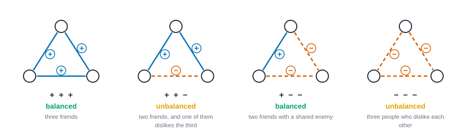
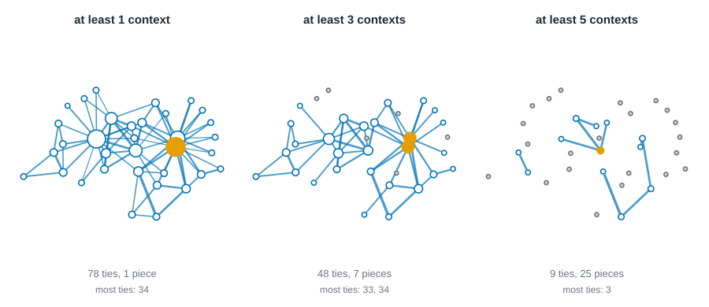

# Signed and valued networks {#sec-signed-and-valued}

::: {.callout-note appearance="simple"}
## Prerequisites
@sec-networks-as-data and @sec-centrality, for ties, degree and what a measure promises. Triangles come up a lot, so a glance at @sec-triads-and-motifs helps but isn't required. We use Sampson's monastery, the karate club, and a few invented offices.
:::

::: {.callout-note appearance="simple"}
## The short version
Sometimes a tie isn't just there or not there. It can be good or bad (a friend or a foe), or it can be strong or weak (a daily email or a yearly one). Networks with good and bad ties are called signed, and networks with strong and weak ties are called valued. For signed networks the big idea is balance: whether people split into two opposing camps, with friends inside each camp and enemies across. For valued networks the big idea is to decide what a number on a tie means before you do any arithmetic with it. Most of the tools from earlier chapters quietly assume plain present-or-absent ties, so this chapter shows what changes when ties carry a sign or a weight.
:::

::: {.callout-note appearance="simple"}
## Why you might care
Whenever people can like and dislike, trust and distrust, or interact a lot and a little, a plain network averages those differences away. Knowing about signs and weights lets you say whether a group is split into sides, who matters when you count strength rather than headcount, and why a "cutoff" for strong ties can change the story completely.
:::

## Introduction

Until now a tie either existed or it didn't. Two questions have been waiting in the wings. The first: *is the tie good or bad?* Two people can be tied because they are close friends, or tied because one reported the other to a manager. Count both as "a tie" and you have averaged a hug and a slap. The second: *how much?* A colleague you email once a year and one you email forty times a week are both "connected" in the plain version of the data, and nobody believes they are the same.

The first question gives **signed** networks, where each tie is positive or negative. The second gives **valued** (or *weighted*) networks, where each tie carries a number. They turn out to be a good pair to study together, because they have the same awkward consequence. Most of the tools you've met so far were built for ties that are present or absent, and each one quietly assumes something about what a tie means. Give it a tie with a minus sign, or a tie that is five times stronger than its neighbour, and the assumption is exposed.

By the end of this chapter you'll be able to:

- say what **structural balance** is, test a signed network for it, and measure how far from balance it is, knowing exactly what each measure counts;
- tell **balance** from **clusterability**, and say when the old saying "the enemy of my enemy is my friend" is a fair summary and when it isn't;
- compute and interpret **strength** and Opsahl's **generalized degree**, and choose between them on purpose;
- see how **thresholding** a valued network can change the picture, and read a weight as a *strength* or as a *distance* without mixing the two up;
- say what negative or valued ties do to centrality and community detection, and what to report next to the number.

Two real datasets carry the chapter. **Sampson's monastery** [@sampson1968novitiate] has 18 novices who were asked whom they liked and whom they disliked, so it is signed (and, because they ranked their top three, it is also valued, in an awkward way we'll look at). The **karate club** [@zachary1977information] has 34 members, and each tie carries the number of kinds of situation in which the observer saw the pair together. We'll use the Florentine marriages as a contrast, because they carry no sign at all.

## Positive and negative ties

A **signed network** is a network where every tie has a sign, $s_{ij} = +1$ or $s_{ij} = -1$ (read "$s_{ij}$" as "the sign of the tie between person $i$ and person $j$", where $i$ and $j$ stand for any two people). Where do signs come from? Mostly from a question with two poles: like and dislike, trust and distrust, ally and enemy, endorse and flag, cooperate and fight. Online platforms produce them as a side effect (follow and block, upvote and downvote, friend and foe).

Three things about signs are easy to get wrong.

- **No tie is not a negative tie.** A pair that has no recorded tie might be strangers, might be indifferent, or might dislike each other and never say so. A negative tie is a *positive statement of hostility*. Treat absence as "minus" and you invent enmities.
- **Negative ties are under-reported.** People name friends more readily than enemies, and surveys, platforms and organizations all discourage saying out loud whom you dislike. A signed network is a record of what was *said*, and the negative half is usually the thinner half.
- **Signs belong to a direction.** "Ana dislikes Ben" and "Ben dislikes Ana" are two statements. Structural balance, which we meet next, works on undirected signs, so to use it you have to decide what to do when the two directions disagree. That is a modelling choice, and we'll make it out loud.

### Building a signed network from Sampson's data

Sampson lived in a New England monastery while the 18 novices were in training, and later asked each novice to name the three he liked most and the three he liked least. The file records those choices with their ranks. We take liking as positive and disliking as negative, both from the same wave (time 3), and make the network undirected by looking at *pairs*. Two rules for a pair:

1. **Agree:** keep the pair only if every choice about it has the same sign. If Ana likes Ben but Ben dislikes Ana, drop the pair as conflicted.
2. **Net rank:** add up the signed ranks over both directions, keep the sign of the total, and drop pairs that sum to zero.

Neither is "right". They answer slightly different questions, and we'll run the chapter's checks under both.

First, a tiny example you can do on paper. Five people in an office, eight ties.

- Positive: Ana–Ben, Ana–Cleo, Ben–Cleo, Dev–Eli.
- Negative: Ana–Dev, Cleo–Dev, Cleo–Eli, Ben–Eli.

Then a ninth tie arrives: Ben starts to like Dev, a positive tie that crosses the divide. We'll come back to what it does.

## Heider's triads

Fritz Heider, a psychologist, argued that people prefer their attitudes to fit together [@heider1946attitudes]. If you like Ben and Ben likes Cleo, it is more comfortable to like Cleo yourself. If you like Ben and dislike Cleo, then Ben liking Cleo is awkward, and something will tend to give: you stop liking Ben, you start liking Cleo, or you decide Ben doesn't really like Cleo.

Put that in network terms. Take any **triangle**, three people all tied to each other, and multiply the three signs. If the product is positive, the triangle is **balanced**. If it is negative, it is **unbalanced**. @fig-signed-triads shows the four possibilities.

{#fig-signed-triads fig-alt="Four triangles side by side. The first has three positive ties and is labeled balanced. The second has two positive ties and one negative tie and is labeled unbalanced. The third has one positive tie and two negative ties and is labeled balanced. The fourth has three negative ties and is labeled unbalanced."}

The question the next line answers is: how do we tell, with arithmetic, whether a triangle of three people is comfortable or tense? In symbols, a triangle on people $i, j, k$ is balanced when

$$ s_{ij}\, s_{jk}\, s_{ik} = +1, $$

::: {.callout-tip title="In plain words"}
Take the three signs around the triangle, each a plus one or a minus one, and multiply them. If the answer is plus one, the triangle is balanced. Here $s_{ij}$ is the sign between the first and second person, $s_{jk}$ between the second and third, and $s_{ik}$ between the first and third. Three friends: $(+1)(+1)(+1) = +1$, balanced. Two friends who both dislike a third: $(+1)(-1)(-1) = +1$, balanced. Two friends and one enemy tie: $(+1)(+1)(-1) = -1$, unbalanced. The product is plus one exactly when the number of minus signs is even.
:::

Here $s_{ij}$ is the sign of the tie between $i$ and $j$. Two readings of the same rule are worth keeping in your pocket: "a friend of my friend is my friend" (the $+++$ triangle), and "an enemy of my enemy is my friend" (the $+--$ triangle, where the two people who dislike the same third person like each other). The other two triangles are the awkward ones. Two friends who disagree about a third person ($++-$) is the classic tense triangle. Three mutual enemies ($---$) is odd under Heider's rule, and we'll see that it's the point where later authors disagreed.

### The office, by hand

Let's count the triangles in our office. A triangle needs three people who are all tied to each other.

- Ana, Ben, Cleo: all three ties are positive. Signs $+++$, balanced.
- Ana, Cleo, Dev: Ana–Cleo is $+$, Cleo–Dev is $-$, Ana–Dev is $-$. Signs $+--$, balanced.
- Cleo, Dev, Eli: Cleo–Dev $-$, Dev–Eli $+$, Cleo–Eli $-$. Signs $+--$, balanced.
- Ben, Cleo, Eli: Ben–Cleo $+$, Cleo–Eli $-$, Ben–Eli $-$. Signs $+--$, balanced.

Four triangles, all balanced. There's a neat picture behind that: put Ana, Ben and Cleo in one camp and Dev and Eli in another. Every positive tie is inside a camp and every negative tie is between camps.

Now add Ben likes Dev. Ben and Dev have three common neighbours (Ana, Cleo and Eli), so three new triangles appear, and each has exactly one negative tie (for instance Ben, Dev, Eli has Ben–Dev $+$, Dev–Eli $+$, Ben–Eli $-$). One new tie has made three triangles unbalanced. The code below checks this by brute force, and also counts something we haven't named yet, the **frustration index**, which is where the next section is heading.

::: {.panel-tabset group="language"}

## R

```r
library(knappnet)
library(dplyr)
library(purrr)

people <- c("Ana", "Ben", "Cleo", "Dev", "Eli")
# One row per tie: the two people (numbered from 1) and its sign, +1 or -1.
office <- tibble(
  a = c(1, 1, 2, 4, 1, 3, 3, 2),
  b = c(2, 3, 3, 5, 4, 4, 5, 5),
  sign = c(1, 1, 1, 1, -1, -1, -1, -1)
)
office_plus <- bind_rows(office, tibble(a = 2, b = 4, sign = 1)) # Ben also likes Dev

# The three tie numbers of every triangle (one row each) in a network of n people.
triangle_ties <- function(n, ties) {
  number <- matrix(0L, n, n)
  number[cbind(ties$a, ties$b)] <- seq_len(nrow(ties))
  number <- pmax(number, t(number))
  trio <- t(combn(n, 3))
  found <- cbind(number[trio[, c(1, 2)]], number[trio[, c(1, 3)]], number[trio[, c(2, 3)]])
  found[rowSums(found == 0) == 0, , drop = FALSE]
}
# How many of each triangle's ties are negative.
negatives_in <- function(ties, found) rowSums(matrix(ties$sign[found], ncol = 3) < 0)

# Every split into two camps, one per row, as +1 and -1. Person 1 is always in camp +1.
camps <- function(n) {
  bits <- outer(0:(2^(n - 1) - 1), seq_len(n - 1) - 1L, \(m, b) bitwAnd(bitwShiftR(m, b), 1L))
  cbind(1, 1 - 2 * bits)
}
# The fewest ties that disagree with some split, and every split that reaches it.
frustration <- function(n, ties) {
  x <- camps(n)
  agreeing <- (x[, ties$a] * x[, ties$b]) %*% ties$sign
  bad <- (nrow(ties) - agreeing[, 1]) / 2
  list(index = min(bad), splits = x[bad == min(bad), , drop = FALSE])
}

list(office = office, `office plus Ben-Dev` = office_plus) |>
  map(\(d) {
    neg <- negatives_in(d, triangle_ties(5, d))
    best <- frustration(5, d)
    tibble(
      ties = nrow(d), triangles = length(neg),
      neg_0 = sum(neg == 0), neg_1 = sum(neg == 1), neg_2 = sum(neg == 2), neg_3 = sum(neg == 3),
      balanced = sum(neg %% 2 == 0), frustration = best$index,
      anas_camp = paste(people[best$splits[1, ] == 1], collapse = " ")
    )
  }) |>
  list_rbind(names_to = "network")
```

::: {.code-output}
```text
# A tibble: 2 × 10
  network  ties triangles neg_0 neg_1 neg_2 neg_3 balanced frustration anas_camp
  <chr>   <int>     <int> <int> <int> <int> <int>    <int>       <dbl> <chr>    
1 office      8         4     1     0     3     0        4           0 Ana Ben …
2 office…     9         7     1     3     3     0        4           1 Ana Ben …
```
:::

## Python

```python
import itertools

import numpy as np

people = ["Ana", "Ben", "Cleo", "Dev", "Eli"]
# One entry per tie: the two people (numbered from zero) and the sign, +1 or -1.
office = [(0, 1, 1), (0, 2, 1), (1, 2, 1), (3, 4, 1), (0, 3, -1), (2, 3, -1), (2, 4, -1), (1, 4, -1)]
office_plus = office + [(1, 3, 1)]  # Ben also likes Dev

def triangle_ties(n, ties):
    """The three tie numbers of every triangle in a network of n people."""
    number = {}
    for k, (a, b, _) in enumerate(ties):
        number[a, b] = number[b, a] = k
    return [(number[a, b], number[a, c], number[b, c])
            for a, b, c in itertools.combinations(range(n), 3)
            if (a, b) in number and (a, c) in number and (b, c) in number]

def negatives(ties, triangles):
    """How many of each triangle's ties are negative."""
    return [sum(ties[e][2] < 0 for e in t) for t in triangles]

def camps(n):
    """Every split into two camps, one per row, as +1 and -1. Person 0 is always in camp +1."""
    bits = (np.arange(2 ** (n - 1))[:, None] >> np.arange(n - 1)) & 1
    return np.hstack([np.ones((len(bits), 1), dtype=int), 1 - 2 * bits])

def frustration(n, ties):
    """The fewest ties that disagree with some split, and every split that reaches it."""
    i, j, s = (np.array(column) for column in zip(*ties))
    x = camps(n)
    bad = ((x[:, i] * x[:, j]) != s).sum(axis=1)
    return bad.min(), x[bad == bad.min()]

for label, ties in [("office", office), ("office plus Ben-Dev", office_plus)]:
    neg = negatives(ties, triangle_ties(5, ties))
    fewest, splits = frustration(5, ties)
    camp = lambda side: " ".join(p for p, v in zip(people, splits[0]) if v == side)
    print(f"{label}: {len(ties)} ties, {len(neg)} triangles, {sum(k % 2 == 0 for k in neg)} balanced, frustration {fewest}")
    print(f"  triangles with 0, 1, 2, 3 negative ties: {np.bincount(neg, minlength=4).tolist()}")
    print(f"  best split: {camp(1)} | {camp(-1)}")
```

::: {.code-output}
```text
office: 8 ties, 4 triangles, 4 balanced, frustration 0
  triangles with 0, 1, 2, 3 negative ties: [1, 0, 3, 0]
  best split: Ana Ben Cleo | Dev Eli
office plus Ben-Dev: 9 ties, 7 triangles, 4 balanced, frustration 1
  triangles with 0, 1, 2, 3 negative ties: [1, 3, 3, 0]
  best split: Ana Ben Cleo | Dev Eli
```
:::

## Rust

```rust
let people = ["Ana", "Ben", "Cleo", "Dev", "Eli"];
// One entry per tie: the two people (numbered from zero) and the sign, +1 or -1.
let office: Vec<(usize, usize, i32)> = vec![(0, 1, 1), (0, 2, 1), (1, 2, 1), (3, 4, 1), (0, 3, -1), (2, 3, -1), (2, 4, -1), (1, 4, -1)];
let mut office_plus = office.clone();
office_plus.push((1, 3, 1)); // Ben also likes Dev

// The three tie numbers of every triangle in a network of n people.
fn triangle_ties(n: usize, ties: &[(usize, usize, i32)]) -> Vec<[usize; 3]> {
    let mut number = vec![vec![usize::MAX; n]; n];
    for (k, &(a, b, _)) in ties.iter().enumerate() {
        number[a][b] = k;
        number[b][a] = k;
    }
    let mut found = Vec::new();
    for a in 0..n {
        for b in a + 1..n {
            for c in b + 1..n {
                let t = [number[a][b], number[a][c], number[b][c]];
                if t.iter().all(|&e| e != usize::MAX) {
                    found.push(t);
                }
            }
        }
    }
    found
}
// How many of a triangle's ties are negative.
fn negatives(ties: &[(usize, usize, i32)], t: &[usize; 3]) -> usize {
    t.iter().filter(|&&e| ties[e].2 < 0).count()
}
// A split into two camps is a bit mask: bit k - 1 says which camp person k is in. Person 0 is always in camp 0.
fn camp_of(mask: u32, k: usize) -> u32 {
    if k == 0 { 0 } else { (mask >> (k - 1)) & 1 }
}
// The fewest ties that disagree with some split, and every split that reaches it.
fn frustration(n: usize, ties: &[(usize, usize, i32)]) -> (usize, Vec<u32>) {
    let (mut fewest, mut splits) = (usize::MAX, Vec::new());
    for mask in 0..(1u32 << (n - 1)) {
        let bad = ties.iter().filter(|&&(a, b, s)| (camp_of(mask, a) == camp_of(mask, b)) != (s > 0)).count();
        if bad < fewest {
            fewest = bad;
            splits.clear();
        }
        if bad == fewest {
            splits.push(mask);
        }
    }
    (fewest, splits)
}

for (label, ties) in [("office", &office), ("office plus Ben-Dev", &office_plus)] {
    let found = triangle_ties(5, ties);
    let mut by_negatives = [0usize; 4];
    for t in &found {
        by_negatives[negatives(ties, t)] += 1;
    }
    let (fewest, splits) = frustration(5, ties);
    let camp = |side: u32| {
        let names: Vec<&str> = (0..5).filter(|&k| camp_of(splits[0], k) == side).map(|k| people[k]).collect();
        names.join(" ")
    };
    println!("{label}: {} ties, {} triangles, {} balanced, frustration {fewest}", ties.len(), found.len(), by_negatives[0] + by_negatives[2]);
    println!("  triangles with 0, 1, 2, 3 negative ties: {by_negatives:?}");
    println!("  best split: {} | {}", camp(0), camp(1));
}
```

::: {.code-output}
```text
office: 8 ties, 4 triangles, 4 balanced, frustration 0
  triangles with 0, 1, 2, 3 negative ties: [1, 0, 3, 0]
  best split: Ana Ben Cleo | Dev Eli
office plus Ben-Dev: 9 ties, 7 triangles, 4 balanced, frustration 1
  triangles with 0, 1, 2, 3 negative ties: [1, 3, 3, 0]
  best split: Ana Ben Cleo | Dev Eli
```
:::

:::

The office starts with four triangles, all balanced. After Ben likes Dev there are seven, and only four are balanced. Three have exactly one negative tie, which is the unbalanced $++-$ pattern. The one new tie is responsible for all three, and the best split into two camps is the same as before. The code found it by trying every split.

## From triangles to the whole network

Heider talked about three people. Dorwin Cartwright and Frank Harary asked what it would mean for a *whole* network to be balanced, and showed that the triangle rule scales up into a strikingly simple statement [@cartwright1956structural]. A **cycle** is a closed route that returns to its start without repeating a node. A signed network is **balanced** if every cycle in it has an even number of negative ties. (A triangle is a cycle of length three, so this contains Heider's rule.)

::: {.callout-note appearance="simple"}
## The structure theorem
For a signed network, the following are equivalent [@cartwright1956structural; @harary1953notion]:

1. Every cycle has an even number of negative ties.
2. The people can be split into **two camps** (either may be empty) so that every positive tie is inside a camp and every negative tie is between the camps.

Balance is therefore a statement about *polarization*. A balanced network is one where a single dividing line explains every sign.
:::

::: {.callout-tip title="In plain words"}
The theorem says two very different-looking tests give the same answer. One test walks around every loop in the network and counts the minus signs. The other test just tries to draw one line through the group, friends on the same side and enemies on opposite sides. If either works, so does the other. In the five-person office, the line puts Ana, Ben and Cleo on one side and Dev and Eli on the other, and every loop you can trace has an even number of minus signs.
:::

::: {.callout-note appearance="simple"}
## A harder part
The next paragraph explains why the theorem is true. On a first read you can skip it and keep going to "Davis: more than two camps". You'll still have the statement of the theorem and how to use it, which is what matters for the rest of the chapter.
:::

Why are the two the same? Going from (2) to (1) is a counting argument. Walk around any cycle. Each time you cross between camps you use a negative tie, and since you finish where you began you cross an even number of times. Going from (1) to (2): pick any person and put everyone you can reach by a route with an even number of negative ties in their camp, and everyone you reach by an odd number in the other camp. If this ever disagreed with itself, two routes to the same person would differ in parity, and together they'd form a cycle with an odd number of negatives. Do this separately for each connected piece.

Two warnings follow from the theorem, and both are common mistakes.

- **Counting balanced triangles is not testing balance.** If every triangle is balanced the network can still be unbalanced, because longer cycles count too. A four-person ring with three positive ties and one negative tie has *no* triangles at all, so the triangle test passes it vacuously, and yet it can't be split into two camps. (When *every* pair of people is tied, a complete network, balanced triangles do suffice. Real networks are almost never complete.)
- **Balance is a property of one signed network, not of a theory.** "The network is balanced" is a claim about the data, to be tested with the data.

### Davis: more than two camps

Is a triangle of three mutual enemies really tense? James Davis argued not necessarily [@davis1967clustering]. Three groups that dislike each other and like their own members is a perfectly stable arrangement, and Heider's rule calls its cross-group triangles unbalanced. Davis's weaker condition forbids only the awkward $++-$ pattern, and the matching global statement says that a signed network is **clusterable** if people can be split into *any number* of groups so that every positive tie is inside a group and every negative tie is between groups.

The test is as clean as Cartwright and Harary's. A network is clusterable exactly when no cycle has exactly one negative tie. Cut the network down to its positive ties, and find the connected pieces. A negative tie that sits *inside* a positive piece would close a cycle with exactly one negative tie (the negative tie, plus the positive route back). So:

> A signed network is clusterable if and only if no negative tie joins two people who are connected by positive ties.

Every balanced network is clusterable (two camps are groups). The reverse fails, which is the whole point. Hence three levels: **balanced** (two camps), **clusterable** (any number of groups), and **neither**.

## How balanced is it?

Real networks are rarely perfectly balanced, so we want a number. There are two common ones, and it is worth being exact about which is which, because they answer different questions and sometimes disagree.

**The balanced share of triangles.** Count the triangles, count how many have an even number of negative ties, and divide. It is cheap, local and easy to explain. It is also *only* about triangles, so it says nothing about longer cycles, and it isn't defined for a network with no triangles.

**The frustration index.** Imagine assigning each person to one of two camps, $\sigma_i = +1$ or $\sigma_i = -1$. A tie is *frustrated* if it disagrees with the split: a negative tie inside a camp, or a positive tie across. The frustration index is the smallest number of frustrated ties over all possible splits:

$$ F \;=\; \min_{\sigma \in \{+1,-1\}^n} \; \sum_{\{i,j\}\,\in\, E} \tfrac12 \bigl(1 - s_{ij}\,\sigma_i\,\sigma_j\bigr), $$

where $E$ is the set of ties, $n$ is the number of people, and $s_{ij}$ is the sign of tie $\{i,j\}$. Each term is 0 when the tie agrees with the split ($s_{ij}\sigma_i\sigma_j = +1$) and 1 when it doesn't. $F = 0$ exactly when the network is balanced.

::: {.callout-tip title="In plain words"}
This is the hard-looking formula of the chapter, but the idea is a game. Try every way of putting each person in camp plus one or camp minus one (that is the $\sigma$, the Greek letter sigma, one camp label per person, and "min" means we try them all and keep the best). For each tie, check whether it behaves: a friendship tie should join two people in the same camp, an enemy tie should join people in different camps. The little expression inside gives 0 for a tie that behaves and 1 for a tie that doesn't, and the big sigma adds those up over all ties. $F$ is the lowest total you can get. In the office, with Ana, Ben and Cleo in one camp and Dev and Eli in the other, every tie behaves, so $F = 0$. After Ben starts liking Dev, that one friendship crosses the camps and the best you can do is $F = 1$.
:::

Three facts make $F$ easier to read than it first looks.

- **Three ways of counting give the same number.** $F$ is also the fewest ties you would have to *delete*, or the fewest you would have to *flip* in sign, to make the network balanced. (Take an optimal split. Deleting its frustrated ties leaves a balanced network, and so does flipping them. Conversely, any set of ties whose deletion or flipping balances the network contains the frustrated ties of the split that results, so none is smaller.)
- **It is at most half the ties.** A random split frustrates half the ties on average, so the best split frustrates at most half. So $F/m$, where $m$ is the number of ties, lies between 0 and $\tfrac12$.
- **It is hard to compute for big networks.** It is a max-cut problem in disguise, and large networks use heuristics or integer programming [@facchetti2011computing]. For 20 or so people you can try all $2^{n-1}$ splits, which is what the code in this chapter does (person 0 is fixed in one camp, since swapping camps changes nothing).

The two numbers are linked but not interchangeable: the triangle share is about local tension, the frustration index is about whether *one dividing line* works for the whole network. A network can have a high balanced share and still need many ties to be flipped, and the reverse. Doreian and Mrvar [@doreian1996partitioning] built on the same idea to ask for the best partition into *any* number of groups, scoring a partition by its negative ties inside groups plus its positive ties between them. We'll compute that score below.

## Sampson's novices: balance in practice

Time to try it on real people. The code below builds both versions of the signed network, counts the triangles by type, and finds the frustration index under each rule.

::: {.panel-tabset group="language"}

## R

```r
sampson <- read.csv("data/sampson/edges.csv") |> as_tibble()
novices <- sort(unique(c(sampson$from, sampson$to)))

# Liking (+) and disliking (-) at time 3, one row per pair of novices.
affect <- sampson |>
  filter(time == 3, relation %in% c("liking", "disliking")) |>
  mutate(a = pmin(match(from, novices), match(to, novices)),
         b = pmax(match(from, novices), match(to, novices)))
pairs <- affect |>
  group_by(a, b) |>
  summarise(positive = any(sign > 0), negative = any(sign < 0), net = sum(sign * rank), .groups = "drop")
# Rule 1 keeps pairs whose choices all agree. Rule 2 keeps the sign of the summed ranks.
agree <- pairs |> filter(positive != negative) |> mutate(sign = if_else(positive, 1, -1))
net_rank <- pairs |> filter(net != 0) |> mutate(sign = sign(net))

tibble(with_a_choice = nrow(pairs), both_signs = sum(pairs$positive & pairs$negative), net_zero = sum(pairs$net == 0))
list(agree = agree, net_rank = net_rank) |>
  map(\(d) tibble(ties = nrow(d), positive = sum(d$sign > 0), negative = sum(d$sign < 0))) |>
  list_rbind(names_to = "rule")
```

::: {.code-output}
```text
# A tibble: 1 × 3
  with_a_choice both_signs net_zero
          <int>      <int>    <int>
1            67         12        3
# A tibble: 2 × 4
  rule      ties positive negative
  <chr>    <int>    <int>    <int>
1 agree       55       29       26
2 net_rank    64       34       30
```
:::

## Python

```python
import csv
from collections import Counter, defaultdict
from fractions import Fraction

import networkx as nx

with open("data/sampson/edges.csv") as f:
    sampson = list(csv.DictReader(f))
novices = sorted({r["from"] for r in sampson} | {r["to"] for r in sampson})
number = {name: k for k, name in enumerate(novices)}

# Liking (+) and disliking (-) at time 3, one entry per pair of novices.
seen = defaultdict(lambda: {"plus": False, "minus": False, "net": 0})
for r in sampson:
    if r["time"] == "3" and r["relation"] in ("liking", "disliking"):
        pair = tuple(sorted((number[r["from"]], number[r["to"]])))
        seen[pair]["plus" if int(r["sign"]) > 0 else "minus"] = True
        seen[pair]["net"] += int(r["sign"]) * int(r["rank"])
# Rule 1 keeps pairs whose choices all agree. Rule 2 keeps the sign of the summed ranks.
agree = [(a, b, 1 if v["plus"] else -1) for (a, b), v in sorted(seen.items()) if v["plus"] != v["minus"]]
net_rank = [(a, b, 1 if v["net"] > 0 else -1) for (a, b), v in sorted(seen.items()) if v["net"] != 0]

print(f"pairs {len(seen)}, with choices of both signs {sum(v['plus'] and v['minus'] for v in seen.values())}, "
      f"net rank zero {sum(v['net'] == 0 for v in seen.values())}")
print("rule      ties  positive  negative")
for label, ties in [("agree", agree), ("net rank", net_rank)]:
    print(f"{label:<9} {len(ties):>4} {sum(s > 0 for *_, s in ties):>9} {sum(s < 0 for *_, s in ties):>9}")
```

::: {.code-output}
```text
pairs 67, with choices of both signs 12, net rank zero 3
rule      ties  positive  negative
agree       55        29        26
net rank    64        34        30
```
:::

## Rust

```rust
use std::collections::{BTreeMap, BTreeSet};

let text = std::fs::read_to_string("data/sampson/edges.csv")?;
let rows: Vec<Vec<&str>> = text.lines().skip(1).map(|l| l.split(',').collect()).collect(); // from, to, relation, sign, time, rank
let novices: Vec<&str> = rows.iter().flat_map(|p| [p[0], p[1]]).collect::<BTreeSet<_>>().into_iter().collect();
let number = |name: &str| novices.iter().position(|&x| x == name).unwrap();

// Liking (+) and disliking (-) at time 3. For each pair: any positive choice, any negative choice, signed ranks added up.
let affect: Vec<&Vec<&str>> = rows.iter().filter(|p| p[4] == "3" && (p[2] == "liking" || p[2] == "disliking")).collect();
let mut seen: BTreeMap<(usize, usize), (bool, bool, i32)> = BTreeMap::new();
for p in &affect {
    let (a, b) = (number(p[0]), number(p[1]));
    let entry = seen.entry((a.min(b), a.max(b))).or_insert((false, false, 0));
    let sign: i32 = p[3].parse().unwrap();
    if sign > 0 { entry.0 = true } else { entry.1 = true }
    entry.2 += sign * p[5].parse::<i32>().unwrap();
}
// Rule 1 keeps pairs whose choices all agree. Rule 2 keeps the sign of the summed ranks.
let agree: Vec<(usize, usize, i32)> = seen.iter().filter(|(_, v)| v.0 != v.1).map(|(&(a, b), v)| (a, b, if v.0 { 1 } else { -1 })).collect();
let net_rank: Vec<(usize, usize, i32)> = seen.iter().filter(|(_, v)| v.2 != 0).map(|(&(a, b), v)| (a, b, v.2.signum())).collect();

println!("pairs {}, with choices of both signs {}, net rank zero {}", seen.len(),
    seen.values().filter(|v| v.0 && v.1).count(), seen.values().filter(|v| v.2 == 0).count());
println!("rule      ties  positive  negative");
for (label, ties) in [("agree", &agree), ("net rank", &net_rank)] {
    println!("{label:<9} {:>4} {:>9} {:>9}", ties.len(), ties.iter().filter(|t| t.2 > 0).count(), ties.iter().filter(|t| t.2 < 0).count());
}
```

::: {.code-output}
```text
pairs 67, with choices of both signs 12, net rank zero 3
rule      ties  positive  negative
agree       55        29        26
net rank    64        34        30
```
:::

:::

67 pairs of novices have at least one liking or disliking choice about them. In 12 of those the choices have both signs. Sometimes a novice listed the same person among those he liked and those he disliked, and sometimes the two novices disagree about each other. Of those 12, 3 cancel exactly when the signed ranks are added up. The agree rule keeps 55 ties, 29 positive and 26 negative. The net-rank rule keeps 64, 34 positive and 30 negative. These counts matter later: the 12 conflicted pairs are a real feature of the monastery (liking and being liked are not always mutual), and we dropped them from the first network to keep every remaining tie unambiguous.

Now the triangles and the frustration index. The second block also checks Davis's clusterability test and counts "enemy of my enemy" triangles.

::: {.panel-tabset group="language"}

## R

```r
by_rule <- list(agree = agree, net_rank = net_rank) |>
  map(\(d) {
    neg <- negatives_in(d, triangle_ties(18, d))
    best <- frustration(18, d)
    tibble(ties = nrow(d), triangles = length(neg),
           `+++` = sum(neg == 0), `++-` = sum(neg == 1), `+--` = sum(neg == 2), `---` = sum(neg == 3),
           balanced_share = round(mean(neg %% 2 == 0), 3), frustration = best$index,
           share_of_ties = round(best$index / nrow(d), 3), best_splits = nrow(best$splits))
  }) |>
  list_rbind(names_to = "rule")
by_rule

# The two camps that frustrate the fewest ties, under the agree rule.
best <- frustration(18, agree)
split(novices, best$splits[1, ])

# Davis: cut to the positive ties and look at its pieces. Is any negative tie inside a piece?
positive <- agree |> filter(sign > 0) |> transmute(source = novices[a], target = novices[b])
pieces <- net_frame(positive, nodes = tibble(id = novices), directed = FALSE) |> net_components()
inside <- agree |> filter(sign < 0) |> mutate(same_piece = pieces$membership[a] == pieces$membership[b])
# Score a partition by its negative ties inside groups plus its positive ties between groups.
cost <- \(group) sum((group[agree$a] == group[agree$b]) != (agree$sign > 0))
neg <- negatives_in(agree, triangle_ties(18, agree))
tibble(
  positive_pieces = pieces$no, negative_inside_a_piece = sum(inside$same_piece), negative_ties = nrow(inside),
  one_group = cost(rep(1, 18)), two_camps = cost(best$splits[1, ]), everyone_alone = cost(1:18),
  two_negative_triangles = sum(neg == 2), three_negative_triangles = sum(neg == 3)
)
```

::: {.code-output}
```text
# A tibble: 2 × 11
  rule      ties triangles `+++` `++-` `+--` `---` balanced_share frustration
  <chr>    <int>     <int> <int> <int> <int> <int>          <dbl>       <dbl>
1 agree       55        34     9     6    14     5          0.676          11
2 net_rank    64        58    14    14    24     6          0.655          14
# ℹ 2 more variables: share_of_ties <dbl>, best_splits <int>
$`-1`
[1] "Berthold"   "Gregory"    "Hugh"       "John Bosco" "Louis"     
[6] "Peter"      "Winfrid"   

$`1`
 [1] "Albert"      "Amand"       "Ambrose"     "Basil"       "Bonaventure"
 [6] "Boniface"    "Elias"       "Mark"        "Romuald"     "Simplicius" 
[11] "Victor"     

# A tibble: 1 × 8
  positive_pieces negative_inside_a_piece negative_ties one_group two_camps
            <int>                   <int>         <int>     <int>     <int>
1               1                      26            26        26        11
# ℹ 3 more variables: everyone_alone <int>, two_negative_triangles <int>,
#   three_negative_triangles <int>
```
:::

## Python

```python
for label, ties in [("agree", agree), ("net rank", net_rank)]:
    neg = negatives(ties, triangle_ties(18, ties))
    counts = np.bincount(neg, minlength=4)
    fewest, splits = frustration(18, ties)
    print(f"{label:<9} ties {len(ties)}, triangles {len(neg)} (+++ {counts[0]}, ++- {counts[1]}, +-- {counts[2]}, --- {counts[3]}), "
          f"balanced share {sum(k % 2 == 0 for k in neg) / len(neg):.3f}, frustration {fewest} = {fewest / len(ties):.3f} of ties, "
          f"best splits {len(splits)}")

# The two camps that frustrate the fewest ties, under the agree rule.
fewest, splits = frustration(18, agree)
for side, label in [(1, "A"), (-1, "B")]:
    print(f"camp {label}: " + ", ".join(n for n, v in zip(novices, splits[0]) if v == side))

# Davis: cut to the positive ties and look at its pieces. Is any negative tie inside a piece?
positive = nx.Graph()
positive.add_nodes_from(range(18))
positive.add_edges_from((a, b) for a, b, s in agree if s > 0)
piece = {v: k for k, part in enumerate(nx.connected_components(positive)) for v in part}
inside = sum(piece[a] == piece[b] for a, b, s in agree if s < 0)
# Score a partition by its negative ties inside groups plus its positive ties between groups.
cost = lambda group: sum((group[a] == group[b]) != (s > 0) for a, b, s in agree)
neg = negatives(agree, triangle_ties(18, agree))
print(f"positive pieces {len(set(piece.values()))}; negative ties inside a positive piece {inside} of {sum(s < 0 for *_, s in agree)}")
print(f"ties that disagree: one group {cost([0] * 18)}, two camps {cost(list(splits[0]))}, everyone alone {cost(list(range(18)))}")
print(f"triangles with two negative ties {neg.count(2)}, with three {neg.count(3)}")
```

::: {.code-output}
```text
agree     ties 55, triangles 34 (+++ 9, ++- 6, +-- 14, --- 5), balanced share 0.676, frustration 11 = 0.200 of ties, best splits 1
net rank  ties 64, triangles 58 (+++ 14, ++- 14, +-- 24, --- 6), balanced share 0.655, frustration 14 = 0.219 of ties, best splits 2
camp A: Albert, Amand, Ambrose, Basil, Bonaventure, Boniface, Elias, Mark, Romuald, Simplicius, Victor
camp B: Berthold, Gregory, Hugh, John Bosco, Louis, Peter, Winfrid
positive pieces 1; negative ties inside a positive piece 26 of 26
ties that disagree: one group 26, two camps 11, everyone alone 29
triangles with two negative ties 14, with three 5
```
:::

## Rust

```rust
use knappnet::metrics::topography::{find_components, ComponentKind};
use knappnet::Graph;

for (label, ties) in [("agree", &agree), ("net rank", &net_rank)] {
    let found = triangle_ties(18, ties);
    let mut by = [0usize; 4];
    for t in &found {
        by[negatives(ties, t)] += 1;
    }
    let (fewest, splits) = frustration(18, ties);
    println!("{label:<9} ties {}, triangles {} (+++ {}, ++- {}, +-- {}, --- {}), balanced share {:.3}, frustration {fewest} = {:.3} of ties, best splits {}",
        ties.len(), found.len(), by[0], by[1], by[2], by[3], (by[0] + by[2]) as f64 / found.len() as f64,
        fewest as f64 / ties.len() as f64, splits.len());
}

// The two camps that frustrate the fewest ties, under the agree rule.
let (_, splits) = frustration(18, &agree);
for (side, label) in [(0u32, "A"), (1, "B")] {
    let members: Vec<&str> = (0..18).filter(|&k| camp_of(splits[0], k) == side).map(|k| novices[k]).collect();
    println!("camp {label}: {}", members.join(", "));
}

// Davis: cut to the positive ties and look at its pieces. Is any negative tie inside a piece?
let plus: Vec<&(usize, usize, i32)> = agree.iter().filter(|t| t.2 > 0).collect();
let from: Vec<i64> = plus.iter().map(|t| t.0 as i64).collect();
let to: Vec<i64> = plus.iter().map(|t| t.1 as i64).collect();
let positive = Graph::from_edges(18, &from, &to, None, false)?;
let pieces = find_components(&positive, ComponentKind::Weak);
let inside = agree.iter().filter(|t| t.2 < 0 && pieces.membership[t.0] == pieces.membership[t.1]).count();
// Score a partition by its negative ties inside groups plus its positive ties between groups.
let cost = |group: &dyn Fn(usize) -> usize| agree.iter().filter(|&&(a, b, s)| (group(a) == group(b)) != (s > 0)).count();
let neg: Vec<usize> = triangle_ties(18, &agree).iter().map(|t| negatives(&agree, t)).collect();
println!("positive pieces {}; negative ties inside a positive piece {} of {}", pieces.count(), inside, agree.iter().filter(|t| t.2 < 0).count());
println!("ties that disagree: one group {}, two camps {}, everyone alone {}",
    cost(&|_| 0), cost(&|k| camp_of(splits[0], k) as usize), cost(&|k| k));
println!("triangles with two negative ties {}, with three {}", neg.iter().filter(|&&k| k == 2).count(), neg.iter().filter(|&&k| k == 3).count());
```

::: {.code-output}
```text
agree     ties 55, triangles 34 (+++ 9, ++- 6, +-- 14, --- 5), balanced share 0.676, frustration 11 = 0.200 of ties, best splits 1
net rank  ties 64, triangles 58 (+++ 14, ++- 14, +-- 24, --- 6), balanced share 0.655, frustration 14 = 0.219 of ties, best splits 2
camp A: Albert, Amand, Ambrose, Basil, Bonaventure, Boniface, Elias, Mark, Romuald, Simplicius, Victor
camp B: Berthold, Gregory, Hugh, John Bosco, Louis, Peter, Winfrid
positive pieces 1; negative ties inside a positive piece 26 of 26
ties that disagree: one group 26, two camps 11, everyone alone 29
triangles with two negative ties 14, with three 5
```
:::

:::

Read it slowly, because it holds the chapter's central lesson.

- **The balanced share looks decent.** Of 34 triangles, 23 are balanced: 9 are $+++$ and 14 are $+--$. That is 0.676.
- **The network is not balanced, and not clusterable either.** The best two-camp split still leaves 11 of the 55 ties frustrated (0.2 of them), and the positive ties connect all 18 novices into a single piece, so all 26 negative ties sit inside it. Davis's test fails. There is no way to cut the monastery into groups with positive ties inside and negative ties between.
- **The split is informative anyway.** It puts 11 novices in one camp and 7 in the other (@fig-sampson-signed). Most positive ties are inside the camps and most negative ties between them. The 11 exceptions are the thick lines.
- **The two rules agree about the story.** Under the net-rank rule the numbers are different (64 ties, 14 frustrated, 0.219 of the ties), but the finding is the same: not balanced, not clusterable, and two best splits instead of one, so on that rule the camps are less sharply determined.
- **"Enemy of my enemy" holds more often than not.** Of the 19 triangles with two or three negative ties, 14 have the "friendly" shape: the two people who dislike the same novice like each other. The other 5 are three mutual enemies.

{#fig-sampson-signed fig-alt="A network of 18 named novices joined by 55 ties, 29 positive and 26 negative. Eleven novices are drawn as open circles in a ring on the left and seven as filled squares in a ring on the right. 11 ties disagree with that split: 8 negative ties inside a camp and 3 positive ties between the camps."}

Doreian and Mrvar's partition score gives a third angle. Put everyone in one group and 26 ties disagree (every negative tie). Put everyone alone and 29 disagree (every positive tie). Two camps bring it to 11. So the camps help a lot compared with the two extremes. That is the kind of comparison to report.

### Is that more balanced than chance?

Here is the trap. 0.676 sounds high. But a sparse network is easy to balance. With only 55 ties among 153 possible pairs, there aren't many triangles or long cycles to contradict each other, and even *random* signs would come out partly balanced. The honest comparison is a **null model**: keep the ties exactly where they are, keep the number of positives and negatives, and **shuffle which tie gets which sign**. If the real network is more balanced than most shuffles, there's evidence of structure beyond "it's sparse and about half the ties are negative".

The code below does 100 shuffles. To make all three languages print the same numbers, it uses a tiny, fully specified random number generator (the Park-Miller recipe, which in words says "multiply the last number by 16807 and keep the remainder after dividing by 2,147,483,647, which is $2^{31}-1$", written $x \leftarrow 16807\,x \bmod (2^{31}-1)$, started from 2024) rather than each language's own, and shuffles by sorting the ties by random keys.

::: {.panel-tabset group="language"}

## R

```r
reps <- 100
m <- nrow(agree)
found <- triangle_ties(18, agree)
x <- camps(18)
across_split <- x[, agree$a] * x[, agree$b]      # +1 where the split puts a tie's two ends together
keys <- accumulate(seq_len(reps * m), \(k, i) (16807 * k) %% 2147483647, .init = 2024)[-1]
order_of <- apply(matrix(keys, nrow = m), 2, order)               # one shuffle per column
shuffled <- matrix(agree$sign[order_of], nrow = m)                # signs after shuffling, one column per shuffle
neg <- (shuffled[found[, 1], ] < 0) + (shuffled[found[, 2], ] < 0) + (shuffled[found[, 3], ] < 0)
null <- tibble(
  balanced = colSums(neg %% 2 == 0),
  frustration = (m - apply(across_split %*% shuffled, 2, max)) / 2
)
observed <- tibble(balanced = sum(negatives_in(agree, found) %% 2 == 0), frustration = best$index)

bind_rows(
  observed = observed,
  `shuffled mean` = summarise(null, across(everything(), mean)),
  `shuffled min` = summarise(null, across(everything(), min)),
  `shuffled max` = summarise(null, across(everything(), max)),
  .id = "signs"
) |>
  mutate(balanced_share = round(balanced / nrow(found), 3), across(c(balanced, frustration), \(v) round(v, 1)))
c(
  as_balanced_or_more = sum(null$balanced >= observed$balanced),
  as_unfrustrated_or_less = sum(null$frustration <= observed$frustration)
)
```

::: {.code-output}
```text
# A tibble: 4 × 4
  signs         balanced frustration balanced_share
  <chr>            <dbl>       <dbl>          <dbl>
1 observed          23          11            0.676
2 shuffled mean     17.4        12.3          0.511
3 shuffled min      10           8            0.294
4 shuffled max      26          15            0.765
    as_balanced_or_more as_unfrustrated_or_less 
                      7                      27 
```
:::

## Python

```python
reps, m = 100, len(agree)
found = triangle_ties(18, agree)
i, j, sign = (np.array(column) for column in zip(*agree))
across_split = camps(18)[:, i] * camps(18)[:, j]   # +1 where the split puts a tie's two ends together

keys, state = [], 2024
for _ in range(reps * m):
    state = 16807 * state % 2147483647
    keys.append(state)
order_of = np.argsort(np.array(keys).reshape(reps, m), axis=1)      # one shuffle per row
shuffled = sign[order_of]                                          # signs after shuffling, one row per shuffle
neg = (shuffled[:, np.array(found)] < 0).sum(axis=2)
balanced = (neg % 2 == 0).sum(axis=1)
frustrated = (m - (across_split @ shuffled.T).max(axis=0)) // 2
observed = sum(k % 2 == 0 for k in negatives(agree, found))

print(f"observed: {observed} balanced triangles of {len(found)} ({observed / len(found):.3f}), frustration {fewest}")
print(f"{reps} shuffles of the signs: balanced triangles {balanced.mean():.1f} on average (range {balanced.min()} to {balanced.max()}), "
      f"frustration {frustrated.mean():.1f} on average (range {frustrated.min()} to {frustrated.max()})")
print(f"shuffles at least as balanced as observed: {(balanced >= observed).sum()}; at least as unfrustrated: {(frustrated <= fewest).sum()}")
```

::: {.code-output}
```text
observed: 23 balanced triangles of 34 (0.676), frustration 11
100 shuffles of the signs: balanced triangles 17.4 on average (range 10 to 26), frustration 12.3 on average (range 8 to 15)
shuffles at least as balanced as observed: 7; at least as unfrustrated: 27
```
:::

## Rust

```rust
let reps = 100;
let m = agree.len();
let found = triangle_ties(18, &agree);
let mut state: u64 = 2024;
let (mut balanced, mut frustrated) = (Vec::new(), Vec::new());
for _ in 0..reps {
    let keys: Vec<u64> = (0..m).map(|_| { state = 16807 * state % 2147483647; state }).collect();
    let mut order: Vec<usize> = (0..m).collect();
    order.sort_by_key(|&e| keys[e]); // sorting by random keys is a shuffle
    let shuffled: Vec<(usize, usize, i32)> = agree.iter().enumerate().map(|(e, &(a, b, _))| (a, b, agree[order[e]].2)).collect();
    balanced.push(found.iter().filter(|t| negatives(&shuffled, t) % 2 == 0).count());
    frustrated.push(frustration(18, &shuffled).0);
}
let observed = found.iter().filter(|t| negatives(&agree, t) % 2 == 0).count();
let fewest = frustration(18, &agree).0;
let mean = |v: &Vec<usize>| v.iter().sum::<usize>() as f64 / v.len() as f64;

println!("observed: {observed} balanced triangles of {} ({:.3}), frustration {fewest}", found.len(), observed as f64 / found.len() as f64);
println!("{reps} shuffles of the signs: balanced triangles {:.1} on average (range {} to {}), frustration {:.1} on average (range {} to {})",
    mean(&balanced), balanced.iter().min().unwrap(), balanced.iter().max().unwrap(),
    mean(&frustrated), frustrated.iter().min().unwrap(), frustrated.iter().max().unwrap());
println!("shuffles at least as balanced as observed: {}; at least as unfrustrated: {}",
    balanced.iter().filter(|&&b| b >= observed).count(), frustrated.iter().filter(|&&f| f <= fewest).count());
```

::: {.code-output}
```text
observed: 23 balanced triangles of 34 (0.676), frustration 11
100 shuffles of the signs: balanced triangles 17.4 on average (range 10 to 26), frustration 12.3 on average (range 8 to 15)
shuffles at least as balanced as observed: 7; at least as unfrustrated: 27
```
:::

:::

This is a more modest result than the raw 0.676 suggested. Among 100 shuffles, the average shuffled network has about 17 balanced triangles of 34 (half), and the observed 23 is higher than most but not all: 7 of the 100 shuffles are at least as balanced. The frustration index tells a weaker story still. The shuffles average about 12 frustrated ties against the real 11, and 27 of the 100 shuffles do at least as well as the real network. With 100 shuffles you shouldn't read the percentages closely, but the direction is clear. **The monastery is somewhat more balanced than shuffled signs on the same ties, and not strikingly so.** That is a more careful sentence than "the monastery is two camps".

### One defensible sentence, and one that over-claims

- *Defensible:* "Among the 18 novices, 55 liking or disliking ties remain after dropping 12 conflicted pairs. 23 of the 34 triangles are balanced, and the best two-camp split leaves 11 ties frustrated, a little better than most random reassignments of the same signs. The network is not balanced and not clusterable."
- *Over-claiming:* "Sampson's monastery was split into two camps." The data show a tendency toward two sides, with 11 exceptions and a comparison with chance that is only mildly favourable. They don't show that two camps *caused* anything, and the novices' own groups (which are not in this file) are a separate question.

## The enemy of my enemy

The saying is a one-line version of the $+--$ triangle. It has been used in arguments about alliances, politics and online communities, and it is worth saying clearly what it does and doesn't claim.

- It says *if* two people share an enemy, they tend to be friends. In Sampson's triangles with two or more negatives it holds 14 times out of 19. That is a tendency, and one that a complete count shows is far from universal.
- It is silent on the case of three mutual enemies. Heider's rule calls that unbalanced; Davis's rule accepts it. The data can't settle which is "right", only how often each occurs (here, 5 of 34 triangles are $---$).
- It says nothing about *why*. A shared enemy can bring two people together, but two people can also share an enemy because they share a neighbourhood, a job or a school, and the shared context brings both the enmity and the friendship.
- It is easiest to believe where there are only two sides. In a network with three or more rival camps, "enemy of my enemy" is a coin flip, and Davis's clusterability is the better fit.

## Status theory: when ties point up and down

Balance treats a tie as a symmetrical statement of attitude. Many signed ties are *directed* and carry a different message: a link from Ana to Ben that says "I trust Ben" or "Ben is better than me" is an evaluation of Ben by Ana. Leskovec, Huttenlocher and Kleinberg studied large online communities where people could attach positive and negative links to each other, and proposed **status theory** as a rival to balance [@leskovec2010predicting; @leskovec2010signed]. In status theory, a positive link from $A$ to $B$ means "I think $B$ has higher status than I do", and a negative link means "I think $B$ has lower status". A triangle is then consistent if the statuses can be put in one order.

The two theories can disagree on the same triangle. Take three people and these directed links.

- $A \to B$ positive, $B \to C$ positive, $C \to A$ positive. Balance sees $+++$ and calls it balanced. Status theory says $B$ is above $A$, $C$ above $B$, and $A$ above $C$, which is a loop, so it's inconsistent.
- $A \to B$ negative, $B \to C$ negative, $A \to C$ negative. Balance sees $---$ and calls it unbalanced. Status theory is content: $A$ is above $B$, who is above $C$, and $A$ is above $C$. It is a pecking order.

Which is right depends on what the links mean. The authors tested both on three online communities and found that each captured part of the pattern, which is a good reason to treat balance as one useful lens, not a law. Sampson's data are too small, and the ranks too coarse, to test status theory, so we don't pretend to here. The practical lesson is to ask *what a negative link says* before reaching for a theory of signed triangles.

## What negative ties do to the usual measures

Most tools in this book assume ties are non-negative. Here is what goes wrong, measure by measure.

**Degree.** Counting is fine, but *what you count* needs a decision. You can count positive and negative ties separately (two numbers per person), or take the signed difference (one number that can hide a lot). The table below shows the difference for Sampson. Note a design quirk first: Sampson asked each novice for his top three, so nearly every novice makes exactly three choices of each sign. The most any novice made is four (where Sampson recorded tied ranks), and three novices named nobody they disliked. Out-degree is therefore fixed by the question and carries almost no information. Only the *received* counts differ much.

::: {.panel-tabset group="language"}

## R

```r
tibble(novice = novices) |>
  mutate(
    liked_by = map_int(novice, \(n) sum(affect$to == n & affect$sign > 0)),
    disliked_by = map_int(novice, \(n) sum(affect$to == n & affect$sign < 0)),
    net = liked_by - disliked_by
  ) |>
  arrange(desc(net), novice)
affect |> count(from, sign) |> pull(n) |> max()
```

::: {.code-output}
```text
# A tibble: 18 × 4
   novice      liked_by disliked_by   net
   <chr>          <int>       <int> <int>
 1 Bonaventure        6           0     6
 2 Boniface           6           0     6
 3 Ambrose            3           0     3
 4 John Bosco         4           2     2
 5 Louis              2           0     2
 6 Romuald            4           2     2
 7 Simplicius         3           1     2
 8 Albert             2           1     1
 9 Winfrid            2           1     1
10 Amand              2           2     0
11 Berthold           4           4     0
12 Hugh               2           2     0
13 Mark               2           2     0
14 Victor             5           5     0
15 Elias              2           4    -2
16 Peter              6           8    -2
17 Basil              1           6    -5
18 Gregory            0           7    -7
[1] 4
```
:::

## Python

```python
affect = [r for r in sampson if r["time"] == "3" and r["relation"] in ("liking", "disliking")]
rows = []
for name in novices:
    liked = sum(r["to"] == name and int(r["sign"]) > 0 for r in affect)
    disliked = sum(r["to"] == name and int(r["sign"]) < 0 for r in affect)
    rows.append((name, liked, disliked, liked - disliked))
rows.sort(key=lambda t: (-t[3], t[0]))
print(f"{'novice':<12} {'liked by':>8} {'disliked by':>11} {'net':>4}")
for name, liked, disliked, net in rows:
    print(f"{name:<12} {liked:>8} {disliked:>11} {net:>4}")
print("most choices of one sign by any novice:", max(Counter((r["from"], r["sign"]) for r in affect).values()))
```

::: {.code-output}
```text
novice       liked by disliked by  net
Bonaventure         6           0    6
Boniface            6           0    6
Ambrose             3           0    3
John Bosco          4           2    2
Louis               2           0    2
Romuald             4           2    2
Simplicius          3           1    2
Albert              2           1    1
Winfrid             2           1    1
Amand               2           2    0
Berthold            4           4    0
Hugh                2           2    0
Mark                2           2    0
Victor              5           5    0
Elias               2           4   -2
Peter               6           8   -2
Basil               1           6   -5
Gregory             0           7   -7
most choices of one sign by any novice: 4
```
:::

## Rust

```rust
let mut table: Vec<(&str, i32, i32)> = novices.iter().map(|&name| {
    let received = |sign: i32| affect.iter().filter(|p| p[1] == name && p[3].parse::<i32>().unwrap() == sign).count() as i32;
    (name, received(1), received(-1))
}).collect();
table.sort_by(|x, y| (y.1 - y.2).cmp(&(x.1 - x.2)).then(x.0.cmp(y.0)));
println!("{:<12} {:>8} {:>11} {:>4}", "novice", "liked by", "disliked by", "net");
for (name, liked, disliked) in &table {
    println!("{name:<12} {liked:>8} {disliked:>11} {:>4}", liked - disliked);
}
let mut made: BTreeMap<(&str, &str), usize> = BTreeMap::new();
for p in &affect {
    *made.entry((p[0], p[3])).or_insert(0) += 1;
}
println!("most choices of one sign by any novice: {}", made.values().max().unwrap());
```

::: {.code-output}
```text
novice       liked by disliked by  net
Bonaventure         6           0    6
Boniface            6           0    6
Ambrose             3           0    3
John Bosco          4           2    2
Louis               2           0    2
Romuald             4           2    2
Simplicius          3           1    2
Albert              2           1    1
Winfrid             2           1    1
Amand               2           2    0
Berthold            4           4    0
Hugh                2           2    0
Mark                2           2    0
Victor              5           5    0
Elias               2           4   -2
Peter               6           8   -2
Basil               1           6   -5
Gregory             0           7   -7
most choices of one sign by any novice: 4
```
:::

:::

Compare Peter, Berthold and Boniface. Peter is liked by 6 novices and disliked by 8, a net of $-2$. Berthold is liked by 4 and disliked by 4, a net of 0. Boniface is liked by 6 and disliked by none. A signed degree of zero describes both a person nobody has a view about and a person half the monastery loves and half dislikes, and the two are very different people to be. The net score is a poor summary of anyone who is *polarizing*, which is a feature of the pair of numbers, not either one. Report both.

**Paths.** Distance measures (closeness, betweenness, diameter) need ties to be a cost to cross, and a negative cost makes no sense. In an undirected network, one negative-length tie can be walked back and forth, shaving off length each trip, so there is *no* shortest route at all. The usual remedies are to analyse the positive ties and the negative ties as **two separate networks**, or to ask what path a *specific* sign pattern allows ("a friend of a friend", a positive path). Flipping negatives to positive and carrying on answers a different question, namely how far apart people are *regardless of whether they like each other*.

**Eigenvector-style measures.** These rely on the leading eigenvector of the adjacency matrix being all one sign, which is guaranteed for non-negative matrices. With signs, that guarantee goes. A three-person example you can check by hand: a triangle with two positive ties and one negative tie has the adjacency matrix with rows $(0,1,1)$, $(1,0,-1)$, $(1,-1,0)$. Subtract the identity and every row is a multiple of $(1,-1,-1)$, so the matrix has rank one and the value 1 is an eigenvalue *twice*. The trace is 0, so the third eigenvalue is $-2$. There's no single leading direction, so no unique "most central" ranking, and the one you'd get from software depends on the algorithm.

**Community detection.** Standard modularity rewards dense groups of positive ties and knows nothing about negative ones. Run on the absolute values of signed ties, it will happily put sworn enemies into one community. Traag and Bruggeman's signed version [@traag2009community] scores a partition by how many positive ties are *inside* groups compared with chance, and how many negative ties are *between* groups compared with chance, with the two parts weighed against their own null expectations. The Doreian-Mrvar score above does a similar thing without the null model. In Sampson, the two-camp split frustrates 11 ties; any signed community method should recover something at least that good, and you can check it.

**Triangle-based measures.** In an unsigned network a triangle is a triangle. In a signed one, there are four kinds with four meanings. Always report the counts by type (as the code above does), not one combined total.

## Reading signed networks in different settings

The numbers above have no meaning until you say what the signs *are*. Here is how the same output reads in four places.

| Setting | A high balanced share or low frustration | A low balanced share or high frustration |
| --- | --- | --- |
| **Alliance or marriage network** among families or states | Two blocs, possibly rivals. Check whether the negative ties are real rivalries or just missing alliances (see below). | Cross-cutting loyalties; no single dividing line. |
| **An office** (friend and foe, or trust and distrust) | A divided workplace, or a survey that only recorded cliques and their opponents. | Mixed loyalties. Also possible: respondents who named few enemies at all. |
| **Trade, sanctions or conflict** among organizations | A world of two sides, which may follow a third factor such as geography or history. | Shifting coalitions, or a complex web of partners and competitors. |
| **An online platform** (follow and block, upvote and downvote) | Echo-chamber structure: people sort into two sides. | Blocks and flags that follow topics or moods rather than stable camps. |

And what the numbers **do not** show: *why* ties have the signs they do; whether the signs are stable over time; whether the negative ties are under-reported; or whether the two best camps are the *actual* groups people see themselves in. A split into two camps is a summary of signs, not a discovery about groups.

### A sign-free contrast

What about a network with no signs at all? The Florentine marriage network among 15 families has no negative ties. It is "balanced" in the way an empty wall is "clean", and the numbers below show it.

::: {.panel-tabset group="language"}

## R

```r
marriages <- read.csv("data/florentine/edges.csv") |> as_tibble()
families <- sort(unique(c(marriages$source, marriages$target)))
n <- length(families)
links <- marriages |> transmute(a = match(source, families), b = match(target, families), sign = 1)
neg <- negatives_in(links, triangle_ties(n, links))
tibble(
  families = n, ties = nrow(links), triangles = length(neg), with_a_negative_tie = sum(neg > 0),
  frustration = frustration(n, links)$index
)
```

::: {.code-output}
```text
# A tibble: 1 × 5
  families  ties triangles with_a_negative_tie frustration
     <int> <int>     <int>               <int>       <dbl>
1       15    20         3                   0           0
```
:::

## Python

```python
with open("data/florentine/edges.csv") as f:
    marriages = [(r["source"], r["target"]) for r in csv.DictReader(f)]
families = sorted({x for pair in marriages for x in pair})
ties = [(families.index(a), families.index(b), 1) for a, b in marriages]
neg = negatives(ties, triangle_ties(len(families), ties))
print(f"families {len(families)}, ties {len(ties)}, triangles {len(neg)}, with a negative tie {sum(k > 0 for k in neg)}, "
      f"frustration {frustration(len(families), ties)[0]}")
```

::: {.code-output}
```text
families 15, ties 20, triangles 3, with a negative tie 0, frustration 0
```
:::

## Rust

```rust
let text = std::fs::read_to_string("data/florentine/edges.csv")?;
let pairs: Vec<Vec<&str>> = text.lines().skip(1).map(|l| l.split(',').collect()).collect();
let families: Vec<&str> = pairs.iter().flat_map(|p| [p[0], p[1]]).collect::<BTreeSet<_>>().into_iter().collect();
let family = |name: &str| families.iter().position(|&x| x == name).unwrap();
let ties: Vec<(usize, usize, i32)> = pairs.iter().map(|p| (family(p[0]), family(p[1]), 1)).collect();
let neg: Vec<usize> = triangle_ties(families.len(), &ties).iter().map(|t| negatives(&ties, t)).collect();
println!("families {}, ties {}, triangles {}, with a negative tie {}, frustration {}",
    families.len(), ties.len(), neg.len(), neg.iter().filter(|&&k| k > 0).count(), frustration(families.len(), &ties).0);
```

::: {.code-output}
```text
families 15, ties 20, triangles 3, with a negative tie 0, frustration 0
```
:::

:::

Three triangles, all $+++$, frustration 0. That is not evidence that Florence was harmonious. It is the consequence of *recording only positive ties*. A signed analysis needs the negative half of the data, and if you don't have it, the right conclusion is that balance cannot be assessed.

## Valued networks

Everything above was about signs. From here on the question is about weights. Now the second question. What does a number on a tie *mean*?

### Strength or distance?

Before any calculation, decide which of these a weight is, because tools differ on the default.

- A **strength**: bigger means closer, more intense, more of the thing. Emails per week, hours together, years known, number of shared contexts, trade volume.
- A **distance** or **cost**: bigger means farther, harder, slower. Kilometres, travel time, price, number of intermediaries.

For counting and summing (degree, strength) the distinction doesn't matter. For *paths* it flips the answer. A shortest route should use the ties that are cheap to cross. If the weights are strengths, a strong tie is cheap and must become a *short* length, while if they are distances, the weight already is the length. knappnet's R interface makes you say which when you build the network (`weight_type = "strength"` or `"distance"`, with no default), and in Rust you pass the choice to each path measure (`WeightKind`, which defaults to distance). A strength uses $1/w$ as its path length (so a tie of weight 5 becomes a short step of length one fifth, and a tie of weight 1 stays a step of length 1). NetworkX takes a different approach, and the two conventions disagree out of the box: its betweenness reads the `weight` attribute as a *distance*, while its PageRank reads the same attribute as a *strength* (a heavier tie passes more rank). Neither is wrong. Both will give a strange answer if you feed them the other kind of number.

### A small example by hand

Seven people trade favours. The weight on a tie is how many favours were exchanged last year.

- Ann has four ties, each with one favour: Ann–Bo, Ann–Cy, Ann–Di, Ann–Ed.
- Fay and Gus have one strong tie, Fay–Gus, with 5 favours.
- Gus and Ed have a weak tie, Gus–Ed, with 1 favour.

Who is the most "connected"? By *degree*, Ann (4 ties) is far ahead of Gus (2) and Fay (1). By **strength**, the sum of a person's tie weights (written $s_i = \sum_j w_{ij}$, which reads "person $i$'s strength is the total of the weights $w_{ij}$ on all their ties"), the picture changes: Ann's strength is 4, Gus's is 6, Fay's is 5. Same network, opposite verdicts. Neither is the truth. Degree asks "how many people do you know", strength asks "how much exchange passes through you". People with many weak ties and people with a few strong ones look the same on one measure and different on the other.

### Opsahl's generalized degree

Tore Opsahl and colleagues proposed blending the two with a tuning knob [@opsahl2010node]. For a person $i$ with $k_i$ ties and strength $s_i$, the **generalized degree** is

$$ k_i^{\,w\alpha} \;=\; k_i^{\,1-\alpha}\; s_i^{\,\alpha}, $$

::: {.callout-tip title="In plain words"}
This is a dimmer switch between "count my contacts" and "add up my exchange." Take the person's number of ties $k_i$ and their strength $s_i$, raise each to a power that depends on a setting $\alpha$ (the Greek letter alpha), and multiply. The setting is the knob: all the way down ($\alpha = 0$) you get just the number of ties, all the way up ($\alpha = 1$) you get just the strength. For Gus in the favours example, $k = 2$ and $s = 6$, so at $\alpha = 0$ his score is 2, at $\alpha = 1$ it is 6, and at $\alpha = 0.5$ it is $\sqrt{2 \times 6} \approx 3.46$.
:::

Here $\alpha \ge 0$ is chosen by the analyst. At $\alpha = 0$ you get plain degree, $k_i$. At $\alpha = 1$ you get strength, $s_i$. In between, a bit of both. Above 1 you reward strong ties even more than strength does. The knob has a clear meaning: **how much should one strong tie count compared with several weak ones?** At $\alpha < 1$, spreading weight over more ties scores higher. At $\alpha > 1$, concentrating it in fewer ties does.

In the favours example, Ann scores 4 at every $\alpha$ (four ties of weight 1 make $k = s = 4$). Gus scores $2^{1-\alpha}\,6^{\alpha}$, which is 2 at $\alpha = 0$, about 3.46 at $\alpha = 0.5$ and 6 at $\alpha = 1$. He passes Ann when $2 \cdot 3^{\alpha} = 4$, that is, at $\alpha = \ln 2/\ln 3 \approx 0.63$. So Ann is "more connected" than Gus if you care mostly about the *number* of contacts, and Gus overtakes her once you value strength more than about 63% as much as count. There is no right $\alpha$; there is only the one that matches your question, and a good report says what happens at a few values.

::: {.panel-tabset group="language"}

## R

```r
favours <- tibble(
  source = c("Ann", "Ann", "Ann", "Ann", "Fay", "Gus"),
  target = c("Bo", "Cy", "Di", "Ed", "Gus", "Ed"),
  weight = c(1, 1, 1, 1, 5, 1)
)
trade <- net_frame(favours, directed = FALSE, weight = "weight", weight_type = "strength")

# Opsahl's generalized degree: k^(1 - alpha) * s^alpha. Alpha 0 is degree, alpha 1 is strength.
generalized <- \(k, s, alpha) k^(1 - alpha) * s^alpha
tibble(person = trade$nodes$id, degree = net_degree(trade), strength = net_strength(trade)) |>
  mutate(alpha_0.5 = generalized(degree, strength, 0.5), alpha_1.5 = generalized(degree, strength, 1.5)) |>
  mutate(across(starts_with("alpha"), \(v) round(v, 3))) |>
  arrange(person)
```

::: {.code-output}
```text
# A tibble: 7 × 5
  person degree strength alpha_0.5 alpha_1.5
  <chr>   <dbl>    <dbl>     <dbl>     <dbl>
1 Ann         4        4      4          4  
2 Bo          1        1      1          1  
3 Cy          1        1      1          1  
4 Di          1        1      1          1  
5 Ed          2        2      2          2  
6 Fay         1        5      2.24      11.2
7 Gus         2        6      3.46      10.4
```
:::

## Python

```python
favours = [("Ann", "Bo", 1), ("Ann", "Cy", 1), ("Ann", "Di", 1), ("Ann", "Ed", 1), ("Fay", "Gus", 5), ("Gus", "Ed", 1)]
trade = nx.Graph()
trade.add_weighted_edges_from(favours)

# Opsahl's generalized degree: k^(1 - alpha) * s^alpha. Alpha 0 is degree, alpha 1 is strength.
def generalized(k, s, alpha):
    return k ** (1 - alpha) * s ** alpha

print(f"{'person':<7} {'degree':>6} {'strength':>8} {'alpha 0.5':>10} {'alpha 1.5':>10}")
for person in sorted(trade):
    k, s = trade.degree(person), trade.degree(person, weight="weight")
    print(f"{person:<7} {k:>6} {s:>8} {generalized(k, s, 0.5):>10.3f} {generalized(k, s, 1.5):>10.3f}")
```

::: {.code-output}
```text
person  degree strength  alpha 0.5  alpha 1.5
Ann          4        4      4.000      4.000
Bo           1        1      1.000      1.000
Cy           1        1      1.000      1.000
Di           1        1      1.000      1.000
Ed           2        2      2.000      2.000
Fay          1        5      2.236     11.180
Gus          2        6      3.464     10.392
```
:::

## Rust

```rust
use knappnet::metrics::degree::{compute_degree, compute_strength, DegreeMode};

let names = ["Ann", "Bo", "Cy", "Di", "Ed", "Fay", "Gus"];
let favours = [(0, 1, 1.0), (0, 2, 1.0), (0, 3, 1.0), (0, 4, 1.0), (5, 6, 5.0), (6, 4, 1.0)];
let from: Vec<i64> = favours.iter().map(|t| t.0).collect();
let to: Vec<i64> = favours.iter().map(|t| t.1).collect();
let weight: Vec<f64> = favours.iter().map(|t| t.2).collect();
let trade = Graph::from_edges(7, &from, &to, Some(&weight), false)?;

// Opsahl's generalized degree: k^(1 - alpha) * s^alpha. Alpha 0 is degree, alpha 1 is strength.
let generalized = |k: f64, s: f64, alpha: f64| k.powf(1.0 - alpha) * s.powf(alpha);
let degree = compute_degree(&trade, DegreeMode::All, true);
let strength = compute_strength(&trade, DegreeMode::All, true)?;
println!("{:<7} {:>6} {:>8} {:>10} {:>10}", "person", "degree", "strength", "alpha 0.5", "alpha 1.5");
for (i, name) in names.iter().enumerate() {
    println!("{name:<7} {:>6} {:>8} {:>10.3} {:>10.3}", degree[i], strength[i],
        generalized(degree[i], strength[i], 0.5), generalized(degree[i], strength[i], 1.5));
}
```

::: {.code-output}
```text
person  degree strength  alpha 0.5  alpha 1.5
Ann          4        4      4.000      4.000
Bo           1        1      1.000      1.000
Cy           1        1      1.000      1.000
Di           1        1      1.000      1.000
Ed           2        2      2.000      2.000
Fay          1        5      2.236     11.180
Gus          2        6      3.464     10.392
```
:::

:::

The table confirms the hand calculation. Ann scores 4 whatever the knob, Gus rises from 2 through 3.46 to 6, and at $\alpha = 1.5$ Gus's 10.39 still trails Fay's 11.18, because Fay's single tie of weight 5 is worth even more once strong ties are rewarded heavily.

## The karate club, valued

Wayne Zachary's karate club [@zachary1977information] has 34 members and 78 ties. Each tie carries a count, from 1 to 7, of the kinds of situation in which Zachary saw the two members interact. It is a good example of a weight that is a strength, and an honest one: more contexts means a closer tie, as far as the observer could tell.

Does weight change who looks central? The code below prints degree, strength and mean weight for the usual suspects, then the top three by generalized degree at several values of $\alpha$.

::: {.panel-tabset group="language"}

## R

```r
karate <- read.csv("data/karate/edges.csv") |> as_tibble() |> mutate(across(c(source, target), as.character))
club <- net_frame(karate, directed = FALSE, weight = "contexts", weight_type = "strength")
members <- tibble(member = as.integer(club$nodes$id), degree = net_degree(club), strength = net_strength(club)) |>
  mutate(mean_weight = round(strength / degree, 2))
focus <- c(34, 1, 33, 24, 26)
members |> filter(member %in% focus) |> arrange(match(member, focus))

c(0, 0.5, 1, 1.5, 2, 3) |>
  map(\(a) members |>
    mutate(score = generalized(degree, strength, a)) |>
    slice_max(score, n = 3, with_ties = FALSE) |>
    summarise(alpha = a, top_three = paste0(member, " (", round(score, 1), ")", collapse = ", "))) |>
  list_rbind()
```

::: {.code-output}
```text
# A tibble: 5 × 4
  member degree strength mean_weight
   <int>  <dbl>    <dbl>       <dbl>
1     34     17       48        2.82
2      1     16       42        2.62
3     33     12       38        3.17
4     24      5       21        4.2 
5     26      3       14        4.67
# A tibble: 6 × 2
  alpha top_three                         
  <dbl> <chr>                             
1   0   34 (17), 1 (16), 33 (12)          
2   0.5 34 (28.6), 1 (25.9), 33 (21.4)    
3   1   34 (48), 1 (42), 33 (38)          
4   1.5 34 (80.7), 1 (68), 33 (67.6)      
5   2   34 (135.5), 33 (120.3), 1 (110.2) 
6   3   34 (382.7), 33 (381.1), 24 (370.4)
```
:::

## Python

```python
with open("data/karate/edges.csv") as f:
    club_ties = [(int(r["source"]), int(r["target"]), int(r["contexts"])) for r in csv.DictReader(f)]
club = nx.Graph()
club.add_nodes_from(range(1, 35))
club.add_weighted_edges_from(club_ties)
degree = dict(club.degree())
strength = dict(club.degree(weight="weight"))

print("member degree strength mean weight")
for member in (34, 1, 33, 24, 26):
    print(f"{member:>6} {degree[member]:>6} {strength[member]:>8} {strength[member] / degree[member]:>11.2f}")
for alpha in (0, 0.5, 1, 1.5, 2, 3):
    score = {m: generalized(degree[m], strength[m], alpha) for m in club}
    top = sorted(score, key=lambda m: (-score[m], m))[:3]
    print(f"alpha {alpha:<3}: " + ", ".join(f"{m} ({score[m]:.1f})" for m in top))
```

::: {.code-output}
```text
member degree strength mean weight
    34     17       48        2.82
     1     16       42        2.62
    33     12       38        3.17
    24      5       21        4.20
    26      3       14        4.67
alpha 0  : 34 (17.0), 1 (16.0), 33 (12.0)
alpha 0.5: 34 (28.6), 1 (25.9), 33 (21.4)
alpha 1  : 34 (48.0), 1 (42.0), 33 (38.0)
alpha 1.5: 34 (80.7), 1 (68.0), 33 (67.6)
alpha 2  : 34 (135.5), 33 (120.3), 1 (110.2)
alpha 3  : 34 (382.7), 33 (381.1), 24 (370.4)
```
:::

## Rust

```rust
let text = std::fs::read_to_string("data/karate/edges.csv")?;
let club_ties: Vec<(i64, i64, f64)> = text.lines().skip(1).map(|l| {
    let p: Vec<&str> = l.split(',').collect();
    (p[0].parse::<i64>().unwrap() - 1, p[1].parse::<i64>().unwrap() - 1, p[2].parse::<f64>().unwrap())
}).collect();
// A graph of the ties seen in at least `at_least` contexts; members are numbered from zero here.
let club_graph = |at_least: f64| -> Result<Graph, knappnet::Error> {
    let kept: Vec<&(i64, i64, f64)> = club_ties.iter().filter(|t| t.2 >= at_least).collect();
    let (from, to): (Vec<i64>, Vec<i64>) = kept.iter().map(|t| (t.0, t.1)).unzip();
    let weight: Vec<f64> = kept.iter().map(|t| t.2).collect();
    Graph::from_edges(34, &from, &to, Some(&weight), false)
};
let club = club_graph(0.0)?;
let degree = compute_degree(&club, DegreeMode::All, true);
let strength = compute_strength(&club, DegreeMode::All, true)?;

println!("member degree strength mean weight");
for member in [34, 1, 33, 24, 26] {
    let i = member - 1;
    println!("{member:>6} {:>6} {:>8} {:>11.2}", degree[i], strength[i], strength[i] / degree[i]);
}
for alpha in [0.0, 0.5, 1.0, 1.5, 2.0, 3.0] {
    let score: Vec<f64> = (0..34).map(|i| generalized(degree[i], strength[i], alpha)).collect();
    let mut order: Vec<usize> = (0..34).collect();
    order.sort_by(|&a, &b| score[b].partial_cmp(&score[a]).unwrap().then(a.cmp(&b)));
    let top: Vec<String> = order[..3].iter().map(|&i| format!("{} ({:.1})", i + 1, score[i])).collect();
    println!("alpha {alpha:<3}: {}", top.join(", "));
}
```

::: {.code-output}
```text
member degree strength mean weight
    34     17       48        2.82
     1     16       42        2.62
    33     12       38        3.17
    24      5       21        4.20
    26      3       14        4.67
alpha 0  : 34 (17.0), 1 (16.0), 33 (12.0)
alpha 0.5: 34 (28.6), 1 (25.9), 33 (21.4)
alpha 1  : 34 (48.0), 1 (42.0), 33 (38.0)
alpha 1.5: 34 (80.7), 1 (68.0), 33 (67.6)
alpha 2  : 34 (135.5), 33 (120.3), 1 (110.2)
alpha 3  : 34 (382.7), 33 (381.1), 24 (370.4)
```
:::

:::

For the leading members the degree and strength rankings agree: members 34, 1 and 33 are the top three at $\alpha = 0$ (degree) and at $\alpha = 1$ (strength). They part company further down, where it matters for a *story*. Member 26 has just three ties, but their mean weight is 4.67, so strength (14) is nearly five times degree (3). Member 24 has 5 ties of mean weight 4.2.

The top three at each $\alpha$ shows the knob at work. Members 34, 1 and 33 hold the top three through $\alpha = 1.5$. At $\alpha = 2$, 33 passes 1, and by $\alpha = 3$ member 24 has joined the top three while member 1, who has the second most ties, has dropped out. Whether that matters depends on your question, but you should know it happens before you choose a measure.

## Thresholding: what happens when you throw the weights away

A very common move is to keep only ties above a cutoff, turning a valued network into a plain one so that the unweighted toolbox applies. The question is: which ties survive if I only keep the ones at least as strong as some cutoff? Formally, for a cutoff $t$,

$$ A^{(t)}_{ij} = \begin{cases} 1 & \text{if } w_{ij} \ge t,\\ 0 & \text{otherwise,} \end{cases} $$

::: {.callout-tip title="In plain words"}
For each pair of people, look at the weight on their tie. If it is at least the cutoff $t$, write a 1 (the tie stays). Otherwise write a 0 (the tie is gone). In the karate club, with $t = 3$, a pair that Zachary saw together in four kinds of situation keeps its tie, and a pair he saw in only two does not. That is how 78 ties shrink to 48.
:::

Here $w_{ij}$ is the tie weight and $A^{(t)}$ is the resulting plain network. It's tempting and sometimes sensible. It also has no right answer, and the answer you get depends on $t$ more than you'd expect.

{#fig-karate-thresholds fig-alt="Three drawings of the same 34 dots. With every tie kept there are 78 ties in 1 piece. Keeping ties seen in at least 3 contexts leaves 48 ties in 7 pieces. Keeping at least 5 leaves 9 ties in 25 pieces, most dots with no tie at all."}

::: {.panel-tabset group="language"}

## R

```r
1:7 |>
  map(\(t) {
    kept <- karate |> filter(contexts >= t)
    h <- net_frame(kept, nodes = tibble(id = as.character(1:34)), directed = FALSE)
    d <- net_degree(h)
    tibble(cut = t, ties = nrow(kept), pieces = net_components(h)$no, isolated = sum(d == 0),
           most_ties = paste(which(d == max(d)), collapse = ", "), max_degree = max(d))
  }) |>
  list_rbind()
```

::: {.code-output}
```text
# A tibble: 7 × 6
    cut  ties pieces isolated most_ties    max_degree
  <int> <int>  <int>    <int> <chr>             <dbl>
1     1    78      1        0 34                   17
2     2    72      1        0 1, 34                15
3     3    48      7        6 33, 34                9
4     4    21     19       17 34                    6
5     5     9     25       22 3                     3
6     6     2     32       30 2, 3, 26, 32          1
7     7     1     33       32 26, 32                1
```
:::

## Python

```python
print("cut  ties  pieces  isolated  most ties")
for t in range(1, 8):
    h = nx.Graph()
    h.add_nodes_from(club)
    h.add_edges_from((a, b) for a, b, w in club_ties if w >= t)
    d = dict(h.degree())
    top = max(d.values())
    print(f"{t:<4} {h.number_of_edges():<5} {nx.number_connected_components(h):<7} {sum(v == 0 for v in d.values()):<9} "
          f"{', '.join(str(m) for m in sorted(d) if d[m] == top)} ({top})")
```

::: {.code-output}
```text
cut  ties  pieces  isolated  most ties
1    78    1       0         34 (17)
2    72    1       0         1, 34 (15)
3    48    7       6         33, 34 (9)
4    21    19      17        34 (6)
5    9     25      22        3 (3)
6    2     32      30        2, 3, 26, 32 (1)
7    1     33      32        26, 32 (1)
```
:::

## Rust

```rust
println!("cut  ties  pieces  isolated  most ties");
for t in 1..=7 {
    let h = club_graph(t as f64)?;
    let d = compute_degree(&h, DegreeMode::All, true);
    let top = d.iter().cloned().fold(0.0, f64::max);
    let leaders: Vec<String> = (0..34).filter(|&i| d[i] == top).map(|i| (i + 1).to_string()).collect();
    println!("{:<4} {:<5} {:<7} {:<9} {} ({})", t, h.edge_count(), find_components(&h, ComponentKind::Weak).count(),
        d.iter().filter(|&&v| v == 0.0).count(), leaders.join(", "), top);
}
```

::: {.code-output}
```text
cut  ties  pieces  isolated  most ties
1    78    1       0         34 (17)
2    72    1       0         1, 34 (15)
3    48    7       6         33, 34 (9)
4    21    19      17        34 (6)
5    9     25      22        3 (3)
6    2     32      30        2, 3, 26, 32 (1)
7    1     33      32        26, 32 (1)
```
:::

:::

Keep every tie (cut 1) and the club is one piece of 78 ties, with member 34 on top. Require two contexts and almost nothing changes (72 ties, one piece), though members 1 and 34 now share the lead. Require three and the network *shatters*: 48 ties, 7 pieces, 6 members with no tie left, and the top spot is shared between 33 and 34. Require five and 22 of the 34 members are isolated. A cut at 3 is no more "correct" than a cut at 1: it's a different network answering a different question. There is no threshold at which "the real network" appears.

If you must threshold, do three things. **Say why** the cutoff is what it is (a count that means something in your field, not whatever gives a nice picture). **Report the result at several cutoffs**, as the table does. And **prefer a method that keeps the weights** when you have a choice, since throwing them away is exactly the information loss that valued data exists to avoid.

## Transforming weights, and the traps

Measures that work on routes (closeness, betweenness, distances) treat each tie as the cost of crossing it. If your weights are strengths, you have to turn them into costs first. The usual choice is the inverse, $d_{ij} = 1/w_{ij}$: a strong tie becomes a short step. Other transformations exist, and each carries a judgment call.

- **The inverse, $1/w$.** Simple, and zero or negative weights are impossible (zero would mean an infinite step). It makes a route through *many strong ties* as short as *one weak tie*: two steps of weight 2 cost $\tfrac12 + \tfrac12 = 1$, the same as one step of weight 1. That is sometimes what you want and sometimes not.
- **A shifted reversal, such as $w_{\max} - w + 1$.** Keeps lengths positive and bounded, but the answer now depends on the largest weight in the data, so adding one very strong tie changes every other path length.
- **A logarithm, $-\ln p$.** The natural choice when weights are probabilities (the chance a tie transmits something), because path lengths then add where probabilities multiply. A poor choice for counts.
- **Treating the weight as a distance when it is a strength.** The commonest mistake. The routes now prefer the *weakest* ties, since those are the cheapest to cross.

Here is that last mistake on the karate club. The block computes betweenness three ways: ties only; the weight read (wrongly) as a distance; and the weight read (properly) as a strength, with length $1/w$.

::: {.panel-tabset group="language"}

## R

```r
list(
  `ties only` = net_betweenness(club, weighted = FALSE),
  `weight as distance` = net_betweenness(club, weighted = TRUE, weights_as = "distance"),
  `weight as strength` = net_betweenness(club, weighted = TRUE, weights_as = "strength")
) |>
  imap(\(score, reading) {
    tibble(member = as.integer(club$nodes$id), score = score) |>
      summarise(
        reading = reading,
        top_four = paste0(member[order(-score, member)][1:4], " (", round(sort(score, decreasing = TRUE)[1:4], 1), ")", collapse = ", "),
        member_33 = round(score[member == 33], 1)
      )
  }) |>
  list_rbind()
```

::: {.code-output}
```text
# A tibble: 3 × 3
  reading            top_four                                     member_33
  <chr>              <chr>                                            <dbl>
1 ties only          1 (231.1), 34 (160.6), 33 (76.7), 3 (75.9)        76.7
2 weight as distance 1 (250.1), 34 (209.5), 20 (127.1), 32 (66.3)      38.1
3 weight as strength 1 (209), 3 (177), 34 (174), 33 (83.5)             83.5
```
:::

## Python

```python
for a, b, w in club_ties:
    club[a][b]["inverse"] = Fraction(1, w)  # a strength turned into a length, kept exact (see the text)
readings = {"ties only": None, "weight as distance": "weight", "weight as strength": "inverse"}
for label, attribute in readings.items():
    score = nx.betweenness_centrality(club, normalized=False, weight=attribute)
    score = {m: float(v) for m, v in score.items()}
    top = sorted(score, key=lambda m: (-score[m], m))[:4]
    print(f"{label:<19} " + ", ".join(f"{m} ({score[m]:.1f})" for m in top) + f"; member 33: {score[33]:.1f}")
```

::: {.code-output}
```text
ties only           1 (231.1), 34 (160.6), 33 (76.7), 3 (75.9); member 33: 76.7
weight as distance  1 (250.1), 34 (209.5), 20 (127.1), 32 (66.3); member 33: 38.1
weight as strength  1 (209.0), 3 (177.0), 34 (174.0), 33 (83.5); member 33: 83.5
```
:::

## Rust

```rust
use knappnet::{compute_betweenness, BetweennessOptions, WeightKind};

let readings = [
    ("ties only", BetweennessOptions { weighted: false, ..BetweennessOptions::default() }),
    ("weight as distance", BetweennessOptions { weighted: true, weights_as: WeightKind::Distance, ..BetweennessOptions::default() }),
    ("weight as strength", BetweennessOptions { weighted: true, weights_as: WeightKind::Strength, ..BetweennessOptions::default() }),
];
for (label, options) in readings {
    let score = compute_betweenness(&club, options)?;
    let mut order: Vec<usize> = (0..34).collect();
    order.sort_by(|&a, &b| score[b].partial_cmp(&score[a]).unwrap().then(a.cmp(&b)));
    let top: Vec<String> = order[..4].iter().map(|&i| format!("{} ({:.1})", i + 1, score[i])).collect();
    println!("{label:<19} {}; member 33: {:.1}", top.join(", "), score[32]);
}
```

::: {.code-output}
```text
ties only           1 (231.1), 34 (160.6), 33 (76.7), 3 (75.9); member 33: 76.7
weight as distance  1 (250.1), 34 (209.5), 20 (127.1), 32 (66.3); member 33: 38.1
weight as strength  1 (209.0), 3 (177.0), 34 (174.0), 33 (83.5); member 33: 83.5
```
:::

:::

Member 1 leads all three. But treating a strength as a distance halves member 33's betweenness (from 76.7 to 38.1) and makes member 20 the third most "between" member. The reading that fits the data (a strength, with length $1/w$) puts member 3 second and 33 at 83.5. Those are three stories from one network, and only one of them respects what the weights say.

One more thing the table shows, if you compare the tabs: tools can disagree even when you give them the same reading. With $1/w$ as the length, several different routes have *exactly* the same length in arithmetic, for instance $\tfrac12+\tfrac12 = 1$, but not in floating point, where $\tfrac13+\tfrac13+\tfrac13$ is not exactly 1. A tool that compares path lengths exactly then breaks ties by rounding noise. NetworkX handed plain decimal $1/w$ gives 208.5, 178.0, 173.5 and 84.0 for the last row. Handed exact fractions (which is what the Python tab does) it agrees with knappnet, which treats lengths within a tiny tolerance as equal. When a weighted path measure disagrees between tools by a little, check for ties first.

## Reading valued networks in different settings

| Setting | What a heavy tie says | What high strength says | What it does not say |
| --- | --- | --- | --- |
| **Communication in an office** (emails or messages) | Frequent contact | Handles a lot of traffic | Closeness, trust or influence. Volume can be routine or one-way. |
| **Friendship or support network** (hours together, contexts) | A closer tie, if the weight tracks closeness | Invests heavily in others, or has a few very close ties | Whether strong ties are good for them. Many strong ties may be a burden. |
| **Transport or supply** (flows, capacity) | A busy or large link | A major hub by volume | That flows follow shortest routes. For physical flows read weights as capacity or cost, and say which. |
| **An online platform** (interactions, replies) | A lot of interaction | A very active account | That interaction means liking. Reply counts include arguments. |

Three more cautions.

- **Weights come from a measurement.** Counts of interactions depend on how long you watched. Two groups observed for different lengths of time have weights that aren't comparable.
- **Ranks are not intervals.** In Sampson's data a first choice is coded 3 and a third choice 1. Using those as weights treats the gap between first and second choice as equal to the gap between second and third, which was never asked. For a fixed-choice design (name three people), the total weight each novice gives is nearly constant. Only the weights *received* vary much.
- **Weights from different relations don't mix.** Adding hours together to emails sent to "weight" a tie combines units that have no common scale. Standardize each first, or keep them as separate layers (@sec-multilayer).

## Common misconceptions

- **"Balanced means harmonious."** Balanced means *polarized into two camps*. A network of two warring camps is perfectly balanced.
- **"Most triangles are balanced, so the network is balanced."** A network is balanced only if *every* cycle is, and the balanced share ignores longer cycles. It also needs comparing with chance in sparse networks.
- **"Missing negative ties mean no conflict."** The Florentine marriages are perfectly "balanced" because nobody recorded an enemy.
- **"Strength is just degree, weighted."** It mixes how many with how much, and the mix changes who looks central. Opsahl's knob separates them.
- **"A threshold finds the real network."** There is no real network at one threshold. Report several.
- **"The tools agree."** They agree on counts and sums. For paths they differ on whether a weight is a distance or a strength, and you must tell them which.

## A cheat sheet

| Idea | Question | Range | Watch out for |
| --- | --- | --- | --- |
| Balanced triangle share | What fraction of triangles have an even number of negative ties? | 0 to 1 | Ignores longer cycles; high by chance in sparse networks |
| Frustration index $F$ | Fewest ties to flip or delete to make two camps work | 0 to $m/2$ | Hard to compute for large networks; compare with shuffled signs |
| Clusterable | Can people be split into any number of groups, positives inside, negatives between? | Yes or no | Passing says nothing about whether the groups are real |
| Strength $s_i$ | Total weight on a person's ties | 0 upward | Mixes the number of ties with their size |
| Generalized degree | The same, with a knob $\alpha$ between count and strength | 0 upward | The ranking depends on $\alpha$; report a few values |
| Threshold at $t$ | Which ties are at least $t$? | A plain network | Changes the answer; report several $t$ |
| Weight as distance or strength | Does a bigger number mean farther, or closer? | n/a | Tools differ; state it every time |

## Reporting signed and valued results

A report on a signed network should say how the sign was defined, how conflicted pairs were handled, how many ties of each sign there are, the triangle counts *by type*, the frustration index with its comparison to shuffled signs, and the sensitivity to the conflict rule. A report on a valued network should say whether weights are strengths or distances, whether they are counts, rates or ranks, which transformation was used, and what happens at more than one $\alpha$ or threshold. Machine-readable cards for the two principal ideas are in the book: `structural-balance` and `weighted-degree`.

## Exercises

1. **By hand.** Four people have these ties: P+Q, Q+R, P−R, R−S, Q−S. List the triangles, classify each as balanced or not, and find the frustration index. Check by trying the splits.
2. **By hand.** A ring of four people has three positive ties and one negative tie. How many triangles does it have? Is it balanced? What is its frustration index? What does this say about the balanced share of triangles as a test?
3. **By hand.** Person X has 2 ties with total weight 12. Person Y has 6 ties with total weight 6. Find the $\alpha$ at which their generalized degrees are equal. Which person scores higher below that value?
4. **By hand.** A route runs through two ties, each with weight 2, and a direct tie has weight 1. If weights are strengths with length $1/w$, which is shorter? What if the weights are distances?
5. **Coding.** Build a signed network from Sampson's *esteem* (positive) and *disesteem* (negative) relations using the agree rule. Compute the triangle counts and frustration index, and compare the balanced share with the liking network.
6. **Coding.** For the karate club, find the smallest threshold at which the network falls into more than one piece, and name the members who are isolated at that threshold.
7. **Coding.** Find the smallest $\alpha$ at which member 33 has a higher generalized degree than member 1.
8. **Interpretation.** A report says "68% of triangles in the network are balanced, so the network is polarized into two camps." Write a short, kind reply that says what the number shows and what it does not.
9. **Interpretation.** A platform's signed network has 5% negative ties (blocks). A colleague computes the frustration index and reports "very close to balanced". What would you ask before agreeing?
10. **Design.** You have a weighted email network (message counts) and want to find people who connect departments. Which measure would you use, how would you handle the weights, and what would you check the result against?

::: {.callout-note collapse="true"}
## Worked answers

1. Only one of the two triangles is balanced, and one flipped tie fixes the other. Triangles: P, Q, R has P+Q, Q+R, P−R, signs $++-$, unbalanced. Q, R, S has Q+R, R−S, Q−S, signs $+--$, balanced. No other triple is fully tied. Flipping P−R to positive makes both balanced, so $F \le 1$, and $F \ge 1$ because the network isn't balanced, so $F = 1$. (Two different splits tie for this value.)
2. No triangles at all. It has one negative tie, an odd number, so the cycle is unbalanced. Its frustration index is 1 (flip or delete any one tie). The balanced share of triangles is not defined for it, and if it were extended to "no triangles, so no unbalanced triangles", the test would wrongly pass it.
3. The two people tie at a little over 0.6, and below that the person with more ties scores higher. Setting $2^{1-\alpha}\,12^{\alpha} = 6$ gives $2\cdot 6^{\alpha} = 6$, so $6^{\alpha} = 3$ and $\alpha = \ln 3/\ln 6 \approx 0.613$. Below that, Y (many ties) scores higher; above, X (few strong ties) does.
4. With strengths, the two-step route costs $\tfrac12+\tfrac12 = 1$ and the direct tie costs $1$: a tie. With distances, the two-step route costs $2+2 = 4$ against $1$ for the direct tie, so the direct tie is shorter.
5. With the agree rule there are 86 ties (41 positive), 167 triangles of which 113 are balanced (0.677), and the frustration index is 19 (0.22 of the ties). The balanced share is almost identical to the liking network's 0.676, though the networks are different sizes, so compare with the shuffled-sign check before saying more.
6. The network first breaks apart when you only keep ties seen in at least three kinds of situation. A cut of 3 is the first to give more than one piece: 7 pieces, with 6 members isolated, namely 10, 18, 19, 20, 22 and 29.
7. Member 33 passes member 1 somewhere between $\alpha = 1.5$ and $2$. Solving solving $16^{1-\alpha}\,42^{\alpha} = 12^{1-\alpha}\,38^{\alpha}$ gives $\alpha \approx 1.53$.
8. "The 68% counts triangles only, and the network could still fail to split into two camps through longer cycles. It also needs a comparison: in a sparse network, shuffled signs give about half balanced triangles, so 68% isn't far above chance. Balance would mean one dividing line explains every sign; the frustration index tests that directly."
9. Ask how the blocks were collected (blocking is rare, so a network with few negatives is *easy* to balance), whether the frustration index was compared with shuffled signs at the same 5%, and whether blocks measure enmity or something else (spam, privacy). "Very close to balanced" may mean only "there are few negatives".
10. Treat message counts as strengths, so use $1/w$ for any route-based measure (betweenness), or use a weighted degree with a stated $\alpha$ for local measures. Check at two or three transformations and thresholds, compare with a version that ignores weights, and check that the people it finds also connect departments in an unweighted view.
:::

## Summary

::: {.callout-tip appearance="simple"}
A signed network adds a sign to each tie, and Heider's balance asks whether triangles have an even number of negatives. Cartwright and Harary showed that balance for the whole network means the people split into two camps; Davis relaxed that to any number of groups. Count the balanced triangles *and* the frustration index, and compare with shuffled signs, because sparse networks are easy to balance (Sampson's monastery is not balanced, not clusterable, and only modestly more balanced than shuffled signs). A valued network adds a number, and you must say whether it is a strength or a distance. Strength and Opsahl's generalized degree trade count against weight, thresholds change the picture, and most standard measures need non-negative ties.

The takeaway: before any measure, say what a sign or a weight *means*, then check the result against what shuffling or re-cutting would give.
:::

## Further reading

For balance, start with @heider1946attitudes and @cartwright1956structural, with the underlying graph result in @harary1953notion and the book by @harary1965structural. For clusterability, see @davis1967clustering, and for partitioning by the best score, @doreian1996partitioning. For computing balance at scale, see @facchetti2011computing. For status theory and signed links online, see @leskovec2010predicting and @leskovec2010signed. For community detection with signs, see @traag2009community. For weighted degree and strength, see @opsahl2010node and @barrat2004architecture. For the data, see @sampson1968novitiate (with @white1976social for the later analyses) and @zachary1977information. For the general treatment of weighted and signed networks in textbooks, see @wasserman1994social, @hanneman2005introduction and @newman2018networks.
