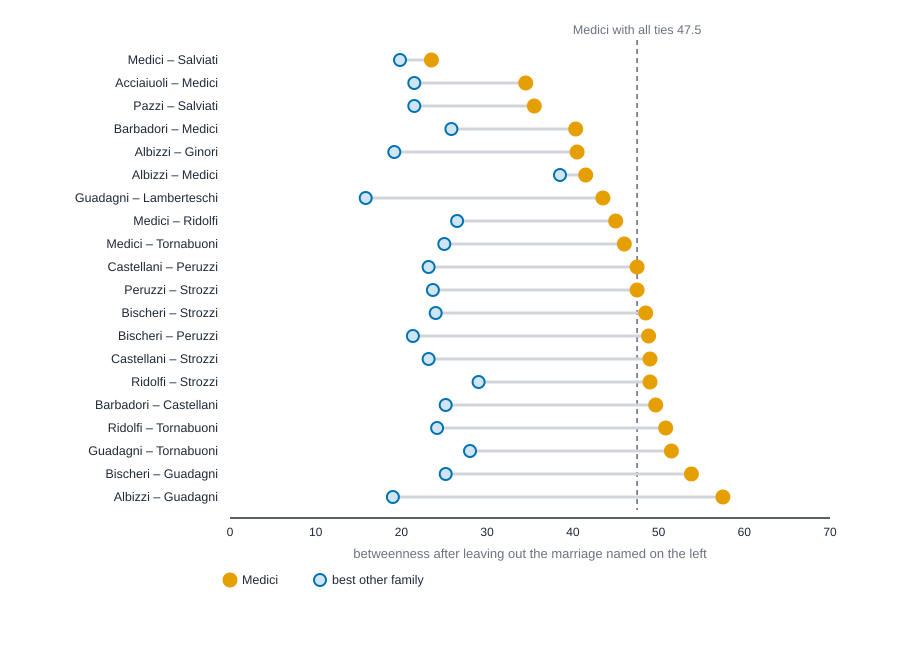

# Case study: the Medici and the Florentine marriage network {#sec-case-florentine}

::: {.callout-note appearance="simple"}
## Prerequisites
@sec-centrality and @sec-tests-and-null-models. You will use degree, closeness, betweenness and eigenvector centrality, and the idea of comparing a network with random ones.
:::

## The question

Most of this book teaches one tool at a time. Real work doesn't arrive that way. It arrives as a question, a small messy table, and a person who would like to know what to believe. This chapter takes one question all the way through, so you can see how the tools fit together and, just as important, where each step stops you from saying too much.

The question comes from a famous study. John Padgett and Christopher Ansell [@padgett1993robust] asked how the Medici family rose in Florence between 1400 and 1434. Their answer draws on archival history and on several kinds of relations among the leading families of the city, of which marriage is one. They argue that the Medici's rise has to be understood through how the family was tied to the others. This chapter doesn't reproduce that argument, and it can't. It uses one slice of their data, the marriages, to answer a smaller question that a network *can* answer:

> **Did the Medici hold an unusual position in the marriage network, and does that finding survive a few honest tests?**

Notice what that question leaves out. It doesn't ask why the Medici rose, or whether their position caused their power. A marriage network can describe where a family sat. It can't tell you what the family did there, what else it had going for it, or what would have happened otherwise. Those need history, and other data. We will come back to this at the end, in a list of what we can and can't say.

The plan has six steps, and each one is a habit worth keeping for any network:

1. Look at the data and say what it can't show.
2. Describe the network before measuring anyone.
3. Compute several measures, side by side, and read each in plain words.
4. Ask whether the result is unusual compared with random networks.
5. Stress-test it: leave out ties, leave out the star.
6. Write down what you found, with its limits, in a paragraph someone else could check.

## The data and its limits

The data are 15 leading families of Renaissance Florence, and 20 marriages among them. A tie means a marriage joined the two families. We met this network in @sec-centrality; here we treat it more carefully.

Before any number, ask what the table is and isn't.

- **One relation.** Only marriage. No business partnerships, no loans, no friendship, no patronage. Padgett and Ansell used more than marriage. If another relation tells a different story, we won't see it here.
- **One moment.** The file lists which pairs of families are joined and nothing else, with no dates. We read it as a single snapshot taken around 1430, and we can't see which marriages came first or how the network changed.
- **Who chose the ties.** A marriage was a decision made by two families, usually for reasons that had nothing to do with network position. The tie says the marriage happened. It doesn't say which side wanted it, or why. The ties are undirected for that reason: we have no way to say who reached out.
- **A boundary someone drew.** The 15 are the leading families the study looked at. Families outside the list, and any marriages with them, aren't here. A family at the edge of this list may look peripheral because we stopped looking, not because it was.
- **What isn't in the table.** No wealth, no offices held, no family size, no neighborhood. Every one of those is a rival explanation for who was well placed, and none of them can be checked with this file.

The bundled copy has no isolated families, which makes the checks easy, but run them anyway. Count the families and ties, look for pairs listed twice, find the number of connected pieces, and see who has no tie at all. Distances between pieces are undefined, so closeness and betweenness quietly change meaning if the network has more than one (@sec-paths-and-cohesion).

::: {.panel-tabset group="language"}

## R

```r
library(knappnet)
library(dplyr)
library(purrr)

# Florentine marriages around 1430: one row per marriage between two families.
marriages <- as_tibble(read.csv("data/florentine/edges.csv"))
florence <- net_frame(marriages, directed = FALSE)
florence

# Checks before any measure: how many pieces, any family with no marriage,
# any pair of families listed twice?
parts <- net_components(florence, mode = "weak")
ties <- net_degree(florence)
tibble(
  n_families = nrow(florence$nodes),
  n_marriages = nrow(marriages),
  n_distinct_pairs = nrow(distinct(marriages, a = pmin(source, target), b = pmax(source, target))),
  n_pieces = max(parts$membership),
  n_isolated = sum(ties == 0)
)

# How many families have each number of marriages?
count(tibble(marriages = ties), marriages, name = "families")
```

::: {.code-output}
```text
# net_frame: 15 nodes, 20 edges
#   directed:  no        mode: one-mode (15 actors)
#   weights:   unweighted
#   time:      static    space: none
#   simple:    no loops, no parallel edges
#   components: 1    isolates: 0    density: 0.190
#
# Nodes (15 x 1)      Edges (20 x 2)
#   id                  source     target
#   <chr>               <chr>      <chr>
# 1 Acciaiuoli        1 Acciaiuoli Medici
# 2 Medici            2 Albizzi    Ginori
# 3 Albizzi           3 Albizzi    Guadagni
# 4 Ginori            4 Bischeri   Guadagni
# 5 Guadagni          5 Barbadori  Castellani
# 6 Bischeri          6 Castellani Peruzzi
#   ... 9 more rows     ... 14 more rows
# A tibble: 1 × 5
  n_families n_marriages n_distinct_pairs n_pieces n_isolated
       <int>       <int>            <int>    <int>      <int>
1         15          20               20        1          0
# A tibble: 5 × 2
  marriages families
      <dbl>    <int>
1         1        4
2         2        2
3         3        6
4         4        2
5         6        1
```
:::

## Python

```python
import csv
from collections import Counter

import networkx as nx
import numpy as np

# Florentine marriages around 1430: one row per marriage between two families.
with open("data/florentine/edges.csv") as f:
    marriages = [tuple(row) for row in list(csv.reader(f))[1:]]
florence = nx.Graph(marriages)
families = list(florence.nodes)

# Checks before any measure: how many pieces, any family with no marriage,
# any pair of families listed twice?
distinct_pairs = {tuple(sorted(pair)) for pair in marriages}
isolated = [v for v in florence if florence.degree(v) == 0]
print(f"families {len(families)}, marriages {len(marriages)}, distinct pairs {len(distinct_pairs)}")
print(f"density {nx.density(florence):.3f}, pieces {nx.number_connected_components(florence)}, isolated {len(isolated)}")

# How many families have each number of marriages?
tally = Counter(d for _, d in florence.degree())
for k in sorted(tally):
    print(f"{k} marriage(s): {tally[k]} families")
```

::: {.code-output}
```text
families 15, marriages 20, distinct pairs 20
density 0.190, pieces 1, isolated 0
1 marriage(s): 4 families
2 marriage(s): 2 families
3 marriage(s): 6 families
4 marriage(s): 2 families
6 marriage(s): 1 families
```
:::

## Rust

```rust
use knappnet::metrics::topography::{find_components, ComponentKind};
use knappnet::{compute_degree, DegreeMode, Graph};

// Florentine marriages around 1430: one row per marriage between two families.
let text = std::fs::read_to_string("data/florentine/edges.csv")?;
let marriages: Vec<(&str, &str)> = text.lines().skip(1).map(|line| line.split_once(',').unwrap()).collect();
let mut families: Vec<&str> = Vec::new();
for &(a, b) in &marriages {
    for family in [a, b] {
        if !families.contains(&family) { families.push(family); }
    }
}
let n = families.len();

// One helper we will reuse: a network from a list of families and the marriages among them.
let build = |names: &[&str], ties: &[(&str, &str)]| -> Result<Graph, knappnet::Error> {
    let at = |family: &str| names.iter().position(|f| *f == family).unwrap() as i64;
    let from: Vec<i64> = ties.iter().map(|t| at(t.0)).collect();
    let to: Vec<i64> = ties.iter().map(|t| at(t.1)).collect();
    Graph::from_edges(names.len(), &from, &to, None, false)
};
let florence = build(&families, &marriages)?;
println!("{}", florence.describe().with_labels(&families));

// Checks before any measure: any pair of families listed twice, how many pieces,
// any family with no marriage?
let distinct: std::collections::HashSet<(&str, &str)> =
    marriages.iter().map(|&(a, b)| if a < b { (a, b) } else { (b, a) }).collect();
let degree = compute_degree(&florence, DegreeMode::All, true);
let pieces = find_components(&florence, ComponentKind::Weak).count();
println!("families {n}, marriages {}, distinct pairs {}", marriages.len(), distinct.len());
println!("pieces {pieces}, isolated {}", degree.iter().filter(|&&d| d == 0.0).count());

// How many families have each number of marriages?
let mut tally = std::collections::BTreeMap::new();
for &d in &degree { *tally.entry(d as usize).or_insert(0) += 1; }
for (k, count) in &tally {
    println!("{k} marriage(s): {count} families");
}
```

::: {.code-output}
```text
Undirected network: 15 nodes, 20 ties
  Density           0.190
  Degree            1 to 6, mean 2.67
  Connected pieces  1
  Isolated nodes    0
  Loops, repeats    none
  Busiest           Medici (6), Guadagni (4), Strozzi (4)

families 15, marriages 20, distinct pairs 20
pieces 1, isolated 0
1 marriage(s): 4 families
2 marriage(s): 2 families
3 marriage(s): 6 families
4 marriage(s): 2 families
6 marriage(s): 1 families
```
:::

:::


Fifteen families, twenty marriages, twenty distinct pairs, one piece, nobody left out. The density of 0.190 means about one in five of all possible pairs of families are joined. Moving on.

## Step 1: describe the network

Four families have a single marriage each (Acciaiuoli, Ginori, Lamberteschi and Pazzi). Six have three. Two have four, two have two, and one family, the Medici, has six. The average is 2.67 marriages per family, so six is a long way above ordinary. Keep that in mind, because it will matter in Step 3.

The network is one connected piece, so every pair of families can reach each other through some chain of marriages, and all four measures below are defined for everyone. It is also sparse. With so few ties, a single marriage can change who sits on whose route, and we'll lean on that when we stress-test.

## Step 2: four measures, side by side

@sec-centrality introduced four questions you can ask about a node's position. Run all four and put them in one table, because a result that holds for one measure and not another is information.

::: {.panel-tabset group="language"}

## R

```r
medici <- which(florence$nodes$id == "Medici")

measures <- tibble(
  family = florence$nodes$id,
  marriages = net_degree(florence),
  closeness = net_closeness(florence, normalized = TRUE),
  betweenness = net_betweenness(florence),
  eigenvector = net_eigen(florence)
)

# Sorted by betweenness. Eigenvector is scaled so the top score is 1.
measures |>
  arrange(desc(betweenness)) |>
  mutate(
    across(c(closeness, eigenvector), \(x) round(x, 3)),
    betweenness = round(betweenness, 1)
  )
```

::: {.code-output}
```text
# A tibble: 15 × 5
   family       marriages closeness betweenness eigenvector
   <chr>            <dbl>     <dbl>       <dbl>       <dbl>
 1 Medici               6     0.56         47.5       1    
 2 Guadagni             4     0.467        23.2       0.672
 3 Albizzi              3     0.483        19.3       0.567
 4 Salviati             2     0.389        13         0.339
 5 Ridolfi              3     0.5          10.3       0.794
 6 Bischeri             3     0.4           9.5       0.657
 7 Strozzi              4     0.438         9.3       0.827
 8 Barbadori            2     0.438         8.5       0.492
 9 Tornabuoni           3     0.483         8.3       0.757
10 Castellani           3     0.389         5         0.602
11 Peruzzi              3     0.368         2         0.641
12 Acciaiuoli           1     0.368         0         0.307
13 Ginori               1     0.333         0         0.174
14 Lamberteschi         1     0.326         0         0.206
15 Pazzi                1     0.286         0         0.104
```
:::

## Python

```python
medici = families.index("Medici")
degree = dict(florence.degree())
close = nx.closeness_centrality(florence)
between = nx.betweenness_centrality(florence, normalized=False)
eigen = nx.eigenvector_centrality_numpy(florence)
top_eigen = max(eigen.values())

# Sorted by betweenness. Eigenvector is scaled so the top score is 1.
print(f"{'family':<13}{'marriages':>9}{'closeness':>10}{'betweenness':>12}{'eigenvector':>12}")
for v in sorted(families, key=lambda v: -between[v]):
    print(f"{v:<13}{degree[v]:>9}{close[v]:>10.3f}{between[v]:>12.1f}{eigen[v] / top_eigen:>12.3f}")
```

::: {.code-output}
```text
family       marriages closeness betweenness eigenvector
Medici               6     0.560        47.5       1.000
Guadagni             4     0.467        23.2       0.672
Albizzi              3     0.483        19.3       0.567
Salviati             2     0.389        13.0       0.339
Ridolfi              3     0.500        10.3       0.794
Bischeri             3     0.400         9.5       0.657
Strozzi              4     0.438         9.3       0.827
Barbadori            2     0.438         8.5       0.492
Tornabuoni           3     0.483         8.3       0.757
Castellani           3     0.389         5.0       0.602
Peruzzi              3     0.368         2.0       0.641
Acciaiuoli           1     0.368         0.0       0.307
Ginori               1     0.333         0.0       0.174
Lamberteschi         1     0.326         0.0       0.206
Pazzi                1     0.286         0.0       0.104
```
:::

## Rust

```rust
use knappnet::metrics::closeness::{compute_closeness, ClosenessOptions};
use knappnet::metrics::eigenvector::{compute_eigenvector_centrality, EigenvectorOptions};
use knappnet::{compute_betweenness, BetweennessOptions};

let medici = families.iter().position(|f| *f == "Medici").unwrap();
let close = compute_closeness(&florence, ClosenessOptions { normalized: true, ..Default::default() })?;
let between = compute_betweenness(&florence, BetweennessOptions::default())?;
let eigen = compute_eigenvector_centrality(&florence, EigenvectorOptions::default())?;

// Sorted by betweenness. Eigenvector is scaled so the top score is 1.
let mut order: Vec<usize> = (0..n).collect();
order.sort_by(|&a, &b| between[b].partial_cmp(&between[a]).unwrap());
println!("{:<13}{:>9}{:>10}{:>12}{:>12}", "family", "marriages", "closeness", "betweenness", "eigenvector");
for &i in &order {
    println!("{:<13}{:>9}{:>10.3}{:>12.1}{:>12.3}", families[i], degree[i], close[i], between[i], eigen.values[i]);
}
```

::: {.code-output}
```text
family       marriages closeness betweenness eigenvector
Medici               6     0.560        47.5       1.000
Guadagni             4     0.467        23.2       0.672
Albizzi              3     0.483        19.3       0.567
Salviati             2     0.389        13.0       0.339
Ridolfi              3     0.500        10.3       0.794
Bischeri             3     0.400         9.5       0.657
Strozzi              4     0.438         9.3       0.827
Barbadori            2     0.438         8.5       0.492
Tornabuoni           3     0.483         8.3       0.757
Castellani           3     0.389         5.0       0.602
Peruzzi              3     0.368         2.0       0.641
Acciaiuoli           1     0.368         0.0       0.307
Ginori               1     0.333         0.0       0.174
Lamberteschi         1     0.326         0.0       0.206
Pazzi                1     0.286         0.0       0.104
```
:::

:::


The Medici lead on all four. That is the first thing a hurried reader would report, and it deserves a second look, because the four leads are not the same size. Here is a plain reading of each in this setting. Think of a tie as a channel along which an introduction, an offer or a favor could travel.

- **Degree (marriages).** The number of direct marriage partners. The Medici have six; the next families (Guadagni and Strozzi) have four. This is the *activity* reading: the Medici had the most direct connections to other families. It says nothing about who the partners were.
- **Closeness.** How near a family is to all the others, counted in marriage steps. The Medici's 0.560 means they are, on average, about 1.8 steps from another family ($1 / 0.560$). Ridolfi is next at 0.500. The lead is real but modest, because in a network this small nearly everyone is within a few steps of everyone.
- **Betweenness.** How many of the shortest routes between *other* pairs of families run through this family. The Medici's 47.5 is more than twice Guadagni's 23.2, the widest lead of the four. The reading is *control of routes*: for many pairs of other families, the shortest chain of marriages goes through the Medici. The card for this measure adds a caution that matters here. A family on many routes *may* control access, but only if it chose to.
- **Eigenvector.** A score that is high when a family's partners are themselves well connected. The Medici are scaled to 1.000. Strozzi, at 0.827, comes second even though it is seventh on betweenness. Strozzi's four marriages are to Castellani, Peruzzi, Bischeri and Ridolfi, families that also marry each other and have several partners themselves, which eigenvector rewards and betweenness does not.

Betweenness is the measure that makes the Medici look most special, so it is the one to test hardest. By the numbers, the Medici sit on 47.5 of the $\binom{14}{2} = 91$ shortest routes between pairs of other families, which is 52%. You can check part of that by hand. Acciaiuoli has one marriage, and it is to the Medici. So the shortest route from Acciaiuoli to any of the 13 families other than itself and the Medici must pass through the Medici. That alone gives the Medici 13 of their 47.5.

## Step 3: is it unusual?

A number needs a comparison. Is a betweenness of 47.5 high for a family in *this kind* of network, or just what you would expect of any family with six marriages?

The tool for this is a null model from @sec-tests-and-null-models. The **configuration model** keeps every family's number of marriages exactly as it is and reshuffles who marries whom [@molloy1995critical; @newman2001random]. In each random network the Medici still have six marriages, Guadagni still has four, and so on. If the Medici's betweenness in the real network is no higher than their betweenness across many such reshufflings, then their lead follows from having six marriages, and not from who the six were.

We draw 1,000 random networks with a fixed seed and record the Medici's betweenness in each one. Three side questions come along, because they change how to read the answer. How often is the six-marriage family on top? How many draws are connected? And what's the spread?

::: {.panel-tabset group="language"}

## R

```r
degrees <- net_degree(florence)
observed <- measures$betweenness[medici]

# 1,000 random networks in which every family keeps its number of marriages.
# simple = TRUE allows no self-marriages and no repeated pairs.
draws <- net_random_config(degrees, simple = TRUE, max_tries = 100000, reps = 1000, seed = 1)
random_between <- map(draws, net_betweenness)
scores <- map_dbl(random_between, \(b) b[medici])

tibble(
  real = observed,
  random_average = mean(scores),
  middle_90 = paste(round(quantile(scores, c(0.05, 0.95)), 1), collapse = " to "),
  share_as_high = mean(scores >= observed - 1e-9),
  medici_on_top = mean(map_lgl(random_between, \(b) b[medici] >= max(b))),
  one_piece = mean(map_lgl(draws, \(d) max(net_components(d)$membership) == 1))
) |>
  mutate(across(where(is.numeric), \(x) round(x, 3)))
```

::: {.code-output}
```text
# A tibble: 1 × 6
   real random_average middle_90  share_as_high medici_on_top one_piece
  <dbl>          <dbl> <chr>              <dbl>         <dbl>     <dbl>
1  47.5           40.4 24.9 to 55         0.218         0.916     0.875
```
:::

## Python

```python
degrees = [degree[v] for v in families]
observed = between["Medici"]

def simple_configuration(degrees, rng):
    # Match the stubs at random and start over until there are no loops or repeated ties.
    while True:
        m = nx.configuration_model(degrees, seed=int(rng.integers(2**31)))
        h = nx.Graph(m)
        if nx.number_of_selfloops(h) == 0 and h.number_of_edges() == m.number_of_edges():
            return h

# 1,000 random networks in which every family keeps its number of marriages.
# NetworkX draws different networks than Rust, so the digits differ a little.
rng = np.random.default_rng(1)
draws = [simple_configuration(degrees, rng) for _ in range(1000)]
random_between = [nx.betweenness_centrality(h, normalized=False) for h in draws]
scores = np.array([b[medici] for b in random_between])

low, high = np.percentile(scores, [5, 95])
print(f"real {observed:.1f}, random average {scores.mean():.1f}, middle 90% {low:.1f} to {high:.1f}")
print(f"random networks with the Medici at least that high  {np.mean(scores >= observed - 1e-9):.3f}")
print(f"random networks with the Medici on top              {np.mean([b[medici] >= max(b.values()) for b in random_between]):.3f}")
print(f"random networks in one piece                        {np.mean([nx.is_connected(h) for h in draws]):.3f}")
```

::: {.code-output}
```text
real 47.5, random average 39.9, middle 90% 24.8 to 54.5
random networks with the Medici at least that high  0.196
random networks with the Medici on top              0.905
random networks in one piece                        0.887
```
:::

## Rust

```rust
use knappnet::generate::{sample_configuration, Degrees};

let observed = between[medici];
let degrees: Vec<u64> = degree.iter().map(|&d| d as u64).collect();

// 1,000 random networks in which every family keeps its number of marriages.
// `true` allows no self-marriages and no repeated pairs; 100,000 is how many tries each draw gets.
let draws = sample_configuration(&Degrees::Undirected(degrees), true, 100_000, 1_000, 1, 0)?;
let mut scores = Vec::new();
let (mut on_top, mut one_piece) = (0, 0);
for d in &draws {
    let from: Vec<i64> = d.from.iter().map(|&x| x as i64).collect();
    let to: Vec<i64> = d.to.iter().map(|&x| x as i64).collect();
    let g = Graph::from_edges(n, &from, &to, None, false)?;
    let b = compute_betweenness(&g, BetweennessOptions::default())?;
    scores.push(b[medici]);
    if b.iter().all(|&x| x <= b[medici]) { on_top += 1; }
    if find_components(&g, ComponentKind::Weak).count() == 1 { one_piece += 1; }
}

let mut sorted = scores.clone();
sorted.sort_by(|a, b| a.partial_cmp(b).unwrap());
// A percentile by straight-line interpolation between neighboring draws.
let percentile = |p: f64| {
    let pos = p * (sorted.len() - 1) as f64;
    let (lo, hi) = (pos.floor() as usize, pos.ceil() as usize);
    sorted[lo] + (sorted[hi] - sorted[lo]) * (pos - lo as f64)
};
let share = |count: usize| count as f64 / scores.len() as f64;
let at_least = scores.iter().filter(|&&s| s >= observed - 1e-9).count();
let average = scores.iter().sum::<f64>() / scores.len() as f64;
println!("real {observed:.1}, random average {average:.1}, middle 90% {:.1} to {:.1}", percentile(0.05), percentile(0.95));
println!("random networks with the Medici at least that high  {:.3}", share(at_least));
println!("random networks with the Medici on top              {:.3}", share(on_top));
println!("random networks in one piece                        {:.3}", share(one_piece));
```

::: {.code-output}
```text
real 47.5, random average 40.4, middle 90% 24.9 to 55.0
random networks with the Medici at least that high  0.218
random networks with the Medici on top              0.916
random networks in one piece                        0.875
```
:::

:::


Read the Rust numbers first. In the random networks the Medici's betweenness averages 40.4, and the middle 90% of draws run from 24.9 to 55.0. The real value, 47.5, is above average but well inside that range. A share of 0.218 means about one draw in five reaches it or goes higher. And in 91.6% of the random networks the family with six marriages is the top family on betweenness, which is what the real network shows too.

@fig-null-medici shows the same thing as a picture.

{#fig-null-medici fig-alt="A histogram of the Medici's betweenness across 1,000 random networks, rising from near zero to a peak around 40 and falling off by about 65. A black vertical line marks the real value, 47.5. Bars from the 45 to 50 bin onward are orange. In these draws 199 of 1,000 reach the real value; the average is 39.6."}

This result runs against the simple story, so say it plainly. **Relative to networks with the same degrees, the Medici's betweenness is not unusual.** Having six marriages, when nobody else has more than four, is enough to put a family on many routes in a network like this one. What stands out about the Medici in this table is that they have so many marriages, not that those marriages are placed in an unusual way.

Three cautions keep that from being overread:

- **It's one yardstick.** The configuration model fixes degrees and randomizes everything else. A different null (say, one that keeps clusters intact) could put the Medici in a different place.
- **It tests betweenness, not the story.** The configuration model says nothing about *why* the Medici had six marriages. If those six marriages were themselves the result of the family's wealth or standing, then "explained by degree" and "explained by position" aren't rivals. They could be the same thing described twice.
- **Draws are random.** With 1,000 draws and a share near 0.2, the share is uncertain by about one and a quarter percentage points, give or take. The R tab uses the same engine and seed as Rust. The Python tab uses different random draws, so its digits differ a little. None of the differences would change what we conclude.

Some draws also come out in more than one piece (only 87.5% are in one piece), and betweenness only counts pairs that have a route. We report that share so you can see how often it happens. It's a reminder that null models are themselves a choice.

## Step 4: stress tests

A finding that falls apart when one tie moves isn't worth reporting. In a network with 20 ties, one marriage is 5% of the data. The card for betweenness suggests two checks, and we run both, plus a third that asks the structural question directly.

### Leave out one marriage

Think of leaving out a tie as a stand-in for a marriage that was never recorded. For each of the 20 marriages, drop it, recompute betweenness for every family, and see whether the Medici are still first.

::: {.panel-tabset group="language"}

## R

```r
# Betweenness of the Medici and of the best other family, with some marriages left out.
leave_out <- \(dropped) {
  g <- net_frame(marriages[-dropped, ], nodes = tibble(id = florence$nodes$id), directed = FALSE)
  b <- net_betweenness(g)
  best <- which.max(replace(b, medici, -Inf))
  tibble(
    medici = b[medici], other = g$nodes$id[best], other_score = b[best],
    pieces = max(net_components(g)$membership)
  )
}
labels <- paste(marriages$source, marriages$target, sep = " - ")

# One marriage left out, each of the 20 in turn.
singles <- seq_len(nrow(marriages)) |>
  map(leave_out) |>
  list_rbind() |>
  mutate(dropped = labels, margin = medici - other_score, .before = 1)

singles |>
  summarise(
    medici_first = sum(margin > 0), of = n(),
    lowest = min(medici), highest = max(medici), network_splits = sum(pieces > 1)
  )

# The three closest calls.
singles |>
  slice_min(margin, n = 3) |>
  select(dropped, medici, other, other_score) |>
  mutate(across(where(is.numeric), \(x) round(x, 1)))
```

::: {.code-output}
```text
# A tibble: 1 × 5
  medici_first    of lowest highest network_splits
         <int> <int>  <dbl>   <dbl>          <int>
1           20    20   23.5    57.5              5
# A tibble: 3 × 4
  dropped             medici other    other_score
  <chr>                <dbl> <chr>          <dbl>
1 Albizzi - Medici      41.5 Guadagni        38.5
2 Medici - Salviati     23.5 Guadagni        19.8
3 Acciaiuoli - Medici   34.5 Guadagni        21.5
```
:::

## Python

```python
from itertools import combinations

# Betweenness of the Medici and of the best other family, with some marriages left out.
def leave_out(dropped):
    kept = [m for i, m in enumerate(marriages) if i not in dropped]
    h = nx.Graph()
    h.add_nodes_from(families)
    h.add_edges_from(kept)
    b = nx.betweenness_centrality(h, normalized=False)
    other = max((v for v in families if v != "Medici"), key=lambda v: b[v])
    return b["Medici"], other, b[other], nx.number_connected_components(h)

labels = [f"{a} - {b}" for a, b in marriages]

# One marriage left out, each of the 20 in turn.
singles = [(labels[i], *leave_out({i})) for i in range(len(marriages))]
first = sum(m > o_score for _, m, _, o_score, _ in singles)
print(f"Medici first in {first} of {len(singles)}; betweenness from {min(s[1] for s in singles):.1f} to {max(s[1] for s in singles):.1f}")
print(f"leaving out one marriage splits the network in {sum(s[4] > 1 for s in singles)} of {len(singles)} cases")

# The three closest calls.
for label, m, other, o_score, _ in sorted(singles, key=lambda s: s[1] - s[3])[:3]:
    print(f"  without {label}: Medici {m:.1f}, {other} {o_score:.1f}")
```

::: {.code-output}
```text
Medici first in 20 of 20; betweenness from 23.5 to 57.5
leaving out one marriage splits the network in 5 of 20 cases
  without Albizzi - Medici: Medici 41.5, Guadagni 38.5
  without Medici - Salviati: Medici 23.5, Guadagni 19.8
  without Acciaiuoli - Medici: Medici 34.5, Guadagni 21.5
```
:::

## Rust

```rust
// Betweenness of the Medici and of the best other family, with some marriages left out.
let leave_out = |dropped: &[usize]| -> Result<(f64, usize, f64, usize), knappnet::Error> {
    let kept: Vec<(&str, &str)> = marriages.iter().enumerate()
        .filter(|(i, _)| !dropped.contains(i)).map(|(_, &t)| t).collect();
    let g = build(&families, &kept)?;
    let b = compute_betweenness(&g, BetweennessOptions::default())?;
    let mut other = if medici == 0 { 1 } else { 0 };
    for i in 0..n {
        if i != medici && b[i] > b[other] { other = i; }
    }
    Ok((b[medici], other, b[other], find_components(&g, ComponentKind::Weak).count()))
};
let labels: Vec<String> = marriages.iter().map(|(a, b)| format!("{a} - {b}")).collect();

// One marriage left out, each of the 20 in turn.
let mut singles = Vec::new();
for i in 0..marriages.len() {
    singles.push((i, leave_out(&[i])?));
}
let first = singles.iter().filter(|(_, r)| r.0 > r.2).count();
let lowest = singles.iter().map(|(_, r)| r.0).fold(f64::INFINITY, f64::min);
let highest = singles.iter().map(|(_, r)| r.0).fold(f64::NEG_INFINITY, f64::max);
println!("Medici first in {first} of {}; betweenness from {lowest:.1} to {highest:.1}", singles.len());
println!("leaving out one marriage splits the network in {} of {} cases",
         singles.iter().filter(|(_, r)| r.3 > 1).count(), singles.len());

// The three closest calls.
singles.sort_by(|a, b| (a.1 .0 - a.1 .2).partial_cmp(&(b.1 .0 - b.1 .2)).unwrap());
for (i, r) in &singles[..3] {
    println!("  without {}: Medici {:.1}, {} {:.1}", labels[*i], r.0, families[r.1], r.2);
}
```

::: {.code-output}
```text
Medici first in 20 of 20; betweenness from 23.5 to 57.5
leaving out one marriage splits the network in 5 of 20 cases
  without Albizzi - Medici: Medici 41.5, Guadagni 38.5
  without Medici - Salviati: Medici 23.5, Guadagni 19.8
  without Acciaiuoli - Medici: Medici 34.5, Guadagni 21.5
```
:::

:::


Leaving out any single marriage, the Medici stay first in every case. Their betweenness ranges widely, though, from 23.5 when we drop the Medici's marriage to Salviati (that marriage is the only link between the Medici and the Pazzi-Salviati pair) to 57.5 when we drop one that was providing shortcuts around them. The closest call is without the Albizzi-Medici marriage, where the Medici's 41.5 is only three points ahead of Guadagni's 38.5. And in five cases, the network splits into two pieces, because five of the 20 marriages are the only link to someone.

@fig-tie-drop-stability shows all 20 cases.

{#fig-tie-drop-stability fig-alt="Twenty rows, one per marriage left out, sorted from lowest Medici betweenness at the top (23.5) to highest at the bottom (57.5). In every row an orange dot for the Medici lies to the right of a blue dot for the best other family. A dashed vertical line marks the Medici's value with all marriages, 47.5. The two dots are closest in the row for the Albizzi–Medici marriage."}

### Leave out two marriages

One tie at a time is gentle. With only 20 ties we can afford to try every pair of them: 190 combinations.

::: {.panel-tabset group="language"}

## R

```r
# Two marriages left out, all 190 pairs.
pair_ids <- combn(nrow(marriages), 2, simplify = FALSE)
pairs <- pair_ids |>
  map(leave_out) |>
  list_rbind() |>
  mutate(
    dropped = map_chr(pair_ids, \(p) paste(labels[p], collapse = " and ")),
    margin = medici - other_score,
    .before = 1
  )

pairs |> summarise(medici_first = sum(margin > 0), of = n())

# The pair that hurts most.
pairs |>
  slice_min(margin, n = 1) |>
  select(dropped, medici, other, other_score)
```

::: {.code-output}
```text
# A tibble: 1 × 2
  medici_first    of
         <int> <int>
1          178   190
# A tibble: 1 × 4
  dropped                                  medici other    other_score
  <chr>                                     <dbl> <chr>          <dbl>
1 Barbadori - Medici and Ridolfi - Strozzi     38 Guadagni          54
```
:::

## Python

```python
# Two marriages left out, all 190 pairs.
pairs = [(f"{labels[i]} and {labels[j]}", *leave_out({i, j}))
         for i, j in combinations(range(len(marriages)), 2)]
first = sum(m > o_score for _, m, _, o_score, _ in pairs)
print(f"Medici first in {first} of {len(pairs)}")

# The pair that hurts most.
label, m, other, o_score, _ = min(pairs, key=lambda p: p[1] - p[3])
print(f"worst case, without {label}: Medici {m:.1f}, {other} {o_score:.1f}")
```

::: {.code-output}
```text
Medici first in 178 of 190
worst case, without Barbadori - Medici and Ridolfi - Strozzi: Medici 38.0, Guadagni 54.0
```
:::

## Rust

```rust
// Two marriages left out, all 190 pairs.
let mut pairs = Vec::new();
for i in 0..marriages.len() {
    for j in (i + 1)..marriages.len() {
        pairs.push(((i, j), leave_out(&[i, j])?));
    }
}
let first = pairs.iter().filter(|(_, r)| r.0 > r.2).count();
println!("Medici first in {first} of {}", pairs.len());

// The pair that hurts most.
let worst = pairs.iter()
    .min_by(|a, b| (a.1 .0 - a.1 .2).partial_cmp(&(b.1 .0 - b.1 .2)).unwrap()).unwrap();
println!("worst case, without {} and {}: Medici {:.1}, {} {:.1}",
         labels[worst.0 .0], labels[worst.0 .1], worst.1 .0, families[worst.1 .1], worst.1 .2);
```

::: {.code-output}
```text
Medici first in 178 of 190
worst case, without Barbadori - Medici and Ridolfi - Strozzi: Medici 38.0, Guadagni 54.0
```
:::

:::


Now the ranking is *mostly* stable, not always. In 178 of 190 cases the Medici remain first; in the other 12 another family overtakes them. The worst pair, leaving out Barbadori-Medici and Ridolfi-Strozzi, drops the Medici to 38.0 against Guadagni's 54.0. Two missing marriages out of 20 can change who comes first. This is the honest size of the claim: the Medici's lead is sturdy against one error and mostly sturdy against two.

What these tests don't do is just as important. They only *remove* recorded ties. They can't test for marriages that were recorded but never happened, for families outside the 15, or for marriages missing from the whole record in a way that is not random (for instance, if some families' marriages were better documented than others). Randomly dropping ties is a model of one kind of error. Name it.

### Take the Medici out

The last test asks about structure directly. If the Medici weren't in the network, what is left?

::: {.panel-tabset group="language"}

## R

```r
others <- tibble(id = setdiff(florence$nodes$id, "Medici"))
without <- marriages |>
  filter(source != "Medici", target != "Medici") |>
  net_frame(nodes = others, directed = FALSE)

pieces <- others |>
  mutate(piece = net_components(without, mode = "weak")$membership) |>
  group_by(piece) |>
  summarise(size = n(), families = paste(id, collapse = ", "), .groups = "drop") |>
  arrange(desc(size))
pieces

# Pairs of the other families that can still reach each other, out of all pairs.
tibble(can_still_reach = sum(choose(pieces$size, 2)), all_pairs = choose(nrow(others), 2))
```

::: {.code-output}
```text
# A tibble: 3 × 3
  piece  size families                                                          
  <int> <int> <chr>                                                             
1     2    11 Albizzi, Ginori, Guadagni, Bischeri, Barbadori, Castellani, Peruz…
2     3     2 Salviati, Pazzi                                                   
3     1     1 Acciaiuoli                                                        
# A tibble: 1 × 2
  can_still_reach all_pairs
            <dbl>     <dbl>
1              56        91
```
:::

## Python

```python
without = florence.copy()
without.remove_node("Medici")
pieces = sorted(nx.connected_components(without), key=lambda c: -len(c))
print(f"{len(pieces)} pieces")
for piece in pieces:
    print(f"  size {len(piece):>2}: {', '.join(sorted(piece))}")

# Pairs of the other families that can still reach each other, out of all pairs.
can_reach = sum(len(p) * (len(p) - 1) // 2 for p in pieces)
total = without.number_of_nodes() * (without.number_of_nodes() - 1) // 2
print(f"pairs that can still reach each other: {can_reach} of {total}")
```

::: {.code-output}
```text
3 pieces
  size 11: Albizzi, Barbadori, Bischeri, Castellani, Ginori, Guadagni, Lamberteschi, Peruzzi, Ridolfi, Strozzi, Tornabuoni
  size  2: Pazzi, Salviati
  size  1: Acciaiuoli
pairs that can still reach each other: 56 of 91
```
:::

## Rust

```rust
let others: Vec<&str> = families.iter().copied().filter(|f| *f != "Medici").collect();
let kept: Vec<(&str, &str)> = marriages.iter().copied()
    .filter(|t| t.0 != "Medici" && t.1 != "Medici").collect();
let without = build(&others, &kept)?;

let parts = find_components(&without, ComponentKind::Weak);
let mut pieces: Vec<Vec<&str>> = vec![Vec::new(); parts.count()];
for (i, &label) in parts.membership.iter().enumerate() {
    pieces[label as usize].push(others[i]);
}
pieces.sort_by(|a, b| b.len().cmp(&a.len()));
println!("{} pieces", pieces.len());
for piece in &pieces {
    let mut members = piece.clone();
    members.sort();
    println!("  size {:>2}: {}", piece.len(), members.join(", "));
}

// Pairs of the other families that can still reach each other, out of all pairs.
let can_reach: usize = pieces.iter().map(|p| p.len() * (p.len() - 1) / 2).sum();
println!("pairs that can still reach each other: {can_reach} of {}", others.len() * (others.len() - 1) / 2);
```

::: {.code-output}
```text
3 pieces
  size 11: Albizzi, Barbadori, Bischeri, Castellani, Ginori, Guadagni, Lamberteschi, Peruzzi, Ridolfi, Strozzi, Tornabuoni
  size  2: Pazzi, Salviati
  size  1: Acciaiuoli
pairs that can still reach each other: 56 of 91
```
:::

:::


Without the Medici, the other 14 families fall into three pieces: a large one of 11, the pair Pazzi and Salviati, and Acciaiuoli alone. Only 56 of the 91 pairs of other families could still reach each other. The other 35 pairs, which is 11 times 2 plus 11 times 1 plus 2 times 1, have no route at all without the Medici.

That number connects back to Step 2. Thirty-five of the Medici's 47.5 betweenness comes from these pairs, and it is exactly 35 because each of them has one route and it goes through the Medici. The remaining 12.5 comes from pairs that have other routes, so the Medici only get a share. This tells you something the table of measures could not: most of the Medici's betweenness is a matter of three families that hang off them. Acciaiuoli, Pazzi and Salviati have no way into the rest of the network except through the Medici. That is a fact about this snapshot of marriages. It is not a claim that the families were dependent on the Medici in any other way.

It also is not a prediction. "Remove the Medici" is a thought experiment about structure. It doesn't say what Florence would have looked like without them, because other marriages would have been made.

## Step 5: what we can say, what we cannot

Now put the findings in two lists. Writing both is the discipline; the second list is the one most reports leave out.

::: {.callout-tip appearance="simple"}
## What we can say
- In this marriage network the Medici have the most marriages, the highest closeness, the highest eigenvector score and the highest betweenness.
- About half (52%) of the shortest marriage routes between other pairs of families pass through them.
- This lead holds if any one recorded marriage is left out, and mostly holds if any two are.
- Without the Medici, the network of the other 14 families breaks into pieces of 11, 2 and 1.
- Their betweenness is about what you would expect of a family with six marriages in a network with these degrees.
:::

::: {.callout-warning appearance="simple"}
## What we cannot say
- That position *caused* the Medici's rise. These are one relation at one moment, with no wealth, office or dates.
- That the Medici *used* their position. Betweenness describes where they sat, not what they did.
- That the Medici were unusual in how their marriages were arranged. The degree-preserving comparison says their betweenness is ordinary for six marriages.
- A precise ranking of other families. Several families have close or tied scores.
- Anything about marriages outside these 15 families, or about other kinds of ties.
:::

Several rival explanations fit the same table, and each is something to check with other data, not with this network:

- **Wealth or standing.** A rich family could be sought out in marriage, which would give it many ties without any structural cleverness.
- **Family size.** A large family has more people to marry off, so more marriages.
- **Direction of cause.** If the data are from around 1430, the Medici may already have been rising. Position could follow power as easily as cause it, and one snapshot can't separate the two.
- **Other relations.** Partnership, patronage and friendship could place families very differently. This is why the original study didn't rest on marriage alone.
- **The boundary.** If the list of 15 had been drawn differently, who sits on whose routes would change.

## Step 6: write the result

The last step is to say what you found in a form that carries its own limits. The betweenness card in the book's interpretation cards gives a template; here it is filled in from the numbers above.

> In this marriage network of 15 leading Florentine families (20 marriages, no dates, read as one snapshot), the Medici have betweenness 47.5 (52% of the shortest routes between other pairs of families pass through them; rank 1 of 15). This describes their position on shortest routes, not what they did with that position. The ranking is stable when any one of the 20 marriages is left out (first in 20 of 20 cases) and mostly stable when any two are left out (first in 178 of 190). Betweenness is about what is expected in networks with the same degrees: in 1,000 random networks that keep every family's number of marriages, the Medici's betweenness averaged about 40 and about one in five reached 47.5 or more. Without the Medici, the other 14 families split into pieces of 11, 2 and 1. The data cover one relation and no family attributes, so they do not show why the Medici rose.

Read that paragraph against the checklist. Does it say what the tie means? Which networks it compares with? What was perturbed and how often the answer held? What the number doesn't show? A reader who disagrees with you should be able to find the place where they disagree. That is what *defensible* means, and it is a different thing from *impressive*.

## Exercises

1. **By hand.** Using only the edge list, find the pairs of families that cannot reach each other once the Medici are removed. Count them, and check that you get 35.
2. **By hand.** Which family comes second on betweenness? List the pairs of other families whose only route goes through it. How many are there, and how does that compare with the Medici's 35?
3. **Coding.** Repeat Step 3 for closeness instead of betweenness. Are the Medici's closeness scores unusual relative to the degree-preserving random networks?
4. **Coding.** Repeat the tie-dropping test with *Guadagni* as the family of interest. Is Guadagni's rank as stable as the Medici's?
5. **Coding.** In Step 3, change the seed and rerun with 1,000 draws. How much does the share of draws at or above 47.5 move? Then run 10,000 draws. How much does it move now?
6. **Design.** Name three attributes you would want for each family to test the rival explanations in Step 5. For each, say what result would make you believe the rival over the network story.
7. **Interpretation.** A newspaper writes, "A network analysis proves the Medici ruled Florence because of where they sat in the marriage network." Write two sentences on what the analysis supports and two on what it doesn't.

## Summary

::: {.callout-tip appearance="simple"}
We took one question, whether the Medici held an unusual position in the Florentine marriage network, through six steps: check the data and its limits, describe the network, compare four measures, compare with random networks that keep every degree, stress-test, and write the result with its caveats. The Medici lead on all four measures and sit on 52% of the shortest routes between other families. That lead survives leaving out any one marriage and most pairs of marriages, and without them the network splits into pieces of 11, 2 and 1. But their betweenness is about what six marriages would give in any network with these degrees, and the data say nothing about wealth, office, or why the marriages were made. A good analysis states what the numbers show and what they cannot.
:::

## Further reading

For the question and the history, read the original study, @padgett1993robust, which uses more kinds of ties and a great deal more archival evidence than this chapter. For the measures, see @freeman1977set for betweenness and @freeman1978centrality for the three ideas behind the classic measures, and @borgatti2005centrality for why a measure should match the process you care about. For how sturdy centrality scores are when data are missing or wrong, see @borgatti2006robustness. For null models, see @molloy1995critical and @newman2001random for the configuration model, and @sec-tests-and-null-models. For the broker and structural hole ideas behind reading a bridge, see @burt1992structural.
