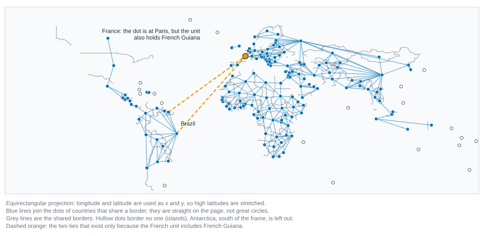
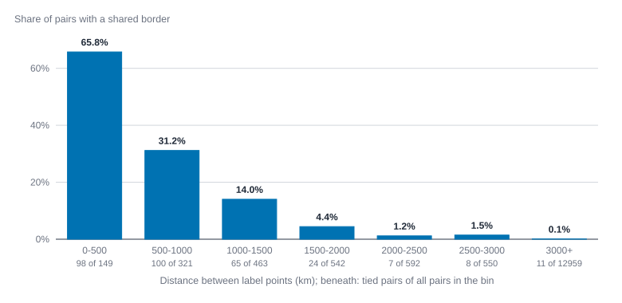
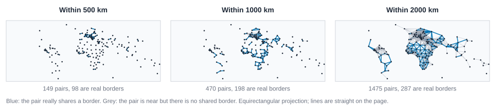

# Networks in space {#sec-space}

::: {.callout-note appearance="simple"}
## Prerequisites
Networks as data, Centrality, and Paths, distance and cohesion.
:::

## Introduction

Some ties cost something to keep up. A friendship across town is easier to maintain than one across an ocean. A road between two cities has to be built. A flight needs two airports and fuel. Even an email is more likely to go to the person two desks away than to the colleague in another country. Whenever nodes have places, distance leaks into the ties, and the network you see is partly a map in disguise.

That cuts two ways. It gives you more to work with: you can ask how long ties are, how fast they thin out with distance, and whether a place is central on the map or only in the network. It also raises the stakes for caution. Neighbors are often near each other, so a network can look clustered, or divided into regions, for no reason except that nearby people are more likely to be tied. Before you read structure into a spatial network you have to ask how much of it is just geography.

By the end of this chapter you'll be able to put coordinates on nodes and measure distances honestly, describe how long the ties are, see how the chance of a tie falls with distance, build a network from distances alone and see how much the cutoff you pick matters, tell topological centrality from geographic position, and run three quick checks that keep you from crediting "structure" with what is really nearness.

Two datasets carry the chapter. The first is real: the land borders between the world's countries (@sec-space-data). The second is a small invented set of twelve towns and the commuters between them, labeled as invented wherever it appears; we use it for the one place where we need counts of movement, not just ties.

::: {.callout-note appearance="simple"}
## Which tools do what here
The R and Rust tabs use knappnet's spatial functions: `net_spatial`, `net_edge_lengths` and `net_proximity` in R, and the `spatial` module in Rust. knappnet's Python package does not cover spatial networks, so the Python tabs write the few formulas they need by hand with numpy, with networkx for the graph measures. Where that is the case the code says so. R also has `net_distance_decay` and `net_group_geometry`, and can take node tables from the sf package for shapes other than points; we don't need them here.
:::

## Places on a sphere {#sec-space-coordinates}

A **coordinate** says where a node is. There are two common kinds, and mixing them up is the most frequent spatial mistake.

**Longitude and latitude** are angles, in degrees, on a globe. Latitude runs from -90 at the south pole to 90 at the north pole; longitude says how far east or west. A **projected** coordinate system flattens the globe onto a plane and gives positions as x and y in some unit, usually meters or kilometers, so ordinary geometry works. Every projection distorts something (area, angle or distance), and which distortion you accept depends on the task.

Why does it matter? Because a degree is not a fixed length. One degree of latitude is always about 111 km, but one degree of longitude shrinks as you move away from the equator, to nothing at the poles. If you treat longitude and latitude as x and y and measure with Pythagoras, the distances you get are wrong, more wrong the further from the equator you are.

The standard fix is the **great-circle distance**: the length of the shortest path along the surface of a sphere. The haversine formula computes it. For two points with latitudes $\varphi_1, \varphi_2$ and longitudes $\lambda_1, \lambda_2$ (in radians) on a sphere of radius $R$:

$$
d = 2R \arcsin\sqrt{\sin^2\!\left(\tfrac{\varphi_2-\varphi_1}{2}\right) + \cos\varphi_1\cos\varphi_2\,\sin^2\!\left(\tfrac{\lambda_2-\lambda_1}{2}\right)}
$$

The formula goes back to a classic note by Sinnott [@sinnott1984virtues], and knappnet uses it with the mean Earth radius of the Geodetic Reference System 1980, 6371.0088 km [@moritz2000geodetic]. The Earth is not a perfect sphere, so great-circle distances can be off by up to about half a percent against ellipsoidal ones. For network questions about countries, towns or people that is far below the other uncertainties, but it is good to know the number is an approximation.

The tabs below build the country-border network and show the degree problem with a tiny test: two points one degree of longitude apart, once on the equator and once at 60 degrees north.

::: {.panel-tabset group="language"}

## R

```r
library(knappnet)
library(dplyr)
library(purrr)
library(tibble)

# Countries: one row per unit, with a point (longitude, latitude) for each.
countries <- as_tibble(read.csv("data/space/borders/nodes.csv"))
# Borders: one row per pair of countries that share a land border.
borders <- as_tibble(read.csv("data/space/borders/edges.csv"))

# Tell knappnet which columns are coordinates, and that the sphere has radius
# 6371.0088 km, so every distance comes out in kilometers.
world <- net_frame(borders, countries, directed = FALSE) |>
  net_spatial(coords = c("longitude", "latitude"), radius = 6371.0088)
world

# Two points one degree of longitude apart, on the equator and at 60 degrees north.
tiny <- tibble(id = c("a", "b", "c", "d"), lon = c(0, 1, 0, 1), lat = c(0, 0, 60, 60))
net_proximity(tiny, coords = c("lon", "lat"), radius = 6371.0088, within = 200)$edges
```

::: {.code-output}
```text
# spatial_net_frame: 177 nodes, 313 edges
#   directed:  no        mode: one-mode (177 actors)
#   weights:   unweighted
#   time:      static edges
#   space:     node coordinates `longitude`, `latitude` (longitude and latitude)
#   distances: great-circle, sphere radius 6371.0088 m
#   simple:    no loops, no parallel edges
#   components: 25    isolates: 21    density: 0.020
#
# Nodes (177 x 6)                       Edges (313 x 3)
#   id    name                            source target border_km
#   <chr> <chr>                           <chr>  <chr>  <dbl>
# 1 FJI   Fiji                          1 TZA    COD    472.8
# 2 TZA   United Republic of T          2 TZA    KEN    743.7
# 3 SAH   Western Sahara                3 TZA    ZMB    244.6
# 4 CAN   Canada                        4 TZA    MWI    365.5
# 5 USA   United States of Ame          5 TZA    MOZ    676.5
# 6 KAZ   Kazakhstan                    6 TZA    BDI    326.5
#   ... 171 more rows, 4 more columns     ... 307 more rows
  source target  distance
1      a      b 111.19508
2      c      d  55.59701
```
:::

## Python

```python
import numpy as np
import pandas as pd
import networkx as nx

R_KM = 6371.0088  # mean Earth radius in kilometers

def haversine(lon1, lat1, lon2, lat2):
    """Great-circle distance in km. knappnet's Python package has no spatial
    module, so this is the formula above written out with numpy."""
    p1, p2 = np.radians(lat1), np.radians(lat2)
    h = np.sin((p2 - p1) / 2) ** 2 + np.cos(p1) * np.cos(p2) * np.sin(np.radians(lon2 - lon1) / 2) ** 2
    return 2 * R_KM * np.arcsin(np.sqrt(np.clip(h, 0, 1)))

# Countries: one row per unit, with a point (longitude, latitude) for each.
countries = pd.read_csv("data/space/borders/nodes.csv")
# Borders: one row per pair of countries that share a land border.
borders = pd.read_csv("data/space/borders/edges.csv")
row_of = {code: i for i, code in enumerate(countries["id"])}
tie_from = borders["source"].map(row_of).to_numpy()
tie_to = borders["target"].map(row_of).to_numpy()
lon = countries["longitude"].to_numpy()
lat = countries["latitude"].to_numpy()

world = nx.Graph()
world.add_nodes_from(range(len(countries)))
world.add_edges_from(zip(tie_from, tie_to))
print(f"{world.number_of_nodes()} units, {world.number_of_edges()} borders, "
      f"{sum(1 for v in world if world.degree(v) == 0)} with no land border")

# One degree of longitude, on the equator and at 60 degrees north.
print(f"one degree of longitude: {haversine(0, 0, 1, 0):.1f} km at the equator, "
      f"{haversine(0, 60, 1, 60):.1f} km at 60 N")
```

::: {.code-output}
```text
177 units, 313 borders, 21 with no land border
one degree of longitude: 111.2 km at the equator, 55.6 km at 60 N
```
:::

## Rust

```rust
use knappnet::spatial::{compute_edge_lengths, find_nearest_neighbors, find_pairs_within_distance, Crs, Points};
use knappnet::Graph;
use std::collections::{HashMap, HashSet};

// Countries: id, name, continent, population, longitude, latitude.
let text = std::fs::read_to_string("data/space/borders/nodes.csv")?;
let rows: Vec<Vec<&str>> = text.lines().skip(1).map(|line| line.split(',').collect()).collect();
let ids: Vec<&str> = rows.iter().map(|r| r[0]).collect();
let names: Vec<&str> = rows.iter().map(|r| r[1]).collect();
let lon: Vec<f64> = rows.iter().map(|r| r[4].parse().unwrap()).collect();
let lat: Vec<f64> = rows.iter().map(|r| r[5].parse().unwrap()).collect();
let place: HashMap<&str, usize> = ids.iter().enumerate().map(|(i, id)| (*id, i)).collect();

// Borders: one row per pair of countries that share a land border.
let text = std::fs::read_to_string("data/space/borders/edges.csv")?;
let ties: Vec<(usize, usize)> = text.lines().skip(1).map(|line| {
    let f: Vec<&str> = line.split(',').collect();
    (place[f[0]], place[f[1]])
}).collect();
let from: Vec<i64> = ties.iter().map(|t| t.0 as i64).collect();
let to: Vec<i64> = ties.iter().map(|t| t.1 as i64).collect();
let world = Graph::from_edges(ids.len(), &from, &to, None, false)?;
println!("{}", world.describe().with_labels(&names));

// Longitude and latitude on a sphere of radius 6371.0088 km: distances come out in kilometers.
let earth = Crs::LonLat { radius: 6371.0088 };
let points = Points::new(&lon, &lat, earth)?;

// One degree of longitude, on the equator and at 60 degrees north.
let tiny = Points::new(&[0.0, 1.0, 0.0, 1.0], &[0.0, 0.0, 60.0, 60.0], earth)?;
println!("one degree of longitude: {:.1} km at the equator, {:.1} km at 60 N",
         tiny.compute_distance(0, 1), tiny.compute_distance(2, 3));
```

::: {.code-output}
```text
Undirected network: 177 nodes, 313 ties
  Density           0.020
  Degree            0 to 14, mean 3.54
  Connected pieces  25 (largest has 150 of 177 nodes)
  Isolated nodes    21
  Loops, repeats    none
  Busiest           Russia (14), China (14), Brazil (10)

one degree of longitude: 111.2 km at the equator, 55.6 km at 60 N
```
:::

:::

The same degree of longitude is twice as long on the equator as at 60 degrees north, because the lines of longitude converge toward the pole. A planar formula applied to degrees would call both distances 1.

You can check this on paper. For two points at the same latitude $\varphi$ and a small gap $\Delta\lambda$ between their longitudes (in radians), the formula reduces to $d \approx R \cos\varphi \, \Delta\lambda$. One degree is $0.017453$ radians, so on the equator $d \approx 6371.0088 \times 0.017453 = 111.2$ km, and at 60 degrees north, where $\cos 60^\circ = 0.5$, it is $55.6$ km. Those are the numbers the code printed.

One quirk to know about: R's printed header says `sphere radius 6371.0088 m`, but we gave the radius in kilometers, so every distance knappnet returns here is in kilometers. The unit of a distance is whatever unit you gave the radius, and the header does not know it.

## Our data: country borders {#sec-space-data}

Our real example is the network of **land borders**: two countries are tied when they share a stretch of land border. It comes from Natural Earth, a public-domain world map (the 1:110 million scale "Admin 0" layer, which is generalized, so borders are simplified), and it ships with knappnet. Natural Earth gives each unit a label point, a spot chosen to print the name on the map; we use it as the unit's location, and I'll call these points "the dots." A dot is not a true center. For France it sits in Paris, which matters in a moment.

The network has 177 units and 313 borders. Natural Earth maps the world as it is administered, so the units include places like Kosovo, Taiwan and Western Sahara, and a few dependencies. Twenty-one units are islands, or Antarctica, and border no one. We keep them. @fig-space-border-map shows the network on a flat map.

{#fig-space-border-map fig-alt="A flat world map. Blue dots mark countries and blue lines join neighbouring countries, forming a connected web across Europe, Africa, Asia and South America, with a looser set of ties in North and Central America. Hollow dots are islands with no land border. Two orange dashed lines run from the dot for France, at Paris, across the Atlantic to the dots for Brazil and Suriname."}

Look at the two orange lines. France shares a land border with Brazil and with Suriname, but only because French Guiana is part of France. The data records "France" as one unit with one dot, in Paris, so the tie looks like it spans the Atlantic. This is not a bug to fix. It is a lesson about spatial networks: the node is a *place*, a place has an extent, and when we squeeze it to a point we choose how to lie. We'll return to this in @sec-space-honest.

The map itself tells a smaller lie too. It is an equirectangular projection, where longitude and latitude are used directly as x and y, so Russia and Canada are stretched and Africa looks small. We label that on the figure. The distances in the code below are great-circle distances, not distances measured on this picture.

## How long are the ties? {#sec-space-lengths}

The first spatial question to ask of any network with places is the plainest one: how long are its ties? The **edge length** of a tie is the distance between its two endpoints. The collection of all edge lengths is the **tie-length distribution**, and its shape tells you a lot: are ties mostly local, with a thin tail of long ones? Or are they spread widely?

::: {.panel-tabset group="language"}

## R

```r
# The length of every border tie, in kilometers: the distance between the two dots.
lengths <- net_edge_lengths(world)
tibble(
  stat = c("shortest", "25%", "median", "mean", "75%", "longest"),
  km = round(c(min(lengths), quantile(lengths, 0.25), median(lengths), mean(lengths),
               quantile(lengths, 0.75), max(lengths)))
)

# The three longest ties, by country name.
names_by_id <- select(countries, id, name)
borders |>
  mutate(km = round(lengths)) |>
  slice_max(km, n = 3) |>
  left_join(rename(names_by_id, source = id, from = name), by = "source") |>
  left_join(rename(names_by_id, target = id, to = name), by = "target") |>
  select(from, to, km)
```

::: {.code-output}
```text
# A tibble: 6 × 2
  stat        km
  <chr>    <dbl>
1 shortest    65
2 25%        427
3 median     815
4 mean      1012
5 75%       1241
6 longest   8336
# A tibble: 3 × 3
  from     to             km
  <chr>    <chr>       <dbl>
1 Brazil   France       8336
2 Suriname France       7313
3 Russia   North Korea  5883
```
:::

## Python

```python
# The length of every border tie, in kilometers: the distance between the two dots.
lengths = haversine(lon[tie_from], lat[tie_from], lon[tie_to], lat[tie_to])
q25, median, q75 = np.percentile(lengths, [25, 50, 75])
print(f"shortest {lengths.min():.0f}  25% {q25:.0f}  median {median:.0f}  mean {lengths.mean():.0f}  "
      f"75% {q75:.0f}  longest {lengths.max():.0f}  (km)")

# The three longest ties, by country name.
for k in np.argsort(-lengths)[:3]:
    print(f"{countries['name'][tie_from[k]]:<12} {countries['name'][tie_to[k]]:<12} {lengths[k]:>6.0f}")
```

::: {.code-output}
```text
shortest 65  25% 427  median 815  mean 1012  75% 1241  longest 8336  (km)
Brazil       France         8336
Suriname     France         7313
Russia       North Korea    5883
```
:::

## Rust

```rust
// The length of every border tie, in kilometers: the distance between the two dots.
let km = compute_edge_lengths(&world, &points)?;
let mut sorted = km.clone();
sorted.sort_by(|a, b| a.partial_cmp(b).unwrap());
// A percentile by linear interpolation, the same rule numpy and R use by default.
let quantile = |p: f64| {
    let h = p * (sorted.len() - 1) as f64;
    let (lo, hi) = (h.floor() as usize, h.ceil() as usize);
    sorted[lo] + (h - lo as f64) * (sorted[hi] - sorted[lo])
};
println!("shortest {:.0}  25% {:.0}  median {:.0}  mean {:.0}  75% {:.0}  longest {:.0}  (km)",
         sorted[0], quantile(0.25), quantile(0.5), km.iter().sum::<f64>() / km.len() as f64,
         quantile(0.75), sorted[sorted.len() - 1]);

// The three longest ties, by country name.
let mut order: Vec<usize> = (0..km.len()).collect();
order.sort_by(|&a, &b| km[b].partial_cmp(&km[a]).unwrap());
for &k in order.iter().take(3) {
    println!("{:<12} {:<12} {:>6.0}", names[ties[k].0], names[ties[k].1], km[k]);
}
```

::: {.code-output}
```text
shortest 65  25% 427  median 815  mean 1012  75% 1241  longest 8336  (km)
Brazil       France         8336
Suriname     France         7313
Russia       North Korea    5883
```
:::

:::

The median border tie is about 815 km long and the mean about 1,012 km. The mean sits above the median because a few ties are very long: the longest is 8,336 km. That is the usual shape for tie lengths, a bulk of short ties and a thin tail of long ones, and it is the first place to look for trouble.

Look at who the long ties join. Brazil and France are 8,336 km apart, and Suriname and France 7,313 km, because the French dot is in Paris and the border is in French Guiana. Russia and North Korea are 5,883 km apart because Russia's dot is far to the west of the short border it shares with North Korea. These are real borders, but the lengths are not real distances between neighbors. They are distances between *dots*, and for countries a dot says little about where the border is. Whenever your nodes are areas, such as countries, counties or postcodes, the lengths of ties partly measure how big the units are.

Two other things to remember. A length by itself says nothing about cost or effort until you compare it with what was possible: the average distance between *any* two of these countries is about 7,500 km, so a median tie of 815 km is short. And the lengths here are straight-line, great-circle distances. Travel time, road distance or the number of border crossings might be the better "distance" for your question.

## Distance decay: how the chance of a tie falls with distance {#sec-space-decay}

So ties are short. But short compared with what? There are far more far-apart pairs than close ones, so a plain histogram of tie lengths mostly shows where the pairs are, not how likely ties are. To see the pull of distance you divide: for each band of distances, the share of *all possible pairs* in that band that are tied. That share is the **distance decay** of ties, the tendency of the chance of a tie to fall as distance grows.

The code below builds all 15,576 pairs of countries, flags the 313 that share a border, and tabulates the share by 500 km bands. In R and Rust the pairs come from knappnet's own proximity search with a radius wider than the Earth. In Python they come from the pairwise distances computed with numpy.

::: {.panel-tabset group="language"}

## R

```r
# Every pair of countries with its distance in kilometers: the radius is wider than
# any pair of points on Earth can be, so no pair is left out.
all_pairs <- net_proximity(countries, coords = c("longitude", "latitude"),
                           radius = 6371.0088, within = 21000)$edges

# A pair is "tied" if it is one of the 313 borders. Order the two codes so a-b matches b-a.
pair_key <- \(a, b) paste(pmin(a, b), pmax(a, b))
border_keys <- pair_key(borders$source, borders$target)

# Share of pairs that are tied, by distance band of 500 km (the last band is 3000 km and up).
bands <- c(paste0(seq(0, 2500, 500), "-", seq(500, 3000, 500)), "3000+")
all_pairs <- all_pairs |>
  mutate(tied = pair_key(source, target) %in% border_keys, band = pmin(distance %/% 500, 6))
decay <- all_pairs |>
  summarise(pairs = n(), ties = sum(tied), share = round(mean(tied), 3), .by = band) |>
  arrange(band) |>
  mutate(km = bands[band + 1], .before = 1) |>
  select(-band)
decay
```

::: {.code-output}
```text
         km pairs ties share
1     0-500   149   98 0.658
2  500-1000   321  100 0.312
3 1000-1500   463   65 0.140
4 1500-2000   542   24 0.044
5 2000-2500   592    7 0.012
6 2500-3000   550    8 0.015
7     3000+ 12959   11 0.001
```
:::

## Python

```python
# Every pair of countries with its distance in kilometers (15,576 pairs).
i, j = np.triu_indices(len(countries), 1)
distance = haversine(lon[i], lat[i], lon[j], lat[j])

# A pair is "tied" if it is one of the 313 borders. Order the two codes so a-b matches b-a.
border_keys = {(min(a, b), max(a, b)) for a, b in zip(tie_from, tie_to)}
tied = np.array([(a, b) in border_keys for a, b in zip(i, j)])

# Share of pairs that are tied, by distance band of 500 km (the last band is 3000 km and up).
band = np.minimum(distance // 500, 6).astype(int)
labels = [f"{b * 500}-{b * 500 + 500}" for b in range(6)] + ["3000+"]
print(f"{'km':<10} {'pairs':>6} {'ties':>5} {'share':>6}")
for b in range(7):
    pairs, ties_in = int((band == b).sum()), int(tied[band == b].sum())
    print(f"{labels[b]:<10} {pairs:>6} {ties_in:>5} {ties_in / pairs:>6.3f}")
```

::: {.code-output}
```text
km          pairs  ties  share
0-500         149    98  0.658
500-1000      321   100  0.312
1000-1500     463    65  0.140
1500-2000     542    24  0.044
2000-2500     592     7  0.012
2500-3000     550     8  0.015
3000+       12959    11  0.001
```
:::

## Rust

```rust
// Every pair of countries with its distance in kilometers: the radius is wider than
// any pair of points on Earth can be, so no pair is left out.
let all = find_pairs_within_distance(&points, 21_000.0, 0)?;

// A pair is "tied" if it is one of the 313 borders. Order the two codes so a-b matches b-a.
let border_set: HashSet<(usize, usize)> = ties.iter().map(|&(a, b)| (a.min(b), a.max(b))).collect();

// Share of pairs that are tied, by distance band of 500 km (the last band is 3000 km and up).
let band = |d: f64| ((d / 500.0) as usize).min(6);
let bands = ["0-500", "500-1000", "1000-1500", "1500-2000", "2000-2500", "2500-3000", "3000+"];
let mut pairs = [0usize; 7];
let mut tied = [0usize; 7];
for k in 0..all.from.len() {
    let b = band(all.distance[k]);
    pairs[b] += 1;
    if border_set.contains(&(all.from[k] as usize, all.to[k] as usize)) {
        tied[b] += 1;
    }
}
println!("{:<10} {:>6} {:>5} {:>6}", "km", "pairs", "ties", "share");
for b in 0..7 {
    println!("{:<10} {:>6} {:>5} {:>6.3}", bands[b], pairs[b], tied[b], tied[b] as f64 / pairs[b] as f64);
}
```

::: {.code-output}
```text
km          pairs  ties  share
0-500         149    98  0.658
500-1000      321   100  0.312
1000-1500     463    65  0.140
1500-2000     542    24  0.044
2000-2500     592     7  0.012
2500-3000     550     8  0.015
3000+       12959    11  0.001
```
:::

:::

{#fig-space-decay fig-alt="A bar chart with seven bars. The share of pairs with a shared border is 65.8 percent, 31.2 percent, 14.0 percent, 4.4 percent, 1.2 percent, 1.5 percent, and 0.1 percent for the bins 0 to 500, 500 to 1000, 1000 to 1500, 1500 to 2000, 2000 to 2500, 2500 to 3000 and 3000 kilometres and more. The bars fall steeply from left to right, then flatten near zero."}

Two thirds (66%) of the pairs closer than 500 km share a border. Between 500 and 1,000 km it is 31%, then 14%, then 4%, about 1%, and beyond 3,000 km it is about one pair in a thousand. For the first two steps the chance of a tie roughly halves with every 500 km; after that it falls faster and flattens near zero. @fig-space-decay draws it.

Raw counts would have told a different story. The 500 to 1,000 km band holds slightly more ties (100) than the 0 to 500 km band (98), because it contains twice as many pairs. A pair within 500 km is still twice as likely to be tied. This is why decay is a *rate*, ties per available pair, and not a count.

The shape matters because people model it. A tie probability that falls like $e^{-d/s}$ (exponential) has a characteristic range $s$ beyond which ties are rare. One that falls like $d^{-b}$ (a power law) keeps a heavy tail of long ties, which changes how quickly information can cross the whole network. R's `net_distance_decay` turns distances into weights of either form, and the review by Barthelemy [-@barthelemy2011spatial] describes how these choices shape spatial networks. Choose bands wide enough that each holds plenty of pairs; 500 km is a convenience here, not a law.

## Flows and the gravity idea {#sec-space-gravity}

So far a tie was a yes or a no. Often ties carry an amount: commuters, trade, phone calls, flights. A **flow** is an amount that moves from one place to another, and flows between places follow a pattern known as the **gravity model**: the flow between places $i$ and $j$ grows with how big the two places are and shrinks with the distance between them,

$$
F_{ij} = k \, \frac{P_i P_j}{d_{ij}^{\,b}},
$$

where $P_i$ and $P_j$ are the sizes (say, populations), $d_{ij}$ is the distance, $b$ says how quickly flow fades with distance, and $k$ is a constant that fixes the units. The name is borrowed from Newton: two big things close together pull hard on each other. The model is intuitive. A town of 100,000 sends more commuters to a neighbor than a hamlet does, and sends more to a town 10 km away than to one 100 km away.

Taking logs turns the product into a sum, so you can estimate $b$ with a straight-line fit: plot $\log(F_{ij} / (P_i P_j))$ against $\log d_{ij}$, and the slope is $-b$.

Our real country data has no flows, so we use a small *invented* set: twelve made-up towns on a 100 km by 100 km square, with populations in thousands, and the daily commuters between every pair. I made the commuter counts with a gravity rule with exponent 2 and a dose of random noise. This is only to show what a gravity fit looks like; it says nothing about any real region. The towns are planar (x and y in kilometers), so distances are ordinary straight lines.

::: {.panel-tabset group="language"}

## R

```r
# INVENTED data: twelve towns on a 100 km by 100 km square, and the daily commuters
# between each pair, made up to behave like a gravity law with some noise.
towns <- as_tibble(read.csv("data/space/towns/nodes.csv"))
flows <- as_tibble(read.csv("data/space/towns/edges.csv"))
town_net <- net_frame(flows, towns, directed = FALSE, weight = "commuters", weight_type = "strength") |>
  net_spatial(coords = c("x_km", "y_km"), crs = "planar")

# For each pair: the distance (km, planar), both populations (thousands), and a gravity score.
pairs <- town_net$edges |>
  mutate(
    km = net_edge_lengths(town_net),
    pop_i = towns$population_thousands[match(source, towns$id)],
    pop_j = towns$population_thousands[match(target, towns$id)],
    score = pop_i * pop_j / km^2
  )

# If flow = k * pop_i * pop_j / distance^b, then log(flow / (pop_i * pop_j)) falls in a
# straight line with log(distance), with slope -b.
fit <- lm(log(commuters / (pop_i * pop_j)) ~ log(km), data = pairs)
tibble(distance_exponent = -unname(coef(fit)[2]))

# How well does each ingredient alone line up with log(commuters)?
tibble(
  predictor = c("1 / distance", "pop_i * pop_j", "pop_i * pop_j / distance^2"),
  correlation = c(cor(log(pairs$commuters), -log(pairs$km)),
                  cor(log(pairs$commuters), log(pairs$pop_i * pairs$pop_j)),
                  cor(log(pairs$commuters), log(pairs$score))) |> round(2)
)
```

::: {.code-output}
```text
# A tibble: 1 × 1
  distance_exponent
              <dbl>
1              2.17
# A tibble: 3 × 2
  predictor                  correlation
  <chr>                            <dbl>
1 1 / distance                      0.77
2 pop_i * pop_j                     0.81
3 pop_i * pop_j / distance^2        0.98
```
:::

## Python

```python
# INVENTED data: twelve towns on a 100 km by 100 km square, and the daily commuters
# between each pair, made up to behave like a gravity law with some noise.
towns = pd.read_csv("data/space/towns/nodes.csv")
flows = pd.read_csv("data/space/towns/edges.csv")
x = dict(zip(towns["id"], towns["x_km"]))
y = dict(zip(towns["id"], towns["y_km"]))
pop = dict(zip(towns["id"], towns["population_thousands"]))

# For each pair: the distance (km, planar), both populations (thousands), and a gravity score.
km = np.hypot(flows["source"].map(x) - flows["target"].map(x), flows["source"].map(y) - flows["target"].map(y))
pop_product = flows["source"].map(pop) * flows["target"].map(pop)
log_flow = np.log(flows["commuters"])

# If flow = k * pop_i * pop_j / distance^b, then log(flow / (pop_i * pop_j)) falls in a
# straight line with log(distance), with slope -b.
slope = np.polyfit(np.log(km), np.log(flows["commuters"] / pop_product), 1)[0]
print(f"distance exponent {-slope:.2f}")

# How well does each ingredient alone line up with log(commuters)?
print(f"{'predictor':<28} {'correlation':>11}")
for label, predictor in [("1 / distance", -np.log(km)), ("pop_i * pop_j", np.log(pop_product)),
                         ("pop_i * pop_j / distance^2", np.log(pop_product / km ** 2))]:
    print(f"{label:<28} {np.corrcoef(log_flow, predictor)[0, 1]:>11.2f}")
```

::: {.code-output}
```text
distance exponent 2.17
predictor                    correlation
1 / distance                        0.77
pop_i * pop_j                       0.81
pop_i * pop_j / distance^2          0.98
```
:::

## Rust

```rust
// INVENTED data: twelve towns on a 100 km by 100 km square, and the daily commuters
// between each pair, made up to behave like a gravity law with some noise.
let text = std::fs::read_to_string("data/space/towns/nodes.csv")?;
let town_rows: Vec<Vec<&str>> = text.lines().skip(1).map(|line| line.split(',').collect()).collect();
let town_place: HashMap<&str, usize> = town_rows.iter().enumerate().map(|(i, r)| (r[0], i)).collect();
let town_x: Vec<f64> = town_rows.iter().map(|r| r[1].parse().unwrap()).collect();
let town_y: Vec<f64> = town_rows.iter().map(|r| r[2].parse().unwrap()).collect();
let town_pop: Vec<f64> = town_rows.iter().map(|r| r[3].parse().unwrap()).collect();
let text = std::fs::read_to_string("data/space/towns/edges.csv")?;
let flows: Vec<(usize, usize, f64)> = text.lines().skip(1).map(|line| {
    let f: Vec<&str> = line.split(',').collect();
    (town_place[f[0]], town_place[f[1]], f[2].parse().unwrap())
}).collect();

// For each pair: the distance (km, planar), both populations (thousands), and a gravity score.
let planar = Points::new(&town_x, &town_y, Crs::Planar)?;
let km: Vec<f64> = flows.iter().map(|f| planar.compute_distance(f.0, f.1)).collect();
let pop_product: Vec<f64> = flows.iter().map(|f| town_pop[f.0] * town_pop[f.1]).collect();
let log_flow: Vec<f64> = flows.iter().map(|f| f.2.ln()).collect();

// Covariance and the two variances of a pair of lists: enough for a slope and a correlation.
let moments = |a: &[f64], b: &[f64]| {
    let n = a.len() as f64;
    let (ma, mb) = (a.iter().sum::<f64>() / n, b.iter().sum::<f64>() / n);
    let cov: f64 = a.iter().zip(b).map(|(p, q)| (p - ma) * (q - mb)).sum();
    let va: f64 = a.iter().map(|p| (p - ma).powi(2)).sum();
    let vb: f64 = b.iter().map(|q| (q - mb).powi(2)).sum();
    (cov, va, vb)
};
let corr = |a: &[f64], b: &[f64]| { let (c, va, vb) = moments(a, b); c / (va * vb).sqrt() };

// If flow = k * pop_i * pop_j / distance^b, then log(flow / (pop_i * pop_j)) falls in a
// straight line with log(distance), with slope -b.
let log_km: Vec<f64> = km.iter().map(|d| d.ln()).collect();
let log_pop_product: Vec<f64> = pop_product.iter().map(|p| p.ln()).collect();
let per_pop: Vec<f64> = log_flow.iter().zip(&log_pop_product).map(|(f, p)| f - p).collect();
let (cov, var_km, _) = moments(&log_km, &per_pop);
println!("distance exponent {:.2}", -cov / var_km);

// How well does each ingredient alone line up with log(commuters)?
let neg_log_km: Vec<f64> = log_km.iter().map(|v| -v).collect();
let log_score: Vec<f64> = log_pop_product.iter().zip(&log_km).map(|(p, d)| p - 2.0 * d).collect();
println!("{:<28} {:>11}", "predictor", "correlation");
println!("{:<28} {:>11.2}", "1 / distance", corr(&log_flow, &neg_log_km));
println!("{:<28} {:>11.2}", "pop_i * pop_j", corr(&log_flow, &log_pop_product));
println!("{:<28} {:>11.2}", "pop_i * pop_j / distance^2", corr(&log_flow, &log_score));
```

::: {.code-output}
```text
distance exponent 2.17
predictor                    correlation
1 / distance                        0.77
pop_i * pop_j                       0.81
pop_i * pop_j / distance^2          0.98
```
:::

:::

The fitted exponent is about 2.17, close to the 2 that made the data; the gap is the noise. More interesting is the second table. Distance alone lines up with the log of the flows at 0.77, and the two populations alone at 0.81. Together, in the gravity score, they reach 0.98. Neither ingredient explains the flows by itself, and together they explain almost all.

On real data the gravity model is a baseline, not a finding. Big places and nearby places exchange more of everything, so a large flow between two big, close towns tells you very little about them in particular. What is interesting is a pair whose flow is far above or below what size and distance predict: a rail line, a shared employer, a river that cuts a town in two. That gap is the same idea as the null models at the end of the chapter, and the same warning applies: the size of the gap depends on the exponent you fitted, so show how much it moves when you change it.

### Stress check: how far does the gap move with the exponent?

I said the size of a gap depends on the exponent you fitted. Here is how much. For each pair, take the commuters we see and divide by what the gravity score predicts at exponent $b$, after setting the constant $k$ so that the *typical* pair (in the sense of a geometric mean) is predicted exactly. A **gap factor** of 2 means the pair has twice the commuters the model expects, and 0.5 means half.

::: {.panel-tabset group="language"}

## R

```r
# The gap factor of every pair at exponent b. Dividing by the geometric mean sets the constant k.
gap_at <- \(b) {
  g <- log(pairs$commuters * pairs$km^b / (pairs$pop_i * pairs$pop_j))
  exp(g - mean(g))
}
gap_two <- gap_at(2)

tibble(exponent = 1:3) |>
  mutate(
    gap = map(exponent, gap_at),
    largest_gap = map_chr(gap, \(g) paste(pairs$source[which.max(g)], pairs$target[which.max(g)], sep = " - ")),
    factor = map_dbl(gap, \(g) round(max(g), 2)),
    spread = map_dbl(gap, \(g) round(sd(log(g)), 2)),
    corr_with_b2 = map_dbl(gap, \(g) round(cor(log(g), log(gap_two)), 2))
  ) |>
  select(-gap)
```

::: {.code-output}
```text
# A tibble: 3 × 5
  exponent largest_gap     factor spread corr_with_b2
     <int> <chr>            <dbl>  <dbl>        <dbl>
1        1 Fenwick - Grove   3.31   0.57         0.7 
2        2 Fenwick - Grove   1.88   0.3          1   
3        3 Alder - Kestrel   2.78   0.45         0.45
```
:::

## Python

```python
# The gap factor of every pair at exponent b. Dividing by the geometric mean sets the constant k.
def gap_at(b):
    g = np.log(flows["commuters"] * km ** b / pop_product)
    return g - g.mean()

gap_two = gap_at(2)
print(f"{'exponent':<9} {'largest gap':<20} {'factor':>6} {'spread':>6} {'corr with b=2':>13}")
for b in [1, 2, 3]:
    g = gap_at(b)
    top = g.idxmax()
    print(f"{b:<9} {flows['source'][top] + ' - ' + flows['target'][top]:<20} {np.exp(g[top]):>6.2f} "
          f"{g.std():>6.2f} {np.corrcoef(g, gap_two)[0, 1]:>13.2f}")
```

::: {.code-output}
```text
exponent  largest gap          factor spread corr with b=2
1         Fenwick - Grove        3.31   0.57          0.70
2         Fenwick - Grove        1.88   0.30          1.00
3         Alder - Kestrel        2.78   0.45          0.45
```
:::

## Rust

```rust
// The gap factor of every pair at exponent b, on the log scale. Subtracting the mean sets the constant k.
let gap_at = |b: f64| -> Vec<f64> {
    let g: Vec<f64> = (0..flows.len()).map(|k| (flows[k].2 * km[k].powf(b) / pop_product[k]).ln()).collect();
    let mean = g.iter().sum::<f64>() / g.len() as f64;
    g.iter().map(|v| v - mean).collect()
};
let gap_two = gap_at(2.0);
println!("{:<9} {:<20} {:>6} {:>6} {:>13}", "exponent", "largest gap", "factor", "spread", "corr with b=2");
for b in [1.0, 2.0, 3.0] {
    let g = gap_at(b);
    let top = (0..g.len()).max_by(|&p, &q| g[p].partial_cmp(&g[q]).unwrap()).unwrap();
    let (_, sum_sq, _) = moments(&g, &g);
    println!("{:<9} {:<20} {:>6.2} {:>6.2} {:>13.2}", b,
             format!("{} - {}", town_rows[flows[top].0][0], town_rows[flows[top].1][0]),
             g[top].exp(), (sum_sq / (g.len() - 1) as f64).sqrt(), corr(&g, &gap_two));
}
```

::: {.code-output}
```text
exponent  largest gap          factor spread corr with b=2
1         Fenwick - Grove        3.31   0.57          0.70
2         Fenwick - Grove        1.88   0.30          1.00
3         Alder - Kestrel        2.78   0.45          0.45
```
:::

:::

At exponent 2, the one that made the data, the largest gap is Fenwick to Grove at about 1.9 times the commuters predicted, and the gaps have a spread of 0.30 on the log scale, roughly the 0.35 of noise I put in. Change the exponent and the story changes. At 1 the same pair is 3.3 times its prediction, so the gap is bigger; at 3 the largest gap is Alder to Kestrel (2.8 times), a pair far apart, and the correlation between its gaps and the exponent-2 gaps falls to 0.45. In other words a "surprisingly strong" pair is partly a statement about the exponent. If you were hunting for a pair with a shared employer, you would get a different shortlist at 1 than at 3. Report the exponent, say how it was chosen, and rerun the shortlist at a neighbouring value.

A last practical point. A table of flows between every pair of places is a dense network, not a sparse one, and most of its ties are tiny. Before you measure it with the tools of the earlier chapters, decide what a tie is, perhaps flows above some number or the strongest few per town, and report that choice.

## Building a network from distances {#sec-space-proximity}

What if you have locations but no ties? Sometimes that is the data: the positions of sensors, the places where people checked in, the homes of survey respondents. You can build a network from the distances. A **proximity network** joins nodes that are near each other, and there are two standard recipes.

- **Radius (or threshold) network.** Join every pair within a distance $r$. It is symmetric and easy to explain ("people within 2 km"), but it makes dense regions into knots and leaves sparse regions with no ties at all.
- **k-nearest-neighbors network.** Each node points to its $k$ closest others. Everyone gets exactly $k$ outgoing ties, so no one is left out, but the ties are directed: Ana can be among Ben's three nearest while Ben is not among hers. You decide how to make it undirected: keep a tie if *either* points at the other, or only if *both* do (*mutual*).

Both need a distance and a rule, and the rule is a choice you make, not something the data hands you. To see how big a choice it is, we build all of them for the countries and compare each with the real borders. Two scores help. **Precision** is the share of the proximity ties that are real borders; **recall** is the share of the real borders that the proximity network found. Neither is a measure of how good the network is, only of how much it looks like borders.

::: {.panel-tabset group="language"}

## R

```r
# A helper: the near-neighbor network of the countries, in kilometers.
near <- \(...) net_proximity(countries, coords = c("longitude", "latitude"), radius = 6371.0088, ...)

# One row per way of building a network from distances alone: how many ties, how many
# pieces it falls into, and how well it recovers the real borders.
profile <- \(g) {
  e <- g$edges
  parts <- net_components(g)
  hit <- sum(pair_key(e$source, e$target) %in% border_keys)
  tibble(ties = nrow(e), mean_degree = round(2 * nrow(e) / nrow(g$nodes), 1), pieces = parts$no,
         largest = max(parts$csize), real = hit,
         precision = round(hit / nrow(e), 2), recall = round(hit / nrow(borders), 2))
}

list(
  "within 250 km" = near(within = 250),
  "within 500 km" = near(within = 500),
  "within 1000 km" = near(within = 1000),
  "within 2000 km" = near(within = 2000),
  "2 nearest (either)" = near(k = 2, knn = "either"),
  "3 nearest (either)" = near(k = 3, knn = "either"),
  "3 nearest (mutual)" = near(k = 3, knn = "mutual"),
  "5 nearest (either)" = near(k = 5, knn = "either")
) |>
  imap(\(g, label) bind_cols(setup = label, profile(g))) |>
  list_rbind()
```

::: {.code-output}
```text
# A tibble: 8 × 8
  setup               ties mean_degree pieces largest  real precision recall
  <chr>              <int>       <dbl>  <int>   <int> <int>     <dbl>  <dbl>
1 within 250 km         36         0.4    147      10    32      0.89   0.1 
2 within 500 km        149         1.7    100      30    98      0.66   0.31
3 within 1000 km       470         5.3     35     110   198      0.42   0.63
4 within 2000 km      1475        16.7      7     139   287      0.19   0.92
5 2 nearest (either)   243         2.7      7     111   158      0.65   0.5 
6 3 nearest (either)   348         3.9      1     177   202      0.58   0.65
7 3 nearest (mutual)   183         2.1     37      14   128      0.7    0.41
8 5 nearest (either)   557         6.3      1     177   252      0.45   0.81
```
:::

## Python

```python
# The near-neighbor networks of the countries, from the distances of the last block.
n = len(countries)
dist = np.zeros((n, n))
dist[i, j] = dist[j, i] = distance

def profile(label, pair_set):
    """Ties, pieces, and how well a set of pairs recovers the real borders."""
    g = nx.Graph()
    g.add_nodes_from(range(n))
    g.add_edges_from(pair_set)
    pieces = [len(c) for c in nx.connected_components(g)]
    hit = len(pair_set & border_keys)
    print(f"{label:<20} {len(pair_set):>5} {2 * len(pair_set) / n:>6.1f} {len(pieces):>6} {max(pieces):>7} "
          f"{hit:>5} {hit / len(pair_set):>9.2f} {hit / len(border_keys):>7.2f}")

def within(r):
    return {(a, b) for a, b in zip(i[distance <= r], j[distance <= r])}

def nearest(k, mutual):
    # Each unit points at its k nearest others (ties in distance broken by position).
    order = np.argsort(dist + np.diag([np.inf] * n), axis=1, kind="stable")[:, :k]
    arcs = {(a, int(b)) for a in range(n) for b in order[a]}
    keep = {(a, b) for a, b in arcs if (b, a) in arcs} if mutual else arcs
    return {(min(a, b), max(a, b)) for a, b in keep}

print(f"{'setup':<20} {'ties':>5} {'degree':>6} {'pieces':>6} {'largest':>7} {'real':>5} {'precision':>9} {'recall':>7}")
for r in [250, 500, 1000, 2000]:
    profile(f"within {r} km", within(r))
profile("2 nearest (either)", nearest(2, False))
profile("3 nearest (either)", nearest(3, False))
profile("3 nearest (mutual)", nearest(3, True))
profile("5 nearest (either)", nearest(5, False))
```

::: {.code-output}
```text
setup                 ties degree pieces largest  real precision  recall
within 250 km           36    0.4    147      10    32      0.89    0.10
within 500 km          149    1.7    100      30    98      0.66    0.31
within 1000 km         470    5.3     35     110   198      0.42    0.63
within 2000 km        1475   16.7      7     139   287      0.19    0.92
2 nearest (either)     243    2.7      7     111   158      0.65    0.50
3 nearest (either)     348    3.9      1     177   202      0.58    0.65
3 nearest (mutual)     183    2.1     37      14   128      0.70    0.41
5 nearest (either)     557    6.3      1     177   252      0.45    0.81
```
:::

## Rust

```rust
use knappnet::metrics::topography::{find_components, ComponentKind};

// One row per way of building a network from distances alone: how many ties, how many
// pieces it falls into, and how well it recovers the real borders.
let n = ids.len();
let profile = |label: &str, set: &[(usize, usize)]| -> Result<(), knappnet::Error> {
    let a: Vec<i64> = set.iter().map(|p| p.0 as i64).collect();
    let b: Vec<i64> = set.iter().map(|p| p.1 as i64).collect();
    let g = Graph::from_edges(n, &a, &b, None, false)?;
    let parts = find_components(&g, ComponentKind::Weak);
    let hit = set.iter().filter(|p| border_set.contains(p)).count();
    println!("{:<20} {:>5} {:>6.1} {:>6} {:>7} {:>5} {:>9.2} {:>7.2}", label, set.len(),
             2.0 * set.len() as f64 / n as f64, parts.count(), parts.sizes.iter().max().unwrap(), hit,
             hit as f64 / set.len() as f64, hit as f64 / border_set.len() as f64);
    Ok(())
};

// Pairs within a distance come back with the smaller position first.
let within = |r: f64| -> Result<Vec<(usize, usize)>, knappnet::Error> {
    let near = find_pairs_within_distance(&points, r, 0)?;
    Ok(near.from.iter().zip(&near.to).map(|(&a, &b)| (a as usize, b as usize)).collect())
};
// Each unit points at its k nearest others; keep every pointing pair ("either") or only
// the pairs where both point at each other ("mutual").
let nearest = |k: usize, mutual: bool| -> Result<Vec<(usize, usize)>, knappnet::Error> {
    let arcs = find_nearest_neighbors(&points, k, 0)?;
    let set: HashSet<(usize, usize)> = arcs.from.iter().zip(&arcs.to).map(|(&a, &b)| (a as usize, b as usize)).collect();
    let mut out: Vec<(usize, usize)> = set.iter()
        .filter(|&&(a, b)| a < b || !set.contains(&(b, a)))
        .filter(|&&(a, b)| !mutual || set.contains(&(b, a)))
        .map(|&(a, b)| (a.min(b), a.max(b)))
        .collect();
    out.sort();
    Ok(out)
};

println!("{:<20} {:>5} {:>6} {:>6} {:>7} {:>5} {:>9} {:>7}", "setup", "ties", "degree", "pieces", "largest", "real", "precision", "recall");
for r in [250.0, 500.0, 1000.0, 2000.0] {
    profile(&format!("within {} km", r), &within(r)?)?;
}
profile("2 nearest (either)", &nearest(2, false)?)?;
profile("3 nearest (either)", &nearest(3, false)?)?;
profile("3 nearest (mutual)", &nearest(3, true)?)?;
profile("5 nearest (either)", &nearest(5, false)?)?;
```

::: {.code-output}
```text
setup                 ties degree pieces largest  real precision  recall
within 250 km           36    0.4    147      10    32      0.89    0.10
within 500 km          149    1.7    100      30    98      0.66    0.31
within 1000 km         470    5.3     35     110   198      0.42    0.63
within 2000 km        1475   16.7      7     139   287      0.19    0.92
2 nearest (either)     243    2.7      7     111   158      0.65    0.50
3 nearest (either)     348    3.9      1     177   202      0.58    0.65
3 nearest (mutual)     183    2.1     37      14   128      0.70    0.41
5 nearest (either)     557    6.3      1     177   252      0.45    0.81
```
:::

:::

{#fig-space-thresholds fig-alt="Three side-by-side world maps with dots at the country label points. The first, within 500 kilometres, has 149 lines of which 98 are real borders. The second, within 1000 kilometres, has 470 lines of which 198 are real borders. The third, within 2000 kilometres, has 1475 lines of which 287 are real borders. Real borders are drawn in blue and the rest in grey; the third map has many grey lines, most of all in Europe."}

Read down the table. A radius of 250 km finds 36 ties, and 32 of them are real borders (precision 0.89), but it leaves almost every country alone: 147 pieces, and it found only 10% of the real borders. At 500 km the network has 149 ties and 100 pieces. At 1,000 km the number of ties triples to 470 and the pieces fall to 35, and at 2,000 km there are 1,475 ties in 7 pieces: it finds 92% of the real borders, but only 19% of its ties are borders. Doubling the radius from 500 to 1,000 km changes how many pieces the network falls into by a factor of nearly three. The threshold you pick decides whether you report a fragmented network or a connected one, and how dense it is.

The nearest-neighbor networks behave differently. With three nearest neighbors and the "either" rule there is a single piece of 177 units, which includes the islands: k-nearest never leaves a node unconnected, so it cannot tell you that something is isolated. With "mutual" it is strict, 37 pieces, and its ties are more likely to be real (precision 0.70), but it finds only 41% of the borders. @fig-space-thresholds shows three of the radii on the map.

No setting recovers the borders. The best compromise in the table, 1,000 km, has 63% recall and 42% precision. That is not a failure of the method. Borders depend on the shapes of countries and on the sea, not on how far apart two dots are: a small island may be near a continent and share no border, and two huge countries can share a long border with dots thousands of kilometers apart.

The lesson reaches beyond countries. If you build a network from locations, properties such as "is it connected?" and "what is its mean degree?" belong to the threshold as much as to the world. Choose the rule from a reason (a radio range, a walking distance, a contact definition from the disease you study), say what it is, and show a sweep like the table above so the reader can see how much the answer moves.

## Central on the map, or central in the network? {#sec-space-centrality}

Chapter @sec-centrality asked who is central in a network. With places there is a second question that sounds the same and is not: who is central *on the map*? A country in the middle of the world map is close to many others whether or not it shares any border with them.

We can measure that second thing directly. **Remoteness** is a unit's average distance to every other unit. It uses only the dots and ignores the borders, so a low remoteness means "near the middle of the map" and says nothing about ties. Then we ask how much of the network measures, degree and betweenness (@sec-centrality), line up with it. Rank correlation is the right tool: Spearman's correlation compares the *orderings* of units, so a few extreme values do not drive it. It runs from -1 to 1; a negative value here means that the less remote a unit is, the higher its network score.

::: {.panel-tabset group="language"}

## R

```r
# Remoteness: a unit's average distance to every other unit on the map. It uses only the
# dots, not the borders, so it measures where a unit sits, not whom it touches.
remote <- bind_rows(select(all_pairs, id = source, distance), select(all_pairs, id = target, distance)) |>
  summarise(remote_km = sum(distance) / (nrow(countries) - 1), .by = id)

position <- countries |>
  mutate(degree = net_degree(world), betweenness = net_betweenness(world)) |>
  left_join(remote, by = "id") |>
  select(name, degree, betweenness, remote_km)

# The five units whose borders carry the most shortest routes, and the five least remote.
position |> slice_max(betweenness, n = 5) |> mutate(across(c(betweenness, remote_km), round))
position |> slice_min(remote_km, n = 5) |> mutate(across(c(betweenness, remote_km), round))

# Rank correlation: does being near the middle of the map go with network position?
tibble(
  measure = c("betweenness", "degree"),
  spearman_with_remoteness = c(cor(position$betweenness, position$remote_km, method = "spearman"),
                               cor(position$degree, position$remote_km, method = "spearman")) |> round(2)
)
```

::: {.code-output}
```text
# A tibble: 5 × 4
  name   degree betweenness remote_km
  <chr>   <dbl>       <dbl>     <dbl>
1 Israel      5        4971      5582
2 Egypt       3        4900      5590
3 Russia     14        4651      6234
4 Turkey      7        4402      5572
5 Syria       5        4315      5622
# A tibble: 5 × 4
  name            degree betweenness remote_km
  <chr>            <dbl>       <dbl>     <dbl>
1 Greece               4         216      5483
2 Albania              4          58      5493
3 North Macedonia      5          53      5494
4 Kosovo               4           4      5505
5 Bulgaria             5         852      5511
# A tibble: 2 × 2
  measure     spearman_with_remoteness
  <chr>                          <dbl>
1 betweenness                    -0.31
2 degree                         -0.45
```
:::

## Python

```python
# Remoteness: a unit's average distance to every other unit on the map. It uses only the
# dots, not the borders, so it measures where a unit sits, not whom it touches.
remote = dist.sum(axis=1) / (n - 1)
degree = dict(world.degree())
between = nx.betweenness_centrality(world, normalized=False)
position = pd.DataFrame({"name": countries["name"], "degree": [degree[v] for v in range(n)],
                         "betweenness": [between[v] for v in range(n)], "remote_km": remote})

# The five units whose borders carry the most shortest routes, and the five least remote.
print(position.nlargest(5, "betweenness").round({"betweenness": 0, "remote_km": 0}).to_string(index=False))
print(position.nsmallest(5, "remote_km").round({"betweenness": 0, "remote_km": 0}).to_string(index=False))

# Rank correlation: does being near the middle of the map go with network position?
for measure in ["betweenness", "degree"]:
    print(f"spearman({measure}, remoteness) {position[measure].corr(position['remote_km'], method='spearman'):.2f}")
```

::: {.code-output}
```text
  name  degree  betweenness  remote_km
Israel       5       4971.0     5582.0
 Egypt       3       4900.0     5590.0
Russia      14       4651.0     6234.0
Turkey       7       4402.0     5572.0
 Syria       5       4315.0     5622.0
           name  degree  betweenness  remote_km
         Greece       4        216.0     5483.0
        Albania       4         58.0     5493.0
North Macedonia       5         53.0     5494.0
         Kosovo       4          4.0     5505.0
       Bulgaria       5        852.0     5511.0
spearman(betweenness, remoteness) -0.31
spearman(degree, remoteness) -0.45
```
:::

## Rust

```rust
use knappnet::{compute_betweenness, compute_degree, BetweennessOptions, DegreeMode};

// Remoteness: a unit's average distance to every other unit on the map. It uses only the
// dots, not the borders, so it measures where a unit sits, not whom it touches.
let mut remote = vec![0.0; n];
for k in 0..all.from.len() {
    remote[all.from[k] as usize] += all.distance[k];
    remote[all.to[k] as usize] += all.distance[k];
}
let remote: Vec<f64> = remote.iter().map(|r| r / (n - 1) as f64).collect();
let degree = compute_degree(&world, DegreeMode::All, true);
let between = compute_betweenness(&world, BetweennessOptions::default())?;

// The five units whose borders carry the most shortest routes, and the five least remote.
let show = |order: &[usize]| {
    for &v in order.iter().take(5) {
        println!("{:<26} {:>6.0} {:>11.0} {:>9.0}", names[v], degree[v], between[v], remote[v]);
    }
};
println!("{:<26} {:>6} {:>11} {:>9}", "name", "degree", "betweenness", "remote_km");
let mut by_between: Vec<usize> = (0..n).collect();
by_between.sort_by(|&a, &b| between[b].partial_cmp(&between[a]).unwrap());
show(&by_between);
let mut by_remote: Vec<usize> = (0..n).collect();
by_remote.sort_by(|&a, &b| remote[a].partial_cmp(&remote[b]).unwrap());
show(&by_remote);

// Rank correlation: ranks (ties share their average rank), then an ordinary correlation.
let rank = |v: &[f64]| -> Vec<f64> {
    let mut idx: Vec<usize> = (0..v.len()).collect();
    idx.sort_by(|&a, &b| v[a].partial_cmp(&v[b]).unwrap());
    let mut r = vec![0.0; v.len()];
    let mut start = 0;
    while start < idx.len() {
        let mut end = start;
        while end + 1 < idx.len() && v[idx[end + 1]] == v[idx[start]] { end += 1; }
        for &p in &idx[start..=end] { r[p] = (start + end) as f64 / 2.0 + 1.0; }
        start = end + 1;
    }
    r
};
println!("spearman(betweenness, remoteness) {:.2}", corr(&rank(&between), &rank(&remote)));
println!("spearman(degree, remoteness) {:.2}", corr(&rank(&degree), &rank(&remote)));
```

::: {.code-output}
```text
name                       degree betweenness remote_km
Israel                          5        4971      5582
Egypt                           3        4900      5590
Russia                         14        4651      6234
Turkey                          7        4402      5572
Syria                           5        4315      5622
Greece                          4         216      5483
Albania                         4          58      5493
North Macedonia                 5          53      5494
Kosovo                          4           4      5505
Bulgaria                        5         852      5511
spearman(betweenness, remoteness) -0.31
spearman(degree, remoteness) -0.45
```
:::

:::

The five units with the most shortest routes through them are Israel, Egypt, Russia, Turkey and Syria. None of them is among the five least remote, which are Greece, Albania, North Macedonia, Kosovo and Bulgaria. Israel and Egypt are on the list for a reason that is about the *map of land*, not the middle of it: in this data the Egypt to Israel border is the only land tie between Africa and Eurasia, so shortest routes between the two continents all cross it. The rank correlations are -0.31 for betweenness and -0.45 for degree: being nearer the middle of the map goes with having more borders and with sitting on more routes, but only loosely.

Read this as two answers to two questions. Topological centrality says where a node sits in the pattern of ties. Spatial position says where it sits on the map. They are related, because ties are local, and they are different, because land bridges and shapes of countries are neither the same as the middle of the map. Reporting a centrality in a spatial network without saying which you mean invites the reader to hear the other. If your question is about the network's role in something that flows through the ties, such as disease or information, use the network measure. If it is about reach, say how far from the center of activity a unit is, use the spatial one. And if you want to know whether the network adds anything beyond geography, compare the two as we just did and look at what is left over.

## Reading spatial results honestly {#sec-space-honest}

Spatial data invites a kind of over-reading that ordinary network data does not. This section names the traps and gives three checks you can run on any spatial network before you report a result.

**Space can make structure by itself.** If nearby nodes are more likely to be tied, then two nodes that are both tied to a third are likely to be near each other too, and so likely to be tied: a triangle with no social process behind it, only geometry. A network can look clustered, or fall into regions, simply because it is a nearby network. The same goes for attributes. Nearby places tend to resemble each other (similar income, similar weather, similar language), and this **spatial autocorrelation** means that observations are not independent: a sample of 100 neighboring places holds less information than 100 independent ones, so tests that assume independence report p-values that are too small. Anselin [-@anselin1988spatial] is the classic treatment of spatial dependence in statistics.

**The unit is a choice.** Natural Earth's France is one unit with a dot in Paris, which put two ties across the Atlantic. Redraw the units, merge counties into regions or split a country into provinces, and the network and every number from it change. This is called the **modifiable areal unit problem**. Aggregating to areas is sometimes forced on you, but it is never neutral.

**Studies have edges, and the world does not.** If you look only at one region, every tie that leaves it disappears, so nodes near the boundary look less connected than they are, and anything computed from degrees, paths or centrality is biased toward the interior. These are **edge effects**.

None of this means space is a nuisance to be removed. Often distance *is* the mechanism: people who live near each other meet more, and that is a social fact. "Controlling for distance" can remove the very thing you were studying. The point is to know how much of a result geography alone would give you, and to say so. The three checks are quick ways to find out.

### Check 1: compare with a null that keeps the distances

A **null model** is a rule for making networks that keep something about your data and scramble the rest. If your result is no bigger than what the scrambled networks give, it needs no extra explanation. @sec-tests-and-null-models develops them properly; here is the simplest one that respects distance.

Take the 313 border ties and sort them into the same distance bands as before. Now keep the *number* of ties in each band, but choose *which* pairs are tied at random among the pairs in that band. The result has the same tie-length profile as the real network and none of its structure. Do this 200 times, measure the transitivity (the share of connected triples that close into triangles, from @sec-paths-and-cohesion) each time, and see where the real network falls. Each language uses its own random number generator, so the null's numbers differ a little from tab to tab; the picture does not.

::: {.panel-tabset group="language"}

## R

```r
# Keep how many ties sit in each distance band, but choose which pairs at random within the band.
set.seed(14)
ties_per_band <- all_pairs |> summarise(n = sum(tied), .by = band) |> arrange(band) |> pull(n)

shuffled_transitivity <- \(draw) {
  chosen <- all_pairs |>
    group_by(band) |>
    group_modify(\(rows, key) slice_sample(rows, n = ties_per_band[key$band + 1])) |>
    ungroup() |>
    select(source, target)
  net_transitivity(net_frame(chosen, countries, directed = FALSE))
}

observed <- net_transitivity(world)
null <- map_dbl(1:200, shuffled_transitivity)
tibble(observed = round(observed, 3), null_mean = round(mean(null), 3), null_sd = round(sd(null), 3),
       null_min = round(min(null), 3), null_max = round(max(null), 3), draws_at_or_above = sum(null >= observed))
```

::: {.code-output}
```text
# A tibble: 1 × 6
  observed null_mean null_sd null_min null_max draws_at_or_above
     <dbl>     <dbl>   <dbl>    <dbl>    <dbl>             <int>
1    0.372     0.257   0.019    0.213    0.315                 0
```
:::

## Python

```python
# Keep how many ties sit in each distance band, but choose which pairs at random within the band.
rng = np.random.default_rng(14)
members = [np.flatnonzero(band == b) for b in range(7)]
ties_per_band = [int(tied[band == b].sum()) for b in range(7)]

def shuffled_transitivity():
    chosen = np.concatenate([rng.choice(members[b], ties_per_band[b], replace=False) for b in range(7)])
    g = nx.Graph()
    g.add_edges_from(zip(i[chosen], j[chosen]))
    return nx.transitivity(g)

observed = nx.transitivity(world)
null = np.array([shuffled_transitivity() for _ in range(200)])
print(f"observed transitivity {observed:.3f}")
print(f"distance-matched null: mean {null.mean():.3f}, sd {null.std(ddof=1):.3f}, range {null.min():.3f} to {null.max():.3f}")
print(f"null draws at or above the observed value: {(null >= observed).sum()} of 200")
```

::: {.code-output}
```text
observed transitivity 0.372
distance-matched null: mean 0.255, sd 0.020, range 0.186 to 0.309
null draws at or above the observed value: 0 of 200
```
:::

## Rust

```rust
use knappnet::metrics::descriptive::{compute_transitivity, ClusteringOptions};
use knappnet::rng::Stream;

// Keep how many ties sit in each distance band, but choose which pairs at random within the band.
let mut members: Vec<Vec<usize>> = vec![Vec::new(); 7];
for k in 0..all.from.len() {
    members[band(all.distance[k])].push(k);
}
let observed = compute_transitivity(&world, ClusteringOptions::default());
let mut rng = Stream::new(14, 0);
let mut null: Vec<f64> = Vec::new();
for _ in 0..200 {
    let (mut a, mut b) = (Vec::new(), Vec::new());
    for bin in 0..7 {
        // A random order of the pairs in the band; the first tied[bin] of them become ties.
        let mut shuffle = vec![0usize; members[bin].len()];
        rng.fill_permutation(&mut shuffle);
        for &p in shuffle.iter().take(tied[bin]) {
            let k = members[bin][p];
            a.push(all.from[k] as i64);
            b.push(all.to[k] as i64);
        }
    }
    let g = Graph::from_edges(n, &a, &b, None, false)?;
    null.push(compute_transitivity(&g, ClusteringOptions::default()));
}
let mean = null.iter().sum::<f64>() / null.len() as f64;
let sd = (null.iter().map(|v| (v - mean).powi(2)).sum::<f64>() / (null.len() - 1) as f64).sqrt();
let (low, high) = (null.iter().cloned().fold(f64::MAX, f64::min), null.iter().cloned().fold(f64::MIN, f64::max));
println!("observed transitivity {observed:.3}");
println!("distance-matched null: mean {mean:.3}, sd {sd:.3}, range {low:.3} to {high:.3}");
println!("null draws at or above the observed value: {} of {}", null.iter().filter(|&&v| v >= observed).count(), null.len());
```

::: {.code-output}
```text
observed transitivity 0.372
distance-matched null: mean 0.252, sd 0.018, range 0.204 to 0.314
null draws at or above the observed value: 0 of 200
```
:::

:::

### Check 2: change what a node is

The check for the modifiable unit is to change the unit and see what moves. We cannot redraw the countries, but we can take out the two ties that exist only because of how the French unit was drawn, and recompute.

::: {.panel-tabset group="language"}

## R

```r
# Pieces, size of the largest piece, and the three units with the most shortest routes through them.
summarize_net <- \(label, g) {
  parts <- net_components(g)
  top <- countries |> mutate(b = net_betweenness(g)) |> slice_max(b, n = 3) |> pull(name)
  tibble(setup = label, pieces = parts$no, largest = max(parts$csize), top_betweenness = paste(top, collapse = ", "))
}

# Drop the two ties that exist only because the French unit includes French Guiana.
trimmed <- borders |>
  filter(!(pair_key(source, target) %in% pair_key("FRA", c("BRA", "SUR")))) |>
  net_frame(countries, directed = FALSE)

bind_rows(summarize_net("as recorded", world), summarize_net("without the French Guiana ties", trimmed))
```

::: {.code-output}
```text
# A tibble: 2 × 4
  setup                          pieces largest top_betweenness      
  <chr>                           <int>   <int> <chr>                
1 as recorded                        25     150 Israel, Egypt, Russia
2 without the French Guiana ties     26     128 Israel, Egypt, Syria 
```
:::

## Python

```python
# Pieces, size of the largest piece, and the three units with the most shortest routes through them.
def summarize(label, g):
    pieces = sorted((len(c) for c in nx.connected_components(g)), reverse=True)
    b = nx.betweenness_centrality(g, normalized=False)
    top = ", ".join(countries["name"][v] for v in sorted(b, key=b.get, reverse=True)[:3])
    print(f"{label:<32} pieces {len(pieces):>3}  largest {pieces[0]:>3}  top betweenness: {top}")

summarize("as recorded", world)
# Drop the two ties that exist only because the French unit includes French Guiana.
trimmed = world.copy()
trimmed.remove_edges_from([(row_of["FRA"], row_of["BRA"]), (row_of["FRA"], row_of["SUR"])])
summarize("without the French Guiana ties", trimmed)
```

::: {.code-output}
```text
as recorded                      pieces  25  largest 150  top betweenness: Israel, Egypt, Russia
without the French Guiana ties   pieces  26  largest 128  top betweenness: Israel, Egypt, Syria
```
:::

## Rust

```rust
// Pieces, size of the largest piece, and the three units with the most shortest routes through them.
let summarize = |label: &str, set: &[(usize, usize)]| -> Result<(), knappnet::Error> {
    let a: Vec<i64> = set.iter().map(|p| p.0 as i64).collect();
    let b: Vec<i64> = set.iter().map(|p| p.1 as i64).collect();
    let g = Graph::from_edges(n, &a, &b, None, false)?;
    let parts = find_components(&g, ComponentKind::Weak);
    let between = compute_betweenness(&g, BetweennessOptions::default())?;
    let mut order: Vec<usize> = (0..n).collect();
    order.sort_by(|&x, &y| between[y].partial_cmp(&between[x]).unwrap());
    let top: Vec<&str> = order.iter().take(3).map(|&v| names[v]).collect();
    println!("{:<32} pieces {:>3}  largest {:>3}  top betweenness: {}", label, parts.count(),
             parts.sizes.iter().max().unwrap(), top.join(", "));
    Ok(())
};
summarize("as recorded", &ties)?;
// Drop the two ties that exist only because the French unit includes French Guiana.
let (fra, bra, sur) = (place["FRA"], place["BRA"], place["SUR"]);
let guiana = [(bra.min(fra), bra.max(fra)), (sur.min(fra), sur.max(fra))];
let trimmed: Vec<(usize, usize)> = ties.iter().copied()
    .filter(|&(a, b)| !guiana.contains(&(a.min(b), a.max(b))))
    .collect();
summarize("without the French Guiana ties", &trimmed)?;
```

::: {.code-output}
```text
as recorded                      pieces  25  largest 150  top betweenness: Israel, Egypt, Russia
without the French Guiana ties   pieces  26  largest 128  top betweenness: Israel, Egypt, Syria
```
:::

:::

### Check 3: move the study boundary

The check for edge effects is to move the boundary and see what the boundary does to the ties. Here we pretend to study only Europe, using Natural Earth's continent column (which, note, files Russia under Europe), and count the ties that would be cut.

::: {.panel-tabset group="language"}

## R

```r
# Study Europe only (Natural Earth's continent column) and see which ties the boundary cuts.
europe <- countries$id[countries$continent == "Europe"]
cut <- borders |> mutate(source_in = source %in% europe, target_in = target %in% europe)
inside <- filter(cut, source_in & target_in)
crossing <- filter(cut, source_in != target_in)

tibble(
  units = length(europe), ties_inside = nrow(inside), ties_crossing = nrow(crossing),
  mean_degree_inside_only = round(2 * nrow(inside) / length(europe), 2),
  mean_degree_with_crossing = round((2 * nrow(inside) + nrow(crossing)) / length(europe), 2)
)

# Which European units lose ties to the outside, and how many?
crossing |>
  mutate(id = if_else(source_in, source, target)) |>
  count(id, name = "lost") |>
  left_join(countries, by = "id") |>
  arrange(desc(lost), name) |>
  select(name, lost)
```

::: {.code-output}
```text
# A tibble: 1 × 5
  units ties_inside ties_crossing mean_degree_inside_only mean_degree_with_cro…¹
  <int>       <int>         <int>                   <dbl>                  <dbl>
1    39          79            10                    4.05                   4.31
# ℹ abbreviated name: ¹​mean_degree_with_crossing
# A tibble: 4 × 2
  name      lost
  <chr>    <int>
1 Russia       6
2 France       2
3 Bulgaria     1
4 Greece       1
```
:::

## Python

```python
from collections import Counter

# Study Europe only (Natural Earth's continent column) and see which ties the boundary cuts.
in_europe = (countries["continent"] == "Europe").to_numpy()
inside = [(a, b) for a, b in zip(tie_from, tie_to) if in_europe[a] and in_europe[b]]
crossing = [(a, b) for a, b in zip(tie_from, tie_to) if in_europe[a] != in_europe[b]]
m = int(in_europe.sum())
print(f"Europe: {m} units, {len(inside)} ties inside, {len(crossing)} ties cross the boundary")
print(f"mean degree counting only inside ties {2 * len(inside) / m:.2f}; "
      f"counting the crossing ones too {(2 * len(inside) + len(crossing)) / m:.2f}")

# Which European units lose ties to the outside, and how many?
lost = Counter(a if in_europe[a] else b for a, b in crossing)
ranked = sorted(lost.items(), key=lambda kv: (-kv[1], countries["name"][kv[0]]))
print("units that lose ties to the outside:", ", ".join(f"{countries['name'][v]} ({c})" for v, c in ranked))
```

::: {.code-output}
```text
Europe: 39 units, 79 ties inside, 10 ties cross the boundary
mean degree counting only inside ties 4.05; counting the crossing ones too 4.31
units that lose ties to the outside: Russia (6), France (2), Bulgaria (1), Greece (1)
```
:::

## Rust

```rust
// Study Europe only (Natural Earth's continent column) and see which ties the boundary cuts.
let in_europe: Vec<bool> = rows.iter().map(|r| r[2] == "Europe").collect();
let m = in_europe.iter().filter(|&&e| e).count();
let inside = ties.iter().filter(|&&(a, b)| in_europe[a] && in_europe[b]).count();
let crossing: Vec<usize> = ties.iter()
    .filter(|&&(a, b)| in_europe[a] != in_europe[b])
    .map(|&(a, b)| if in_europe[a] { a } else { b })
    .collect();
println!("Europe: {m} units, {inside} ties inside, {} ties cross the boundary", crossing.len());
println!("mean degree counting only inside ties {:.2}; counting the crossing ones too {:.2}",
         2.0 * inside as f64 / m as f64, (2 * inside + crossing.len()) as f64 / m as f64);

// Which European units lose ties to the outside, and how many?
let mut lost: Vec<(usize, usize)> = Vec::new();
for &v in &crossing {
    match lost.iter_mut().find(|e| e.0 == v) {
        Some(entry) => entry.1 += 1,
        None => lost.push((v, 1)),
    }
}
lost.sort_by(|a, b| b.1.cmp(&a.1).then(names[a.0].cmp(names[b.0])));
let shown: Vec<String> = lost.iter().map(|&(v, c)| format!("{} ({})", names[v], c)).collect();
println!("units that lose ties to the outside: {}", shown.join(", "));
```

::: {.code-output}
```text
Europe: 39 units, 79 ties inside, 10 ties cross the boundary
mean degree counting only inside ties 4.05; counting the crossing ones too 4.31
units that lose ties to the outside: Russia (6), France (2), Bulgaria (1), Greece (1)
```
:::

:::

Taken together, the three tabs read like this.

*Check 1.* The border network's transitivity is 0.372. In the distance-matched null it is about 0.25 (standard deviation about 0.02), and no draw out of 200 reaches the real value. So the border network is more clustered than its tie lengths alone would give. Read that carefully. It does not mean borders are "social". The null picks random pairs in each band without any regard for where they are, so it lets A be tied to B and B to C with A on the far side of the world. Real neighbors are close to each other's neighbors, and geometry alone would produce much of the gap. The null removed the part of the clustering that *distance bands* explain, and no more. A stricter null would keep the positions fixed and simulate ties from a fitted distance-decay curve; the models of @sec-ergm and @sec-latent-space are the next step in that direction.

*Check 2.* Dropping two of 313 ties moves the largest piece from 150 units to 128 and the number of pieces from 25 to 26: the 22 land-connected units of the Americas were joined to the rest of the world only through French Guiana. The third-ranked unit by betweenness also changes, from Russia to Syria. Two ties that depend on where we drew a unit changed a headline fact (is the network connected across the Atlantic?) and part of a ranking. If your conclusions flip when you adjust ties that come from how units were defined, report that.

*Check 3.* Cutting Europe out of the world removes 10 ties that cross the boundary, 10 of the 89 ties that touch a European unit. The mean degree inside the cut is 4.05, against 4.31 if the crossing ties are counted. Most of the loss falls on Russia, which would look like a country with 8 neighbors instead of 14. Edge effects are not random: they hit the units at the boundary, so they tend to turn the places you cut off from their neighbors into the periphery. Two remedies: draw the study area a ring wider than the area you want to report on, and report only the interior; or choose the boundary because ties really stop there, not because a label such as "continent" is convenient.

### What to write down

When you report a spatial result, say which coordinate system and distance formula you used, what a node's location stands for (a dot, a centroid, a home address), how the study area was chosen, and whether the result survives a distance-matched comparison, a change of unit and a move of the boundary. And say what the data cannot show. A network that is clustered because its members live near each other has not shown you a social process, and a network that is not has not ruled one out.

Here is the border result, once as a sentence you can defend and once as one you cannot.

> **Defensible.** Among the 15,576 pairs of Natural Earth country units, 66% of pairs whose label points are under 500 km apart share a land border, against about one in a thousand beyond 3,000 km. The border network's transitivity (0.372) is higher than in networks with the same number of ties in each distance band (mean about 0.25, none of 200 draws as high), so its closure is more local than tie lengths alone would give. Removing the two French Guiana ties changes the largest piece from 150 units to 128.

> **Over-claiming.** Neighboring countries cluster because states choose to align with their neighbors.

The second sentence names a process the data never measured: we have borders, not alliances or choices, and the null that was beaten was a crude one.

## Reading the same numbers in different settings {#sec-space-settings}

A tie length or a decay curve means different things depending on what the nodes are and why the ties exist. Four settings show how much the reading shifts.

- **Marriage or alliance ties among families in one town.** Short ties and a steep decay say that families mostly married near home. That can be a preference, or it can be what the marriage market looked like: you can only marry someone you could meet. The number does not tell the two apart.
- **An office, with the distance between desks.** A steep decay says people talk to those who sit near them. It does not say that nearness causes the talk. Managers often seat people next to the colleagues they work with, so the seating may follow the ties, not the other way round. A change of seating, if you have one, is the useful test.
- **A transport or supply network.** Here distance is usually the mechanism, not a nuisance: a road, a rail line or a flight costs more the longer it is, so a steep decay is what you expect and "controlling for distance" would remove the answer. A long tie means someone paid to span the gap. Betweenness in such a network counts hops, not kilometers or travel time, so it can crown a short link between two regions as the most important place on the map. Weight the paths by length if cost is your question.
- **An online platform.** Locations are often typed in by users, guessed from an address on the network, or missing. A weak decay may mean the platform really connects people across places, or only that the location field is wrong or coarse. A "long" tie may be a person who moved. Say how the location was obtained before you say anything about distance.

In all four, the number describes where the ties are. It does not say why they are there, and it cannot say what would happen if you moved people.

## Mistakes people make, and where tools differ {#sec-space-misconceptions}

- **"A longer tie is a weaker tie."** Not unless you measured strength. Length is geography; strength is something else, and the two may or may not go together.
- **"A steep decay shows people prefer nearby partners."** It shows nearby partners are more often tied. Opportunity, cost and preference all produce that, and the curve cannot separate them.
- **"The nearest-neighbor network shows who is isolated."** It cannot: every node gets $k$ ties by construction. Isolation shows up in a radius network, and only for that radius.
- **"Higher transitivity than the null means social closure."** The null only removed what distance bands explain. Closure from geometry survives it.
- **"Great-circle distance is how far people travel."** It is the straight line over a sphere. Roads, borders and mountains make real trips longer, and for some questions travel time is the right distance.

Where tools differ, in this chapter: every deterministic number (distances, bands, thresholds, correlations, the three stress checks) was identical in R, Python and Rust. The distance-matched null is the exception, because each language draws its own random numbers: the null mean is 0.257 in R, 0.255 in Python and 0.252 in Rust, with a standard deviation near 0.02 each time, and no draw reaches 0.372 in any of them. That is the size of difference you should expect from a different random seed, and it is not a disagreement about the answer. Two smaller differences are not about numbers. R's frame header prints the sphere radius with the unit `m` even when you supplied kilometers, as noted earlier. And Natural Earth files Russia under Europe, so a "Europe" boundary drawn from its continent column contains Russia while six of Russia's borders run out of it, a choice no tool will warn you about. For other software, such as ellipsoidal distances in geodesy libraries, expect small differences from the spherical formula, as noted at the start of the chapter.

## Exercises

1. **By hand.** Three towns sit at A = (0, 0), B = (30, 40) and C = (60, 0), in kilometers, with populations 10, 20 and 40 thousand. Find the three distances. Which pairs does a radius network of 55 km join? Using the gravity score $P_i P_j / d^2$, which pair would you expect to have the largest flow? Does that pair appear in the radius network?
2. **Code.** Using `data/space/borders`, rebuild the distance-decay table with bands of 250 km for the first 1,000 km. Is the fall in the chance of a tie as steep inside the first 500 km as it is between 500 and 1,000? Then remove the Egypt to Israel tie and compare the pieces with and without it. Predict the result first.
3. **Interpretation.** A study of a firm reports that two employees on the same floor are five times as likely to be friends as two in different buildings, and concludes that the firm has "a culture of silos". List at least two explanations that do not involve culture. Which of the three checks in this chapter would you run first, and what would you compare against?
4. **Interpretation.** You build a contact network from phone location pings, joining people who were within 50 meters at the same time. Your colleague rebuilds it at 100 meters and gets a different story about who is central. What would you show to settle which result to trust?
5. **By hand.** Two points on the equator are 90 degrees of longitude apart. How far apart are they? Two points at 60 degrees north are also 90 degrees of longitude apart. Use the haversine formula to find their distance, and say whether it is half of the equatorial one.
6. **By hand.** Four towns sit on a straight road at kilometer marks 0, 1, 3 and 7. Build the radius network for $r = 2$ and the 1-nearest-neighbor network under both the "either" and the "mutual" rule. Which of them leaves the town at 7 alone?
7. **Code.** On the invented towns, refit the gravity exponent 66 times, leaving out one pair each time. How far does the exponent move? Then drop only the pair with the most commuters. What does this say about trusting the 2.17?
8. **Interpretation.** A student fits a gravity model to commuting between 30 real towns, gets an exponent of 2.2, and writes that "commuting obeys an inverse-square law, like gravity". Name two things the fit does not show, and one check you would ask for.

::: {.callout-note collapse="true" appearance="simple"}
## Worked answers

1. The distances are AB = 50, BC = 50 and AC = 60 km. A 55 km radius joins A-B and B-C, not A-C. The gravity scores are $10 \cdot 20 / 50^2 = 0.08$ for A-B, $20 \cdot 40 / 50^2 = 0.32$ for B-C and $10 \cdot 40 / 60^2 = 0.11$ for A-C, so B-C should have the largest flow, and it is in the radius network.
2. In bands of 250 km the share of pairs that are tied is 0.889 (36 pairs), 0.584 (113), 0.350 (143) and 0.281 (178). In share points the fall is 0.31, 0.23 and 0.07, steepest at the start; as a ratio each step multiplies the share by 0.66, 0.60 and 0.80, so it is not steeper inside the first 500 km. Without the Egypt to Israel tie there are 26 pieces instead of 25, and the largest has 100 units instead of 150: the 50 units of Africa are cut off from Eurasia.
3. Two explanations without culture: people on the same floor are on the same team (the floor is a proxy for work), and people choose or are assigned floors by tenure or by who they already know. Run Check 1 first: compare with networks that keep how many ties fall in each distance class (same floor, same building, different building) and ask whether the "silo" is bigger than that.
4. Show how each defining number moves across a sweep of thresholds (25, 50, 100, 200 meters), and say what the phone's location error is: if it is about 30 meters, a 50 meter contact is mostly noise. Report which conclusions survive the sweep.
5. On the equator, $d = R \pi / 2 = 6371.0088 \times 1.5708 = 10{,}007.6$ km. At 60 degrees north the haversine term is $\cos^2 60^\circ \sin^2 45^\circ = 0.25 \times 0.5 = 0.125$, so $d = 2R \arcsin\sqrt{0.125} = 4{,}604.5$ km. That is less than half of the equatorial distance (5,003.8 km): the shortest path between two points on the same parallel bends toward the pole, where meridians are closer.
6. For $r = 2$ the pairs 0-1 (distance 1) and 1-3 (distance 2) are joined, so the network is the path 0-1-3 and the town at 7 is alone. For 1-nearest: 0 points to 1, 1 to 0, 3 to 1 (distance 2, against 3 to 0 and 4 to 7), and 7 to 3. "Either" keeps 0-1, 1-3 and 3-7, one piece with 7 attached. "Mutual" keeps only 0-1, because only 0 and 1 point at each other, and leaves 3 and 7 alone. So the radius network and the mutual one isolate 7, and "either" never does.
7. The exponent stays between 2.14 and 2.20 across the 66 refits. Dropping only the largest flow (Cedar to Fenwick, 1,428 commuters) gives 2.15. So the 2.17 is stable to any one pair, which is what you want to show. It says nothing about whether the form is right, since these data were built from it.
8. The fit does not show a mechanism (it describes the pattern, and size and distance may stand in for jobs, roads and housing), and it does not give a law, because 435 pairs from 30 towns are not independent observations: each town appears in 29 pairs, so the usual standard errors are too small. Ask for the exponent with an interval that accounts for that (for example by resampling towns, not pairs), and for the fit with a sensible alternative such as travel time in place of distance.
:::

## Summary

::: {.callout-tip appearance="simple"}
When nodes have places, distance leaks into ties: the chance of a tie typically falls with distance, and a network can look clustered or regional only because it is a nearby one. Measure distance with the right formula for the coordinates (great-circle distance for longitude and latitude), compare tie lengths with the lengths available, and estimate the decay as a rate per available pair. Networks built from distances depend on the rule and the threshold, so show a sweep. Separate where a node sits on the map from where it sits in the network. Before you report structure, ask what a distance-matched null, a different unit, and a different study boundary would do to it.

The one-line takeaway: in a spatial network, nearness is the first explanation to rule out, not the last.
:::

## Further reading

- @barthelemy2011spatial is a review of spatial networks from the physics side: ties with lengths and costs, planar networks, and models with distance in them.
- @gastner2006spatial studies how putting nodes in space shapes the networks that can form.
- @anselin1988spatial introduces spatial dependence and autocorrelation in statistical models.
- @sinnott1984virtues and @moritz2000geodetic are the sources for the great-circle formula and the Earth radius used here.
- @sec-tests-and-null-models for permutation tests and null models in general, @sec-latent-space for models where positions in a hidden space explain ties, and @sec-ergm for models that include distance as a predictor of ties.
