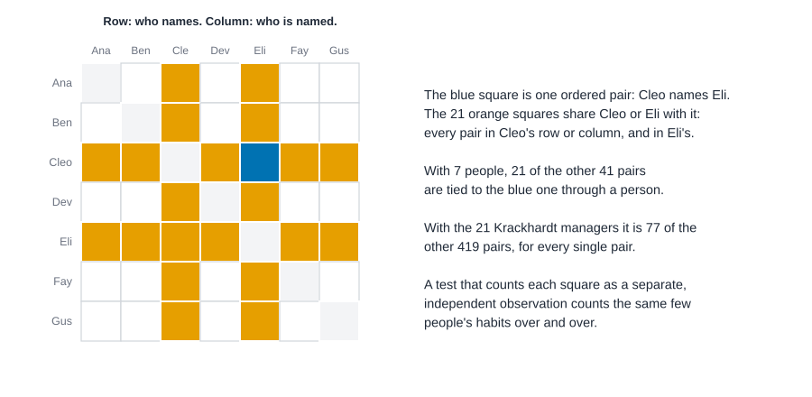

# Network regression and autocorrelation {#sec-network-regression}

::: {.callout-note appearance="simple"}
## Prerequisites
@sec-tests-and-null-models, which introduced QAP and the idea of relabeling people, and @sec-centrality, where we first met Krackhardt's 21 managers.
:::

## Who goes to whom for advice?

Twenty-one managers at a small manufacturing firm were asked, one at a time, "Whom do you go to for advice?" David Krackhardt collected the answers, along with who counts as whose friend and who reports to whom on the company's chart [@krackhardt1987cognitive]. You met these managers in @sec-centrality. The advice answers make a 21 by 21 table: a 1 in row $i$, column $j$ if manager $i$ goes to manager $j$.

Now ask the next question, the one that usually matters: *why*? Do people go to their friends? To their bosses? To someone in their own department, or someone at their own level? Does it matter how far apart two people are in age or in years at the firm?

That is a regression question: one outcome (an advice tie from $i$ to $j$, yes or no) and several things that might go with it. The trouble is that the rows of this data set are not people. They are *pairs* of people, and pairs that share a person are not independent of each other. @sec-tests-and-null-models showed you how QAP handles that for one predictor. This chapter does it for many predictors at once, and then turns to a second kind of question: an outcome measured on *people* (how long each manager has been at the firm) that might resemble the outcomes of the people they are tied to.

By the end you'll be able to:

- set up a regression on pairs, with a response matrix and predictor matrices;
- fit and read a multiple regression QAP (MRQAP), and say how many relabelings you used and why;
- fit a logistic version, and know which problem the permutation test solves and which it leaves alone;
- fit a network effects model for a person-level outcome and read its coefficient $\rho$;
- say, in one honest sentence, what a significant coefficient does not show.

## Regression when observations are not independent

Start with the table you'll actually fit. Every ordered pair of different managers is one row: manager 1 goes to manager 2 or doesn't, manager 2 goes to manager 1 or doesn't, and so on. With 21 managers that's $21 \times 20 = 420$ rows. The outcome in each row is the **response**: a 1 if the advice tie exists, a 0 if not. Things that might go with it are the **predictors**.

A predictor that describes a pair is itself a matrix over the same people. Two of ours are other relationships: friendship (does $i$ name $j$ as a friend?) and reporting (does $i$ report to $j$?). The other four are **similarity matrices**, built by comparing two people's attributes:

| matrix | cell $(i, j)$ holds | reads as |
|---|---|---|
| `same_dept` | 1 if $i$ and $j$ are in the same department, else 0 | do departments organize advice? |
| `level_gap` | $i$'s level minus $j$'s level (1 is the CEO, 3 a manager) | positive when the asker ranks lower than the person asked |
| `age_gap` | the absolute difference in age, in years | large for pairs far apart in age |
| `tenure_gap` | the absolute difference in years at the firm | large for pairs far apart in tenure |

Notice that `level_gap` keeps its sign, because "asking up" and "asking down" are different things, while the age and tenure gaps are absolute differences. Which one you pick is a modeling choice, and it changes what the coefficient means. The code builds all of them from the two data files.

::: {.callout-tip appearance="simple"}
## Code lives next to the idea
Each block runs on its own tab, and the tabs of a chapter run top to bottom as one script, so later blocks reuse what earlier ones built. knappnet has `net_mrqap` for the permutation regression; for the logistic and the network effects models it has nothing yet, so those are written by hand in all three languages, and I say so where it happens.
:::

::: {.panel-tabset group="language"}

## R

```r
library(knappnet)
library(dplyr)
library(purrr)
library(tibble)

nodes <- read.csv("data/krackhardt/nodes.csv") |> as_tibble()
edges <- read.csv("data/krackhardt/edges.csv") |> as_tibble()
n <- nrow(nodes)

# One 21 x 21 matrix per relation: a 1 in row i, column j means "manager i names manager j".
as_matrix <- \(relation_name) {
  e <- filter(edges, relation == relation_name)
  m <- matrix(0, n, n)
  m[cbind(e$from, e$to)] <- 1
  m
}
advice <- as_matrix("advice")
friendship <- as_matrix("friendship")
reports_to <- as_matrix("reports_to")

# Similarity matrices: one number for each ordered pair (row i, column j).
same_dept <- outer(nodes$department, nodes$department, "==") * 1
level_gap <- outer(nodes$level, nodes$level, "-") # row's level minus column's level
age_gap <- abs(outer(nodes$age, nodes$age, "-"))
tenure_gap <- abs(outer(nodes$tenure, nodes$tenure, "-"))
predictors <- list(friendship = friendship, reports_to = reports_to, same_dept = same_dept,
                   level_gap = level_gap, age_gap = age_gap, tenure_gap = tenure_gap)

# Which pairs of ordered pairs share a person?
dyads <- tibble(i = as.vector(row(advice)), j = as.vector(col(advice))) |> filter(i != j)
share <- outer(dyads$i, dyads$i, "==") | outer(dyads$i, dyads$j, "==") |
  outer(dyads$j, dyads$i, "==") | outer(dyads$j, dyads$j, "==")
tibble(
  managers = n, dyads = nrow(dyads), advice_ties = sum(advice),
  density = round(sum(advice) / nrow(dyads), 3),
  pairs_of_dyads = choose(nrow(dyads), 2), pairs_sharing_a_person = (sum(share) - nrow(dyads)) / 2,
  each_dyad_shares_with = mean(rowSums(share)) - 1
)
tibble(reporting_pairs = sum(reports_to), with_an_advice_tie = sum(advice * reports_to))
```

::: {.code-output}
```text
PENDING
```
:::

## Python

```python
import csv
import math

import numpy as np

with open("data/krackhardt/nodes.csv") as f:
    nodes = list(csv.DictReader(f))
with open("data/krackhardt/edges.csv") as f:
    edges = list(csv.DictReader(f))
n = len(nodes)
col = lambda name: np.array([float(r[name]) for r in nodes])
age, tenure, level, dept = col("age"), col("tenure"), col("level"), col("department")

# One 21 x 21 matrix per relation: a 1 in row i, column j means "manager i names manager j".
relation = {name: np.zeros((n, n)) for name in ["advice", "friendship", "reports_to"]}
for r in edges:
    relation[r["relation"]][int(r["from"]) - 1, int(r["to"]) - 1] = 1
advice, friendship, reports_to = relation["advice"], relation["friendship"], relation["reports_to"]

# Similarity matrices: one number for each ordered pair (row i, column j).
same_dept = (dept[:, None] == dept[None, :]).astype(float)
level_gap = level[:, None] - level[None, :]  # row's level minus column's level
age_gap = np.abs(age[:, None] - age[None, :])
tenure_gap = np.abs(tenure[:, None] - tenure[None, :])
predictors = {"friendship": friendship, "reports_to": reports_to, "same_dept": same_dept,
              "level_gap": level_gap, "age_gap": age_gap, "tenure_gap": tenure_gap}

# Which pairs of ordered pairs share a person?
off = ~np.eye(n, dtype=bool)  # the 420 ordered pairs
i_idx, j_idx = np.nonzero(off)
share = ((i_idx[:, None] == i_idx[None, :]) | (i_idx[:, None] == j_idx[None, :])
         | (j_idx[:, None] == i_idx[None, :]) | (j_idx[:, None] == j_idx[None, :]))
d = len(i_idx)
print(f"{n} managers, {d} ordered pairs (dyads), {advice.sum():g} advice ties, density {advice.sum() / d:.3f}")
print(f"pairs of dyads that share a person: {(share.sum() - d) // 2} of {d * (d - 1) // 2}")
print(f"each dyad shares a person with {share.sum(axis=1).mean() - 1:g} of the other {d - 1}")
print(f"reporting pairs with an advice tie: {advice[reports_to == 1].sum():g} of {reports_to.sum():g}")
```

::: {.code-output}
```text
21 managers, 420 ordered pairs (dyads), 190 advice ties, density 0.452
pairs of dyads that share a person: 16170 of 87990
each dyad shares a person with 77 of the other 419
reporting pairs with an advice tie: 19 of 20
```
:::

## Rust

```rust
use knappnet::matrix::Dense;

let node_text = std::fs::read_to_string("data/krackhardt/nodes.csv")?;
let edge_text = std::fs::read_to_string("data/krackhardt/edges.csv")?;
let column = |k: usize| -> Vec<f64> {
    node_text.lines().skip(1).map(|l| l.split(',').nth(k).unwrap().parse().unwrap()).collect()
};
let (age, tenure, level, dept) = (column(1), column(2), column(3), column(4));
let n = age.len();

// One 21 x 21 matrix per relation: a 1 in row i, column j means "manager i names manager j".
let relation = |name: &str| -> Dense {
    let mut m = Dense::zeros(n, n);
    for line in edge_text.lines().skip(1) {
        let p: Vec<&str> = line.split(',').collect();
        if p[2] == name {
            m.set(p[0].parse::<usize>().unwrap() - 1, p[1].parse::<usize>().unwrap() - 1, 1.0);
        }
    }
    m
};
let (advice, friendship, reports_to) = (relation("advice"), relation("friendship"), relation("reports_to"));

// Similarity matrices: one number for each ordered pair (row i, column j).
let from_pairs = |f: &dyn Fn(usize, usize) -> f64| -> Dense {
    let mut m = Dense::zeros(n, n);
    for i in 0..n {
        for j in 0..n {
            m.set(i, j, f(i, j));
        }
    }
    m
};
let same_dept = from_pairs(&|i, j| if dept[i] == dept[j] { 1.0 } else { 0.0 });
let level_gap = from_pairs(&|i, j| level[i] - level[j]); // row's level minus column's level
let age_gap = from_pairs(&|i, j| (age[i] - age[j]).abs());
let tenure_gap = from_pairs(&|i, j| (tenure[i] - tenure[j]).abs());

// Which pairs of ordered pairs share a person?
let dyads: Vec<(usize, usize)> = (0..n).flat_map(|i| (0..n).filter(move |&j| j != i).map(move |j| (i, j))).collect();
let d = dyads.len();
let shares = |a: (usize, usize), b: (usize, usize)| a.0 == b.0 || a.0 == b.1 || a.1 == b.0 || a.1 == b.1;
let sharing: usize = (0..d).map(|a| (a + 1..d).filter(|&b| shares(dyads[a], dyads[b])).count()).sum();
let ties: f64 = dyads.iter().map(|&(i, j)| advice.get(i, j)).sum();
println!("{n} managers, {d} ordered pairs (dyads), {ties} advice ties, density {:.3}", ties / d as f64);
println!("pairs of dyads that share a person: {sharing} of {}", d * (d - 1) / 2);
println!("each dyad shares a person with {} of the other {}", 2 * sharing / d, d - 1);
let with_advice: f64 = dyads.iter().map(|&(i, j)| advice.get(i, j) * reports_to.get(i, j)).sum();
let reporting: f64 = dyads.iter().map(|&(i, j)| reports_to.get(i, j)).sum();
println!("reporting pairs with an advice tie: {with_advice} of {reporting}");
```

::: {.code-output}
```text
21 managers, 420 ordered pairs (dyads), 190 advice ties, density 0.452
pairs of dyads that share a person: 16170 of 87990
each dyad shares a person with 77 of the other 419
reporting pairs with an advice tie: 19 of 20
```
:::

:::

The advice network is dense: 190 of the 420 possible ties are there, a density of 0.452. The last line in each tab is the one that matters for this chapter. Of the 87,990 ways to pick two different pairs of managers, 16,170 pairs of pairs share a person. That is only 18 percent of them, but it means every single pair shares a person with 77 of the other 419. One more number from these lines will matter later: 19 of the 20 managers who report to someone go to that person for advice.

@fig-nr-dependence shows the same thing on seven people. Pick one pair (blue). Every pair in the same two people's rows and columns (orange) is connected to it through a person.

{#fig-nr-dependence fig-alt="A seven by seven grid with people in rows and columns. The cell in row Cleo, column Eli is blue. 21 other off-diagonal cells are orange: all those in the rows and columns of Cleo and of Eli. The remaining 20 off-diagonal cells are white. Text beside the grid says that among 21 managers each pair shares a person with 77 of the other 419 pairs."}

## What goes wrong with ordinary regression

Ordinary least squares will happily fit a line to 420 rows. The coefficients it gives are fine as descriptions: they are the best straight-line summary of how the outcome moves with each predictor. What breaks is the *standard error*, and with it the p-value.

Ordinary standard errors assume that the leftover variation in one row says nothing about the leftover variation in another. In network data it does. Suppose manager 15 asks a lot of people for advice. All of the 20 rows where 15 is the asker are pulled up together. If a predictor also happens to be high in those rows (say 15 has an unusual level, so the level gap is large in all of them), regression sees 20 pieces of evidence where there is really one. The effective sample size is closer to the number of *people* than the number of *pairs*, and an ordinary test overstates how much it knows.

How badly? Here's an experiment you can run yourself. Make two matrices that are unrelated by construction: in each, a pair's value is its sender's own "sociability" (drawn once per person) plus fresh noise for the pair. There is no connection between the two matrices, so a test at the 5 percent level should call the correlation significant in about 5 percent of runs. Do it 200 times, and test each correlation two ways: with the ordinary test, and with QAP using 99 relabelings.

The random numbers come from a small generator written into the code (Park-Miller), so that all three languages draw exactly the same data and agree to the last digit.


::: {.panel-tabset group="language"}

## R

```r
# A pseudo-random stream that is identical in every language (Park-Miller), so all three tabs agree.
stream <- \(seed, k) accumulate(seq_len(k), \(s, i) (16807 * s) %% 2147483647, .init = seed)[-1] / 2147483647

sims <- 200
perms <- 99
per_dataset <- 2 * n + 2 * n^2 + perms * n
u <- matrix(stream(2024, sims * per_dataset), nrow = sims, byrow = TRUE)
off <- row(advice) != col(advice)

# Two unrelated matrices: each ties' value is its sender's own level of "sociability" plus noise.
one_pair <- \(row) {
  y <- row[1:n] + matrix(row[(2 * n + 1):(2 * n + n^2)], n, n, byrow = TRUE)
  x <- row[(n + 1):(2 * n)] + matrix(row[(2 * n + n^2 + 1):(2 * n + 2 * n^2)], n, n, byrow = TRUE)
  keys <- matrix(row[(2 * n + 2 * n^2 + 1):length(row)], nrow = perms, byrow = TRUE)
  r <- cor(y[off], x[off])
  t <- r * sqrt((sum(off) - 2) / (1 - r^2))
  relabeled <- map_dbl(seq_len(perms), \(b) cor(y[off], x[order(keys[b, ]), order(keys[b, ])][off]))
  tibble(naive = abs(t) > 1.966, qap = (1 + sum(abs(relabeled) >= abs(r) - 1e-12)) / (perms + 1) <= 0.05)
}
asplit(u, 1) |> map(one_pair) |> list_rbind() |>
  summarise(unrelated_pairs = n(), ordinary_test_rejects = sum(naive), qap_rejects = sum(qap))
```

::: {.code-output}
```text
PENDING
```
:::

## Python

```python
def stream(seed, k):
    """k pseudo-random numbers in (0, 1): Park-Miller, identical in every language."""
    out, s = np.empty(k), seed
    for i in range(k):
        s = 16807 * s % 2147483647
        out[i] = s / 2147483647
    return out

sims, perms = 200, 99
per_dataset = 2 * n + 2 * n * n + perms * n
u = stream(2024, sims * per_dataset).reshape(sims, per_dataset)

naive = qap = 0
for row in u:
    # Two unrelated matrices: each tie's value is its sender's own level of "sociability" plus noise.
    y = row[:n, None] + row[2 * n:2 * n + n * n].reshape(n, n)
    x = row[n:2 * n, None] + row[2 * n + n * n:2 * n + 2 * n * n].reshape(n, n)
    keys = row[2 * n + 2 * n * n:].reshape(perms, n)
    r = np.corrcoef(y[off], x[off])[0, 1]
    t = r * np.sqrt((d - 2) / (1 - r * r))
    relabeled = [np.corrcoef(y[off], x[np.ix_(p, p)][off])[0, 1] for p in np.argsort(keys, axis=1)]
    naive += abs(t) > 1.966
    qap += (1 + np.sum(np.abs(relabeled) >= abs(r) - 1e-12)) / (perms + 1) <= 0.05
print(f"unrelated pairs of matrices: {sims}")
print(f"the ordinary test calls the correlation significant in {naive} of {sims}")
print(f"QAP calls it significant in {qap} of {sims}")
```

::: {.code-output}
```text
unrelated pairs of matrices: 200
the ordinary test calls the correlation significant in 73 of 200
QAP calls it significant in 7 of 200
```
:::

## Rust

```rust
let stream = |seed: u64, k: usize| -> Vec<f64> {
    let mut s = seed;
    (0..k).map(|_| { s = 16807 * s % 2147483647; s as f64 / 2147483647.0 }).collect()
};
let pearson = |a: &[f64], b: &[f64]| -> f64 {
    let (ma, mb) = (a.iter().sum::<f64>() / a.len() as f64, b.iter().sum::<f64>() / b.len() as f64);
    let (mut sab, mut saa, mut sbb) = (0.0, 0.0, 0.0);
    for (p, q) in a.iter().zip(b) {
        sab += (p - ma) * (q - mb);
        saa += (p - ma).powi(2);
        sbb += (q - mb).powi(2);
    }
    sab / (saa * sbb).sqrt()
};
let (sims, perms) = (200, 99);
let per_dataset = 2 * n + 2 * n * n + perms * n;
let u = stream(2024, sims * per_dataset);

let (mut naive, mut qap) = (0, 0);
for s in 0..sims {
    let row = &u[s * per_dataset..(s + 1) * per_dataset];
    // Two unrelated matrices: each tie's value is its sender's own level of "sociability" plus noise.
    let y: Vec<f64> = dyads.iter().map(|&(i, j)| row[i] + row[2 * n + i * n + j]).collect();
    let x_full: Vec<f64> = (0..n * n).map(|k| row[n + k / n] + row[2 * n + n * n + k]).collect();
    let x: Vec<f64> = dyads.iter().map(|&(i, j)| x_full[i * n + j]).collect();
    let keys = &row[2 * n + 2 * n * n..];
    let r = pearson(&y, &x);
    let t = r * ((d - 2) as f64 / (1.0 - r * r)).sqrt();
    let mut hits = 0;
    for b in 0..perms {
        let k = &keys[b * n..(b + 1) * n];
        let mut p: Vec<usize> = (0..n).collect();
        p.sort_by(|&a, &c| k[a].partial_cmp(&k[c]).unwrap());
        let xp: Vec<f64> = dyads.iter().map(|&(i, j)| x_full[p[i] * n + p[j]]).collect();
        if pearson(&y, &xp).abs() >= r.abs() - 1e-12 { hits += 1; }
    }
    if t.abs() > 1.966 { naive += 1; }
    if (1 + hits) as f64 / (perms + 1) as f64 <= 0.05 { qap += 1; }
}
println!("unrelated pairs of matrices: {sims}");
println!("the ordinary test calls the correlation significant in {naive} of {sims}");
println!("QAP calls it significant in {qap} of {sims}");
```

::: {.code-output}
```text
unrelated pairs of matrices: 200
the ordinary test calls the correlation significant in 73 of 200
QAP calls it significant in 7 of 200
```
:::

:::

## The ordinary test cried wolf in 73 of 200 runs, a false-alarm rate of 36.5 percent where 5 percent was promised. QAP, which relabels people and so keeps each person's bundle of pairs together, did so in 7 of 200 (3.5 percent, which is within the wobble you'd expect from 200 runs). That is the whole case for the rest of the chapter. The regression is fine; the p-values need a different definition of chance.

## A hand-worked example on four people

Before the real data, a case small enough to do on paper. Four people: Ana, Ben, Cleo and Dev. Three pairs are tied: Ana-Ben, Ana-Cleo and Cleo-Dev. Ana and Ben are in one group, Cleo and Dev in another. Is a tie more likely inside a group?

There are $\binom{4}{2} = 6$ pairs:

| pair | tie? | same group? |
|---|---|---|
| Ana-Ben | 1 | 1 |
| Ana-Cleo | 1 | 0 |
| Ana-Dev | 0 | 0 |
| Ben-Cleo | 0 | 0 |
| Ben-Dev | 0 | 0 |
| Cleo-Dev | 1 | 1 |

Both same-group pairs are ties, so the average of the response is 1 among them. Among the four other pairs, one of four is a tie, so the average is 0.25. For a 0-or-1 predictor, the regression slope is the difference between those two averages, $1 - 0.25 = 0.75$, and the intercept is 0.25. The correlation between the two columns is

$$
r = \frac{N n_{11} - n_y n_x}{\sqrt{n_y (N - n_y)\, n_x (N - n_x)}} = \frac{6 \cdot 2 - 3 \cdot 2}{\sqrt{3 \cdot 3 \cdot 2 \cdot 4}} = \frac{6}{\sqrt{72}} \approx 0.707,
$$

where $N = 6$ pairs, $n_y = 3$ tied pairs, $n_x = 2$ same-group pairs and $n_{11} = 2$ pairs that are both.

Now relabel the people, which is what QAP does. There are $4! = 24$ ways to do it. The same-group pairs always form two disjoint pairs, so relabeling can only turn them into one of three arrangements: {Ana-Ben, Cleo-Dev}, {Ana-Cleo, Ben-Dev} or {Ana-Dev, Ben-Cleo}. Each comes up 8 times in 24. They overlap the three ties in 2, 1 and 0 pairs, giving correlations 0.707, 0 and $-0.707$. So the share of relabelings at least as high as ours is $8/24 = 1/3$.

Two lessons. First, the exact p-value here is one third, and *it can never be smaller with four people*, however strong the pattern looks. A permutation test cannot see more evidence than the number of distinct relabelings allows. Second, nothing in this calculation used a formula for how the correlation is "supposed" to be distributed. It just counted.

The code does it all three ways. knappnet can enumerate every relabeling exactly (up to ten people), and the by-hand version loops over all 24.


::: {.panel-tabset group="language"}

## R

```r
# Four people; ties Ana-Ben, Ana-Cleo, Cleo-Dev; groups {Ana, Ben} and {Cleo, Dev}.
toy_ties <- matrix(0, 4, 4)
toy_ties[rbind(c(1, 2), c(1, 3), c(3, 4))] <- 1
toy_ties <- pmax(toy_ties, t(toy_ties))
toy_group <- outer(c(1, 1, 2, 2), c(1, 1, 2, 2), "==") * 1
low <- lower.tri(toy_ties)

# For a 0/1 predictor the slope is the difference between the two group averages.
slope <- mean(toy_ties[low][toy_group[low] == 1]) - mean(toy_ties[low][toy_group[low] == 0])

# Every one of the 4! = 24 relabelings, checked exactly.
toy <- net_qap_cor(toy_ties, toy_group, exact = TRUE, mode = "graph")
tibble(
  slope = slope, correlation = round(toy$statistic, 3), relabelings = toy$draws,
  share_at_least = toy$p.value[["Pr(>=r)"]]
)
tibble(r = round(toy$dist, 3)) |> count(r, name = "relabelings") |> arrange(desc(r))
```

::: {.code-output}
```text
PENDING
```
:::

## Python

```python
from collections import Counter
from itertools import permutations

# Four people; ties Ana-Ben, Ana-Cleo, Cleo-Dev; groups {Ana, Ben} and {Cleo, Dev}.
toy_ties = np.zeros((4, 4))
for a, b in [(0, 1), (0, 2), (2, 3)]:
    toy_ties[a, b] = toy_ties[b, a] = 1
group = np.array([0, 0, 1, 1])
toy_group = (group[:, None] == group[None, :]).astype(float)
low4 = np.tril_indices(4, -1)
y4, x4 = toy_ties[low4], toy_group[low4]

# For a 0/1 predictor the slope is the difference between the two group averages.
slope = y4[x4 == 1].mean() - y4[x4 == 0].mean()
r_obs = np.corrcoef(y4, x4)[0, 1]
# Every one of the 4! = 24 relabelings, checked exactly.
draws = [np.corrcoef(y4, toy_group[np.ix_(p, p)][low4])[0, 1] for p in permutations(range(4))]
print(f"slope {slope:.2f}, correlation {r_obs:.3f}")
print(f"{len(draws)} relabelings, share at least as high {np.mean(np.array(draws) >= r_obs - 1e-10):.3f}")
for r, count in sorted(Counter(round(v, 3) + 0.0 for v in draws).items(), reverse=True):
    print(f"  r = {r:+.3f}: {count} relabelings")
```

::: {.code-output}
```text
slope 0.75, correlation 0.707
24 relabelings, share at least as high 0.333
  r = +0.707: 8 relabelings
  r = +0.000: 8 relabelings
  r = -0.707: 8 relabelings
```
:::

## Rust

```rust
use knappnet::qap::{compute_qap_cor, Permutations, QapCorOptions, QapMode};

// Four people; ties Ana-Ben, Ana-Cleo, Cleo-Dev; groups {Ana, Ben} and {Cleo, Dev}.
let mut toy_ties = Dense::zeros(4, 4);
for (a, b) in [(0, 1), (0, 2), (2, 3)] {
    toy_ties.set(a, b, 1.0);
    toy_ties.set(b, a, 1.0);
}
let toy_group = |i: usize, j: usize| if (i < 2) == (j < 2) { 1.0 } else { 0.0 };
let mut toy_same = Dense::zeros(4, 4);
for i in 0..4 {
    for j in 0..4 {
        if i != j { toy_same.set(i, j, toy_group(i, j)); }
    }
}
// For a 0/1 predictor the slope is the difference between the two group averages.
let low_pairs: Vec<(usize, usize)> = (0..4).flat_map(|i| (0..i).map(move |j| (i, j))).collect();
let mean_where = |flag: f64| {
    let v: Vec<f64> = low_pairs.iter().filter(|&&(i, j)| toy_same.get(i, j) == flag).map(|&(i, j)| toy_ties.get(i, j)).collect();
    v.iter().sum::<f64>() / v.len() as f64
};
let options = QapCorOptions { mode: QapMode::Graph, permutations: Permutations::Exhaustive, keep_draws: true, ..Default::default() };
let toy = compute_qap_cor(&toy_ties, &toy_same, options)?;
println!("slope {:.2}, correlation {:.3}", mean_where(1.0) - mean_where(0.0), toy.statistic);
println!("{} relabelings, share at least as high {:.3}", toy.draws, toy.tail.compute_p_ge());
let mut counts: Vec<(f64, usize)> = Vec::new();
for &v in &toy.distribution {
    let v = (v * 1000.0).round() / 1000.0 + 0.0;
    match counts.iter_mut().find(|c| (c.0 - v).abs() < 1e-9) {
        Some(c) => c.1 += 1,
        None => counts.push((v, 1)),
    }
}
counts.sort_by(|a, b| b.0.partial_cmp(&a.0).unwrap());
for (r, count) in counts { println!("  r = {r:+.3}: {count} relabelings"); }
```

::: {.code-output}
```text
slope 0.75, correlation 0.707
24 relabelings, share at least as high 0.333
  r = +0.707: 8 relabelings
  r = +0.000: 8 relabelings
  r = -0.707: 8 relabelings
```
:::

:::

The three tabs agree: slope 0.75, correlation 0.707, 8 of 24 relabelings at least that high, and the counts come in 8, 8 and 8 for 0.707, 0 and $-0.707$, as we worked out.

## QAP correlation: a recap

The one-predictor version is the **QAP correlation**, which you met in @sec-tests-and-null-models [@hubert1976quadratic; @krackhardt1987qap]. With $N$ pairs, response values $y_{ij}$ and predictor values $x_{ij}$, it is the Pearson correlation

$$
r = \frac{\sum (y_{ij} - \bar y)(x_{ij} - \bar x)}{\sqrt{\sum (y_{ij} - \bar y)^2 \sum (x_{ij} - \bar x)^2}},
$$

and its p-value is the share of relabelings (the same permutation applied to the rows and columns of $x$) whose correlation is at least as far from zero as the observed one. Here is advice against friendship, all 420 ordered pairs.


::: {.panel-tabset group="language"}

## R

```r
cor_test <- net_qap_cor(advice, friendship, reps = 5000, seed = 1)
tibble(
  correlation = round(cor_test$statistic, 3),
  share_at_least_as_extreme = cor_test$p.value[["Pr(>=|r)"]]
)
```

::: {.code-output}
```text
PENDING
```
:::

## Python

```python
def relabel(v, p, cells, sym):
    """Put a list of dyad values back in a matrix, relabel the people, and read the dyads off again."""
    m = np.zeros((n, n))
    m[cells] = v
    if sym:
        m = m + m.T
    return m[np.ix_(p, p)][cells]

rng = np.random.default_rng(1)
r_obs = np.corrcoef(advice[off], friendship[off])[0, 1]
draws = np.array([np.corrcoef(advice[off], relabel(friendship[off], rng.permutation(n), off, False))[0, 1]
                  for _ in range(5000)])
print(f"correlation {r_obs:.3f}")
print(f"share of relabelings at least as extreme {np.mean(np.abs(draws) >= abs(r_obs) - 1e-10):.4f}")
```

::: {.code-output}
```text
correlation 0.155
share of relabelings at least as extreme 0.0340
```
:::

## Rust

```rust
let cor_options = QapCorOptions { permutations: Permutations::Random { reps: 5_000, seed: 1 }, ..Default::default() };
let cor_test = compute_qap_cor(&advice, &friendship, cor_options)?;
println!("correlation {:.3}", cor_test.statistic);
println!("share of relabelings at least as extreme {:.4}", cor_test.tail.compute_p_abs());
```

::: {.code-output}
```text
correlation 0.155
share of relabelings at least as extreme 0.0340
```
:::

:::

The correlation between advice and friendship is 0.155, and about 3 percent of relabelings reach that far from zero. Modest but not nothing: people who are friends are somewhat more likely to be asked for advice. What the correlation can't do is say whether friendship matters *once you account for* the org chart, because the two surely overlap. For that you need several predictors in the model.

## Multiple regression QAP

**Multiple regression QAP**, or MRQAP, is an ordinary linear regression on the pairs, with the p-values replaced by permutation p-values [@krackhardt1988predicting]. The model is

$$
y_{ij} = \beta_0 + \beta_1 x_{ij1} + \beta_2 x_{ij2} + \dots + \beta_K x_{ijK} + \varepsilon_{ij},
$$

where $y_{ij}$ is the response for the pair $(i, j)$ (1 if $i$ goes to $j$ for advice), $x_{ijk}$ is predictor $k$ for that pair, $\beta_k$ is its coefficient, and $\varepsilon_{ij}$ is whatever is left over. The coefficients are fitted by least squares, exactly as in any regression. Nothing about *estimating* them changes.

What changes is the test. The null hypothesis for predictor $k$ is "$\beta_k = 0$": this pair-level pattern has no relationship with the response once the other predictors are accounted for. The permutation scheme has to build a reference distribution for $\beta_k$'s t statistic under that null, while keeping everything else about the data as it is. There are two ways.

**Y-permutation** (Krackhardt's original). Relabel the people in the response, refit the model, and record each coefficient's t statistic. Repeat many times. The trouble: relabeling the response breaks its relationship with *every* predictor, including the ones that really do matter. The reference distribution then describes "nothing is related to anything", not "predictor $k$ is unrelated, given the rest", and it can mislead when predictors overlap.

**Double semi-partialling** (DSP), the default in knappnet and the recommended choice [@dekker2007sensitivity]. To test predictor $k$:

1. regress the predictor $x_k$ on all the other predictors (across the pairs), and keep what's left over, the part of $x_k$ the others can't explain;
2. relabel the people in that leftover matrix;
3. refit the full model with the relabeled leftover in place of $x_k$, and record the t statistic for $k$;
4. repeat many times and count how often it is at least as far from zero as the t you observed.

The leftover part carries no linear overlap with the other predictors, so relabeling it leaves the relationship between the response and the *other* predictors alone and breaks only the one under test. Dekker, Krackhardt and Snijders compared the variants in simulations and recommended double semi-partialling, the variant whose error rates they found held up best when predictors are correlated and when the network has strong person effects [@dekker2007sensitivity]. I did not repeat their simulations here.

Now the real model: advice on friendship, reporting, same department, level gap, age gap and tenure gap, with 5,000 relabelings. We fit it twice, once with each method. (The R and Rust tabs use the same random generator and agree exactly; the Python tab draws its own relabelings, so its p-values differ a little.)


::: {.panel-tabset group="language"}

## R

```r
terms <- names(predictors)
fit_dsp <- net_mrqap(advice, predictors, reps = 5000, seed = 1)
fit_y <- net_mrqap(advice, predictors, reps = 5000, seed = 1, method = "y")
tibble(
  term = terms,
  coefficient = fit_dsp$coefficients[-1],
  t = fit_dsp$t[-1],
  p_dsp = fit_dsp$p.value[-1, "Pr(>=|b|)"],
  p_y = fit_y$p.value[-1, "Pr(>=|b|)"]
) |>
  mutate(across(where(is.numeric), \(v) round(v, 3)))
tibble(intercept = round(fit_dsp$coefficients[[1]], 3), r_squared = round(fit_dsp$r.squared, 3), dyads = fit_dsp$dyads)
```

::: {.code-output}
```text
PENDING
```
:::

## Python

```python
def ols(y, D):
    """Ordinary least squares: coefficients, t statistics, residuals."""
    gram_inv = np.linalg.inv(D.T @ D)
    beta = gram_inv @ D.T @ y
    resid = y - D @ beta
    se = np.sqrt(np.diag(gram_inv) * (resid @ resid) / (len(y) - D.shape[1]))
    return beta, beta / se, resid

def mrqap(y_mat, mats, reps, seed, cells=off, sym=False, columns=None, y_method=True):
    """MRQAP by hand: p-values by double semi-partialling and, optionally, by permuting the response."""
    rng = np.random.default_rng(seed)
    y = y_mat[cells]
    D = np.column_stack([np.ones(len(y))] + [m[cells] for m in mats])
    beta, t, resid = ols(y, D)
    columns = range(D.shape[1]) if columns is None else columns
    # What is left of each predictor once the others are removed.
    rest = {k: D[:, k] - np.delete(D, k, axis=1) @ np.linalg.lstsq(np.delete(D, k, axis=1), D[:, k], rcond=None)[0]
            for k in columns}
    p_dsp, p_y = np.zeros(D.shape[1]), np.zeros(D.shape[1])
    for _ in range(reps):
        p = rng.permutation(n)
        if y_method:
            p_y += np.abs(ols(relabel(y, p, cells, sym), D)[1]) >= np.abs(t) - 1e-10
        for k in columns:
            Dp = D.copy()
            Dp[:, k] = relabel(rest[k], p, cells, sym)
            p_dsp[k] += abs(ols(y, Dp)[1][k]) >= abs(t[k]) - 1e-10
    r2 = 1 - (resid @ resid) / ((y - y.mean()) @ (y - y.mean()))
    return dict(beta=beta, t=t, p_dsp=p_dsp / reps, p_y=p_y / reps, r2=r2, dyads=len(y))

fit = mrqap(advice, list(predictors.values()), reps=5000, seed=1)
print(f"{'':<12} {'coefficient':>11} {'t':>7} {'p (dsp)':>8} {'p (y)':>8}")
for k, label in enumerate(predictors, start=1):
    print(f"{label:<12} {fit['beta'][k]:>11.3f} {fit['t'][k]:>7.2f} {fit['p_dsp'][k]:>8.3f} {fit['p_y'][k]:>8.3f}")
print(f"intercept {fit['beta'][0]:.3f}, R-squared {fit['r2']:.3f} on {fit['dyads']} dyads")
```

::: {.code-output}
```text
             coefficient       t  p (dsp)    p (y)
friendship         0.116    2.05    0.176    0.160
reports_to         0.434    3.61    0.001    0.001
same_dept         -0.066   -1.10    0.338    0.328
level_gap          0.083    2.72    0.265    0.265
age_gap           -0.004   -1.45    0.322    0.323
tenure_gap        -0.009   -2.46    0.091    0.091
intercept 0.539, R-squared 0.113 on 420 dyads
```
:::

## Rust

```rust
use knappnet::qap::{fit_mrqap, MrqapMethod, MrqapOptions};

let labels = ["friendship", "reports_to", "same_dept", "level_gap", "age_gap", "tenure_gap"];
let mats = vec![friendship.clone(), reports_to.clone(), same_dept.clone(), level_gap.clone(), age_gap.clone(), tenure_gap.clone()];
let run = |method: MrqapMethod| {
    let options = MrqapOptions { method, permutations: Permutations::Random { reps: 5_000, seed: 1 }, ..Default::default() };
    fit_mrqap(&advice, &mats, options)
};
let fit_dsp = run(MrqapMethod::DoubleSemiPartialling)?;
let fit_y = run(MrqapMethod::YPermutation)?;
println!("{:<12} {:>11} {:>7} {:>8} {:>8}", "", "coefficient", "t", "p (dsp)", "p (y)");
for (k, label) in labels.iter().enumerate() {
    println!("{:<12} {:>11.3} {:>7.2} {:>8.3} {:>8.3}", label, fit_dsp.coefficients[k + 1], fit_dsp.t[k + 1],
             fit_dsp.tails[k + 1].compute_p_abs(), fit_y.tails[k + 1].compute_p_abs());
}
println!("intercept {:.3}, R-squared {:.3} on {} dyads", fit_dsp.coefficients[0], fit_dsp.r_squared, fit_dsp.dyads);
```

::: {.code-output}
```text
             coefficient       t  p (dsp)    p (y)
friendship         0.116    2.05    0.172    0.168
reports_to         0.434    3.61    0.000    0.000
same_dept         -0.066   -1.10    0.342    0.335
level_gap          0.083    2.72    0.269    0.279
age_gap           -0.004   -1.45    0.317    0.306
tenure_gap        -0.009   -2.46    0.097    0.096
intercept 0.539, R-squared 0.113 on 420 dyads
```
:::

:::

Read the table one row at a time. The response is 0 or 1, so a coefficient is a change in the *chance* of an advice tie, holding the other predictors fixed. This is a **linear probability model**: a straight-line fit to a yes-or-no outcome. It is easy to read, and for unusual pairs it can predict below 0 or above 1, which is one reason a logistic version exists (below).

- **reports_to, 0.434.** A pair where $i$ reports to $j$ has a chance of an advice tie from $i$ to $j$ that is 43 percentage points higher. The t statistic is 3.61, and in 5,000 relabelings none or almost none went that far (the p-value prints as 0.000; report it as below 0.001).
- **friendship, 0.116.** Friends are about 12 points more likely to have an advice tie. The t statistic of 2.05 is borderline for an ordinary test, and the permutation p-value is about 0.17.
- **level_gap, 0.083.** For each step down the hierarchy that the asker is from the person asked, the chance goes up about 8 points. People ask up. The t statistic is 2.72, which an ordinary test would call clearly significant. The permutation p-value is about 0.27.
- **tenure_gap, $-0.009$.** Each extra year of difference in tenure lowers the chance by about 1 point, so 10 years apart is about 9 points lower. The permutation p-value is about 0.10.
- **same_dept and age_gap** are small and nowhere near significant.
- **intercept, 0.539.** The chance of an advice tie for a pair that is not friends, not in a reporting line, in different departments, at the same level, with the same age and tenure. That's a baseline for a rather artificial pair, not a finding. R-squared is 0.113.

The two columns of p-values, double semi-partialling and Y-permutation, agree closely here (no gap above about 0.01). That's common when predictors overlap little. They can part ways when predictors overlap a lot.

The more important comparison is between the t statistics and the permutation p-values. Four of the six t statistics (friendship 2.05, reports_to 3.61, level_gap 2.72, tenure_gap $-2.46$) are beyond the 1.97 cutoff that an ordinary test applies at the 5 percent level. After relabeling, only reports_to survives. @fig-nr-null-distribution shows why for the level gap.

{#fig-nr-null-distribution fig-alt="A histogram of 1,000 relabeled t statistics for the level gap, centered near zero and spread from about -7.4 to 7.6. Dashed vertical lines mark plus and minus 1.97, the ordinary test cutoffs. A solid line marks the observed t of 2.72. Bars at least that far from zero are orange and hold 27% of the draws. The 95th percentile of the absolute relabeled t is 4.93."}

The level gap is built from two people's levels, so it varies mostly *by person*: it is the asker's level minus the level of the person asked, a row effect plus a column effect. Age gap and tenure gap are the same kind of animal. Predictors like that are exactly the ones whose evidence an ordinary test double-counts, and the relabeled t statistics spread much wider than the textbook curve. A t of 2.72 is ordinary there; the 95th percentile of the relabeled $|t|$ is about 4.9.

@fig-nr-coefficients puts every predictor on one scale. Each coefficient is standardized (the change in advice, in standard deviations, per standard deviation of the predictor). The gray band is where 95 percent of coefficients land when the managers are relabeled, and the blue line is the ordinary 95 percent interval.

{#fig-nr-coefficients fig-alt="Six rows, one per predictor, each with a gray band, a blue horizontal line and a dot. The dot is outside the gray band, and filled, only for reports_to. The blue line, the ordinary interval, stays on one side of zero for friendship, reports_to, level_gap, tenure_gap. For all but the filled dots the dot is hollow and inside the band."}

## How the permutation test is built, and how many relabelings to use

Under double semi-partialling, one relabeling means: draw a random reordering of the $n$ people; apply it to the rows and columns together of the leftover matrix for predictor $k$; refit; and record the t statistic $t^*_{k}$. After $B$ relabelings the p-value is

$$
p_k = \frac{\#\{b : |t^*_{kb}| \ge |t_k|\}}{B},
$$

where $t_k$ is the observed t statistic and $t^*_{kb}$ is the statistic from relabeling $b$. knappnet and the R package `sna` report this count-over-$B$ share. Many authors add one to the top and the bottom, $(1 + \#)/(1 + B)$, which counts the observed data as one of the relabelings and keeps the p-value from being exactly zero. Either way, when none of the draws gets as far as the observed value, report "below $1/B$".

The p-value is itself an estimate from random draws. If the true share is $p$, then $B$ random relabelings give an estimate with standard deviation about $\sqrt{p(1-p)/B}$. Here is the friendship p-value with 100, 1,000 and 10,000 relabelings, each with three different seeds, next to that formula's prediction (evaluated at the first seed's p-value).


::: {.panel-tabset group="language"}

## R

```r
# The friendship coefficient's p-value, with more and more relabelings and three different seeds.
tidyr::expand_grid(reps = c(100, 1000, 10000), seed = 1:3) |>
  mutate(p = map2_dbl(reps, seed, \(r, s) net_mrqap(advice, predictors, reps = r, seed = s)$p.value["friendship", "Pr(>=|b|)"])) |>
  summarise(p_seed_1 = p[1], p_seed_2 = p[2], p_seed_3 = p[3], .by = reps) |>
  mutate(sd_of_p = sqrt(p_seed_1 * (1 - p_seed_1) / reps))
```

::: {.code-output}
```text
PENDING
```
:::

## Python

```python
print(f"{'reps':>6} {'seed 1':>7} {'seed 2':>7} {'seed 3':>7} {'sd of p':>8}")
for reps in (100, 1000, 10000):
    ps = [mrqap(advice, list(predictors.values()), reps, seed, columns=[1], y_method=False)["p_dsp"][1] for seed in (1, 2, 3)]
    print(f"{reps:>6} {ps[0]:>7.3f} {ps[1]:>7.3f} {ps[2]:>7.3f} {np.sqrt(ps[0] * (1 - ps[0]) / reps):>8.3f}")
```

::: {.code-output}
```text
  reps  seed 1  seed 2  seed 3  sd of p
   100   0.140   0.180   0.140    0.035
  1000   0.167   0.180   0.148    0.012
 10000   0.172   0.174   0.167    0.004
```
:::

## Rust

```rust
println!("{:>6} {:>7} {:>7} {:>7} {:>8}", "reps", "seed 1", "seed 2", "seed 3", "sd of p");
for reps in [100, 1_000, 10_000] {
    let ps: Vec<f64> = (1..=3u64).map(|seed| {
        let options = MrqapOptions { permutations: Permutations::Random { reps, seed }, ..Default::default() };
        fit_mrqap(&advice, &mats, options).unwrap().tails[1].compute_p_abs()
    }).collect();
    println!("{:>6} {:>7.3} {:>7.3} {:>7.3} {:>8.3}", reps, ps[0], ps[1], ps[2], (ps[0] * (1.0 - ps[0]) / reps as f64).sqrt());
}
```

::: {.code-output}
```text
  reps  seed 1  seed 2  seed 3  sd of p
   100   0.140   0.220   0.190    0.035
  1000   0.166   0.191   0.192    0.012
 10000   0.172   0.172   0.175    0.004
```
:::

:::

With 100 relabelings the friendship p-value wandered between about 0.14 and 0.22 across seeds, so a verdict of "significant" or "not" could have gone either way. With 1,000 it stayed between about 0.17 and 0.19, and with 10,000 it sat at about 0.17. The last column predicts the wobble well. A working rule: 1,000 relabelings while you explore, 10,000 or more for a p-value you will report, and more still if it lands near your threshold. Always report the number of relabelings and the seed. With ten people or fewer you can skip the randomness and enumerate every relabeling exactly, as the toy example did.

What does the p-value say? It says: if this predictor had no linear relationship with the response beyond the bundling in the data, a t statistic this far from zero would turn up in that share of relabelings. It doesn't say how likely the predictor is to be "real", how big its effect is (that's the coefficient), or whether the pattern would hold in another firm.

## Valued responses and undirected data

Not every response is yes or no. Often you have a count or a strength: how many times two people met, how much two countries trade. The set-up is the same, and the coefficients keep their ordinary regression meaning: *the change in the expected response for a one-unit increase in the predictor*.

To try it, collapse advice to the *pair*: for each pair of managers, count how many of the two possible advice ties exist, 0, 1 or 2. That is undirected, so each pair is used once (210 pairs, "graph mode"), and the predictors have to be symmetric too. Friendship becomes the number of friendship ties in the pair (0 to 2), reporting becomes "one reports to the other", and the level gap becomes an absolute difference, since there is no longer an asker.


::: {.panel-tabset group="language"}

## R

```r
# A valued response: how many of the two advice ties between a pair exist (0, 1 or 2). Pairs, not ordered pairs.
mutual <- \(m) m + t(m)
valued_predictors <- list(
  friendship = mutual(friendship), reports_to = mutual(reports_to), same_dept = same_dept,
  level_gap = abs(level_gap), age_gap = age_gap, tenure_gap = tenure_gap
)
fit_valued <- net_mrqap(mutual(advice), valued_predictors, reps = 5000, seed = 1, mode = "graph")
tibble(
  term = names(valued_predictors),
  coefficient = fit_valued$coefficients[-1],
  t = fit_valued$t[-1],
  p = fit_valued$p.value[-1, "Pr(>=|b|)"]
) |>
  mutate(across(where(is.numeric), \(v) round(v, 3)))
tibble(intercept = round(fit_valued$coefficients[[1]], 3), r_squared = round(fit_valued$r.squared, 3), pairs = fit_valued$dyads)
```

::: {.code-output}
```text
PENDING
```
:::

## Python

```python
# A valued response: how many of the two advice ties between a pair exist (0, 1 or 2). Pairs, not ordered pairs.
low = np.tril_indices(n, -1)
mutual = lambda m: m + m.T
valued = {"friendship": mutual(friendship), "reports_to": mutual(reports_to), "same_dept": same_dept,
          "level_gap": np.abs(level_gap), "age_gap": age_gap, "tenure_gap": tenure_gap}
fit_valued = mrqap(mutual(advice), list(valued.values()), reps=5000, seed=1, cells=low, sym=True, y_method=False)
print(f"{'':<12} {'coefficient':>11} {'t':>7} {'p':>8}")
for k, label in enumerate(valued, start=1):
    print(f"{label:<12} {fit_valued['beta'][k]:>11.3f} {fit_valued['t'][k]:>7.2f} {fit_valued['p_dsp'][k]:>8.3f}")
print(f"intercept {fit_valued['beta'][0]:.3f}, R-squared {fit_valued['r2']:.3f} on {fit_valued['dyads']} pairs")
```

::: {.code-output}
```text
             coefficient       t        p
friendship         0.194    2.63    0.033
reports_to         0.588    3.10    0.004
same_dept         -0.201   -1.53    0.169
level_gap          0.141    1.68    0.236
age_gap           -0.007   -1.08    0.441
tenure_gap        -0.022   -3.04    0.032
intercept 0.994, R-squared 0.164 on 210 pairs
```
:::

## Rust

```rust
// A valued response: how many of the two advice ties between a pair exist (0, 1 or 2). Pairs, not ordered pairs.
let mutual = |m: &Dense| from_pairs(&|i, j| m.get(i, j) + m.get(j, i));
let valued_mats = vec![mutual(&friendship), mutual(&reports_to), same_dept.clone(),
                       from_pairs(&|i, j| level_gap.get(i, j).abs()), age_gap.clone(), tenure_gap.clone()];
let options = MrqapOptions { mode: QapMode::Graph, permutations: Permutations::Random { reps: 5_000, seed: 1 }, ..Default::default() };
let fit_valued = fit_mrqap(&mutual(&advice), &valued_mats, options)?;
println!("{:<12} {:>11} {:>7} {:>8}", "", "coefficient", "t", "p");
for (k, label) in labels.iter().enumerate() {
    println!("{:<12} {:>11.3} {:>7.2} {:>8.3}", label, fit_valued.coefficients[k + 1], fit_valued.t[k + 1], fit_valued.tails[k + 1].compute_p_abs());
}
println!("intercept {:.3}, R-squared {:.3} on {} pairs", fit_valued.coefficients[0], fit_valued.r_squared, fit_valued.dyads);
```

::: {.code-output}
```text
             coefficient       t        p
friendship         0.194    2.63    0.029
reports_to         0.588    3.10    0.004
same_dept         -0.201   -1.53    0.163
level_gap          0.141    1.68    0.241
age_gap           -0.007   -1.08    0.442
tenure_gap        -0.022   -3.04    0.033
intercept 0.994, R-squared 0.164 on 210 pairs
```
:::

:::

Now each coefficient is a change in the expected number of advice ties inside a pair, on a scale of 0 to 2. Each extra friendship tie within a pair adds about 0.19 advice ties (permutation p about 0.03). A reporting pair has about 0.59 more advice ties than other pairs (p about 0.004). Each extra year of tenure gap takes away about 0.02 (p about 0.03).

Compare this with the directed model. The friendship p-value went from about 0.17 to about 0.03, and tenure gap from about 0.10 to 0.03. Nothing is wrong: collapsing to pairs and making the predictors symmetric changes the *question* (is a pair's total advice linked to its friendships, rather than does $i$'s advice to $j$ follow $i$'s naming $j$ as a friend). It is a warning all the same. A choice about coding, made after seeing the data, can move a p-value across 0.05. With six coefficients in each of two models, a p of 0.03 in one of them is not a finding. Decide the coding before you look, and report the alternative.

## Logistic network regression, and its limits

For a yes-or-no response the standard tool is logistic regression, which models the **log-odds** of a tie:

$$
\log \frac{\pi_{ij}}{1 - \pi_{ij}} = \beta_0 + \beta_1 x_{ij1} + \dots + \beta_K x_{ijK},
$$

where $\pi_{ij}$ is the chance of a tie from $i$ to $j$ and the other symbols are as before. The odds are $\pi/(1-\pi)$, and $e^{\beta_k}$ is the factor by which the *odds* are multiplied when predictor $k$ goes up by one. The model can't predict a probability outside 0 and 1, which fixes the linear model's one awkward habit. Fitting uses Newton's method, which is a short loop around a weighted least squares step.

The permutation test works the same way as before: relabel what is left of predictor $k$ after the others are removed, refit, and compare the z statistic (coefficient divided by its usual logistic standard error) with its relabeled values. I use 400 relabelings, since each one is a full logistic fit. knappnet doesn't have this model yet, so all three tabs are written by hand, and the R reference is `sna::netlogit`.

After the table comes a fit check, because there is a question the permutation test cannot answer: does the model describe the network? We compare two things the model could be expected to reproduce. One is the number of pairs of managers who go to each other for advice. The other is the *spread* of how many people each manager goes to, measured as the standard deviation of out-degree. The model's expected values come from the fitted probabilities, assuming ties are independent given the predictors.


::: {.panel-tabset group="language"}

## R

```r
# Logistic regression by Newton's method (knappnet has no logistic network regression yet, so this is by hand).
X <- cbind(1, do.call(cbind, map(predictors, \(m) m[off])))
y <- advice[off]
logit_fit <- \(X, y) {
  step <- \(b, i) {
    p <- as.vector(plogis(X %*% b))
    b + solve(crossprod(X, X * (p * (1 - p))), crossprod(X, y - p))[, 1]
  }
  b <- reduce(seq_len(15), step, .init = rep(0, ncol(X)))
  p <- as.vector(plogis(X %*% b))
  list(b = b, fitted = p, info = crossprod(X, X * (p * (1 - p))))
}
z_of <- \(fit, k) fit$b[k] / sqrt(solve(fit$info)[k, k])
fit <- logit_fit(X, y)

# Double semi-partialling again: relabel what is left of predictor k, refit, and compare z.
relabel <- \(v, p) { m <- matrix(0, n, n); m[off] <- v; m[p, p][off] }
set.seed(1)
perm_list <- map(seq_len(400), \(i) sample(n))
p_logit <- map_dbl(2:7, \(k) {
  rest <- resid(lm(X[, k] ~ X[, -k] - 1))
  z_perm <- map_dbl(perm_list, \(p) { Xp <- X; Xp[, k] <- relabel(rest, p); z_of(logit_fit(Xp, y), k) })
  mean(abs(z_perm) >= abs(z_of(fit, k)) - 1e-10)
})
tibble(term = names(predictors), log_odds = fit$b[-1], odds_ratio = exp(fit$b[-1]), z = map_dbl(2:7, \(k) z_of(fit, k)), p = p_logit) |>
  mutate(across(where(is.numeric), \(v) round(v, 3)))

# Does the fitted model reproduce the number of mutual pairs...
fitted <- matrix(0, n, n)
fitted[off] <- fit$fitted
tibble(mutual_observed = sum(advice * t(advice)) / 2, mutual_expected = round(sum(fitted * t(fitted)) / 2, 1))
# ...and the spread of how many people each manager asks (standard deviation of out-degree)?
tibble(sd_observed = round(sd(rowSums(advice)), 2),
       sd_expected = round(sqrt(var(rowSums(fitted)) + mean(rowSums(fitted * (1 - fitted)))), 2))
```

::: {.code-output}
```text
PENDING
```
:::

## Python

```python
def solve_logit(D, y, iters=15):
    """Logistic regression by Newton's method: coefficients, fitted probabilities, information matrix."""
    b = np.zeros(D.shape[1])
    for _ in range(iters):
        p = 1 / (1 + np.exp(-D @ b))
        info = D.T @ (D * (p * (1 - p))[:, None])
        b = b + np.linalg.solve(info, D.T @ (y - p))
    p = 1 / (1 + np.exp(-D @ b))
    return b, p, D.T @ (D * (p * (1 - p))[:, None])

def z_of(b, info, k):
    return b[k] / np.sqrt(np.linalg.inv(info)[k, k])

D = np.column_stack([np.ones(d)] + [m[off] for m in predictors.values()])
y = advice[off]
b, fitted, info = solve_logit(D, y)

# Double semi-partialling again: relabel what is left of predictor k, refit, and compare z.
rng = np.random.default_rng(1)
perm_list = [rng.permutation(n) for _ in range(400)]
p_logit = np.zeros(D.shape[1])
for k in range(1, D.shape[1]):
    others = np.delete(D, k, axis=1)
    rest = D[:, k] - others @ np.linalg.lstsq(others, D[:, k], rcond=None)[0]
    z_obs = z_of(b, info, k)
    for p in perm_list:
        Dp = D.copy()
        Dp[:, k] = relabel(rest, p, off, False)
        bp, _, ip = solve_logit(Dp, y)
        p_logit[k] += abs(z_of(bp, ip, k)) >= abs(z_obs) - 1e-10
print(f"{'':<12} {'log-odds':>9} {'odds ratio':>11} {'z':>7} {'p':>7}")
for k, label in enumerate(predictors, start=1):
    print(f"{label:<12} {b[k]:>9.3f} {np.exp(b[k]):>11.3f} {z_of(b, info, k):>7.2f} {p_logit[k] / 400:>7.3f}")

# Does the fitted model reproduce the number of mutual pairs...
P = np.zeros((n, n))
P[off] = fitted
print(f"mutual pairs: observed {np.sum(advice * advice.T) / 2:g}, expected under the model {np.sum(P * P.T) / 2:.1f}")
# ...and the spread of how many people each manager asks (standard deviation of out-degree)?
expected_sd = np.sqrt(P.sum(axis=1).var(ddof=1) + (P * (1 - P)).sum(axis=1).mean())
print(f"spread of out-degree: observed {advice.sum(axis=1).std(ddof=1):.2f}, expected under the model {expected_sd:.2f}")
```

::: {.code-output}
```text
              log-odds  odds ratio       z       p
friendship       0.511       1.667    2.03   0.193
reports_to       2.894      18.070    2.74   0.005
same_dept       -0.256       0.774   -0.94   0.425
level_gap        0.392       1.480    2.72   0.265
age_gap         -0.020       0.980   -1.46   0.292
tenure_gap      -0.040       0.960   -2.51   0.092
mutual pairs: observed 45, expected under the model 42.5
spread of out-degree: observed 5.45, expected under the model 2.75
```
:::

## Rust

```rust
// Small linear-algebra helpers (solve a linear system, log determinant), written by hand.
fn solve(a: &[Vec<f64>], b: &[f64]) -> Vec<f64> {
    let k = b.len();
    let mut m: Vec<Vec<f64>> = a.iter().zip(b).map(|(row, &v)| { let mut r = row.clone(); r.push(v); r }).collect();
    for c in 0..k {
        let piv = (c..k).max_by(|&i, &j| m[i][c].abs().partial_cmp(&m[j][c].abs()).unwrap()).unwrap();
        m.swap(c, piv);
        for r in 0..k {
            if r != c {
                let f = m[r][c] / m[c][c];
                for cc in c..=k { let sub = f * m[c][cc]; m[r][cc] -= sub; }
            }
        }
    }
    (0..k).map(|i| m[i][k] / m[i][i]).collect()
}
fn log_det(a: &[Vec<f64>]) -> f64 {
    let k = a.len();
    let mut m = a.to_vec();
    let mut total = 0.0;
    for c in 0..k {
        let piv = (c..k).max_by(|&i, &j| m[i][c].abs().partial_cmp(&m[j][c].abs()).unwrap()).unwrap();
        m.swap(c, piv);
        total += m[c][c].abs().ln();
        for r in c + 1..k {
            let f = m[r][c] / m[c][c];
            for cc in c..k { let sub = f * m[c][cc]; m[r][cc] -= sub; }
        }
    }
    total
}
// Logistic regression by Newton's method: coefficients, fitted probabilities, information matrix.
fn solve_logit(d: &[Vec<f64>], y: &[f64]) -> (Vec<f64>, Vec<f64>, Vec<Vec<f64>>) {
    let k = d[0].len();
    let mut b = vec![0.0; k];
    let mut p = vec![0.0; d.len()];
    let mut info = vec![vec![0.0; k]; k];
    for _ in 0..16 {
        p = d.iter().map(|r| 1.0 / (1.0 + (-r.iter().zip(&b).map(|(x, c)| x * c).sum::<f64>()).exp())).collect();
        info = vec![vec![0.0; k]; k];
        let mut grad = vec![0.0; k];
        for ((r, &pi), &yi) in d.iter().zip(&p).zip(y) {
            for a in 0..k {
                grad[a] += r[a] * (yi - pi);
                for c in 0..k { info[a][c] += r[a] * r[c] * pi * (1.0 - pi); }
            }
        }
        let step = solve(&info, &grad);
        for a in 0..k { b[a] += step[a]; }
    }
    (b, p, info)
}
let z_of = |b: &[f64], info: &[Vec<f64>], k: usize| {
    let mut unit = vec![0.0; b.len()];
    unit[k] = 1.0;
    b[k] / solve(info, &unit)[k].sqrt()
};

// Design: intercept first, then the six predictors; one row per ordered pair.
let all_mats = [&friendship, &reports_to, &same_dept, &level_gap, &age_gap, &tenure_gap];
let design: Vec<Vec<f64>> = dyads.iter().map(|&(i, j)| std::iter::once(1.0).chain(all_mats.iter().map(|m| m.get(i, j))).collect()).collect();
let y: Vec<f64> = dyads.iter().map(|&(i, j)| advice.get(i, j)).collect();
let (b, _, info) = solve_logit(&design, &y);

// Double semi-partialling again: relabel what is left of predictor k, refit, and compare z.
let relabeled = |v: &[f64], p: &[usize]| -> Vec<f64> {
    let mut m = vec![0.0; n * n];
    for (c, &(i, j)) in dyads.iter().enumerate() { m[i * n + j] = v[c]; }
    dyads.iter().map(|&(i, j)| m[p[i] * n + p[j]]).collect()
};
let keys = stream(5, 400 * n);
let perm_list: Vec<Vec<usize>> = (0..400).map(|b| {
    let mut p: Vec<usize> = (0..n).collect();
    p.sort_by(|&a, &c| keys[b * n + a].partial_cmp(&keys[b * n + c]).unwrap());
    p
}).collect();
let mut p_logit = vec![0.0; 7];
for k in 1..7 {
    // What is left of column k after removing the others (least squares on the other columns).
    let others: Vec<Vec<f64>> = design.iter().map(|r| r.iter().enumerate().filter(|&(c, _)| c != k).map(|(_, &v)| v).collect()).collect();
    let xtx: Vec<Vec<f64>> = (0..6).map(|p| (0..6).map(|q| others.iter().map(|r| r[p] * r[q]).sum()).collect()).collect();
    let xty: Vec<f64> = (0..6).map(|p| others.iter().zip(&design).map(|(r, full)| r[p] * full[k]).sum()).collect();
    let coef = solve(&xtx, &xty);
    let rest: Vec<f64> = others.iter().zip(&design).map(|(r, full)| full[k] - r.iter().zip(&coef).map(|(x, c)| x * c).sum::<f64>()).collect();
    let z_obs = z_of(&b, &info, k);
    for p in &perm_list {
        let moved = relabeled(&rest, p);
        let design_p: Vec<Vec<f64>> = design.iter().zip(&moved).map(|(r, &v)| { let mut r = r.clone(); r[k] = v; r }).collect();
        let (bp, _, ip) = solve_logit(&design_p, &y);
        if z_of(&bp, &ip, k).abs() >= z_obs.abs() - 1e-10 { p_logit[k] += 1.0; }
    }
}
println!("{:<12} {:>9} {:>11} {:>7} {:>7}", "", "log-odds", "odds ratio", "z", "p");
for (k, label) in labels.iter().enumerate() {
    println!("{:<12} {:>9.3} {:>11.3} {:>7.2} {:>7.3}", label, b[k + 1], b[k + 1].exp(), z_of(&b, &info, k + 1), p_logit[k + 1] / 400.0);
}

// Does the fitted model reproduce the number of mutual pairs...
let fitted: Vec<f64> = design.iter().map(|r| 1.0 / (1.0 + (-r.iter().zip(&b).map(|(x, c)| x * c).sum::<f64>()).exp())).collect();
let mut p_matrix = vec![0.0; n * n];
for (c, &(i, j)) in dyads.iter().enumerate() { p_matrix[i * n + j] = fitted[c]; }
let expected: f64 = (0..n).flat_map(|i| (0..i).map(move |j| (i, j))).map(|(i, j)| p_matrix[i * n + j] * p_matrix[j * n + i]).sum();
let observed: f64 = (0..n).flat_map(|i| (0..i).map(move |j| (i, j))).map(|(i, j)| advice.get(i, j) * advice.get(j, i)).sum();
println!("mutual pairs: observed {observed}, expected under the model {expected:.1}");
// ...and the spread of how many people each manager asks (standard deviation of out-degree)?
let sample_var = |v: &[f64]| { let m = v.iter().sum::<f64>() / v.len() as f64; v.iter().map(|x| (x - m).powi(2)).sum::<f64>() / (v.len() - 1) as f64 };
let out_expected: Vec<f64> = (0..n).map(|i| (0..n).map(|j| p_matrix[i * n + j]).sum()).collect();
let noise = (0..n).map(|i| (0..n).map(|j| p_matrix[i * n + j] * (1.0 - p_matrix[i * n + j])).sum::<f64>()).sum::<f64>() / n as f64;
let out_observed: Vec<f64> = (0..n).map(|i| (0..n).map(|j| advice.get(i, j)).sum()).collect();
println!("spread of out-degree: observed {:.2}, expected under the model {:.2}", sample_var(&out_observed).sqrt(), (sample_var(&out_expected) + noise).sqrt());
```

::: {.code-output}
```text
              log-odds  odds ratio       z       p
friendship       0.511       1.667    2.03   0.195
reports_to       2.894      18.070    2.74   0.005
same_dept       -0.256       0.774   -0.94   0.427
level_gap        0.392       1.480    2.72   0.287
age_gap         -0.020       0.980   -1.46   0.328
tenure_gap      -0.040       0.960   -2.51   0.090
mutual pairs: observed 45, expected under the model 42.5
spread of out-degree: observed 5.45, expected under the model 2.75
```
:::

:::

Start with the odds ratios. The odds of an advice tie are about 18 times as large for a reporting pair (log-odds 2.89), holding the others fixed. That is a ratio of *odds*, not of chances; the exercises return to the difference. Friendship's odds ratio is 1.67. The permutation p-values tell the same story as the linear model: only reports_to separates clearly from chance (about 0.005), with friendship at about 0.2.

Now the fit check. Mutual pairs are fine: 45 observed against 42.5 expected. The spread of out-degree is not: the standard deviation is 5.45 in the data and the model expects 2.75, about half. Managers differ enormously in how many colleagues they ask, far more than the six predictors can account for. The model has no term for sociability, so it treats two managers with the same predictor values as equally likely to ask the same number of people.

That gap is the point of this section. The permutation test protects the *test* from this misfit: relabeling keeps each manager's bundle of rows intact, so the p-value still answers "could chance in a bundled network produce a z this far from zero?" What it can't do is repair the *model*. The coefficients are averages over a misfit. The likelihood-based standard errors (hence the z statistics), the deviance and information criteria such as AIC are not to be trusted, and an odds ratio does not describe any particular manager. I'm also not aware of simulation evidence for double semi-partialling in logistic models like the evidence in @dekker2007sensitivity for linear ones, so treat these p-values as a sensible approximation.

When ties depend on other ties (popularity, sociability, reciprocity, closure) the honest next step is a model that says how. That's the job of ERGMs, @sec-ergm, and of latent space and block models, @sec-latent-space.

## Network autocorrelation: when the outcome is on people

So far the response was a pair. Now give each manager a number: how many years they've been at the firm. Do managers' tenures resemble the tenures of the people they go to for advice, beyond what their own age and level explain? That question is about **network autocorrelation**: whether values of connected people are more alike than their attributes can account for.

The **network effects model** (also called the network autoregressive model or the network autocorrelation model) is

$$
y = \rho\, W y + X \beta + \varepsilon,
$$

where $y$ holds the $n$ outcomes, one per person; $X$ is a table of each person's own attributes, with a column of ones for the intercept; $\beta$ holds their coefficients; and $\varepsilon$ is independent noise with variance $\sigma^2$. The matrix $W$ is an $n \times n$ **weight matrix**: $w_{ij}$ says how much person $j$ counts as a neighbor of person $i$. Standardize each row to add to 1, and $(Wy)_i$ is the *average outcome of $i$'s neighbors*. The number $\rho$ is the **network effect**: how far a person's outcome moves with their neighbors' average, once their own attributes are accounted for. With $\rho = 0$ this is ordinary regression.

The model comes from spatial statistics, where $W$ says which regions border which [@ord1975estimation; @anselin1988spatial]. Doreian discussed how this kind of dependence enters social data, as an effect of neighbors' outcomes or as correlated disturbances [@doreian1980linear], and Leenders studied how the choice of $W$ shapes what you find [@leenders2002modeling].

Why not just regress $y$ on $Wy$ and $X$ with least squares? Because $y$ is on both sides: your outcome depends on your neighbors', which depend on yours. Least squares ignores that loop and gives a biased estimate of $\rho$. Moving the $y$ terms to the left, $(I - \rho W)y = X\beta + \varepsilon$, shows the way out: for a given $\rho$, *filter* the outcome by $(I - \rho W)$, and the filtered outcome follows an ordinary regression. The likelihood needs one extra piece, the log of the determinant of $(I - \rho W)$, which accounts for the filtering:

$$
\ell(\rho, \beta, \sigma^2) = -\tfrac{n}{2}\log(2\pi\sigma^2) - \tfrac{1}{2\sigma^2}\,\lVert (I - \rho W)y - X\beta \rVert^2 + \log\bigl|\det(I - \rho W)\bigr|.
$$

For any fixed $\rho$, the best $\beta$ is a least squares fit of the filtered outcome on $X$, and the best $\sigma^2$ is the residual sum of squares divided by $n$. Plugging those in leaves a function of $\rho$ alone, the **profile log-likelihood**, and a one-dimensional search finds its peak. That is maximum likelihood in a few lines. With a row-standardized $W$, $\rho$ lives between $-1$ and $1$.

Here it is on four people along a path, Ana - Ben - Cleo - Dev, with outcomes $y = (1, 2, 4, 3)$ and an intercept only. Each person's neighbors get equal weight, so Ben's row of $W$ is $(\tfrac12, 0, \tfrac12, 0)$ and Ana's is $(0, 1, 0, 0)$. At $\rho = 0.5$ the filtered outcome $(I - \rho W)y$ is, by hand,

- Ana: $1 - 0.5 \cdot 2 = 0$;
- Ben: $2 - 0.5 \cdot \tfrac{1 + 4}{2} = 0.75$;
- Cleo: $4 - 0.5 \cdot \tfrac{2 + 3}{2} = 2.75$;
- Dev: $3 - 0.5 \cdot 4 = 1$.

The eigenvalues of this $W$ are $1, \tfrac12, -\tfrac12, -1$, so $\det(I - \rho W) = (1 - \rho^2)(1 - \rho^2/4)$, which at $\rho = 0.5$ is $0.75 \times 0.9375 = 0.703125$. With $\rho = 0$ and an intercept only, the filtered outcome is $y$ itself, with mean 2.5, residual sum of squares 5, and $\sigma^2 = 1.25$, so $\ell = -2\,(\ln(2\pi \cdot 1.25) + 1) = -6.122$. The code does all of this and finds the peak.


::: {.panel-tabset group="language"}

## R

```r
# Four people on a path Ana - Ben - Cleo - Dev. W gives each person's neighbors equal weight (rows add to 1).
ring_w <- matrix(c(0, 1, 0, 0,  1, 0, 1, 0,  0, 1, 0, 1,  0, 0, 1, 0), 4, byrow = TRUE)
w4 <- ring_w / rowSums(ring_w)
y4 <- c(1, 2, 4, 3)

# The profile log-likelihood of rho: filter y by (I - rho W), fit the regression part by least squares.
profile_ll <- \(rho, y, X, W) {
  A <- diag(nrow(W)) - rho * W
  ys <- as.vector(A %*% y)
  beta <- as.vector(solve(crossprod(X), crossprod(X, ys)))
  sigma2 <- sum((ys - X %*% beta)^2) / length(y)
  list(ll = -length(y) / 2 * (log(2 * pi * sigma2) + 1) + as.numeric(determinant(A)$modulus),
       beta = beta, sigma2 = sigma2)
}
x4 <- matrix(1, 4, 1) # intercept only
best <- optimize(\(r) profile_ll(r, y4, x4, w4)$ll, c(-0.99, 0.99), maximum = TRUE, tol = 1e-10)
list(
  filtered_at_half = as.vector((diag(4) - 0.5 * w4) %*% y4),
  det_at_half = det(diag(4) - 0.5 * w4),
  ll_at_zero = round(profile_ll(0, y4, x4, w4)$ll, 3),
  ll_at_half = round(profile_ll(0.5, y4, x4, w4)$ll, 3),
  best_rho = round(best$maximum, 3), ll_at_best = round(best$objective, 3)
)
```

::: {.code-output}
```text
PENDING
```
:::

## Python

```python
# Four people on a path Ana - Ben - Cleo - Dev. W gives each person's neighbors equal weight (rows add to 1).
path = np.array([[0, 1, 0, 0], [1, 0, 1, 0], [0, 1, 0, 1], [0, 0, 1, 0]], dtype=float)
w4 = path / path.sum(axis=1, keepdims=True)
y4 = np.array([1.0, 2.0, 4.0, 3.0])

def profile_ll(rho, y, X, W):
    """Profile log-likelihood of rho: filter y by (I - rho W), fit the regression part by least squares."""
    A = np.eye(len(y)) - rho * W
    ys = A @ y
    beta = np.linalg.solve(X.T @ X, X.T @ ys)
    sigma2 = np.sum((ys - X @ beta) ** 2) / len(y)
    return -len(y) / 2 * (np.log(2 * np.pi * sigma2) + 1) + np.linalg.slogdet(A)[1], beta, sigma2

def golden(f, lo=-0.99, hi=0.99, tol=1e-10):
    """The rho that maximizes f, by golden-section search."""
    g = (np.sqrt(5) - 1) / 2
    while hi - lo > tol:
        c, e = hi - g * (hi - lo), lo + g * (hi - lo)
        lo, hi = (lo, e) if f(c) > f(e) else (c, hi)
    return (lo + hi) / 2

x4 = np.ones((4, 1))  # intercept only
best = golden(lambda r: profile_ll(r, y4, x4, w4)[0])
print("filtered y at rho = 0.5:", (np.eye(4) - 0.5 * w4) @ y4)
print(f"det(I - 0.5 W) = {np.linalg.det(np.eye(4) - 0.5 * w4):.6f}")
print(f"log-likelihood at rho = 0: {profile_ll(0, y4, x4, w4)[0]:.3f}, at rho = 0.5: {profile_ll(0.5, y4, x4, w4)[0]:.3f}")
print(f"best rho {best:.3f}, log-likelihood there {profile_ll(best, y4, x4, w4)[0]:.3f}")
```

::: {.code-output}
```text
filtered y at rho = 0.5: [0.   0.75 2.75 1.  ]
det(I - 0.5 W) = 0.703125
log-likelihood at rho = 0: -6.122, at rho = 0.5: -6.059
best rho 0.291, log-likelihood there -5.938
```
:::

## Rust

```rust
// Four people on a path Ana - Ben - Cleo - Dev. W gives each person's neighbors equal weight (rows add to 1).
let w4 = vec![vec![0.0, 1.0, 0.0, 0.0], vec![0.5, 0.0, 0.5, 0.0], vec![0.0, 0.5, 0.0, 0.5], vec![0.0, 0.0, 1.0, 0.0]];
let y4 = [1.0, 2.0, 4.0, 3.0];

// Profile log-likelihood of rho: filter y by (I - rho W), fit the regression part by least squares.
let profile_ll = |rho: f64, y: &[f64], x: &[Vec<f64>], w: &[Vec<f64>]| -> (f64, Vec<f64>, f64) {
    let (m, k) = (y.len(), x[0].len());
    let a: Vec<Vec<f64>> = (0..m).map(|i| (0..m).map(|j| if i == j { 1.0 } else { 0.0 } - rho * w[i][j]).collect()).collect();
    let ys: Vec<f64> = a.iter().map(|r| r.iter().zip(y).map(|(p, q)| p * q).sum()).collect();
    let xtx: Vec<Vec<f64>> = (0..k).map(|p| (0..k).map(|q| x.iter().map(|r| r[p] * r[q]).sum()).collect()).collect();
    let xty: Vec<f64> = (0..k).map(|p| x.iter().zip(&ys).map(|(r, v)| r[p] * v).sum()).collect();
    let beta = solve(&xtx, &xty);
    let rss: f64 = x.iter().zip(&ys).map(|(r, v)| (v - r.iter().zip(&beta).map(|(p, q)| p * q).sum::<f64>()).powi(2)).sum();
    let sigma2 = rss / m as f64;
    (-(m as f64) / 2.0 * ((2.0 * std::f64::consts::PI * sigma2).ln() + 1.0) + log_det(&a), beta, sigma2)
};
// The rho that maximizes f, by golden-section search.
let golden = |f: &dyn Fn(f64) -> f64| -> f64 {
    let (mut lo, mut hi) = (-0.99_f64, 0.99_f64);
    let g = (5f64.sqrt() - 1.0) / 2.0;
    while hi - lo > 1e-10 {
        let (c, e) = (hi - g * (hi - lo), lo + g * (hi - lo));
        if f(c) > f(e) { hi = e } else { lo = c }
    }
    (lo + hi) / 2.0
};
let x4 = vec![vec![1.0]; 4]; // intercept only
let filtered: Vec<f64> = (0..4).map(|i| y4[i] - 0.5 * (0..4).map(|j| w4[i][j] * y4[j]).sum::<f64>()).collect();
let a_half: Vec<Vec<f64>> = (0..4).map(|i| (0..4).map(|j| if i == j { 1.0 } else { 0.0 } - 0.5 * w4[i][j]).collect()).collect();
let best = golden(&|r: f64| profile_ll(r, &y4, &x4, &w4).0);
println!("filtered y at rho = 0.5: {filtered:?}");
println!("det(I - 0.5 W) = {:.6}", log_det(&a_half).exp());
println!("log-likelihood at rho = 0: {:.3}, at rho = 0.5: {:.3}", profile_ll(0.0, &y4, &x4, &w4).0, profile_ll(0.5, &y4, &x4, &w4).0);
println!("best rho {best:.3}, log-likelihood there {:.3}", profile_ll(best, &y4, &x4, &w4).0);
```

::: {.code-output}
```text
filtered y at rho = 0.5: [0.0, 0.75, 2.75, 1.0]
det(I - 0.5 W) = 0.703125
log-likelihood at rho = 0: -6.122, at rho = 0.5: -6.059
best rho 0.291, log-likelihood there -5.938
```
:::

:::

The first three lines match the hand work: the filtered outcome $(0, 0.75, 2.75, 1)$, the determinant 0.703125, and $\ell = -6.122$ at $\rho = 0$. At $\rho = 0.5$ the log-likelihood is $-6.059$ (filtered mean 1.125, residual sum of squares 4.0625, $\sigma^2 = 1.0156$, plus $\ln 0.703125$), a little higher, and the peak is at $\rho = 0.291$ with $\ell = -5.938$. The whole gain from the best $\rho$ over $\rho = 0$ is 0.18 in log-likelihood, which with four people tells you nothing. The point is the mechanics.

Now the managers. The outcome is tenure, in years. The weights come from advice: row $i$ of $W$ spreads weight equally over the managers $i$ goes to, so $(Wy)_i$ is the average tenure of $i$'s advisers. The predictors are the manager's own age and level. We ask: beyond their own age and level, do managers whose advisers have long tenure have long tenure themselves?

The fit is the profile search from above, plus three summaries. The first is a likelihood ratio test of $\rho = 0$: twice the log-likelihood gain, compared with a chi-square curve with one degree of freedom. The second is a 95 percent profile interval for $\rho$: every value of $\rho$ whose log-likelihood is within 1.92 of the peak (half of the chi-square cutoff 3.84). The third is the same model under other plausible weight matrices, each compared with $\rho = 0$ by the same likelihood ratio.


::: {.panel-tabset group="language"}

## R

```r
# Outcome: years with the firm. Predictors: age and level. Weights: whom each manager goes to for advice,
# averaged (each row of W adds to 1), so (W y)_i is the average tenure of manager i's advisers.
rows <- \(m) m / pmax(rowSums(m), 1) # each row adds to 1; people with no ties keep a row of zeros
w_advice <- rows(advice)
X_ten <- cbind(intercept = 1, age = nodes$age, level = nodes$level)
fit_net <- \(y, X, W) {
  rho <- optimize(\(r) profile_ll(r, y, X, W)$ll, c(-0.99, 0.99), maximum = TRUE, tol = 1e-10)$maximum
  c(list(rho = rho), profile_ll(rho, y, X, W))
}
lnam <- fit_net(nodes$tenure, X_ten, w_advice)
ols_ll <- profile_ll(0, nodes$tenure, X_ten, w_advice)

lr <- 2 * (lnam$ll - ols_ll$ll)
grid <- seq(-0.99, 0.99, by = 0.001)
inside <- grid[map_dbl(grid, \(r) profile_ll(r, nodes$tenure, X_ten, w_advice)$ll) >= lnam$ll - 1.920729]
tibble(
  rho = round(lnam$rho, 3), age = round(lnam$beta[2], 3), level = round(lnam$beta[3], 3), intercept = round(lnam$beta[1], 3),
  sigma2 = round(lnam$sigma2, 2), age_if_rho_0 = round(ols_ll$beta[2], 3), level_if_rho_0 = round(ols_ll$beta[3], 3)
)
tibble(lr = round(lr, 2), p = round(pchisq(lr, 1, lower.tail = FALSE), 3), rho_low = min(inside), rho_high = max(inside))

# The same model with other weight matrices: the answer depends on who counts as a neighbor.
sym <- \(m) pmax(m, t(m))
list(advice_out = w_advice, advice_either_way = rows(sym(advice)), friendship_out = rows(friendship),
     friendship_either_way = rows(sym(friendship)), same_department = rows(same_dept - diag(n))) |>
  map(\(W) fit_net(nodes$tenure, X_ten, W)) |>
  imap(\(f, label) tibble(weights = label, rho = round(f$rho, 3),
                          lr = round(2 * (f$ll - profile_ll(0, nodes$tenure, X_ten, w_advice)$ll), 2))) |>
  list_rbind()
```

::: {.code-output}
```text
PENDING
```
:::

## Python

```python
# Outcome: years with the firm. Predictors: age and level. Weights: whom each manager goes to for advice,
# averaged (each row of W adds to 1), so (W y)_i is the average tenure of manager i's advisers.
def rows(m):
    s = m.sum(axis=1, keepdims=True)
    return np.divide(m, s, out=np.zeros_like(m), where=s > 0)

w_advice = rows(advice)
X_ten = np.column_stack([np.ones(n), age, level])

def fit_net(y, X, W):
    rho = golden(lambda r: profile_ll(r, y, X, W)[0])
    return (rho, *profile_ll(rho, y, X, W))

rho, ll, beta, sigma2 = fit_net(tenure, X_ten, w_advice)
ll0, beta0, _ = profile_ll(0, tenure, X_ten, w_advice)
lr = 2 * (ll - ll0)
grid = np.arange(-0.99, 0.9901, 0.001)
inside = [r for r in grid if profile_ll(r, tenure, X_ten, w_advice)[0] >= ll - 1.920729]
print(f"rho {rho:.3f}; intercept {beta[0]:.3f}, age {beta[1]:.3f}, level {beta[2]:.3f}; sigma2 {sigma2:.2f}")
print(f"the same regression with rho = 0: age {beta0[1]:.3f}, level {beta0[2]:.3f}")
print(f"likelihood ratio {lr:.2f}, p {math.erfc(math.sqrt(lr / 2)):.3f}, 95% interval for rho {min(inside):.3f} to {max(inside):.3f}")

# The same model with other weight matrices: the answer depends on who counts as a neighbor.
sym = lambda m: np.maximum(m, m.T)
for label, W in [("advice_out", w_advice), ("advice_either_way", rows(sym(advice))), ("friendship_out", rows(friendship)),
                 ("friendship_either_way", rows(sym(friendship))), ("same_department", rows(same_dept - np.eye(n)))]:
    r, l, _, _ = fit_net(tenure, X_ten, W)
    print(f"{label:<22} rho {r:+.3f}  likelihood ratio {2 * (l - profile_ll(0, tenure, X_ten, W)[0]):.2f}")
```

::: {.code-output}
```text
rho 0.538; intercept 2.644, age 0.326, level -4.340; sigma2 34.41
the same regression with rho = 0: age 0.331, level -5.282
likelihood ratio 2.79, p 0.095, 95% interval for rho -0.106 to 0.945
advice_out             rho +0.538  likelihood ratio 2.79
advice_either_way      rho +0.178  likelihood ratio 0.09
friendship_out         rho -0.116  likelihood ratio 0.17
friendship_either_way  rho -0.566  likelihood ratio 1.30
same_department        rho +0.070  likelihood ratio 0.07
```
:::

## Rust

```rust
// Outcome: years with the firm. Predictors: age and level. Weights: whom each manager goes to for advice,
// averaged (each row of W adds to 1), so (W y)_i is the average tenure of manager i's advisers.
let rows = |m: &dyn Fn(usize, usize) -> f64| -> Vec<Vec<f64>> {
    (0..n).map(|i| {
        let s: f64 = (0..n).map(|j| m(i, j)).sum();
        (0..n).map(|j| if s > 0.0 { m(i, j) / s } else { 0.0 }).collect()
    }).collect()
};
let w_advice = rows(&|i, j| advice.get(i, j));
let x_ten: Vec<Vec<f64>> = (0..n).map(|i| vec![1.0, age[i], level[i]]).collect();
let fit_net = |w: &[Vec<f64>]| {
    let rho = golden(&|r: f64| profile_ll(r, &tenure, &x_ten, w).0);
    (rho, profile_ll(rho, &tenure, &x_ten, w))
};
let (rho, (ll, beta, sigma2)) = fit_net(&w_advice);
let (ll0, beta0, _) = profile_ll(0.0, &tenure, &x_ten, &w_advice);
let lr = 2.0 * (ll - ll0);
// Survival function of a chi-square with one degree of freedom: erfc(sqrt(x / 2)), by its power series.
let erfc = |x: f64| -> f64 {
    let (mut term, mut sum) = (x, x);
    for k in 1..60 { term *= -x * x / k as f64; sum += term / (2 * k + 1) as f64; }
    1.0 - 2.0 / std::f64::consts::PI.sqrt() * sum
};
let inside: Vec<f64> = (0..=1980).map(|k| -0.99 + 0.001 * k as f64)
    .filter(|&r| profile_ll(r, &tenure, &x_ten, &w_advice).0 >= ll - 1.920729).collect();
println!("rho {rho:.3}; intercept {:.3}, age {:.3}, level {:.3}; sigma2 {sigma2:.2}", beta[0], beta[1], beta[2]);
println!("the same regression with rho = 0: age {:.3}, level {:.3}", beta0[1], beta0[2]);
println!("likelihood ratio {lr:.2}, p {:.3}, 95% interval for rho {:.3} to {:.3}", erfc((lr / 2.0).sqrt()), inside[0], inside[inside.len() - 1]);

// The same model with other weight matrices: the answer depends on who counts as a neighbor.
fn either(m: &Dense) -> impl Fn(usize, usize) -> f64 + '_ { move |i, j| m.get(i, j).max(m.get(j, i)) }
let others = [
    ("advice_out", w_advice.clone()),
    ("advice_either_way", rows(&either(&advice))),
    ("friendship_out", rows(&|i, j| friendship.get(i, j))),
    ("friendship_either_way", rows(&either(&friendship))),
    ("same_department", rows(&|i, j| if i != j { same_dept.get(i, j) } else { 0.0 })),
];
for (label, w) in &others {
    let (r, (l, _, _)) = fit_net(w);
    println!("{label:<22} rho {r:+.3}  likelihood ratio {:.2}", 2.0 * (l - profile_ll(0.0, &tenure, &x_ten, w).0));
}
```

::: {.code-output}
```text
rho 0.538; intercept 2.644, age 0.326, level -4.340; sigma2 34.41
the same regression with rho = 0: age 0.331, level -5.282
likelihood ratio 2.79, p 0.095, 95% interval for rho -0.106 to 0.945
advice_out             rho +0.538  likelihood ratio 2.79
advice_either_way      rho +0.178  likelihood ratio 0.09
friendship_out         rho -0.116  likelihood ratio 0.17
friendship_either_way  rho -0.566  likelihood ratio 1.30
same_department        rho +0.070  likelihood ratio 0.07
```
:::

:::

Read the first lines. The best $\rho$ is 0.538: holding a manager's own age and level fixed, a one-year rise in the average tenure of their advisers goes with about half a year more tenure for the manager. (Because the loop runs both ways, the total effect of a change spreads further than 0.538; $(I - \rho W)^{-1}$ says how far.) Age and level behave as you'd expect, with each year of age worth about 0.33 years of tenure, and each step down the hierarchy about 4.3 years less.

Now the caution. The likelihood ratio is 2.79, a p-value of 0.095, and the 95 percent interval for $\rho$ runs from $-0.11$ to 0.95. The data are consistent with no network effect and with a very strong one. "Suggestive, not established" is the honest summary. Notice too what happened to the other coefficients: with $\rho = 0$, the level coefficient is $-5.28$, and with the network term it shrinks to $-4.34$. Part of what looked like a level effect is shared with the managers' advisers, which fits with people asking higher-ups who have been there longer, though a shift in a coefficient is a hint, not a test.

The last table is the one to remember. With five reasonable weight matrices the same model gives $\rho$ = $+0.54$ (advice $i$ asks), $+0.18$ (advice in either direction), $-0.12$ (friends $i$ names), $-0.57$ (friends in either direction) and $+0.07$ (same department). The sign flips. The likelihood ratios for the others are all small, so none of them is a finding either, but the lesson is Leenders's [@leenders2002modeling]: $\rho$ is only as meaningful as the weight matrix. Decide $W$ from a theory of *how* neighbors would matter, before you look, and show the others. Choosing the $W$ that gives the best $\rho$ is a quiet way to fool yourself.

And what would a positive $\rho$ mean even if it were solid? Tenure isn't something advice changes in a few years. If tenure resembled advisers' tenure, it would be through *who asks whom* (newer managers asking longer-serving ones, or people asking others like themselves), which is selection, not influence. The model can't tell these apart. With a response like an opinion or an adopted practice, influence becomes plausible, but the same model still can't separate it from choosing similar friends or sharing a setting (@sec-homophily).

## Stress checks

Before believing the pair-level regression, push on it twice. First, drop a random tenth of the advice ties (19 of 190) and refit. Second, keep how many people each manager goes to but choose the people at random, so the *spread of out-degree* is preserved while the pattern of who is asked is destroyed. If a coefficient reflects something real about who asks whom, the second version should wipe it out, and the first shouldn't move it much. Same model, 1,000 relabelings, same seed.


::: {.panel-tabset group="language"}

## R

```r
# A stress check: (1) drop a tenth of the advice ties at random; (2) keep how many people each manager asks,
# but choose the people at random. Same model, same seed.
keys <- stream(7, 190 + n * (n - 1))
ties <- which(advice == 1, arr.ind = TRUE)
ties <- ties[order(ties[, 1], ties[, 2]), ] # row by row, as in the other tabs
dropped <- advice
dropped[ties[order(keys[1:190])[1:19], ]] <- 0

shuffled <- matrix(0, n, n)
row_keys <- matrix(keys[-(1:190)], n, byrow = TRUE)
for_rows <- map(seq_len(n), \(i) setdiff(seq_len(n), i)[order(row_keys[i, ])[seq_len(sum(advice[i, ]))]])
shuffled[cbind(rep(seq_len(n), lengths(for_rows)), unlist(for_rows))] <- 1

options(pillar.width = 110)
refit <- \(y) net_mrqap(y, predictors, reps = 1000, seed = 1)
list(observed = advice, dropped_tenth = dropped, shuffled_recipients = shuffled) |>
  imap(\(y, label) {
    f <- refit(y)
    tibble(term = names(predictors), coefficient = f$coefficients[-1], p = f$p.value[-1, "Pr(>=|b|)"]) |>
      mutate(version = label)
  }) |>
  list_rbind() |>
  mutate(across(where(is.numeric), \(v) round(v, 3))) |>
  tidyr::pivot_wider(names_from = version, values_from = c(coefficient, p))
```

::: {.code-output}
```text
PENDING
```
:::

## Python

```python
# A stress check: (1) drop a tenth of the advice ties at random; (2) keep how many people each manager asks,
# but choose the people at random. Same model, same seed.
keys = stream(7, 190 + n * (n - 1))
ties = np.argwhere(advice == 1)
dropped = advice.copy()
for i, j in ties[np.argsort(keys[:190])[:19]]:
    dropped[i, j] = 0

shuffled = np.zeros((n, n))
row_keys = keys[190:].reshape(n, n - 1)
for i in range(n):
    others = [j for j in range(n) if j != i]
    for pos in np.argsort(row_keys[i])[: int(advice[i].sum())]:
        shuffled[i, others[pos]] = 1

fits = {label: mrqap(y, list(predictors.values()), reps=1000, seed=1, y_method=False)
        for label, y in [("observed", advice), ("dropped a tenth", dropped), ("shuffled recipients", shuffled)]}
print(f"{'':<12}" + "".join(f"{label:>24}" for label in fits))
for k, term in enumerate(predictors, start=1):
    print(f"{term:<12}" + "".join(f"{f['beta'][k]:>16.3f} (p {f['p_dsp'][k]:.3f})" for f in fits.values()))
```

::: {.code-output}
```text
                            observed         dropped a tenth     shuffled recipients
friendship             0.116 (p 0.167)           0.124 (p 0.122)           0.023 (p 0.773)
reports_to             0.434 (p 0.001)           0.384 (p 0.000)           0.245 (p 0.048)
same_dept             -0.066 (p 0.351)          -0.129 (p 0.059)           0.042 (p 0.506)
level_gap              0.083 (p 0.272)           0.060 (p 0.416)          -0.017 (p 0.805)
age_gap               -0.004 (p 0.320)          -0.003 (p 0.466)          -0.004 (p 0.317)
tenure_gap            -0.009 (p 0.087)          -0.010 (p 0.037)          -0.007 (p 0.144)
```
:::

## Rust

```rust
// A stress check: (1) drop a tenth of the advice ties at random; (2) keep how many people each manager asks,
// but choose the people at random. Same model, same seed.
let keys = stream(7, 190 + n * (n - 1));
let ties: Vec<(usize, usize)> = dyads.iter().copied().filter(|&(i, j)| advice.get(i, j) == 1.0).collect();
let mut order: Vec<usize> = (0..190).collect();
order.sort_by(|&a, &b| keys[a].partial_cmp(&keys[b]).unwrap());
let mut dropped = advice.clone();
for &t in &order[..19] { dropped.set(ties[t].0, ties[t].1, 0.0); }

let mut shuffled = Dense::zeros(n, n);
for i in 0..n {
    let others: Vec<usize> = (0..n).filter(|&j| j != i).collect();
    let row_keys = &keys[190 + i * (n - 1)..190 + (i + 1) * (n - 1)];
    let mut pos: Vec<usize> = (0..n - 1).collect();
    pos.sort_by(|&a, &b| row_keys[a].partial_cmp(&row_keys[b]).unwrap());
    let asked = (0..n).filter(|&j| advice.get(i, j) == 1.0).count();
    for &p in &pos[..asked] { shuffled.set(i, others[p], 1.0); }
}
let versions = [("observed", &advice), ("dropped a tenth", &dropped), ("shuffled recipients", &shuffled)];
let fits: Vec<_> = versions.iter().map(|(_, y)| {
    let options = MrqapOptions { permutations: Permutations::Random { reps: 1_000, seed: 1 }, ..Default::default() };
    fit_mrqap(y, &mats, options).unwrap()
}).collect();
print!("{:<12}", "");
for (label, _) in &versions { print!("{label:>24}"); }
println!();
for (k, term) in labels.iter().enumerate() {
    print!("{term:<12}");
    for f in &fits { print!("{:>16.3} (p {:.3})", f.coefficients[k + 1], f.tails[k + 1].compute_p_abs()); }
    println!();
}
```

::: {.code-output}
```text
                            observed         dropped a tenth     shuffled recipients
friendship             0.116 (p 0.166)           0.124 (p 0.111)           0.023 (p 0.782)
reports_to             0.434 (p 0.000)           0.384 (p 0.001)           0.245 (p 0.049)
same_dept             -0.066 (p 0.346)          -0.129 (p 0.051)           0.042 (p 0.552)
level_gap              0.083 (p 0.272)           0.060 (p 0.420)          -0.017 (p 0.822)
age_gap               -0.004 (p 0.302)          -0.003 (p 0.434)          -0.004 (p 0.307)
tenure_gap            -0.009 (p 0.081)          -0.010 (p 0.031)          -0.007 (p 0.138)
```
:::

:::

Dropping a tenth of the ties moves the coefficients a little. Friendship goes from 0.116 to 0.124, and reporting from 0.434 to 0.384, still far from chance. The weak effects are less steady. The same-department coefficient goes from $-0.066$ to $-0.129$, and its p-value from about 0.35 to about 0.05. Tenure gap goes from about 0.08 to 0.03 (with 1,000 relabelings, so allow a couple of hundredths). Weak effects in a network this small flicker across the 0.05 line when 19 of 190 ties change. Only reporting lines stay put.

Shuffling the recipients behaves as it should for most predictors: friendship (0.023), same department (0.042), level gap ($-0.017$) and age gap ($-0.004$) fall to nearly zero, with p-values from about 0.3 to 0.8. Reporting, though, lands at 0.245 with p = 0.049, which is about half the observed 0.434 and borderline. In a network built to have no pattern, one of six predictors landing near 0.05 isn't alarming (six tests at the 5 percent level produce at least one such result about a quarter of the time). It is a reason not to treat 0.049 as a line in the sand.

## What a significant coefficient does not show

You now have the tools, so here is what they can't do. A small permutation p-value for a coefficient says one thing: if people could be relabeled without changing what each matrix is, a coefficient this far from zero would be rare. It doesn't show:

- **Cause or direction.** Advice may follow friendship, or friendship may follow advice. The regression can't tell; swap the response and a predictor (exercise 6) and you get a different table, not a different truth.
- **Why.** Choosing similar people, being placed together, sharing a setting and being influenced all produce the same alignment of ties and attributes.
- **That a non-significant predictor doesn't matter.** Friendship's p of 0.17 on 21 managers is not evidence of absence. The stress check shows how easily weak effects cross the line.
- **Size or importance.** R-squared for the directed advice model is 0.113. Even the predictors that stand out leave most of the variation in who asks whom unexplained.
- **That the model fits.** The logistic fit check missed the spread of out-degree by a factor of two.
- **That it generalizes.** This is one firm at one time, and the 21 managers are the whole population, not a sample from one. A permutation p-value is about relabeling, not about sampling.
- **That you've tested once.** Six coefficients, two codings of the response, several weight matrices: the more you try, the more likely a p near 0.03 turns up by chance.

Here is one sentence that is defensible, and one that isn't, from the same table.

> Among these 21 managers, a pair in which one reports to the other has an advice tie about 43 percentage points more often than other pairs, holding friendship, department, level, age and tenure differences fixed (permutation p below 0.001, 5,000 relabelings). This describes how advice lines up with reporting lines in this network.

> Reporting lines cause managers to seek advice from their bosses, and friendship plays no role.

The second sentence turns an association into a cause, and turns a p-value of 0.17 into "no role".

When the question becomes "why do ties form?", the regressions in this chapter reach their limit. They treat the dependence among ties (people who ask many people, advice returned, advisers shared) as a nuisance to protect the test from. If you want to *model* that dependence, to ask whether reciprocity or popularity explains a pattern, you need a model of ties given other ties. That's the next chapter, @sec-ergm, and it contains the logistic model of this chapter as the special case in which ties don't depend on each other.

## Misconceptions, and where tools disagree

**"Permutation p-values are exact."** They are exact for exhaustive enumeration (the four-person example). Otherwise they are Monte Carlo estimates, with the wobble you saw in the table.

**"Permutation tests assume nothing."** They assume that people are *exchangeable* under the null: relabeling them changes nothing about what the matrices mean. If the people in a data set come in a known order or hierarchy that matters to the question, the null may not be the one you want.

**"A significant coefficient is the strongest predictor."** Size and significance are different things. The standardized coefficients in @fig-nr-coefficients say more about relative size than the p-values do.

**"The network effect is the share of variance explained by the network."** $\rho$ is a regression slope on the neighbors' average. It has no such interpretation.

Tools disagree in smaller ways, and the differences are worth knowing.

- **Names.** `sna::netlm` calls double semi-partialling `nullhyp = "qapspp"` and Y-permutation `"qapy"`; knappnet calls them `"dsp"` and `"y"`.
- **MRQAP.** VERIF_NETLM
- **Logistic.** VERIF_NETLOGIT
- **Network effects.** VERIF_LNAM
- **The p-value convention.** Count-over-$B$ (`sna`, knappnet) versus $(1 + \text{count})/(1 + B)$ differ by at most $1/B$, which matters only when the count is small.

## Exercises

1. **By hand.** In the four-person example, group Ana with Cleo and Ben with Dev instead. What are the slope and the correlation for "tie ~ same group"? What is the share of the 24 relabelings at least as high as yours?
2. **By hand.** Show that with $n$ people, an ordered pair shares a person with $4n - 7$ of the other ordered pairs. Check it against the 21-manager count, then find the number for four people.
3. **Interpretation.** In the advice table, `level_gap` has coefficient 0.083 and t = 2.72, with a permutation p-value of about 0.27. Write the sentence you'd put in a report, and explain why an ordinary test and the permutation test disagree.
4. **By hand.** Three people in a line, Ana - Ben - Cleo, with outcomes $(2, 4, 3)$ and equal weights for each person's neighbors. Compute $(I - \rho W)y$ for $\rho = 0.4$. The eigenvalues of $W$ are $1$, $0$ and $-1$: what is $\det(I - \rho W)$ at $\rho = 0.4$?
5. **Coding.** Rerun the permutation-count table with seeds 4, 5 and 6 and with 50,000 relabelings. How far does the friendship p-value move at each size, and is it close to what the formula predicts?
6. **Coding.** Swap the roles: use friendship as the response and advice as one of the predictors (keep the other five). Which predictor stands out now, and what does that say about how advice and friendship are organized?
7. **Coding.** Fit the network effects model with age as the outcome, weights from advice, and tenure and level as predictors. What is $\rho$, and is there any sign of a network effect?
8. **Interpretation.** A summary of the logistic table says "managers are 18 times as likely to ask their boss for advice." What is wrong with that sentence? Use the fact that 19 of the 20 reporting pairs have an advice tie.
9. **Design.** A colleague fits the network effects model with six different weight matrices and reports the one with the largest $\rho$, "because it fits best." What is wrong, and what should be reported instead?
10. **Interpretation.** A report says "the regression shows that department drives friendship (p = 0.002)." Rewrite it so that every claim is one the analysis supports.

::: {.callout-note collapse="true"}
## Worked answers

1. The same-group pairs are Ana-Cleo and Ben-Dev, and the ties are Ana-Ben, Ana-Cleo and Cleo-Dev. Among the same-group pairs the tie average is $\tfrac{1 + 0}{2} = 0.5$, and among the other four pairs it is $\tfrac{2}{4} = 0.5$, so the slope is 0. The overlap $n_{11}$ is 1, so $r = (6 \cdot 1 - 3 \cdot 2)/\sqrt{72} = 0$. The relabelings give the same three values as before, 0.707, 0 and $-0.707$, 8 times each, so the share at least as high as 0 is $16/24 = 0.667$.
2. A pair $(i, j)$ touches $2(n-1)$ ordered pairs through $i$ (those with $i$ as sender or receiver) and $2(n-1)$ through $j$. The two ordered pairs $(i, j)$ and $(j, i)$ are counted in both, so the union is $4(n-1) - 2$, and removing the pair itself leaves $4n - 7$. For $n = 21$ that is 77, matching the output. For $n = 4$ it is 9, out of 11 other ordered pairs.
3. "Each step down the hierarchy that the asker is below the person asked goes with about 8 percentage points more chance of an advice tie, holding friendship, reporting, department and the age and tenure gaps fixed; the permutation p-value is about 0.27, so we can't distinguish this from chance in a network this size." The ordinary test treats the 420 pairs as independent, but the level gap is a row effect plus a column effect, so a few managers' levels are being counted 20 times each.
4. $W$ has rows $(0, 1, 0)$, $(\tfrac12, 0, \tfrac12)$ and $(0, 1, 0)$. Then $(I - 0.4W)y$ is Ana: $2 - 0.4 \cdot 4 = 0.4$; Ben: $4 - 0.4 \cdot \tfrac{2 + 3}{2} = 3$; Cleo: $3 - 0.4 \cdot 4 = 1.4$. The determinant is $(1 - \rho)(1 - 0\rho)(1 + \rho) = 1 - \rho^2 = 0.84$.
5. From the table, at 1,000 relabelings the p-value moves by about 0.01 to 0.02 around 0.17 across seeds, as the formula ($\approx 0.012$) predicts. At 50,000 the formula gives about 0.002, so seeds should agree to the second decimal. Your exact digits depend on the generator.
6. With friendship as the response, same department stands out: a coefficient of about 0.195 and a permutation p-value well below 0.01, while advice (about 0.09), reporting (about 0.15) and level gap are not distinguishable from chance. Advice follows the reporting lines, friendship follows the departments. R-squared is about 0.10.
7. $\rho$ is about $-0.09$ and the likelihood ratio is about 0.04, which is nothing. There's no sign that managers' ages resemble their advisers' ages beyond what tenure and level explain.
8. 18 is an odds ratio, not a ratio of chances. In the data, 19 of 20 reporting pairs (95 percent) have an advice tie, against $(190 - 19)/(420 - 20) = 42.75$ percent of the other pairs: reporting pairs are about 2.2 times as likely to have a tie. The odds are 19 to 1 against about 0.75 to 1, a raw odds ratio of about 25, and the fitted 18 is that ratio after holding the other predictors fixed. Odds ratios blow up when the base rate is high, and they say nothing about "times as likely" in chances.
9. Choosing the weight matrix by the result is a way to find a $\rho$ you like: with five matrices the same data gave $+0.54$, $+0.18$, $-0.12$, $-0.57$ and $+0.07$. Pick $W$ from a theory of how neighbors would matter, before fitting; report all that you tried, with likelihood ratios and intervals, and treat a sign that flips as a finding about the weight matrix, not the network.
10. "Departments are associated with friendship in this firm: friends are about 20 percentage points more likely to be in the same department, holding advice, reporting, level, age and tenure differences fixed (permutation p below 0.01). This describes the firm's pattern of ties; it does not show that departments cause friendships, which may have formed before people joined or for other reasons."
:::

## Summary

::: {.callout-tip appearance="simple"}
Pairs of people share people, so ordinary regression on pairs is overconfident: on unrelated matrices an ordinary test called a correlation significant in 73 of 200 runs, and QAP in 7. MRQAP keeps the regression and replaces the p-value with a relabeling test (double semi-partialling is the recommended version), and you should say how many relabelings you used. For advice among 21 managers, the level gap had t = 2.72 but a permutation p-value of about 0.27, and only reporting lines stood out, by about 43 percentage points. The permutation test protects the test for a logistic model, not its fit. For a person-level outcome, the network effects model gives $\rho$ = 0.54 for tenure, with a 95 percent interval from $-0.11$ to 0.95, and a sign that depends on the weight matrix. A significant coefficient says the pattern is unlikely to be luck in a bundled network; it does not say why, how much it matters, or that the model fits.
:::

## Further reading

For the origin of QAP, see @hubert1976quadratic, and for its use with network data, @krackhardt1987qap and @krackhardt1988predicting. For why double semi-partialling is the default, see @dekker2007sensitivity. For the network effects model, see @doreian1980linear, @leenders2002modeling and, for the spatial roots, @ord1975estimation and @anselin1988spatial. For textbook treatments of network regression, see @wasserman1994social and @hanneman2005introduction. The interpretation cards for this chapter (`qap`, `mrqap` and `network-autocorrelation`) summarize what each result does and does not show. When ties depend on other ties, go on to @sec-ergm.
