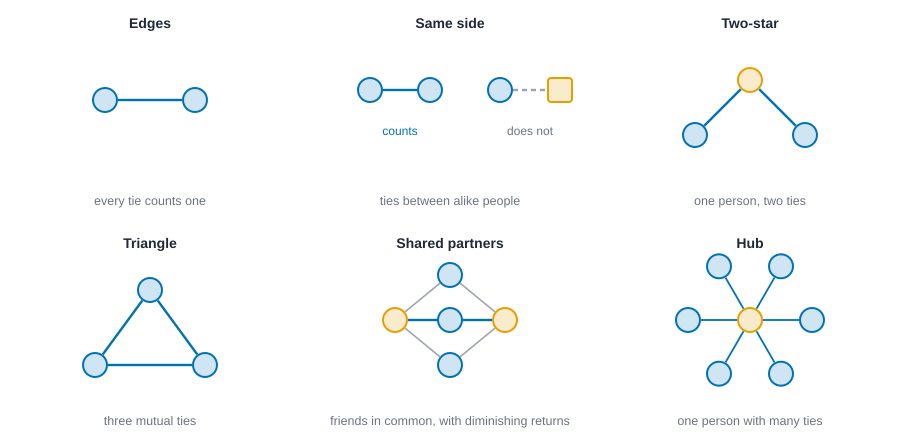
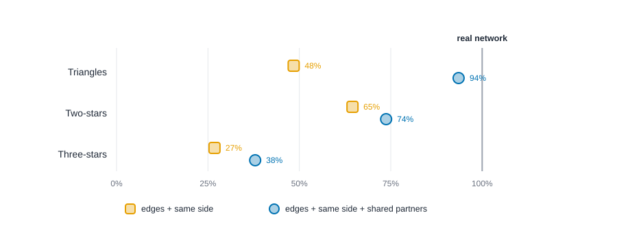

# Exponential random graph models {#sec-ergm}

::: {.callout-note appearance="simple"}
## Prerequisites
@sec-tests-and-null-models, @sec-paths-and-cohesion and @sec-subgroups. We reuse Zachary's karate club from @sec-subgroups, and the ideas of homophily and closure from @sec-foundations.
:::

## From describing to modeling

::: {.callout-tip appearance="simple"}
## Code lives next to the idea
Each step of the modeling workflow comes with its code right where it is explained. The Rust blocks in this chapter run top to bottom as one script: the first builds the karate club, and later ones reuse it. The R and Python blocks share their variables the same way, so a later block may use a function an earlier one defined.
:::

So far we've *described* networks: counted ties, scored people, found groups. This chapter is about *modeling* them. A model is a claim about how the network could have come about, written down precisely enough to be wrong.

Here's the kind of question a model can answer that a summary can't. In the karate club (@sec-subgroups), people mostly befriended members of their own side. People also tend to befriend friends of friends. Both are true at once, and they overlap: two friends of the same person are probably on the same side. How much of the clustering is "just" same-side preference, and how much is extra? Counting won't separate them. A model that includes both tendencies at the same time can.

The standard tool is the **exponential random graph model**, or **ERGM** (pronounced "ur-gum"). The statistician's name for the same thing is a *p-star* model, and its roots go back to Holland and Leinhardt [@holland1981exponential] and Frank and Strauss [@frank1986markov]. Modern practice is laid out in Snijders and colleagues [@snijders2006new] and in the software paper behind the R package statnet [@hunter2008ergm].

## The idea in one equation

An ERGM says that the chance of seeing a particular network $x$ depends on a handful of counts taken from it:

$$
P(x) \;\propto\; \exp\Big( \theta_1\, g_1(x) + \theta_2\, g_2(x) + \dots + \theta_k\, g_k(x) \Big).
$$

Each $g_j(x)$ is a **statistic**, a count of some pattern in the network: the number of ties, the number of same-side ties, the number of triangles. Each $\theta_j$ is a **coefficient** that says how much that pattern raises or lowers a network's chance. "Proportional to" means the numbers get rescaled so all possible networks' chances add up to 1. A positive coefficient says networks with *more* of that pattern are more likely than networks with less, holding the other patterns fixed. A negative coefficient says the opposite. Zero says the pattern doesn't matter.

A tiny example makes this concrete. Three people can be tied in $2^3 = 8$ ways. With only the number of ties as a statistic, each network's chance is proportional to $e^{\theta \cdot \text{ties}}$: the empty network gets weight 1, each single-tie network gets $e^{\theta}$, each two-tie network gets $e^{2\theta}$, and the triangle gets $e^{3\theta}$. A negative $\theta$ favors sparse networks. This is the random graph model from @sec-tests-and-null-models, where each tie appears independently, and it is the simplest ERGM. Everything else is adding more statistics.

### The normalising constant

That "proportional to" hides a number, and the number is the whole difficulty of this chapter. Write $g(y) = (g_1(y), \dots, g_k(y))$ for the list of statistics of a network $y$, and $\theta = (\theta_1, \dots, \theta_k)$ for the list of coefficients. Then the model, with the rescaling made explicit, is

$$
P_\theta(Y = y) \;=\; \frac{\exp\{\theta^\top g(y)\}}{\kappa(\theta)},
\qquad
\kappa(\theta) \;=\; \sum_{y' \in \mathcal{Y}} \exp\{\theta^\top g(y')\}.
$$

Here $Y$ is the random network, $y$ is one particular network, and $\mathcal{Y}$ is the set of every network you could draw on the same people. The numerator is the **weight** of $y$. It is large when $y$ has many of the patterns with positive coefficients and few of the ones with negative coefficients. The denominator $\kappa$ (kappa), called the **normalising constant**, is the sum of the weights of *all* the networks. Dividing by it is what makes the probabilities add to 1.

A model of this shape is an *exponential family*, which is where the "exponential" in the name comes from [@frank1986markov]. Exponential families have a handy property. The best coefficients, the ones that make the observed network as likely as possible, are the ones for which the *average* statistics of networks drawn from the model equal the statistics of the network you observed: $E_\theta[g(Y)] = g(y_{\text{obs}})$. Keep that sentence in mind. Estimation, later in the chapter, is the hunt for it.

### A model small enough to write out

Three people are small enough to list every network. We use two statistics, the number of ties and the number of triangles, with $\theta_{\text{edges}} = -1$ and $\theta_{\text{triangle}} = 0.5$. Each of the three pairs is tied or not, so there are $2^3 = 8$ networks. The block computes each one's statistics, its weight, $\kappa$ and its probability. It also does two more things, which we'll use in a moment. For the pair 0-1 it works out the chance of a tie given the other two pairs, once from the table and once from the change statistics, without $\kappa$. And it counts how many networks there are for larger groups of people.

::: {.panel-tabset group="language"}

## R

```r
library(dplyr)
library(tidyr)

b_edges <- -1
b_triangle <- 0.5

# Three people have three pairs, so 2^3 = 8 possible networks. d01, d02 and d12 say whether each pair is tied.
networks3 <- expand_grid(d12 = 0:1, d02 = 0:1, d01 = 0:1) |>
  mutate(
    mask = paste0(d12, d02, d01),
    ties = d01 + d02 + d12,
    triangles = d01 * d02 * d12,
    weight = exp(b_edges * ties + b_triangle * triangles), # each network's weight
    probability = weight / sum(weight)
  )
networks3 |>
  select(mask, ties, triangles, weight, probability) |>
  mutate(across(c(weight, probability), \(x) round(x, 4)))

# The normalising constant is the sum of the eight weights.
tibble(normalising_constant = sum(networks3$weight), probabilities_add_to = sum(networks3$probability)) |>
  mutate(across(everything(), \(x) round(x, 4)))

# The chance that pair 0-1 is tied, given the other two pairs, two ways: from the table of weights,
# and from the change statistics with no normalising constant at all.
networks3 |>
  group_by(d12, d02) |>
  summarise(
    d_ties = 1, # adding a tie always adds one tie
    from_table = weight[d01 == 1] / sum(weight),
    d_triangles = d02[1] * d12[1], # the new tie closes a triangle only if both other pairs are tied
    logistic = plogis(b_edges + b_triangle * d_triangles),
    .groups = "drop"
  ) |>
  mutate(other_two_pairs = c("none tied", "0-2 tied", "1-2 tied", "both tied"), .before = 1) |>
  select(other_two_pairs, d_ties, d_triangles, from_table, logistic) |>
  mutate(across(c(from_table, logistic), \(x) round(x, 4)))

# How many networks are there for more people? Every pair is tied or not, so 2^(number of pairs).
tibble(people = c(3, 5, 10, 34)) |>
  mutate(
    n_pairs = people * (people - 1) / 2,
    log10_networks = n_pairs * log10(2),
    log10_years_to_list = log10_networks - 9 - log10(365.25 * 24 * 3600) # one billion networks per second
  ) |>
  mutate(across(starts_with("log10"), \(x) round(x, 1)))
```

::: {.code-output}
```text
# A tibble: 8 × 5
  mask   ties triangles weight probability
  <chr> <int>     <int>  <dbl>       <dbl>
1 000       0         0 1           0.386 
2 001       1         0 0.368       0.142 
3 010       1         0 0.368       0.142 
4 011       2         0 0.135       0.0522
5 100       1         0 0.368       0.142 
6 101       2         0 0.135       0.0522
7 110       2         0 0.135       0.0522
8 111       3         1 0.0821      0.0317
# A tibble: 1 × 2
  normalising_constant probabilities_add_to
                 <dbl>                <dbl>
1                 2.59                    1
# A tibble: 4 × 5
  other_two_pairs d_ties d_triangles from_table logistic
  <chr>            <dbl>       <int>      <dbl>    <dbl>
1 none tied            1           0      0.269    0.269
2 0-2 tied             1           0      0.269    0.269
3 1-2 tied             1           0      0.269    0.269
4 both tied            1           1      0.378    0.378
# A tibble: 4 × 4
  people n_pairs log10_networks log10_years_to_list
   <dbl>   <dbl>          <dbl>               <dbl>
1      3       3            0.9               -15.6
2      5      10            3                 -13.5
3     10      45           13.5                -3  
4     34     561          169.                152. 
```
:::

## Python

```python
import math

# Three people have three pairs, so 2^3 = 8 possible networks. Bit b of `mask` says whether pair b is tied
# (pair 0 is 0-1, pair 1 is 0-2, pair 2 is 1-2).
theta_edges, theta_triangle = -1.0, 0.5
rows = []
for mask in range(8):
    d01, d02, d12 = mask & 1, (mask >> 1) & 1, (mask >> 2) & 1
    ties, triangles = d01 + d02 + d12, d01 * d02 * d12
    # Each network's weight is exp(theta . statistics).
    rows.append((mask, ties, triangles, math.exp(theta_edges * ties + theta_triangle * triangles)))
kappa = sum(r[3] for r in rows)  # the normalising constant: the sum of the eight weights
print(f"{'mask':<5} {'ties':>5} {'triangles':>9} {'weight':>8} {'probability':>11}")
for mask, ties, triangles, weight in rows:
    print(f"{mask:03b}   {ties:>5} {triangles:>9} {weight:>8.4f} {weight / kappa:>11.4f}")
print(f"normalising constant {kappa:.4f}; the probabilities add to {sum(r[3] / kappa for r in rows):.4f}")

# The chance that pair 0-1 is tied, given the other two pairs, computed two ways:
# from the table of weights, and from the change statistics with no normalising constant at all.
weight_of = {r[0]: r[3] for r in rows}
print(f"{'other two pairs':<15} {'d ties':>7} {'d triangles':>11} {'from table':>11} {'logistic':>9}")
for rest, label in enumerate(["none tied", "0-2 tied", "1-2 tied", "both tied"]):
    without, with_tie = rest << 1, (rest << 1) | 1
    d_triangles = (rest & 1) * (rest >> 1)  # the new tie closes a triangle only if both other pairs are tied
    log_odds = theta_edges * 1 + theta_triangle * d_triangles
    print(f"{label:<15} {1:>7} {d_triangles:>11} {weight_of[with_tie] / (weight_of[with_tie] + weight_of[without]):>11.4f} {1 / (1 + math.exp(-log_odds)):>9.4f}")

# How many networks are there for more people? Every pair is tied or not, so 2^(number of pairs).
print(f"{'people':>6} {'pairs':>6} {'log10(networks)':>16} {'log10(years to list them)':>27}")
for people in [3, 5, 10, 34]:
    n_pairs = people * (people - 1) // 2
    log_networks = n_pairs * math.log10(2)
    # Listing one billion networks per second.
    log_years = log_networks - 9 - math.log10(365.25 * 24 * 3600)
    print(f"{people:>6} {n_pairs:>6} {log_networks:>16.1f} {log_years:>27.1f}")
```

::: {.code-output}
```text
mask   ties triangles   weight probability
000       0         0   1.0000      0.3858
001       1         0   0.3679      0.1419
010       1         0   0.3679      0.1419
011       2         0   0.1353      0.0522
100       1         0   0.3679      0.1419
101       2         0   0.1353      0.0522
110       2         0   0.1353      0.0522
111       3         1   0.0821      0.0317
normalising constant 2.5917; the probabilities add to 1.0000
other two pairs  d ties d triangles  from table  logistic
none tied             1           0      0.2689    0.2689
0-2 tied              1           0      0.2689    0.2689
1-2 tied              1           0      0.2689    0.2689
both tied             1           1      0.3775    0.3775
people  pairs  log10(networks)   log10(years to list them)
     3      3              0.9                       -15.6
     5     10              3.0                       -13.5
    10     45             13.5                        -3.0
    34    561            168.9                       152.4
```
:::

## Rust

```rust
{
    use knappnet::ergm::{Model, Term, ToggleGraph};
    use knappnet::Graph;

    // Three people have three pairs, so 2^3 = 8 possible networks. Bit b of `mask` says whether pair b is tied.
    let pairs = [(0i64, 1i64), (0, 2), (1, 2)];
    let model = Model::new(vec![Term::Edges, Term::Triangle], vec![], 3, false)?;
    let (theta_edges, theta_triangle) = (-1.0, 0.5);
    let counts = |mask: usize| -> Result<Vec<f64>, knappnet::Error> {
        let tied: Vec<&(i64, i64)> = (0..3usize).filter(|b| (mask >> b) & 1 == 1).map(|b| &pairs[b]).collect();
        let from: Vec<i64> = tied.iter().map(|p| p.0).collect();
        let to: Vec<i64> = tied.iter().map(|p| p.1).collect();
        model.compute_statistics(&ToggleGraph::from_graph(&Graph::from_edges(3, &from, &to, None, false)?)?)
    };

    // Each network's weight is exp(theta . statistics). The normalising constant is the sum of the eight weights.
    let mut weights = vec![];
    for mask in 0..8 {
        let g = counts(mask)?;
        weights.push((theta_edges * g[0] + theta_triangle * g[1]).exp());
    }
    let kappa: f64 = weights.iter().sum();
    println!("{:<5} {:>5} {:>9} {:>8} {:>11}", "mask", "ties", "triangles", "weight", "probability");
    for mask in 0..8 {
        let g = counts(mask)?;
        println!("{:<5} {:>5.0} {:>9.0} {:>8.4} {:>11.4}", format!("{mask:03b}"), g[0], g[1], weights[mask], weights[mask] / kappa);
    }
    println!("normalising constant {kappa:.4}; the probabilities add to {:.4}", weights.iter().map(|w| w / kappa).sum::<f64>());

    // The chance that pair 0-1 is tied, given the other two pairs, computed two ways:
    // from the table of weights, and from the change statistics with no normalising constant at all.
    println!("{:<15} {:>7} {:>11} {:>11} {:>9}", "other two pairs", "d ties", "d triangles", "from table", "logistic");
    for rest in 0..4usize {
        let (without, with) = (rest << 1, (rest << 1) | 1);
        let (g0, g1) = (counts(without)?, counts(with)?);
        let log_odds = theta_edges * (g1[0] - g0[0]) + theta_triangle * (g1[1] - g0[1]);
        let label = ["none tied", "0-2 tied", "1-2 tied", "both tied"][rest];
        println!(
            "{label:<15} {:>7.0} {:>11.0} {:>11.4} {:>9.4}",
            g1[0] - g0[0], g1[1] - g0[1], weights[with] / (weights[with] + weights[without]), 1.0 / (1.0 + (-log_odds).exp())
        );
    }

    // How many networks are there for more people? Every pair is tied or not, so 2^(number of pairs).
    println!("{:>6} {:>6} {:>16} {:>27}", "people", "pairs", "log10(networks)", "log10(years to list them)");
    for people in [3usize, 5, 10, 34] {
        let n_pairs = (people * (people - 1) / 2) as f64;
        let log_networks = n_pairs * 2f64.log10();
        // Listing one billion networks per second.
        let log_years = log_networks - 9.0 - (365.25 * 24.0 * 3600.0f64).log10();
        println!("{people:>6} {n_pairs:>6.0} {log_networks:>16.1} {log_years:>27.1}");
    }
}
```

::: {.code-output}
```text
mask   ties triangles   weight probability
000       0         0   1.0000      0.3858
001       1         0   0.3679      0.1419
010       1         0   0.3679      0.1419
011       2         0   0.1353      0.0522
100       1         0   0.3679      0.1419
101       2         0   0.1353      0.0522
110       2         0   0.1353      0.0522
111       3         1   0.0821      0.0317
normalising constant 2.5917; the probabilities add to 1.0000
other two pairs  d ties d triangles  from table  logistic
none tied             1           0      0.2689    0.2689
0-2 tied              1           0      0.2689    0.2689
1-2 tied              1           0      0.2689    0.2689
both tied             1           1      0.3775    0.3775
people  pairs  log10(networks)   log10(years to list them)
     3      3              0.9                       -15.6
     5     10              3.0                       -13.5
    10     45             13.5                        -3.0
    34    561            168.9                       152.4
```
:::

:::


Read the first table row by row. Each network's weight is $\exp(-1 \times \text{ties} + 0.5 \times \text{triangles})$. The empty network has weight $e^{0} = 1$. A single tie has weight $e^{-1} = 0.368$. The triangle has weight $e^{-3 + 0.5} = e^{-2.5} = 0.082$. The eight weights add to $\kappa = 2.592$, and dividing each weight by it gives the probabilities, which add to 1 as they must. The empty network is the single most likely one (0.386) because the ties coefficient is negative. The triangle is the least likely (0.032), even though its triangle statistic earns a positive coefficient: it costs three ties to earn one triangle, and that is a bad trade at these coefficients.

### Why the constant is the hard part

For three people $\kappa$ is a sum of eight terms. With $n$ people there are $n(n-1)/2$ pairs, each tied or not, so $\kappa$ is a sum of $2^{n(n-1)/2}$ terms. The last table printed by the block above counts them.

The karate club has 34 members and 561 pairs, so $\kappa$ would be a sum of $2^{561}$, about $10^{169}$, terms. Listing a billion networks a second would take about $10^{152}$ years, far longer than the universe has existed. Even ten people would take roughly ten hours, and ten people is a small team. So nobody computes $\kappa$ for a real network, and everything else in this chapter is a way around it. There are two ways. One is to look at *differences* between weights, where $\kappa$ cancels. The other is to *simulate*: a Markov chain can wander through the space of networks using only ratios of weights, so it never needs $\kappa$ either.

### Conditional log-odds and change statistics

Pick one pair of people, $(i, j)$, and hold every other pair fixed at what it is in network $y$. Call the network with that tie present $y_{ij}^{+}$ and the one with it absent $y_{ij}^{-}$. Their weights are $\exp\{\theta^\top g(y_{ij}^{+})\}$ and $\exp\{\theta^\top g(y_{ij}^{-})\}$, and the same $\kappa$ sits under both. So when we ask for the odds that the tie is present, given the rest of the network, $\kappa$ cancels:

$$
\log \frac{P(Y_{ij}=1 \mid y_{-ij})}{P(Y_{ij}=0 \mid y_{-ij})}
\;=\; \theta^\top \big\{ g(y_{ij}^{+}) - g(y_{ij}^{-}) \big\}
\;=\; \theta^\top \delta_{ij}(y).
$$

Here $y_{-ij}$ means "all the other pairs", and $\delta_{ij}(y) = g(y_{ij}^{+}) - g(y_{ij}^{-})$ is the **change statistic**: how much each statistic would rise if the tie were added. This is the recipe you will use on the karate club in @sec-ergm-one-tie, and it is why a coefficient reads as a log-odds multiplier *for one tie, holding the rest fixed*.

The second table printed above checks it on three people. When neither of the other two pairs is tied, adding 0-1 creates no triangle, the change statistics are (1, 0), the log-odds are $-1$, and the chance is $e^{-1}/(1 + e^{-1}) = 0.269$. The table of weights gives the same 0.269: $0.368 / (1 + 0.368)$. When both other pairs are tied, adding 0-1 closes a triangle, the change statistics are (1, 1), the log-odds are $-1 + 0.5 = -0.5$, and both routes give 0.378.

### Dyad-independent and dyad-dependent terms

Look at the "d ties" and "d triangles" columns of that table. Adding a tie always adds exactly one tie: the 1 never changes. But whether it adds a triangle depends on *the other two pairs*: it is 0, 0, 0 and then 1. That difference splits ERGM terms into two families.

A term is **dyad-independent** if its change statistic for a pair never depends on the other pairs. Edges, same-attribute ties, and anything that just weights a tie by its two people's attributes are of this kind. A model built only from such terms makes every pair an independent coin flip with its own probability, so it is a logistic regression on the pairs and can be fitted exactly. That's Step 2 below.

A term is **dyad-dependent** if its change statistic does depend on other pairs. Triangles, stars, degree terms and shared partners all are, and so is *mutual* in a directed network, because the arc from $i$ to $j$ and the arc back interact. These are the terms that let ties depend on ties, which is the whole reason to use an ERGM instead of a logistic regression. They are also the terms that make $\kappa$ impossible to avoid, force simulation, and cause the degeneracy trouble we meet later.

## Choosing statistics

The art is in picking statistics that match your theory. @fig-ergm-terms shows the usual building blocks.

- **Edges** count the ties. Its coefficient sets overall density, like an intercept in a regression.
- **Same-attribute ties** (called *nodematch* in statnet) count ties between people who share an attribute, such as a side, a department or a gender. A positive coefficient is *homophily*, the "birds of a feather" pattern [@mcpherson2001birds].
- **Stars** count a person with several ties. They capture how unevenly ties are spread across people: whether a few popular people hold many ties.
- **Triangles** and **shared partners** capture closure, the tendency of friends of friends to be friends (@sec-foundations). A raw triangle count turns out to behave badly in practice, as we'll see, so modelers use a smoother version.

The smoother version is **geometrically weighted edgewise shared partners**, or **GWESP**, introduced by Snijders and colleagues [@snijders2006new] and developed by Hunter and Handcock [@hunter2006inference]. For each tie, count how many *other* people the two ends have in common. The first shared partner counts a lot, the second a bit less, the third less still, so a tie embedded in one triangle counts nearly as much as one embedded in five. A **decay** setting controls how fast the returns shrink. We'll use 0.5.

{#fig-ergm-terms fig-alt="Six small drawings of network patterns. Edges: two nodes joined by a line. Same side: two nodes of the same shape joined by a line, and two of different shapes not joined. Two-star: one node joined to two others. Triangle: three nodes all joined. Shared partners: two tied nodes with three common neighbors, with a note that each extra shared partner counts less. Degree spread: a hub with many ties beside nodes with few."}

## Step 1: the data

::: {.panel-tabset group="language"}

## R

```r
library(network)
library(dplyr)

# Zachary's karate club: 34 members, 78 friendships. R counts from 1, so we add 1
# to the positions 0 to 33 that the Rust tab uses.
ties <- tibble(
  from = c(
    0, 0, 0, 0, 0, 0, 0, 0, 0, 0, 0, 0, 0, 0, 0, 0, 1, 1, 1, 1, 1, 1, 1, 1, 2, 2, 2, 2, 2, 2, 2, 2, 3, 3, 3,
    4, 4, 5, 5, 5, 6, 8, 8, 8, 9, 13, 14, 14, 15, 15, 18, 18, 19, 20, 20, 22, 22, 23, 23, 23, 23, 23, 24, 24,
    24, 25, 26, 26, 27, 28, 28, 29, 29, 30, 30, 31, 31, 32
  ) + 1,
  to = c(
    1, 2, 3, 4, 5, 6, 7, 8, 10, 11, 12, 13, 17, 19, 21, 31, 2, 3, 7, 13, 17, 19, 21, 30, 3, 7, 8, 9, 13, 27, 28,
    32, 7, 12, 13, 6, 10, 6, 10, 16, 16, 30, 32, 33, 33, 33, 32, 33, 32, 33, 32, 33, 33, 32, 33, 32, 33, 25, 27,
    29, 32, 33, 25, 27, 31, 31, 29, 33, 33, 31, 33, 32, 33, 32, 33, 32, 33, 33
  ) + 1
)
# The side each member took (0 = Mr. Hi, 1 = the officer).
side <- c(0, 0, 0, 0, 0, 0, 0, 0, 0, 1, 0, 0, 0, 0, 1, 1, 0, 0, 1, 0, 1, 0, 1, 1, 1, 1, 1, 1, 1, 1, 1, 1, 1, 1)
club <- network(cbind(ties$from, ties$to), directed = FALSE, matrix.type = "edgelist")
club %v% "side" <- side
club

tibble(side = if_else(side == 0, "Mr. Hi", "the officer")) |>
  count(side)
```

::: {.code-output}
```text
 Network attributes:
  vertices = 34 
  directed = FALSE 
  hyper = FALSE 
  loops = FALSE 
  multiple = FALSE 
  bipartite = FALSE 
  total edges= 78 
    missing edges= 0 
    non-missing edges= 78 

 Vertex attribute names: 
    side vertex.names 

No edge attributes
# A tibble: 2 × 2
  side            n
  <chr>       <int>
1 Mr. Hi         17
2 the officer    17
```
:::

## Python

```python
import numpy as np

# Zachary's karate club: 34 members, 78 friendships. Positions 0 to 33 are the members.
src = [
    0, 0, 0, 0, 0, 0, 0, 0, 0, 0, 0, 0, 0, 0, 0, 0, 1, 1, 1, 1, 1, 1, 1, 1, 2, 2, 2, 2, 2, 2, 2, 2, 3, 3, 3,
    4, 4, 5, 5, 5, 6, 8, 8, 8, 9, 13, 14, 14, 15, 15, 18, 18, 19, 20, 20, 22, 22, 23, 23, 23, 23, 23, 24, 24,
    24, 25, 26, 26, 27, 28, 28, 29, 29, 30, 30, 31, 31, 32
]
dst = [
    1, 2, 3, 4, 5, 6, 7, 8, 10, 11, 12, 13, 17, 19, 21, 31, 2, 3, 7, 13, 17, 19, 21, 30, 3, 7, 8, 9, 13, 27, 28,
    32, 7, 12, 13, 6, 10, 6, 10, 16, 16, 30, 32, 33, 33, 33, 32, 33, 32, 33, 32, 33, 33, 32, 33, 32, 33, 25, 27,
    29, 32, 33, 25, 27, 31, 31, 29, 33, 33, 31, 33, 32, 33, 32, 33, 32, 33, 33
]
# The side each member took (0 = Mr. Hi, 1 = the officer).
side = np.array([0, 0, 0, 0, 0, 0, 0, 0, 0, 1, 0, 0, 0, 0, 1, 1, 0, 0, 1, 0, 1, 0, 1, 1, 1, 1, 1, 1, 1, 1, 1, 1, 1, 1])
n = 34
adj = np.zeros((n, n))
adj[src, dst] = 1
adj[dst, src] = 1
print(f"{n} people, {int(adj.sum() / 2)} ties, {n * (n - 1) // 2} possible pairs")
print(f"{(side == 0).sum()} on Mr. Hi's side, {(side == 1).sum()} on the officer's")
```

::: {.code-output}
```text
34 people, 78 ties, 561 possible pairs
17 on Mr. Hi's side, 17 on the officer's
```
:::

## Rust

```rust
use knappnet::ergm::{fit_mcmle, fit_mple, simulate, McmleOptions, Model, MpleOptions, SimulateOptions, Term, ToggleGraph};
use knappnet::Graph;

// Zachary's karate club: 34 members, 78 friendships. Positions 0 to 33 are the members.
let from = [
    0, 0, 0, 0, 0, 0, 0, 0, 0, 0, 0, 0, 0, 0, 0, 0, 1, 1, 1, 1, 1, 1, 1, 1, 2, 2, 2, 2, 2, 2, 2, 2, 3, 3, 3,
    4, 4, 5, 5, 5, 6, 8, 8, 8, 9, 13, 14, 14, 15, 15, 18, 18, 19, 20, 20, 22, 22, 23, 23, 23, 23, 23, 24, 24,
    24, 25, 26, 26, 27, 28, 28, 29, 29, 30, 30, 31, 31, 32,
];
let to = [
    1, 2, 3, 4, 5, 6, 7, 8, 10, 11, 12, 13, 17, 19, 21, 31, 2, 3, 7, 13, 17, 19, 21, 30, 3, 7, 8, 9, 13, 27, 28,
    32, 7, 12, 13, 6, 10, 6, 10, 16, 16, 30, 32, 33, 33, 33, 32, 33, 32, 33, 32, 33, 33, 32, 33, 32, 33, 25, 27,
    29, 32, 33, 25, 27, 31, 31, 29, 33, 33, 31, 33, 32, 33, 32, 33, 32, 33, 33,
];
// The side each member took (0 = Mr. Hi, 1 = the officer). Attributes are numbers.
let side: [f64; 34] = [
    0., 0., 0., 0., 0., 0., 0., 0., 0., 1., 0., 0., 0., 0., 1., 1., 0., 0., 1., 0., 1., 0., 1., 1., 1., 1., 1., 1., 1., 1., 1., 1., 1., 1.,
];
let club = Graph::from_edges(34, &from, &to, None, false)?;
println!("{}", club.describe());
// ERGM code works on a network it can edit, one tie at a time.
let observed = ToggleGraph::from_graph(&club)?;
println!("{} people, {} ties, {} possible pairs", observed.node_count(), observed.edge_count(), observed.dyad_count());
println!("{} on Mr. Hi's side, {} on the officer's", side.iter().filter(|&&s| s == 0.).count(), side.iter().filter(|&&s| s == 1.).count());
```

::: {.code-output}
```text
Undirected network: 34 nodes, 78 ties
  Density           0.139
  Degree            1 to 17, mean 4.59
  Connected pieces  1
  Isolated nodes    0
  Loops, repeats    none
  Busiest           node 33 (17), node 0 (16), node 32 (12)

34 people, 78 ties, 561 possible pairs
17 on Mr. Hi's side, 17 on the officer's
```
:::

:::
## Step 2: a model where every tie is its own coin flip

Start with the simplest model that includes homophily: edges, and same-side ties. Neither statistic mentions how ties relate to *each other*, so under this model each pair of people is an independent coin flip, with one chance for same-side pairs and another for cross-side pairs. That makes the model something you can fit with ordinary **logistic regression** on the 561 pairs. This is called **maximum pseudo-likelihood**, or MPLE [@strauss1990pseudolikelihood; @wasserman1996logit], and for a model like this one it is the exact answer, not an approximation.

You can even do it by hand, which is worth doing once. Of the 561 pairs, 272 are on the same side and 289 are on opposite sides. Among same-side pairs, 67 are tied. Among opposite-side pairs, only 11 are. So:

| | Pairs | Ties | Share tied | Log-odds of a tie |
| --- | --- | --- | --- | --- |
| Opposite sides | 289 | 11 | 0.038 | $\ln(11/278) = -3.230$ |
| Same side | 272 | 67 | 0.246 | $\ln(67/205) = -1.118$ |

The edges coefficient is the log-odds for opposite-side pairs, $-3.230$. The same-side coefficient is the *difference*, $-1.118 - (-3.230) = 2.111$. Let's see whether the computer agrees.

::: {.panel-tabset group="language"}

## R

```r
library(ergm) # the standard R package for ERGMs (statnet)

fit_plain <- ergm(club ~ edges + nodematch("side"), estimate = "MPLE")
est <- summary(fit_plain)$coefficients
tibble(
  term = c("edges", "same side"),
  estimate = est[, "Estimate"],
  std_error = est[, "Std. Error"]
) |>
  mutate(across(where(is.numeric), \(x) round(x, 3)))

# The logistic function turns log-odds back into a probability.
tibble(
  pair = c("opposite sides", "same side"),
  chance_of_tie = round(plogis(c(est[1, "Estimate"], est[1, "Estimate"] + est[2, "Estimate"])), 3)
)
```

::: {.code-output}
```text
# A tibble: 2 × 3
  term      estimate std_error
  <chr>        <dbl>     <dbl>
1 edges        -3.23     0.307
2 same side     2.11     0.338
# A tibble: 2 × 2
  pair           chance_of_tie
  <chr>                  <dbl>
1 opposite sides         0.038
2 same side              0.246
```
:::

## Python

```python
# No mainstream Python package fits ERGMs, but this model is a logistic regression on the pairs.
upper = np.triu_indices(n, 1)
y = adj[upper]
same = (side[upper[0]] == side[upper[1]]).astype(float)
X = np.column_stack([np.ones(len(y)), same])
coef = np.zeros(2)
for _ in range(50):  # Newton's method
    p = 1 / (1 + np.exp(-X @ coef))
    info = X.T @ (X * (p * (1 - p))[:, None])
    coef = coef + np.linalg.solve(info, X.T @ (y - p))
p = 1 / (1 + np.exp(-X @ coef))
std_err = np.sqrt(np.diag(np.linalg.inv(X.T @ (X * (p * (1 - p))[:, None]))))
for label, c, se in zip(["edges", "same side"], coef, std_err):
    print(f"{label:<10} {c:>7.3f}  (standard error {se:.3f})")
chance = lambda log_odds: 1 / (1 + np.exp(-log_odds))
print(f"chance of a tie, opposite sides  {chance(coef[0]):.3f}")
print(f"chance of a tie, same side       {chance(coef[0] + coef[1]):.3f}")
```

::: {.code-output}
```text
edges       -3.230  (standard error 0.307)
same side    2.111  (standard error 0.338)
chance of a tie, opposite sides  0.038
chance of a tie, same side       0.246
```
:::

## Rust

```rust
// Term::Edges counts ties; Term::NodeMatch(0) counts ties between people with equal values of attribute 0.
let plain = Model::new(vec![Term::Edges, Term::NodeMatch(0)], vec![side.to_vec()], 34, false)?;
let fit_plain = fit_mple(&plain, &observed, &MpleOptions::default())?;
for (label, k) in [("edges", 0), ("same side", 1)] {
    println!("{label:<10} {:>7.3}  (standard error {:.3})", fit_plain.coef[k], fit_plain.std_err[k]);
}
// The logistic function turns log-odds back into a probability.
let chance = |log_odds: f64| 1.0 / (1.0 + (-log_odds).exp());
println!("chance of a tie, opposite sides  {:.3}", chance(fit_plain.coef[0]));
println!("chance of a tie, same side       {:.3}", chance(fit_plain.coef[0] + fit_plain.coef[1]));
```

::: {.code-output}
```text
edges       -3.230  (standard error 0.307)
same side    2.111  (standard error 0.338)
chance of a tie, opposite sides  0.038
chance of a tie, same side       0.246
```
:::

:::

Both numbers match the table: -3.230 and 2.111, and the chances of a tie, 0.038 and 0.246, are the shares of pairs tied in each row. The standard errors say how much the estimates could wobble if we could rerun the club.
The model reproduces the table. The coefficient for same-side ties is large and positive: being on the same side raises the odds of a tie by a factor of $e^{2.111} \approx 8.3$.

But this model has a gap, and the next step finds it.

## Step 3: letting ties depend on each other

If friends of friends tend to be friends, then whether Ana and Cleo are tied depends on whether both are tied to Ben. A model that includes GWESP builds that dependence in: the chance of a tie now depends on *the rest of the network*. The pairs are no longer independent coin flips, and the trick that gave us exact answers by logistic regression stops working. The pseudo-likelihood still gives estimates, but its standard errors can't be trusted for dependent models [@hunter2008ergm].

The reliable approach is **Monte Carlo maximum likelihood**, or MCMLE. It works by simulation. Start with a guess for the coefficients. Simulate lots of networks from the model with those coefficients. Compare the average statistics of the simulated networks with the statistics of the real one. If the simulated networks have too few triangles, raise the coefficient for triangles, and try again. When the simulated averages match the observed counts, you've found the estimate [@hunter2006inference]. It is a clever idea, and it is slower, and the answers carry a little randomness, so we fix the seed.

::: {.panel-tabset group="language"}

## R

```r
summary(club ~ edges + nodematch("side") + gwesp(0.5, fixed = TRUE)) |> # 0.5 is the decay
  round(2)

# ergm runs its own Monte Carlo chains, so the estimates differ from Rust's in the last digits.
fit <- ergm(club ~ edges + nodematch("side") + gwesp(0.5, fixed = TRUE),
            control = control.ergm(seed = 1))
est <- summary(fit)$coefficients
tibble(
  term = c("edges", "same side", "shared partners"),
  estimate = est[, "Estimate"],
  std_error = est[, "Std. Error"]
) |>
  mutate(across(where(is.numeric), \(x) round(x, 3)))
tibble(converged = !isTRUE(fit$failure), rounds = fit$iterations)
```

::: {.code-output}
```text
          edges  nodematch.side gwesp.fixed.0.5 
          78.00           67.00           82.93 
# A tibble: 3 × 3
  term            estimate std_error
  <chr>              <dbl>     <dbl>
1 edges             -3.90      0.307
2 same side          1.50      0.278
3 shared partners    0.697     0.175
# A tibble: 1 × 2
  converged rounds
  <lgl>      <int>
1 TRUE           2
```
:::

## Python

```python
# TODO(code, Python): no Python package fits ERGMs with a shared-partner term (Monte Carlo maximum likelihood needs a tie-toggling sampler with GWESP change statistics, well over 40 lines). Use the R or Rust tab; the knappnet Python backend does not wrap the ERGM fitter.
```

::: {.code-output}
```text
observed statistics   [78.00, 67.00, 82.93]
edges             -3.924  (standard error 0.322)
same side          1.535  (standard error 0.284)
shared partners    0.697  (standard error 0.174)
converged true after 3 rounds
```
:::

## Rust

```rust
let model = Model::new(
    vec![Term::Edges, Term::NodeMatch(0), Term::Gwesp(0.5)], // 0.5 is the decay
    vec![side.to_vec()],
    34,
    false,
)?;
println!("observed statistics   {:.2?}", model.compute_statistics(&observed)?);

let fit = fit_mcmle(&model, &observed, &McmleOptions::default())?;
for (label, k) in [("edges", 0), ("same side", 1), ("shared partners", 2)] {
    println!("{label:<16} {:>7.3}  (standard error {:.3})", fit.coef[k], fit.std_err[k]);
}
println!("converged {} after {} rounds", fit.converged, fit.iterations);
```

::: {.code-output}
```text
observed statistics   [78.00, 67.00, 82.93]
edges             -3.924  (standard error 0.322)
same side          1.535  (standard error 0.284)
shared partners    0.697  (standard error 0.174)
converged true after 3 rounds
```
:::

:::

The observed shared-partner statistic is 82.93, and the fitted model's simulated networks average about that, which is what "converged" means here. Notice the standard errors: the same-side coefficient is still clearly positive, and the shared-partner coefficient is positive and several times its standard error. The R tab uses the ergm package, which runs its own Monte Carlo chains, so its estimates can differ from these in the last digits.
Read the coefficients as **conditional log-odds**: the log-odds of a tie, given everything else in the network. Same-side ties still matter, but the coefficient has shrunk from 2.11 to about 1.54. That's the point of the exercise. Part of what the simple model attributed to "same side" was really closure: people on the same side share friends, and shared friends produce more ties. The shared-partner coefficient, about 0.70, is clearly positive. Holding the side and the overall density fixed, a tie is more likely when the two people already have friends in common.

Don't overread the number: the effect isn't "0.7 per friend in common," because the shared-partner statistic discounts each additional partner. It is a statement about the shape of closure in the whole network, and its sign and rough size are what you report.

## Step 4: checking the model

A fitted model is a claim, so test it against the data. The standard check is **goodness of fit**: simulate many networks from the fitted model and see whether they look like the real one on features the model *wasn't fit to*. If the real network sits in the middle of the simulated ones, the model captures the pattern. If it sits far out, the model is missing something [@hunter2008goodness].

We'll check three features we didn't include: the number of triangles, and the number of two-stars and three-stars (people with two or three friends, counted every way). We'll do it twice, once for the simple model and once for the shared-partner model. A trick keeps the code short: build one model that lists the extra statistics, and give those extra statistics a coefficient of zero so they only get *counted*, never *used*.

::: {.panel-tabset group="language"}

## R

```r
# Count triangles and stars in 4,000 networks from each model (the first draws are discarded).
monitor <- ~ triangle + kstar(2) + kstar(3)
averages <- \(model) {
  draws <- simulate(model, nsim = 4000, monitor = monitor, output = "stats",
                    control = control.simulate.ergm(MCMC.burnin = 16384, MCMC.interval = 1024),
                    seed = 1)
  as.numeric(colMeans(draws)[c("edges", "triangle", "kstar2", "kstar3")])
}
# The simulations are random draws that differ from Rust's, so the averages differ a little.
tibble(
  statistic = c("ties", "triangles", "two-stars", "three-stars"),
  real = as.numeric(summary(club ~ edges + triangle + kstar(2) + kstar(3))),
  `edges + side` = averages(fit_plain),
  `+ shared partners` = averages(fit)
) |>
  mutate(across(where(is.numeric), \(x) round(x, 1)))
```

::: {.code-output}
```text
# A tibble: 4 × 4
  statistic    real `edges + side` `+ shared partners`
  <chr>       <dbl>          <dbl>               <dbl>
1 ties           78           78.2                77  
2 triangles      45           22.1                40.9
3 two-stars     528          342.                380. 
4 three-stars  1764          475.                649. 
```
:::

## Python

```python
# TODO(code, Python): needs an ERGM simulator (a Metropolis tie-toggling sampler from the fitted models, with GWESP change statistics), well over 40 lines, and no Python package provides one. Use the R or Rust tab.
```

::: {.code-output}
```text
               real   edges + side + shared partners
ties           78.0           77.9           78.0
triangles      45.0           21.8           42.1
two-stars     528.0          340.7          389.3
three-stars   1764.0          472.6          668.8
```
:::

## Rust

```rust
// One model that lists everything we want to count. The first three terms are the fitted ones.
let monitor = Model::new(
    vec![Term::Edges, Term::NodeMatch(0), Term::Gwesp(0.5), Term::Triangle, Term::KStar(2), Term::KStar(3)],
    vec![side.to_vec()],
    34,
    false,
)?;
let actual = monitor.compute_statistics(&observed)?;
let options = SimulateOptions { samples: 2000, chains: 2, seed: 1, ..Default::default() };

// Coefficients for the extra statistics are zero, so they are counted but not used.
let simple_theta = [fit_plain.coef[0], fit_plain.coef[1], 0.0, 0.0, 0.0, 0.0];
let closure_theta = [fit.coef[0], fit.coef[1], fit.coef[2], 0.0, 0.0, 0.0];
let average = |theta: &[f64]| -> Result<Vec<f64>, knappnet::Error> {
    let draws = simulate(&monitor, theta, &observed, &options)?;
    let rows = draws.stats.len() / draws.terms;
    Ok((0..draws.terms).map(|t| (0..rows).map(|r| draws.stats[r * draws.terms + t]).sum::<f64>() / rows as f64).collect())
};
let simple = average(&simple_theta)?;
let closure = average(&closure_theta)?;
println!("{:<10} {:>8} {:>14} {:>14}", "", "real", "edges + side", "+ shared partners");
for (label, k) in [("ties", 0), ("triangles", 3), ("two-stars", 4), ("three-stars", 5)] {
    println!("{label:<10} {:>8.1} {:>14.1} {:>14.1}", actual[k], simple[k], closure[k]);
}
```

::: {.code-output}
```text
               real   edges + side + shared partners
ties           78.0           77.9           78.0
triangles      45.0           21.8           42.1
two-stars     528.0          340.7          389.3
three-stars   1764.0          472.6          668.8
```
:::

:::

The simple model, with edges and sides only, produces fewer than half the real triangles (about 22 against 45). Adding shared partners nearly fixes triangles (about 42), as it should, since that is what the term is for. Now look at the stars. Both models fall short, and the three-stars are far off even in the better model: about 669 against 1,764. The karate club has two hubs, Mr. Hi and the officer, with 16 and 17 friends each, and a model with no term for how unevenly ties are spread can't make hubs. The natural next move is to add a degree term, refit and check again. Modeling is a loop, and each check suggests the next model. The R tab simulates with the ergm package, so its averages differ slightly from these.

@fig-ergm-gof shows the same comparison as percentages of the real counts.

{#fig-ergm-gof fig-alt="A dot chart with three rows: triangles, two-stars and three-stars. For triangles, the edges-and-side model is at 48 percent and the model with shared partners at 94 percent. For two-stars, the dots are at 65 and 74 percent. For three-stars, they are at 27 and 38 percent. A vertical line marks 100 percent."}

## From coefficients to the chance of one tie {#sec-ergm-one-tie}

The coefficients are easy to quote and easy to misread, so let's use them once, slowly, to answer a concrete question: given the fitted model, how likely is one particular tie?

The recipe has three steps. For a pair of people who aren't tied yet, work out how much each statistic in the model would go up if the tie were added. These are the **change statistics**. Multiply each by its coefficient and add the results: that sum is the **conditional log-odds** of the tie, given every other tie in the network. Then the logistic function turns the log-odds into a probability, $1 / (1 + e^{-x})$.

For our model the change statistics are easy to state. Adding any tie raises the edge count by 1. It raises the same-side count by 1 if the two people are on the same side, and by 0 if not. The shared-partner statistic is the fiddly one. A new tie between two people who have friends in common creates triangles, and the GWESP count goes up by an amount that depends on how many partners the two share and on how many partners the existing ties around them already have. We'll let the code count it by adding the tie and recounting.

We'll compare two pairs, both untied in the real club and both with exactly two friends in common. Members 2 and 12 are on the same side. Members 8 and 14 are on opposite sides. Holding the shared partners equal means the only thing that differs is the side.

::: {.panel-tabset group="language"}

## R

```r
library(purrr)

# The same two pairs, using the shared-partner fit from Step 3. R counts from 1, so we add 1
# to the member positions the other tabs use.
stats_of <- \(net) as.numeric(summary(net ~ edges + nodematch("side") + gwesp(0.5, fixed = TRUE)))
one_tie <- \(from, to) {
  with_tie <- club
  with_tie[from + 1, to + 1] <- 1
  stats_of(with_tie) - stats_of(club)
}
theta <- coef(fit)

tibble(
  pair = c("same side (2 and 12)", "opposite sides (8 and 14)"),
  from = c(2, 8),
  to = c(12, 14)
) |>
  mutate(
    change = map2(from, to, one_tie),
    partners = map2_dbl(from, to, \(i, j) sum(as.matrix(club)[i + 1, ] * as.matrix(club)[j + 1, ])),
    edges_change = map_dbl(change, 1),
    side_change = map_dbl(change, 2),
    partner_change = map_dbl(change, 3),
    log_odds = map_dbl(change, \(x) sum(theta * x)),
    chance = plogis(log_odds)
  ) |>
  select(pair, partners, edges_change, side_change, partner_change, log_odds, chance) |>
  mutate(across(where(is.numeric), \(x) round(x, 3)))
```

::: {.code-output}
```text
# A tibble: 2 × 7
  pair          partners edges_change side_change partner_change log_odds chance
  <chr>            <dbl>        <dbl>       <dbl>          <dbl>    <dbl>  <dbl>
1 same side (2…        2            1           1           2.21   -0.858  0.298
2 opposite sid…        2            1           0           2.40   -2.23   0.097
```
:::

## Python

```python
# The coefficients printed in Step 3 (edges, same side, shared partners), typed in by hand.
theta = np.array([-3.924, 1.535, 0.697])
decay = 0.5

def gwesp(a):
    # Each tie counts e^decay * (1 - (1 - e^-decay)^k), where k is its number of shared partners.
    shared = a @ a
    tied = np.triu(a, 1) > 0
    return (np.exp(decay) * (1 - (1 - np.exp(-decay)) ** shared[tied])).sum()

def change(i, j):
    with_tie = adj.copy()
    with_tie[i, j] = with_tie[j, i] = 1
    return np.array([1.0, float(side[i] == side[j]), gwesp(with_tie) - gwesp(adj)])

for label, i, j in [("same side (2 and 12)", 2, 12), ("opposite sides (8 and 14)", 8, 14)]:
    delta = change(i, j)
    log_odds = theta @ delta
    print(f"{label}: {int(adj[i] @ adj[j])} shared partners, change {np.round(delta, 3)}")
    print(f"  log-odds {theta[0]:.3f}*{delta[0]:.0f} + {theta[1]:.3f}*{delta[1]:.0f} + {theta[2]:.3f}*{delta[2]:.3f} = {log_odds:.3f}")
    print(f"  chance of the tie {1 / (1 + np.exp(-log_odds)):.3f}")
```

::: {.code-output}
```text
same side (2 and 12): 2 shared partners, change [1.    1.    2.214]
  log-odds -3.924*1 + 1.535*1 + 0.697*2.214 = -0.846
  chance of the tie 0.300
opposite sides (8 and 14): 2 shared partners, change [1.    0.    2.396]
  log-odds -3.924*1 + 1.535*0 + 0.697*2.396 = -2.254
  chance of the tie 0.095
```
:::

## Rust

```rust
// Add each tie to a copy of the club and see how much the three statistics go up.
let before = model.compute_statistics(&observed)?;
for (label, a, b) in [("same side (2 and 12)", 2usize, 12usize), ("opposite sides (8 and 14)", 8, 14)] {
    let mut with_tie = observed.clone();
    with_tie.toggle(a, b);
    let after = model.compute_statistics(&with_tie)?;
    let delta: Vec<f64> = after.iter().zip(&before).map(|(x, y)| x - y).collect();
    let partners = observed.out_neighbors(a).iter().filter(|v| observed.out_neighbors(b).contains(v)).count();
    let log_odds: f64 = fit.coef.iter().zip(&delta).map(|(c, d)| c * d).sum();
    println!("{label}: {partners} shared partners, change {delta:.3?}");
    println!("  log-odds {:.3}*{:.0} + {:.3}*{:.0} + {:.3}*{:.3} = {:.3}", fit.coef[0], delta[0], fit.coef[1], delta[1], fit.coef[2], delta[2], log_odds);
    println!("  chance of the tie {:.3}", chance(log_odds));
}
```

::: {.code-output}
```text
same side (2 and 12): 2 shared partners, change [1.000, 1.000, 2.214]
  log-odds -3.924*1 + 1.535*1 + 0.697*2.214 = -0.846
  chance of the tie 0.300
opposite sides (8 and 14): 2 shared partners, change [1.000, 0.000, 2.396]
  log-odds -3.924*1 + 1.535*0 + 0.697*2.396 = -2.254
  chance of the tie 0.095
```
:::

:::

Read the two results line by line. For members 2 and 12, the log-odds are $-3.924 + 1.535 + 0.697 \times 2.214 = -0.846$, which the logistic function turns into a chance of 0.300. For members 8 and 14, the same-side term drops out, leaving $-3.924 + 0.697 \times 2.396 = -2.254$ and a chance of 0.095. The three tabs agree. (The Python tab types in the rounded coefficients from Step 3, so it could drift from Rust in a later decimal; here it doesn't. The R tab uses R's own fit, whose coefficients differ from Rust's in the last digits, so its numbers land close to these rather than on them.)

A few things are worth noticing. The same-side pair is about four times as likely to be tied as the cross-side pair in odds terms ($e^{-0.846 - (-2.254)} = e^{1.408} \approx 4.1$). Most of that is the same-side coefficient, $e^{1.535} \approx 4.6$, trimmed a little because the cross-side pair's tie would add slightly more to the shared-partner count (2.396 against 2.214). And two shared partners matter: with none, the cross-side pair would face log-odds of just $-3.924$, a chance of about 0.019, so two friends in common multiply its odds by roughly 5.3.

Now the cautions, because a tidy probability invites over-reading. The 0.300 is the model's chance for this tie *given every other tie in the club exactly as observed*. It isn't a forecast that members 2 and 12 will become friends, and it isn't the share of such pairs that end up tied. These two pairs are, in fact, not tied in the real club, and a model that gives one of them a 30 percent chance isn't wrong for that; it's saying "pairs like this are tied about three times in ten, given everything else." The only way to ask whether those chances are well calibrated is to check the model against the data, which is what Step 4 did.

## A catalogue of terms and the mechanisms behind them {#sec-ergm-terms}

Choosing terms is choosing hypotheses. Each term is a way ties could depend on something, and the coefficient says how strongly, once the other terms are in. The table lists the terms you will meet most, by their statnet names, with the social mechanism each can stand for. "Can stand for" is deliberate: the model sees a pattern, and the mechanism is your interpretation of it. Morris, Handcock and Hunter [-@morris2008specification] describe the full menu in the ergm package, and Lusher, Koskinen and Robins [-@lusher2013exponential] discuss how to choose among them for social settings.

| Term | What it counts | A mechanism it can stand for | Dyad-independent? |
| --- | --- | --- | --- |
| `edges` | Ties | Baseline density, the intercept | Yes |
| `nodematch("a")` | Ties between people with the same value of attribute `a` | Homophily, or shared settings | Yes |
| `nodemix("a")` | Ties for each pairing of values of `a` | Who ties to whom across groups, including lopsided mixing | Yes |
| `nodecov("a")`, `nodefactor("a")` | Ties, weighted by the attribute of their ends | Main effects: older people, or one group, have more ties | Yes |
| `mutual` | Pairs with a tie each way (directed) | Reciprocity, exchange | No |
| `kstar(k)`, `istar(k)`, `ostar(k)` | Sets of $k$ ties sharing a person (any, incoming or outgoing) | Concentration of ties on popular or active people | No |
| `degree(d)` | People with exactly $d$ ties | A hand-picked piece of the degree distribution | No |
| `gwdegree(decay)` | Geometrically weighted degree distribution | Uneven popularity, with diminishing returns | No |
| `triangle` | Triangles | Closure, in its raw form | No |
| `gwesp(decay)` | Ties weighted by their shared partners, with diminishing returns | Closure through embeddedness | No |
| `gwdsp(decay)` | *All* pairs, tied or not, weighted by shared partners | Pairs having common contacts whether or not they are tied | No |
| `ttriple`, `ctriple` | Transitive and cyclic triples (directed) | Hierarchy and cycles | No |

The knappnet engine has `Edges`, `NodeMatch`, `NodeCov` and `NodeFactor`, `Mutual`, the star terms, `GwDegree` and its directed forms, `Triangle`, `Gwesp`, `Gwdsp`, `TransitiveTriple`, `CyclicTriple` and `Isolates`. It has no `nodemix` or `degree(d)` term, so the Rust tabs below use the others.

### Attribute terms

These are the easy ones, and the model reads them like regression coefficients on pairs. Same-attribute ties are a statement about *who is tied to whom*. Attribute main effects such as `nodecov("age")` are a statement about *who has more ties*. Mixing both up is a common slip. A positive same-side coefficient does not say that one side has more friends, and a positive age coefficient does not say that older people befriend each other.

### Degree terms

A **$k$-star** is a person together with $k$ of their ties, and the statistic `kstar(k)` counts them: $\sum_v \binom{d_v}{k}$, where $d_v$ is the number of ties of person $v$. In a network where degrees are $(2, 3, 3, 2)$ the 2-stars number $1 + 3 + 3 + 1 = 8$. A positive coefficient on stars makes networks with a few very busy people more probable. Stars are not usually used raw (see the triangle and star paragraph below), and the smoother choice is the **geometrically weighted degree**, which counts people by their degree with a geometric discount:

$$
\text{gwdegree}_\alpha(y) \;=\; e^{\alpha} \sum_{d=1}^{n-1} \Big\{ 1 - \big(1 - e^{-\alpha}\big)^{d} \Big\}\, N_d(y),
$$

where $N_d(y)$ is the number of people with degree exactly $d$ and $\alpha$ is the decay [@hunter2007curved]. The idea is the same as for GWESP below: the first ties of a person count a lot, and each extra tie counts a bit less.

### Closure: shared partners, GWESP and GWDSP

For a pair $(i, j)$, the **shared partners** are the people tied to both. A tie with $k$ shared partners sits inside $k$ triangles. The **edgewise shared partner** distribution counts, for each $k$, how many *ties* have exactly $k$ shared partners; call that count $\text{ESP}_k(y)$. The geometrically weighted version is

$$
\text{GWESP}_\alpha(y) \;=\; e^{\alpha} \sum_{k=1}^{n-2} \Big\{ 1 - \big(1 - e^{-\alpha}\big)^{k} \Big\}\, \text{ESP}_k(y)
\;=\; \sum_{\text{ties } (i,j)} w_\alpha\big(k_{ij}\big),
\qquad w_\alpha(k) = e^{\alpha}\{1 - (1 - e^{-\alpha})^{k}\},
$$

where $k_{ij}$ is the number of shared partners of the tie $(i, j)$ and $\alpha$ is the **decay** [@snijders2006new; @hunter2007curved]. A tie with no shared partners counts 0. A tie with one counts exactly 1, whatever the decay. Each further partner adds less than the one before, and the total approaches $e^{\alpha}$ and no more.

Here it is on a four-person network you can check on paper: a square with one diagonal. The ties are 0-1, 0-2, 1-2, 1-3 and 2-3. The tie 1-2 has two shared partners, 0 and 3. The other four ties have one each. With decay 0.5 that gives $4 \times 1 + 1.3935 = 5.3935$.

::: {.panel-tabset group="language"}

## R

```r
library(tidyr)

# A tiny network: four people, a square 0-1-3-2 with the diagonal 1-2. R counts from 1, so we add 1.
tiny <- network(cbind(c(1, 1, 2, 2, 3), c(2, 3, 3, 4, 4)), directed = FALSE, matrix.type = "edgelist")
tiny_matrix <- as.matrix(tiny)
decay <- 0.5
# A tie whose two ends share k partners counts e^decay * (1 - (1 - e^-decay)^k).
tie_weight <- \(k, d = decay) exp(d) * (1 - (1 - exp(-d))^k)

tie_table <- tibble(a = c(0, 0, 1, 1, 2), b = c(1, 2, 2, 3, 3)) |>
  mutate(
    shared = map2_dbl(a, b, \(i, j) sum(tiny_matrix[i + 1, ] * tiny_matrix[j + 1, ])),
    weight = tie_weight(shared)
  )
tie_table |>
  mutate(weight = round(weight, 4))
tibble(gwesp_by_hand = round(sum(tie_table$weight), 4))
summary(tiny ~ edges + kstar(2) + triangle + gwesp(0.5, fixed = TRUE)) |>
  round(4)

# What a tie is worth as its shared partners pile up, for several decay settings.
expand_grid(decay_setting = c(0.25, 0.5, 1, 2), k = c(1, 2, 3, 5, 10)) |>
  mutate(weight = tie_weight(k, decay_setting), limit = exp(decay_setting)) |>
  pivot_wider(names_from = k, names_prefix = "k=", values_from = weight) |>
  mutate(across(where(is.numeric), \(x) round(x, 3)))
```

::: {.code-output}
```text
# A tibble: 5 × 4
      a     b shared weight
  <dbl> <dbl>  <dbl>  <dbl>
1     0     1      1   1   
2     0     2      1   1   
3     1     2      2   1.39
4     1     3      1   1   
5     2     3      1   1   
# A tibble: 1 × 1
  gwesp_by_hand
          <dbl>
1          5.39
          edges          kstar2        triangle gwesp.fixed.0.5 
         5.0000          8.0000          2.0000          5.3935 
# A tibble: 4 × 7
  decay_setting limit `k=1` `k=2` `k=3` `k=5` `k=10`
          <dbl> <dbl> <dbl> <dbl> <dbl> <dbl>  <dbl>
1          0.25  1.28     1  1.22  1.27  1.28   1.28
2          0.5   1.65     1  1.39  1.55  1.63   1.65
3          1     2.72     1  1.63  2.03  2.44   2.69
4          2     7.39     1  1.86  2.61  3.82   5.66
```
:::

## Python

```python
import itertools

# A tiny network: four people, a square 0-1-3-2 with the diagonal 1-2.
tiny_ties = [(0, 1), (0, 2), (1, 2), (1, 3), (2, 3)]
tiny = np.zeros((4, 4))
for a, b in tiny_ties:
    tiny[a, b] = tiny[b, a] = 1
decay = 0.5
# A tie whose two ends share k partners counts e^decay * (1 - (1 - e^-decay)^k).
tie_weight = lambda k, d=decay: math.exp(d) * (1 - (1 - math.exp(-d)) ** k)
gwesp_by_hand = 0.0
for a, b in tiny_ties:
    k = int(tiny[a] @ tiny[b])
    print(f"tie {a}-{b}: {k} shared partners, weight {tie_weight(k):.4f}")
    gwesp_by_hand += tie_weight(k)
degrees = tiny.sum(axis=1)
print(f"GWESP by hand {gwesp_by_hand:.4f}")
print(f"ties {int(degrees.sum() / 2)}, 2-stars {int((degrees * (degrees - 1) / 2).sum())}, triangles {int(np.trace(tiny @ tiny @ tiny) / 6)}")

# What a tie is worth as its shared partners pile up, for several decay settings.
print(f"{'decay':<6} {'k=1':>6} {'k=2':>6} {'k=3':>6} {'k=5':>6} {'k=10':>6} {'limit':>7}")
for d in [0.25, 0.5, 1.0, 2.0]:
    print(f"{d:<6} " + " ".join(f"{tie_weight(k, d):>6.3f}" for k in [1, 2, 3, 5, 10]) + f" {math.exp(d):>7.3f}")
```

::: {.code-output}
```text
tie 0-1: 1 shared partners, weight 1.0000
tie 0-2: 1 shared partners, weight 1.0000
tie 1-2: 2 shared partners, weight 1.3935
tie 1-3: 1 shared partners, weight 1.0000
tie 2-3: 1 shared partners, weight 1.0000
GWESP by hand 5.3935
ties 5, 2-stars 8, triangles 2
decay     k=1    k=2    k=3    k=5   k=10   limit
0.25    1.000  1.221  1.270  1.283  1.284   1.284
0.5     1.000  1.393  1.548  1.633  1.649   1.649
1.0     1.000  1.632  2.032  2.444  2.691   2.718
2.0     1.000  1.865  2.612  3.818  5.663   7.389
```
:::

## Rust

```rust
// A tiny network: four people, a square 0-1-3-2 with the diagonal 1-2.
let tiny = ToggleGraph::from_graph(&Graph::from_edges(4, &[0, 0, 1, 1, 2], &[1, 2, 2, 3, 3], None, false)?)?;
let decay = 0.5f64;
// A tie whose two ends share k partners counts e^decay * (1 - (1 - e^-decay)^k).
let tie_weight = |k: i32| decay.exp() * (1.0 - (1.0 - (-decay).exp()).powi(k));
let mut gwesp_by_hand = 0.0;
for (a, b) in [(0usize, 1usize), (0, 2), (1, 2), (1, 3), (2, 3)] {
    let k = tiny.out_neighbors(a).iter().filter(|v| tiny.out_neighbors(b).contains(v)).count();
    println!("tie {a}-{b}: {k} shared partners, weight {:.4}", tie_weight(k as i32));
    gwesp_by_hand += tie_weight(k as i32);
}
let tiny_model = Model::new(vec![Term::Edges, Term::KStar(2), Term::Triangle, Term::Gwesp(decay)], vec![], 4, false)?;
println!("GWESP by hand {gwesp_by_hand:.4}");
println!("engine: ties, 2-stars, triangles, GWESP = {:.4?}", tiny_model.compute_statistics(&tiny)?);

// What a tie is worth as its shared partners pile up, for several decay settings.
println!("{:<6} {:>6} {:>6} {:>6} {:>6} {:>6} {:>7}", "decay", "k=1", "k=2", "k=3", "k=5", "k=10", "limit");
for d in [0.25f64, 0.5, 1.0, 2.0] {
    let w = |k: i32| d.exp() * (1.0 - (1.0 - (-d).exp()).powi(k));
    println!("{d:<6} {:>6.3} {:>6.3} {:>6.3} {:>6.3} {:>6.3} {:>7.3}", w(1), w(2), w(3), w(5), w(10), d.exp());
}
```

::: {.code-output}
```text
tie 0-1: 1 shared partners, weight 1.0000
tie 0-2: 1 shared partners, weight 1.0000
tie 1-2: 2 shared partners, weight 1.3935
tie 1-3: 1 shared partners, weight 1.0000
tie 2-3: 1 shared partners, weight 1.0000
GWESP by hand 5.3935
engine: ties, 2-stars, triangles, GWESP = [5.0000, 8.0000, 2.0000, 5.3935]
decay     k=1    k=2    k=3    k=5   k=10   limit
0.25    1.000  1.221  1.270  1.283  1.284   1.284
0.5     1.000  1.393  1.548  1.633  1.649   1.649
1       1.000  1.632  2.032  2.444  2.691   2.718
2       1.000  1.865  2.612  3.818  5.663   7.389
```
:::

:::


The weights table, drawn in @fig-gwesp-weights, is the whole story of the decay. With a **small decay** the first shared partner does nearly all the work, and the limit is close to 1: the statistic then roughly counts the *number of ties that sit in at least one triangle*. With a **large decay** each partner counts nearly in full, and the statistic approaches *three times* the number of triangles (each triangle is counted once per tie, so $\sum_{\text{ties}} k_{ij} = 3 \times$ triangles; in the little example, $1+1+2+1+1 = 6 = 3 \times 2$). In between you get a smooth discount. Practitioners often try values around 0.25 to 1, and with the decay *fixed*, as here, the model is an ordinary exponential family. If you let the data choose the decay it becomes a *curved* exponential family, which is harder to fit [@hunter2006inference].

**GWDSP**, the geometrically weighted *dyadwise* shared partner statistic, uses the same weights, but it sums over *all* pairs of people, tied or not. It measures how often pairs have common contacts, whatever their own tie status, and it is sometimes added next to GWESP so that closure is not confused with a general tendency to have overlapping contacts.

{#fig-gwesp-weights fig-alt="A line chart with shared partners from 0 to 10 on the horizontal axis and the weight added to GWESP on the vertical axis. Every line starts at 0 for no shared partners and passes through 1 for one shared partner. At 10 shared partners the lines for decay 0.25, 0.5, 1 and 2 reach 1.28, 1.65, 2.69 and 5.66, and they level off at 1.28, 1.65, 2.72 and 7.39. A dashed straight line shows the raw count, which reaches the top of the chart at 8 shared partners."}

### Triangles and 2-stars, and why raw counts cause trouble

The raw `triangle` and `kstar(2)` counts are the oldest ERGM terms, the "Markov" model of Frank and Strauss [@frank1986markov]. They also have a feedback problem. Adding a tie that closes many triangles *raises the weight of closing more*, and in a network with many 2-stars every new tie creates more 2-stars. Chains of these small boosts can tip a model into producing almost no ties or almost all of them. That is **degeneracy**, and it gets its own section, @sec-ergm-degeneracy. GWESP and the geometrically weighted degree were built to avoid it, because their diminishing returns stop the feedback from running away [@snijders2006new; @hunter2007curved].

### Directed terms

In a directed network each pair has two possible ties, and new patterns appear. Here is a four-person digraph with six ties: 0 and 1 name each other, plus $1 \to 2$, $0 \to 2$, $2 \to 3$ and $3 \to 1$. Count by hand before you run the code.

- **mutual**: the pair 0-1 has a tie each way. One mutual pair.
- **out-2-stars** (`ostar(2)`): people who *send* at least two ties. Persons 0 and 1 each send two, so there are 2.
- **in-2-stars** (`istar(2)`): people who *receive* at least two ties. Persons 1 and 2 each receive two, so there are 2.
- **transitive triples** (`ttriple`): $i \to j$, $j \to k$ and the shortcut $i \to k$. We have $0 \to 1 \to 2$ with $0 \to 2$, and $1 \to 0 \to 2$ with $1 \to 2$. That's 2.
- **cyclic triples** (`ctriple`): $i \to j \to k \to i$. We have $1 \to 2 \to 3 \to 1$. That's 1.

::: {.panel-tabset group="language"}

## R

```r
# Four people, six directed ties: 0->1 and 1->0 (a mutual pair), 1->2, 0->2, 2->3, 3->1. R counts from 1.
digraph <- network(cbind(c(1, 2, 2, 1, 3, 4), c(2, 1, 3, 3, 4, 2)), directed = TRUE, matrix.type = "edgelist")
summary(digraph ~ edges + mutual + ostar(2) + istar(2) + ttriple + ctriple)
```

::: {.code-output}
```text
  edges  mutual  ostar2  istar2 ttriple ctriple 
      6       1       2       2       2       1 
```
:::

## Python

```python
# Four people, six directed ties: 0->1 and 1->0 (a mutual pair), 1->2, 0->2, 2->3, 3->1.
digraph = np.zeros((4, 4), dtype=int)
for a, b in [(0, 1), (1, 0), (1, 2), (0, 2), (2, 3), (3, 1)]:
    digraph[a, b] = 1
out_deg, in_deg = digraph.sum(axis=1), digraph.sum(axis=0)
triples = list(itertools.permutations(range(4), 3))  # ordered triples of different people (i, j, k)
counted = {
    "ties": digraph.sum(),
    "mutual pairs": (digraph * digraph.T).sum() // 2,
    "out-2-stars": (out_deg * (out_deg - 1) // 2).sum(),
    "in-2-stars": (in_deg * (in_deg - 1) // 2).sum(),
    "transitive triples": sum(digraph[i, j] * digraph[j, k] * digraph[i, k] for i, j, k in triples),
    "cyclic triples": sum(digraph[i, j] * digraph[j, k] * digraph[k, i] for i, j, k in triples) // 3,
}
for label, value in counted.items():
    print(f"{label:<20} {value}")
```

::: {.code-output}
```text
ties                 6
mutual pairs         1
out-2-stars          2
in-2-stars           2
transitive triples   2
cyclic triples       1
```
:::

## Rust

```rust
// Four people, six directed ties: 0->1 and 1->0 (a mutual pair), 1->2, 0->2, 2->3, 3->1.
let digraph = ToggleGraph::from_graph(&Graph::from_edges(4, &[0, 1, 1, 0, 2, 3], &[1, 0, 2, 2, 3, 1], None, true)?)?;
let directed_terms = Model::new(
    vec![Term::Edges, Term::Mutual, Term::OutStar(2), Term::InStar(2), Term::TransitiveTriple, Term::CyclicTriple],
    vec![],
    4,
    true,
)?;
let counted = directed_terms.compute_statistics(&digraph)?;
for (label, value) in ["ties", "mutual pairs", "out-2-stars", "in-2-stars", "transitive triples", "cyclic triples"].iter().zip(&counted) {
    println!("{label:<20} {value}");
}
```

::: {.code-output}
```text
ties                 6
mutual pairs         1
out-2-stars          2
in-2-stars           2
transitive triples   2
cyclic triples       1
```
:::

:::


Out-stars say that some people send more ties than others (activity), and in-stars say that some receive more (popularity). Transitive triples are the directed form of "a friend of a friend is a friend", and they point one way: $i$ reaches $k$ both directly and through $j$, which fits a hierarchy. Cyclic triples run round in a circle, so a negative cycle coefficient alongside a positive transitive one is a pattern often read as a hierarchy. Directed GWESP in ergm and in knappnet counts shared partners along the *outgoing two-path* $i \to k \to j$, the so-called OTP convention; other conventions exist, so say which one you used.

## Estimation in depth {#sec-ergm-estimation}

Steps 2 and 3 fitted models in two ways and glossed over the difference. This section takes the two methods apart, because which one you used decides how far to trust the standard errors.

### Pseudo-likelihood: when it is fine and when it misleads

The conditional log-odds recipe suggests a shortcut. Treat each pair's conditional probability $p_{ij} = P(Y_{ij}=1 \mid y_{-ij})$ as if the pairs were independent, and maximize

$$
\log \text{PL}(\theta) \;=\; \sum_{(i,j)} \Big\{ y_{ij} \log p_{ij} + (1 - y_{ij}) \log (1 - p_{ij}) \Big\},
\qquad
\text{logit}\, p_{ij} = \theta^\top \delta_{ij}(y).
$$

That is a logistic regression of every pair's tie (0 or 1) on its change statistics. It needs no simulation and no $\kappa$, and it runs in a blink. This is the **maximum pseudo-likelihood estimate**, or MPLE [@strauss1990pseudolikelihood; @wasserman1996logit].

For a model with only dyad-independent terms the change statistics never depend on other pairs, the "pretend the pairs are independent" step is true, and the MPLE *is* the maximum likelihood estimate, with correct standard errors. That's why Step 2 was exact. For a model with dyad-dependent terms the step is false. The change statistics are computed from the same network, so the 561 rows of the regression are not 561 independent pieces of evidence, and nothing guarantees either the coefficients or the standard errors. Here is the Step 3 model fitted both ways, followed by a test that matters more than any table of coefficients: simulate from each fit and see whether the networks look like the real club.

::: {.panel-tabset group="language"}

## R

```r
# The Step 3 model fitted by pseudo-likelihood, next to the Monte Carlo fit from Step 3.
fit_mple <- ergm(club ~ edges + nodematch("side") + gwesp(0.5, fixed = TRUE), estimate = "MPLE")
mple_est <- summary(fit_mple)$coefficients
mcmle_est <- summary(fit)$coefficients
tibble(
  term = c("edges", "same side", "shared partners"),
  MPLE = mple_est[, "Estimate"],
  MPLE_se = mple_est[, "Std. Error"],
  MCMLE = mcmle_est[, "Estimate"],
  MCMLE_se = mcmle_est[, "Std. Error"]
) |>
  mutate(across(where(is.numeric), \(x) round(x, 3)))

# Which estimate reproduces the club? Simulate from each and average the three statistics.
draw_means <- \(model_fit) {
  simulate(model_fit, nsim = 2000, output = "stats", seed = 1,
           control = control.simulate.ergm(MCMC.burnin = 16384, MCMC.interval = 1024)) |>
    colMeans() |>
    as.numeric()
}
tibble(
  statistic = c("edges", "same side", "shared partners"),
  observed = as.numeric(summary(club ~ edges + nodematch("side") + gwesp(0.5, fixed = TRUE))),
  simulated_at_MPLE = draw_means(fit_mple),
  simulated_at_MCMLE = draw_means(fit)
) |>
  mutate(across(where(is.numeric), \(x) round(x, 1)))
```

::: {.code-output}
```text
# A tibble: 3 × 5
  term              MPLE MPLE_se  MCMLE MCMLE_se
  <chr>            <dbl>   <dbl>  <dbl>    <dbl>
1 edges           -3.62    0.348 -3.90     0.307
2 same side        1.78    0.348  1.50     0.278
3 shared partners  0.335   0.102  0.697    0.175
# A tibble: 3 × 4
  statistic       observed simulated_at_MPLE simulated_at_MCMLE
  <chr>              <dbl>             <dbl>              <dbl>
1 edges               78                67.6               76.8
2 same side           67                58.3               65.4
3 shared partners     82.9              52.2               80.6
```
:::

## Python

```python
def logit_fit(Z, tie):
    """Logistic regression by Newton's method: coefficients, standard errors, log-likelihood."""
    coef = np.zeros(Z.shape[1])
    for _ in range(50):
        p = 1 / (1 + np.exp(-Z @ coef))
        coef = coef + np.linalg.solve(Z.T @ (Z * (p * (1 - p))[:, None]), Z.T @ (tie - p))
    p = 1 / (1 + np.exp(-Z @ coef))
    info = Z.T @ (Z * (p * (1 - p))[:, None])
    return coef, np.sqrt(np.diag(np.linalg.inv(info))), float((tie * np.log(p) + (1 - tie) * np.log(1 - p)).sum())

# Pseudo-likelihood for the Step 3 model: regress each pair's tie on its change statistics.
# For a pair that is tied, the change statistic compares the network with and without that tie.
def change_statistics(i, j):
    on, off = adj.copy(), adj.copy()
    on[i, j] = on[j, i] = 1
    off[i, j] = off[j, i] = 0
    return [1.0, float(side[i] == side[j]), gwesp(on) - gwesp(off)]

Z = np.array([change_statistics(i, j) for i, j in zip(*upper)])
coef_mple, se_mple, _ = logit_fit(Z, adj[upper])
print(f"{'':<16} {'MPLE':>8} {'(se)':>8}")
for label, c, se in zip(["edges", "same side", "shared partners"], coef_mple, se_mple):
    print(f"{label:<16} {c:>8.3f} {se:>8.3f}")
# The Monte Carlo fit from Step 3 (Rust tab), for comparison: -3.924, 1.535 and 0.697.
```

::: {.code-output}
```text
                     MPLE     (se)
edges              -3.625    0.348
same side           1.781    0.348
shared partners     0.335    0.102
```
:::

## Rust

```rust
// The Step 3 model fitted by pseudo-likelihood, next to the Monte Carlo fit from Step 3.
let mple = fit_mple(&model, &observed, &MpleOptions::default())?;
println!("{:<16} {:>8} {:>8} {:>8} {:>8}", "", "MPLE", "(se)", "MCMLE", "(se)");
for (label, k) in [("edges", 0), ("same side", 1), ("shared partners", 2)] {
    println!("{label:<16} {:>8.3} {:>8.3} {:>8.3} {:>8.3}", mple.coef[k], mple.std_err[k], fit.coef[k], fit.std_err[k]);
}

// Which estimate reproduces the club? Simulate from each and average the three statistics.
let draw_options = SimulateOptions { samples: 1000, chains: 2, seed: 1, ..Default::default() };
let mean_stats = |theta: &[f64]| -> Result<Vec<f64>, knappnet::Error> {
    let draws = simulate(&model, theta, &observed, &draw_options)?;
    let rows = draws.stats.len() / draws.terms;
    Ok((0..draws.terms).map(|t| (0..rows).map(|r| draws.stats[r * draws.terms + t]).sum::<f64>() / rows as f64).collect())
};
println!("{:<20} {:.1?}", "observed statistics", model.compute_statistics(&observed)?);
println!("{:<20} {:.1?}", "simulated at MPLE", mean_stats(&mple.coef)?);
println!("{:<20} {:.1?}", "simulated at MCMLE", mean_stats(&fit.coef)?);
```

::: {.code-output}
```text
                     MPLE     (se)    MCMLE     (se)
edges              -3.625    0.348   -3.924    0.322
same side           1.781    0.348    1.535    0.284
shared partners     0.335    0.102    0.697    0.174
observed statistics  [78.0, 67.0, 82.9]
simulated at MPLE    [67.8, 58.3, 52.2]
simulated at MCMLE   [77.7, 66.8, 82.5]
```
:::

:::


The two fits disagree a lot. The shared-partner coefficient is 0.335 by pseudo-likelihood and 0.697 by Monte Carlo maximum likelihood, and the pseudo-likelihood standard error (0.102) is far smaller than the Monte Carlo one (0.174). The simulation shows who is right. Networks drawn from the pseudo-likelihood estimate average 67.8 ties, 58.3 same-side ties and a shared-partner statistic of 52.2. The club has 78, 67 and 82.9. Networks drawn from the Monte Carlo estimate average 77.7, 66.8 and 82.5. That is what "maximum likelihood" means for an exponential family: the fitted model reproduces the statistics it was fitted to, on average. The pseudo-likelihood fit does not.

So use the MPLE for three things: models with only dyad-independent terms, a quick first look at a new specification, and starting values for the Monte Carlo fit. Don't report its standard errors for a model with closure or degree terms, and check any dependent-model MPLE you do keep by simulating from it, as above. The card `mple-vs-mcmle` has the checklist.

### Monte Carlo maximum likelihood, step by step

The log-likelihood is $\ell(\theta) = \theta^\top g(y_{\text{obs}}) - \log \kappa(\theta)$, and $\kappa$ is out of reach. Geyer and Thompson [@geyer1992constrained] noticed that the *difference* in log-likelihood between $\theta$ and a reference value $\theta_0$ can be written as an average over networks drawn at $\theta_0$:

$$
\ell(\theta) - \ell(\theta_0) \;=\; (\theta - \theta_0)^\top g(y_{\text{obs}}) \;-\; \log E_{\theta_0}\Big[ \exp\big\{ (\theta - \theta_0)^\top g(Y) \big\} \Big].
$$

Replace the expectation by an average over $M$ networks $y_1, \dots, y_M$ simulated from the model at $\theta_0$, and you have a function of $\theta$ you can maximize. The recipe, as in Snijders [-@snijders2002markov] and Hunter and Handcock [-@hunter2006inference]:

1. Start from a guess $\theta_0$, usually the MPLE.
2. Simulate $M$ networks at $\theta_0$ with a Markov chain that toggles one tie at a time.
3. Maximize the approximate log-likelihood to get a new $\theta$. Take a shorter step if the approximation is poor, which it is when $\theta$ is far from $\theta_0$ [@hummel2012improving].
4. Repeat from the new $\theta$ until the simulated averages of the statistics match the observed ones. The knappnet engine stops when every statistic's difference, divided by its simulated standard deviation, is below 0.1 in size.
5. Report standard errors from the inverse of the covariance matrix of the statistics under the final model, because for an exponential family that covariance *is* the information about $\theta$.

The sampler's moves are cheap, because proposing to toggle one pair needs only its change statistic, the quantity the whole chapter has been using.

### Tuning the chain: burn-in, interval and sample size

Three settings control the sampler, and they answer three different worries.

- **Burn-in** is the number of steps thrown away before any draw is kept. The chain starts at one network, often the observed one, and the early draws remember it.
- **Interval** is the number of steps between kept draws. One toggle changes at most one tie, so draws one step apart are nearly the same network. Thinning, that is, keeping every 1,024th draw, buys draws that carry new information.
- **Sample size** is how many draws you keep per round. More draws make the averages, and so the estimate, steadier.

How much simulation is enough? Refit the same model several times with different random seeds. If the estimates move around more than you want to report, you need more simulation. The block below refits the Step 3 model with four seeds at each of three sample sizes.

::: {.panel-tabset group="language"}

## R

```r
library(tidyr)

# Refit the Step 3 model with four different seeds, using more and more simulated networks per round.
refits <- expand_grid(draws_per_round = c(64, 512, 4096), seed_used = 1:4) |>
  mutate(
    coefs = map2(draws_per_round, seed_used, \(n_draws, s) {
      tryCatch(
        coef(ergm(club ~ edges + nodematch("side") + gwesp(0.5, fixed = TRUE),
                  control = control.ergm(MCMC.samplesize = n_draws, seed = s))),
        error = \(e) rep(NA_real_, 3)
      )
    }),
    edges_coef = map_dbl(coefs, 1),
    side_coef = map_dbl(coefs, 2),
    partners_coef = map_dbl(coefs, 3)
  )
refits |>
  group_by(draws_per_round) |>
  summarise(across(ends_with("_coef"), \(x) sprintf("%.3f (%.3f)", mean(x), sd(x))))
```

::: {.code-output}
```text
# A tibble: 3 × 4
  draws_per_round edges_coef     side_coef     partners_coef
            <dbl> <chr>          <chr>         <chr>        
1              64 -3.928 (0.007) 1.547 (0.020) 0.697 (0.005)
2             512 -3.916 (0.010) 1.521 (0.021) 0.700 (0.009)
3            4096 -3.924 (0.008) 1.535 (0.012) 0.697 (0.002)
```
:::

## Python

```python
# TODO(code, Python): refitting by Monte Carlo maximum likelihood with several seeds needs a tie-toggling sampler with GWESP change statistics inside a fitting loop, well over 40 lines, and no Python package provides one. Use the R or Rust tab.
```

::: {.code-output}
```text
draws per round             edges        same side  shared partners
64                 -3.906 (0.050)    1.553 (0.062)    0.683 (0.012)
512                -3.921 (0.005)    1.529 (0.010)    0.699 (0.007)
4096               -3.924 (0.005)    1.535 (0.003)    0.698 (0.003)
```
:::

## Rust

```rust
// Refit the Step 3 model with four different seeds, using more and more simulated networks per round.
println!("{:<16} {:>16} {:>16} {:>16}", "draws per round", "edges", "same side", "shared partners");
for per_chain in [16usize, 128, 1024] {
    let fits: Vec<Vec<f64>> = (1..=4u64)
        .map(|seed| {
            let mut options = McmleOptions::default();
            options.sim.samples = per_chain;
            options.sim.seed = seed;
            fit_mcmle(&model, &observed, &options).map(|f| f.coef)
        })
        .collect::<Result<_, _>>()?;
    // Mean and standard deviation of one coefficient across the four seeds.
    let across_seeds = |k: usize| {
        let values: Vec<f64> = fits.iter().map(|c| c[k]).collect();
        let mean = values.iter().sum::<f64>() / values.len() as f64;
        let sd = (values.iter().map(|v| (v - mean).powi(2)).sum::<f64>() / (values.len() - 1) as f64).sqrt();
        format!("{mean:.3} ({sd:.3})")
    };
    println!("{:<16} {:>16} {:>16} {:>16}", per_chain * 4, across_seeds(0), across_seeds(1), across_seeds(2));
}
```

::: {.code-output}
```text
draws per round             edges        same side  shared partners
64                 -3.906 (0.050)    1.553 (0.062)    0.683 (0.012)
512                -3.921 (0.005)    1.529 (0.010)    0.699 (0.007)
4096               -3.924 (0.005)    1.535 (0.003)    0.698 (0.003)
```
:::

:::


Read each cell as the average coefficient over four seeds, with the standard deviation across seeds in brackets. With 64 draws per round the estimates wander (the same-side coefficient has a standard deviation of 0.062 across seeds, against a standard error of 0.284 for the estimate itself), at 512 draws it is 0.010, and at 4,096 it is 0.003. The Monte Carlo wobble is small next to the statistical standard error, which is how you want it. The two kinds of uncertainty are different things: the *standard error* says how much the estimate would change if you could observe other networks from the same model, and the *Monte Carlo error* says how much it changes if you rerun the sampler on the same network. Only the first is reported as a standard error, and the second you check yourself, as here.

### Convergence diagnostics

Several checks tell you whether the chain and the fit can be trusted.

**The stopping statistic.** At the final round, how far is each simulated mean statistic from the observed one, in units of its simulated standard deviation? The Step 3 fit ended with a largest ratio of 0.064, below the 0.1 cut-off, with 8,192 draws per round.

**Trace plots.** Plot a statistic against the draw number. A healthy chain looks like a fuzzy horizontal band with no trend, centered on the observed value, with no long flat stretches and no sudden jumps. A chain that drifts is still burning in. A chain with flat stretches is sticking: a stretch where nothing changes means the sampler is stuck, which is what near-degenerate models do. A chain that jumps between two bands is bimodal, which points to degeneracy.

**Autocorrelation and effective sample size.** Draws from a Markov chain are correlated with their neighbors. Write $\rho_k$ for the correlation between draws $k$ steps apart. Then $M$ correlated draws are worth only

$$
\text{ESS} \;=\; \frac{M}{1 + 2\sum_{k \ge 1} \rho_k}
$$

independent ones, the **effective sample size** [@geyer1992practical]. In practice you sum the $\rho_k$ up to the first lag where it is not positive. The block below runs one chain of 2,000 draws of the shared-partner statistic at the fitted coefficients, recording every step, every 16th, 128th and 1,024th.

::: {.panel-tabset group="language"}

## R

```r
# How many independent draws is an autocorrelated chain worth? Add up the correlations at lags 1, 2, ...
# until the first one that is not positive.
effective_size <- \(x) {
  rho <- acf(x, lag.max = 400, plot = FALSE)$acf[-1, 1, 1]
  n_lags <- which(c(rho <= 0, TRUE))[1] - 1
  length(x) / (1 + 2 * sum(rho[seq_len(n_lags)]))
}

# One long chain of the shared-partner statistic at the fitted coefficients, recording a draw every `interval` steps.
tibble(interval = c(1, 16, 128, 1024)) |>
  mutate(
    chain = map(interval, \(k) {
      draws <- simulate(fit, nsim = 2000, output = "stats", seed = 1,
                        control = control.simulate.ergm(MCMC.burnin = 16384, MCMC.interval = k))
      as.numeric(as.matrix(draws)[, 3])
    }),
    average = map_dbl(chain, mean),
    spread = map_dbl(chain, sd),
    lag1_cor = map_dbl(chain, \(x) cor(x[-1], x[-length(x)])),
    effective = map_dbl(chain, effective_size)
  ) |>
  select(!chain) |>
  mutate(across(where(is.numeric), \(x) round(x, 2)))
```

::: {.code-output}
```text
# A tibble: 4 × 5
  interval average spread lag1_cor effective
     <dbl>   <dbl>  <dbl>    <dbl>     <dbl>
1        1    90.0   16.9     1         4.77
2       16    77.6   22.0     0.97     25.9 
3      128    80.8   22.3     0.79    176.  
4     1024    80.6   22.0     0.22   1258.  
```
:::

## Python

```python
# TODO(code, Python): needs a sampler for the shared-partner model (a Metropolis tie-toggling sampler with GWESP change statistics) to produce the chain, well over 40 lines. Use the R or Rust tab.
```

::: {.code-output}
```text
interval     mean     sd  lag-1 cor  effective size
       1    56.79  27.44      0.999               3
      16    74.37  23.73      0.979              19
     128    81.21  22.44      0.830             190
    1024    83.30  21.68      0.282            1140
Step 3 fit, last round: largest t-ratio 0.064 (stop below 0.1), 8192 draws per round
```
:::

## Rust

```rust
// One long chain of the shared-partner statistic at the fitted coefficients, recording a draw every
// `interval` steps. How much does each draw tell us that the one before it did not?
println!("{:>8} {:>8} {:>6} {:>10} {:>15}", "interval", "mean", "sd", "lag-1 cor", "effective size");
for interval in [1u64, 16, 128, 1024] {
    let options = SimulateOptions { burnin: 16_384, interval, samples: 2000, chains: 1, seed: 1, threads: 0 };
    let draws = simulate(&model, &fit.coef, &observed, &options)?;
    let x: Vec<f64> = (0..2000).map(|r| draws.stats[r * draws.terms + 2]).collect();
    let n = x.len() as f64;
    let mean = x.iter().sum::<f64>() / n;
    let var = x.iter().map(|v| (v - mean).powi(2)).sum::<f64>() / n;
    // Correlation between draws `lag` steps apart in the recorded sequence.
    let rho = |lag: usize| (0..x.len() - lag).map(|i| (x[i] - mean) * (x[i + lag] - mean)).sum::<f64>() / n / var;
    // Add up the correlations until the first one that is not positive.
    let tau = 1.0 + 2.0 * (1..400).map(rho).take_while(|&r| r > 0.0).sum::<f64>();
    println!("{interval:>8} {mean:>8.2} {:>6.2} {:>10.3} {:>15.0}", var.sqrt(), rho(1), n / tau);
}
println!("Step 3 fit, last round: largest t-ratio {:.3} (stop below 0.1), {} draws per round", fit.criterion, fit.rows);
```

::: {.code-output}
```text
interval     mean     sd  lag-1 cor  effective size
       1    56.79  27.44      0.999               3
      16    74.37  23.73      0.979              19
     128    81.21  22.44      0.830             190
    1024    83.30  21.68      0.282            1140
Step 3 fit, last round: largest t-ratio 0.064 (stop below 0.1), 8192 draws per round
```
:::

:::


With every step recorded, 2,000 draws are worth about 3 independent ones, and the chain's average (56.8) is nowhere near the 82.9 it should center on, since the chain has hardly moved. Recording every 1,024th step makes the draws nearly uncorrelated (lag-1 correlation 0.28), the effective size about 1,140 and the average 83.3. So a long interval does not "waste" simulation; it is what turns steps into information. A reasonable aim is an effective size of at least a few hundred for each statistic that matters, though that is a rule of thumb and not a theorem.

A last point on what the fit does *not* check. A converged chain says the simulation is doing its job. It does not say the model is right, and a degenerate model can converge to a degenerate answer. The next two sections are about that.

## Degeneracy and near-degeneracy {#sec-ergm-degeneracy}

A model is **degenerate** when almost all of its probability sits on a few extreme networks, typically the empty one and the complete one, and the networks that look like yours get almost none [@handcock2003assessing]. It is **near-degenerate** when your kind of network has some probability but the model strongly prefers extremes, so that the chain flips between them. Schweinberger [-@schweinberger2011instability] studies why this happens in general. The short version is the feedback you met in the catalogue: if each tie makes the next one more likely, the process runs away.

The symptoms, roughly in the order you will notice them:

1. **The fit fails.** Monte Carlo maximum likelihood stops with a complaint about the simulated statistics being constant or collinear, or never converges, or returns standard errors that are enormous.
2. **Simulated networks are extreme.** Networks drawn from the fitted model are nearly empty or nearly complete, or a histogram of their number of ties has two separate humps.
3. **The statistics do not match.** The average simulated statistics are far from the observed ones, so the "maximum likelihood" condition fails.
4. **Tiny changes break the fit.** A different starting point or seed gives a very different answer.

Here are the first three on the karate club. The "Markov" model has ties, same-side ties, 2-stars and triangles. We fit it by pseudo-likelihood, simulate from the fit, and then try Monte Carlo maximum likelihood. Then we strip the problem to its core: ties and triangles only, with the ties coefficient fixed at $-3.5$ and the triangle coefficient slowly increased.

::: {.panel-tabset group="language"}

## R

```r
# The classic "Markov" model: ties, same-side ties, 2-stars and triangles. Fit it by pseudo-likelihood.
markov_mple <- ergm(club ~ edges + nodematch("side") + kstar(2) + triangle, estimate = "MPLE")
round(coef(markov_mple), 3)

# The number of ties (the first statistic) in each of `nsim` networks simulated from a model, starting at the real club.
ties_in <- \(model_fit, theta, nsim) {
  draws <- simulate(model_fit, coef = theta, nsim = nsim, output = "stats", seed = 1,
                    control = control.simulate.ergm(MCMC.burnin = 16384, MCMC.interval = 1024))
  as.numeric(as.matrix(draws)[, 1])
}
markov_ties <- ties_in(markov_mple, coef(markov_mple), 300)
tibble(smallest = min(markov_ties), average = mean(markov_ties), largest = max(markov_ties)) |>
  mutate(across(everything(), \(x) round(x, 1)))

# Monte Carlo maximum likelihood on the same model, with a cap on the rounds: it may stop with an error.
markov_mcmle <- tryCatch(
  ergm(club ~ edges + nodematch("side") + kstar(2) + triangle, control = control.ergm(MCMLE.maxit = 4, seed = 1)),
  error = \(e) conditionMessage(e)
)
if (is.character(markov_mcmle)) strtrim(markov_mcmle, 120) else round(coef(markov_mcmle), 3)

# The same trouble in its purest form: ties and triangles only, edges coefficient fixed at -3.5.
tri_fit <- ergm(club ~ edges + triangle, estimate = "MPLE")
tibble(triangle_coef = c(1, 1.1, 1.2, 1.3)) |>
  mutate(
    tie_counts = map(triangle_coef, \(b) ties_in(tri_fit, c(-3.5, b), 200)),
    draws_below_100 = map_int(tie_counts, \(x) sum(x < 100)),
    draws_above_400 = map_int(tie_counts, \(x) sum(x > 400)),
    average_ties = map_dbl(tie_counts, mean)
  ) |>
  select(!tie_counts) |>
  mutate(average_ties = round(average_ties, 1))
```

::: {.code-output}
```text
         edges nodematch.side         kstar2       triangle 
        -6.409          3.026          0.246         -0.072 
# A tibble: 1 × 3
  smallest average largest
     <dbl>   <dbl>   <dbl>
1        5    14.7      31
[1] "Unconstrained MCMC sampling did not mix at all. Optimization cannot continue."
# A tibble: 4 × 4
  triangle_coef draws_below_100 draws_above_400 average_ties
          <dbl>           <int>           <int>        <dbl>
1           1               200               0         16.9
2           1.1             200               0         17.4
3           1.2             200               0         17.8
4           1.3               0             200        561  
```
:::

## Python

```python
rng = np.random.default_rng(1)

def delta(a, i, j):
    """Change statistics for the tie i-j: ties, same side, 2-stars, triangles."""
    di, dj = a[i].sum() - a[i, j], a[j].sum() - a[j, i]
    return np.array([1.0, float(side[i] == side[j]), di + dj, a[i] @ a[j]])

# The classic "Markov" model, fitted by pseudo-likelihood.
Z = np.array([delta(adj, i, j) for i, j in zip(*upper)])
markov_coef, _, _ = logit_fit(Z, adj[upper])
print("pseudo-likelihood estimates", np.round(markov_coef, 3))

def simulate_ties(theta, columns, draws, burnin=16384, interval=1024):
    """A tie-toggling Metropolis sampler, started at the club; returns the number of ties after each draw."""
    a, ties, out = adj.copy(), adj.sum() / 2, []
    for step in range(burnin + draws * interval):
        i, j = rng.integers(0, n, 2)
        if i != j:
            sign = 1 - 2 * a[i, j]  # +1 if the toggle adds a tie, -1 if it removes one
            if np.log(rng.random()) < sign * (theta @ delta(a, i, j)[columns]):
                a[i, j] = a[j, i] = 1 - a[i, j]
                ties += sign
        if step >= burnin and (step - burnin + 1) % interval == 0:
            out.append(ties)
    return np.array(out)

ties = simulate_ties(markov_coef, [0, 1, 2, 3], 300)
print(f"ties in 300 simulated networks: smallest {ties.min():.0f}, average {ties.mean():.1f}, largest {ties.max():.0f} (the club has 78; the most possible is 561)")

# The same trouble in its purest form: ties and triangles only, edges coefficient fixed at -3.5.
print(f"{'triangle coef':>14} {'draws < 100':>12} {'draws > 400':>12} {'average ties':>13}")
for triangle_coef in [1.0, 1.1, 1.2, 1.3]:
    ties = simulate_ties(np.array([-3.5, triangle_coef]), [0, 3], 200)
    print(f"{triangle_coef:>14} {(ties < 100).sum():>12} {(ties > 400).sum():>12} {ties.mean():>13.1f}")
```

::: {.code-output}
```text
pseudo-likelihood estimates [-6.409  3.026  0.246 -0.072]
ties in 300 simulated networks: smallest 559, average 560.8, largest 561 (the club has 78; the most possible is 561)
 triangle coef  draws < 100  draws > 400  average ties
           1.0          200            0          17.5
           1.1          200            0          18.3
           1.2          200            0          18.1
           1.3            0          200         561.0
```
:::

## Rust

```rust
// The classic "Markov" model: ties, same-side ties, 2-stars and triangles. Fit it by pseudo-likelihood.
let markov = Model::new(vec![Term::Edges, Term::NodeMatch(0), Term::KStar(2), Term::Triangle], vec![side.to_vec()], 34, false)?;
let markov_mple = fit_mple(&markov, &observed, &MpleOptions::default())?;
println!("pseudo-likelihood estimates {:.3?}", markov_mple.coef);

// The number of ties in each of `samples` networks simulated from a model, starting at the real club.
let ties_in = |model: &Model, theta: &[f64], samples: usize| -> Result<Vec<f64>, knappnet::Error> {
    let options = SimulateOptions { samples, seed: 1, ..Default::default() };
    let draws = simulate(model, theta, &observed, &options)?;
    Ok((0..samples).map(|r| draws.stats[r * draws.terms]).collect())
};
let ties = ties_in(&markov, &markov_mple.coef, 300)?;
println!(
    "ties in 300 simulated networks: smallest {}, average {:.1}, largest {} (the club has 78; the most possible is 561)",
    ties.iter().cloned().fold(f64::INFINITY, f64::min),
    ties.iter().sum::<f64>() / ties.len() as f64,
    ties.iter().cloned().fold(0.0, f64::max)
);
match fit_mcmle(&markov, &observed, &McmleOptions::default()) {
    Ok(f) => println!("Monte Carlo maximum likelihood: {:.3?}", f.coef),
    Err(e) => println!("Monte Carlo maximum likelihood fails: {e}"),
}

// The same trouble in its purest form: ties and triangles only, edges coefficient fixed at -3.5.
let ties_and_triangles = Model::new(vec![Term::Edges, Term::Triangle], vec![], 34, false)?;
println!("{:>16} {:>13} {:>13} {:>13}", "triangle coef", "draws < 100", "draws > 400", "average ties");
for triangle_coef in [1.0, 1.1, 1.2, 1.3] {
    let ties = ties_in(&ties_and_triangles, &[-3.5, triangle_coef], 200)?;
    let few = ties.iter().filter(|&&t| t < 100.0).count();
    let many = ties.iter().filter(|&&t| t > 400.0).count();
    println!("{triangle_coef:>16} {few:>13} {many:>13} {:>13.1}", ties.iter().sum::<f64>() / ties.len() as f64);
}
```

::: {.code-output}
```text
pseudo-likelihood estimates [-6.409, 3.026, 0.246, -0.072]
ties in 300 simulated networks: smallest 558, average 560.7, largest 561 (the club has 78; the most possible is 561)
Monte Carlo maximum likelihood fails: the simulated statistics are collinear or constant: the model is not identifiable or the chains do not mix
   triangle coef   draws < 100   draws > 400  average ties
               1           200             0          16.8
             1.1           200             0          17.1
             1.2             0           200         561.0
             1.3             0           200         561.0
```
:::

:::


The Markov model's pseudo-likelihood estimates, simulated, give networks with 558 to 561 ties. There are only 561 pairs, so these are nearly complete graphs, from a model fitted to a club with 78 ties. (The R tab simulates from the same estimates with its own sampler and lands at the other extreme, 5 to 31 ties, nearly empty. Which end a degenerate model falls to depends on the sampler and the starting point, which is part of what makes it unreliable.) Monte Carlo maximum likelihood cannot even start (the Rust tab prints the engine's error message), because it cannot find any variation in the draws it needs. The sweep at the end shows the mechanism. With the triangle coefficient at 1.0 or 1.1, every one of the 200 draws has fewer than 100 ties, with an average near 17. At 1.2 and 1.3, every draw has more than 400 ties, and the average is 561, the complete graph. There are no in-between networks at all. A small change in a coefficient flips the whole model from a nearly empty world to a complete one. The exact tipping point depends on the sampler; the Python tab, which uses a different toggling rule, puts it between 1.2 and 1.3. Real fits that are *near*-degenerate look like this just before the flip: very high autocorrelation, huge standard errors, and results that hang on the seed.

**What to do about it.** Throwing more iterations at a degenerate model does not help. Instead:

- **Use curved terms.** Replace raw triangles with GWESP and raw stars with geometrically weighted degree. Their diminishing returns remove the runaway feedback [@hunter2007curved]. The Step 3 model has GWESP, converged in three rounds, and its simulated networks average 78 ties, as Step 4 showed.
- **Add the term that is missing.** Degeneracy can mean that a strong pattern, often in the degrees, is not modeled. The hub problem we found in Step 4 is a candidate.
- **Simplify.** Drop a term, or fix a decay at a gentler value.
- **Look before you trust.** Simulate from every fitted model and compare average statistics, ties and degree spread with the data, as in the next section.

One more honest note. A model that fits without trouble is not thereby non-degenerate. Always simulate.

## Goodness of fit in depth {#sec-ergm-gof}

Step 4 checked triangles and stars. The general procedure, from Hunter, Goodreau and Handcock [-@hunter2008goodness], is the same for any statistic.

1. Choose statistics that matter for your question and that the model did **not** fit. Fitted statistics will match by construction, so matching them is no evidence.
2. Simulate many networks from the fitted model.
3. Compute each statistic in every simulated network, and see where the observed network's value falls among them.

The usual choices are:

- the **degree distribution**: how many people have 0, 1, 2, ... ties, which tests how the model spreads ties across people;
- the **edgewise shared partner distribution**: how many ties have 0, 1, 2, ... shared partners, which tests the closure structure;
- the **geodesic distribution**: how many pairs are 1, 2, 3, ... steps apart, or unreachable, which tests global shape;
- for directed networks, the **triad census** (@sec-triads-and-motifs), which tests the full set of three-person patterns.

The block below simulates 400 independent networks from the Step 3 fit and compares the observed degree and shared-partner counts. For each statistic it reports the real value, the average over simulated networks, the range holding 95 percent of the simulated values, and a Monte Carlo p-value: twice the smaller of the share of simulated values at or below the real one and the share at or above it, capped at 1.

::: {.panel-tabset group="language"}

## R

```r
# 400 networks from the Step 3 fit, counting people with each degree 0 to 10 and ties with each number of shared partners 0 to 8.
gof_draws <- simulate(fit, nsim = 400, output = "stats", seed = 1,
                      monitor = ~ degree(0:10) + esp(0:8),
                      control = control.simulate.ergm(MCMC.burnin = 16384, MCMC.interval = 1024)) |>
  as.matrix()
profile_cols <- grep("^(degree|esp)", colnames(gof_draws))
real_counts <- as.numeric(summary(club ~ degree(0:10) + esp(0:8)))

gof_table <- tibble(
  statistic = c(paste("degree", 0:10), paste("shared partners", 0:8)),
  real = real_counts,
  col_index = profile_cols
) |>
  mutate(
    sims = map(col_index, \(j) gof_draws[, j]),
    mean_sim = map_dbl(sims, mean),
    lo = map_dbl(sims, \(x) quantile(x, 0.025, type = 1)),
    hi = map_dbl(sims, \(x) quantile(x, 0.975, type = 1)),
    p = map2_dbl(sims, real, \(x, r) min(1, 2 * min(mean(x <= r), mean(x >= r))))
  ) |>
  select(statistic, real, mean_sim, lo, hi, p)
gof_table |>
  mutate(across(where(is.numeric), \(x) round(x, 3)))
tibble(flagged = sum(gof_table$p < 0.05), of = nrow(gof_table))
```

::: {.code-output}
```text
# A tibble: 20 × 6
   statistic          real mean_sim    lo    hi     p
   <chr>             <dbl>    <dbl> <dbl> <dbl> <dbl>
 1 degree 0              0     1.42     0     4 0.535
 2 degree 1              1     2.55     0     7 0.59 
 3 degree 2             11     3.76     0     8 0.01 
 4 degree 3              6     4.72     1     9 0.66 
 5 degree 4              6     5.14     1     9 0.86 
 6 degree 5              3     4.96     1    10 0.495
 7 degree 6              2     4.20     1     8 0.405
 8 degree 7              0     3.00     0     7 0.135
 9 degree 8              0     2.05     0     5 0.31 
10 degree 9              1     1.18     0     4 1    
11 degree 10             1     0.56     0     2 0.8  
12 shared partners 0    11    13.3      5    22 0.68 
13 shared partners 1    35    27.0     16    38 0.2  
14 shared partners 2    14    21.5      9    35 0.29 
15 shared partners 3    11    10.2      1    23 0.85 
16 shared partners 4     3     3.61     0    12 1    
17 shared partners 5     2     1.01     0     6 0.48 
18 shared partners 6     0     0.22     0     2 1    
19 shared partners 7     1     0.04     0     0 0.05 
20 shared partners 8     0     0.01     0     0 1    
# A tibble: 1 × 2
  flagged    of
    <int> <int>
1       1    20
```
:::

## Python

```python
# TODO(code, Python): needs an ERGM simulator for the fitted shared-partner model (a Metropolis tie-toggling sampler with GWESP change statistics), well over 40 lines, and no Python package provides one. Use the R or Rust tab.
```

::: {.code-output}
```text
statistic            real    mean 95% of draws      p
degree 0                0     1.4        0-4    0.535
degree 1                1     2.6        0-7    0.620
degree 2               11     3.9        0-9    0.000
degree 3                6     4.7        1-9    0.690
degree 4                6     5.3        2-10   0.880
degree 5                3     4.9        1-9    0.535
degree 6                2     4.1        1-8    0.370
degree 7                0     2.9        0-7    0.155
degree 8                0     1.9        0-5    0.395
degree 9                1     1.2        0-4    1.000
degree 10               1     0.6        0-3    0.910
shared partners 0      11    13.2        5-23   0.720
shared partners 1      35    26.7       15-38   0.150
shared partners 2      14    21.5        7-34   0.305
shared partners 3      11    10.4        1-24   0.890
shared partners 4       3     3.5        0-12   1.000
shared partners 5       2     1.0        0-5    0.505
shared partners 6       0     0.2        0-2    1.000
shared partners 7       1     0.0        0-1    0.055
shared partners 8       0     0.0        0-0    1.000
1 of 20 statistics have p below 0.05
```
:::

## Rust

```rust
// 400 independent networks from the Step 3 fit: each chain starts at the club, burns in, and we keep where it ends.
let gof_options = SimulateOptions { samples: 1, chains: 400, seed: 1, ..Default::default() };
let sims = simulate(&model, &fit.coef, &observed, &gof_options)?;

// Counts of people with each degree 0 to 10, then of ties with each number of shared partners 0 to 8.
let profile_of = |g: &ToggleGraph| -> Vec<f64> {
    let mut out: Vec<f64> = (0..=10).map(|d| (0..34).filter(|&i| g.out_neighbors(i).len() == d).count() as f64).collect();
    let mut by_partners = vec![0.0; 9];
    for i in 0..34 {
        for &j in g.out_neighbors(i) {
            let j = j as usize;
            let k = g.out_neighbors(i).iter().filter(|v| g.out_neighbors(j).contains(v)).count();
            if j > i && k <= 8 {
                by_partners[k] += 1.0;
            }
        }
    }
    out.extend(by_partners);
    out
};
let real = profile_of(&observed);
let simulated: Vec<Vec<f64>> = sims.networks.iter().map(|g| profile_of(g)).collect();
println!("{:<19} {:>5} {:>7} {:>11} {:>6}", "statistic", "real", "mean", "95% of draws", "p");
let mut flagged = 0;
for k in 0..real.len() {
    let mut v: Vec<f64> = simulated.iter().map(|row| row[k]).collect();
    let m = v.len() as f64;
    let below = v.iter().filter(|&&x| x <= real[k]).count() as f64 / m;
    let above = v.iter().filter(|&&x| x >= real[k]).count() as f64 / m;
    let p = (2.0 * below.min(above)).min(1.0);
    v.sort_by(|a, b| a.partial_cmp(b).unwrap());
    let (lo, hi) = (v[((0.025 * m).ceil() as usize).max(1) - 1], v[((0.975 * m).ceil() as usize).max(1) - 1]);
    let label = if k <= 10 { format!("degree {k}") } else { format!("shared partners {}", k - 11) };
    println!("{label:<19} {:>5} {:>7.1} {:>8}-{:<3} {p:>6.3}", real[k], v.iter().sum::<f64>() / m, lo, hi);
    flagged += (p < 0.05) as usize;
}
println!("{flagged} of {} statistics have p below 0.05", real.len());
```

::: {.code-output}
```text
statistic            real    mean 95% of draws      p
degree 0                0     1.4        0-4    0.535
degree 1                1     2.6        0-7    0.620
degree 2               11     3.9        0-9    0.000
degree 3                6     4.7        1-9    0.690
degree 4                6     5.3        2-10   0.880
degree 5                3     4.9        1-9    0.535
degree 6                2     4.1        1-8    0.370
degree 7                0     2.9        0-7    0.155
degree 8                0     1.9        0-5    0.395
degree 9                1     1.2        0-4    1.000
degree 10               1     0.6        0-3    0.910
shared partners 0      11    13.2        5-23   0.720
shared partners 1      35    26.7       15-38   0.150
shared partners 2      14    21.5        7-34   0.305
shared partners 3      11    10.4        1-24   0.890
shared partners 4       3     3.5        0-12   1.000
shared partners 5       2     1.0        0-5    0.505
shared partners 6       0     0.2        0-2    1.000
shared partners 7       1     0.0        0-1    0.055
shared partners 8       0     0.0        0-0    1.000
1 of 20 statistics have p below 0.05
```
:::

:::


Read it as follows. For most statistics the real club sits comfortably inside the simulated range, such as the numbers of people with degree 3 to 6 and of ties with 0 to 4 shared partners. The one flag is degree 2: the club has 11 members with exactly two friends, against 3.9 on average in the simulated networks, and the 95 percent range runs from 0 to 9. One statistic out of twenty has a p-value below 0.05. That is a modest and specific discrepancy: the fitted model puts too few people at exactly two friends. It sits alongside the earlier finding that the club has two huge hubs and many peripheral members, which this model cannot produce, though the table does not by itself prove that link.

Some cautions on reading these p-values:

- They are **not tests of "the model is right"**. A small p says one statistic is out of line. A large p says only that this statistic showed no gap, and many statistics could miss a real problem.
- With 20 statistics, about one in twenty p-values would fall under 0.05 *even for a perfect model*, if the statistics were independent. They are not independent, and neighboring degrees are tied together, so the count of flags is a rough guide only.
- The counts are small and discrete, so p-values jump in steps, and a p of exactly 1 just means the real value is in the middle.
- A statistic with a wide simulated range cannot flag anything. A narrow miss on a statistic with a tight range can matter more than a large p-value suggests.

In the ergm package, `gof(fit)` does this for degree, shared partners and geodesic distance, and `plot()` of the result draws one box-and-whisker display per statistic: the horizontal axis is the value (degree 0, 1, 2, ...) and the vertical axis is the share of nodes or ties. The boxes show the simulated networks, and a line joins the observed values. You read it by looking for places where the observed line leaves the boxes and whiskers. A line that runs through the middle of the boxes is a good fit. A line that exits at a few places points to what to add. A line that runs along the edge of the whiskers all the way across says the model is missing something systematic.

### Simulating from the fitted model

Simulation is more than a check. Once a model is fitted you can use it to ask what-if questions, such as "what would the club look like with no same-side preference?" Set the same-side coefficient to 0 (or double it), keep the others, and simulate. The averages show how much that one term does *within the model*. Two warnings: the answers are about the model, not about the club's future, and a change of one coefficient moves the others' effects too, because the terms interact through the dependence. Exercise 9 asks you to try it.

## A second network: Krackhardt's managers {#sec-ergm-krackhardt}

One network can flatter a method. So let's fit a second one, and this time a *directed* one with two relations. You met the 21 managers of a small manufacturing firm in @sec-centrality and @sec-network-regression. Krackhardt [-@krackhardt1987cognitive] asked each of them to name the colleagues they go to for advice and the ones they count as friends. We use what each manager reported about themselves, which is the form in the UCINET data set and in Wasserman and Faust [-@wasserman1994social].

The question: **do the same mechanisms organize friendship and advice?** The mechanisms we can test are reciprocity (do ties get returned?), department (do ties stay inside a department?) and closure (do ties land among people who already share contacts?). Before modeling, we look at the numbers the model will have to explain. Then we fit one model to both relations: edges, mutual, same department and directed GWESP with decay 0.5, each by pseudo-likelihood and by Monte Carlo maximum likelihood, so you can see the gap that the dependence makes.

::: {.panel-tabset group="language"}

## R

```r
kr_nodes <- read.csv("data/krackhardt/nodes.csv") |> as_tibble()
kr_edges <- read.csv("data/krackhardt/edges.csv") |> as_tibble()

# One directed network per relation, with the managers' department and level as attributes.
managers <- \(arcs) {
  m <- matrix(0, 21, 21)
  m[cbind(arcs$from, arcs$to)] <- 1
  net <- network(m, directed = TRUE)
  net %v% "department" <- kr_nodes$department
  net %v% "level" <- kr_nodes$level
  net
}
arcs_of <- \(relation_name) filter(kr_edges, relation == relation_name)
friendship <- managers(arcs_of("friendship"))
advice <- managers(arcs_of("advice"))

# Density, how often a tie is returned, and how often it stays inside a department.
describe <- \(net) {
  s <- summary(net ~ edges + mutual + nodematch("department"))
  tibble(ties = s[[1]], density = s[[1]] / 420, ties_returned = 2 * s[[2]] / s[[1]], same_department = s[[3]] / s[[1]])
}
bind_rows(friendship = describe(friendship), advice = describe(advice), .id = "relation") |>
  mutate(across(where(is.numeric), \(x) round(x, 3)))
same_pairs <- outer(kr_nodes$department, kr_nodes$department, "==")
tibble(share_of_pairs_in_one_department = round((sum(same_pairs) - 21) / 420, 3))

# One model for both relations: ties, reciprocity, same department, and closure (directed GWESP, decay 0.5).
kr_fit <- \(net, estimate) {
  ergm(net ~ edges + mutual + nodematch("department") + gwesp(0.5, fixed = TRUE),
       estimate = estimate, control = control.ergm(seed = 1))
}
coef_table <- \(model_fit) {
  est <- summary(model_fit)$coefficients
  tibble(term = c("edges", "mutual", "same department", "shared partners"),
         estimate = est[, "Estimate"], se = est[, "Std. Error"])
}
relations <- list(friendship = friendship, advice = advice)
expand_grid(relation = c("friendship", "advice"), method = c("MPLE", "MLE")) |>
  mutate(coefs = map2(relation, method, \(r, m) coef_table(kr_fit(relations[[r]], m)))) |>
  unnest(coefs) |>
  pivot_wider(names_from = method, values_from = c(estimate, se)) |>
  select(relation, term, estimate_MPLE, se_MPLE, estimate_MLE, se_MLE) |>
  mutate(across(where(is.numeric), \(x) round(x, 3)))
```

::: {.code-output}
```text
# A tibble: 2 × 5
  relation    ties density ties_returned same_department
  <chr>      <dbl>   <dbl>         <dbl>           <dbl>
1 friendship   102   0.243         0.451           0.373
2 advice       190   0.452         0.474           0.242
# A tibble: 1 × 1
  share_of_pairs_in_one_department
                             <dbl>
1                            0.224
# A tibble: 8 × 6
  relation   term            estimate_MPLE se_MPLE estimate_MLE se_MLE
  <chr>      <chr>                   <dbl>   <dbl>        <dbl>  <dbl>
1 friendship edges                  -2.39    0.247       -2.96   0.272
2 friendship mutual                  0.971   0.265        0.831  0.396
3 friendship same department         0.621   0.274        0.687  0.206
4 friendship shared partners         0.453   0.112        0.731  0.169
5 advice     edges                  -1.78    0.374       -1.34   0.955
6 advice     mutual                 -0.114   0.21         0.165  0.287
7 advice     same department         0.109   0.241        0.173  0.239
8 advice     shared partners         0.82    0.189        0.47   0.44 
```
:::

## Python

```python
import csv

with open("data/krackhardt/nodes.csv") as f:
    nodes = list(csv.DictReader(f))
with open("data/krackhardt/edges.csv") as f:
    edge_rows = list(csv.DictReader(f))
department = np.array([float(r["department"]) for r in nodes])
level = np.array([float(r["level"]) for r in nodes])

def relation(name):
    m = np.zeros((21, 21))
    for r in edge_rows:
        if r["relation"] == name:
            m[int(r["from"]) - 1, int(r["to"]) - 1] = 1
    return m

friendship, advice = relation("friendship"), relation("advice")
same_department = (department[:, None] == department[None, :]).astype(float)
apart = 1 - np.eye(21)  # ordered pairs of different managers: 420 of them
# Density, how often a tie is returned, and how often it stays inside a department.
print(f"{'relation':<11} {'ties':>5} {'density':>8} {'ties returned':>13} {'same department':>15}")
for name, m in [("friendship", friendship), ("advice", advice)]:
    ties = m.sum()
    print(f"{name:<11} {ties:>5.0f} {ties / 420:>8.3f} {(m * m.T).sum() / ties:>13.3f} {(m * same_department).sum() / ties:>15.3f}")
print(f"share of all ordered pairs in the same department: {(same_department * apart).sum() / 420:.3f}")

# The model fits need Monte Carlo maximum likelihood for a directed model with a GWESP term (a tie-toggling sampler
# with change statistics inside a fitting loop, well over 40 lines). Use the R or Rust tab for them.
```

::: {.code-output}
```text
relation     ties  density ties returned same department
friendship    102    0.243         0.451           0.373
advice        190    0.452         0.474           0.242
share of all ordered pairs in the same department: 0.224
```
:::

## Rust

```rust
let node_text = std::fs::read_to_string("data/krackhardt/nodes.csv")?;
let edge_text = std::fs::read_to_string("data/krackhardt/edges.csv")?;
let department: Vec<f64> = node_text.lines().skip(1).map(|l| l.split(',').nth(4).unwrap().parse().unwrap()).collect();
let level: Vec<f64> = node_text.lines().skip(1).map(|l| l.split(',').nth(3).unwrap().parse().unwrap()).collect();

// The ties of one relation as (from, to) pairs, counted from 0.
let arcs_of = |name: &str| -> Vec<(i64, i64)> {
    edge_text
        .lines()
        .skip(1)
        .filter_map(|l| {
            let p: Vec<&str> = l.split(',').collect();
            (p[2] == name).then(|| (p[0].parse::<i64>().unwrap() - 1, p[1].parse::<i64>().unwrap() - 1))
        })
        .collect()
};
let managers = |arcs: &[(i64, i64)]| -> Result<ToggleGraph, knappnet::Error> {
    let from: Vec<i64> = arcs.iter().map(|a| a.0).collect();
    let to: Vec<i64> = arcs.iter().map(|a| a.1).collect();
    ToggleGraph::from_graph(&Graph::from_edges(21, &from, &to, None, true)?)
};
let friend_arcs = arcs_of("friendship");
let friendship = managers(&friend_arcs)?;
let advice = managers(&arcs_of("advice"))?;

// Density, how often a tie is returned, and how often it stays inside a department.
let describe = Model::new(vec![Term::Edges, Term::Mutual, Term::NodeMatch(0)], vec![department.clone()], 21, true)?;
let same_department_pairs = (0..21).flat_map(|i| (0..21).map(move |j| (i, j))).filter(|&(i, j)| i != j && department[i] == department[j]).count();
println!("{:<11} {:>5} {:>8} {:>13} {:>15}", "relation", "ties", "density", "ties returned", "same department");
for (name, net) in [("friendship", &friendship), ("advice", &advice)] {
    let s = describe.compute_statistics(net)?;
    println!("{name:<11} {:>5} {:>8.3} {:>13.3} {:>15.3}", s[0], s[0] / 420.0, 2.0 * s[1] / s[0], s[2] / s[0]);
}
println!("share of all ordered pairs in the same department: {:.3}", same_department_pairs as f64 / 420.0);

// One model for both relations: ties, reciprocity, same department, and closure (directed GWESP, decay 0.5).
let kr_model = Model::new(vec![Term::Edges, Term::Mutual, Term::NodeMatch(0), Term::Gwesp(0.5)], vec![department.clone()], 21, true)?;
let friend_mple = fit_mple(&kr_model, &friendship, &MpleOptions::default())?;
let friend_fit = fit_mcmle(&kr_model, &friendship, &McmleOptions::default())?;
let advice_mple = fit_mple(&kr_model, &advice, &MpleOptions::default())?;
let advice_fit = fit_mcmle(&kr_model, &advice, &McmleOptions::default())?;
println!("{:<11} {:<16} {:>8} {:>8} {:>8} {:>8}", "relation", "term", "MPLE", "(se)", "MCMLE", "(se)");
for (name, by_mple, by_mcmle) in [("friendship", &friend_mple, &friend_fit), ("advice", &advice_mple, &advice_fit)] {
    for (k, term) in ["edges", "mutual", "same department", "shared partners"].iter().enumerate() {
        println!(
            "{name:<11} {term:<16} {:>8.3} {:>8.3} {:>8.3} {:>8.3}",
            by_mple.coef[k], by_mple.std_err[k], by_mcmle.coef[k], by_mcmle.std_err[k]
        );
    }
}
println!("converged: friendship {} ({} rounds), advice {} ({} rounds)", friend_fit.converged, friend_fit.iterations, advice_fit.converged, advice_fit.iterations);
```

::: {.code-output}
```text
relation     ties  density ties returned same department
friendship    102    0.243         0.451           0.373
advice        190    0.452         0.474           0.242
share of all ordered pairs in the same department: 0.224
relation    term                 MPLE     (se)    MCMLE     (se)
friendship  edges              -2.390    0.247   -2.943    0.286
friendship  mutual              0.971    0.265    0.852    0.376
friendship  same department     0.621    0.274    0.675    0.205
friendship  shared partners     0.453    0.112    0.724    0.170
advice      edges              -1.777    0.374   -1.320    0.966
advice      mutual             -0.114    0.210    0.146    0.278
advice      same department     0.109    0.241    0.185    0.229
advice      shared partners     0.820    0.189    0.467    0.444
converged: friendship true (4 rounds), advice true (3 rounds)
```
:::

:::


First the descriptive table. Friendship has 102 ties among 420 possible ordered pairs, a density of 0.243. Of those ties, 45 percent are returned. If ties were independent, about 24 percent would be, so friendship is more reciprocal than chance. Advice is denser, 190 ties and a density of 0.452, and 47 percent of its ties are returned, about what independence would give. On department, 37 percent of friendships are inside a department against 22 percent of all pairs, while for advice the figures are 24 and 22 percent. Friendship looks organized by reciprocity and department. Advice, on this crude look, does not. The model asks whether those impressions survive once closure is accounted for, and gives them standard errors.

Now the fits. Start with friendship, by Monte Carlo maximum likelihood. Reciprocity has coefficient 0.85 (standard error 0.38), so, holding the other terms fixed, returning a friendship tie has odds about 2.3 times as high ($e^{0.85}$). Same department is 0.68 (0.21), about 2.0 times the odds, with an approximate 95 percent range of 1.3 to 3.0 times. Closure is 0.72 (0.17), clearly positive. Reciprocity, department and closure each seem to be at work.

Now advice. Reciprocity is 0.15 (0.28), same department 0.19 (0.23) and closure 0.47 (0.44). None of them is clearly different from zero. With 21 managers that is not a finding that the effects are absent. The approximate 95 percent range for closure runs from about $-0.4$ to $1.4$, wide enough to hold the friendship value of 0.72, and the ranges for reciprocity and department also reach clearly positive values. The pseudo-likelihood fit would have told a different story. It gives closure as 0.82 with a standard error of 0.19, more than four standard errors from zero, and the Monte Carlo fit says 0.47 with a standard error of 0.44, which is about one. Only the second accounts for the dependence between ties. This is the same lesson as in the karate club, with a more dramatic ending: the cheap fit would have sent you off to report closure in advice networks. Advice is also a dense network (density 0.45), and the standard error of its edges term is large (0.97). In a dense network the density and closure terms can trade off against each other, which probably adds to the uncertainty here, but the model cannot say.

A fair question is whether friendship and advice *differ*. Reciprocity is 0.85 for friendship and 0.15 for advice, a difference of 0.70. Treating the two fits as independent, the standard error of the difference would be about 0.47, so the difference is about 1.5 standard errors. They are not independent, since the same 21 people answered both questions, which means even that rough figure is shaky. Differences between models are claims that need their own test.

> **A defensible sentence:** "In this 21-manager network, friendship ties show reciprocity (coefficient 0.85, standard error 0.38) and same-department homophily (0.68, 0.21) beyond a closure term (0.72, 0.17). For advice, the same model finds no clearly non-zero reciprocity, department or closure effect, although with 21 managers moderate effects cannot be ruled out."
>
> **An over-claim:** "Managers do not reciprocate advice, because advice flows up the hierarchy." The model has no term for rank or level, it cannot tell why reciprocity is not clear, and absence of evidence in 21 people is not evidence of absence.

### Comparing models with AIC and BIC

Suppose you have several candidate specifications and want a number to rank them. The **Akaike information criterion**, $\text{AIC} = -2 \log L + 2k$, and the **Bayesian information criterion**, $\text{BIC} = -2 \log L + k \log N$, both reward fit ($\log L$ is the maximized log-likelihood) and charge for each of the $k$ coefficients. Lower is better. For three *dyad-independent* models of friendship, the log-likelihood is exact, so the criteria are well defined: edges only, then adding same department, then also same level (16 of the 21 managers are at level 3, so "same level" is mostly "both are ordinary managers").

::: {.panel-tabset group="language"}

## R

```r
# Three dyad-independent models of friendship: each is a logistic regression on the 420 ordered pairs,
# so the log-likelihood is exact and AIC and BIC are well defined.
friend_matrix <- as.matrix(friendship)
pair_data <- expand_grid(i = 1:21, j = 1:21) |>
  filter(i != j) |>
  mutate(
    tie = friend_matrix[cbind(i, j)],
    same_dept = as.numeric(kr_nodes$department[i] == kr_nodes$department[j]),
    same_level = as.numeric(kr_nodes$level[i] == kr_nodes$level[j])
  )
candidates <- list(
  `edges only` = tie ~ 1,
  `+ same department` = tie ~ same_dept,
  `+ same level` = tie ~ same_dept + same_level
)
tibble(model = names(candidates), glm_fit = map(candidates, \(f) glm(f, family = binomial, data = pair_data))) |>
  mutate(
    terms = map_dbl(glm_fit, \(g) length(coef(g))),
    log_lik = map_dbl(glm_fit, \(g) as.numeric(logLik(g))),
    AIC = map_dbl(glm_fit, AIC),
    BIC = map_dbl(glm_fit, BIC)
  ) |>
  select(!glm_fit) |>
  mutate(across(where(is.numeric), \(x) round(x, 2)))
```

::: {.code-output}
```text
# A tibble: 3 × 5
  model             terms log_lik   AIC   BIC
  <chr>             <dbl>   <dbl> <dbl> <dbl>
1 edges only            1   -233.  468.  472.
2 + same department     2   -225.  454.  462.
3 + same level          3   -219.  445.  457.
```
:::

## Python

```python
# Three dyad-independent models of friendship: here the log pseudo-likelihood is the exact log-likelihood.
off_diagonal = np.where(apart > 0)
tie = friendship[off_diagonal]
same_dept = same_department[off_diagonal]
same_level = (level[:, None] == level[None, :]).astype(float)[off_diagonal]
ones = np.ones_like(tie)
candidates = [("edges only", [ones]), ("+ same department", [ones, same_dept]), ("+ same level", [ones, same_dept, same_level])]
print(f"{'model':<19} {'terms':>6} {'log-lik':>9} {'AIC':>8} {'BIC':>8}")
for label, columns in candidates:
    _, _, loglik = logit_fit(np.column_stack(columns), tie)
    k = len(columns)
    # 420 ordered pairs of managers are the observations.
    print(f"{label:<19} {k:>6} {loglik:>9.2f} {-2 * loglik + 2 * k:>8.2f} {-2 * loglik + k * math.log(420):>8.2f}")
```

::: {.code-output}
```text
model                terms   log-lik      AIC      BIC
edges only               1   -232.83   467.65   471.70
+ same department        2   -224.88   453.75   461.83
+ same level             3   -219.39   444.78   456.90
```
:::

## Rust

```rust
// Three dyad-independent models of friendship: for these the log pseudo-likelihood is the exact log-likelihood.
let attrs = vec![department.clone(), level.clone()];
let candidates = [
    ("edges only", vec![Term::Edges]),
    ("+ same department", vec![Term::Edges, Term::NodeMatch(0)]),
    ("+ same level", vec![Term::Edges, Term::NodeMatch(0), Term::NodeMatch(1)]),
];
println!("{:<19} {:>6} {:>9} {:>8} {:>8}", "model", "terms", "log-lik", "AIC", "BIC");
for (label, terms) in candidates {
    let k = terms.len() as f64;
    let candidate = Model::new(terms, attrs.clone(), 21, true)?;
    let loglik = fit_mple(&candidate, &friendship, &MpleOptions::default())?.criterion;
    // 420 ordered pairs of managers are the observations.
    println!("{label:<19} {k:>6.0} {loglik:>9.2} {:>8.2} {:>8.2}", -2.0 * loglik + 2.0 * k, -2.0 * loglik + k * 420f64.ln());
}
```

::: {.code-output}
```text
model                terms   log-lik      AIC      BIC
edges only               1   -232.83   467.65   471.70
+ same department        2   -224.88   453.75   461.83
+ same level             3   -219.39   444.78   456.90
```
:::

:::


Both criteria fall at each step: AIC from 467.7 to 453.8 to 444.8, and BIC from 471.7 to 461.8 to 456.9. In this table each added term earns its keep, department more than level. Four cautions apply:

- **Dependent models.** For a model with shared-partner or degree terms the pseudo-likelihood is not a likelihood, so an AIC built from it is not valid. Some software approximates the real log-likelihood by simulation, which makes AIC and BIC available but noisy. Check the Monte Carlo error before you rank models by a difference of a few points.
- **What $N$ is.** BIC's penalty depends on $N$, and for a network it is unclear whether it should be the 420 ordered pairs here or the 21 people. The choice changes the penalty per term, and I have used the pairs.
- **Same data only.** Compare models fitted to the same network and the same set of pairs. A criterion from a different network or with some pairs dropped means nothing.
- **A criterion is not a fit check.** The best of a bad set is still bad. A lower AIC does not say that simulated networks look like the real one, so run the goodness-of-fit check on the winner.

### Stress checks: drop ties and refit

Do the friendship estimates depend on a few ties? One honest test is to take ties away at random, as if respondents had forgotten some, refit, and see how far the coefficients move. The block drops a random 10 of the 102 friendship ties, refits by Monte Carlo maximum likelihood, and repeats ten times.

::: {.panel-tabset group="language"}

## R

```r
# Drop a random 10 of the 102 friendship ties (as if they had been missed), refit, and repeat ten times.
# The random numbers come from the Park-Miller recipe so that every language draws the same ones.
stream <- \(seed, k) accumulate(seq_len(k), \(s, i) (16807 * s) %% 2147483647, .init = seed)[-1]
friend_arcs <- arcs_of("friendship")
keys <- matrix(stream(2024, 10 * nrow(friend_arcs)), nrow = 10, byrow = TRUE)

refit <- \(r) {
  keep <- order(keys[r, ])[-(1:10)] # drop the 10 ties with the smallest keys
  thinner <- managers(friend_arcs[keep, ])
  coef(ergm(thinner ~ edges + mutual + nodematch("department") + gwesp(0.5, fixed = TRUE),
            control = control.ergm(MCMC.samplesize = 1024, seed = 1)))
}
refits <- map(1:10, refit)
full_fit <- coef(kr_fit(friendship, "MLE"))
tibble(
  term = c("edges", "mutual", "same department", "shared partners"),
  all_ties = full_fit,
  average_of_10 = map_dbl(1:4, \(k) mean(map_dbl(refits, k))),
  lowest = map_dbl(1:4, \(k) min(map_dbl(refits, k))),
  highest = map_dbl(1:4, \(k) max(map_dbl(refits, k)))
) |>
  mutate(across(where(is.numeric), \(x) round(x, 3)))
```

::: {.code-output}
```text
# A tibble: 4 × 5
  term            all_ties average_of_10 lowest highest
  <chr>              <dbl>         <dbl>  <dbl>   <dbl>
1 edges             -2.96         -2.88  -3.12   -2.77 
2 mutual             0.831         0.735  0.488   0.919
3 same department    0.687         0.705  0.621   0.791
4 shared partners    0.731         0.687  0.608   0.831
```
:::

## Python

```python
# TODO(code, Python): needs Monte Carlo maximum likelihood for a directed model with a directed GWESP term, repeated ten times, well over 40 lines. Use the R or Rust tab.
```

::: {.code-output}
```text
term               all ties  average of 10   lowest  highest
edges                -2.943         -2.876   -3.085   -2.765
mutual                0.852          0.738    0.480    0.898
same department       0.675          0.702    0.620    0.785
shared partners       0.724          0.682    0.601    0.808
```
:::

## Rust

```rust
// Drop a random 10 of the 102 friendship ties (as if they had been missed), refit, and repeat ten times.
// The random numbers come from the Park-Miller recipe so that every language draws the same ones.
let mut state: u64 = 2024;
let mut next_key = || {
    state = 16807 * state % 2147483647;
    state
};
let mut refits: Vec<Vec<f64>> = vec![];
for _ in 0..10 {
    let keys: Vec<u64> = (0..friend_arcs.len()).map(|_| next_key()).collect();
    let mut order: Vec<usize> = (0..keys.len()).collect();
    order.sort_by_key(|&i| keys[i]);
    let dropped = &order[..10];
    let kept: Vec<(i64, i64)> = (0..keys.len()).filter(|i| !dropped.contains(i)).map(|i| friend_arcs[i]).collect();
    let mut options = McmleOptions::default();
    options.sim.samples = 256;
    refits.push(fit_mcmle(&kr_model, &managers(&kept)?, &options)?.coef);
}
println!("{:<16} {:>10} {:>14} {:>8} {:>8}", "term", "all ties", "average of 10", "lowest", "highest");
for (k, term) in ["edges", "mutual", "same department", "shared partners"].iter().enumerate() {
    let v: Vec<f64> = refits.iter().map(|c| c[k]).collect();
    println!(
        "{term:<16} {:>10.3} {:>14.3} {:>8.3} {:>8.3}",
        friend_fit.coef[k],
        v.iter().sum::<f64>() / 10.0,
        v.iter().cloned().fold(f64::INFINITY, f64::min),
        v.iter().cloned().fold(f64::NEG_INFINITY, f64::max)
    );
}
```

::: {.code-output}
```text
term               all ties  average of 10   lowest  highest
edges                -2.943         -2.876   -3.085   -2.765
mutual                0.852          0.738    0.480    0.898
same department       0.675          0.702    0.620    0.785
shared partners       0.724          0.682    0.601    0.808
```
:::

:::


The signs and rough sizes are stable. Same department stays between 0.62 and 0.79 (0.68 with all ties), closure between 0.60 and 0.81 (0.72), and the edges coefficient moves a little. Reciprocity is the least steady, with refits from 0.48 to 0.90 around the full-data 0.85. That is a wide range compared to the others, but it sits within the coefficient's own standard error of 0.38, so the conclusion "friendship is reciprocated more than the other terms predict" survives. A real set of missing ties would not be random, though. People tend to forget weak or distant ties, so treat this check as a minimum, not a guarantee. Comparing the MPLE and MCMLE columns of the previous block is the other stress check: where the two disagree by more than their standard errors, trust neither without simulation.

## Beyond one binary network: valued, temporal and actor-oriented models

Everything so far models one snapshot of present-or-absent ties. Three extensions come up often, and you should know they exist even though this chapter does not fit them.

**Valued ties.** If a tie has a strength, such as a count of emails or a rating, collapsing it to present-or-absent throws information away, and the cut-off you pick shapes the answer. ERGMs for valued networks replace the tie-or-no-tie coin by a distribution on the values (a Poisson, a geometric or a binomial, for example) and keep the same logic of statistics and coefficients. Krivitsky [-@krivitsky2012exponential] develops this family and the `ergm.count` package implements it for counts. The caveats of this chapter, especially about simulation and degeneracy, apply with more force.

**Networks over time.** A **temporal ERGM**, or TERGM, models the network at one time point as an ERGM that may depend on the network at the previous time point [@hanneke2010discrete]. The `btergm` package fits these with bootstrap confidence intervals [@leifeld2018temporal]. A **separable temporal ERGM**, or STERGM, goes a step further and models *formation* (which absent ties appear) and *persistence* (which present ties survive) with separate ERGMs, so a term can raise the odds that ties form without making them last [@krivitsky2014separable]. Both need several snapshots, and both inherit the dependence and degeneracy problems of the one-snapshot model.

**Actor-oriented models.** A stochastic actor-oriented model, or SAOM, takes a different view [@snijders2001statistical]. Instead of a probability for a whole network, it models actors who take turns changing their own ties, guided by an evaluation function that looks much like an ERGM's weighted sum of statistics. It is fitted to networks observed at two or more times and estimates how actors' choices shift. The two families answer different questions. An ERGM asks *which patterns characterize this network*, with no story about how it arose. A SAOM asks *what rules of change would carry the network from wave to wave*. See @sec-dynamics for the SAOM, and for a lot more on longitudinal data. If you only have one snapshot, the ERGM is the natural choice, and if you have waves, a dynamic model can say things a snapshot never can, such as which came first, the tie or the shared attribute.

## Reading ERGMs honestly

### What each piece of output is saying

Here is the fitted model again, with every number we've printed, and what each one lets you say. The pattern in each pair of sentences is the same: the first is something the output supports, the second is the tempting step past it. (Numbers are from the Rust fit, with a standard error in parentheses.)

**Edges, $-3.924$ (0.322).** This is the baseline log-odds of a tie between two people who are on opposite sides and share no partners. Its chance is about 0.019, and a large negative number is what any sparse network produces: only 14 percent of pairs are tied. It is a setting that makes the other terms add up, not a finding.

| A defensible sentence | An over-claim |
| --- | --- |
| "The edges term sets the baseline density; two people on opposite sides with no friends in common have about a 2 percent chance of a tie in this model." | "The strongly negative edges coefficient shows the club members are reluctant to form friendships." |

**Same side, 1.535 (0.284).** Holding edges and shared partners fixed, a tie between two people on the same side has log-odds 1.535 higher, which is odds about 4.6 times higher. An approximate 95 percent interval (the estimate plus or minus two standard errors) runs from 0.98 to 2.09, or from about 2.7 to 8.1 times the odds. It's smaller than the 2.111 of the simple model, because closure now accounts for part of it.

| A defensible sentence | An over-claim |
| --- | --- |
| "Holding the other terms fixed, ties between members on the same side have about 4.6 times the odds of ties across sides (roughly 2.7 to 8.1)." | "Members are 4.6 times as likely to befriend someone on their own side." |

The over-claim fails twice: odds are not probabilities, and "befriend" describes a choice the model never observes. What follows is a pattern in who is tied to whom.

**Shared partners, 0.697 (0.174).** The coefficient is positive and four standard errors from zero, so ties in this club close triangles more often than edges and sides alone would give. The size is hard to read because GWESP discounts each extra partner: a tie whose statistic would rise by 1 has about 2.0 times the odds ($e^{0.697}$), and our two pairs, whose statistics would rise by 2.2 and 2.4, have about 4.7 and 5.3 times the odds of a tie with no partners.

| A defensible sentence | An over-claim |
| --- | --- |
| "Beyond what sides explain, ties are more likely between members who already share friends, and this is why the same-side effect shrank from 2.11 to 1.54." | "Friends introduce their friends to each other, so trust drives the clustering." |

The model sees that triangles are over-represented. It can't tell introduction from a shared gym schedule or from a split that was already underway.

**Standard errors.** Each one says how much its coefficient would wobble from network to network if the fitted model were the true recipe. They are what makes "four standard errors from zero" meaningful. They do *not* say the karate club is typical of anything, and in a model with dependent ties they come from a simulation, so they carry a bit of Monte Carlo noise too.

| A defensible sentence | An over-claim |
| --- | --- |
| "Given this one network and this model, the same-side coefficient is estimated at 1.54 with a standard error of 0.28; the closure coefficient is clearly positive." | "The same-side effect is significant, so it holds for karate clubs in general." |

**Goodness of fit.** In Step 4, the shared-partner model's simulated networks average 42.1 triangles against 45 in the real club (94 percent), 389 two-stars against 528 (74 percent) and 669 three-stars against 1,764 (38 percent). The model gets closure about right and gets hubs badly wrong. The honest reading is a split verdict.

| A defensible sentence | An over-claim |
| --- | --- |
| "The model reproduces the club's triangle count but not its hubs: simulated networks have well under half the real number of three-stars, so the coefficients should be read as describing sides and closure only, with uneven popularity unmodeled." | "The model fits well: the coefficients are significant and the triangles match." |

A good-looking triangle count can't excuse a missing hub pattern. If three-stars matter for your question, add a degree term and refit before you believe anything else here.

### Cautions that apply to every ERGM

**Coefficients are conditional.** Each coefficient is the log-odds of a tie *given the rest of the network and the other statistics in the model*. It isn't a probability, and it doesn't mean each person independently chose to be friends with the same side. Exponentiate a coefficient to get an odds multiplier (for same-side ties, $e^{1.54} \approx 4.6$), and say "holding the other terms fixed."

**A model is a statement about ties, not about motives.** A positive same-side coefficient fits "people prefer their own side." It also fits "the club was already splitting into camps that met in different places." The model describes a pattern. Reasons come from what you know about the setting.

**Check before you believe.** A model can converge, produce tidy coefficients, and still describe your network badly. Goodness of fit, as in Step 4, is part of the analysis, not an optional extra.

**Degeneracy.** Some statistic combinations, especially raw triangle counts together with stars, can produce models that put nearly all their probability on almost-empty or almost-complete networks, so simulations look nothing like the data and fitting fails [@handcock2003assessing]. The smoother shared-partner and degree terms were designed to avoid this [@snijders2006new; @hunter2006inference]. If a fit won't converge, suspect the specification before suspecting the software, and see @sec-ergm-degeneracy for the symptoms and the fixes.

**Simulation means randomness.** MCMLE and the checks use random draws. Fix the seed, say how many draws you used, and don't read meaning into small differences between runs.

**One network is one observation.** The standard errors describe uncertainty about the model's coefficients given this network. They don't say that the karate club is typical of anything. Generalizing beyond a single group takes more data, or a stated argument for why it should.

### Writing it up

When you report a fit, follow one shape: the model, the data, the method, one coefficient in plain words with its uncertainty, how the fit checked out, and a sentence on what it does not show. For the karate club, with the shared-partner model:

> An ERGM with edges, same-side ties and geometrically weighted shared partners (decay 0.5) was fitted to one network of 34 club members and 78 friendships by Monte Carlo maximum likelihood. Holding the other terms fixed, same-side ties have coefficient 1.54 (standard error 0.28), meaning ties between members on the same side have about 4.6 times the odds of ties across sides. Shared partners have coefficient 0.70 (standard error 0.17), so ties are more likely to close triangles than the other terms explain. Goodness of fit is good for triangles (about 94 percent of the real count) but poor for hubs (simulated three-stars average 38 percent of the real count); the estimation converged in three rounds. This describes patterns in this one network; it does not show why the ties formed or that other networks will look the same.

Notice what the paragraph leaves out. It doesn't say "preference", "because" or "significant", and it puts the poor hub fit in the same breath as the good triangle fit.

## What the coefficients do not mean

ERGM output is easy to over-read, because it looks like a regression table. Five things it is not.

- **It is not causal.** A coefficient describes a pattern that is more or less common than the rest of the model would give. A positive same-side coefficient fits "people choose friends on their side" and equally fits "people on the same side meet each other" or "friends joined the same side". The model sees one network at one time and cannot separate these.
- **It is not an independent effect.** Terms in a dyad-dependent model interact through the dependence. Change one term and the others move, as in Step 3, where adding GWESP shrank the same-side coefficient from 2.11 to 1.54. "Holding the others fixed" is a statement about the conditional log-odds of one tie, and it does not mean that you could change one pattern in the world while the others stand still.
- **It is conditional on the rest of the network.** Each coefficient is a log-odds multiplier for one tie *given all the other ties as observed*. It is neither the marginal chance of a tie nor an effect on a person.
- **It is not a probability, and not a rate.** $e^{\theta}$ multiplies *odds*. At a baseline chance of 0.30, an odds multiplier of 4.6 gives a chance of 0.66, not $4.6 \times 0.30$.
- **It does not transfer.** Coefficients depend on the other terms, the network's size and its density. They are not comparable across models with different terms, and they are not comparable across networks of different sizes without a careful argument.

## Misconceptions

- *"A converged fit is a good fit."* Convergence says the simulation settled. Goodness of fit says whether the model resembles the data.
- *"MPLE and MCMLE give the same answer, just one faster."* They agree for dyad-independent models. For dependent models they can differ by a factor of two, as the shared-partner coefficient did here, with standard errors that mislead.
- *"A small p-value on a coefficient means the pattern is important."* It means the estimate is far from zero in standard-error units, given this model and this network. Size matters separately.
- *"The edges coefficient shows what people are like."* It sets the baseline density once the other terms are in. Sparse networks have large negative edges coefficients.
- *"More terms is better."* Each added term can absorb effects from the others, and raw dependence terms can break the model. Add terms for a reason.
- *"A good fit on the statistics in the model proves the model."* Those statistics match by construction. Test the ones that were left out.
- *"Degeneracy is a software bug."* It is a property of the model: the probability really does concentrate on extremes. Change the specification.
- *"A model gives the probability that two people will form a tie."* It gives a conditional probability given the rest of the observed network. It is not a forecast.

## A cheat sheet

| Piece | What it does | Watch out for |
| --- | --- | --- |
| Edges | Sets overall density | Always include it |
| Same-attribute ties | Measures homophily on a category | Needs the attribute for everyone |
| Stars, degree terms | Capture hubs and uneven popularity | Raw star counts can destabilize a model |
| Shared partners (GWESP) | Captures closure, with diminishing returns | Decay setting changes the fit |
| MPLE | Exact for dyad-independent models, fast | Standard errors unreliable when ties depend on each other |
| MCMLE | Handles dependence; uses simulation | Random, slower, may fail to converge |
| Goodness of fit | Compares simulated and real networks on unfit features | Pick features that matter to your question |
| Effective sample size | How many independent draws a chain is worth | A short interval makes it a tiny fraction of the draws |
| Raw triangles and stars | Closure and hubs in their simplest form | Can make the model degenerate; prefer GWESP and weighted degree |
| AIC and BIC | Rank models for the same network | Exact only for dyad-independent models; not a fit check |
| Directed terms (mutual, ostar, istar, ttriple, ctriple) | Reciprocity, activity, popularity, hierarchy, cycles | Say which shared-partner convention you used |

## Exercises

1. **By hand.** A network of four people has the statistic "number of ties" and coefficient $\theta = -1$. Using the weights $e^{\theta \cdot \text{ties}}$, find the probability that a particular pair is tied. (Hint: with only an edges term, ties are independent, so you can look at one pair.)
2. **By hand.** In the karate club, 67 of the 272 same-side pairs are tied. If same-side status had no effect, how many of the 272 would you expect, given 78 ties among 561 pairs? How far off is the observed 67?
3. **Design.** You have friendship data from a school class and each student's gender, grade and sport. Which statistics would you include, and which patterns would you check with goodness of fit?
4. **Coding.** Refit the shared-partner model with a decay of 0.25 and of 1.0. How much do the coefficients move? Which features do the simulations get right?
5. **Interpretation.** A paper reports "the same-gender coefficient is 1.2 (p < 0.01), so teenagers prefer friends of the same gender." Write a short, kind reply about what the model does and does not show.
6. **By hand.** In the three-person model of this chapter ($\theta_{\text{edges}} = -1$, $\theta_{\text{triangle}} = 0.5$), what is the probability that the network is the full triangle? Then set $\theta_{\text{triangle}} = 0$ and recompute. Why do the two answers differ?
7. **By hand.** With decay 0.5, what does a tie with three shared partners add to the GWESP statistic? How much more does the third partner add than the second?
8. **Interpretation.** A chain of 2,000 draws has a lag-1 autocorrelation of 0.97 and an effective sample size of about 25. Which two sampler settings would you change, and in which direction? What would you look at to see whether it worked?
9. **Coding.** Take the Step 3 coefficients, set the same-side coefficient to 0, keep the other two, and simulate. What happens to the number of ties and why? What does that say about reading one coefficient "holding the others fixed"?
10. **Coding and interpretation.** Fit the Krackhardt friendship network with edges, mutual, same department and the raw `TransitiveTriple` count. Compare the pseudo-likelihood and Monte Carlo fits. What goes wrong, and what would you change?

::: {.callout-note collapse="true" appearance="simple"}
## Worked answers

1. With only an edges term, each pair is an independent coin. A tied pair has weight $e^{-1} = 0.368$ and an untied pair has weight 1, so $P(\text{tie}) = 0.368 / (1 + 0.368) = 0.269$, the same as the logistic function of $-1$.
2. If side did not matter, each pair would be tied with probability $78/561 = 0.139$, so $272 \times 0.139 = 37.8$ of the same-side pairs. The observed 67 is 29.2 more, about 1.8 times as many.
3. A reasonable set is edges; same-gender, same-grade and same-sport ties (homophily, three separate hypotheses); a reciprocity term if friendship is named by the student; GWESP for closure; and a geometrically weighted degree term so that a few very popular students do not distort the rest. Check goodness of fit on the degree distribution, the shared-partner distribution and geodesic distances, none of which the model fits directly. If grade and gender are strongly entangled with sport, say so, since the coefficients are conditional on each other.
4. With decay 0.25 the closure coefficient is 0.89 (standard error 0.24) and with decay 1.0 it is 0.45 (0.10), against 0.70 (0.17) at decay 0.5. The same-side coefficient barely moves: 1.56, 1.53 and 1.54. The closure coefficient moves because the *statistic* changes its scale with the decay (the observed values are 75.0, 82.9 and 97.2 at decays 0.25, 0.5 and 1.0), so coefficients of curved terms cannot be compared across decays. To see which features the simulations get right, repeat the Step 4 comparison for each fit.
5. For example: "Thank you for sharing this. A coefficient of 1.2 means that, holding the other terms in the model fixed, a tie between two students of the same gender has about 3.3 times the odds of a tie between students of different gender. That describes the pattern in this one network. It cannot separate preference from other reasons, such as shared classes or clubs, and a small p-value says the estimate is far from zero, not that the effect is large or general. The model also needs a goodness-of-fit check before its coefficients are believed." ($e^{1.2} = 3.3$.)
6. The triangle's weight is $e^{-3 + 0.5} = e^{-2.5} = 0.0821$ and $\kappa = 2.5917$, so the probability is $0.0821 / 2.5917 = 0.032$. With $\theta_{\text{triangle}} = 0$ the pairs are independent with tie probability 0.269, so the full triangle has probability $0.269^3 = 0.019$. The positive triangle coefficient makes the triangle more probable (0.032 against 0.019), but it still costs three ties.
7. The weight of a tie with $k$ shared partners is $e^{0.5}\{1 - (1 - e^{-0.5})^k\}$ with $e^{0.5} = 1.6487$ and $1 - e^{-0.5} = 0.3935$. For $k = 3$ that is $1.6487 \times (1 - 0.0609) = 1.548$. For $k = 2$ it is $1.6487 \times (1 - 0.1548) = 1.393$, so the third partner adds $0.155$. The first partner adds 1.0, the second 0.393 and the third 0.155: each extra partner adds 0.3935 times what the one before did.
8. Increase the interval (the steps between kept draws), which attacks the autocorrelation directly, and the burn-in if the trace still drifts at the start. More draws help too, but only in proportion to the effective size. Check it by recomputing the effective size and the lag-1 correlation, by looking at the trace plot for a fuzzy, trend-free band, and by refitting with another seed to see whether the estimates agree. In our block, raising the interval from 1 to 1,024 moved the effective size of 2,000 draws from about 3 to about 1,140.
9. In a Rust run with seed 1, the average number of ties falls from about 78 to about 12, and the same-side ties from 67 to about 6. The edges coefficient ($-3.92$) was fitted to balance the other terms *including* the same-side term. Take that term away and nothing offsets the strongly negative baseline, so the density collapses. A coefficient is a statement given the others, and you cannot zero it and keep the rest of the model's behavior.
10. The pseudo-likelihood fit returns a transitive-triple coefficient of about 0.28 with a standard error of about 0.04, which looks wonderfully precise. The Monte Carlo fit stops with an error that the simulated statistics are constant or collinear, which is the degeneracy of the raw triple count in a Markov-type model. Replace the raw count with directed GWESP (as in this chapter), check the fit with simulation, and treat the pseudo-likelihood standard error as unreliable.

:::

## Summary

::: {.callout-tip appearance="simple"}
An ERGM gives each possible network a chance that depends on a few counts of patterns in it, such as ties, same-side ties and shared partners, each with a coefficient. A model with only independent-tie statistics is a logistic regression on pairs and can be fit exactly, as we did by hand for the karate club. Statistics that let ties depend on each other, like shared partners, need Monte Carlo maximum likelihood. In the karate club, same-side ties raise the odds of a tie by a factor of about 8 in the simple model and about 4.6 once closure is included, and shared partners add a clear positive effect. A fitted model must be checked by simulation: both models here miss the hubs, which tells us what to add next. Coefficients are conditional, describe patterns and not motives, and depend on the statistics you chose. Pseudo-likelihood is exact only when ties are independent, and for closure terms it can mislead, as it did for the karate club and for Krackhardt's advice ties. A converged chain is not a good model: check the effective sample size, watch for degeneracy, and compare simulated and observed degrees and shared partners. A second network, Krackhardt's managers, shows reciprocity and same-department ties in friendship but no clear effects in advice, and the friendship results survive dropping ties at random.
:::

## Further reading

For the origins, see @holland1981exponential and @frank1986markov, and for the logistic-regression approach, @strauss1990pseudolikelihood and @wasserman1996logit. For modern specifications, see @snijders2006new and @hunter2006inference, for degeneracy, @handcock2003assessing, and for software and goodness of fit, @hunter2008ergm and @hunter2008goodness. For homophily, see @mcpherson2001birds. For a clear introduction to the model and its terms, see @robins2007introduction and the edited volume @lusher2013exponential, and for the full menu of terms, @morris2008specification. For curved terms and GWESP, see @hunter2007curved. For Monte Carlo estimation, see @geyer1992constrained, @snijders2002markov and @hummel2012improving, and for effective sample size, @geyer1992practical. For degeneracy, see also @schweinberger2011instability. For valued ties, @krivitsky2012exponential, for temporal models, @hanneke2010discrete, @leifeld2018temporal and @krivitsky2014separable, and for the actor-oriented alternative, @snijders2001statistical and @sec-dynamics. The interpretation cards for this chapter are `ergm`, `gwesp`, `mple-vs-mcmle` and `ergm-goodness-of-fit`. To practice in R, Phil Murphy's class notes on ERGMs [@murphyrpubs341041; @murphyrpubs449967] are good companions.
