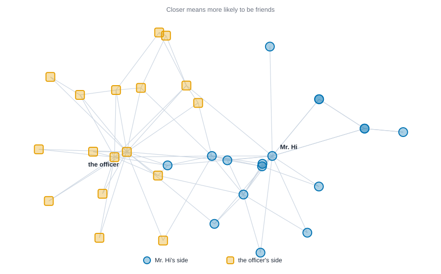
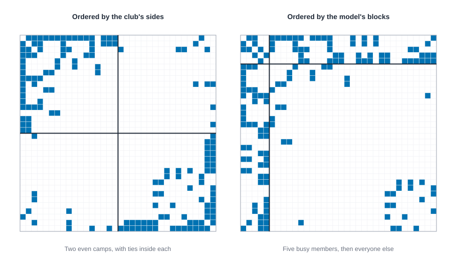
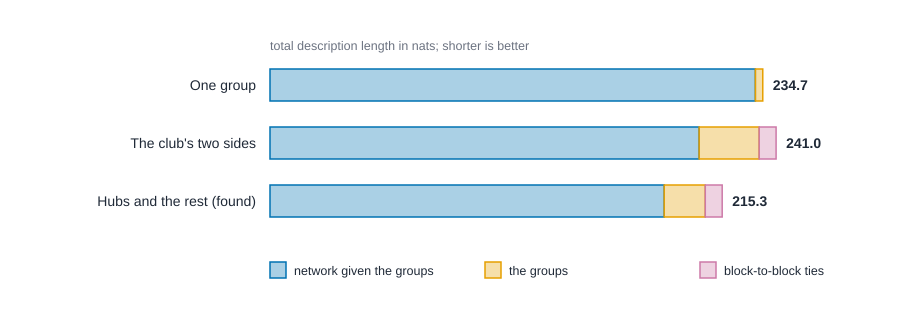

# Latent space and stochastic block models {#sec-latent-space}

::: {.callout-note appearance="simple"}
## Prerequisites
@sec-tests-and-null-models and @sec-ergm. We reuse Zachary's karate club from @sec-subgroups, and the idea of positions from @sec-positions-and-roles.
:::

## Two ways to say "these people are alike"

::: {.callout-tip appearance="simple"}
## Code lives next to the idea
Each step comes with its code right where it is explained. The Rust blocks in this chapter run top to bottom as one script: the first builds the karate club, and later ones reuse it. The R and Python blocks share their variables the same way, so a later block may use a function an earlier one defined.
:::

In @sec-ergm we modeled ties by counting patterns: ties, triangles, same-side pairs. That works well when you know which patterns matter. This chapter takes the opposite road. Instead of choosing patterns, we ask the network to *show us* who is alike, and we let that likeness explain the ties.

There are two classic answers, and they are two different pictures of "alike."

- **Latent space models** say that every person lives somewhere on an invisible map, and the closer two people are, the more likely they are to be tied. "Alike" means *near*. This is the idea of Hoff, Raftery and Handcock [@hoff2002latent].
- **Stochastic block models** say that every person belongs to a group, and the chance of a tie depends only on the two people's groups. "Alike" means *same group*. The idea goes back to Holland, Laskey and Leinhardt [@holland1983stochastic], and it is the statistical cousin of the blockmodels in @sec-positions-and-roles.

Both are *latent* models, because the map or the groups are never observed. They are estimated from the ties. Both also ask a question the earlier chapters couldn't: does the network have hidden structure at all, and how much?

## Latent space: closer means more likely

Give every person a position $z_i$ on a map, a pair of numbers if the map is flat. Then say the log-odds that $i$ and $j$ are tied is a baseline minus the distance between them:

$$
\log \frac{P(\text{tie between } i \text{ and } j)}{1 - P(\text{tie between } i \text{ and } j)} \;=\; \alpha \;-\; \lVert z_i - z_j \rVert .
$$

The number $\alpha$ is the log-odds of a tie between two people standing on the same spot. Every step apart lowers the log-odds by one. Given the map, ties are independent coin flips, one per pair.

A tiny example by hand. Put Ana at 0, Ben at 1 and Cleo at 4 on a line, with $\alpha = 2$.

| Pair | Distance | Log-odds ($2 - \text{distance}$) | Chance of a tie |
| --- | --- | --- | --- |
| Ana and Ben | 1 | 1 | 0.73 |
| Ben and Cleo | 3 | $-1$ | 0.27 |
| Ana and Cleo | 4 | $-2$ | 0.12 |

Ana and Ben are probably friends. Ben and Cleo are a toss-up leaning no, and Ana and Cleo probably aren't. Notice something useful: because distance obeys the triangle inequality (going from Ana to Cleo through Ben is never shorter than going straight), the model builds in a taste for *transitivity*. If Ana is near Ben and Ben is near Cleo, then Ana can't be very far from Cleo. Friends of friends tend to be friends, without a triangle term anywhere in the model.

### Step 1: the data

::: {.panel-tabset group="language"}

## R

```r
library(knappnet)
library(dplyr)
library(purrr)

# Positions 1 to 34 are the members (the files number them from 1).
edges <- read.csv("data/karate/edges.csv")
nodes <- read.csv("data/karate/nodes.csv")
club <- net_frame(edges[, c("source", "target")], nodes = nodes, directed = FALSE)
# The side each member took when the club split (0 = Mr. Hi, 1 = the officer).
side <- as.integer(nodes$faction != "Mr. Hi")
club
```

::: {.code-output}
```text
# net_frame: 34 nodes, 78 edges
#   directed:  no        mode: one-mode (34 actors)
#   weights:   unweighted
#   time:      static    space: none
#   simple:    no loops, no parallel edges
#   components: 1    isolates: 0    density: 0.139
#
# Nodes (34 x 2)       Edges (78 x 2)
#   id    faction        source target
#   <int> <chr>          <int>  <int>
# 1 1     Mr. Hi       1 1      2
# 2 2     Mr. Hi       2 1      3
# 3 3     Mr. Hi       3 1      4
# 4 4     Mr. Hi       4 1      5
# 5 5     Mr. Hi       5 1      6
# 6 6     Mr. Hi       6 1      7
#   ... 28 more rows     ... 72 more rows
```
:::

## Python

```python
import numpy as np
import pandas as pd
import networkx as nx

# Positions 0 to 33 are the members; the files number them from 1.
edges = pd.read_csv("data/karate/edges.csv")
nodes = pd.read_csv("data/karate/nodes.csv")
club = nx.Graph()
club.add_nodes_from(range(34))
club.add_edges_from(zip(edges["source"] - 1, edges["target"] - 1))
# The side each member took when the club split (0 = Mr. Hi, 1 = the officer).
side = (nodes["faction"] != "Mr. Hi").astype(int).to_numpy()
print(club.number_of_nodes(), "members,", club.number_of_edges(), "friendships")
```

::: {.code-output}
```text
34 members, 78 friendships
```
:::

## Rust

```rust
use knappnet::latent_space::{fit as fit_map, LatentOptions};
use knappnet::sbm::{compute_description_length, fit as fit_blocks, move_delta, SbmOptions};
use knappnet::Graph;

// Zachary's karate club again: 34 members, 78 friendships. Positions 0 to 33 are the members.
let from = [
    0, 0, 0, 0, 0, 0, 0, 0, 0, 0, 0, 0, 0, 0, 0, 0, 1, 1, 1, 1, 1, 1, 1, 1, 2, 2, 2, 2, 2, 2, 2, 2, 3, 3, 3,
    4, 4, 5, 5, 5, 6, 8, 8, 8, 9, 13, 14, 14, 15, 15, 18, 18, 19, 20, 20, 22, 22, 23, 23, 23, 23, 23, 24, 24,
    24, 25, 26, 26, 27, 28, 28, 29, 29, 30, 30, 31, 31, 32,
];
let to = [
    1, 2, 3, 4, 5, 6, 7, 8, 10, 11, 12, 13, 17, 19, 21, 31, 2, 3, 7, 13, 17, 19, 21, 30, 3, 7, 8, 9, 13, 27, 28,
    32, 7, 12, 13, 6, 10, 6, 10, 16, 16, 30, 32, 33, 33, 33, 32, 33, 32, 33, 32, 33, 33, 32, 33, 32, 33, 25, 27,
    29, 32, 33, 25, 27, 31, 31, 29, 33, 33, 31, 33, 32, 33, 32, 33, 32, 33, 33,
];
// The side each member took when the club split (0 = Mr. Hi, 1 = the officer).
let side: [u32; 34] = [
    0, 0, 0, 0, 0, 0, 0, 0, 0, 1, 0, 0, 0, 0, 1, 1, 0, 0, 1, 0, 1, 0, 1, 1, 1, 1, 1, 1, 1, 1, 1, 1, 1, 1,
];
let club = Graph::from_edges(34, &from, &to, None, false)?;
println!("{}", club.describe());
println!("{} members, {} friendships", club.node_count(), club.edge_count());
```

::: {.code-output}
```text
Undirected network: 34 nodes, 78 ties
  Density           0.139
  Degree            1 to 17, mean 4.59
  Connected pieces  1
  Isolated nodes    0
  Loops, repeats    none
  Busiest           node 33 (17), node 0 (16), node 32 (12)

34 members, 78 friendships
```
:::

:::

### Step 2: fit a map

Fitting means finding the positions and the baseline $\alpha$ that make the observed ties most likely. That is maximum likelihood again, as in @sec-ergm, but here the unknowns are the 34 positions. A two-dimensional map has $34 \times 2 = 68$ position numbers plus $\alpha$. Estimation starts from a map built by multidimensional scaling of path distances and then climbs the likelihood [@hoff2002latent; @gower1966some].

::: {.panel-tabset group="language"}

## R

```r
# latentnet::ergmm() fits this model too. We write the likelihood out instead, so every
# piece is visible: classical scaling of the path distances, then a quasi-Newton climb.
A <- matrix(0, 34, 34)
A[cbind(edges$source, edges$target)] <- 1
A <- A + t(A)
pairs <- which(upper.tri(A), arr.ind = TRUE)
tied <- A[pairs]

fit_map <- function(dim) {
  start <- cmdscale(net_distances(club), k = dim)
  negloglik <- function(par) {
    z <- matrix(par[-length(par)], 34, dim)
    eta <- par[length(par)] - sqrt(rowSums((z[pairs[, 1], , drop = FALSE] - z[pairs[, 2], , drop = FALSE])^2) + 1e-12)
    -sum(tied * eta - pmax(eta, 0) - log1p(exp(-abs(eta))))
  }
  gradient <- function(par) {
    z <- matrix(par[-length(par)], 34, dim)
    diff <- z[pairs[, 1], , drop = FALSE] - z[pairs[, 2], , drop = FALSE]
    dist <- sqrt(rowSums(diff^2) + 1e-12)
    resid <- tied - 1 / (1 + exp(dist - par[length(par)]))
    step <- -resid / dist * diff
    # Each pair pushes its first member along `step` and its second member the opposite way.
    total_by <- function(rows) {
      sums <- rowsum(step, rows)
      out <- matrix(0, 34, dim)
      out[as.integer(rownames(sums)), ] <- sums
      out
    }
    -c(total_by(pairs[, 1]) - total_by(pairs[, 2]), sum(resid))
  }
  res <- optim(c(start, 0), negloglik, gradient, method = "BFGS",
               control = list(maxit = 5000, reltol = 1e-14))
  list(positions = matrix(res$par[-length(res$par)], 34, dim), alpha = res$par[length(res$par)],
       loglik = -res$value, steps = res$counts[["gradient"]], converged = res$convergence == 0)
}

# The likelihood has many hills, and R's search climbs a different one than Rust's
# does, so the numbers below differ in the first decimals. Python differs too.
fit <- fit_map(2)
positions <- fit$positions

options(pillar.sigfig = 4)

tibble(alpha = fit$alpha, loglik = fit$loglik, steps = fit$steps, converged = fit$converged) |>
  mutate(across(where(is.numeric), \(x) round(x, 3)))

# Where the two leaders ended up on the map.
tibble(member = c("Mr. Hi", "officer"), x = positions[c(1, 34), 1], y = positions[c(1, 34), 2]) |>
  mutate(across(where(is.numeric), \(x) round(x, 2)))
```

::: {.code-output}
```text
# A tibble: 1 × 4
  alpha loglik steps converged
  <dbl>  <dbl> <dbl> <lgl>    
1 3.029 -122.7    78 TRUE     
# A tibble: 2 × 3
  member      x     y
  <chr>   <dbl> <dbl>
1 Mr. Hi  -3.68 -0.4 
2 officer  3.75 -0.14
```
:::

## Python

```python
from scipy.optimize import minimize
from scipy.sparse.csgraph import shortest_path

A = nx.to_numpy_array(club, nodelist=range(34))
pair_i, pair_j = np.triu_indices(34, 1)
tied = A[pair_i, pair_j]

def fit_map(dim):
    # Start from classical scaling of the path distances, then climb the likelihood.
    D = shortest_path(A, unweighted=True)
    J = np.eye(34) - 1 / 34
    w, v = np.linalg.eigh(-0.5 * J @ D**2 @ J)
    start = v[:, ::-1][:, :dim] * np.sqrt(w[::-1][:dim])

    def negloglik(par):
        z, alpha = par[:-1].reshape(34, dim), par[-1]
        diff = z[pair_i] - z[pair_j]
        dist = np.sqrt((diff**2).sum(axis=1) + 1e-12)
        eta = alpha - dist
        resid = tied - 1 / (1 + np.exp(-eta))
        grad = np.zeros((34, dim))
        step = (-resid / dist)[:, None] * diff
        np.add.at(grad, pair_i, step)
        np.add.at(grad, pair_j, -step)
        loglik = (tied * eta - np.logaddexp(0, eta)).sum()
        return -loglik, -np.append(grad.ravel(), resid.sum())

    res = minimize(negloglik, np.append(start.ravel(), 0.0), jac=True, method="L-BFGS-B",
                   options={"maxiter": 5000, "ftol": 1e-14})
    return res.x[:-1].reshape(34, dim), res.x[-1], -res.fun, res

# The likelihood has many hills, and scipy's search climbs a different one than Rust's
# does, so the numbers below differ in the first decimals. R and Python also differ.
positions, alpha, loglik, res = fit_map(2)
print(f"baseline log-odds (alpha): {alpha:.3f}")
print(f"log-likelihood: {loglik:.2f}")
print(f"search steps: {res.nit}, converged: {str(res.success).lower()}")
print(f"Mr. Hi at ({positions[0, 0]:.2f}, {positions[0, 1]:.2f}), the officer at ({positions[33, 0]:.2f}, {positions[33, 1]:.2f})")
```

::: {.code-output}
```text
baseline log-odds (alpha): 3.052
log-likelihood: -122.40
search steps: 2346, converged: true
Mr. Hi at (3.63, -0.57), the officer at (-3.78, -0.27)
```
:::

## Rust

```rust
// Ask for a two-dimensional map. The default options start from classical scaling of the path distances.
let map = fit_map(&club, &LatentOptions { dim: 2, ..Default::default() })?;
println!("baseline log-odds (alpha): {:.3}", map.alpha);
println!("log-likelihood: {:.2}", map.loglik);
println!("search steps: {}, converged: {}", map.iterations, map.converged);
println!("Mr. Hi at ({:.2}, {:.2}), the officer at ({:.2}, {:.2})",
    map.positions[0], map.positions[1], map.positions[66], map.positions[67]);
```

::: {.code-output}
```text
baseline log-odds (alpha): 3.060
log-likelihood: -122.33
search steps: 807, converged: true
Mr. Hi at (3.64, -0.52), the officer at (-3.78, -0.31)
```
:::

:::

The R and Python tabs fit the same model with their own optimizers, which climb a different hill of the likelihood than the Rust search does, so their digits differ from the ones shown here.

The log-likelihood of $-122.33$ is a score for how well this map explains the 78 ties and 483 non-ties: closer to zero is better. The baseline of 3.06 says two members standing on top of each other would have a chance of a tie of about 96 percent. @fig-latent-map draws the map.

{#fig-latent-map fig-alt="A scatter of 34 markers joined by light grey lines for the 78 friendships. Blue circles for Mr. Hi's side sit mostly on the right, with Mr. Hi near the middle. Orange squares for the officer's side sit mostly on the left, around the officer. A few blue circles sit near the center, between the two groups."}

Nobody told the model about the two sides. It only saw who was friends with whom, and the map still pulls the officer's side to one end and Mr. Hi's to the other, with a few members in between.

### Step 3: read the map

A map is a picture. To use it, turn it back into numbers: how likely is each pair to be tied, and do distances line up with the club's sides?

::: {.panel-tabset group="language"}

## R

```r
# Distances come from the map, so they differ a little from Rust's.
# Turn the map into tie probabilities: log-odds = alpha - distance.
distance <- as.matrix(dist(positions))
pair_table <- tibble(i = pairs[, 1], j = pairs[, 2]) |>
  mutate(distance = distance[cbind(i, j)],
         p = 1 / (1 + exp(distance - fit$alpha)),
         tied = A[cbind(i, j)] == 1,
         same_side = side[i] == side[j])

pair_table |> summarise(expected_ties = sum(p), observed_ties = sum(tied))

pair_table |>
  group_by(tied) |>
  summarise(pairs = n(), average_chance = mean(p))

pair_table |>
  group_by(same_side) |>
  summarise(pairs = n(), average_distance = mean(distance))
```

::: {.code-output}
```text
# A tibble: 1 × 2
  expected_ties observed_ties
          <dbl>         <int>
1         78.00            78
# A tibble: 2 × 3
  tied  pairs average_chance
  <lgl> <int>          <dbl>
1 FALSE   483        0.08060
2 TRUE     78        0.5009 
# A tibble: 2 × 3
  same_side pairs average_distance
  <lgl>     <int>            <dbl>
1 FALSE       289            9.468
2 TRUE        272            5.194
```
:::

## Python

```python
# Distances come from the map, so they differ a little from Rust's.
# Turn the map into tie probabilities: log-odds = alpha - distance.
dist = np.linalg.norm(positions[pair_i] - positions[pair_j], axis=1)
p = 1 / (1 + np.exp(dist - alpha))
same_side = side[pair_i] == side[pair_j]
print(f"expected ties {p.sum():.1f} (observed {int(tied.sum())})")
print(f"average chance of a tie: {p[tied == 1].mean():.3f} for pairs that are tied, {p[tied == 0].mean():.3f} for pairs that are not")
print(f"average distance: {dist[same_side].mean():.2f} within a side, {dist[~same_side].mean():.2f} between sides")
```

::: {.code-output}
```text
expected ties 78.0 (observed 78)
average chance of a tie: 0.502 for pairs that are tied, 0.080 for pairs that are not
average distance: 5.24 within a side, 9.47 between sides
```
:::

## Rust

```rust
// Turn the map into tie probabilities: log-odds = alpha - distance.
let spot = |i: usize| (map.positions[2 * i], map.positions[2 * i + 1]);
let distance = |i: usize, j: usize| ((spot(i).0 - spot(j).0).powi(2) + (spot(i).1 - spot(j).1).powi(2)).sqrt();
let mut tied = vec![vec![false; 34]; 34];
for (&a, &b) in from.iter().zip(to.iter()) {
    tied[a as usize][b as usize] = true;
    tied[b as usize][a as usize] = true;
}
let (mut expected, mut p_tie, mut p_none, mut n_tie, mut n_none) = (0.0, 0.0, 0.0, 0, 0);
let (mut within, mut between, mut n_within, mut n_between) = (0.0, 0.0, 0, 0);
for i in 0..34 {
    for j in (i + 1)..34 {
        let p = 1.0 / (1.0 + (distance(i, j) - map.alpha).exp());
        expected += p;
        if tied[i][j] { p_tie += p; n_tie += 1 } else { p_none += p; n_none += 1 }
        if side[i] == side[j] { within += distance(i, j); n_within += 1 } else { between += distance(i, j); n_between += 1 }
    }
}
println!("expected ties {:.1} (observed {})", expected, n_tie);
println!("average chance of a tie: {:.3} for pairs that are tied, {:.3} for pairs that are not", p_tie / n_tie as f64, p_none / n_none as f64);
println!("average distance: {:.2} within a side, {:.2} between sides", within / n_within as f64, between / n_between as f64);
```

::: {.code-output}
```text
expected ties 78.0 (observed 78)
average chance of a tie: 0.502 for pairs that are tied, 0.080 for pairs that are not
average distance: 5.27 within a side, 9.47 between sides
```
:::

:::

Because the R and Python maps differ a little from the Rust map, the averages they print differ in the first decimals too.

Three things to see. First, the model's expected number of ties is 78.0, exactly the observed number. That is not luck: the likelihood is maximized, among other things, over $\alpha$, and at the maximum the expected number of ties must equal the observed one, the same property an intercept gives an ordinary logistic regression. Second, pairs that are tied get an average chance of about 0.50 and pairs that aren't get about 0.08, so the map separates ties from non-ties, though far from perfectly, as it should for friendships that no map can fully predict. Third, members of the same side are on average 5.3 apart and members of different sides 9.5, so the map found the split on its own.

::: {.callout-warning appearance="simple"}
## A map is one of many
The likelihood of a latent space model has many hills, and the search stops at the first one it climbs. A check with 40 random starting points found that the best ten maps had log-likelihoods from about $-126$ to $-121$, so the map above, at $-122.33$, is good but not the best one found. The pictures differed in their details, yet in every one of the best three the same-side distances averaged between 5.1 and 5.3 and the between-side distances between 9.2 and 9.8. Trust what the maps agree on (the split, the hubs in the middle of their camps), and don't read meaning into the small details of any one picture.
:::

### Step 4: how many dimensions?

Why two dimensions? Mostly because we can draw two. More dimensions always fit at least as well, so the question is where to stop.

::: {.panel-tabset group="language"}

## R

```r
tibble(dim = 1:3) |>
  mutate(fit = map(dim, fit_map),
         loglik = map_dbl(fit, "loglik"),
         alpha = map_dbl(fit, "alpha")) |>
  select(!fit) |>
  mutate(across(where(is.numeric), \(x) round(x, 2)))
```

::: {.code-output}
```text
# A tibble: 3 × 3
    dim  loglik alpha
  <dbl>   <dbl> <dbl>
1     1 -159.2   0.4 
2     2 -122.7   3.03
3     3  -83.31 17.98
```
:::

## Python

```python
for dim in (1, 2, 3):
    _, a, ll, _ = fit_map(dim)
    print(f"{dim} dimension(s): log-likelihood {ll:8.2f}, alpha {a:6.2f}")
```

::: {.code-output}
```text
1 dimension(s): log-likelihood  -159.14, alpha   0.42
2 dimension(s): log-likelihood  -122.40, alpha   3.05
3 dimension(s): log-likelihood   -73.83, alpha  47.28
```
:::

## Rust

```rust
for dim in 1..=3 {
    let m = fit_map(&club, &LatentOptions { dim, ..Default::default() })?;
    println!("{dim} dimension(s): log-likelihood {:>8.2}, alpha {:>6.2}", m.loglik, m.alpha);
}
```

::: {.code-output}
```text
1 dimension(s): log-likelihood  -160.20, alpha   0.33
2 dimension(s): log-likelihood  -122.33, alpha   3.06
3 dimension(s): log-likelihood   -83.66, alpha  13.75
```
:::

:::

Again, the R and Python optimizers end at different hills, so their log-likelihoods and baselines differ from these, most of all in three dimensions, where the search runs off along the ridge described below.

Going from one dimension to two raises the log-likelihood from $-160$ to $-122$, a big gain for 34 more numbers. Three dimensions look better still, at $-84$, but look at $\alpha$: it jumped to nearly 14. That is a warning sign. With enough room, the model can place members so that ties and non-ties separate almost perfectly, and then the likelihood has no peak: it keeps rising as the positions spread out and $\alpha$ grows. In a longer search it climbed past $-59$ with $\alpha$ near 100. A fit like that is memorizing the network, and a map that memorizes tells you nothing. With only 34 people, two dimensions is as far as the data will carry us. In larger networks you would compare models by how well they predict ties left out of the fit.

### Choosing the dimension with evidence {#sec-latent-dimension}

"Pick the dimension by prediction" is the right answer, and @sec-prediction shows how to hold ties out and score them. Before you spend that effort, two quick rules of thumb can tell you whether the extra dimension is earning its keep. Both start from the log-likelihood $\ell$ and charge a price per free number $k$: AIC adds $2k$ to $-2\ell$, and BIC adds $k \ln N$ [@schwarz1978estimating], where $N$ is the number of pairs (here $34 \times 33 / 2 = 561$). Lower is better. A map in $d$ dimensions has $34d$ positions, minus $d$ shifts and $d(d-1)/2$ turns that change nothing, plus $\alpha$.

::: {.panel-tabset group="language"}

## R

```r
# Count the free numbers: every position, minus the shifts and turns that change nothing, plus alpha.
n_pairs <- nrow(pairs)
tibble(dim = 1:2) |>
  mutate(fit = map(dim, fit_map),
         loglik = map_dbl(fit, "loglik"),
         free_numbers = 34 * dim - dim - dim * (dim - 1) / 2 + 1,
         aic = -2 * loglik + 2 * free_numbers,
         bic = -2 * loglik + free_numbers * log(n_pairs)) |>
  select(!fit) |>
  mutate(across(where(is.numeric), \(x) round(x, 1)))
```

::: {.code-output}
```text
```
:::

## Python

```python
# Count the free numbers: every position, minus the shifts and turns that change nothing, plus alpha.
n_pairs = len(tied)
print(f"{'dim':>3} {'free numbers':>13} {'log-lik':>9} {'AIC':>7} {'BIC':>7}")
for dim in (1, 2):
    _, _, ll, _ = fit_map(dim)
    free = 34 * dim - dim - dim * (dim - 1) // 2 + 1
    print(f"{dim:>3} {free:>13} {ll:9.1f} {-2 * ll + 2 * free:7.1f} {-2 * ll + free * np.log(n_pairs):7.1f}")
```

::: {.code-output}
```text
dim  free numbers   log-lik     AIC     BIC
  1            34    -159.1   386.3   533.5
  2            66    -122.4   376.8   662.6
```
:::

## Rust

```rust
// Count the free numbers: every position, minus the shifts and turns that change nothing, plus alpha.
let n_pairs = 34.0 * 33.0 / 2.0_f64;
println!("{:>3} {:>13} {:>9} {:>7} {:>7}", "dim", "free numbers", "log-lik", "AIC", "BIC");
for dim in 1..=2usize {
    let fitted = fit_map(&club, &LatentOptions { dim, ..Default::default() })?;
    let free = 34 * dim - dim - dim * (dim - 1) / 2 + 1;
    let ll = fitted.loglik;
    println!("{:>3} {:>13} {:9.1} {:7.1} {:7.1}", dim, free, ll, -2.0 * ll + 2.0 * free as f64, -2.0 * ll + free as f64 * n_pairs.ln());
}
```

::: {.code-output}
```text
dim  free numbers   log-lik     AIC     BIC
  1            34    -160.2   388.4   535.6
  2            66    -122.3   376.7   662.4
```
:::

:::


The extra dimension raises the log-likelihood by about 38 nats, so $-2\ell$ falls by about 76. The 32 extra free numbers cost $2 \times 32 = 64$ under AIC and $32 \times \ln 561 = 203$ under BIC. AIC says two dimensions (376.7 against 388.4) and BIC says one (535.6 against 662.4). That disagreement is a finding in its own right: the data do not clearly demand a second axis. Take care with both numbers. Treating the 561 pairs as 561 independent observations is a convention, since the model itself says pairs share members, and neither rule knows about the runaway fits of the last step, where three dimensions look wonderful and mean nothing. Use these as a first screen, report both, and settle it with held-out ties or with a check of what the model gets wrong (the goodness-of-fit step later in this chapter).

### What the positions mean, and what they don't {#sec-latent-meaning}

It is tempting to read the map like a street map: that cluster is the "inner circle", the left edge is "the officer's end". Three facts keep that honest.

**Only distances count.** The model sees positions only through the distances between them. Turn the whole map, flip it in a mirror, or slide it across the page, and every distance stays the same, so the likelihood stays the same. The axes therefore mean nothing, and two researchers who fit the same network will draw maps that look different and are the same. Stretching is different: it changes distances, and the likelihood notices.

::: {.panel-tabset group="language"}

## R

```r
pair_loglik <- function(z, a) {
  eta <- a - sqrt(rowSums((z[pairs[, 1], , drop = FALSE] - z[pairs[, 2], , drop = FALSE])^2))
  sum(tied * eta - pmax(eta, 0) - log1p(exp(-abs(eta))))
}

turn <- 0.7
rotation <- matrix(c(cos(turn), sin(turn), -sin(turn), cos(turn)), 2, 2)
mirror <- diag(c(1, -1))
shift <- c(5, -3)
changes <- list(
  "as fitted" = positions,
  "turned by 0.7 radians" = positions %*% rotation,
  "mirrored" = positions %*% mirror,
  "shifted by (5, -3)" = sweep(positions, 2, shift, "+"),
  "all three together" = sweep(positions %*% rotation %*% mirror, 2, shift, "+"),
  "stretched 1.3 times sideways" = sweep(positions, 2, c(1.3, 1), "*")
)

tibble(change = names(changes),
       loglik = map_dbl(changes, \(z) pair_loglik(z, fit$alpha)),
       largest_distance_change = map_dbl(changes, \(z) max(abs(as.vector(dist(z)) - as.vector(dist(positions)))))) |>
  mutate(across(where(is.numeric), \(x) round(x, 4)))
```

::: {.code-output}
```text
```
:::

## Python

```python
def pair_loglik(z, a):
    eta = a - np.linalg.norm(z[pair_i] - z[pair_j], axis=1)
    return (tied * eta - np.logaddexp(0, eta)).sum()

turn = 0.7
rotation = np.array([[np.cos(turn), -np.sin(turn)], [np.sin(turn), np.cos(turn)]])
mirror = np.diag([1.0, -1.0])
shift = np.array([5.0, -3.0])
changes = {
    "as fitted": positions,
    "turned by 0.7 radians": positions @ rotation,
    "mirrored": positions @ mirror,
    "shifted by (5, -3)": positions + shift,
    "all three together": positions @ rotation @ mirror + shift,
    "stretched 1.3 times sideways": positions * np.array([1.3, 1.0]),
}
for name, z in changes.items():
    gap = np.abs(np.linalg.norm(z[pair_i] - z[pair_j], axis=1) - dist).max()
    print(f"{name:<29} log-likelihood {pair_loglik(z, alpha):9.4f}, largest change in a distance {gap:.4f}")
```

::: {.code-output}
```text
as fitted                     log-likelihood -122.4019, largest change in a distance 0.0000
turned by 0.7 radians         log-likelihood -122.4019, largest change in a distance 0.0000
mirrored                      log-likelihood -122.4019, largest change in a distance 0.0000
shifted by (5, -3)            log-likelihood -122.4019, largest change in a distance 0.0000
all three together            log-likelihood -122.4019, largest change in a distance 0.0000
stretched 1.3 times sideways  log-likelihood -132.0727, largest change in a distance 5.6579
```
:::

## Rust

```rust
// Log-likelihood of the ties, and the biggest change in any distance, for positions `z` (two numbers per member) and baseline `a`.
let judge = |z: &[f64], a: f64| -> (f64, f64) {
    let (mut total, mut gap) = (0.0, 0.0_f64);
    for i in 0..34 {
        for j in (i + 1)..34 {
            let far = ((z[2 * i] - z[2 * j]).powi(2) + (z[2 * i + 1] - z[2 * j + 1]).powi(2)).sqrt();
            let eta = a - far;
            total += (if tied[i][j] { eta } else { 0.0 }) - eta.max(0.0) - (-eta.abs()).exp().ln_1p();
            gap = gap.max((far - distance(i, j)).abs());
        }
    }
    (total, gap)
};
// Each change is x' = a x + b y + e and y' = c x + d y + f, written as [a, b, c, d, e, f].
let (cs, sn) = (0.7_f64.cos(), 0.7_f64.sin());
for (name, [a, b, c, d, e, f]) in [
    ("as fitted", [1.0, 0.0, 0.0, 1.0, 0.0, 0.0]), ("turned by 0.7 radians", [cs, sn, -sn, cs, 0.0, 0.0]),
    ("mirrored", [1.0, 0.0, 0.0, -1.0, 0.0, 0.0]), ("shifted by (5, -3)", [1.0, 0.0, 0.0, 1.0, 5.0, -3.0]),
    ("all three together", [cs, sn, sn, -cs, 5.0, -3.0]), ("stretched 1.3 times sideways", [1.3, 0.0, 0.0, 1.0, 0.0, 0.0]),
] {
    let z: Vec<f64> = (0..34).flat_map(|i| {
        let (x, y) = (map.positions[2 * i], map.positions[2 * i + 1]);
        [a * x + b * y + e, c * x + d * y + f]
    }).collect();
    let (loglik, gap) = judge(&z, map.alpha);
    println!("{name:<29} log-likelihood {loglik:9.4}, largest change in a distance {gap:.4}");
}
```

::: {.code-output}
```text
as fitted                     log-likelihood -122.3329, largest change in a distance 0.0000
turned by 0.7 radians         log-likelihood -122.3329, largest change in a distance 0.0000
mirrored                      log-likelihood -122.3329, largest change in a distance 0.0000
shifted by (5, -3)            log-likelihood -122.3329, largest change in a distance 0.0000
all three together            log-likelihood -122.3329, largest change in a distance 0.0000
stretched 1.3 times sideways  log-likelihood -132.0533, largest change in a distance 5.5667
```
:::

:::


Five of the six rows give one log-likelihood, $-122.33$, and a largest change in any distance of 0. The stretched map is not the same model: its log-likelihood drops to $-132.05$ and distances move by up to 5.6.

**The map is not geography, and not the truth.** A position is a device for explaining ties, and the model is only asked to reproduce them. Two members can sit apart because they are in different circles, because they never met, because one of them is new, or because the data stopped there. And one network gives one fit: add a 35th member or drop five ties and the map can shift. You can call the horizontal direction "faction" only if you check it against something you know, and even then the fit would draw the same picture rotated by any angle.

**Near does not mean liking.** The model says ties are likelier between near members. That is a statement about the *ties you saw*. Whether those ties come from liking, from sharing a classroom, or from a rule that hands out partners, the model cannot say.

### Friends of friends, for free {#sec-latent-transitivity}

An ERGM gets closure by being told to count triangles. A latent space model gets it from geometry, through the triangle inequality: $\lVert z_i - z_k \rVert \le \lVert z_i - z_j \rVert + \lVert z_j - z_k \rVert$. If $i$ is near $j$ and $j$ is near $k$, then $i$ cannot be far from $k$, so the third tie of the triangle is likely too. Homophily works the same way when members with a shared trait end up close: ties between them become likelier without any "same trait" term. We can measure how much closure a fitted map buys by adding up, over every triple, the chance that all three ties are present.

::: {.panel-tabset group="language"}

## R

```r
# Chance of a tie for every pair, from the map (zero on the diagonal).
P <- 1 / (1 + exp(distance - fit$alpha))
diag(P) <- 0
overall <- sum(A) / (34 * 33)
# Each triangle is counted six times by the trace.
count_triangles <- \(M) sum(diag(M %*% M %*% M)) / 6

tibble(source = c("the club", "the fitted map", "every pair with the same chance"),
       triangles = c(count_triangles(A), count_triangles(P), count_triangles(overall * (1 - diag(34))))) |>
  mutate(triangles = round(triangles, 1))
```

::: {.code-output}
```text
```
:::

## Python

```python
# Chance of a tie for every pair, from the map (zero on the diagonal).
P = np.zeros((34, 34))
P[pair_i, pair_j] = P[pair_j, pair_i] = p
density = A.sum() / (34 * 33)
triangles = lambda M: np.trace(M @ M @ M) / 6    # each triangle is counted six times by the trace

print(f"triangles in the club:                        {triangles(A):6.1f}")
print(f"expected from the fitted map:                 {triangles(P):6.1f}")
print(f"expected if every pair had chance {density:.3f}:    {triangles(density * (1 - np.eye(34))):6.1f}")
```

::: {.code-output}
```text
triangles in the club:                          45.0
expected from the fitted map:                   41.3
expected if every pair had chance 0.139:      16.1
```
:::

## Rust

```rust
// Chance of a tie for every pair from the map, and the same for a model where every pair has the club's overall chance.
let map_chance: Vec<Vec<f64>> = (0..34).map(|i| (0..34).map(|j| 1.0 / (1.0 + (distance(i, j) - map.alpha).exp())).collect()).collect();
let overall = 2.0 * 78.0 / (34.0 * 33.0);
let same_chance = vec![vec![overall; 34]; 34];
let seen_ties: Vec<Vec<f64>> = tied.iter().map(|row| row.iter().map(|&t| if t { 1.0 } else { 0.0 }).collect()).collect();
// Expected triangles: the product of the three chances, added up over every triple of members.
let triangles = |p: &Vec<Vec<f64>>| -> f64 {
    (0..34).map(|i| (i + 1..34).map(|j| (j + 1..34).map(|k| p[i][j] * p[j][k] * p[i][k]).sum::<f64>()).sum::<f64>()).sum()
};
println!("triangles in the club:                        {:6.1}", triangles(&seen_ties));
println!("expected from the fitted map:                 {:6.1}", triangles(&map_chance));
println!("expected if every pair had chance {:.3}:    {:6.1}", overall, triangles(&same_chance));
```

::: {.code-output}
```text
triangles in the club:                          45.0
expected from the fitted map:                   41.4
expected if every pair had chance 0.139:      16.1
```
:::

:::


The club has 45 triangles. A model where every pair has the same chance (0.139, the club's density) would give about 16. The fitted map expects 41.4, most of the way to the truth. Nobody told the model about triangles. What the map did not get is the other side of the coin, as the goodness-of-fit check will show.

### How sure is the map? {#sec-latent-uncertainty}

So far we fitted by maximum likelihood: one best map. The Bayesian way fits a *cloud* of maps. Give every coordinate and $\alpha$ a prior (here a normal with standard deviation 10, deliberately vague), and ask for the posterior, which says how plausible each map is after seeing the ties. Nobody can write that posterior down, so we sample from it with a random-walk Metropolis chain: nudge one member, keep the nudge with probability $\min(1, \text{ratio of posterior values})$, move on to the next member, then nudge $\alpha$, and repeat [@hoff2002latent]. Many draws form a picture of the uncertainty.

Think about what to measure, though. Positions are only defined up to turns, mirror images and shifts, so averaging the draws of one member's coordinates mixes unlike things. Distances do not have that problem, so we summarize those: the distance between the two leaders, whether member 2 (the one the block model could not place firmly) sits nearer Mr. Hi or the officer, and $\alpha$.

::: {.panel-tabset group="language"}

## R

```r
# Log-likelihood of the ties of member i alone.
node_loglik <- function(z, a, i) {
  eta <- a - sqrt(rowSums(sweep(z[-i, , drop = FALSE], 2, z[i, ])^2))
  sum(A[i, -i] * eta - pmax(eta, 0) - log1p(exp(-abs(eta))))
}

# Nudge member i and keep the move with the Metropolis probability (Normal(0, 10) prior on each coordinate).
move_member <- function(z, i, a, step = 0.5, prior_sd = 10) {
  moved <- z
  moved[i, ] <- z[i, ] + step * rnorm(2)
  log_accept <- node_loglik(moved, a, i) - node_loglik(z, a, i) -
    (sum(moved[i, ]^2) - sum(z[i, ]^2)) / (2 * prior_sd^2)
  if (log(runif(1)) < log_accept) moved else z
}

# Visit the members one at a time (recursion instead of a loop).
move_all <- function(z, members, a) {
  if (length(members) == 0) z else move_all(move_member(z, members[1], a), members[-1], a)
}

move_alpha <- function(z, a, step = 0.2, prior_sd = 10) {
  proposal <- a + step * rnorm(1)
  log_accept <- pair_loglik(z, proposal) - pair_loglik(z, a) - (proposal^2 - a^2) / (2 * prior_sd^2)
  if (log(runif(1)) < log_accept) proposal else a
}

run_chain <- function(z, a, sweeps) {
  if (sweeps == 0) return(list(z = z, alpha = a))
  z <- move_all(z, 1:34, a)
  run_chain(z, move_alpha(z, a), sweeps - 1)
}

# 40 chains of 100 sweeps, each started at the fitted map; the last state of each is one draw.
set.seed(1)
draws <- map(1:40, \(chain) run_chain(positions, fit$alpha, 100))

apart <- \(z, i, j) sqrt(sum((z[i, ] - z[j, ])^2))
draw_table <- tibble(
  leaders_apart = map_dbl(draws, \(d) apart(d$z, 1, 34)),
  member2_lean = map_dbl(draws, \(d) apart(d$z, 3, 1) - apart(d$z, 3, 34)),
  alpha = map_dbl(draws, "alpha"),
  loglik = map_dbl(draws, \(d) pair_loglik(d$z, d$alpha))
)

draw_table |>
  map(\(x) tibble(mean = mean(x), low = quantile(x, 0.025, names = FALSE), high = quantile(x, 0.975, names = FALSE))) |>
  bind_rows(.id = "quantity") |>
  mutate(across(where(is.numeric), \(x) round(x, 2)))

# member2_lean is the distance from member 2 to Mr. Hi minus the distance to the officer.
tibble(nearer_Mr_Hi = sum(draw_table$member2_lean < 0), of_draws = nrow(draw_table))

tibble(quantity = c("leaders_apart", "member2_lean", "alpha", "loglik"),
       at_fitted_map = c(apart(positions, 1, 34), apart(positions, 3, 1) - apart(positions, 3, 34), fit$alpha, fit$loglik)) |>
  mutate(at_fitted_map = round(at_fitted_map, 2))
```

::: {.code-output}
```text
```
:::

## Python

```python
rng = np.random.default_rng(1)

def node_loglik(z, a, i):
    """Log-likelihood of the ties of member i alone."""
    eta = a - np.linalg.norm(np.delete(z, i, axis=0) - z[i], axis=1)
    return (np.delete(A[i], i) * eta - np.logaddexp(0, eta)).sum()

def run_chain(z, a, sweeps, step=0.5, alpha_step=0.2, prior_sd=10.0):
    """Random-walk Metropolis: nudge each member in turn, then alpha. Normal(0, 10) priors."""
    z = z.copy()
    for _ in range(sweeps):
        for i in range(34):
            old, new = z[i].copy(), z[i] + step * rng.standard_normal(2)
            before = node_loglik(z, a, i)
            z[i] = new
            log_accept = node_loglik(z, a, i) - before - (new @ new - old @ old) / (2 * prior_sd**2)
            if np.log(rng.uniform()) >= log_accept:
                z[i] = old
        a_new = a + alpha_step * rng.standard_normal()
        log_accept = pair_loglik(z, a_new) - pair_loglik(z, a) - (a_new**2 - a**2) / (2 * prior_sd**2)
        if np.log(rng.uniform()) < log_accept:
            a = a_new
    return z, a

# 40 chains of 100 sweeps, each started at the fitted map; the last state of each is one draw.
draws = [run_chain(positions, alpha, 100) for _ in range(40)]
apart = lambda z, i, j: np.linalg.norm(z[i] - z[j])
summaries = {
    "distance from Mr. Hi to the officer": [apart(z, 0, 33) for z, _ in draws],
    "member 2: distance to Mr. Hi minus to the officer": [apart(z, 2, 0) - apart(z, 2, 33) for z, _ in draws],
    "alpha": [a for _, a in draws],
    "log-likelihood of the map": [pair_loglik(z, a) for z, a in draws],
}
for name, values in summaries.items():
    low, high = np.quantile(values, [0.025, 0.975])
    print(f"{name}: mean {np.mean(values):.2f}, 95% range {low:.2f} to {high:.2f}")
closer = sum(value < 0 for value in summaries["member 2: distance to Mr. Hi minus to the officer"])
print(f"member 2 is nearer Mr. Hi than the officer in {closer} of {len(draws)} draws")
print(f"at the fitted map: {apart(positions, 0, 33):.2f}, {apart(positions, 2, 0) - apart(positions, 2, 33):.2f}, {alpha:.2f}, {pair_loglik(positions, alpha):.2f}")
```

::: {.code-output}
```text
distance from Mr. Hi to the officer: mean 7.79, 95% range 6.27 to 9.40
member 2: distance to Mr. Hi minus to the officer: mean -1.34, 95% range -4.05 to 1.85
alpha: mean 3.32, 95% range 2.76 to 3.94
log-likelihood of the map: mean -157.13, 95% range -168.98 to -147.26
member 2 is nearer Mr. Hi than the officer in 31 of 40 draws
at the fitted map: 7.42, -1.29, 3.05, -122.40
```
:::

## Rust

```rust
use knappnet::latent_space::{sample, LatentMcmcOptions};

// 40 chains of 100 sweeps, each started at the fitted map; the last state of each is one draw.
let draws = (0..40u64)
    .map(|chain| sample(&club, 2, &map.positions, map.alpha, &LatentMcmcOptions { sweeps: 100, seed: chain + 1, ..Default::default() }))
    .collect::<Result<Vec<_>, _>>()?;
let apart = |z: &[f64], i: usize, j: usize| ((z[2 * i] - z[2 * j]).powi(2) + (z[2 * i + 1] - z[2 * j + 1]).powi(2)).sqrt();
// Quantile by linear interpolation between neighbours.
let quantile = |values: &[f64], q: f64| -> f64 {
    let mut sorted = values.to_vec();
    sorted.sort_by(|a, b| a.partial_cmp(b).unwrap());
    let at = q * (sorted.len() - 1) as f64;
    let (low, high) = (at.floor() as usize, at.ceil() as usize);
    sorted[low] + (sorted[high] - sorted[low]) * (at - low as f64)
};
let lean: Vec<f64> = draws.iter().map(|d| apart(&d.positions, 2, 0) - apart(&d.positions, 2, 33)).collect();
let summaries: Vec<(&str, Vec<f64>)> = vec![
    ("distance from Mr. Hi to the officer", draws.iter().map(|d| apart(&d.positions, 0, 33)).collect()),
    ("member 2: distance to Mr. Hi minus to the officer", lean.clone()),
    ("alpha", draws.iter().map(|d| d.alpha).collect()),
    ("log-likelihood of the map", draws.iter().map(|d| judge(&d.positions, d.alpha).0).collect()),
];
for (name, values) in &summaries {
    let mean = values.iter().sum::<f64>() / values.len() as f64;
    println!("{name}: mean {:.2}, 95% range {:.2} to {:.2}", mean, quantile(values, 0.025), quantile(values, 0.975));
}
println!("member 2 is nearer Mr. Hi than the officer in {} of {} draws", lean.iter().filter(|&&x| x < 0.0).count(), draws.len());
println!("at the fitted map: {:.2}, {:.2}, {:.2}, {:.2}", apart(&map.positions, 0, 33),
    apart(&map.positions, 2, 0) - apart(&map.positions, 2, 33), map.alpha, map.loglik);
```

::: {.code-output}
```text
distance from Mr. Hi to the officer: mean 7.83, 95% range 5.24 to 9.64
member 2: distance to Mr. Hi minus to the officer: mean -1.27, 95% range -4.19 to 2.63
alpha: mean 3.49, 95% range 2.84 to 4.09
log-likelihood of the map: mean -156.90, 95% range -167.55 to -146.75
member 2 is nearer Mr. Hi than the officer in 31 of 40 draws
at the fitted map: 7.41, -1.27, 3.06, -122.33
```
:::

:::


The Rust chains put the leaders 7.8 apart on average, with a 95% range of 5.2 to 9.6 (the fitted map says 7.4). For member 2, the distance to Mr. Hi minus the distance to the officer averages $-1.3$, with a range from $-4.2$ to $+2.6$ that crosses zero, and 31 of the 40 draws put member 2 nearer Mr. Hi. So the data lean toward Mr. Hi without settling it, which agrees with the block model's verdict on that member. Two more things to see. First, the typical draw has a log-likelihood near $-157$ while the best map has $-122$. That is how posteriors behave when there are many unknowns: the best map is an unusually good one, not a typical one. Second, the chains are short, and they were still drifting. In Python, the mean distance between the leaders was 7.8, 8.2 and 8.4 when the same 40 chains ran for 100, 200 and 400 sweeps. A published analysis would run far longer, from several starts, and check trace plots. Treat the cloud in @fig-latent-posterior as an illustration of how wide the uncertainty can be, not as a calibrated interval.

{#fig-latent-posterior fig-alt="A scatter of 34 large hollow markers, blue circles for Mr. Hi's side and orange squares for the officer's side, each surrounded by 40 small dots of the same color. The dots lie on average 1.0 map units from the fitted position for member 33, the tightest cloud, and 5.2 units for member 11, the widest (root mean square distance)."}

This is why a single plot overstates certainty. The tightest cloud (the officer, member 33, with 17 friends) has a typical radius of about 1.0 map units, and the widest (member 11, who has a single friend) about 5.2, on a map where the two leaders sit about 7.4 units apart. Members with few ties are poorly pinned down, and the maximum-likelihood picture shows them with the same crisp marker as the hubs.

**What makes a fit well posed.** Four things to keep straight. The turns, mirrors and shifts are not identified, so compare maps only after aligning them (the figure used orthogonal Procrustes alignment) or compare distances. The likelihood has many hills, so start from classical scaling of path distances [@gower1966some] and try more than one start. A member with no ties has no position the data can fix, so drop isolates or give them a prior. And with enough dimensions the ties separate perfectly and $\alpha$ runs away, which is a sign to lower the dimension, not to trust the fit. For networks too large for the exact likelihood, a case-control approximation fits each member's ties against a sample of non-ties [@raftery2012fast].

### Other versions of the idea {#sec-latent-variants}

The distance model is the simplest member of a family.

- **Projection model.** Replace distance by a projection: $\operatorname{logit} P_{ij} = \alpha + z_i \cdot z_j / \lVert z_j \rVert$, the length of the shadow that $i$'s position casts on the direction of $j$'s [@hoff2002latent]. It treats the two ends of a tie differently, so it suits directed ties, and it is no longer a distance, so the triangle inequality is gone and with it the automatic closure.
- **Bilinear (dot-product) model.** $\operatorname{logit} P_{ij} = \alpha + z_i^\top z_j$, or with sender and receiver vectors $u_i^\top v_j$ for directed ties [@hoff2005bilinear]. Likeness can be positive or negative: members pointing opposite ways repel. Spectral embeddings in @sec-prediction are the least-squares cousin.
- **Covariates.** Add what you measured: $\operatorname{logit} P_{ij} = \alpha + \beta\, x_{ij} - \lVert z_i - z_j \rVert$. Then the map explains what the covariate does not. This is the contrast with @sec-ergm: an ERGM coefficient is a conditional log-odds *given the rest of the network's patterns*, and nothing hides in the background; here the background is a map, a set of unseen positions, so $\beta$ is a log-odds *given positions*, and it can shrink toward zero if the positions already carry what $x$ says.
- **Clusters and mixtures.** Let the positions come from a few clouds, so that members fall into soft groups on the map [@handcock2007model]. This is a latent space model with a block model laid on top, which is why the two pictures of this chapter are less far apart than they look.
- **Random sender and receiver effects.** For directed ties, give each member a sender effect $s_i$ and a receiver effect $r_j$ on the log-odds, on top of the distance: $\operatorname{logit} P_{i \to j} = \alpha + s_i + r_j - \lVert z_i - z_j \rVert$ [@krivitsky2009representing]. This is what lets the model produce hubs, and we are about to see why a plain map cannot.

## Stochastic block models: same group, same story

Now the second picture. Suppose every member belongs to one of a few groups, and the chance that two members are tied depends only on their groups. Maybe the groups are tied closely inside and sparsely between, like the two camps in the karate club. Maybe one group is a set of hubs that everybody else ties to. A block model allows any pattern of rates between groups.

This is the same object as the blockmodel in @sec-positions-and-roles, with one important difference. There, we chose the groups by hand or from similarity scores. Here, a statistical model decides *how many groups there are* and *who is in them*, by asking which grouping gives the most economical account of the network.

### The idea: shortest description wins

Imagine you must send the karate club's ties to a friend over a slow connection, using as few bits as possible. One way is to list all 78 pairs. A smarter way is to first say "there are two groups, here is who is in each, and here is how dense the ties are within and between," and then send only the details that remain. If the groups capture real structure, the second message is shorter. If they don't, you've spent bits describing groups that didn't help.

The length of the best such message is the **description length** of a grouping [@peixoto2017nonparametric], measured here in nats (a natural-log version of bits). It has three parts:

1. **The network given the groups.** How many bits remain to say exactly which pairs are tied, once you know the groups and their ties-per-block counts. Good groupings make this smaller.
2. **The groups themselves.** The cost of saying who is in which group. More groups, more cost.
3. **The block-to-block ties.** The cost of stating how many ties run between each pair of groups.

This builds in a fair penalty for complexity. A grouping must pay for itself, and the model chooses the number of groups for you instead of asking you to guess. The shortest total wins.

### Step 5: find the best grouping

::: {.panel-tabset group="language"}

## R

```r
# Peixoto's description length has no R package that works from a plain network, so we write
# it out: the cost in nats of the network given the groups, of the groups, and of the ties between them.
m_ties <- sum(A) / 2
degree <- rowSums(A)
ln_fact <- function(k) lgamma(k + 1)
ln_multiset <- function(bins, items) {
  if (items == 0) 0 else ln_fact(bins + items - 1) - ln_fact(items) - ln_fact(bins - 1)
}

# `adj` is the adjacency matrix to describe; it defaults to the karate club.
description_length <- function(blocks, degree_corrected = FALSE, adj = A) {
  labels <- sort(unique(blocks))
  n <- length(blocks)
  k <- length(labels)
  degree <- rowSums(adj)
  m_ties <- sum(adj) / 2
  member <- outer(blocks, labels, "==") * 1
  between <- t(member) %*% adj %*% member   # ties between groups, counted twice inside a group
  size <- colSums(member)
  stubs <- colSums(member * degree)
  # One count per pair of groups (r <= s); a group's own ties were counted twice.
  counts <- between
  diag(counts) <- diag(between) / 2
  counts <- counts[upper.tri(counts, diag = TRUE)]
  network <- -sum(ln_fact(counts)) - sum(diag(between) / 2) * log(2)
  groups <- log(n) + ln_fact(n) - sum(ln_fact(size)) + ln_fact(n - 1) - ln_fact(k - 1) - ln_fact(n - k)
  if (degree_corrected) {
    network <- network + sum(ln_fact(stubs)) - sum(ln_fact(degree))
    popularity <- sum(map2_dbl(size, stubs, ln_multiset))
  } else {
    network <- network + sum(stubs * log(size))
    popularity <- 0
  }
  ties <- ln_multiset(k * (k + 1) / 2, m_ties)
  c(network = network, groups = groups, ties = ties, popularity = popularity,
    total = network + groups + ties + popularity)
}

fit_blocks <- function(degree_corrected, restarts = 5, max_groups = 6, adj = A) {
  n <- nrow(adj)
  # Greedy search: move one member at a time to the group that shortens the description most.
  length_of <- function(blocks) description_length(blocks, degree_corrected, adj)[["total"]]
  best_group <- function(blocks, v, k) {
    lengths <- map_dbl(seq_len(k) - 1, \(g) length_of(replace(blocks, v, g)))
    if (min(lengths) < length_of(blocks) - 1e-9) which.min(lengths) - 1 else blocks[v]
  }
  # Visit the members in the given order, one at a time (recursion instead of a loop).
  sweep_once <- function(blocks, order, k) {
    if (length(order) == 0) blocks
    else sweep_once(replace(blocks, order[1], best_group(blocks, order[1], k)), order[-1], k)
  }
  # Sweep again and again until a whole sweep changes nothing.
  settle <- function(blocks, k) {
    moved <- sweep_once(blocks, sample(n), k)
    if (identical(moved, blocks)) blocks else settle(moved, k)
  }
  starts <- rep(seq_len(max_groups), each = restarts)
  candidates <- map(starts, \(k) settle(sample((0:(n - 1)) %% k), k))
  best <- candidates[[which.min(map_dbl(candidates, length_of))]]
  # Name the groups in order of their first member.
  match(best, unique(best)) - 1
}

set.seed(1)
found <- fit_blocks(FALSE)

tibble(member = 0:33, group = found) |>
  summarise(size = n(), first_members = paste(head(member, 8), collapse = " "), .by = group)
```

::: {.code-output}
```text
# A tibble: 2 × 3
  group  size first_members   
  <dbl> <int> <chr>           
1     0     5 0 1 2 32 33     
2     1    29 3 4 5 6 7 8 9 10
```
:::

## Python

```python
from math import lgamma, log

m = club.number_of_edges()
degree = A.sum(axis=1)

def ln_fact(k):
    return lgamma(k + 1)

def ln_multiset(bins, items):
    return ln_fact(bins + items - 1) - ln_fact(items) - ln_fact(bins - 1) if items else 0.0

def description_length(blocks, degree_corrected=False, adj=None):
    """Peixoto's description length in nats: network, groups, ties, member popularities, total.
    `adj` is the adjacency matrix to describe; it defaults to the karate club."""
    adj = A if adj is None else adj
    degree, m = adj.sum(axis=1), int(adj.sum() / 2)
    blocks = np.asarray(blocks)
    labels = np.unique(blocks)
    n, k = len(blocks), len(labels)
    member = (blocks[:, None] == labels[None, :]).astype(float)
    between = member.T @ adj @ member         # ties between groups, counted twice inside a group
    size, stubs = member.sum(axis=0), member.T @ degree
    network = 0.0
    for r in range(k):
        for s in range(r, k):
            count = int(between[r, s] / 2 if r == s else between[r, s])
            network -= ln_fact(count) + (count * log(2) if r == s else 0.0)
    groups = log(n) + ln_fact(n) - sum(ln_fact(int(x)) for x in size)
    groups += ln_fact(n - 1) - ln_fact(k - 1) - ln_fact(n - k)
    if degree_corrected:
        network += sum(ln_fact(int(x)) for x in stubs) - sum(ln_fact(int(x)) for x in degree)
        popularity = sum(ln_multiset(int(x), int(t)) for x, t in zip(size, stubs))
    else:
        network += sum(t * log(x) for x, t in zip(size, stubs))
        popularity = 0.0
    ties = ln_multiset(k * (k + 1) // 2, m)
    return network, groups, ties, popularity, network + groups + ties + popularity

def fit_blocks(degree_corrected, restarts=5, seed=1, max_groups=6, adj=None):
    # Greedy search: move one member at a time to the group that shortens the description most.
    adj = A if adj is None else adj
    n = len(adj)
    rng = np.random.default_rng(seed)
    best, best_len = None, np.inf
    for k in range(1, max_groups + 1):
        for _ in range(restarts):
            blocks = rng.permutation(np.arange(n) % k)
            length = description_length(blocks, degree_corrected, adj)[-1]
            improved = True
            while improved:
                improved = False
                for v in rng.permutation(n):
                    for g in range(k):
                        trial = blocks.copy()
                        trial[v] = g
                        trial_len = description_length(trial, degree_corrected, adj)[-1]
                        if trial_len < length - 1e-9:
                            blocks, length, improved = trial, trial_len, True
            if length < best_len - 1e-9:
                best, best_len = blocks, length
    # Name the groups in order of their first member.
    _, first, inverse = np.unique(best, return_index=True, return_inverse=True)
    return np.argsort(np.argsort(first))[inverse]

found = fit_blocks(False)
print(f"{found.max() + 1} groups found")
for g in range(found.max() + 1):
    members = [int(i) for i in np.flatnonzero(found == g)]
    print(f"group {g} ({len(members)} members): {members}")
```

::: {.code-output}
```text
2 groups found
group 0 (5 members): [0, 1, 2, 32, 33]
group 1 (29 members): [3, 4, 5, 6, 7, 8, 9, 10, 11, 12, 13, 14, 15, 16, 17, 18, 19, 20, 21, 22, 23, 24, 25, 26, 27, 28, 29, 30, 31]
```
:::

## Rust

```rust
// Find the grouping that gives the shortest description of the network. Five restarts guard against a poor start.
let plain = SbmOptions { degree_corrected: false, seed: 1, restarts: 5, ..Default::default() };
let found = fit_blocks(&club, &plain)?;
println!("{} groups found", found.groups);
for g in 0..found.groups as u32 {
    let members: Vec<usize> = (0..34).filter(|&i| found.blocks[i] == g).collect();
    println!("group {g} ({} members): {:?}", members.len(), members);
}
```

::: {.code-output}
```text
2 groups found
group 0 (5 members): [0, 1, 2, 32, 33]
group 1 (29 members): [3, 4, 5, 6, 7, 8, 9, 10, 11, 12, 13, 14, 15, 16, 17, 18, 19, 20, 21, 22, 23, 24, 25, 26, 27, 28, 29, 30, 31]
```
:::

:::

This is a surprise, and a useful one. The model did not find the two camps. It found five members, 0, 1, 2, 32 and 33, and then everyone else. Those five are the club's busiest people, including Mr. Hi (0) and the officer (33) themselves. @fig-sbm-matrix shows what the model sees.

{#fig-sbm-matrix fig-alt="Two 34 by 34 grids of cells, blue where two members are friends. The left grid is split into two equal halves by heavy lines, with blue cells concentrated in the two diagonal blocks and few in the off-diagonal blocks. The right grid is split after the first five rows and columns. Its small top-left block and its top and left strips are dense, and the large lower-right block is sparse."}

On the left, the sides do divide the network: dense blocks along the diagonal and a thin scatter between. On the right, the model's grouping shows a different pattern: a small, dense block of hubs, strips of ties running from the hubs to everyone, and a big, sparse block of everyone else. Both are real structure. The question is which is *more* of the story, and the description length answers it.

### Step 6: compare groupings

::: {.panel-tabset group="language"}

## R

```r
# Score three groupings with the same yardstick. Shorter is better.
list("one group" = rep(0, 34), "the club's two sides" = side, "hubs and the rest (found)" = found) |>
  map(description_length) |>
  bind_rows(.id = "grouping") |>
  select(grouping, network, groups, ties, total) |>
  mutate(across(where(is.numeric), \(x) round(x, 1)))
```

::: {.code-output}
```text
# A tibble: 3 × 5
  grouping                  network groups  ties total
  <chr>                       <dbl>  <dbl> <dbl> <dbl>
1 one group                   231.1    3.5   0   234.7
2 the club's two sides        204.3   28.6   8.1 241  
3 hubs and the rest (found)   187.7   19.6   8.1 215.3
```
:::

## Python

```python
# Score three groupings with the same yardstick. Shorter is better.
print(f"{'':<26} {'network':>8} {'groups':>8} {'ties':>8} {'total':>8}")
for label, blocks in [("one group", np.zeros(34, dtype=int)), ("the club's two sides", side),
                      ("hubs and the rest (found)", found)]:
    network, groups, ties, _, total = description_length(blocks)
    print(f"{label:<26} {network:8.1f} {groups:8.1f} {ties:8.1f} {total:8.1f}")
```

::: {.code-output}
```text
                            network   groups     ties    total
one group                     231.1      3.5      0.0    234.7
the club's two sides          204.3     28.6      8.1    241.0
hubs and the rest (found)     187.7     19.6      8.1    215.3
```
:::

## Rust

```rust
// Score three groupings with the same yardstick. Shorter is better.
let one_group = [0u32; 34];
println!("{:<26} {:>8} {:>8} {:>8} {:>8}", "", "network", "groups", "ties", "total");
for (label, blocks) in [("one group", &one_group[..]), ("the club's two sides", &side[..]), ("hubs and the rest (found)", &found.blocks[..])] {
    let d = compute_description_length(&club, blocks, false)?;
    println!("{label:<26} {:>8.1} {:>8.1} {:>8.1} {:>8.1}", d.adjacency, d.partition, d.edges, d.total);
}
```

::: {.code-output}
```text
                            network   groups     ties    total
one group                     231.1      3.5      0.0    234.7
the club's two sides          204.3     28.6      8.1    241.0
hubs and the rest (found)     187.7     19.6      8.1    215.3
```
:::

:::

@fig-dl-bars draws the same table. Look at the first column of numbers. Splitting by sides makes the network cheaper to describe given the groups (204.3, against 231.1 for no groups at all), but it costs 28.6 to say who is on which side and 8.1 to state the ties between the sides, and the total ends up *worse* than having one group (241.0 against 234.7). The hubs-and-the-rest grouping pays less for describing its groups and finds more structure to exploit, and wins by a wide margin at 215.3.

{#fig-dl-bars fig-alt="Three horizontal stacked bars. One group: 231.1 for the network given the groups, 3.5 for the groups, total 234.7. The club's two sides: 204.3, 28.6 and 8.1, total 241.0. Hubs and the rest: 187.7, 19.6 and 8.1, total 215.3."}

This does not mean the two sides are fake. They are real, and Zachary recorded them. It means that, from the ties alone and with only 34 people, the sides are a *softer* signal than the hubs: 11 of 78 ties cross the divide, and the cost of describing the split is steep. A model that must pay for every group it draws isn't impressed by a split that leaves that many ties across it.

### Step 7: how sure is the grouping?

Is the hubs-and-the-rest grouping a solid winner or a close call? One way to ask is to find out what moving a single member would cost.

::: {.panel-tabset group="language"}

## R

```r
# What would it cost to move one member into the other group? Positive means the description gets longer.
base <- description_length(found)[["total"]]
tibble(member = c(0, 2, 5, 9)) |>
  mutate(to_group = 1 - found[member + 1],
         cost = map2_dbl(member, to_group,
                         \(m, g) description_length(replace(found, m + 1, g))[["total"]] - base),
         cost = round(cost, 2))
```

::: {.code-output}
```text
# A tibble: 4 × 3
  member to_group  cost
   <dbl>    <dbl> <dbl>
1      0        1 14.8 
2      2        1  2.44
3      5        0  4.08
4      9        0  9.77
```
:::

## Python

```python
# What would it cost to move one member into the other group? Positive means the description gets longer.
base = description_length(found)[-1]
for member in [0, 2, 5, 9]:
    target = 1 - found[member]
    moved = found.copy()
    moved[member] = target
    cost = description_length(moved)[-1] - base
    print(f"move member {member:>2} to group {target}: {cost:+.2f}")
```

::: {.code-output}
```text
move member  0 to group 1: +14.80
move member  2 to group 1: +2.44
move member  5 to group 0: +4.08
move member  9 to group 0: +9.77
```
:::

## Rust

```rust
// What would it cost to move one member into the other group? Positive means the description gets longer.
for member in [0, 2, 5, 9] {
    let target = 1 - found.blocks[member];
    let cost = move_delta(&club, &found.blocks, false, member, target)?;
    println!("move member {member:>2} to group {target}: {cost:+.2}");
}
```

::: {.code-output}
```text
move member  0 to group 1: +14.80
move member  2 to group 1: +2.44
move member  5 to group 0: +4.08
move member  9 to group 0: +9.77
```
:::

:::

Under the model, a grouping whose description is $d$ nats longer is about $e^{d}$ times less probable. Moving Mr. Hi (member 0) into the big group costs 14.8 nats, which makes the grouping millions of times less probable, so he is firmly a hub. Moving member 9, who is tied only to two hubs, costs 9.8, about 17,000 times less probable. Moving member 2 costs just 2.4 nats, about 11 times less probable, the cheapest of any member we tried. Member 2 has friends among the hubs (0, 1 and 32) and outside them (7, for one), so that member sits closest to the boundary, and a different run or a bit more data could easily put member 2 in the other group. A grouping like this one is a best guess with a boundary, not a fact.

### Step 8: let popularity vary

The hubs group exists because some members have many more friends than others. But popularity is a *member* property, and block models usually don't separate "this person is in a busy group" from "this person is just popular." The **degree-corrected** block model gives each person their own popularity on top of their group [@karrer2011stochastic]. Then hubs no longer need a group of their own.

::: {.panel-tabset group="language"}

## R

```r
# Degree-corrected blocks let each member have their own popularity, so hubs no longer need a group of their own.
corrected <- fit_blocks(TRUE)
bind_rows(
  "fitted, degree-corrected" = description_length(corrected, TRUE),
  "hubs and the rest, degree-corrected" = description_length(found, TRUE),
  .id = "grouping"
) |>
  mutate(n_groups = c(n_distinct(corrected), n_distinct(found)), .after = grouping) |>
  select(grouping, n_groups, network, groups, popularity, total) |>
  mutate(across(where(is.numeric), \(x) round(x, 1)))
```

::: {.code-output}
```text
# A tibble: 2 × 6
  grouping                            n_groups network groups popularity total
  <chr>                                  <dbl>   <dbl>  <dbl>      <dbl> <dbl>
1 fitted, degree-corrected                   1   139.2    3.5       85   227.7
2 hubs and the rest, degree-corrected        2   130.2   19.6       76.3 234.2
```
:::

## Python

```python
# Degree-corrected blocks let each member have their own popularity, so hubs no longer need a group of their own.
corrected = fit_blocks(True)
network, groups, _, popularity, total = description_length(corrected, True)
print(f"{corrected.max() + 1} group found, description length {total:.1f}")
print(f"(network {network:.1f}, groups {groups:.1f}, member popularities {popularity:.1f})")
print(f"hubs-and-the-rest, degree-corrected: {description_length(found, True)[-1]:.1f}")
```

::: {.code-output}
```text
1 group found, description length 227.7
(network 139.2, groups 3.5, member popularities 85.0)
hubs-and-the-rest, degree-corrected: 234.2
```
:::

## Rust

```rust
// Degree-corrected blocks let each member have their own popularity, so hubs no longer need a group of their own.
let corrected = fit_blocks(&club, &SbmOptions { degree_corrected: true, seed: 1, restarts: 5, ..Default::default() })?;
let d = corrected.description_length;
println!("{} group found, description length {:.1}", corrected.groups, d.total);
println!("(network {:.1}, groups {:.1}, member popularities {:.1})", d.adjacency, d.partition, d.degrees);
let ours = compute_description_length(&club, &found.blocks, true)?;
println!("hubs-and-the-rest, degree-corrected: {:.1}", ours.total);
```

::: {.code-output}
```text
1 group found, description length 227.7
(network 139.2, groups 3.5, member popularities 85.0)
hubs-and-the-rest, degree-corrected: 234.2
```
:::

:::

With popularity handled member by member, the model finds *no* groups at all: one group, and the structure is explained by who is popular. Notice what that costs, though. Writing down every member's popularity takes 85.0 nats, so the total is 227.7. That is longer than the 215.3 of the plain model's hubs-and-the-rest grouping, and the same grouping scored by the degree-corrected model comes out at 234.2. Description lengths are measured in the same units whichever model computes them, so they can be compared: for this club, the plain model's short story ("five hubs and everyone else") beats the degree-corrected model's longer one ("each member has their own popularity").

Both models agree on the part that matters here: they found no evidence, among these 34 people, that the two sides are worth a group each. That is not a statement about the club's history. It is a statement about how much structure ties alone can support. A larger network, or one with fewer ties across the divide, would give a different answer.

### The model written down {#sec-sbm-definition}

Let $z_i \in \{1, \dots, K\}$ be the block of member $i$. A **stochastic block model** says that, given the blocks, every pair is tied independently, with a chance that depends only on the two blocks:

$$
P(\text{tie between } i \text{ and } j) = \omega_{z_i z_j}.
$$

The $K \times K$ table of the $\omega_{rs}$ is the **block probability matrix**. It is the "image" of the blockmodels in @sec-positions-and-roles, with probabilities in place of 0s and 1s, and the idea of putting probabilities there is Holland, Laskey and Leinhardt's [@holland1983stochastic]. Nowicki and Snijders [@nowicki2001estimation] showed how to estimate the blocks and the table together. If the blocks are known, estimating $\omega$ is counting. Let $m_{rs}$ be the number of ties between blocks $r$ and $s$ and $n_{rs}$ the number of pairs that could be tied between them ($n_r (n_r - 1)/2$ inside block $r$, and $n_r n_s$ between two blocks). Then

$$
\hat\omega_{rs} = \frac{m_{rs}}{n_{rs}}, \qquad
\ell = \sum_{r \le s} \Big[ m_{rs} \ln \hat\omega_{rs} + (n_{rs} - m_{rs}) \ln (1 - \hat\omega_{rs}) \Big],
$$

and $\ell$ is the log-likelihood, the same kind of score as for the map. A tiny example you can do on paper: six people, two triangles (1-2-3 and 4-5-6) joined by the single tie 3-4. With one block, 7 of 15 pairs are tied, so $\hat\omega = 7/15 = 0.467$ and $\ell = 7 \ln (7/15) + 8 \ln (8/15) = -10.36$. With the two triangles as blocks, the six ties inside are 6 of 6 possible ($\hat\omega = 1$, which adds nothing to $\ell$), and between the blocks 1 of 9 pairs is tied, so $\hat\omega = 1/9$ and $\ell = \ln (1/9) + 8 \ln (8/9) = -3.14$. The two-block model explains the network 7.2 nats better, and it needs three numbers in place of one. The code does this for any grouping, then scores four groupings of the karate club.

::: {.panel-tabset group="language"}

## R

```r
# Six people: two triangles, 1-2-3 and 4-5-6, joined by the single tie 3-4.
six <- matrix(0, 6, 6)
six[cbind(c(1, 1, 2, 4, 4, 5, 3), c(2, 3, 3, 5, 6, 6, 4))] <- 1
six <- six + t(six)

# The block probability matrix (ties found over pairs possible, both read in both directions) and the
# log-likelihood it gives, for any grouping of any network.
block_fit <- function(adj, group) {
  member <- outer(group, sort(unique(group)), "==") * 1
  size <- colSums(member)
  ties <- t(member) %*% adj %*% member                                    # ordered ties between groups
  possible <- outer(size, size) - diag(size, nrow = length(size))         # ordered pairs between groups
  omega <- ties / possible
  omega[possible == 0] <- 0
  chance <- (member %*% omega %*% t(member))[upper.tri(adj)]
  y <- adj[upper.tri(adj)]
  list(omega = omega, loglik = sum(log(chance[y == 1])) + sum(log(1 - chance[y == 0])))
}

two_ways <- map(list("one group" = rep(1, 6), "two triangles" = c(1, 1, 1, 2, 2, 2)), \(group) block_fit(six, group))

tibble(grouping = names(two_ways), log_likelihood = round(unname(map_dbl(two_ways, "loglik")), 3))
round(two_ways[["two triangles"]]$omega, 3)

# Log-likelihood, then -2 x log-likelihood plus penalties (BIC), and its ICL cousin. Lower is better.
bic_icl <- function(adj, group) {
  n <- nrow(adj)
  k <- length(unique(group))
  loglik <- block_fit(adj, group)$loglik
  size <- as.vector(table(group))
  free <- k * (k + 1) / 2
  bic <- -2 * loglik + free * log(n * (n - 1) / 2)
  # ICL also pays for the labels: -2 x sum of log(share of the member's group), plus a penalty for the shares.
  icl <- bic - 2 * sum(size * log(size / n)) + (k - 1) * log(n)
  tibble(groups = k, loglik = loglik, bic = bic, icl = icl)
}

hubs <- as.integer(found)   # group 0 holds the five hubs, group 1 everyone else
groupings <- list("one group" = rep(0, 34),
                  "the club's two sides" = side,
                  "hubs and the rest" = hubs,
                  "hubs, then the rest by side" = ifelse(hubs == 0, 0, 1 + side))

groupings |>
  map(\(group) bic_icl(A, group)) |>
  bind_rows(.id = "grouping") |>
  mutate(dl_total = map_dbl(groupings, \(group) description_length(group)[["total"]])) |>
  mutate(across(where(is.numeric), \(x) round(x, 1)))

round(block_fit(A, hubs)$omega, 3)
```

::: {.code-output}
```text
```
:::

## Python

```python
from scipy.special import xlogy

# Six people: two triangles, 0-1-2 and 3-4-5, joined by the single tie 2-3.
six = np.zeros((6, 6))
for u, v in [(0, 1), (0, 2), (1, 2), (3, 4), (3, 5), (4, 5), (2, 3)]:
    six[u, v] = six[v, u] = 1

def block_fit(adj, group):
    """Block probability matrix (ties found over pairs possible) and the log-likelihood it gives."""
    group = np.asarray(group)
    member = np.eye(group.max() + 1)[group]
    size = member.sum(axis=0)
    ties = member.T @ adj @ member                      # ordered ties between groups
    pairs = np.outer(size, size) - np.diag(size)        # ordered pairs between groups
    omega = np.divide(ties, pairs, out=np.zeros_like(ties), where=pairs > 0)
    chance = (member @ omega @ member.T)[np.triu_indices(len(adj), 1)]
    y = adj[np.triu_indices(len(adj), 1)]
    return omega, np.log(chance[y == 1]).sum() + np.log(1 - chance[y == 0]).sum()

for label, group in [("one group", [0] * 6), ("two triangles", [0, 0, 0, 1, 1, 1])]:
    omega, loglik = block_fit(six, group)
    print(f"{label}: block probabilities {np.round(omega, 3).tolist()}, log-likelihood {loglik:.3f}")

def bic_icl(adj, group):
    """Log-likelihood, -2 x log-likelihood plus penalties (BIC), and its ICL cousin. Lower is better."""
    n, group = len(adj), np.asarray(group)
    k = group.max() + 1
    _, loglik = block_fit(adj, group)
    size = np.bincount(group, minlength=k)
    free = k * (k + 1) // 2
    bic = -2 * loglik + free * np.log(n * (n - 1) / 2)
    # ICL also pays for the labels: -2 x sum of log(share of the member's group), plus a penalty for the shares.
    icl = bic - 2 * (size * np.log(size / n)).sum() + (k - 1) * np.log(n)
    return loglik, bic, icl

hubs = (found > 0).astype(int)
groupings = {
    "one group": np.zeros(34, dtype=int),
    "the club's two sides": side,
    "hubs and the rest": hubs,
    "hubs, then the rest by side": np.where(hubs == 0, 0, 1 + side),
}
print(f"{'':<29} {'groups':>6} {'log-lik':>8} {'BIC':>7} {'ICL':>7} {'description length':>19}")
for label, group in groupings.items():
    loglik, bic, icl = bic_icl(A, group)
    print(f"{label:<29} {group.max() + 1:>6} {loglik:8.1f} {bic:7.1f} {icl:7.1f} {description_length(group)[-1]:19.1f}")
omega, _ = block_fit(A, hubs)
print("block probabilities for hubs and the rest:", np.round(omega, 3).tolist())
```

::: {.code-output}
```text
one group: block probabilities [[0.467]], log-likelihood -10.364
two triangles: block probabilities [[1.0, 0.111], [0.111, 1.0]], log-likelihood -3.139
                              groups  log-lik     BIC     ICL  description length
one group                          1   -226.2   458.7   458.7               234.7
the club's two sides               2   -198.5   416.0   466.6               241.0
hubs and the rest                  2   -179.4   377.8   409.7               215.3
hubs, then the rest by side        3   -169.0   376.0   451.7               231.2
block probabilities for hubs and the rest: [[0.5, 0.372], [0.372, 0.047]]
```
:::

## Rust

```rust
// The block probability matrix (ties found over pairs possible, both read in both directions) and the
// log-likelihood it gives, for any grouping of any network given as a table of true and false.
fn block_fit(adj: &[Vec<bool>], group: &[usize]) -> (Vec<Vec<f64>>, f64) {
    let (n, k) = (adj.len(), group.iter().max().unwrap() + 1);
    let (mut ties, mut possible) = (vec![vec![0.0; k]; k], vec![vec![0.0; k]; k]);
    for i in 0..n {
        for j in 0..n {
            if i != j {
                possible[group[i]][group[j]] += 1.0;
                if adj[i][j] {
                    ties[group[i]][group[j]] += 1.0;
                }
            }
        }
    }
    let omega: Vec<Vec<f64>> = (0..k)
        .map(|r| (0..k).map(|s| if possible[r][s] > 0.0 { ties[r][s] / possible[r][s] } else { 0.0 }).collect())
        .collect();
    let mut loglik = 0.0;
    for i in 0..n {
        for j in (i + 1)..n {
            let chance = omega[group[i]][group[j]];
            loglik += if adj[i][j] { chance.ln() } else { (1.0 - chance).ln() };
        }
    }
    (omega, loglik)
}

// Six people: two triangles, 0-1-2 and 3-4-5, joined by the single tie 2-3.
let mut six = vec![vec![false; 6]; 6];
for (u, v) in [(0, 1), (0, 2), (1, 2), (3, 4), (3, 5), (4, 5), (2, 3)] {
    six[u][v] = true;
    six[v][u] = true;
}
for (label, group) in [("one group", vec![0usize; 6]), ("two triangles", vec![0, 0, 0, 1, 1, 1])] {
    let (omega, loglik) = block_fit(&six, &group);
    let rounded: Vec<Vec<f64>> = omega.iter().map(|row| row.iter().map(|x| (x * 1000.0).round() / 1000.0).collect()).collect();
    println!("{label}: block probabilities {:?}, log-likelihood {:.3}", rounded, loglik);
}

// Log-likelihood, then -2 x log-likelihood plus penalties (BIC), and its ICL cousin. Lower is better.
fn bic_icl(adj: &[Vec<bool>], group: &[usize]) -> (usize, f64, f64, f64) {
    let (n, k) = (adj.len() as f64, group.iter().max().unwrap() + 1);
    let loglik = block_fit(adj, group).1;
    let free = (k * (k + 1) / 2) as f64;
    let bic = -2.0 * loglik + free * (n * (n - 1.0) / 2.0).ln();
    // ICL also pays for the labels: -2 x sum of log(share of the member's group), plus a penalty for the shares.
    let label_cost: f64 = (0..k).map(|r| {
        let size = group.iter().filter(|&&g| g == r).count() as f64;
        size * (size / n).ln()
    }).sum();
    (k, loglik, bic, bic - 2.0 * label_cost + (k as f64 - 1.0) * n.ln())
}

let hubs: Vec<usize> = found.blocks.iter().map(|&b| b as usize).collect();
let sides: Vec<usize> = side.iter().map(|&b| b as usize).collect();
let hubs_by_side: Vec<usize> = (0..34).map(|i| if hubs[i] == 0 { 0 } else { 1 + sides[i] }).collect();
println!("{:<29} {:>6} {:>8} {:>7} {:>7} {:>19}", "", "groups", "log-lik", "BIC", "ICL", "description length");
for (label, group) in [("one group", vec![0usize; 34]), ("the club's two sides", sides.clone()),
                       ("hubs and the rest", hubs.clone()), ("hubs, then the rest by side", hubs_by_side)] {
    let (k, loglik, bic, icl) = bic_icl(&tied, &group);
    let labels: Vec<u32> = group.iter().map(|&g| g as u32).collect();
    let length = compute_description_length(&club, &labels, false)?.total;
    println!("{label:<29} {k:>6} {loglik:8.1} {bic:7.1} {icl:7.1} {length:19.1}");
}
let omega = block_fit(&tied, &hubs).0;
let rounded: Vec<Vec<f64>> = omega.iter().map(|row| row.iter().map(|x| (x * 1000.0).round() / 1000.0).collect()).collect();
println!("block probabilities for hubs and the rest: {:?}", rounded);
```

::: {.code-output}
```text
one group: block probabilities [[0.467]], log-likelihood -10.364
two triangles: block probabilities [[1.0, 0.111], [0.111, 1.0]], log-likelihood -3.139
                              groups  log-lik     BIC     ICL  description length
one group                          1   -226.2   458.7   458.7               234.7
the club's two sides               2   -198.5   416.0   466.6               241.0
hubs and the rest                  2   -179.4   377.8   409.7               215.3
hubs, then the rest by side        3   -169.0   376.0   451.7               231.2
block probabilities for hubs and the rest: [[0.5, 0.372], [0.372, 0.047]]
```
:::

:::


The paper-and-pencil numbers match: $-10.364$ for one block and $-3.139$ for the two triangles, with the block matrix $\begin{pmatrix} 1 & 0.111 \\ 0.111 & 1 \end{pmatrix}$. For the club's busiest five members and everyone else the matrix reads: hubs tie to each other with chance 0.50, hubs to the rest 0.37, the rest among themselves 0.05. That is a **core-periphery** pattern, not two camps with ties inside. The log-likelihoods here for the sides ($-198.5$) and for the hub grouping ($-179.4$) are the same ones that @sec-case-karate finds when it fits two-block models to the club, and we leave the discussion of that fit to the case study.

### Choosing the number of blocks {#sec-sbm-k}

Likelihood alone can't choose $K$, because more blocks never fit worse. In the table the log-likelihood climbs from $-226.2$ for one block to $-169.0$ for three. Every criterion for choosing $K$ is a likelihood with a charge for complexity, and they charge differently.

- **BIC** adds $k \ln N$ to $-2\ell$, where $k = K(K+1)/2$ is the number of $\omega$'s and $N$ the number of pairs [@schwarz1978estimating]. It does not charge for saying who is in which block.
- **ICL**, the integrated completed likelihood, also pays for the labels [@biernacki2000assessing; @daudin2008mixture]. We use the common form $-2\big(\ell + \sum_i \ln \hat\pi_{z_i}\big) + k \ln N + (K - 1) \ln n$, where $\hat\pi_r = n_r / n$ is the share of members in block $r$.
- **Description length** is the chapter's earlier yardstick, in nats, with a Bayesian code for the labels and the block-to-block ties [@peixoto2017nonparametric].

For the four groupings: BIC reads 458.7, 416.0, 377.8 and 376.0, ICL reads 458.7, 466.6, 409.7 and 451.7, and the description length reads 234.7, 241.0, 215.3 and 231.2. All three agree that hubs-and-the-rest beats the club's two sides. They disagree on two things. BIC says the sides are better than nothing (416.0 against 458.7), while ICL and the description length say they are worse than nothing, because naming 34 members costs more than the sides save. And BIC barely prefers the three-block grouping (376.0 against 377.8) that ICL and the description length reject by a wide margin.

The honest limits are these. No criterion finds "the true $K$": each finds the most economical description under one model, and a different model (degree-corrected, below) gives a different answer. The search over groupings is a heuristic, so a criterion can only rank what the search found. And there is a floor below which blocks cannot be recovered by anyone: when groups differ only a little, no method does better than guessing, a result that has been worked out for sparse networks with equal-sized groups [@decelle2011asymptotic; @abbe2018community]. In this chapter, naming the club's sides costs 28.6 nats and the sides save 26.8 on the ties, so with 34 people and 78 ties they do not pay for themselves.

**Mixed membership, in words.** A block model puts each member in exactly one block. The mixed-membership version gives each member a *mixture*, say 70 percent block A and 30 percent block B, and each tie draws a block for each end separately [@airoldi2008mixed]. It suits people who play different roles with different partners (a colleague at work, a rival on the team), where a single block would have to pick one. It costs more numbers, and it needs more ties to pin them down.

### Degree correction, and why it matters {#sec-sbm-dc}

In the plain model, all members of a block have the same expected number of ties, so a handful of busy members either get a block of their own (as the five hubs did) or are misfiled. The degree-corrected model of Karrer and Newman [@karrer2011stochastic] gives each member $i$ a propensity $\theta_i$ and makes the expected number of ties between $i$ and $j$ proportional to $\theta_i \theta_j \omega_{z_i z_j}$. Popularity is then a property of the member, and blocks are free to mean something else. We fitted it to the club in Step 8, and @sec-case-karate puts a two-block degree-corrected fit next to the club's factions, so we will not repeat that here. What we can add is a test of how much of a plain block fit is only degrees.

### Stress tests: is the structure more than degrees? {#sec-sbm-stress}

Build a network with no groups at all and the club's degrees: tie every pair with chance proportional to the product of the two members' degrees (the Chung-Lu model, with the club's degrees and chances capped at 1). Fit the plain model and the degree-corrected one to 20 such networks and ask how much shorter than one group the found description is. Then do a second, different stress: drop 8 of the 78 ties (about 10 percent) at random, 20 times, refit, and measure how well the new grouping matches the full-network grouping with the adjusted Rand index (@sec-subgroups, where 0 is chance level and 1 is identical). In this run the block search is the engine's own for Rust and the chapter's greedy search for R and Python, so the digits differ a little.

::: {.panel-tabset group="language"}

## R

```r
# Agreement of two groupings: 0 for chance level, 1 for identical.
adjusted_rand <- function(a, b) {
  table_ab <- table(a, b)
  pairs_in <- \(x) sum(x * (x - 1) / 2)
  expected <- pairs_in(rowSums(table_ab)) * pairs_in(colSums(table_ab)) / pairs_in(length(a))
  (pairs_in(table_ab) - expected) / ((pairs_in(rowSums(table_ab)) + pairs_in(colSums(table_ab))) / 2 - expected)
}


# A network with no groups by construction: the chance of a tie is proportional to the product of the two
# members' degrees (the Chung-Lu model), using the club's own degrees. Hub-to-hub chances are capped at 1.
chung_lu_chance <- pmin(outer(degree, degree) / sum(degree), 1)
diag(chung_lu_chance) <- 0

chung_lu <- function() {
  upper <- (matrix(runif(34 * 34), 34, 34) < chung_lu_chance) & upper.tri(chung_lu_chance)
  1 * (upper | t(upper))
}

# Groups found, and how many nats shorter than one group the found description is.
groups_and_gain <- function(adj, degree_corrected) {
  blocks <- fit_blocks(degree_corrected, restarts = 3, max_groups = 4, adj = adj)
  one <- description_length(rep(0, 34), degree_corrected, adj)[["total"]]
  tibble(groups = n_distinct(blocks), gain = one - description_length(blocks, degree_corrected, adj)[["total"]])
}

set.seed(7)
nulls <- map(1:20, \(i) chung_lu())

compare_with_nulls <- function(degree_corrected) {
  club_fit <- groups_and_gain(A, degree_corrected)
  null_fit <- bind_rows(map(nulls, \(x) groups_and_gain(x, degree_corrected)))
  tibble(club_groups = club_fit$groups, club_gain = club_fit$gain,
         nulls_with_two_or_more = sum(null_fit$groups >= 2),
         null_median_gain = median(null_fit$gain), null_largest_gain = max(null_fit$gain))
}

bind_rows("plain" = compare_with_nulls(FALSE), "degree-corrected" = compare_with_nulls(TRUE), .id = "model") |>
  mutate(across(where(is.numeric), \(x) round(x, 1)))

set.seed(5)
tie_rows <- which(upper.tri(A) & A == 1, arr.ind = TRUE)

# Drop 8 of the 78 ties (about 10 percent) at random and fit the plain model again.
drop_eight <- function(i) {
  gone <- tie_rows[sample(nrow(tie_rows), 8), , drop = FALSE]
  thinned <- A
  thinned[gone] <- 0
  thinned[gone[, 2:1]] <- 0
  blocks <- fit_blocks(FALSE, restarts = 3, max_groups = 4, adj = thinned)
  tibble(groups = n_distinct(blocks), agreement = adjusted_rand(found, blocks))
}

after_drop <- bind_rows(map(1:20, drop_eight))
count(after_drop, groups)
after_drop |>
  summarise(median_agreement = median(agreement), lowest = min(agreement)) |>
  mutate(across(where(is.numeric), \(x) round(x, 2)))
```

::: {.code-output}
```text
```
:::

## Python

```python
def adjusted_rand(a, b):
    """Agreement of two groupings, 0 for chance level and 1 for identical."""
    table = np.array([[np.sum((a == x) & (b == y)) for y in np.unique(b)] for x in np.unique(a)])
    pairs = lambda x: (x * (x - 1) / 2).sum()
    expected = pairs(table.sum(axis=1)) * pairs(table.sum(axis=0)) / pairs(np.array([len(a)]))
    return (pairs(table) - expected) / ((pairs(table.sum(axis=1)) + pairs(table.sum(axis=0))) / 2 - expected)


rng = np.random.default_rng(7)

# A network with no groups by construction: the chance of a tie is proportional to the product of the two
# members' degrees (the Chung-Lu model), using the club's own degrees. Hub-to-hub chances are capped at 1.
chance = np.minimum(np.outer(degree, degree) / degree.sum(), 1.0)
np.fill_diagonal(chance, 0)

def chung_lu():
    upper = np.triu(rng.uniform(size=(34, 34)) < chance, 1)
    return (upper | upper.T).astype(float)

def groups_and_gain(adj, degree_corrected):
    """Groups found, and how many nats shorter than one group the found description is."""
    blocks = fit_blocks(degree_corrected, restarts=3, max_groups=4, adj=adj)
    one = description_length(np.zeros(34, dtype=int), degree_corrected, adj)[-1]
    return blocks.max() + 1, one - description_length(blocks, degree_corrected, adj)[-1]

nulls = [chung_lu() for _ in range(20)]
club_fits = {"plain": groups_and_gain(A, False), "degree-corrected": groups_and_gain(A, True)}
null_fits = {"plain": np.array([groups_and_gain(x, False) for x in nulls]),
             "degree-corrected": np.array([groups_and_gain(x, True) for x in nulls])}
for model in club_fits:
    groups, gain = club_fits[model]
    found_null = null_fits[model]
    print(f"{model:<17} club: {groups} groups, gain {gain:5.1f} nats | 20 Chung-Lu networks: "
          f"{(found_null[:, 0] >= 2).sum()} with two or more groups, gain median {np.median(found_null[:, 1]):.1f}, "
          f"largest {found_null[:, 1].max():.1f}")

rng = np.random.default_rng(5)
upper_ties = np.argwhere(np.triu(A, 1) > 0)
groups_found, agreement = [], []
for _ in range(20):
    gone = upper_ties[rng.choice(len(upper_ties), size=8, replace=False)]      # about 10 percent of the ties
    thinned = A.copy()
    thinned[gone[:, 0], gone[:, 1]] = thinned[gone[:, 1], gone[:, 0]] = 0
    blocks = fit_blocks(False, restarts=3, max_groups=4, adj=thinned)
    groups_found.append(blocks.max() + 1)
    agreement.append(adjusted_rand(found, blocks))
counts = ", ".join(f"{g} groups: {c}" for g, c in zip(*np.unique(groups_found, return_counts=True)))
print("groups found after dropping 8 of 78 ties, 20 times:", counts)
print(f"agreement with the full-network grouping: median {np.median(agreement):.2f}, lowest {np.min(agreement):.2f}")
```

::: {.code-output}
```text
plain             club: 2 groups, gain  19.3 nats | 20 Chung-Lu networks: 19 with two or more groups, gain median 8.1, largest 18.4
degree-corrected  club: 1 groups, gain   0.0 nats | 20 Chung-Lu networks: 0 with two or more groups, gain median 0.0, largest 0.0
groups found after dropping 8 of 78 ties, 20 times: 2 groups: 20
agreement with the full-network grouping: median 1.00, lowest 0.84
```
:::

## Rust

```rust
use knappnet::rng::Stream;

// Build a network from a table of true and false (positions 0 to n - 1).
fn network(adj: &[Vec<bool>]) -> Result<Graph, knappnet::Error> {
    let (mut a, mut b) = (Vec::new(), Vec::new());
    for i in 0..adj.len() {
        for j in (i + 1)..adj.len() {
            if adj[i][j] {
                a.push(i as i64);
                b.push(j as i64);
            }
        }
    }
    Graph::from_edges(adj.len(), &a, &b, None, false)
}
// Draw a network in which each pair is tied with the given chance.
fn draw(chance: &[Vec<f64>], rng: &mut Stream) -> Vec<Vec<bool>> {
    let n = chance.len();
    let mut adj = vec![vec![false; n]; n];
    for i in 0..n {
        for j in (i + 1)..n {
            if rng.draw_uniform() < chance[i][j] {
                adj[i][j] = true;
                adj[j][i] = true;
            }
        }
    }
    adj
}
// Groups found by the engine's search, and how many nats shorter than one group the found description is.
fn groups_and_gain(graph: &Graph, degree_corrected: bool) -> Result<(usize, f64), knappnet::Error> {
    let options = SbmOptions { degree_corrected, seed: 1, restarts: 3, ..Default::default() };
    let fitted = fit_blocks(graph, &options)?;
    let one = compute_description_length(graph, &vec![0u32; graph.node_count()], degree_corrected)?.total;
    Ok((fitted.groups, one - fitted.description_length.total))
}

// A network with no groups by construction: the chance of a tie is proportional to the product of the two
// members' degrees (the Chung-Lu model), using the club's own degrees. Hub-to-hub chances are capped at 1.
let degrees: Vec<f64> = tied.iter().map(|row| row.iter().filter(|&&t| t).count() as f64).collect();
let total_degree: f64 = degrees.iter().sum();
let chung_lu: Vec<Vec<f64>> = (0..34).map(|i| (0..34).map(|j| if i == j { 0.0 } else { (degrees[i] * degrees[j] / total_degree).min(1.0) }).collect()).collect();
let mut stream = Stream::seek(7, 0, 0);
let nulls: Vec<Graph> = (0..20).map(|_| network(&draw(&chung_lu, &mut stream))).collect::<Result<_, _>>()?;
for (label, dc) in [("plain", false), ("degree-corrected", true)] {
    let (groups, gain) = groups_and_gain(&club, dc)?;
    let fits: Vec<(usize, f64)> = nulls.iter().map(|g| groups_and_gain(g, dc)).collect::<Result<_, _>>()?;
    let mut gains: Vec<f64> = fits.iter().map(|f| f.1).collect();
    gains.sort_by(|a, b| a.partial_cmp(b).unwrap());
    println!("{label:<17} club: {groups} groups, gain {gain:5.1} nats | 20 Chung-Lu networks: {} with two or more groups, gain median {:.1}, largest {:.1}",
        fits.iter().filter(|f| f.0 >= 2).count(), (gains[9] + gains[10]) / 2.0, gains[19]);
}

// Agreement of two groupings: 0 for chance level, 1 for identical.
fn adjusted_rand(a: &[u32], b: &[u32]) -> f64 {
    let (ka, kb) = (*a.iter().max().unwrap() as usize + 1, *b.iter().max().unwrap() as usize + 1);
    let mut table = vec![vec![0.0_f64; kb]; ka];
    for (x, y) in a.iter().zip(b) {
        table[*x as usize][*y as usize] += 1.0;
    }
    let pairs = |x: f64| x * (x - 1.0) / 2.0;
    let rows: f64 = table.iter().map(|r| pairs(r.iter().sum::<f64>())).sum();
    let cols: f64 = (0..kb).map(|c| pairs(table.iter().map(|r| r[c]).sum::<f64>())).sum();
    let index: f64 = table.iter().flatten().map(|&x| pairs(x)).sum();
    let expected = rows * cols / pairs(a.len() as f64);
    (index - expected) / ((rows + cols) / 2.0 - expected)
}


let ties: Vec<(i64, i64)> = from.iter().copied().zip(to.iter().copied()).collect();
let mut stream = Stream::seek(5, 0, 0);
let (mut groups_found, mut agreement) = (Vec::new(), Vec::new());
for _ in 0..20 {
    // Choose 8 of the 78 ties to drop (about 10 percent), without repeats.
    let mut order: Vec<usize> = (0..ties.len()).collect();
    for k in 0..8 {
        let pick = k + stream.draw_below((order.len() - k) as u64) as usize;
        order.swap(k, pick);
    }
    let kept: Vec<&(i64, i64)> = order[8..].iter().map(|&k| &ties[k]).collect();
    let (a, b): (Vec<i64>, Vec<i64>) = kept.iter().map(|t| (t.0, t.1)).unzip();
    let thinned = Graph::from_edges(34, &a, &b, None, false)?;
    let options = SbmOptions { degree_corrected: false, seed: 1, restarts: 3, ..Default::default() };
    let blocks = fit_blocks(&thinned, &options)?;
    groups_found.push(blocks.groups);
    agreement.push(adjusted_rand(&found.blocks, &blocks.blocks));
}
agreement.sort_by(|a, b| a.partial_cmp(b).unwrap());
let counts: Vec<String> = (1..=4).filter_map(|g| {
    let n = groups_found.iter().filter(|&&x| x == g).count();
    if n > 0 { Some(format!("{g} groups: {n}")) } else { None }
}).collect();
println!("groups found after dropping 8 of 78 ties, 20 times: {}", counts.join(", "));
println!("agreement with the full-network grouping: median {:.2}, lowest {:.2}", (agreement[9] + agreement[10]) / 2.0, agreement[0]);
```

::: {.code-output}
```text
plain             club: 2 groups, gain  19.3 nats | 20 Chung-Lu networks: 20 with two or more groups, gain median 8.6, largest 16.7
degree-corrected  club: 1 groups, gain   0.0 nats | 20 Chung-Lu networks: 0 with two or more groups, gain median 0.0, largest 0.0
groups found after dropping 8 of 78 ties, 20 times: 2 groups: 20
agreement with the full-network grouping: median 1.00, lowest 0.66
```
:::

:::


The plain model finds two or more groups in all 20 Chung-Lu networks (19 of 20 in Python), which have no groups by construction. The gain over one group is a median of 8.6 nats there and at most 16.7, against 19.3 for the real club. Two readings follow. The club has more hub structure than degrees alone give, since it beats all 20 nulls, but the margin is not large, and a little under half of its gain turns up in networks with the same degrees and nothing else. And the degree-corrected model finds one group in the club and in all 20 nulls, which is the right answer for the nulls. The drop test points the other way: after dropping 8 ties, the plain model found two groups in all 20 runs, and the grouping agreed with the original with a median adjusted Rand index of 1.00 (lowest 0.66). A grouping can be stable under missing ties and still be mostly a statement about degrees, which is why you run both. A fixed-degree null made by rewiring ties (@sec-tests-and-null-models) would be stricter, because Chung-Lu matches degrees only on average.

### A generative model, not a community finder {#sec-sbm-generative}

@sec-subgroups gave methods that return a partition: they search for the grouping that maximizes a score such as modularity, which rewards dense inside and sparse between. A block model is something different, a story about how ties arise, which you can run forwards. Given blocks and the matrix $\omega$, flip a coin for every pair and out comes a network. Because it is a story, it has a likelihood, so you can compare groupings and numbers of groups, draw networks to test the fit (next), and ask how sure the partition is (Step 7). And because $\omega$ is free, "communities" are only one special case, the one where the diagonal of $\omega$ is large. Core-periphery (the hubs here), bipartite-like patterns where the groups tie only to *each other*, and hierarchies fit the same model. If you ask a block model for communities and it returns something else, as it did for the club, take the answer seriously: it may be telling you that the structure in the ties is not the structure you hoped for.

### Does the model fit? Goodness of fit by simulation {#sec-latent-gof}

A model that explains the ties can still be wrong in ways the likelihood does not show. The check, as for ERGMs (@sec-ergm), is to simulate many networks from the fitted model and see whether they look like the one you have. Pick summaries you did not fit. We use four: the spread of the degrees (standard deviation), the busiest member's degree, the number of triangles, and the number of pairs that are not tied but share a friend ("two steps apart", which are the pairs at distance exactly 2). We simulate 200 networks from each of three models: every pair gets the same chance (the density), the latent space map, and the hubs-and-the-rest block model.

::: {.panel-tabset group="language"}

## R

```r
# Four summaries of a network: spread of degrees, busiest member, triangles, pairs two steps apart.
summary_of <- function(a) {
  deg <- rowSums(a)
  tibble(spread = sqrt(mean((deg - mean(deg))^2)), busiest = max(deg),
         triangles = sum(diag(a %*% a %*% a)) / 6,
         two_steps = sum(((a %*% a) > 0) & (a == 0) & upper.tri(a)))
}

simulate_summaries <- function(chance, how_many = 200) {
  map(seq_len(how_many), \(i) {
    upper <- (matrix(runif(34 * 34), 34, 34) < chance) & upper.tri(chance)
    summary_of(1 * (upper | t(upper)))
  }) |>
    bind_rows()
}

# Chance of a tie for every pair under three fitted models.
omega_hubs <- block_fit(A, hubs)$omega
member_hubs <- outer(hubs, 0:1, "==") * 1
models <- list("same chance for all" = matrix(overall, 34, 34),
               "latent space map" = P,
               "hubs and the rest" = member_hubs %*% omega_hubs %*% t(member_hubs))

set.seed(3)
runs <- map(models, simulate_summaries)
seen <- summary_of(A)

runs |>
  map(\(r) tibble(statistic = names(r), club = unlist(seen, use.names = FALSE),
                  median = map_dbl(r, median),
                  low = map_dbl(r, \(x) quantile(x, 0.025, names = FALSE)),
                  high = map_dbl(r, \(x) quantile(x, 0.975, names = FALSE)))) |>
  bind_rows(.id = "model") |>
  mutate(across(where(is.numeric), \(x) round(x, 1)))
```

::: {.code-output}
```text
```
:::

## Python

```python
rng = np.random.default_rng(3)

def summary(adj):
    deg = adj.sum(axis=1)
    reach_two = ((adj @ adj) > 0) & (adj == 0) & ~np.eye(34, dtype=bool)
    return np.array([deg.std(), deg.max(), np.trace(adj @ adj @ adj) / 6, reach_two.sum() / 2])

def simulate(chance, how_many=200):
    out = []
    for _ in range(how_many):
        upper = np.triu(rng.uniform(size=(34, 34)) < chance, 1)
        out.append(summary((upper | upper.T).astype(float)))
    return np.array(out)

# Chance of a tie for every pair under three fitted models.
omega_hubs, _ = block_fit(A, hubs)
models = {
    "same chance for all": np.full((34, 34), density),
    "latent space map": P,
    "hubs and the rest": (np.eye(2)[hubs] @ omega_hubs @ np.eye(2)[hubs].T),
}
runs = {name: simulate(chance) for name, chance in models.items()}
seen = summary(A)
print(f"{'model':<22} {'statistic':<22} {'club':>8} {'median':>8} {'low':>8} {'high':>8}")
for name in models:
    for k, stat in enumerate(["degree spread (sd)", "busiest member", "triangles", "pairs two steps apart"]):
        low, mid, high = np.quantile(runs[name][:, k], [0.025, 0.5, 0.975])
        print(f"{name:<22} {stat:<22} {seen[k]:8.1f} {mid:8.1f} {low:8.1f} {high:8.1f}")
```

::: {.code-output}
```text
model                  statistic                  club   median      low     high
same chance for all    degree spread (sd)          3.8      1.9      1.5      2.4
same chance for all    busiest member             17.0      9.0      7.0     11.0
same chance for all    triangles                  45.0     16.0      5.0     32.0
same chance for all    pairs two steps apart     265.0    225.0    159.9    286.2
latent space map       degree spread (sd)          3.8      2.2      1.7      2.6
latent space map       busiest member             17.0      9.0      7.0     12.0
latent space map       triangles                  45.0     40.5     24.0     68.0
latent space map       pairs two steps apart     265.0    158.5    127.0    191.1
hubs and the rest      degree spread (sd)          3.8      3.8      3.0      4.7
hubs and the rest      busiest member             17.0     16.0     13.0     20.0
hubs and the rest      triangles                  45.0     34.0     14.0     66.0
hubs and the rest      pairs two steps apart     265.0    291.5    221.0    356.1
```
:::

## Rust

```rust
// Four summaries of a network: spread of degrees, busiest member, triangles, pairs two steps apart.
fn summary(adj: &[Vec<bool>]) -> [f64; 4] {
    let n = adj.len();
    let degrees: Vec<f64> = adj.iter().map(|row| row.iter().filter(|&&t| t).count() as f64).collect();
    let mean = degrees.iter().sum::<f64>() / n as f64;
    let spread = (degrees.iter().map(|d| (d - mean).powi(2)).sum::<f64>() / n as f64).sqrt();
    let (mut triangles, mut two_steps) = (0.0, 0.0);
    for i in 0..n {
        for j in (i + 1)..n {
            let common = (0..n).filter(|&k| adj[i][k] && adj[j][k]).count();
            if adj[i][j] {
                triangles += common as f64;       // each triangle is seen from its three ties
            } else if common > 0 {
                two_steps += 1.0;
            }
        }
    }
    [spread, degrees.iter().cloned().fold(0.0, f64::max), triangles / 3.0, two_steps]
}

let omega_hubs = block_fit(&tied, &hubs).0;
let block_chance: Vec<Vec<f64>> = (0..34).map(|i| (0..34).map(|j| omega_hubs[hubs[i]][hubs[j]]).collect()).collect();
let models: Vec<(&str, &Vec<Vec<f64>>)> = vec![("same chance for all", &same_chance), ("latent space map", &map_chance), ("hubs and the rest", &block_chance)];
let seen = summary(&tied);
let mut stream = Stream::seek(3, 0, 0);
println!("{:<22} {:<22} {:>8} {:>8} {:>8} {:>8}", "model", "statistic", "club", "median", "low", "high");
for (model, chance) in &models {
    let runs: Vec<[f64; 4]> = (0..200).map(|_| summary(&draw(chance, &mut stream))).collect();
    for (k, stat) in ["degree spread (sd)", "busiest member", "triangles", "pairs two steps apart"].iter().enumerate() {
        let values: Vec<f64> = runs.iter().map(|r| r[k]).collect();
        println!("{model:<22} {stat:<22} {:8.1} {:8.1} {:8.1} {:8.1}", seen[k], quantile(&values, 0.5), quantile(&values, 0.025), quantile(&values, 0.975));
    }
}
```

::: {.code-output}
```text
model                  statistic                  club   median      low     high
same chance for all    degree spread (sd)          3.8      1.9      1.5      2.4
same chance for all    busiest member             17.0      9.0      7.0     12.0
same chance for all    triangles                  45.0     15.0      5.0     28.0
same chance for all    pairs two steps apart     265.0    221.0    158.9    283.1
latent space map       degree spread (sd)          3.8      2.2      1.7      2.7
latent space map       busiest member             17.0      9.0      8.0     12.0
latent space map       triangles                  45.0     42.5     26.0     63.1
latent space map       pairs two steps apart     265.0    160.0    126.0    194.0
hubs and the rest      degree spread (sd)          3.8      3.7      3.0      4.6
hubs and the rest      busiest member             17.0     16.0     13.0     20.0
hubs and the rest      triangles                  45.0     32.0     17.0     60.0
hubs and the rest      pairs two steps apart     265.0    284.5    221.9    346.1
```
:::

:::


@fig-latent-gof draws the table. A model fits a summary when the club's value falls inside its bar.

{#fig-latent-gof fig-alt="Four small panels with three horizontal bars each, for the models with the same chance for every pair, the latent space map and hubs and the rest, with a dashed vertical line at the club's value. degree spread (sd): the club's 3.82 lies inside the interval of hubs and the rest; busiest member: the club's 17 lies inside the interval of hubs and the rest; triangles: the club's 45 lies inside the interval of latent space map, hubs and the rest; pairs two steps apart: the club's 265 lies inside the interval of same chance for all, hubs and the rest."}

The same-chance model misses degrees and triangles, as expected. The latent space map gets closure (the club's 45 triangles against a simulated median of 42.5) but misses the hubs: its simulated networks have a busiest member of about 9 where the club has 17, and a degree spread of 2.2 against 3.8. One baseline $\alpha$ and a distance cannot make one member popular unless that member sits in the middle of a crowd, so the usual fix is sender and receiver effects. The map also simulates too few pairs that share a friend without being tied, 160 against the club's 265. A member with 17 friends can by itself create up to 136 such pairs (every two of his friends), and the map has no such members. The hubs-and-the-rest model gets everything inside its bar. Be fair to the map in that comparison, though. The block model was fitted to these very degrees, since the grouping is a list of who the hubs are, so passing a degree check is less of a surprise for it. Fit on part of the ties and check on the rest if you can.

### Comparing the three, and using them to predict {#sec-latent-compare}

| | Latent space | Block model | ERGM (@sec-ergm) |
| --- | --- | --- | --- |
| It says | Tie chance falls with distance on a hidden map | Tie chance depends on the two members' blocks | Tie chance depends on counts of local patterns |
| Hidden part | Positions | Block labels | None; the patterns are counted directly |
| Closure | Automatic, from the triangle inequality | Only inside a block | Explicit, with shared-partner terms |
| Hubs | Need sender and receiver effects | A hub block, or degree correction | Degree or star terms |
| Output | A map and tie probabilities | A partition and a block matrix | Coefficients |
| Natural when | Likeness is a gradient, or you want to adjust for unseen structure | People sort into kinds, or you want roles | You have a theory about mechanisms |
| Uncertainty | A cloud of maps | A distribution over partitions | Standard errors and simulated fits |

For prediction, fit the model to the ties you can see and score every unseen pair with its fitted chance. @sec-prediction does this with a block score and a low-rank score next to simple counts, holding ties out so the model is judged on ties it never saw. A model's fit to its own ties says little about that, and the three-dimension map in this chapter is the reminder: it fit the club almost perfectly and would predict nothing.

## Which one to use

The two models answer different questions.

- **Latent space** asks "how near are people?" It gives you a *picture* and a continuous sense of closeness. It builds in transitivity. It struggles with very large networks and with strongly hub-dominated ones, and its maps are only defined up to rotation and flipping.
- **Block models** ask "which groups are there?" They give you a *partition* and a small table of rates between groups. They choose the number of groups for you. They struggle when likeness is a gradient and not a set of boxes.
- **ERGMs** (@sec-ergm) ask "which local patterns drive ties?" They suit a theory about mechanisms such as closure and homophily, and they need you to name the patterns.

@sec-latent-compare sets the three side by side. The three are not rivals. A common workflow fits an ERGM when you have a mechanism in mind, and a latent space or block model when you want to see what structure is there, or to control for hidden structure before testing something else.

## Reading these models honestly

**Structure is not cause.** A map or a grouping describes a pattern in the ties. People can sit near each other or in the same group because they like each other, because they share an office, or because someone introduced them. The model can't tell these apart.

**There is no single right map or grouping.** Latent space fits have many local peaks, as we saw. Block-model fits are searches too, which is why we asked for five restarts. Report how many restarts you ran and whether they agreed.

**The result depends on the model.** Plain and degree-corrected block models tell different stories about the same club. Their description lengths are comparable, so report both and say which was shorter, and which you used.

**More flexible is not better.** A model with enough dimensions or groups can memorize any network. Description length charges a fair price for groups. Latent space models need you to supply your own discipline, such as holding out ties and checking predictions.

**One network is one observation.** As with ERGMs, a finding about the karate club is a finding about the karate club.

## Reading the results in different settings

Here is how the same two kinds of output read in four settings, and what each leaves unsaid.

- **Marriage or alliance network among families.** *Map:* families close on the map have similar ties to other families, and a family far from everyone may simply have been left out of the records. *Blocks:* a block of families that marry mostly into each other and into one hub family suggests a core-periphery pattern, not a bloc. *Not shown:* motives, wealth, or whether a tie was a choice or an arrangement.
- **Office or communication network.** *Map:* people close together talk to similar colleagues, which may be a team, a floor or a project. *Blocks:* a block can be a department, or a role such as "managers", and a block of one is often the person everyone goes to. *Not shown:* who has authority, or whether talk is about work.
- **Transport or supply network.** *Map:* near on the map is near in routes and partners, which need not be near in kilometers; a station far from the rest may be a terminus. *Blocks:* blocks may be hubs and spokes, or tiers of a supply chain, and the matrix tells you which tier supplies which. *Not shown:* flow, capacity or reliability, none of which a presence-or-absence tie records.
- **Online platform.** *Map:* users close together follow similar accounts and can be shown similar suggestions, though a user with few ties is placed on very little information and the cloud around that user is wide. *Blocks:* blocks are audiences or interest groups, and a few huge accounts may form their own block unless you degree-correct. *Not shown:* that anyone is influenced, or that users who are close like the same things.

## When these models go wrong

Each of these has a number in this chapter.

- **The fit memorizes.** In three dimensions the log-likelihood of the map rises to $-83.7$ and $\alpha$ to 13.8, against $-122.3$ and 3.1 in two. That is separation, not insight.
- **The map has no hubs.** The simulated busiest member has about 9 friends where the club's has 17. Add sender and receiver effects, or use a block model with degree correction.
- **A plain block model mistakes degrees for groups.** It found two or more groups in all 20 networks that had no groups, with gains up to 16.7 nats against the club's 19.3.
- **Criteria disagree.** BIC, ICL and description length order the same four groupings differently (the sides beat nothing under BIC and lose to nothing under the other two).
- **The chain was not run long enough.** The mean distance between the leaders drifted from 7.8 to 8.4 as the same chains ran from 100 to 400 sweeps.

## Misconceptions

- *"Distance on the map is how close the people are."* It is how close the model needs them to be to explain the ties. Only comparisons of distances mean anything, never the axes.
- *"Blocks are communities."* Blocks are groups with the same tie pattern. The club's five hubs form a block, and that is not necessarily a community.
- *"The block model found three groups, so there are three groups."* It found the shortest description it could, with the model and the search you gave it.
- *"A degree-corrected model is always better."* It is better when popularity is a nuisance. Here its description of the club (227.7 nats) was longer than the plain model's (215.3), because writing down 34 popularities is expensive.
- *"A map or grouping that looks clean is certain."* One crisp picture is one point from a cloud, and the cloud in this chapter was wide.
- *"The posterior is the truth."* It is the model's uncertainty. If the model is wrong, as the hubless map is, the posterior is confidently wrong.

## Where the tools disagree

- **Same model, different digits.** The R, Python and Rust fits climb different hills of the same likelihood. For the two-dimensional map, the log-likelihood printed is $-122.7$ (R), $-122.40$ (Python) and $-122.33$ (Rust); in three dimensions, the baseline $\alpha$ was 17.98, 47.28 and 13.75, because each search ran off along the ridge to a different place.
- **Same data, different criteria.** BIC, ICL and description length disagree on whether the club's sides beat one group, and on the three-block grouping.
- **Fixed or free number of groups.** @sec-case-karate fits two-block degree-corrected models and gets a split of 17 and 17. The description-length fit here, which chooses the number of groups, finds one group. They answer different questions.
- **Not compared.** We did not run other packages for latent space models or block models, so we cannot say how their defaults (priors, how distance enters, which approximations) would change these numbers. Report the software and its settings.

## Reporting

A defensible sentence for the club: "A two-dimensional latent space model fitted to the 78 ties separates Mr. Hi's side from the officer's on the map (average distance 5.3 within a side and 9.5 between) and expects 41 of the 45 triangles, but it does not reproduce the busiest member's 17 friends (simulated median 9), and in 40 short posterior chains the widest cloud, for a member with a single friend, had a typical radius of 5.2 map units." An over-claiming sentence: "The model shows where each member truly stood in the club, and that the two sides were far apart in the club's social space." The first reports what the model reproduced and what it did not; the second reads axes as places and a fit as the truth.

## A cheat sheet

| Piece | What it does | Watch out for |
| --- | --- | --- |
| Latent position | A spot on an invisible map | Axes are arbitrary; only distances matter |
| $\alpha$ | Baseline log-odds of a tie at zero distance | Very large $\alpha$ is a warning that the fit is memorizing |
| Dimension | How many axes the map has | More always fits better; choose by prediction |
| Block | A group whose members behave alike | Groups may be hubs, camps, or something else |
| Description length | Total cost of describing the network with a grouping | Compare only on the same network; shorter wins |
| Degree correction | Lets each member have their own popularity | Removes groups that were only popularity |
| Restarts | Repeated searches from different starts | Report how many agreed |
| Posterior draw | One map sampled from the posterior | Short chains drift; summarize distances, not coordinates |
| Block probability matrix | Chance of a tie for each pair of blocks | Read it with the block sizes |
| BIC and ICL | Fit minus a charge for complexity | They disagree; ICL also charges for the labels |
| Goodness of fit | Simulate from the fit and compare summaries you did not fit | Checking on the ties you fitted flatters the model |

## Exercises

1. **By hand.** Put Ana at 0, Ben at 2 and Cleo at 3 on a line, with $\alpha = 2$. Find the chance of a tie for each pair. Which pair is the most likely, and which is the least?
2. **By hand.** With $\alpha = 3.06$, a pair of members at distance 3 has log-odds $0.06$. What is their chance of a tie? What happens at distance 6?
3. **Interpretation.** The block model split the karate club into a hub group and everyone else, not into the two sides. A reader says "so the model got the club wrong." Write a short reply.
4. **Coding.** Refit the plain block model with `seed: 2` and `restarts: 1`. Do you get the same grouping and the same description length? What does your answer say about restarts?
5. **Coding.** Compute the description length of the grouping that puts members 0 and 33 alone in one group and everyone else in another. How does it compare with the fitted grouping?
6. **Design.** You have a friendship network of 300 students and their grades. How would you use a latent space or block model to ask whether friendships follow grade level, and how would you guard against a model that memorizes?
7. **By hand.** In the six-person network (triangles 1-2-3 and 4-5-6, joined by the tie 3-4), use the three blocks $\{1,2\}$, $\{3,4\}$, $\{5,6\}$. Write the block probability matrix and the log-likelihood. Does it beat the two-triangle grouping, and does it need more numbers?
8. **By hand.** Using the log-likelihoods of the one- and two-dimensional maps (about $-160.2$ and $-122.3$), $N = 561$ pairs, and 34 and 66 free numbers, work out AIC and BIC for each. Which dimension does each prefer, and what would you do next?
9. **Coding.** Run the posterior chains for 100, 200 and 400 sweeps with the same seeds. What happens to the mean distance between the two leaders, and what does it tell you about the chains?
10. **Interpretation.** A report fits a two-dimensional latent space to a company's email network and writes: "the horizontal axis is seniority, so the model recovers the hierarchy." What would you ask, and what would you run?

::: {.callout-note collapse="true"}
## Worked answers

1. The log-odds are $\alpha - d$: Ana and Ben (distance 2) have log-odds 0, so a chance of 0.50. Ben and Cleo (distance 1) have log-odds 1, so 0.73. Ana and Cleo (distance 3) have log-odds $-1$, so 0.27. Ben and Cleo are the most likely pair and Ana and Cleo the least.
2. At distance 3 the log-odds are $0.06$, so the chance is $1/(1 + e^{-0.06}) = 0.515$, a coin flip. At distance 6 the log-odds are $-2.94$ and the chance is $1/(1 + e^{2.94}) = 0.05$. Three steps of distance take a pair from even odds to about one in twenty.
3. The model did not get the club wrong; it answered a different question. It was asked for the shortest description of the ties, and the five hubs buy more than the two sides do: naming the sides costs 28.6 nats and saves 26.8 on the ties. The sides are real. What the model says is that, from these 78 ties, they are a softer signal than who is busy. Also say that a little under half of the hub block's gain turns up in networks with the same degrees and no groups, so even the hubs block is partly a statement about degrees.
4. With the engine's search, seed 2 and one restart gave the same five-hub grouping and the same description length, 215.3, as seeds 3, 4 and 5. On a network this small the search always lands in the same place. The greedy searches in the R and Python tabs are less steady, which is why they restart, and on a larger network restarts matter for any search. Report how many you ran and whether they agreed.
5. Members 0 and 33 alone against everyone else give 225.2, which is 9.9 nats longer than the fitted 215.3 and still shorter than the 234.7 of one group. Two leaders are most of the story, but members 1, 2 and 32 are also busy and belong with them.
6. Fit the map without grade, and then with grade as a covariate: $\operatorname{logit} P_{ij} = \alpha + \beta\,|\text{grade}_i - \text{grade}_j| - \lVert z_i - z_j \rVert$. If friendships follow grade, $\beta$ is clearly negative and the map has less to do. To guard against memorizing, hold out a random tenth of the pairs, fit on the rest, and compare the held-out log-likelihood of each model; watch $\alpha$ for runaway values; and check the fit with simulated networks as in this chapter.
7. Inside the blocks: $\{1,2\}$, $\{3,4\}$ and $\{5,6\}$ are each one tied pair, so $\hat\omega = 1$. Between $\{1,2\}$ and $\{3,4\}$, 2 of 4 pairs are tied (1-3 and 2-3), so 0.5. Between $\{3,4\}$ and $\{5,6\}$, 2 of 4 (4-5 and 4-6), so 0.5. Between $\{1,2\}$ and $\{5,6\}$, none, so 0. The log-likelihood is $4 \ln 0.5 + 4 \ln 0.5 = -5.55$. That is worse than the two triangles' $-3.14$, and it needs six numbers instead of three. The triangles are the better description on both counts.
8. AIC: $-2 \times (-160.2) + 2 \times 34 = 388.4$ for one dimension and $244.7 + 132 = 376.7$ for two, so AIC prefers two. BIC: $320.4 + 34 \ln 561 = 535.6$ and $244.7 + 66 \ln 561 = 662.4$, so BIC prefers one. Next, report both, and settle it with held-out ties or a goodness-of-fit check, because the rules disagree about how much a free number should cost.
9. In Python, the mean distance between the leaders was 7.8, 8.2 and 8.4 for 100, 200 and 400 sweeps. It keeps creeping up, so the chains had not settled. Run longer from several starts and look at trace plots before quoting an interval.
10. Ask how "seniority" was matched to the axis, since a map can be turned or mirrored without changing the fit, so no axis is "horizontal" in any lasting sense. Then check: correlate the fitted positions with seniority after fitting (the direction of best agreement, not the axis), or put seniority in as a covariate and see how much the map changes. Add the uncertainty: refit from other starts or draw posterior chains, and see whether the pattern survives.
:::


## Summary

::: {.callout-tip appearance="simple"}
Latent models let the network reveal who is alike instead of making you choose the patterns. A latent space model gives each person a position and makes ties likelier the closer people are, so friends of friends tend to be friends automatically. A stochastic block model sorts people into groups and chooses the number of groups by finding the shortest description of the network. In the karate club, a two-dimensional map pulls the two sides apart on its own, while the block model, charged for every group it draws, prefers a group of five hubs over the two sides. The degree-corrected version finds no groups at all, but its description is longer than the plain model's. Both are searches that can stop at a local best, so report restarts, check what several runs agree on, and treat any single map or grouping as a good guess, not a fact. Positions are only defined up to turns, mirrors and shifts, so compare distances. Posterior chains show that a single map overstates certainty, most of all for members with few ties. Choosing the number of dimensions or blocks is a matter of criteria that can disagree (BIC, ICL, description length), and the fit should be checked by simulation: the map gets closure but not hubs, and a plain block model finds hub blocks even in networks that have none.
:::

## Further reading

For latent space models, see @hoff2002latent, and for fitting them to large networks, @raftery2012fast. For the block model's roots, see @holland1983stochastic, for its degree-corrected form, @karrer2011stochastic, and for the description-length approach used here, @peixoto2017nonparametric and the search methods in @peixoto2014efficient. For classical scaling, which starts the latent space fit, see @gower1966some. For positions and blockmodels in the earlier sense, see @white1976social and @sec-positions-and-roles. For the bilinear and clustered versions of the map, see @hoff2005bilinear and @handcock2007model, and for random sender and receiver effects, @krivitsky2009representing. For estimating block models and choosing their size, see @nowicki2001estimation, @daudin2008mixture and @biernacki2000assessing; for mixed membership, @airoldi2008mixed; and for the limits of recovering blocks, @decelle2011asymptotic and the survey @abbe2018community. The penalty in BIC is from @schwarz1978estimating.
