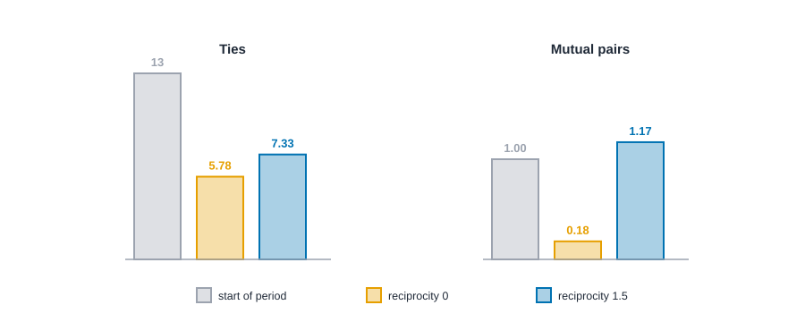

# Longitudinal and temporal networks {#sec-dynamics}

::: {.callout-note appearance="simple"}
## Prerequisites
@sec-time, where we described networks that change without modeling them, and @sec-ergm, whose effects reappear here. We reuse the office advice network from @sec-positions-and-roles and Sampson's monastery data from @sec-multilayer. The checks later in the chapter lean on the idea of a null model from @sec-tests-and-null-models.
:::

::: {.callout-note title="The short version"}
Networks change, and this chapter is about explaining how. We look at two kinds of records. In the first, a group is surveyed a few times, like a class each autumn, and we ask how friendships come and go between surveys. In the second, we have a log of timed events, like emails, and we ask what makes the next message likely. Both models are stories about small steps: one person changes one tie, or one message is sent. We can run those stories forward on a computer and see what the coefficients actually do, and we are careful about what they can and can't prove.
:::

::: {.callout-note title="Why you might care"}
If you have ever wondered whether people answer a message because they are polite, or just because they talk a lot, you are asking this chapter's question. These models let you separate habits from coincidences, spot when a friendly-looking result is really caused by a few chatty people, and avoid claiming a reason the data can't support.
:::

::: {.callout-note title="A note for first-time readers"}
Two formulas appear in this chapter. Each one is followed by a plain-words callout and a tiny hand example with real numbers. If a formula looks scary, read the callout and keep going: the ideas are small, even when the notation is big.
:::


## From describing change to modeling it

::: {.callout-tip appearance="simple"}
## Code lives next to the idea
Each idea comes with its code right where it is explained. The Rust blocks in this chapter run top to bottom as one script, so later blocks reuse names defined earlier. The office people and the messages are invented for this chapter, so that we can show every number and, in one case, check an estimate against the truth. Sampson's novices are real data.
:::

In @sec-time we looked at networks in time without asking why they change. We held time four ways, counted who could reach whom along time-respecting paths, and measured burstiness. Those are descriptions: they say what the recorded data look like. This chapter is about *models*: stories about how ties form and fade, with coefficients you can estimate and test.

The two kinds of time data from @sec-time that have standard models are these.

- **Snapshots.** We observe the whole network at a few moments, such as a school class surveyed each autumn. The question is how ties *change* between waves and why. The tool is the **stochastic actor-oriented model**, or **SAOM** [@snijders2001statistical; @snijders2010introduction].
- **Event streams.** We observe a long sequence of timed, directed events: who wrote to whom, in what order. The question is what makes the *next* event likely. The tool is the **relational event model**, or **REM** [@butts2008relational; @perry2013point].

Models are harder to read than descriptions, and they can say more than the data support, so everything in the "reading honestly" section of @sec-time still applies: the window, the edges of the observation period and the resolution of the clock all matter here too. For a broader survey of temporal networks, see Holme and Saramäki [@holme2012temporal]. We'll take the two models in turn.

### What a dynamic model is for

A description tells you *that* a network changed. A model lets you ask *why it might have*, by proposing a few simple tendencies and asking whether they are enough to reproduce what you saw. The questions look different in different settings.

| Setting | A question a dynamic model can ask | What it cannot tell you |
| --- | --- | --- |
| A school class, surveyed each autumn | Are friendships that are returned more likely to last than those that aren't? | Why: a returned tie might last because of affection, shared classes or a shared neighborhood. |
| An office, advice asked at two times | Do people start asking the colleagues their own contacts already ask? | Whether the advice was good, or whether asking was the person's own idea. |
| An email log | Do people reply sooner or later than they write to someone new? | What the messages said, or whether anyone read them. |
| An online platform's mentions | Do a few accounts keep drawing the next mention, once other effects are in? | Whether the attention was wanted, bought or automated. |

Both models in this chapter share one logic, which is why we cover them together. Something changes, and we write down the probability of *which* change, out of all the changes that were possible, as a function of what the network looks like right now. Everything else (estimation, tests, simulation) follows from that one step.

A third kind of question, whether people's *behavior* spreads along ties or whether people pick friends who already behave like them, needs the SAOM extended with a behavior variable [@steglich2010dynamic]. We don't fit that model here. @sec-diffusion explains why the question is hard, and the card on influence versus selection says what designs can answer it.

### Where the two models come from

Network panels (the same people observed at a few times) were long analyzed by treating each wave as a separate network. Snijders proposed instead that between two waves there is a hidden, continuous process in which actors change their ties one at a time, and that the observed waves are two snapshots of it [@snijders1996stochastic; @snijders2001statistical]. That is the SAOM, and @snijders2017stochastic is a later overview. Butts took the other kind of data, a log of timed events, and modeled the order of events directly [@butts2008relational]. Perry and Wolfe developed point-process models for the same kind of data [@perry2013point]. Both borrow a tool from survival analysis, the partial likelihood of Cox [@cox1972regression], which we meet below.

### Which model for which data

| You have | Use | The question it fits | Fails when |
| --- | --- | --- | --- |
| The whole network at two or more waves | SAOM | How do ties and tie patterns change between waves? | Waves are so far apart that the story between them is invented, or the group changes a lot between waves |
| A log of timed or ordered events | REM | What makes the next event likely? | The set of people who *could* act is unknown or changing, or events are a by-product of something else |
| Only one snapshot | Neither | None. Use the cross-sectional models of @sec-ergm | Always: a snapshot cannot show change |
| Events, and you only care when and how fast | Descriptive tools in @sec-time | Bursts, reach, delays | You want to test why |

Models are harder to read than descriptions, and they can say more than the data support, so everything in the "reading honestly" section of @sec-time still applies: the window, the edges of the observation period and the resolution of the clock all matter here too. For a broader survey of temporal networks, see Holme and Saramäki [@holme2012temporal]. We'll take the two models in turn.

## Snapshots: how do ties change?

Suppose you surveyed a class in autumn and again in spring, and asked each student who they turn to for advice. Between the two waves, some ties dropped, some formed, and some stayed. You can't see the order in which things happened, or whether one change caused another. The SAOM supplies a story that is detailed enough to simulate.

### The story: one actor, one change at a time

In a SAOM, the network changes one tie at a time, in continuous time, and the people themselves make the changes [@snijders2001statistical]. Every actor gets chances to change, at some average **rate** per period. At a chance, an actor looks at their $n$ options: toggle the tie to one of the $n - 1$ others, or change nothing. Each option has an **objective function** value, a score of how attractive the resulting network is *to that actor*, built from effects like the ones in @sec-ergm. The actor picks an option with probability

$$
p_j \;=\; \frac{\exp(\text{gain from option } j)}{\sum_h \exp(\text{gain from option } h)},
$$

where "no change" has gain 0. Better options are likelier but never certain: people don't perfectly maximize.

::: {.callout-tip title="In plain words"}
This formula answers: when an actor is about to make a move, how likely is each option? Every option gets a score called its gain. Take the number $e$ raised to that gain, which turns any score into a positive weight. The probability of option $j$ is its weight divided by the sum of all the weights (that is what the big sigma sign means: "add these up over every option $h$"). It is like a raffle where better options hold more tickets but nobody is guaranteed to win. In Cy's example, dropping the tie to Ada has gain $+2$, so it holds $e^{2} = 7.389$ tickets out of $17.668$ in total, which is a $0.418$ chance.
:::


We'll use two effects. **Outdegree** is a cost (coefficient $-2$) for every tie an actor keeps, so ties don't survive for free. **Reciprocity** is a bonus (coefficient $+1.5$) for a tie that is returned. So for an actor, starting a tie to someone who already asks them for advice has gain $-2 + 1.5 = -0.5$, and starting a tie to someone who doesn't has gain $-2$. Dropping an existing tie to someone who doesn't reciprocate has gain $+2$, since the cost goes away, and dropping a reciprocated tie has gain $+2 - 1.5 = +0.5$.

### Step 1: one ministep by hand and by code

Take Cy in the office network. Cy asks Ada and Ben for advice, and Flo and Gus ask Cy. Nobody Cy asks asks back. With the gains above:

| Option | Gain | Weight $e^{\text{gain}}$ |
| --- | --- | --- |
| Do nothing | 0 | 1.000 |
| Drop the tie to Ada (not reciprocated) | $+2$ | 7.389 |
| Drop the tie to Ben (not reciprocated) | $+2$ | 7.389 |
| Start asking Flo, who asks Cy | $-0.5$ | 0.607 |
| Start asking Gus, who asks Cy | $-0.5$ | 0.607 |
| Start asking any of the other five | $-2$ | 0.135 each |

The weights add to $1 + 14.778 + 1.213 + 0.677 = 17.668$. So the chance Cy drops the tie to Ada is $7.389 / 17.668 = 0.418$.

::: {.panel-tabset group="language"}

## R

```r
library(knappnet)

office_names <- c("Ada", "Ben", "Cy", "Dee", "Eve", "Flo", "Gus", "Hal", "Ivy", "Jay")
asks <- c(0, 1, 2, 2, 3, 3, 4, 4, 5, 6, 7, 8, 9) + 1
is_asked <- c(1, 0, 0, 1, 0, 1, 0, 1, 2, 2, 3, 4, 4) + 1
office <- net_frame(
  data.frame(source = office_names[asks], target = office_names[is_asked]),
  nodes = data.frame(id = office_names), directed = TRUE
)
office

# TODO(code, R): needs net_saom_ministep(): the chance of each option when one actor gets a change opportunity (outdegree and reciprocity effects).
```

::: {.code-output}
```text
# net_frame: 10 nodes, 13 edges
#   directed:  yes       mode: one-mode (10 actors)
#   weights:   unweighted
#   time:      static    space: none
#   simple:    no loops, no parallel edges
#   components: 1    isolates: 0    density: 0.144
#
# Nodes (10 x 1)      Edges (13 x 2)
#   id                  source target
#   <chr>               <chr>  <chr>
# 1 Ada               1 Ada    Ben
# 2 Ben               2 Ben    Ada
# 3 Cy                3 Cy     Ada
# 4 Dee               4 Cy     Ben
# 5 Eve               5 Dee    Ada
# 6 Flo               6 Dee    Ben
#   ... 4 more rows     ... 7 more rows
```
:::

## Python

```python
# TODO(code, Python): needs net_saom_ministep(): the chance of each option when one actor gets a change opportunity (outdegree and reciprocity effects).
```

::: {.code-output}
```text
TODO(output)
```
:::

## Rust

```rust
use knappnet::ergm::ToggleGraph;
use knappnet::saom::{compute_ministep_probabilities, Effect, SaomModel};
use knappnet::Graph;

// The ten-person office from the positions chapter: who asks whom for advice. Positions 0 to 9 are Ada to Jay.
let office_names = ["Ada", "Ben", "Cy", "Dee", "Eve", "Flo", "Gus", "Hal", "Ivy", "Jay"];
let asks = [0, 1, 2, 2, 3, 3, 4, 4, 5, 6, 7, 8, 9];
let is_asked = [1, 0, 0, 1, 0, 1, 0, 1, 2, 2, 3, 4, 4];
let office = Graph::from_edges(10, &asks, &is_asked, None, true)?;
println!("{}", office.describe());
let start = ToggleGraph::from_graph(&office)?;

// Two effects: outdegree (a cost for every tie an actor keeps) and reciprocity (a bonus for mutual ties).
let model = SaomModel::new(vec![Effect::Outdegree, Effect::Reciprocity], vec![], 10)?;
let beta = [-2.0, 1.5];

// Cy (position 2) gets a chance to change. What are Cy's options, and how likely is each?
let chances = compute_ministep_probabilities(&model, &start, &beta, 2)?;
for (j, chance) in chances.iter().enumerate() {
    let what = if j == 2 { "change nothing".to_string() }
        else if asks.iter().zip(&is_asked).any(|(&a, &b)| a == 2 && b == j as i64) { format!("drop the tie to {}", office_names[j]) }
        else { format!("start asking {}", office_names[j]) };
    println!("{what:<22} {chance:.3}");
}
println!("total {:.3}", chances.iter().sum::<f64>());
```

::: {.code-output}
```text
Directed network: 10 nodes, 13 ties (arcs)
  Density           0.144
  Out-degree        1 to 2, mean 1.30
  In-degree         0 to 4, mean 1.30
  Reciprocity       0.15 of ties are returned
  Connected pieces  1 weak, 9 strong
  Isolated nodes    0
  Loops, repeats    none
  Busiest           node 0 (5), node 1 (5), node 2 (4)

drop the tie to Ada    0.418
drop the tie to Ben    0.418
change nothing         0.057
start asking Dee       0.008
start asking Eve       0.008
start asking Flo       0.034
start asking Gus       0.034
start asking Hal       0.008
start asking Ivy       0.008
start asking Jay       0.008
total 1.000
```
:::

:::

The code agrees: 0.418 each for dropping Cy's two ties, 0.034 for starting to ask Flo or Gus, 0.008 for starting any of the other five, and 0.057 for doing nothing. With these coefficients, Cy is much likelier to drop a tie than to do anything else. That is what a negative outdegree coefficient means.

### Step 2: simulate a period

The real power of the SAOM story is that it can be *run*. Start from the observed network, let every actor have chances at rate 3 per period, and see where the network ends up.

::: {.panel-tabset group="language"}

## R

```r
# TODO(code, R): needs net_saom_simulate(): simulate one period of an actor-oriented model from a starting network.
```

::: {.code-output}
```text
TODO(output)
```
:::

## Python

```python
# TODO(code, Python): needs net_saom_simulate(): simulate one period of an actor-oriented model from a starting network.
```

::: {.code-output}
```text
TODO(output)
```
:::

## Rust

```rust
use knappnet::saom::{simulate_period, SaomOptions};

// Run the office forward one period, 2,000 times, with and without the reciprocity bonus.
// The statistics come back as: ties kept, reciprocated ties, ties that changed.
let options = SaomOptions { rate: 3.0, runs: 2000, seed: 1, threads: 1 };
println!("start: {} ties, {} mutual pairs", start.edge_count(), model.compute_statistics(&start)?[1] / 2.0);
for reciprocity in [0.0, 1.5] {
    let sim = simulate_period(&model, &[-2.0, reciprocity], &start, &options)?;
    let average = |column: usize| (0..2000).map(|run| sim.stats[run * 3 + column]).sum::<f64>() / 2000.0;
    println!("reciprocity {reciprocity}: {:.2} ties, {:.2} mutual pairs, {:.2} ties changed", average(0), average(1) / 2.0, average(2));
}
```

::: {.code-output}
```text
start: 13 ties, 1 mutual pairs
reciprocity 0: 5.78 ties, 0.18 mutual pairs, 13.94 ties changed
reciprocity 1.5: 7.33 ties, 1.17 mutual pairs, 14.11 ties changed
```
:::

:::

Both settings lose many ties, because the outdegree cost is high. But look at what survives. With no reciprocity bonus, only 0.18 mutual pairs remain on average (the network started with 1). With the bonus, 1.17 remain, and more ties survive overall (7.3 against 5.8). Reciprocity doesn't create ties here, it keeps the returned ones. @fig-saom-sim shows both settings.

{#fig-saom-sim fig-alt="Two groups of three bars. In the Ties group, the start has 13 ties, the run without reciprocity averages 5.78 and the run with reciprocity 1.5 averages 7.33. In the Mutual pairs group, the start has 1, the run without reciprocity 0.18, and the run with reciprocity 1.17."}

### What the rate does, and why the gap between waves matters

The rate is the part of the SAOM that people skip over, and it matters most. A rate of 3 means each actor gets about three chances to change per period, so the whole group gets about $n \times 3$ chances. We have been using one period for the gap between two waves, but how long the gap is, in the model's clock, is a modeling choice that the data must support. Here is the office network, with the same coefficients as before, run for different rates.

::: {.panel-tabset group="language"}

## R

```r
# TODO(code, R): needs net_saom_simulate() with a rate argument, repeated over many runs.
```

::: {.code-output}
```text
TODO(output)
```
:::

## Python

```python
# TODO(code, Python): needs net_saom_simulate() with a rate argument, repeated over many runs.
```

::: {.code-output}
```text
TODO(output)
```
:::

## Rust

```rust
// Same office, same coefficients; only the rate (chances per actor per period) changes.
for rate in [0.5, 1.0, 3.0, 9.0, 27.0] {
    let options = SaomOptions { rate, runs: 1000, seed: 1, threads: 1 };
    let sim = simulate_period(&model, &[-2.0, 1.5], &start, &options)?;
    let average = |column: usize| (0..1000).map(|run| sim.stats[run * 3 + column]).sum::<f64>() / 1000.0;
    println!("rate {rate:>4}: {:>5.1} chances in all, {:.2} ties at the end, {:.2} ties changed", 10.0 * rate, average(0), average(2));
}
```

::: {.code-output}
```text
rate  0.5:   5.0 chances in all, 10.96 ties at the end, 4.01 ties changed
rate    1:  10.0 chances in all, 9.63 ties at the end, 7.26 ties changed
rate    3:  30.0 chances in all, 7.35 ties at the end, 14.30 ties changed
rate    9:  90.0 chances in all, 6.53 ties at the end, 17.49 ties changed
rate   27: 270.0 chances in all, 6.43 ties at the end, 17.56 ties changed
```
:::

:::

The number of ties that changed climbs with the rate and then stops, at about 17 or 18 here. That is the most important thing to know about the rate. Once everyone has had many chances, the network has reached the kind of network the coefficients favor, and more chances only shuffle it within that kind. Two waves far apart in the model's clock therefore tell you about where the model ends up, and almost nothing about the order of events or the rate itself. At the other end, with a rate of 0.5 only four ties change. A rate of 3 means a given actor gets no chance at all with probability $e^{-3} = 0.05$.

The practical lesson is about spacing. The more of the network changes between two waves, the more your answer depends on the model's story and the less on the data. RSiena reports an estimated rate for each pair of waves; a very large one is a sign that most ties changed and that the waves are far apart.

### A real panel: Sampson's novices

Time to try this on people. In @sec-multilayer we met Sampson's monastery data, in which each of 18 novices named the novices he liked most, at three times. Each novice named three people, or four when he gave tied ranks, so the questionnaire caps how many ties anyone can have. That detail will matter. We use the three waves of the `liking` relation.

First, what happened between waves, with no model at all?

::: {.panel-tabset group="language"}

## R

```r
# TODO(code, R): needs net_panel_summary(): ties, mutual pairs, kept, dropped and new ties between waves of a panel.
```

::: {.code-output}
```text
TODO(output)
```
:::

## Python

```python
# TODO(code, Python): needs net_panel_summary(): ties, mutual pairs, kept, dropped and new ties between waves of a panel.
```

::: {.code-output}
```text
TODO(output)
```
:::

## Rust

```rust
use std::collections::HashMap;

let nodes = std::fs::read_to_string("data/sampson/nodes.csv")?;
let number: HashMap<&str, usize> = nodes.lines().skip(1).map(|l| { let p: Vec<&str> = l.split(',').collect(); (p[0], p[1].parse::<usize>().unwrap() - 1) }).collect();
let mut waves = [[[0i32; 18]; 18]; 3];
let edges = std::fs::read_to_string("data/sampson/edges.csv")?;
for line in edges.lines().skip(1) {
    let p: Vec<&str> = line.split(',').collect(); // from, to, relation, sign, time, rank
    if p[2] == "liking" {
        waves[p[4].parse::<usize>().unwrap() - 1][number[p[0]]][number[p[1]]] = 1;
    }
}

for (w, x) in waves.iter().enumerate() {
    let named: Vec<i32> = x.iter().map(|row| row.iter().sum()).collect();
    let mutual: i32 = (0..18).flat_map(|i| (0..18).map(move |j| (i, j))).map(|(i, j)| x[i][j] * x[j][i]).sum::<i32>() / 2;
    println!("wave {}: {} ties, {mutual} mutual pairs, each novice names {} to {}", w + 1, named.iter().sum::<i32>(), named.iter().min().unwrap(), named.iter().max().unwrap());
}
// For each ordered pair of novices: tie now, tie returned now, tie at the next wave.
let pairs = |w: usize| (0..18).flat_map(move |i| (0..18).map(move |j| (i, j))).filter(|&(i, j)| i != j).map(move |(i, j)| (waves[w][i][j], waves[w][j][i], waves[w + 1][i][j]));
for w in 0..2 {
    let count = |a: i32, b: i32| pairs(w).filter(|&(now, _, later)| now == a && later == b).count();
    println!("wave {} to {}: {} kept, {} dropped, {} new", w + 1, w + 2, count(1, 1), count(1, 0), count(0, 1));
}
// Does a tie last longer when it is returned? Every ordered pair, both transitions pooled.
for tie in [1, 0] {
    for returned in [1, 0] {
        let group: Vec<i32> = (0..2).flat_map(pairs).filter(|&(t, q, _)| t == tie && q == returned).map(|(_, _, later)| later).collect();
        let later: i32 = group.iter().sum();
        println!("tie {tie}, returned {returned}: {:>3} pairs, {later:>2} have a tie later ({:.3})", group.len(), later as f64 / group.len() as f64);
    }
}
```

::: {.code-output}
```text
wave 1: 55 ties, 14 mutual pairs, each novice names 3 to 4
wave 2: 57 ties, 15 mutual pairs, each novice names 3 to 4
wave 3: 56 ties, 15 mutual pairs, each novice names 3 to 4
wave 1 to 2: 35 kept, 20 dropped, 22 new
wave 2 to 3: 40 kept, 17 dropped, 16 new
tie 1, returned 1:  58 pairs, 43 have a tie later (0.741)
tie 1, returned 0:  54 pairs, 32 have a tie later (0.593)
tie 0, returned 1:  54 pairs, 15 have a tie later (0.278)
tie 0, returned 0: 446 pairs, 23 have a tie later (0.052)
```
:::

:::

Three things stand out. First, the totals are steady: 55, 57 and 56 ties, and 14, 15 and 15 mutual pairs. A table of totals would call this network stable. Second, underneath the steady totals, the churn is large. Between waves 1 and 2, 35 of the 55 ties were kept, 20 were dropped and 22 were new, so 42 of the 306 ordered pairs of novices changed. Third, returned ties behave differently from one-way ties (@fig-sampson-turnover). Pooling the two steps, 43 of the 58 ordered pairs with a returned tie still had a tie at the next wave (74 percent), against 32 of 54 (59 percent) for a tie that was not returned. And where there was no tie but the other novice named him, 15 of 54 pairs (28 percent) formed one, against 23 of 446 (5 percent) where nobody named anybody. The two steps share novices, so these percentages are descriptive, not independent tests.

{#fig-sampson-turnover fig-alt="Two panels. On the left, bars for the two steps between waves. From wave 1 to 2: 35 ties kept, 20 dropped and 22 new. From wave 2 to 3: 40 kept, 17 dropped and 16 new. On the right, horizontal bars for the share of ordered pairs with a tie at the next wave: 0.74 (43 of 58) for pairs with a returned tie, 0.59 (32 of 54) for a tie that was not returned, 0.28 (15 of 54) for no tie where the other novice names him, and 0.05 (23 of 446) for no tie either way."}

This is the pattern a SAOM with a reciprocity effect is built to capture, and it is what we try to reproduce next.

### Finding coefficients that reproduce the change

Now the model. We have to choose three numbers: the rate, the outdegree coefficient and the reciprocity coefficient. The real estimation method, due to Snijders, does this by *method of moments*: it searches for the coefficients at which simulated waves match chosen statistics of the observed ones [@snijders2001statistical]. RSiena does it with a stochastic search and reports standard errors and convergence checks. We do a crude version that you can follow with your eyes. Try a grid of settings, simulate wave 1 forward under each, and keep the settings whose average wave looks most like wave 2 in three counts: ties, mutual pairs and ties that changed.

::: {.panel-tabset group="language"}

## R

```r
# TODO(code, R): needs net_saom_simulate() summaries for a wave-to-wave model (ties, mutual pairs, ties changed, out-degree spread).
```

::: {.code-output}
```text
TODO(output)
```
:::

## Python

```python
# TODO(code, Python): needs net_saom_simulate() summaries for a wave-to-wave model (ties, mutual pairs, ties changed, out-degree spread).
```

::: {.code-output}
```text
TODO(output)
```
:::

## Rust

```rust
use knappnet::saom::SaomSimulation;

// The Sampson waves as graphs. We add a third effect, the squared out-degrees, with coefficient 0:
// it changes nothing about the simulation, it only lets the engine report how uneven out-degrees are.
let sampson_model = SaomModel::new(vec![Effect::Outdegree, Effect::Reciprocity, Effect::OutActivity], vec![], 18)?;
let mut wave_graphs = Vec::new();
for x in &waves {
    let (mut from, mut to) = (Vec::new(), Vec::new());
    for i in 0..18 { for j in 0..18 { if x[i][j] == 1 { from.push(i as i64); to.push(j as i64); } } }
    wave_graphs.push(ToggleGraph::from_graph(&Graph::from_edges(18, &from, &to, None, true)?)?);
}
// Per run: ties, mutual pairs, ties that changed from the start, and the spread of out-degrees.
let describe = |sim: &SaomSimulation, runs: usize| -> Vec<[f64; 4]> {
    (0..runs).map(|r| { let s = &sim.stats[r * 4..r * 4 + 4]; [s[0], s[1] / 2.0, s[3], (s[2] / 18.0 - (s[0] / 18.0).powi(2)).sqrt()] }).collect()
};
let differ = |a: usize, b: usize| (0..18).flat_map(|i| (0..18).map(move |j| (i, j))).filter(|&(i, j)| waves[a][i][j] != waves[b][i][j]).count() as f64;
let stats = sampson_model.compute_statistics(&wave_graphs[1])?;
let observed = [stats[0], stats[1] / 2.0, differ(0, 1), (stats[2] / 18.0 - (stats[0] / 18.0).powi(2)).sqrt()];
println!("observed at wave 2: ties {}, mutual {}, changed {}, out-degree sd {:.2}", observed[0], observed[1], observed[2], observed[3]);

// Simulate wave 1 forward at every setting on a grid, 300 runs each, and rank the settings by how far
// the average falls from wave 2 (sum of gaps in ties, mutual pairs and ties changed).
let mut grid = Vec::new();
for rate in [3.0, 3.5, 4.0] {
    for outdegree in [-1.5, -1.25, -1.0] {
        for reciprocity in [1.0, 1.5, 2.0] {
            let options = SaomOptions { rate, runs: 300, seed: 1, threads: 1 };
            let sim = simulate_period(&sampson_model, &[outdegree, reciprocity, 0.0], &wave_graphs[0], &options)?;
            let runs = describe(&sim, 300);
            let mean: Vec<f64> = (0..4).map(|k| runs.iter().map(|r| r[k]).sum::<f64>() / 300.0).collect();
            let distance: f64 = (0..3).map(|k| (mean[k] - observed[k]).abs()).sum();
            grid.push((distance, rate, outdegree, reciprocity, mean));
        }
    }
}
grid.sort_by(|a, b| a.0.partial_cmp(&b.0).unwrap());
for (distance, rate, outdegree, reciprocity, m) in grid.iter().take(5) {
    println!("rate {rate:.1}, outdegree {outdegree:+.2}, reciprocity {reciprocity:.1}: ties {:.1}, mutual {:.1}, changed {:.1}, sd {:.2} (distance {distance:.1})", m[0], m[1], m[2], m[3]);
}
```

::: {.code-output}
```text
observed at wave 2: ties 57, mutual 15, changed 42, out-degree sd 0.37
rate 3.5, outdegree -1.00, reciprocity 1.0: ties 58.0, mutual 13.7, changed 41.1, sd 1.27 (distance 3.3)
rate 3.5, outdegree -1.25, reciprocity 1.5: ties 54.4, mutual 15.6, changed 40.1, sd 1.25 (distance 5.1)
rate 4.0, outdegree -1.25, reciprocity 1.5: ties 54.7, mutual 15.8, changed 44.2, sd 1.28 (distance 5.4)
rate 4.0, outdegree -1.00, reciprocity 1.0: ties 58.5, mutual 13.7, changed 45.1, sd 1.31 (distance 5.9)
rate 3.0, outdegree -1.00, reciprocity 1.0: ties 57.4, mutual 13.5, changed 36.7, sd 1.22 (distance 7.2)
```
:::

:::

The model has to explain the steady totals and the heavy churn together. The five best settings in the Rust run are listed above; the best is a rate of 3.5, an outdegree coefficient of $-1$ and a reciprocity coefficient of $1$. Two things to notice. The runners-up are close behind and sit along a ridge, a line of settings that fit about equally well: a more costly outdegree ($-1.25$) paired with a bigger reciprocity bonus ($1.5$) gives nearly the same wave. Three summary counts cannot pin the coefficients down one by one, which is why real estimation reports standard errors. And a different random seed may order the neighbors differently; look for the same neighborhood, a rate of 3 to 4, an outdegree coefficient from $-1.25$ to $-1$ and a reciprocity coefficient from 1 to 1.5.

One more thing: the simulated out-degree spread is about 1.3 in every setting, while the observed spread is 0.37. We come back to that below.

### Checking the fit on a wave the model has not seen

A model that reproduces the data it was tuned to proves little. The stronger check is to take the winning settings, start from wave 2, simulate to wave 3, and see whether the observed wave 3 looks like something the model could have produced. We compare against a rival without the reciprocity effect, with its outdegree coefficient lowered so that it has about the same number of ties.

::: {.panel-tabset group="language"}

## R

```r
# TODO(code, R): needs net_saom_simulate() with and without a reciprocity effect, compared with the observed next wave.
```

::: {.code-output}
```text
TODO(output)
```
:::

## Python

```python
# TODO(code, Python): needs net_saom_simulate() with and without a reciprocity effect, compared with the observed next wave.
```

::: {.code-output}
```text
TODO(output)
```
:::

## Rust

```rust
let observed_next = {
    let s = sampson_model.compute_statistics(&wave_graphs[2])?;
    [s[0], s[1] / 2.0, differ(1, 2), (s[2] / 18.0 - (s[0] / 18.0).powi(2)).sqrt()]
};
let labels = ["ties", "mutual pairs", "ties changed", "out-degree sd"];
for (name, beta_try) in [("with reciprocity", [-1.0, 1.0, 0.0]), ("without reciprocity", [-0.7, 0.0, 0.0])] {
    let options = SaomOptions { rate: 3.5, runs: 500, seed: 3, threads: 1 };
    let runs = describe(&simulate_period(&sampson_model, &beta_try, &wave_graphs[1], &options)?, 500);
    for (k, label) in labels.iter().enumerate() {
        let mut values: Vec<f64> = runs.iter().map(|r| r[k]).collect();
        values.sort_by(|a, b| a.partial_cmp(b).unwrap());
        let quantile = |p: f64| { let at = p * 499.0; let lo = at.floor() as usize; values[lo] + (at - lo as f64) * (values[(lo + 1).min(499)] - values[lo]) };
        println!("{name:<20} {label:<14} observed {:>6.2}, simulated {:>6.2} ({:>5.1} to {:>5.1})", observed_next[k], values.iter().sum::<f64>() / 500.0, quantile(0.025), quantile(0.975));
    }
}
```

::: {.code-output}
```text
with reciprocity     ties           observed  56.00, simulated  59.14 ( 49.0 to  71.0)
with reciprocity     mutual pairs   observed  15.00, simulated  14.49 (  9.0 to  20.0)
with reciprocity     ties changed   observed  33.00, simulated  41.37 ( 31.0 to  52.0)
with reciprocity     out-degree sd  observed   0.31, simulated   1.33 (  0.9 to   1.8)
without reciprocity  ties           observed  56.00, simulated  59.76 ( 49.0 to  71.0)
without reciprocity  mutual pairs   observed  15.00, simulated   8.86 (  5.0 to  13.0)
without reciprocity  ties changed   observed  33.00, simulated  44.06 ( 34.0 to  55.0)
without reciprocity  out-degree sd  observed   0.31, simulated   1.32 (  0.9 to   1.8)
```
:::

:::

Read the table this way. Where the model is asked for something it was built to produce, it does well: with the reciprocity bonus, the simulated number of mutual pairs is about 14.5 (central range 9 to 20) and the observed 15 is inside it. The rival without reciprocity, tuned to the same number of ties, averages about 9 mutual pairs and its central range tops out at 13 or 14, so the observed 15 is at or just outside its edge. With 500 runs that is a good reason to prefer the first model, not a test that rejects the second.

Two other rows are warnings. The model expects about 41 ties to change in this step and the observed number is 33. The setting was tuned on the first step, where 42 changed, and the second step was calmer. A single rate for every period is an assumption, and the data say it is not quite right. RSiena estimates a separate rate for each period for this reason. And the last row: the model lets out-degrees spread out (about 1.3), while Sampson's questionnaire made every novice name three or four, so the observed spread is 0.31. That is a mismatch between the model and the *design* of the survey, not a feature of the monastery. A fix would limit how uneven out-degrees can get, for instance with a strong negative effect of squared out-degree, the out-activity effect in this engine's effect list. We did not fit that here.

::: {.callout-warning appearance="simple"}
## What this code does not do
We matched three counts by eye on a grid. In a real study you *estimate* the coefficients: RSiena runs a stochastic search for the values at which simulated waves match the observed statistics, and reports for each coefficient a standard error and a convergence ratio, and it has goodness-of-fit tools for checks like the one above [@snijders2010introduction]. This chapter shows the forward model, which is the part that explains what the coefficients mean. For estimation in practice, Phil Murphy's class notes walk through RSiena step by step [@murphyrpubs701832], and Snijders and colleagues give the full account [@snijders2010introduction]. This engine has no SAOM estimation, so a grid like ours is the best it can do alone.
:::

### Reading a SAOM coefficient

Each coefficient is a *log multiplier on the weight* of an option, other things equal. Take reciprocity, with coefficient $\beta$. When an actor considers starting a tie, an option that would be returned weighs $e^{\beta}$ times as much as an otherwise identical option that would not. With $\beta = 1$ that is 2.7 times, with $\beta = 1.5$ it is 4.5 times. It is *not* the probability that a tie forms, and it is not a multiplier on a probability unless the options are few. How a coefficient reads depends on what the tie means.

::: {.callout-tip title="In plain words"}
A coefficient is a dial on a weight. If you turn the reciprocity dial to $\beta = 1$, an option that would be returned weighs $e^{1} = 2.7$ times as much as an identical option that wouldn't be. At $\beta = 1.5$ it is $e^{1.5} = 4.5$ times. This is a multiplier on the raffle tickets, not the chance that something happens.
:::


| Effect | Positive coefficient | Negative coefficient |
| --- | --- | --- |
| Outdegree | Rare: people keep adding ties. | The usual case: ties are costly or limited, so networks are sparse. Its size is mostly a statement about density, and it moves with the other effects. |
| Reciprocity | In a friendship survey, returned ties are favored. In an advice network, mutual consulting is favored, which is not guaranteed since advice often flows one way. In flows between organizations, mutual exchange may be built into the setting. | One-way flows are favored, as in a strict hierarchy. |
| Transitive triplets | Friends of friends tend to become friends, or colleagues ask those their advisers ask. | Closure is avoided, as in a network that works to reach new people. |

What a coefficient does *not* show: motive (a reciprocity bonus is a pattern, not a reason), importance (coefficients are not comparable across models with different effects), strength on any single actor, or anything about causes unless the design supports it. The same positive reciprocity coefficient can come from affection, from shared classes or from the way the question was asked.

### What can go wrong with a SAOM

- **The Markov assumption.** The chance of the next change depends only on the network *now*, not on how long a tie has existed or how it formed. A friendship of five years and one of five days are treated alike unless you add an effect that tells them apart.
- **One rate.** We used one rate for all actors and all periods. Our own check shows the second period calmer than the first.
- **Constraints of the design.** Sampson's out-degree cap broke the model's idea of a free choice, as the last row above shows. Any survey that limits how many people you can name does this.
- **People entering and leaving.** The novices of the monastery left after a crisis, so the group at the last wave is not the group of the first. Standard software has a way to declare who is in the study at each wave. A model that ignores it treats a departure as dropped ties.
- **Missing responses.** Missing answers change the measured structure, sometimes a lot [@kossinets2006effects]. A wave with missing people is not just a smaller network.
- **Waves too far apart.** The rate lesson above: far-apart waves make the story between them invented.
- **Selection and influence together.** If what people *do* also changes, a network-only model attributes to ties what may be behavior. See @sec-diffusion.

### One defensible sentence and one that is not

Defensible: "Across Sampson's three waves of liking, 74 percent of ordered pairs with a returned tie still had a tie at the next wave, against 59 percent of pairs with a one-way tie, and a simulation model needed a reciprocity bonus of about 1 to 1.5 to reproduce the number of mutual pairs. The model overstated how uneven out-degrees are, because the questionnaire capped them, and the data cannot say why the novices behaved this way." Over-claiming: "Novices became friends because their friends liked them back."

## Event streams: what makes the next message likely?

Sometimes we don't have waves at all, we have a log: at hour 0.3, person 6 wrote to person 4; at hour 0.8, person 2 wrote to person 7; and so on. The relational event model treats each message as a draw: at every moment, every ordered pair of people has a *rate* of sending the next message, that depends on what happened before [@butts2008relational; @perry2013point].

### The idea: what history makes a pair likelier?

For a sender $s$ and receiver $r$, the rate of the next message is $\exp(\beta_1 x_1 + \beta_2 x_2 + \dots)$, where each $x_k$ is a count taken from the *past*. Two natural ones:

- **Inertia**: how many times $s$ has already written to $r$. A positive coefficient says people repeat themselves, a negative coefficient says they spread their messages around.
- **Reciprocity**: how many times $r$ has already written to $s$. A positive coefficient says people reply.

::: {.callout-tip title="In plain words"}
The rate of a message from sender $s$ to receiver $r$ is $\exp(\beta_1 x_1 + \beta_2 x_2 + \dots)$. Read $x_1, x_2, \dots$ as running counts from the past (how many times $s$ wrote to $r$, how many times $r$ wrote to $s$), and each $\beta$ as a dial that says how much that count matters. Then $\exp$ turns the total into a positive speed. A dial of zero means the count is ignored. A positive dial speeds the pair up, a negative one slows it down. Example from the four-message story below: reciprocity has $\beta = \ln 3$, so one earlier message from the receiver multiplies the rate by 3.
:::


The model takes each event in order and asks: given everything before, how likely was it that *this* pair, out of all possible pairs, was the one that came next? The product of those probabilities is the **partial likelihood** [@cox1972regression], and it is maximized to estimate $\beta$. Only the *order* of the events matters in this version, not the exact timing.

### Step 3: the same arithmetic by hand, on four messages

Before fitting anything, let's compute one partial likelihood on paper. Ada, Ben and Cy send four messages: Ada to Ben, Ben to Ada, Ada to Ben again, and Cy to Ada. There are six ordered pairs who could send. Use one effect, reciprocity, with coefficient $\ln 3$, so every earlier message from the receiver to the sender *triples* a pair's rate.

| Event | Observed pair | Weights of the six pairs at that moment | Probability of the observed pair |
| --- | --- | --- | --- |
| 1 | Ada to Ben | all six weigh 1 | $1/6 = 0.1667$ |
| 2 | Ben to Ada | Ben to Ada weighs 3 (Ada has written to Ben), the other five weigh 1 | $3/8 = 0.375$ |
| 3 | Ada to Ben | Ada to Ben weighs 3 (Ben wrote to Ada), Ben to Ada weighs 3, the other four weigh 1 | $3/10 = 0.3$ |
| 4 | Cy to Ada | Ben to Ada weighs $3^2 = 9$ (Ada has written to Ben twice), Ada to Ben weighs 3, the other four weigh 1 | $1/16 = 0.0625$ |

The partial likelihood is the product, $\tfrac16 \cdot \tfrac38 \cdot \tfrac3{10} \cdot \tfrac1{16} = 0.00117$, and its log is $-6.749$. With no effect every event has probability $1/6$, so the log is $4 \ln(1/6) = -7.167$. The reciprocity effect makes these four messages about $e^{0.418} = 1.52$ times as likely as no effect would. In symbols, for a sender $s$ and receiver $r$ at event $k$, with $\mathbf{x}_k(s, r)$ the vector of counts and $\boldsymbol\beta$ the coefficients,

$$
\ell(\boldsymbol\beta) \;=\; \sum_{k} \left[ \boldsymbol\beta^\top \mathbf{x}_k(s_k, r_k) \;-\; \ln \sum_{(s, r) \in R_k} e^{\boldsymbol\beta^\top \mathbf{x}_k(s, r)} \right],
$$

where $R_k$ is the **risk set**, the set of pairs who could have sent the $k$-th message. Here it is all ordered pairs of distinct people, and the numerator is the observed pair. The code below does exactly this sum, then asks the computer for the coefficient that makes it largest.

::: {.callout-tip title="In plain words"}
This formula is the score of a whole log of messages, and the code below finds the dial settings that make it biggest. For each event $k$, look at who actually sent it and take the observed pair's weight, then subtract the logarithm of the total weight of every pair that could have sent it. The first piece, $\boldsymbol\beta^\top \mathbf{x}_k(s_k, r_k)$, is "the observed pair's dials times its counts." The second is "the log of the sum over the risk set $R_k$ of the same thing," which is the whole raffle. The big sigma in front adds up the events one after another. It is a running score of "how surprised was the model by each message, given the past?" With the four messages and $\beta = \ln 3$: event 1 contributes $\ln(1/6) = -1.792$, event 2 contributes $\ln(3/8) = -0.981$, event 3 $\ln(3/10) = -1.204$ and event 4 $\ln(1/16) = -2.773$, and they add to $-6.749$. A log of the likelihood is simply "the log-likelihood", a score where closer to zero is better.
:::

::: {.callout-note title="This is the hard part"}
Partial likelihood is the most technical idea in the chapter. On a first read you can skip to the next heading. You will still have the working picture: each message is a draw from a raffle where pairs with a relevant past hold more tickets, and the model looks for the dial settings that would have made the observed messages least surprising.
:::


::: {.panel-tabset group="language"}

## R

```r
# TODO(code, R): needs net_rem_design(): the statistics (inertia, reply, sender out, receiver in) for a relational event model.
```

::: {.code-output}
```text
TODO(output)
```
:::

## Python

```python
# TODO(code, Python): needs net_rem_design(): the statistics (inertia, reply, sender out, receiver in) for a relational event model.
```

::: {.code-output}
```text
TODO(output)
```
:::

## Rust

```rust
use knappnet::temporal::rem::{Memory, RemDesign};

// The probability that each event was the pair that sent it, given coefficients `beta`:
// the weight exp(beta . counts) of the observed pair over the summed weights of every pair at risk.
let event_probabilities = |design: &RemDesign, beta: &[f64]| -> Vec<f64> {
    let p = design.n_statistics;
    let weight = |row: usize| (0..p).map(|j| design.values[row * p + j] * beta[j]).sum::<f64>().exp();
    (0..design.events())
        .map(|k| weight(design.observed[k]) / (design.offsets[k]..design.offsets[k + 1]).map(weight).sum::<f64>())
        .collect()
};

// Ada = 0, Ben = 1, Cy = 2: Ada to Ben, Ben to Ada, Ada to Ben, Cy to Ada.
let tiny = EventStream::new(3, &[0, 1, 0, 2], &[1, 0, 1, 0], &[1.0, 2.0, 3.0, 4.0], None, None)?;
let reply_only = [StatSpec { stat: RemStat::Reciprocity, event_type: None }];
let tiny_design = compute_rem_statistics(&tiny, &reply_only, &RemOptions::default())?;
let p = event_probabilities(&tiny_design, &[3f64.ln()]);
for (k, (label, prob)) in ["Ada to Ben", "Ben to Ada", "Ada to Ben", "Cy to Ada"].iter().zip(&p).enumerate() {
    println!("event {}: {label:<11} probability {prob:.4}", k + 1);
}
let fit_tiny = fit(&tiny_design, &FitOptions::default())?;
println!("log-likelihood at ln 3: {:.3}, with no effect: {:.3}", p.iter().map(|x| x.ln()).sum::<f64>(), fit_tiny.null_loglik);
println!("fitted coefficient {:+.3} (se {:.3}), log-likelihood {:.3}", fit_tiny.coef[0], fit_tiny.se[0], fit_tiny.loglik);
```

::: {.code-output}
```text
event 1: Ada to Ben  probability 0.1667
event 2: Ben to Ada  probability 0.3750
event 3: Ada to Ben  probability 0.3000
event 4: Cy to Ada   probability 0.0625
log-likelihood at ln 3: -6.749, with no effect: -7.167
fitted coefficient +0.864 (se 0.894), log-likelihood -6.715
```
:::

:::


The Rust tab gives the table: 0.1667, 0.3750, 0.3000 and 0.0625, and a log-likelihood of $-6.749$ against $-7.167$ with no effect. The fitted coefficient on four messages is $+0.864$ with a standard error of 0.894, which is a way of saying that four messages tell us almost nothing. That is what the standard error is for.

A standard error is the typical size of the wobble in an estimate, so a coefficient less than about two standard errors from zero is hard to tell from nothing.


### Step 4: fit the model

We use the eighty messages from @sec-time. They weren't recorded from real people: we generated them from a known rule, in which each reply is more likely than a fresh message, and repeating the same message to the same person is less likely than average. Using invented data lets us do something real data never allows: compare the estimates with the truth.

::: {.panel-tabset group="language"}

## R

```r
# TODO(code, R): needs net_rem_fit(): fit a relational event model to a message log.
```

::: {.code-output}
```text
TODO(output)
```
:::

## Python

```python
# TODO(code, Python): needs net_rem_fit(): fit a relational event model to a message log.
```

::: {.code-output}
```text
TODO(output)
```
:::

## Rust

```rust
use knappnet::temporal::rem::{compute_rem_statistics, fit, EventStream, FitOptions, RemOptions, RemStat, StatSpec};

// Eighty messages among eight coworkers, invented for this book. Times are in hours.
let times: [f64; 80] = [
    0.3, 0.8, 3.3, 4.8, 6.8, 25.4, 28.4, 33.4, 35.2, 36.8,
    37.0, 38.0, 43.6, 44.5, 46.3, 46.6, 48.2, 49.0, 49.3, 50.1,
    50.4, 50.7, 52.4, 52.7, 53.3, 55.0, 56.0, 56.9, 57.8, 58.6,
    58.8, 63.3, 64.5, 64.6, 65.6, 77.9, 78.0, 85.1, 98.6, 99.4,
    99.7, 102.9, 105.4, 106.1, 107.1, 107.2, 108.0, 128.2, 128.6, 128.8,
    129.2, 130.8, 134.5, 135.2, 148.1, 149.0, 149.3, 176.8, 182.2, 182.4,
    182.6, 182.8, 183.1, 183.6, 184.6, 185.9, 193.0, 195.1, 196.2, 202.8,
    203.2, 204.4, 204.7, 205.8, 206.1, 208.4, 208.5, 214.4, 215.2, 217.3,
];
// The same eighty messages, now with who sent each one to whom (positions 0 to 7).
let sender: [i64; 80] = [
    6, 2, 5, 7, 4, 4, 6, 5, 3, 4, 6, 0, 5, 6, 2, 3, 1, 5, 7, 2,
    3, 7, 4, 3, 5, 0, 1, 7, 1, 0, 7, 5, 7, 5, 6, 2, 5, 1, 6, 5,
    2, 1, 1, 6, 4, 2, 4, 5, 5, 7, 6, 3, 0, 2, 0, 6, 6, 2, 7, 3,
    3, 4, 7, 7, 1, 6, 1, 6, 4, 1, 0, 7, 0, 1, 7, 4, 3, 3, 4, 3,
];
let receiver: [i64; 80] = [
    4, 7, 4, 0, 7, 5, 1, 6, 6, 6, 3, 4, 2, 1, 5, 7, 6, 3, 5, 3,
    5, 2, 2, 2, 3, 3, 3, 1, 5, 3, 3, 4, 4, 2, 7, 7, 6, 6, 5, 3,
    0, 7, 6, 2, 6, 6, 7, 2, 1, 6, 4, 1, 4, 4, 7, 1, 1, 4, 3, 0,
    5, 0, 6, 0, 2, 7, 6, 2, 5, 3, 4, 2, 1, 4, 4, 2, 7, 1, 0, 0,
];
let stream = EventStream::new(8, &sender, &receiver, &times, None, None)?;

// Before each message, count how often this sender already wrote to this receiver (inertia)
// and how often the receiver already wrote to the sender (reciprocity).
let statistics = [
    StatSpec { stat: RemStat::Inertia, event_type: None },
    StatSpec { stat: RemStat::Reciprocity, event_type: None },
];
let design = compute_rem_statistics(&stream, &statistics, &RemOptions::default())?;
let model_fit = fit(&design, &FitOptions::default())?;
for (label, (coef, se)) in ["repeating a pair", "replying to a pair"].iter().zip(model_fit.coef.iter().zip(&model_fit.se)) {
    println!("{label:<20} coefficient {coef:+.3} (se {se:.3}), rate multiplier {:.2}", coef.exp());
}
println!("log-likelihood {:.1}, against {:.1} with no effects", model_fit.loglik, model_fit.null_loglik);
```

::: {.code-output}
```text
repeating a pair     coefficient -0.754 (se 0.205), rate multiplier 0.47
replying to a pair   coefficient +0.758 (se 0.160), rate multiplier 2.13
log-likelihood -309.5, against -322.0 with no effects
```
:::

:::

Read the coefficients as multipliers on the rate. Each earlier message a sender has already sent to a receiver *multiplies* the rate of another by about 0.47, so people avoid repeating themselves. Each earlier message from the receiver multiplies the rate by about 2.13, so replies are about twice as likely as a first message. Both are clearly different from zero: they sit about 3.7 and 4.7 standard errors away from it. The log-likelihood rises from $-322.0$ with no effects to $-309.5$ with both.

The truth we used was $-1.0$ and $+1.0$. The estimates ($-0.75$ and $+0.76$) are within about 1.2 and 1.5 standard errors of them, which is what we'd expect from a stream of 80 events. Eighty events is not a lot. The estimates carry real uncertainty, and the standard errors say how much.


### Step 5: more effects, and whether they earn their place

Replies and repeats are two of many things a past can say. A sender who has been busy lately may keep being busy (**sender activity**, the number of messages they have sent so far), and a receiver who has been written to a lot may keep being written to (**receiver popularity**). We add both to the model and ask whether the data want them. The yardstick is the **likelihood ratio**: twice the gain in log-likelihood from adding $q$ effects, compared with a chi-squared distribution with $q$ degrees of freedom. For $q = 2$ the chance of a value at least $x$ by luck alone is $e^{-x/2}$, which makes it easy to check by hand.

::: {.callout-tip title="In plain words"}
The likelihood ratio is a way to ask "did adding these effects help more than luck would?" Take the log-likelihood with the extra effects, subtract the one without, and double it: call that $x$. If the extras did nothing, $x$ would still turn out above zero some of the time, and the chi-squared distribution says how often. For two added effects that chance is $e^{-x/2}$, so for a value $x = 2$, worked out here by hand, the chance of a gain at least that big from luck alone is $e^{-1} = 0.37$, which is very ordinary. A small chance means the effects earned their place.
:::


::: {.panel-tabset group="language"}

## R

```r
# TODO(code, R): needs net_rem_fit() with a likelihood-ratio comparison of nested relational event models.
```

::: {.code-output}
```text
TODO(output)
```
:::

## Python

```python
# TODO(code, Python): needs net_rem_fit() with a likelihood-ratio comparison of nested relational event models.
```

::: {.code-output}
```text
TODO(output)
```
:::

## Rust

```rust
let all_four = [
    StatSpec { stat: RemStat::Inertia, event_type: None },
    StatSpec { stat: RemStat::Reciprocity, event_type: None },
    StatSpec { stat: RemStat::SenderOut, event_type: None },
    StatSpec { stat: RemStat::ReceiverIn, event_type: None }
];
let four = fit(&compute_rem_statistics(&stream, &all_four, &RemOptions::default())?, &FitOptions::default())?;
let names = ["inertia", "reply", "sender_out", "receiver_in"];
for (label, f, count) in [("two effects", &model_fit, 2), ("four effects", &four, 4)] {
    for k in 0..count {
        println!("{label:<13} {:<12} {:+.3} (se {:.3})", names[k], f.coef[k], f.se[k]);
    }
}

// Likelihood ratio test of the two added effects (chi-squared with 2 degrees of freedom).
let gain = 2.0 * (four.loglik - model_fit.loglik);
println!("likelihood ratio {gain:.3}, p-value {:.3}", (-gain / 2.0).exp());
```

::: {.code-output}
```text
two effects   inertia      -0.754 (se 0.205)
two effects   reply        +0.758 (se 0.160)
four effects  inertia      -0.675 (se 0.234)
four effects  reply        +0.730 (se 0.164)
four effects  sender_out   -0.077 (se 0.082)
four effects  receiver_in  -0.021 (se 0.070)
likelihood ratio 0.939, p-value 0.625
```
:::

:::

Neither added effect earns its place: the likelihood ratio is small and the chance of a gain that size from noise alone is large. That fits how the messages were made, since the rule that generated them had no activity or popularity effects. Notice what moved, though. The inertia coefficient went from $-0.75$ to about $-0.68$ and its standard error grew, because the extra effects soak up some of the same information. Coefficients in an event model are read *given the other effects in the model*, so a coefficient quoted without the model it came from is incomplete.

### A failure to know about: chatty people look repetitive

Here is a mistake that the model cannot warn you about by itself. Suppose two of eight coworkers send many more messages than the rest, but each message goes to someone chosen entirely at random. There is no habit of repeating and no habit of replying in this world. Here are 120 invented messages from exactly that rule.

::: {.panel-tabset group="language"}

## R

```r
# TODO(code, R): needs net_rem_fit() for a log with a very active sender, plus a per-sender message count.
```

::: {.code-output}
```text
TODO(output)
```
:::

## Python

```python
# TODO(code, Python): needs net_rem_fit() for a log with a very active sender, plus a per-sender message count.
```

::: {.code-output}
```text
TODO(output)
```
:::

## Rust

```rust
let chatty_sender: [i64; 120] = [
    1, 6, 3, 0, 0, 5, 0, 4, 4, 1, 0, 0, 0, 1, 1, 1, 7, 4, 1, 7, 0, 0, 1, 0, 0, 1, 1, 6, 1, 1,
    1, 0, 0, 0, 2, 0, 1, 0, 4, 0, 0, 5, 1, 5, 1, 3, 0, 1, 1, 5, 1, 1, 0, 1, 0, 0, 4, 1, 7, 1,
    1, 1, 2, 0, 1, 0, 1, 0, 7, 0, 2, 0, 5, 1, 0, 5, 7, 6, 1, 0, 0, 6, 1, 0, 5, 1, 1, 1, 1, 0,
    0, 5, 1, 1, 0, 3, 0, 1, 0, 0, 7, 1, 1, 1, 5, 1, 1, 2, 1, 1, 3, 6, 0, 6, 0, 3, 4, 0, 1, 4
];
let chatty_receiver: [i64; 120] = [
    7, 0, 7, 5, 4, 6, 7, 3, 0, 6, 2, 2, 2, 2, 7, 3, 0, 1, 3, 2, 3, 7, 7, 5, 7, 3, 0, 1, 0, 7,
    2, 4, 2, 7, 1, 4, 7, 4, 7, 7, 6, 6, 5, 4, 6, 2, 7, 7, 3, 2, 6, 7, 1, 0, 2, 4, 1, 4, 3, 7,
    6, 2, 6, 6, 5, 5, 3, 6, 0, 5, 7, 7, 2, 3, 5, 2, 5, 1, 2, 1, 4, 1, 3, 7, 6, 6, 5, 0, 6, 5,
    7, 3, 2, 5, 4, 5, 3, 3, 1, 7, 5, 4, 2, 5, 2, 5, 0, 1, 6, 0, 5, 2, 1, 5, 5, 6, 7, 6, 6, 0
];
let sent: Vec<usize> = (0..8).map(|a| chatty_sender.iter().filter(|&&s| s == a).count()).collect();
println!("messages sent by each coworker: {sent:?}");

let hours: Vec<f64> = (1..=120).map(|k| k as f64).collect();
let chatty = EventStream::new(8, &chatty_sender, &chatty_receiver, &hours, None, None)?;
for (label, specs) in [("repeat and reply only", &all_four[..2]), ("plus sender activity", &[all_four[0], all_four[1], all_four[2]][..])] {
    let f = fit(&compute_rem_statistics(&chatty, specs, &RemOptions::default())?, &FitOptions::default())?;
    for (k, name) in names.iter().take(specs.len()).enumerate() {
        println!("{label:<22} {name:<12} {:+.3} (se {:.3})", f.coef[k], f.se[k]);
    }
}
```

::: {.code-output}
```text
messages sent by each coworker: [39, 44, 4, 5, 7, 9, 6, 6]
repeat and reply only  inertia      +0.257 (se 0.039)
repeat and reply only  reply        -0.004 (se 0.062)
plus sender activity   inertia      +0.014 (se 0.061)
plus sender activity   reply        +0.018 (se 0.068)
plus sender activity   sender_out   +0.071 (se 0.013)
```
:::

:::

Without sender activity, the model finds a clearly positive inertia, $+0.257$ with a standard error of 0.039, about 6.6 standard errors from zero, in a world where nobody has any habit of repeating. Add sender activity and inertia falls to $+0.014$ (se 0.061). Here is why. With only seven possible receivers, a chatty sender writes to the same people again and again simply because he writes so much. Pairs with a past are mostly pairs with a chatty sender, who is also the likeliest to write next. The model reads the coincidence as a habit. The same trap awaits with popular receivers, and with pairs who share a team. The check that catches it is the one we just ran: add the heterogeneity effects and see whether the effect you care about survives. Notice too that the sender-activity coefficient of $+0.071$ per earlier message is not a finding either. It restates who the chatty people are.

### Stress checks for an event model

Three checks are cheap and worth running before you report an event model: does it hold in both halves of the log, do a few pairs dominate, and do the coefficients survive a stricter null than "no effects at all"?

For the stricter null, we keep exactly who wrote to whom, but shuffle the *order* of the 80 messages, 200 times, and refit each time. What survives is the set of pairs that are active (some pairs talk a lot, some never), but all the timing is gone. If the observed coefficients are no different from the shuffled ones, then the data cannot tell a pattern in *when* people write apart from a pattern in *who* writes to whom.

::: {.panel-tabset group="language"}

## R

```r
# TODO(code, R): needs net_rem_fit() with split-half refits and a permutation null over event order.
```

::: {.code-output}
```text
TODO(output)
```
:::

## Python

```python
# TODO(code, Python): needs net_rem_fit() with split-half refits and a permutation null over event order.
```

::: {.code-output}
```text
TODO(output)
```
:::

## Rust

```rust
// 1. Does the story hold in both halves of the log?
for (half, range) in [("first", 0..40), ("second", 40..80)] {
    let part = EventStream::new(8, &sender[range.clone()], &receiver[range.clone()], &times[range], None, None)?;
    let f = fit(&compute_rem_statistics(&part, &statistics, &RemOptions::default())?, &FitOptions::default())?;
    println!("{half:<7} half: inertia {:+.3} (se {:.3}), reply {:+.3} (se {:.3})", f.coef[0], f.se[0], f.coef[1], f.se[1]);
}

// 2. Do a few pairs dominate?
let mut tally = std::collections::HashMap::new();
for (s, r) in sender.iter().zip(&receiver) { *tally.entry((s, r)).or_insert(0usize) += 1; }
let mut counts: Vec<usize> = tally.values().copied().collect();
counts.sort_by(|a, b| b.cmp(a));
println!("{} distinct pairs, busiest pair {} messages, top three pairs {:.3} of all messages", counts.len(), counts[0], counts[..3].iter().sum::<usize>() as f64 / 80.0);

// 3. Shuffle the order of the messages 200 times: who writes to whom stays, the timing is destroyed.
// The standard library has no random numbers, so a small generator (splitmix64) drives the shuffle.
let mut state = 4u64;
let mut next = move || { state = state.wrapping_add(0x9E37_79B9_7F4A_7C15); let mut z = state; z = (z ^ (z >> 30)).wrapping_mul(0xBF58_476D_1CE4_E5B9); z = (z ^ (z >> 27)).wrapping_mul(0x94D0_49BB_1331_11EB); z ^ (z >> 31) };
let mut order: Vec<usize> = (0..80).collect();
let mut shuffled = Vec::new();
for _ in 0..200 {
    for i in (1..80).rev() { order.swap(i, (next() % (i as u64 + 1)) as usize); }
    let (s, r): (Vec<i64>, Vec<i64>) = order.iter().map(|&k| (sender[k], receiver[k])).unzip();
    let again = EventStream::new(8, &s, &r, &times, None, None)?;
    let f = fit(&compute_rem_statistics(&again, &statistics, &RemOptions::default())?, &FitOptions::default())?;
    shuffled.push(f.coef);
}
for (k, name) in ["inertia", "reply"].iter().enumerate() {
    let mut values: Vec<f64> = shuffled.iter().map(|c| c[k]).collect();
    values.sort_by(|a, b| a.partial_cmp(b).unwrap());
    let quantile = |p: f64| { let at = p * 199.0; let lo = at.floor() as usize; values[lo] + (at - lo as f64) * (values[(lo + 1).min(199)] - values[lo]) };
    let extreme = values.iter().filter(|&&v| if k == 0 { v <= model_fit.coef[0] } else { v >= model_fit.coef[1] }).count();
    println!("{name:<8} observed {:+.3}, shuffled mean {:+.3} ({:+.3} to {:+.3}), {:.3} of shuffles as extreme", model_fit.coef[k], values.iter().sum::<f64>() / 200.0, quantile(0.025), quantile(0.975), extreme as f64 / 200.0);
}
```

::: {.code-output}
```text
first   half: inertia -0.705 (se 0.380), reply +0.729 (se 0.296)
second  half: inertia -0.678 (se 0.365), reply +0.628 (se 0.282)
45 distinct pairs, busiest pair 4 messages, top three pairs 0.138 of all messages
inertia  observed -0.754, shuffled mean -0.621 (-0.847 to -0.437), 0.120 of shuffles as extreme
reply    observed +0.758, shuffled mean +0.665 (+0.497 to +0.866), 0.175 of shuffles as extreme
```
:::

:::

**Both halves.** The first and second halves give the same signs and similar sizes (@fig-rem-stability): inertia $-0.71$ and $-0.68$, reply $+0.73$ and $+0.63$. Each half alone is only about two standard errors from zero, so the whole-log standard errors of 0.21 and 0.16 owe a lot to having all eighty events.

**No dominating pairs.** The 80 messages use 45 of the 56 possible pairs, the busiest pair has 4 messages, and the top three pairs hold 13.8 percent of all messages. No pair drives the result.

**The stricter null.** In the Rust tab, the shuffled order gives mean coefficients near $-0.62$ for inertia and $+0.67$ for reply, with central 95 percent ranges of roughly $-0.85$ to $-0.43$ and $+0.50$ to $+0.87$. The observed $-0.75$ and $+0.76$ sit inside them: between about 12 and 18 percent of the shuffles are at least as extreme. This is humbling, and it is the right result to take seriously. The z-values of 3.7 and 4.7 compare the data with a world where every pair is equally likely at every moment. The shuffle compares them with a world where the same pairs are active but the timing is random. Against that stricter world, there is no clear evidence that the *order* matters beyond *which pairs* talk. Most of what the coefficients measure is already in the set of active pairs, which includes pairs that write in both directions. More events, or a model with pair-level terms, would be needed to say more.

{#fig-rem-stability fig-alt="Two panels with four rows each, estimates as dots with bars of two standard errors either side and a dashed line at zero. all 80 messages: inertia -0.75, reply +0.76; first 40: inertia -0.70, reply +0.73; last 40: inertia -0.68, reply +0.63; all 80, plus activity and popularity: inertia -0.68, reply +0.73. In every row the inertia estimate is below zero and the reply estimate is above zero; in the two half-log rows the inertia bars extend slightly past zero and the reply bars begin just above it."}

**How far back the past counts.** Everything here counts every earlier message equally. That is a choice. The engine can instead count only messages from the last $w$ hours (`Memory::Window`) or weight them by age (`Memory::Decay`), and the coefficients change with the choice. Report which one you used.

### Several readings of an event-model coefficient

A coefficient is a log multiplier on the rate, *given the other effects in the model*. What it means depends on what an event is.

| Effect | In an email log | On an online platform (replies, mentions) | In a flow between depots or firms |
| --- | --- | --- | --- |
| Inertia, positive | Colleagues keep writing to the same people. Check for chatty senders. | Repeat interactions; also what automated accounts look like. | Stable partners or contracts. |
| Inertia, negative | People spread messages around, as in our office data. | Interactions rarely repeat, as in broadcast-style networks. | Suppliers rotate. |
| Reciprocity, positive | Replies. Mind that two people who simply talk a lot also look reciprocal. | Replies or follow-backs. | Two-way trade, which may be built into the setting. |
| Sender activity, positive | Some people write more. | A few accounts post most. | Hubs ship more. |
| Receiver popularity, positive | Some people get written to more. | Attention concentrates. | Hubs receive more. |

What none of them shows: that the next event happens *because* of the past event (a common cause can produce both), that timing is modeled (this version uses only the order), or that the risk set is right. If the people who could write change over the period, the risk set in our code (everyone, always) is wrong, and so is every coefficient.

### Where tools disagree

Three observed things. The event-model coefficients have no randomness in them, because the partial likelihood is exact, so any correct program gives the same ones to three decimals. The simulations in the SAOM section do not: a different random number generator gives averages that differ in the last digit or two, and calibration tables that can order close neighbors differently. And a tool that is not in this chapter can still differ in *parameterization*: two programs that both say "reciprocity" can count different things. In this chapter the engine's reciprocity statistic counts every mutual pair twice, once for each of its two actors, so we halve it to count pairs. Check the definition before comparing coefficients across software.

Misconceptions to drop:

- *"The coefficient is the chance of a reply."* It multiplies a rate relative to other pairs, in a model with other effects.
- *"A small p-value means a large effect, or a true mechanism."* It means the data are unlikely under a particular null, which was "no effects at all" in our first fit and "same pairs, random order" in the stricter one.
- *"More effects are always better."* Each added effect that earns nothing makes the others less certain. The likelihood-ratio check asks whether it pays.
- *"A SAOM tells you why actors made their choices."* It describes patterns in change under a story.
- *"A model that reproduces its own data is validated."* Check it on a wave or a statistic it was not tuned to.


## Reading dynamic models honestly

The cautions from @sec-time about windows, edges and clocks apply to models as well. Here are the ones that are specific to the two models in this chapter.

::: {.callout-note title="Take a breath"}
This section is a list of habits that keep you from over-claiming. There are no new formulas. Skim it once, and come back to it when you have a result you want to report.
:::


**The SAOM story is a story.** Actors who "decide" one tie at a time are a modeling device. It lets us simulate and estimate, but it doesn't claim that people reason that way or that changes are never coordinated.

**A model of waves can't see inside a wave.** The SAOM treats the change between two observations as the result of many small, unobserved steps. If the waves are far apart, those steps are guesses, and effects that happen fast (a tie that appears and vanishes between waves) are invisible.

**Histories can feed on themselves.** In an event model, effects like repetition and reciprocity can reinforce each other, so a pair that chats a lot gets even more likely to chat. We saw that while building our example: when we made both repeating and replying more likely, a single pair ended up writing nearly all the messages. Check whether a few pairs dominate before reading too much into the coefficients.

**Only the order, in this version of the REM.** The model we fit uses the order of the messages and ignores the gaps between them. A model of the exact timing would use more of the data, and could say different things about bursts and silences.

**Waves are not events.** Two waves of the same survey are a very different kind of data from a log of timed messages. A SAOM uses the first, a REM the second, and you can't swap one for the other.

**Heterogeneity hides as habit.** A few busy senders or popular receivers can make repetition and reciprocity look real. The chatty-sender example showed an inertia of $+0.26$ appear from nothing. Add the heterogeneity effects before you interpret the others.

**The risk set is a claim.** Our code lets every ordered pair of people write at every moment. If some people are away, have left or can't write to each other, the set of pairs at risk is smaller, and ignoring it biases every coefficient.

**Coefficients describe the model, not the cause.** A reciprocity coefficient says that, in this model, returning a tie is rewarded. It doesn't say people return ties because they are polite, or that no third factor is at work.

## Reporting a dynamic model

State, in this order: the data (waves or an event log, who was in the study at each time, what was measured and how); the model (the effects, the rate assumption for a SAOM, the risk set and memory for an event model); how the coefficients were found and how uncertain they are; the checks you ran, on statistics the model was *not* tuned to and against a stricter null than "no effects"; and what the result does not show. A defensible template:

> We modeled {n} {actors} observed {design} with {model} including {effects}. The coefficient for {effect} was {value} ({uncertainty}), a multiplier of {multiplier} on {the weight of an option or the rate of an event}, given the other effects. The model reproduced {what it matched} but not {what it missed}. These coefficients describe patterns in change under the model's story; they do not identify why the changes happened.

## A cheat sheet

| Piece | What it does | Watch out for |
| --- | --- | --- |
| SAOM ministep | One actor, one tie change, chosen by gain | Coefficients are per actor choices, not network totals |
| SAOM simulation | Runs the network forward a period | Needs coefficients: they must be estimated |
| REM coefficient | Log multiplier on a pair's rate | Check that a few pairs don't dominate |
| Partial likelihood | Scores each event by how likely its pair was, given the past | Uses order only, not timing |
| Rate (SAOM) | Chances per actor per period | Large rates mean the waves are far apart and the data say little about order |
| Likelihood ratio | Twice the gain in log-likelihood from added effects | A big gain from a heterogeneity effect can erase a habit you thought you had |
| Shuffled-order check | Same pairs, random timing | If the shuffle matches the data, the coefficients may only reflect which pairs are active |

For time-respecting paths, reach, earliest arrival and burstiness, see @sec-time.

## Exercises

1. **By hand.** An actor's options have gains $+1$, $0$ (no change) and $-1$. What is the probability of each?
2. **By hand.** In the office example, Cy asks Ada and Ben for advice, and Flo and Gus ask Cy. Suppose the reciprocity coefficient were $0$ instead of $+1.5$ and the outdegree coefficient stayed at $-2$. What is the probability that Cy drops the tie to Ada? (The weights add up differently: work them out.)
3. **Coding.** Rerun the simulation with a reciprocity coefficient of 3. How many mutual pairs remain? Why might the number of ties changed also go up?
4. **Coding.** Fit the event model with only the reciprocity effect. Does its coefficient change much from the two-effect fit? Why might it?
5. **Interpretation.** A reader sees "each earlier message in the other direction multiplies the rate by 2.13" and writes "so people are 2.13 times more likely to reply than to send a first message, because they are polite." Reply kindly: what does the coefficient say, and what does it not say?
6. **Interpretation.** A study fits a SAOM to two survey waves a year apart and concludes that "students decide to befriend those who are friends of their friends." Which parts of that sentence does the model support, and which are the modeling story?
7. **By hand.** In the four-message example, what is the probability of the fourth event if the reciprocity multiplier is 2 (coefficient $\ln 2$) instead of 3?
8. **By hand.** From the pooled Sampson table, compute the odds of a tie at the next wave for a returned tie and for a one-way tie, and their ratio. Do the same for pairs with no tie, comparing "the other novice names him" with "no tie either way". Which reciprocity pattern is stronger, keeping or forming?
9. **Coding.** Run the shuffled-order check on the 120 chatty-sender messages. Does the inertia coefficient of about $+0.26$ look unusual among the shuffles? What does your answer say about what the shuffle can and cannot detect?
10. **Design.** You have a year of email logs for 5,000 employees, and some left or joined during the year. List the decisions you would make before fitting an event model (risk set, memory, heterogeneity effects) and the checks you would report.

::: {.callout-note collapse="true"}
## Worked answers

1. With three options, the best one gets about two thirds of the chance. The weights are $e^{1} = 2.718$, $e^{0} = 1$ and $e^{-1} = 0.368$, which add to 4.086. The probabilities are 0.665, 0.245 and 0.090.
2. Without the reciprocity bonus, the chance of dropping the tie to Ada rises a little to 0.442. With no reciprocity bonus, each of Cy's two ties has gain $+2$ and weight $e^{2} = 7.389$. Doing nothing weighs 1. Starting a tie to any of the seven others has gain $-2$, weight 0.135, so those add to 0.947. The total is $14.778 + 1 + 0.947 = 16.725$ and the chance of dropping the tie to Ada is $7.389 / 16.725 = 0.442$, a little higher than the 0.418 with the bonus, because the bonus makes starting a tie to Flo or Gus attractive and takes some probability from dropping.
3. A stronger reciprocity bonus keeps more mutual pairs. In 2,000 simulated periods with a reciprocity coefficient of 3 you should get about 13 ties and about 4.7 mutual pairs (your last digit will differ). The number of ties changed rises a little, to about 15, because more ties exist during the period and every one of them can be dropped or added again. Changes count both lost and gained ties.
4. Leaving out the repeating effect makes the reply effect look weaker. With reciprocity alone the coefficient is about $+0.44$ (se 0.14), well below the $+0.76$ of the two-effect fit. The two counts travel together: a pair with replies tends to have repeats too, and repeats lower the rate, so leaving inertia out hides part of the reply effect.
5. The coefficient says that a reply raises a pair's rate, and it says nothing about why. The coefficient says that, given the other effect in the model, each earlier message from the receiver multiplies a pair's rate by 2.13 relative to pairs without one. It is a multiplier on a rate, not "2.13 times more likely", and a pair with two earlier replies gets $2.13^2$. It does not say why: politeness, a shared project or a manager's rule can all produce it. And as the shuffled-order check showed, most of it may reflect *which* pairs are active, not the timing of replies.
6. The model supports a pattern in the changes, and the word decide is the modeling story. The model supports a pattern: that, across the changes between the two waves, students with a friend in common were likelier to become friends than the model's other effects predict, if a transitivity effect was included and was clearly positive. "Decide" is the modeling story, since the SAOM has actors choosing one tie at a time, and a year is a long gap, so the order and reasons are guesses. Shared classes or neighborhoods can produce the same pattern.
7. With a smaller multiplier, the fourth message has a probability of 0.1. Event 4 (Cy to Ada): Ben to Ada weighs $2^2 = 4$, Ada to Ben weighs 2, and the other four pairs weigh 1. The total is $4 + 2 + 4 = 10$ and the probability is $1/10 = 0.1$, higher than $1/16$ because a smaller multiplier makes the pairs with replies less dominant.
8. Forming ties follows the reciprocity pattern more strongly than keeping them. For a returned tie, 43 had a tie later and 15 did not: odds $43/15 = 2.87$. For a one-way tie, $32/22 = 1.45$. The ratio is 1.97. For no tie with the other novice naming him, $15/39 = 0.385$, against $23/423 = 0.054$ for no tie either way: a ratio of 7.1. Forming shows the stronger pattern here. These are pooled counts of overlapping pairs, so treat them as descriptions.
9. The shuffle cannot tell a habit from simply chatty people, and this one looks ordinary under it. The shuffled inertia coefficients average about $+0.29$ with a central range of roughly $+0.25$ to $+0.34$, and the observed $+0.26$ sits inside it. The shuffle keeps who is chatty, so it cannot separate a habit of repeating from sender activity. What it does show is that the inertia is explained by *who* writes, which is the point.
10. Write the decisions down before fitting: who is at risk, how long the past counts, and which busy-person effects to include. Decide who is at risk at each moment (people who have left or not yet joined must be out of the risk set, so the risk set changes over time, which the code here does not do); whether old messages should fade (a window or decay, and report which); include sender activity and receiver popularity so that habits are not confused with chatty people; consider team membership as a pair-level effect. Report coefficients with standard errors, the same model on two halves of the year, a shuffled-order comparison, whether a few pairs dominate, and how much of the log comes from automated messages if you can tell.
:::

## Summary

::: {.callout-tip appearance="simple"}
Where @sec-time described change, this chapter models it. For snapshots, the stochastic actor-oriented model has actors change one tie at a time, with probabilities set by the gain from each option, and it can be simulated forward to see what a coefficient does. For event streams, the relational event model gives each pair a rate that depends on the past, and we fit it by partial likelihood. In our invented messages it recovered a rate multiplier of about 0.47 for repeating and 2.13 for replying, though a stricter shuffled-order check showed that most of that is already in which pairs are active. On Sampson's novices, a simple simulation model needed a reciprocity bonus to reproduce the mutual pairs, and failed to reproduce the questionnaire's cap on out-degree. Both models describe patterns in recorded data under a stated story, not the reasons behind them. Chatty senders look repetitive, a far-apart pair of waves hides the order of change, and a coefficient quoted without its model is incomplete.
:::

## Further reading

For the SAOM, @snijders2001statistical and @snijders2010introduction, and for practice, Phil Murphy's RSiena class notes [@murphyrpubs701832]. For relational events, @butts2008relational, @perry2013point and @vu2015relational, and for the dynamic network actor model, @stadtfeld2017interactions. For the partial likelihood behind the REM, @cox1972regression. For separating selection from influence with a dynamic model, @steglich2010dynamic, and for what missing data do to measured networks, @kossinets2006effects. For a later overview of actor-oriented models, @snijders2017stochastic. For temporal networks in general, @holme2012temporal, and for the descriptive tools that come first (reach, burstiness, windows), @sec-time.
