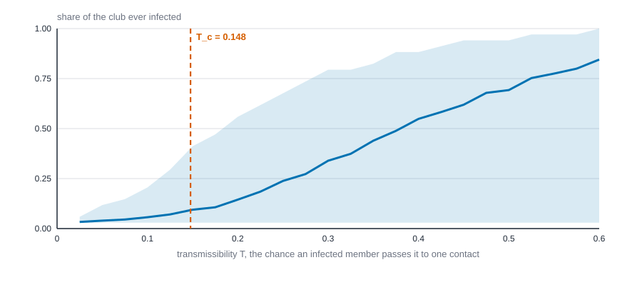
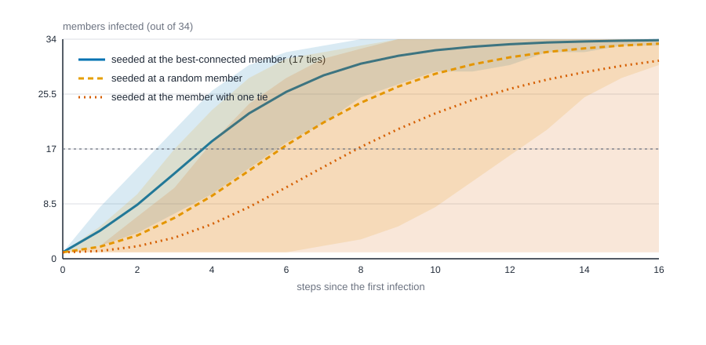
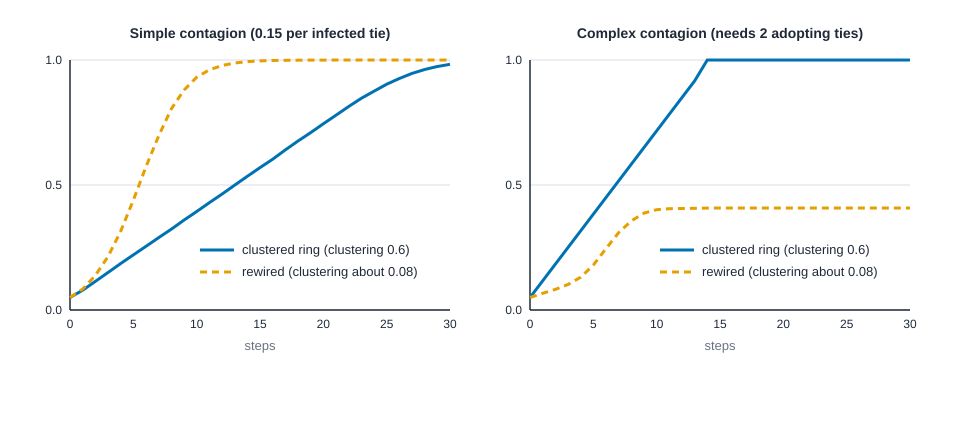

# Diffusion, influence and contagion {#sec-diffusion}

::: {.callout-note appearance="simple"}
## Prerequisites
@sec-dynamics, where networks change over time, and @sec-network-regression, where a person's outcome is tied to their neighbors' outcomes. We reuse the six-person office from @sec-homophily and the karate club from @sec-subgroups.
:::

## Things that travel along ties

A rumour starts with one person at a party. A flu starts with one traveller. A new app, a joke, a tip about a job opening, a worry about layoffs: each begins somewhere and moves from person to person along ties. Three questions come up every time. How many people end up with it? How fast? And does it matter who had it first?

**Diffusion** is the name for this. The important thing to see early is that diffusion is not a measure of structure. Degree, betweenness and density (@sec-centrality, @sec-paths-and-cohesion) describe the map. A diffusion model adds traffic: *rules* (who can pass what to whom, how often, what happens afterward) and *time*. A measure answers "what is this network like?" A process answers "what happens if we put something into it?" The same network can give very different answers under different rules, and that's most of what this chapter is about.

Every diffusion model has the same three ingredients.

- **The contact network.** Who can reach whom. Ties here mean *opportunity to pass it on*, which isn't always what a friendship survey measured.
- **The rule.** What happens along a tie, and what happens to a person afterward.
- **The seeds.** Who has it at the start.

Each run of a model involves chance, so one run tells you almost nothing. We repeat it many times and report the average and the spread. And because this chapter's data are a famous club whose members never caught anything, there's one thing to be clear about up front.

::: {.callout-warning appearance="simple"}
## The outbreaks here are simulated, not observed
The karate club's friendships are observed [@zachary1977information]. Every infection in this chapter is invented by a computer and laid over those real ties. The numbers say what *would* happen under stated rules, not what did happen, and nobody should read them as a finding about the club. knappnet doesn't ship a diffusion simulator, so we write one by hand. It's about fifteen lines, and you can read every one. The R, Python and Rust tabs draw different random numbers even from the same seed, so their results agree about, not to the last digit.
:::

## Three stories about spread: SI, SIR and SIS

Epidemiologists gave us the vocabulary, and it applies far beyond disease [@kermack1927contribution]. At any moment each person is in one state.

- **S**, susceptible: doesn't have it yet, but could.
- **I**, infected: has it and can pass it on.
- **R**, recovered (or removed): had it and no longer passes it on, and can't get it again.

The three classic models differ in what happens to an infected person.

- **SI**: infected stays infected, forever. A rumour nobody forgets, a technology that's adopted for good.
- **SIR**: infected people recover and are done. Measles; a news story people lose interest in.
- **SIS**: infected people recover and become susceptible again. A cold; a habit you can drop and pick up.

We'll run time in steps. In each step, every infected person tries each of their susceptible neighbors, and passes it on with probability $\beta$ per tie per step, independently. Then each infected person recovers with probability $\gamma$ (in SI, $\gamma = 0$). A susceptible person with $k$ infected neighbors escapes only if all $k$ attempts fail, so

$$
P(\text{infected this step}) \;=\; 1 - (1 - \beta)^k .
$$

Here $\beta$ is the chance of passing it along one tie in one step, and $k$ is the number of infected neighbors at the start of the step. (New infections take effect next step, so a person can't be infected and pass it on in the same breath.)

### A six-person office, by hand

Take the six-person office from @sec-homophily: Ana, Ben, Chloe, Dev, Eli and Fay, with seven ties (Ana-Ben, Ana-Chloe, Ben-Chloe, Chloe-Dev, Dev-Eli, Eli-Fay and Ben-Fay). Start an SI outbreak with $\beta = 0.5$, and ask how many people the seed infects in the first step.

If Chloe starts it, she has three neighbors: Ana, Ben and Dev. Each is infected with chance one half, independently. So the number of new cases is 0, 1, 2 or 3 with probabilities $1/8, 3/8, 3/8, 1/8$, and the expected number is $3 \times 0.5 = 1.5$. If Ana starts it, she has two neighbors, and the expected number is $2 \times 0.5 = 1.0$.

That's the whole idea in miniature: **a seed with more ties starts faster**, in direct proportion to its degree. We'll use these two numbers to check the simulator we write below. If a simulation can't reproduce a number you can get on paper, don't trust it on a number you can't.

## When does it take off? The epidemic threshold

Some outbreaks fizzle after a few cases and some sweep through the network. Whether a *large* network supports a sweep depends on one balance: how many people each case infects, on average, in the early phase, against one.

Define the **transmissibility** $T$ of an SIR outbreak as the chance that an infected person ever passes it to one particular neighbor over their whole infectious period. With per-step chance $\beta$ and recovery chance $\gamma$ in the steps above,

$$
T \;=\; \frac{\beta}{\beta + \gamma - \beta\gamma},
$$

which is just $\beta$ when $\gamma = 1$ (infectious for exactly one step). Now follow the first case. They have $k$ neighbors, and each is reached with chance $T$. But a person you reach by following a tie isn't a typical person: hubs sit at the end of many ties, so they're reached more often. Someone reached along a tie has, on average, $\langle k^2 \rangle / \langle k \rangle - 1$ *other* neighbors, where $\langle k \rangle$ is the mean degree and $\langle k^2 \rangle$ the mean of squared degrees. So each case produces on average $T\,(\langle k^2\rangle - \langle k\rangle)/\langle k\rangle$ new cases, and the outbreak can grow when that exceeds 1, that is, when

$$
T \;>\; T_c \;=\; \frac{\langle k\rangle}{\langle k^2\rangle - \langle k\rangle}.
$$

This is the epidemic threshold for SIR on a network [@newman2002spread]. Read it as: the more uneven the degrees (large $\langle k^2\rangle$ for a given $\langle k\rangle$), the lower the bar. Hubs make networks easy to set alight [@pastorsatorras2001epidemic].

For SIS the threshold has a similar shape but uses the largest eigenvalue $\lambda_1$ of the adjacency matrix (the square table of 0s and 1s that says who is tied to whom). The infection persists in a large network when

$$
\frac{\beta}{\gamma} \;>\; \frac{1}{\lambda_1},
$$

an approximation reviewed by Pastor-Satorras and colleagues [@pastorsatorras2015epidemic]. A network with hubs has a big $\lambda_1$, hence a small threshold.

For the office the degrees are 2, 3, 3, 2, 2, 2, so $\langle k\rangle = 14/6$ and $\langle k^2\rangle = 34/6$, and by hand $T_c = (14/6)/((34 - 14)/6) = 14/20 = 0.7$. A high bar: a ring-like office with few hubs needs transmission to be very likely before it takes off. The code gives the same, plus $\lambda_1$, and does it for the karate club.

::: {.panel-tabset group="language"}

## R

```r
library(dplyr)
library(purrr)
library(tibble)
library(tidyr)

options(width = 110)   # wide enough to print whole tables

# A symmetric 0/1 adjacency matrix from the two ends of every tie.
adjacency <- \(from, to, n) {
  a <- matrix(0, n, n)
  a[cbind(from, to)] <- 1
  pmax(a, t(a))
}

office <- adjacency(c(1, 1, 2, 3, 4, 5, 2), c(2, 3, 3, 4, 5, 6, 6), 6)
ties <- read.csv("data/karate/edges.csv")
karate <- adjacency(ties$source, ties$target, 34)

moments <- \(a) {
  k <- rowSums(a)
  lambda <- max(eigen(a, symmetric = TRUE, only.values = TRUE)$values)
  tibble(
    mean_k = mean(k), mean_k2 = mean(k^2),
    t_c = mean(k) / (mean(k^2) - mean(k)),
    lambda_1 = lambda, one_over_lambda = 1 / lambda
  )
}

list(office = office, karate = karate) |>
  map(moments) |>
  bind_rows(.id = "network") |>
  mutate(across(where(is.numeric), \(x) round(x, 3)))
```

::: {.code-output}
```text
TBD
```
:::

## Python

```python
import numpy as np

def adjacency(src, dst, n):
    """A symmetric 0/1 adjacency matrix from the two ends of every tie."""
    a = np.zeros((n, n))
    a[src, dst] = 1
    return np.maximum(a, a.T)

office = adjacency([0, 0, 1, 2, 3, 4, 1], [1, 2, 2, 3, 4, 5, 5], 6)
ties = np.loadtxt("data/karate/edges.csv", delimiter=",", skiprows=1, dtype=int)
karate = adjacency(ties[:, 0] - 1, ties[:, 1] - 1, 34)

for name, a in [("office", office), ("karate", karate)]:
    k = a.sum(axis=1)
    lam = np.linalg.eigvalsh(a)[-1]
    t_c = k.mean() / ((k ** 2).mean() - k.mean())
    print(f"{name:7s} <k> {k.mean():.3f}  <k^2> {(k ** 2).mean():.3f}  T_c {t_c:.3f}  "
          f"lambda_1 {lam:.3f}  1/lambda_1 {1 / lam:.3f}")
```

::: {.code-output}
```text
office  <k> 2.333  <k^2> 5.667  T_c 0.700  lambda_1 2.438  1/lambda_1 0.410
karate  <k> 4.588  <k^2> 35.647  T_c 0.148  lambda_1 6.726  1/lambda_1 0.149
```
:::

## Rust

```rust
// Neighbour lists for an undirected network, from the two ends of every tie.
fn neighbours(n: usize, from: &[usize], to: &[usize]) -> Vec<Vec<usize>> {
    let mut nb = vec![Vec::new(); n];
    for (&a, &b) in from.iter().zip(to) {
        nb[a].push(b);
        nb[b].push(a);
    }
    nb
}

// The largest eigenvalue of the adjacency matrix: power iteration on A + I (the shift
// keeps the iterates from flipping sign), then the Rayleigh quotient x'Ax.
fn lambda_1(nb: &[Vec<usize>]) -> f64 {
    let n = nb.len();
    let mut x = vec![1.0; n];
    for _ in 0..2000 {
        let mut y = x.clone();
        for i in 0..n {
            for &j in &nb[i] {
                y[i] += x[j];
            }
        }
        let norm = y.iter().map(|v| v * v).sum::<f64>().sqrt();
        x = y.iter().map(|v| v / norm).collect();
    }
    (0..n).map(|i| nb[i].iter().map(|&j| x[i] * x[j]).sum::<f64>()).sum()
}
let office = neighbours(6, &[0, 0, 1, 2, 3, 4, 1], &[1, 2, 2, 3, 4, 5, 5]);
let text = std::fs::read_to_string("data/karate/edges.csv")?;
let (mut from, mut to) = (Vec::new(), Vec::new());
for line in text.lines().skip(1) {
    let mut cells = line.split(',');
    from.push(cells.next().unwrap().parse::<usize>().unwrap() - 1);
    to.push(cells.next().unwrap().parse::<usize>().unwrap() - 1);
}
let karate = neighbours(34, &from, &to);
for (name, nb) in [("office", &office), ("karate", &karate)] {
    let n = nb.len() as f64;
    let mean_k = nb.iter().map(|v| v.len() as f64).sum::<f64>() / n;
    let mean_k2 = nb.iter().map(|v| (v.len() * v.len()) as f64).sum::<f64>() / n;
    let lam = lambda_1(nb);
    println!("{name:7} <k> {mean_k:.3}  <k^2> {mean_k2:.3}  T_c {:.3}  lambda_1 {lam:.3}  1/lambda_1 {:.3}",
        mean_k / (mean_k2 - mean_k), 1.0 / lam);
}
```

::: {.code-output}
```text
office  <k> 2.333  <k^2> 5.667  T_c 0.700  lambda_1 2.438  1/lambda_1 0.410
karate  <k> 4.588  <k^2> 35.647  T_c 0.148  lambda_1 6.726  1/lambda_1 0.149
```
:::

:::

Two things to notice. First, the office's $T_c$ is the 0.7 from the paper calculation, so the moments are right. Second, in the karate club $T_c$ and $1/\lambda_1$ come out almost the same, about 0.15. That's a coincidence of this network, not a rule: the two thresholds answer slightly different models (SIR, SIS) and usually differ.

**Where this breaks.** The $T_c$ formula is a large-network, tree-like approximation: it assumes that the neighbors of a case don't tie to each other and that degrees don't correlate. Real networks have triangles, which make some of a case's attempts land on people already reached, so the real bar is higher than the formula says. And 34 people isn't large. We'll see what that does in a moment.

## Writing the simulator

Here is the whole machine. A function takes the network, the seeds, $\beta$, $\gamma$ and a number of steps, and returns who is in which state after every step. Two options we'll need later: `sis` sends recovered people back to susceptible, and `thr` replaces the chance rule with a threshold rule (a person adopts once at least `thr` neighbors have), which we'll meet under complex contagion. Then we check it against the paper numbers: 1.5 new cases from Chloe, 1.0 from Ana.

::: {.panel-tabset group="language"}

## R

```r
set.seed(2026)

# States: 0 susceptible, 1 infected, 2 recovered. Returns everyone's state after each step.
spread <- \(a, seeds, beta, gamma, steps = 40, sis = FALSE, thr = 0) {
  n <- nrow(a)
  step <- \(s, i) {
    k <- as.vector(a %*% (s == 1))
    hit <- if (thr > 0) k >= thr else runif(n) < 1 - (1 - beta)^k
    caught <- s == 0 & hit
    recovered <- s == 1 & runif(n) < gamma
    s |> replace(recovered, if (sis) 0 else 2) |> replace(caught, 1)
  }
  accumulate(seq_len(steps), step, .init = replace(numeric(n), seeds, 1))
}

new_after_one_step <- \(seed, runs = 20000) {
  map_dbl(seq_len(runs), \(i) sum(spread(office, seed, beta = 0.5, gamma = 0, steps = 1)[[2]]) - 1) |>
    mean()
}

tibble(person = c("Chloe", "Ana"), seed = c(3, 1)) |>
  mutate(
    degree = rowSums(office)[seed],
    exact = 0.5 * degree,
    simulated = round(map_dbl(seed, new_after_one_step), 3)
  )
```

::: {.code-output}
```text
TBD
```
:::

## Python

```python
rng = np.random.default_rng(2026)

def spread(a, seeds, beta, gamma, steps=40, sis=False, thr=0):
    """States: 0 susceptible, 1 infected, 2 recovered. Returns everyone's state after each step."""
    n = len(a)
    s = np.zeros(n, dtype=int)
    s[seeds] = 1
    history = [s.copy()]
    for _ in range(steps):
        k = a @ (s == 1)
        hit = k >= thr if thr else rng.random(n) < 1 - (1 - beta) ** k
        caught = (s == 0) & hit
        recovered = (s == 1) & (rng.random(n) < gamma)
        s = np.where(recovered, 0 if sis else 2, s)
        s = np.where(caught, 1, s)
        history.append(s.copy())
    return np.array(history)

def new_after_one_step(seed, runs=20000):
    return np.mean([(spread(office, [seed], 0.5, 0, steps=1)[1] == 1).sum() - 1 for _ in range(runs)])

for name, seed in [("Chloe", 2), ("Ana", 0)]:
    degree = int(office[seed].sum())
    print(f"{name:6s} degree {degree}  exact {0.5 * degree:.3f}  simulated {new_after_one_step(seed):.3f}")
```

::: {.code-output}
```text
Chloe  degree 3  exact 1.500  simulated 1.500
Ana    degree 2  exact 1.000  simulated 1.002
```
:::

## Rust

```rust
// A small random number generator (SplitMix64), so the example needs no extra crate.
struct Rng(u64);
impl Rng {
    fn next(&mut self) -> f64 {
        self.0 = self.0.wrapping_add(0x9E3779B97F4A7C15);
        let mut z = self.0;
        z = (z ^ (z >> 30)).wrapping_mul(0xBF58476D1CE4E5B9);
        z = (z ^ (z >> 27)).wrapping_mul(0x94D049BB133111EB);
        ((z ^ (z >> 31)) >> 11) as f64 / (1u64 << 53) as f64
    }
    fn below(&mut self, n: usize) -> usize {
        (self.next() * n as f64) as usize
    }
}
let mut rng = Rng(2026);

// States: 0 susceptible, 1 infected, 2 recovered. Returns everyone's state after each step.
fn spread(nb: &[Vec<usize>], seeds: &[usize], beta: f64, gamma: f64, steps: usize, sis: bool, thr: usize,
          rng: &mut Rng) -> Vec<Vec<u8>> {
    let mut s = vec![0u8; nb.len()];
    for &i in seeds {
        s[i] = 1;
    }
    let mut history = vec![s.clone()];
    for _ in 0..steps {
        let mut next = s.clone();
        for i in 0..nb.len() {
            let k = nb[i].iter().filter(|&&j| s[j] == 1).count();
            if s[i] == 0 {
                let hit = if thr > 0 { k >= thr } else { rng.next() < 1.0 - (1.0 - beta).powi(k as i32) };
                if hit {
                    next[i] = 1;
                }
            } else if s[i] == 1 && rng.next() < gamma {
                next[i] = if sis { 0 } else { 2 };
            }
        }
        s = next;
        history.push(s.clone());
    }
    history
}
fn count(s: &[u8], state: u8) -> usize {
    s.iter().filter(|&&v| v == state).count()
}
for (name, seed) in [("Chloe", 2), ("Ana", 0)] {
    let runs = 20000;
    let total: usize = (0..runs)
        .map(|_| count(&spread(&office, &[seed], 0.5, 0.0, 1, false, 0, &mut rng)[1], 1) - 1)
        .sum();
    println!("{name:6} degree {}  exact {:.3}  simulated {:.3}",
        office[seed].len(), 0.5 * office[seed].len() as f64, total as f64 / runs as f64);
}
```

::: {.code-output}
```text
Chloe  degree 3  exact 1.500  simulated 1.496
Ana    degree 2  exact 1.000  simulated 1.002
```
:::

:::

The simulated values land on the paper values to about the second decimal place. That's the check we wanted: the machine does what the rule says.

## How far does it go? Many runs, a mean and an interval

One run gives one outcome: say, 4 of 34 people infected. To say anything we need many runs and a summary of them. We'll report the **mean** (the average outcome) and the range holding the middle 95 percent of runs, written as an interval. Be careful what that interval is. It isn't a confidence interval for the mean (with thousands of runs the mean is pinned down tightly). It describes how different *individual outbreaks* are, and it's often the more important number, because an outbreak that dies after two cases and one that sweeps the club can come from identical settings.

The experiment: SIR on the karate club, each person infectious for exactly one step ($\gamma = 1$, so $T = \beta$), one random seed. We vary $T$ and count how many people ever get infected (the seed included, so the smallest possible attack rate is $1/34 = 0.029$). The **attack rate** is that count as a share of the club. We also count a "big outbreak" as one that reaches at least 10 people.

Then SIS on the same network, with recovery chance 0.5 and ten random starters, looking at the share infected after 100 steps.

::: {.panel-tabset group="language"}

## R

```r
describe <- \(x) tibble(mean = mean(x), low = unname(quantile(x, 0.025)), high = unname(quantile(x, 0.975)))

# How many people ever catch it, over many runs from one random seed.
infected_count <- \(a, beta, gamma, runs = 2000) {
  map_dbl(seq_len(runs), \(i) sum(dplyr::last(spread(a, sample(nrow(a), 1), beta, gamma)) != 0))
}

tibble(t = c(0.1, 0.15, 0.2, 0.3, 0.5)) |>
  mutate(
    count = map(t, \(t) infected_count(karate, t, 1)),
    attack = map(count, \(x) describe(x / 34)),
    big_outbreak = map_dbl(count, \(x) mean(x >= 10))
  ) |>
  select(-count) |>
  unnest(attack) |>
  mutate(across(-t, \(x) round(x, 3)))

# SIS: the share infected after 100 steps, from 10 random starters.
prevalence <- \(a, beta, gamma, runs = 500) {
  map_dbl(seq_len(runs), \(i) {
    final <- dplyr::last(spread(a, sample(nrow(a), 10), beta, gamma, steps = 100, sis = TRUE))
    mean(final == 1)
  })
}

tibble(beta = c(0.1, 0.2, 0.5), gamma = 0.5) |>
  mutate(
    ratio = beta / gamma,
    p = map(beta, \(b) prevalence(karate, b, 0.5)),
    mean_prevalence = round(map_dbl(p, mean), 3),
    died_out = round(map_dbl(p, \(x) mean(x == 0)), 3)
  ) |>
  select(-p)
```

::: {.code-output}
```text
TBD
```
:::

## Python

```python
def describe(x):
    lo, hi = np.percentile(x, [2.5, 97.5])
    return np.mean(x), lo, hi

def infected_count(a, beta, gamma, runs=2000):
    """How many people ever catch it, over many runs from one random seed."""
    return np.array([(spread(a, [rng.integers(len(a))], beta, gamma)[-1] != 0).sum() for _ in range(runs)])

print("SIR on the karate club, one random seed, infectious for one step (T = beta)")
for t in [0.1, 0.15, 0.2, 0.3, 0.5]:
    count = infected_count(karate, t, 1.0)
    mean, lo, hi = describe(count / 34)
    print(f"T {t:.2f}  mean attack rate {mean:.3f}  95% of runs in [{lo:.3f}, {hi:.3f}]  "
          f"big outbreaks (>= 10 people) {np.mean(count >= 10):.3f}")

print("SIS, recovery chance 0.5, 10 random starters, after 100 steps")
for beta in [0.1, 0.2, 0.5]:
    p = np.array([(spread(karate, rng.choice(34, 10, replace=False), beta, 0.5, steps=100, sis=True)[-1] == 1).mean()
                  for _ in range(500)])
    print(f"beta/gamma {beta / 0.5:.2f}  mean prevalence {p.mean():.3f}  runs where it died out {np.mean(p == 0):.3f}")
```

::: {.code-output}
```text
SIR on the karate club, one random seed, infectious for one step (T = beta)
T 0.10  mean attack rate 0.058  95% of runs in [0.029, 0.235]  big outbreaks (>= 10 people) 0.012
T 0.15  mean attack rate 0.093  95% of runs in [0.029, 0.382]  big outbreaks (>= 10 people) 0.073
T 0.20  mean attack rate 0.155  95% of runs in [0.029, 0.559]  big outbreaks (>= 10 people) 0.222
T 0.30  mean attack rate 0.336  95% of runs in [0.029, 0.765]  big outbreaks (>= 10 people) 0.531
T 0.50  mean attack rate 0.719  95% of runs in [0.029, 0.971]  big outbreaks (>= 10 people) 0.847
SIS, recovery chance 0.5, 10 random starters, after 100 steps
beta/gamma 0.20  mean prevalence 0.000  runs where it died out 0.996
beta/gamma 0.40  mean prevalence 0.365  runs where it died out 0.010
beta/gamma 1.00  mean prevalence 0.587  runs where it died out 0.000
```
:::

## Rust

```rust
// Mean and the 2.5th and 97.5th percentiles (linear interpolation) of a list of outcomes.
fn describe(mut v: Vec<f64>) -> (f64, f64, f64) {
    v.sort_by(|a, b| a.partial_cmp(b).unwrap());
    let q = |p: f64| {
        let h = p * (v.len() - 1) as f64;
        let (lo, hi) = (h.floor() as usize, h.ceil() as usize);
        v[lo] + (h - lo as f64) * (v[hi] - v[lo])
    };
    (v.iter().sum::<f64>() / v.len() as f64, q(0.025), q(0.975))
}
// k distinct random items from a list (a partial shuffle).
fn pick<T: Copy>(items: &[T], k: usize, rng: &mut Rng) -> Vec<T> {
    let mut v = items.to_vec();
    for i in 0..k.min(v.len()) {
        let j = i + rng.below(v.len() - i);
        v.swap(i, j);
    }
    v.truncate(k);
    v
}
println!("SIR on the karate club, one random seed, infectious for one step (T = beta)");
for t in [0.1, 0.15, 0.2, 0.3, 0.5] {
    let counts: Vec<f64> = (0..2000)
        .map(|_| {
            let seed = rng.below(34);
            let h = spread(&karate, &[seed], t, 1.0, 40, false, 0, &mut rng);
            (34 - count(&h[40], 0)) as f64
        })
        .collect();
    let big = counts.iter().filter(|&&c| c >= 10.0).count() as f64 / counts.len() as f64;
    let (mean, lo, hi) = describe(counts.iter().map(|c| c / 34.0).collect());
    println!("T {t:.2}  mean attack rate {mean:.3}  95% of runs in [{lo:.3}, {hi:.3}]  big outbreaks (>= 10 people) {big:.3}");
}
println!("SIS, recovery chance 0.5, 10 random starters, after 100 steps");
let everyone: Vec<usize> = (0..34).collect();
for beta in [0.1, 0.2, 0.5] {
    let p: Vec<f64> = (0..500)
        .map(|_| {
            let starters = pick(&everyone, 10, &mut rng);
            let h = spread(&karate, &starters, beta, 0.5, 100, true, 0, &mut rng);
            count(&h[100], 1) as f64 / 34.0
        })
        .collect();
    let died = p.iter().filter(|&&x| x == 0.0).count() as f64 / p.len() as f64;
    println!("beta/gamma {:.2}  mean prevalence {:.3}  runs where it died out {died:.3}",
        beta / 0.5, p.iter().sum::<f64>() / p.len() as f64);
}
```

::: {.code-output}
```text
SIR on the karate club, one random seed, infectious for one step (T = beta)
T 0.10  mean attack rate 0.059  95% of runs in [0.029, 0.235]  big outbreaks (>= 10 people) 0.010
T 0.15  mean attack rate 0.089  95% of runs in [0.029, 0.382]  big outbreaks (>= 10 people) 0.068
T 0.20  mean attack rate 0.153  95% of runs in [0.029, 0.559]  big outbreaks (>= 10 people) 0.216
T 0.30  mean attack rate 0.337  95% of runs in [0.029, 0.765]  big outbreaks (>= 10 people) 0.534
T 0.50  mean attack rate 0.710  95% of runs in [0.029, 0.971]  big outbreaks (>= 10 people) 0.838
SIS, recovery chance 0.5, 10 random starters, after 100 steps
beta/gamma 0.20  mean prevalence 0.000  runs where it died out 0.998
beta/gamma 0.40  mean prevalence 0.373  runs where it died out 0.004
beta/gamma 1.00  mean prevalence 0.590  runs where it died out 0.000
```
:::

:::

Read the first table down. At $T = 0.1$, under $T_c = 0.148$, the mean attack rate is 0.058, barely above the seed alone (0.029), and a big outbreak is rare (about one run in a hundred). At $T = 0.15$, right at the threshold, the mean is 0.093 and 7 percent of runs are big outbreaks. At $T = 0.5$ the mean is 0.719 and about 85 percent of runs are big. But look at the interval at $T = 0.5$, which runs from 0.029 to 0.971. Identical settings give both a non-event and a sweep of the club, and the mean describes neither. With 34 people there's no clean jump at $T_c$ (@fig-diffusion-attack): the curve bends gradually. The threshold is a statement about large networks, and here it's only a rough marker of where outbreaks go from rare to common.

The SIS table makes the same point more sharply. A ratio $\beta/\gamma$ of 0.2 is *above* $1/\lambda_1 = 0.149$, and the infection still died out in nearly every run (99.6 percent), because in a small network a lucky stretch of recoveries ends it. It took a ratio of 0.4 for the infection to persist (about 37 percent of the club infected after 100 steps) and 1.0 for it to hold at about 59 percent. The eigenvalue rule describes large networks, where chance extinction is unlikely, and it's a poor guide to 34 people.

One more caution about $T$. The threshold depends on $T$ alone, because early on only the average number of onward cases matters. The *final size* does not: if people differ in how long they stay infectious, one person's attempts on different neighbors are linked, and two settings with the same $T$ can end differently. Exercise 4 shows it.

{#fig-diffusion-attack fig-alt="ALT_ATTACK"}

## Structure and spread: who starts it matters

The threshold said something about the network as a whole. Now ask about one seed. Take the club's best-connected member (node 34, with 17 ties), a random member, and the one member with a single tie (node 12). Run SI with $\beta = 0.2$ and count the steps until half the club (17 people) is infected. SI always ends with everyone infected in a connected network, so *speed* is the thing that differs. Then run SIR ($\beta = 0.2$, $\gamma = 0.5$) and compare how many people it reaches.

::: {.panel-tabset group="language"}

## R

```r
deg <- rowSums(karate)
seed_for <- \(rule) switch(rule, hub = which.max(deg), random = sample(34, 1), periphery = which.min(deg))
steps_to_half <- \(states) which(map_dbl(states, \(s) sum(s == 1)) >= 17)[1] - 1

tibble(rule = c("hub", "random", "periphery")) |>
  mutate(
    si_steps = map(rule, \(r) map_dbl(1:2000, \(i) steps_to_half(spread(karate, seed_for(r), 0.2, 0, steps = 60)))),
    sir_attack = map(rule, \(r) map_dbl(1:2000, \(i) mean(dplyr::last(spread(karate, seed_for(r), 0.2, 0.5)) != 0))),
    si_steps = map(si_steps, describe),
    sir_attack = map(sir_attack, describe)
  ) |>
  unnest(c(si_steps, sir_attack), names_sep = "_") |>
  mutate(across(where(is.numeric), \(x) round(x, 3)))
```

::: {.code-output}
```text
TBD
```
:::

## Python

```python
deg = karate.sum(axis=1)
hub, periphery = int(deg.argmax()), int(deg.argmin())
seed_for = {"hub": lambda: hub, "random": lambda: rng.integers(34), "periphery": lambda: periphery}

for rule, pick_seed in seed_for.items():
    si = [int(np.argmax((spread(karate, [pick_seed()], 0.2, 0, steps=60) == 1).sum(axis=1) >= 17)) for _ in range(2000)]
    sir = [(spread(karate, [pick_seed()], 0.2, 0.5)[-1] != 0).mean() for _ in range(2000)]
    m1, l1, h1 = describe(si)
    m2, l2, h2 = describe(sir)
    print(f"{rule:9s} SI steps to half {m1:.2f} [{l1:.0f}, {h1:.0f}]   SIR attack rate {m2:.3f} [{l2:.3f}, {h2:.3f}]")
```

::: {.code-output}
```text
hub       SI steps to half 4.25 [3, 6]   SIR attack rate 0.548 [0.059, 0.853]
random    SI steps to half 6.56 [3, 13]   SIR attack rate 0.378 [0.029, 0.853]
periphery SI steps to half 9.11 [4, 20]   SIR attack rate 0.200 [0.029, 0.824]
```
:::

## Rust

```rust
let deg: Vec<usize> = karate.iter().map(|v| v.len()).collect();
let hub = (0..34).max_by_key(|&i| deg[i]).unwrap();
let periphery = (0..34).min_by_key(|&i| deg[i]).unwrap();
for rule in ["hub", "random", "periphery"] {
    let mut si = Vec::new();
    let mut sir = Vec::new();
    for _ in 0..2000 {
        let seed = match rule { "hub" => hub, "random" => rng.below(34), _ => periphery };
        let h = spread(&karate, &[seed], 0.2, 0.0, 60, false, 0, &mut rng);
        si.push(h.iter().position(|s| count(s, 1) >= 17).unwrap() as f64);
        let seed = match rule { "hub" => hub, "random" => rng.below(34), _ => periphery };
        let h = spread(&karate, &[seed], 0.2, 0.5, 40, false, 0, &mut rng);
        sir.push((34 - count(&h[40], 0)) as f64 / 34.0);
    }
    let (m1, l1, h1) = describe(si);
    let (m2, l2, h2) = describe(sir);
    println!("{rule:9} SI steps to half {m1:.2} [{l1:.0}, {h1:.0}]   SIR attack rate {m2:.3} [{l2:.3}, {h2:.3}]");
}
```

::: {.code-output}
```text
hub       SI steps to half 4.26 [3, 6]   SIR attack rate 0.528 [0.059, 0.853]
random    SI steps to half 6.36 [4, 12]   SIR attack rate 0.374 [0.029, 0.853]
periphery SI steps to half 9.24 [4, 22]   SIR attack rate 0.210 [0.029, 0.824]
```
:::

:::

With the best-connected member as the seed, half the club has it after about 4.3 steps on average. From a random member it takes 6.6, and from the member with one tie, 9.1 (the Rust tab gives 4.3, 6.4 and 9.2). The intervals matter as much as the means: [3, 6] steps for the hub against [4, 20] for the one-tie seed. That seed is slow *and unpredictable*, because everything waits on one tie, and at 0.2 per step it fails four steps in five. The reason is the one-step arithmetic from earlier: the hub expects $17 \times 0.2 = 3.4$ new cases in the first step, a random member $4.59 \times 0.2 = 0.92$, and the one-tie member 0.2. In SIR the mean attack rate follows the same order, 0.55, 0.38 and 0.20. Even the hub's outbreak occasionally stalls: the lower end of its interval, 0.059, is two people.

Three more structural facts push the same way, none of which we simulate here. **Bridges** (ties that join otherwise separate parts, @sec-paths-and-cohesion) are routes for crossing between groups, and an outbreak seeded inside a community tends to saturate it before it crosses the few ties between communities, so spread curves often have a shoulder. **Clustering** puts redundant paths around a case, which for simple contagion mostly wastes attempts. **Hubs** are reached early and reach many, which is why they lower the threshold. @fig-diffusion-seeds shows the three seed rules over time.

{#fig-diffusion-seeds fig-alt="ALT_SEEDS"}

### A stress check: do the missing ties matter?

A friendship survey misses ties, and an outbreak travels along *all* the contacts, recorded or not. So before believing "seed the hub", test how fragile it is. We'll drop 8 of the club's 78 ties at random (about a tenth), find the best-connected member of the damaged network, and compare it with a random seed. Some runs will start from someone cut off from most of the club, and they never reach half: we report the share that do.

::: {.panel-tabset group="language"}

## R

```r
src <- ties$source
dst <- ties$target

damaged_speed <- \(rule, networks = 200, runs = 5) {
  map(seq_len(networks), \(i) {
    keep <- sample(78, 70)
    a <- adjacency(src[keep], dst[keep], 34)
    map_dbl(seq_len(runs), \(j) {
      seed <- if (rule == "hub") which.max(rowSums(a)) else sample(34, 1)
      states <- spread(a, seed, 0.2, 0)
      steps_to_half(states)
    })
  }) |>
    unlist()
}

tibble(rule = c("hub", "random")) |>
  mutate(steps = map(rule, damaged_speed)) |>
  mutate(
    reached_half = map_dbl(steps, \(x) mean(!is.na(x))),
    mean_steps = map_dbl(steps, \(x) mean(x, na.rm = TRUE))
  ) |>
  select(-steps) |>
  mutate(across(where(is.numeric), \(x) round(x, 3)))
```

::: {.code-output}
```text
TBD
```
:::

## Python

```python
src, dst = ties[:, 0] - 1, ties[:, 1] - 1

def damaged_speed(rule, networks=200, runs=5):
    steps = []
    for _ in range(networks):
        keep = rng.permutation(78)[:70]          # drop 8 of the 78 ties
        a = adjacency(src[keep], dst[keep], 34)
        for _ in range(runs):
            seed = int(a.sum(axis=1).argmax()) if rule == "hub" else int(rng.integers(34))
            infected = (spread(a, [seed], 0.2, 0) == 1).sum(axis=1)
            steps.append(np.argmax(infected >= 17) if infected[-1] >= 17 else np.nan)
    return np.array(steps)

for rule in ["hub", "random"]:
    s = damaged_speed(rule)
    print(f"{rule:7s} reached half the club in {np.mean(~np.isnan(s)):.3f} of runs, mean {np.nanmean(s):.2f} steps")
```

::: {.code-output}
```text
hub     reached half the club in 1.000 of runs, mean 4.61 steps
random  reached half the club in 0.991 of runs, mean 7.22 steps
```
:::

## Rust

```rust
for rule in ["hub", "random"] {
    let mut steps = Vec::new();
    for _ in 0..200 {
        let keep = pick(&(0..78).collect::<Vec<usize>>(), 70, &mut rng);
        let a = neighbours(34, &keep.iter().map(|&e| from[e]).collect::<Vec<_>>(),
                           &keep.iter().map(|&e| to[e]).collect::<Vec<_>>());
        for _ in 0..5 {
            let seed = if rule == "hub" {
                (0..34).max_by_key(|&i| a[i].len()).unwrap()
            } else {
                rng.below(34)
            };
            let h = spread(&a, &[seed], 0.2, 0.0, 40, false, 0, &mut rng);
            steps.extend(h.iter().position(|s| count(s, 1) >= 17).map(|t| t as f64));
        }
    }
    println!("{rule:7} reached half the club in {:.3} of runs, mean {:.2} steps",
        steps.len() as f64 / 1000.0, steps.iter().sum::<f64>() / steps.len() as f64);
}
```

::: {.code-output}
```text
hub     reached half the club in 1.000 of runs, mean 4.64 steps
random  reached half the club in 0.994 of runs, mean 7.27 steps
```
:::

:::

The hub seed still wins after the damage: half the club in about 4.6 steps, against about 7.2 for a random seed, and a random seed fails to reach half in a small share of runs (0.9 percent in Python, 0.6 in Rust), presumably when it starts at a member who has lost their only tie. So the advice "seed the hub" survives this particular stress. It doesn't survive every kind of missing data: real surveys don't lose ties at random, they tend to lose weak ties and ties to people outside the boundary, and hubs are the ones most likely to be mis-measured. A fuller check would rerun this with the damage you think your data has.

### Readings: what fast or slow spread means in different places

The same simulated result reads differently depending on what the ties are.

| Setting | A fast spread from a hub seed suggests | A slow or small spread suggests |
| --- | --- | --- |
| Infectious disease in a school | A few well-connected people matter; targeting them (vaccination, isolation) could slow things most. | Contacts are sparse or transmission is hard; the model's $\beta$ is probably the weak link in your assumptions. |
| A rumour in an office | One or two people carry most of the information; if they leave the rumour mill slows. | The rumour has to climb through several separate teams; ties between teams are scarce. |
| Disruption in a supply network | A failure at a hub supplier could reach most of the network quickly. | Failures stay local, *if* ties here are the real dependencies and not only the contracts you recorded. |
| A feature on an online platform | Early adopters with large audiences can launch it; but exposure is not adoption. | People need more than one nudge, which is the next section's subject. |

What the numbers do **not** show: they don't show how the real thing travelled (the rules are ours), they don't say what the best intervention is (that needs a model of the intervention), and the hub effect only applies if hubs transmit like everyone else.

## Complex contagion: when one exposure isn't enough

A virus needs one contact. A new habit usually needs more. You might not join a boycott because one friend did, but you might when three did. Granovetter called these **threshold models** [@granovetter1978threshold]: each person has a threshold, the number (or share) of their contacts who must already have adopted before they will. **Simple contagion** needs one exposure. **Complex contagion** needs several, from different people.

### Granovetter's riot, with five people

Five people stand in a crowd where everyone sees everyone. Their thresholds, the number of others who must already be taking part before they join, are 0, 1, 2, 3 and 4. The person with threshold 0 starts. Now one person is in, so the person with threshold 1 joins. Now two are in, so the person with threshold 2 joins, and so on: all five. Change a single threshold, from 1 to 2, giving 0, 2, 2, 3, 4. The starter acts, and nobody else's threshold is 1 or less, so it stops at one person. The crowd's average threshold barely changed, and the outcome went from everyone to one. That's the lesson of the model: **the outcome depends on the whole pattern of thresholds, and small differences can tip it.**

### Why clustering helps complex contagion and not simple

Put thresholds on a network. Take 8 people in a ring, each tied to the two people on each side (so each has four ties), and a threshold of 2. Seed people 0 and 1. Person 2 is tied to 0, 1, 3 and 4, so two neighbors have adopted, and they adopt in step 1; so does person 7, tied to 5, 6, 0 and 1. In step 2, person 3 (tied to 1, 2, 4, 5) and person 6 (tied to 4, 5, 7, 0) adopt. In step 3, persons 4 and 5 do. All eight, in three steps. It works because the ring is *clustered*: neighbors share neighbors, so a person next to the frontier is tied to two adopters at once.

Now take the same people with ties redrawn at random. A tie that jumps across the network delivers one exposure to someone whose other contacts haven't adopted, and one exposure isn't enough. The jump is wasted. Centola and Macy argued this is the general pattern: long ties, which are the best thing for simple contagion, are weak for complex contagion, which needs *wide bridges* of overlapping ties [@centola2007complex]. In an online experiment where participants were assigned to either a clustered or a random network of contacts, Centola found a health behavior spread farther and faster in the clustered one [@centola2010spread]. Watts, working with random networks, found that cascades of threshold adopters need a window of connectivity: too few ties and nothing connects, too many and, when thresholds are shares of a person's neighbors, each threshold is hard to reach [@watts2002simple].

For simple contagion the logic flips. One exposure suffices, so the triangle that helps the complex case is redundancy: the same news arrives twice. And a long tie reaches new territory, which is the small-world effect of @sec-small-worlds and the strength of weak ties [@granovetter1973strength].

We test both claims. The networks have 60 people. The **ring** has everyone tied to the three people on each side (6 ties each). The **rewired** network redraws the far end of every tie at random, so the degree stays near 6 but clustering collapses. The simple rule is SI with $\beta = 0.15$. The complex rule is a threshold of 2. The seeds are a random person and up to two of their contacts, so both rules start from comparable footing. We run 500 outbreaks per network and rule, making a new rewired network each time, and report the final share who adopted and the steps to reach half (among runs that get there).

::: {.panel-tabset group="language"}

## R

```r
# n people on a ring, each tied to k people on either side; each tie's far end is redrawn with chance p.
ring <- \(n, k, p) {
  a <- rep(seq_len(n), each = k)
  b <- (a - 1 + rep(seq_len(k), n)) %% n + 1
  b <- ifelse(runif(length(a)) < p, sample.int(n, length(a), replace = TRUE), b)
  keep <- a != b
  adjacency(a[keep], b[keep], n)
}
clustering <- \(a) {
  k <- rowSums(a)
  sum(diag(a %*% a %*% a)) / sum(k * (k - 1))
}
start <- \(a) {
  s <- sample.int(nrow(a), 1)
  nb <- which(a[s, ] == 1)
  c(s, nb[sample.int(length(nb), min(2, length(nb)))])
}

trial <- \(p) {
  a <- ring(60, 3, p)
  seeds <- start(a)
  curve <- \(...) map_dbl(spread(a, seeds, steps = 60, ...), \(s) mean(s == 1))
  tibble(
    rule = c("simple", "complex"), degree = mean(rowSums(a)), clustering = clustering(a),
    curve = list(curve(beta = 0.15, gamma = 0), curve(beta = 0, gamma = 0, thr = 2))
  )
}

tibble(p = c(0, 1), network = c("ring lattice", "rewired")) |>
  mutate(runs = map(p, \(p) bind_rows(map(1:500, \(i) trial(p))))) |>
  unnest(runs) |>
  mutate(
    final = map_dbl(curve, dplyr::last),
    half = map_dbl(curve, \(h) if (dplyr::last(h) >= 0.5) which(h >= 0.5)[1] - 1 else NA)
  ) |>
  summarise(
    degree = mean(degree), clustering = mean(clustering), reach = mean(final),
    low = unname(quantile(final, 0.025)), high = unname(quantile(final, 0.975)),
    steps_to_half = mean(half, na.rm = TRUE),
    .by = c(network, rule)
  ) |>
  mutate(across(where(is.numeric), \(x) round(x, 2)))
```

::: {.code-output}
```text
TBD
```
:::

## Python

```python
def ring(n, k, p):
    """n people on a ring, each tied to k people on either side; each tie's far end is redrawn with chance p."""
    a = np.repeat(np.arange(n), k)
    b = (a + np.tile(np.arange(1, k + 1), n)) % n
    b = np.where(rng.random(len(a)) < p, rng.integers(0, n, len(a)), b)
    keep = a != b
    return adjacency(a[keep], b[keep], n)

def clustering(a):
    k = a.sum(axis=1)
    return np.trace(a @ a @ a) / (k * (k - 1)).sum()

def start(a):
    s = rng.integers(len(a))
    return [s, *rng.permutation(np.flatnonzero(a[s]))[:2]]

rules = {"simple": dict(beta=0.15, gamma=0), "complex": dict(beta=0, gamma=0, thr=2)}
for p, label in [(0, "ring lattice"), (1, "rewired")]:
    res = {name: [] for name in rules}
    degree, clust = [], []
    for _ in range(500):
        a = ring(60, 3, p)
        degree.append(a.sum(axis=1).mean())
        clust.append(clustering(a))
        seeds = start(a)
        for name, kw in rules.items():
            share = (spread(a, seeds, steps=60, **kw) == 1).sum(axis=1) / 60
            res[name].append((share[-1], np.argmax(share >= 0.5) if share[-1] >= 0.5 else np.nan))
    for name, v in res.items():
        v = np.array(v)
        mean, lo, hi = describe(v[:, 0])
        print(f"{label:12s} degree {np.mean(degree):.2f} clustering {np.mean(clust):.2f} {name:7s} "
              f"reach {mean:.2f} [{lo:.2f}, {hi:.2f}] steps to half {np.nanmean(v[:, 1]):.1f}")
```

::: {.code-output}
```text
ring lattice degree 6.00 clustering 0.60 simple  reach 1.00 [1.00, 1.00] steps to half 13.3
ring lattice degree 6.00 clustering 0.60 complex reach 1.00 [1.00, 1.00] steps to half 7.0
rewired      degree 5.66 clustering 0.08 simple  reach 1.00 [1.00, 1.00] steps to half 5.9
rewired      degree 5.66 clustering 0.08 complex reach 0.36 [0.05, 1.00] steps to half 6.4
```
:::

## Rust

```rust
// n people on a ring, each tied to k people on either side; each tie's far end is redrawn with chance p.
fn ring(n: usize, k: usize, p: f64, rng: &mut Rng) -> Vec<Vec<usize>> {
    let mut m = vec![vec![false; n]; n];
    for a in 0..n {
        for step in 1..=k {
            let mut b = (a + step) % n;
            if rng.next() < p {
                b = rng.below(n);
            }
            if a != b {
                m[a][b] = true;
                m[b][a] = true;
            }
        }
    }
    (0..n).map(|i| (0..n).filter(|&j| m[i][j]).collect()).collect()
}
// Closed ordered pairs of neighbours over all ordered pairs of neighbours (trace of A^3 over sum of k(k-1)).
fn clustering(nb: &[Vec<usize>]) -> f64 {
    let (mut closed, mut pairs) = (0.0, 0.0);
    for v in nb {
        for &j in v {
            for &l in v {
                if j != l {
                    pairs += 1.0;
                    if nb[j].contains(&l) {
                        closed += 1.0;
                    }
                }
            }
        }
    }
    closed / pairs
}
for (p, label) in [(0.0, "ring lattice"), (1.0, "rewired")] {
    let mut reach = [Vec::new(), Vec::new()];
    let mut half = [Vec::new(), Vec::new()];
    let (mut degree, mut clust) = (0.0, 0.0);
    for _ in 0..500 {
        let a = ring(60, 3, p, &mut rng);
        degree += a.iter().map(|v| v.len() as f64).sum::<f64>() / 60.0 / 500.0;
        clust += clustering(&a) / 500.0;
        let s = rng.below(60);
        let mut seeds = vec![s];
        seeds.extend(pick(&a[s], 2, &mut rng));
        for (r, (beta, thr)) in [(0.15, 0), (0.0, 2)].into_iter().enumerate() {
            let h = spread(&a, &seeds, beta, 0.0, 60, false, thr, &mut rng);
            reach[r].push(count(&h[60], 1) as f64 / 60.0);
            half[r].extend(h.iter().position(|s| count(s, 1) >= 30).map(|t| t as f64));
        }
    }
    for (r, name) in ["simple", "complex"].into_iter().enumerate() {
        let steps = half[r].iter().sum::<f64>() / half[r].len() as f64;
        let (mean, lo, hi) = describe(reach[r].clone());
        println!("{label:12} degree {degree:.2} clustering {clust:.2} {name:7} reach {mean:.2} [{lo:.2}, {hi:.2}] steps to half {steps:.1}");
    }
}
```

::: {.code-output}
```text
ring lattice degree 6.00 clustering 0.60 simple  reach 1.00 [1.00, 1.00] steps to half 13.4
ring lattice degree 6.00 clustering 0.60 complex reach 1.00 [1.00, 1.00] steps to half 7.0
rewired      degree 5.66 clustering 0.08 simple  reach 1.00 [1.00, 1.00] steps to half 6.0
rewired      degree 5.66 clustering 0.08 complex reach 0.39 [0.05, 1.00] steps to half 6.5
```
:::

:::

The ring and the rewired network have the same size and nearly the same degree (6.00 and 5.66), but clustering of 0.60 against 0.08. For **simple** contagion, both reach everyone, but the rewired network gets to half in about 6 steps and the ring takes 13.3: the shortcuts do their job. For **complex** contagion the story flips. On the ring it reaches everyone in every run and gets to half in 7.0 steps. On the rewired network the mean reach is only 0.36 (the Rust tab gives 0.39), with an interval of [0.05, 1.00]: 0.05 is the three seeds alone, so in a large share of runs it stalled at once, and in the rest it swept through at about the same speed as on the ring (6.4 steps to half). Complex contagion on a random network is all or nothing, and *more often nothing*. @fig-diffusion-complex shows the average curves.

One hedge. This is a threshold of 2 on a degree-6 network. Raise the threshold to 4 and even the ring stalls (Exercise 5), and the effect of rewiring depends on both numbers. The pattern, clustering helping complex contagion and shortcuts helping simple, is robust. The exact sizes belong to these settings.

{#fig-diffusion-complex fig-alt="ALT_COMPLEX"}

## Spread or resemblance? The identification problem

So far we told the story forward: we chose the rule, ran it, and watched what happened. Real analysis runs the other way. You observe a network and people's behaviors, you see that connected people resemble each other, and you want to say *influence spreads*. That step is much harder than anything in the simulations.

Friends who share a habit might share it for three different reasons.

- **Influence** (contagion): one person's behavior changed the other's.
- **Selection** (homophily): people who were already alike became friends. This is the choice and opportunity story of @sec-homophily [@mcpherson2001birds].
- **Shared environment**: something else affected both: the same neighborhood, workplace, school, a news event, a storm.

A snapshot, even a perfect one, shows the same picture under all three: connected people alike. Shalizi and Thomas showed this isn't a data-quality problem that more data would solve. They argued that in observational network studies, influence and homophily are generically confounded: without strong assumptions, the data can't tell them apart [@shalizi2011homophily]. Manski had named an earlier version of the problem, the **reflection problem**: if a group's members all affect each other, you can't tell whether a person is responding to the group's behavior or the group is responding to its members' [@manski1993identification].

### The same pattern from four different worlds

To see this concretely, use the karate club's real ties and give everyone a binary trait, 17 with the trait and 17 without. The statistic is the share of ties that join two people with the same trait. With no mechanism at all, that's about 0.5, since random labels over the club's ties match about half the time. Now generate the trait four ways. Again, all of it is simulated; the only observed thing is the tie pattern.

- **Nothing at work:** random traits on the real ties (the control).
- **Influence only:** random traits to start; then for three rounds each person, with chance 0.5, copies the trait of a random neighbor.
- **Selection only:** random traits, fixed; then 78 ties are drawn among all pairs, with same-trait pairs four times as likely as mixed pairs. So the *network* is built from the traits.
- **Shared environment:** each person's trait follows their faction (the side they took when the club split) with chance 0.85. Nobody influences anybody, and nobody picks friends by trait. The faction produced both the ties and the trait.

::: {.panel-tabset group="language"}

## R

```r
faction <- as.integer(read.csv("data/karate/nodes.csv")$faction == "Mr. Hi")
same_share <- \(x, s, t) mean(x[s] == x[t])
draw_trait <- \() sample(rep(0:1, 17))
all_pairs <- which(upper.tri(diag(34)), arr.ind = TRUE)

copy_step <- \(x) {
  pick <- max.col(karate * matrix(runif(34 * 34), 34), ties.method = "first")   # a random neighbor each
  ifelse(runif(34) < 0.5, x[pick], x)
}
influence <- \() draw_trait() |> copy_step() |> copy_step() |> copy_step() |> same_share(src, dst)
selection <- \() {
  x <- draw_trait()
  w <- ifelse(x[all_pairs[, 1]] == x[all_pairs[, 2]], 4, 1)
  chosen <- order(-log(runif(nrow(all_pairs))) / w)[1:78]      # weighted draw of 78 pairs without replacement
  same_share(x, all_pairs[chosen, 1], all_pairs[chosen, 2])
}
shared_environment <- \() same_share(ifelse(runif(34) < 0.85, faction, 1 - faction), src, dst)

tibble(
  story = c("nothing at work", "influence only", "selection only", "shared environment"),
  make = list(\() same_share(draw_trait(), src, dst), influence, selection, shared_environment)
) |>
  mutate(share = map(make, \(f) describe(map_dbl(1:1000, \(i) f())))) |>
  select(-make) |>
  unnest(share) |>
  mutate(across(where(is.numeric), \(x) round(x, 3)))
```

::: {.code-output}
```text
TBD
```
:::

## Python

```python
faction = (np.loadtxt("data/karate/nodes.csv", delimiter=",", skiprows=1, dtype=str, usecols=1) == "Mr. Hi").astype(int)
pairs = np.triu_indices(34, 1)

def same_share(x, s, t):
    return (x[s] == x[t]).mean()

def draw_trait():
    return rng.permutation(np.repeat([0, 1], 17))

def influence():
    x = draw_trait()
    for _ in range(3):
        pick = np.argmax(karate * rng.random((34, 34)), axis=1)          # a random neighbor each
        x = np.where(rng.random(34) < 0.5, x[pick], x)
    return same_share(x, src, dst)

def selection():
    x = draw_trait()
    w = np.where(x[pairs[0]] == x[pairs[1]], 4.0, 1.0)
    chosen = np.argsort(-np.log(rng.random(len(w))) / w)[:78]            # weighted draw of 78 pairs without replacement
    return same_share(x, pairs[0][chosen], pairs[1][chosen])

def shared_environment():
    return same_share(np.where(rng.random(34) < 0.85, faction, 1 - faction), src, dst)

stories = [("nothing at work", lambda: same_share(draw_trait(), src, dst)), ("influence only", influence),
           ("selection only", selection), ("shared environment", shared_environment)]
for name, make in stories:
    mean, lo, hi = describe([make() for _ in range(1000)])
    print(f"{name:19s} same-trait share of ties {mean:.3f} [{lo:.3f}, {hi:.3f}]")
```

::: {.code-output}
```text
nothing at work     same-trait share of ties 0.484 [0.397, 0.577]
influence only      same-trait share of ties 0.611 [0.461, 0.821]
selection only      same-trait share of ties 0.774 [0.679, 0.859]
shared environment  same-trait share of ties 0.673 [0.487, 0.821]
```
:::

## Rust

```rust
let nodes = std::fs::read_to_string("data/karate/nodes.csv")?;
let faction: Vec<u8> = nodes.lines().skip(1).map(|l| (l.split(',').nth(1).unwrap() == "Mr. Hi") as u8).collect();
let ties: Vec<(usize, usize)> = from.iter().copied().zip(to.iter().copied()).collect();
let all_pairs: Vec<(usize, usize)> = (0..34).flat_map(|i| (i + 1..34).map(move |j| (i, j))).collect();

fn same_share(x: &[u8], ties: &[(usize, usize)]) -> f64 {
    ties.iter().filter(|&&(a, b)| x[a] == x[b]).count() as f64 / ties.len() as f64
}
fn draw_trait(rng: &mut Rng) -> Vec<u8> {
    let half_and_half: Vec<u8> = (0..34).map(|i| (i % 2) as u8).collect();
    pick(&half_and_half, 34, rng)
}

for story in ["nothing at work", "influence only", "selection only", "shared environment"] {
    let shares: Vec<f64> = (0..1000)
        .map(|_| match story {
            "nothing at work" => same_share(&draw_trait(&mut rng), &ties),
            "influence only" => {
                let mut x = draw_trait(&mut rng);
                for _ in 0..3 {
                    let before = x.clone();
                    for i in 0..34 {
                        if rng.next() < 0.5 {
                            x[i] = before[karate[i][rng.below(karate[i].len())]];
                        }
                    }
                }
                same_share(&x, &ties)
            }
            "selection only" => {
                let x = draw_trait(&mut rng);
                let mut keyed: Vec<(f64, usize)> = all_pairs.iter().enumerate()
                    .map(|(e, &(a, b))| (-rng.next().ln() / if x[a] == x[b] { 4.0 } else { 1.0 }, e))
                    .collect();
                keyed.sort_by(|u, v| u.partial_cmp(v).unwrap());
                let chosen: Vec<(usize, usize)> = keyed[..78].iter().map(|&(_, e)| all_pairs[e]).collect();
                same_share(&x, &chosen)
            }
            _ => {
                let x: Vec<u8> = faction.iter().map(|&f| if rng.next() < 0.85 { f } else { 1 - f }).collect();
                same_share(&x, &ties)
            }
        })
        .collect();
    let (mean, lo, hi) = describe(shares);
    println!("{story:19} same-trait share of ties {mean:.3} [{lo:.3}, {hi:.3}]");
}
```

::: {.code-output}
```text
nothing at work     same-trait share of ties 0.486 [0.397, 0.577]
influence only      same-trait share of ties 0.608 [0.462, 0.808]
selection only      same-trait share of ties 0.775 [0.692, 0.859]
shared environment  same-trait share of ties 0.677 [0.500, 0.821]
```
:::

:::

Read the four rows. With nothing at work, the share of same-trait ties is 0.48, and the interval [0.40, 0.58] is the noise you get from 34 people and 78 ties. Influence only gives 0.61 [0.46, 0.82], selection only gives 0.77 [0.68, 0.86], and the shared environment gives 0.67 [0.49, 0.82]. All three mechanisms lift the share well above chance, and the intervals overlap heavily: a share of 0.70, say, sits comfortably inside all three. Selection is highest on average here only because of the settings we picked (a weight of 4, three rounds of copying at 0.5). Other settings reorder them freely, and we tuned none of them. The point isn't which is bigger. A single snapshot's statistic can't tell you which world you are in.

### What designs can separate them

No analysis trick makes the three stories identical on every dimension, so the answer is to bring in something beyond a snapshot.

- **Randomize exposure.** If you assign who sees what, shared environment and selection are broken by design. A large randomized message experiment on a social platform did this for political mobilization, and reported that the effect reached friends of the people who were shown the message, mostly close friends [@bond2012massive]. Centola's online study randomized the *network* people were placed in [@centola2010spread].
- **Follow the same people over time, and model both sides.** Influence needs a time order: the friend changes first, then the person. Selection needs one too: the tie forms after the similarity. The **stochastic actor-oriented model** of @sec-dynamics lets ties change; its extension adds a behavior that changes alongside them, so a *selection* effect (similar people tie) and an *influence* effect (people move toward their friends) are estimated at once [@steglich2010dynamic]. It assumes you have measured the right things at the right time spacing, and it still can't see what you didn't measure.
- **Use the network's shape.** Bramoullé, Djebbari and Fortin showed that in linear peer-effects models the network itself can identify the effect, because a friend-of-a-friend who isn't your friend affects you only through your friend, under specific assumptions [@bramoulle2009identification]. The assumptions are strong, and they fail if friends of friends share your environment.
- **Say how wrong you could be.** VanderWeele proposed *sensitivity analyses* that say how strong an unmeasured confounder would have to be to explain an estimated contagion effect away [@vanderweele2011sensitivity]. That turns "we can't rule it out" into a number a reader can judge.

The **network effects model** of @sec-network-regression belongs here too, with a warning. Its coefficient $\rho$ measures how much a person's outcome moves with their neighbors' average after accounting for their own attributes. A positive $\rho$ fits influence, but it also fits selection and shared environment, because the model is symmetric about *why* neighbors resemble each other. Adding covariates helps only for confounders you measured. Treat $\rho$ as a careful description of resemblance, not a measurement of transmission.

**A famous dispute, stated carefully.** In 2007 Christakis and Fowler reported that obesity appeared to spread through a large, long-running social network, and in 2008 reported something similar for smoking [@christakis2007spread; @christakis2008collective]. Critics argued the methods could not separate influence from homophily and shared environment [@lyons2011spread; @shalizi2011homophily]. Aral, Muchnik and Sundararajan, using a different dataset, found that standard methods can overstate contagion when homophily isn't accounted for [@aral2009distinguishing]. The disagreement is about what observational network data can support. Nobody disputes that friends resemble each other.

### A defensible sentence and an over-claiming one

Take the simulation above. Suppose you saw only the club's ties and the trait.

> **Defensible.** "In this simulated club, 61 percent of ties joined people with the same trait after three rounds of copying, against 48 percent when traits were random. Selection or a shared cause produces the same kind of pattern (77 and 67 percent), so a snapshot like this can't show that the trait spreads."

> **Over-claiming.** "The trait spreads along the club's ties: each friend who has it makes a member likelier to take it up."

The first reports a pattern, compares it with a baseline, and names what it doesn't show. The second asserts a mechanism and an effect size that no snapshot can support. The same discipline applies when a program writes the sentence: if the data are one observed network, the verb should be "is associated with" or "fits", never "spreads", "causes" or "because of".

## Reading diffusion results honestly

**Common misconceptions.**

- *"The threshold is a sharp line."* It is for infinite networks. In 34 people the curve in @fig-diffusion-attack bends gradually, and even below $T_c$ some runs reach 10 or more people. Even above the SIS threshold, small networks die out by chance (see the SIS rows above).
- *"More clustering always slows spread."* It slows simple contagion and can speed complex contagion, as we saw.

**Where tools and conventions differ.** Time can be steps or continuous, and a "rate" in one is a "probability" in another, so a $\beta$ from one source isn't automatically yours. The tabs here use per-step probabilities, and one transmissibility $T$ links them to the threshold formula. Whether the attack rate counts the seed matters for a 34-person network (1 in 34 is 0.029). And different languages have different random number generators: with a fixed seed, R, NumPy and our Rust code each give a reproducible result, but not the *same* result, so compare the means and intervals and not individual runs. When you report a simulated diffusion, say that it is simulated, and give the network, the rule with every parameter, the seed rule, the number of runs and the random seed (the card for the epidemic threshold has a template).

## Exercises

1. **By hand.** A star has one center and four leaves. Compute $\langle k\rangle$, $\langle k^2\rangle$ and $T_c$. Would you expect a star to be easy or hard to set alight, and why?
2. **By hand.** Two networks have mean degree 4. In one everyone has degree 4. In the other, half the people have degree 2 and half have degree 6. Compute $T_c$ for each.
3. **By hand.** In Granovetter's five-person crowd, with thresholds 0, 1, 2, 3, 4, which single threshold could you change, and to what, so that the cascade stops with only two people in it?
4. **Coding.** Run SIR on the karate club with $\beta = 0.2$ and $\gamma = 0.5$ and compute $T$ from the formula. Then run it again with $\gamma = 1$ and $\beta$ set to that $T$. Do the mean attack rates agree? Explain what you find.
5. **Coding.** Add a fourth seed rule to the seed experiment: pick a random member, then seed one of their random friends. Predict whether it beats a random seed, then test it. Why might it?
6. **Coding.** On the 60-person ring, find the largest threshold for which a seed of three adjacent people still spreads to everyone.
7. **Interpretation.** A study reports that "teenagers whose friends smoke are twice as likely to smoke, so smoking spreads through friendship." List the three explanations and say what extra data would let you favor one.
8. **Interpretation.** In our four-story simulation the intervals for influence, selection and shared environment overlap. Suppose you observe a share of 0.70. What can you say, and what can't you?
9. **Interpretation.** Rewrite this for a defensible report: "Our model shows the best-connected employee is the key to the rumour: seed them and it reaches everyone in four days."

::: {.callout-tip collapse="true" appearance="simple"}
## Answers

1. $\langle k\rangle = (4+1+1+1+1)/5 = 1.6$, $\langle k^2\rangle = (16+1+1+1+1)/5 = 4$, so $T_c = 1.6/(4 - 1.6) = 0.667$. The center makes degrees uneven, which helps, but most people have one tie and the mean degree is low, so the bar is still high: transmission has to be two-thirds likely per tie.
2. For everyone at degree 4: $\langle k^2\rangle = 16$ and $T_c = 4/(16-4) = 0.333$. For the mixed network: $\langle k^2\rangle = (4 + 36)/2 = 20$ and $T_c = 4/(20-4) = 0.25$. Same mean degree, lower bar when degrees are uneven.
3. Change the threshold-2 person to 3 or more, giving 0, 1, 3, 3, 4. The starter acts, the threshold-1 person joins (two are in), and nobody else has a threshold of 2 or less, so it stops at two.
4. $T = 0.2/(0.2 + 0.5 - 0.1) = 1/3$. With 4,000 runs each, the mean attack rate is about 0.36 for $\beta = 0.2$, $\gamma = 0.5$ and about 0.40 for $\beta = 1/3$, $\gamma = 1$: a gap well outside the run-to-run noise. Same $T$ means the same threshold, not the same final size. When $\gamma < 1$ a person's chances on their different neighbors are linked through how long they stay infectious (long and they reach several, short and none), and here that gives a smaller average.
5. The average member has 4.6 ties, but a random member's random friend has about 9.6 on average, because following a tie leads to hubs (the friendship paradox). Seeding a random friend got half the club in about 5.5 steps (random seed about 6.6, hub about 4.3) and gave an SIR attack rate of about 0.45 (random about 0.37, hub about 0.54). It gets much of the hub's advantage without knowing who the hub is.
6. Three. A person three places along is tied to three adopters, so it keeps going. With a threshold of 4 it stays at the three seeds. (A quick run gave 60 adopters for thresholds 2 and 3, and 3 for 4.)
7. Influence (the friends' smoking led them to start), selection (teenagers who smoke or are inclined to find each other), and shared environment (the same school, neighborhood or family circumstances). To favor one you'd want who changed first, from repeated surveys of both ties and smoking, ideally modeled together; or a design that varies exposure, such as random assignment of roommates or classes; or measured environment.
8. A share of 0.70 is well above the 0.48 of random traits, so something links the trait to the ties. But 0.70 sits inside the intervals for influence, selection and a shared cause. You can say like ties like; you can't say which mechanism, or that any is large. With 34 people even 0.58 turns up by chance.
9. "In a simulation with a 0.2 chance per tie per step on the club's ties, an outbreak from the best-connected member reached half the club in about 4.3 steps on average, against about 6.6 from a random member. This depends on the simulated rule and on the recorded ties being the real contacts; it doesn't show how a real rumour would travel."
:::

## Summary

::: {.callout-tip appearance="simple"}
Diffusion is a process over ties, with a rule, seeds and time, not a measure of structure. SI, SIR and SIS differ in what happens after infection. For SIR the epidemic threshold $T_c = \langle k\rangle/(\langle k^2\rangle - \langle k\rangle)$ says uneven degrees make networks easier to ignite, and for SIS the threshold $1/\lambda_1$ says the same through the largest eigenvalue; both are large-network results, and in the 34-person club they bend gradually (SIR) or fail (SIS at a ratio of 0.2). Outcomes vary run to run, so report a mean and an interval of runs. Seeding at the hub cut the time to reach half the club from 6.6 steps (a random member) to 4.3, and the advantage survived losing a tenth of the ties. Complex contagion, which needs several exposures, reverses the roles of clustering and shortcuts: on a clustered ring a threshold of 2 reached everyone in every run, and on a rewired network it stalled in most. And an observed network can't tell influence from selection or a shared environment: in our simulations all three produced overlapping same-trait shares. Designs that randomize exposure, follow people over time, or bound the confounding can do better, and a careful sentence says "fits", not "spreads".
:::

## Further reading

For the standard models and the mathematics of epidemics on networks, see the review by @pastorsatorras2015epidemic and, for a book-length treatment of spreading on networks, @newman2018networks. For the original SIR work, see @kermack1927contribution, and for the degree-moment threshold, @newman2002spread. For threshold models and complex contagion, start with @granovetter1978threshold, @watts2002simple and @centola2007complex. For the identification problem, @shalizi2011homophily, @aral2009distinguishing, @manski1993identification and @vanderweele2011sensitivity are the places to begin, and @steglich2010dynamic for the dynamic-network answer.
