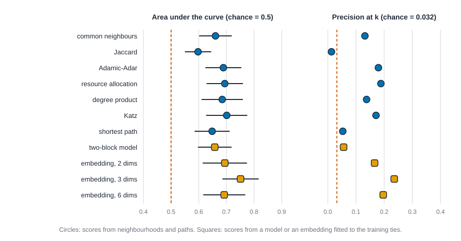
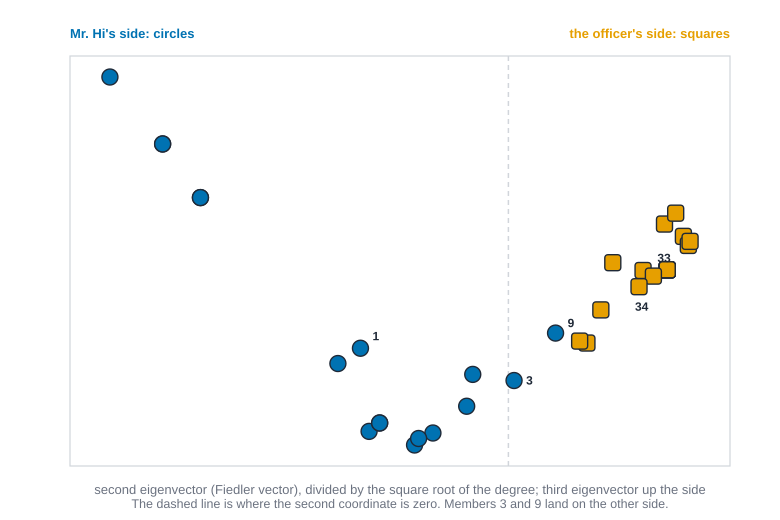

# Link prediction and embeddings {#sec-prediction}

::: {.callout-note appearance="simple"}
## Prerequisites
@sec-latent-space and @sec-tests-and-null-models. We reuse the karate club from @sec-subgroups, the Florentine marriages from @sec-centrality, and Sampson's monastery, and we lean on ties that have a time stamp from @sec-time.
:::

::: {.callout-note title="The short version"}
Link prediction asks whether you can guess which pairs of people are tied when you can't see the tie. The way to find out is to hide a slice of the real ties, give every unconnected pair a score, and check whether the hidden ties ended up near the top of the ranking. Simple scores, like counting shared friends, work modestly well on the karate club, and a plain "how busy are these two people" score works almost as well, which is a useful reality check. The chapter's biggest lesson is about honesty: if any step of your method has already seen the hidden ties, the result looks far better than it really is. A good score ranks pairs, but it never explains why people are tied.
:::

::: {.callout-note title="Why you might care"}
Friend suggestions, "people you may know," finding missing links in a records database, and flagging suspicious connections all run on this idea. Knowing how it is tested lets you spot when a claim like "our method is 95 percent accurate" is too good to be true.
:::

::: {.callout-note title="A note for first-time readers"}
There are several formulas here, mostly small. Each is followed by a plain-words callout with numbers from a six-person network you can check on paper. The spectral embedding section is the hardest part of the chapter, and it says so when you get there. You can skip it and still follow the rest.
:::


## Can you guess a tie you can't see?

Imagine you hold a network with some ties blacked out. Someone shows you a pair of people and asks: are these two tied? You can't look it up. What would you check?

Most of us would reach for the same few clues. Do they know someone in common? Are they both well connected? Are they close to each other, a friend of a friend of a friend away? Each of those is a rule for turning a network into a guess, and this chapter is about writing those rules down, scoring them, and testing them honestly. That is **link prediction**: given a network, rank the pairs that are not tied by how likely they are to be tied, or to become tied.

By the end you should be able to:

- say, in one sentence, what prediction asks that explanation does not;
- compute the classic similarity scores by hand on a six-person network, and in code;
- hide a fraction of ties, score the rest, and judge the ranking with the area under the curve and with precision at k;
- say why the obvious way of hiding ties flatters your method, and show the size of the flattery;
- build a spectral embedding of a network, and say what it keeps and what it throws away;
- report a prediction result without claiming more than it supports.

::: {.callout-tip appearance="simple"}
## Code lives next to the idea
Each step comes with its code right where it is explained, and every tab is checked by running it. The Rust blocks run top to bottom as one script, so a function defined in one block is there in the next. The R and Python tabs do the same.
:::

## Predicting is not explaining

The chapters before this one mostly *explain*. A model such as the ones in @sec-ergm and @sec-latent-space says which patterns, positions or groups make ties more likely, and then asks whether you believe the story: is this coefficient different from zero, is this block structure there at all? The product is a statement about why.

Prediction asks a narrower and more practical question. Whatever the reason, can a rule guess correctly which pairs are tied, on pairs it has not been shown? The product is a ranking of pairs and a number that says how good the ranking is.

| | Explaining | Predicting |
| --- | --- | --- |
| Question | Why are these ties here? | Which pairs are tied that I can't see, or will be tied soon? |
| Judged by | Whether the story survives checks: tests, null models, goodness of fit | How well the ranking does on pairs held out from the fitting |
| A good result | A coefficient you can defend and read | A score that ranks held-out ties above held-out non-ties |
| What it can't give you | Forecasts, unless you also test them | A reason. A score is not a mechanism |
| Typical use | Theory, policy, understanding | Recommending friends, finding missing data, flagging suspicious links |

The two can disagree. A model can predict well because it found a mechanism, or because it found a shortcut such as "popular people get more ties". A model can explain well and predict badly, because the thing it explains is a small part of what makes ties. Keep both questions in view. The last section of this chapter comes back to what a good score does and does not license.

## The task: hide, score, judge

Link prediction looks like a competition with three moves.

1. **Hide.** Take the network you have. Choose some of its ties at random and set them aside. The network that remains is the **training network**. The ties you set aside are the **hidden ties**.
2. **Score.** For every pair of people with no tie in the training network, compute a number: the higher, the more likely the pair is tied. The pairs include the hidden ties (which are secretly tied in the full network) and the pairs that are really not tied. Call these the **candidate pairs**.
3. **Judge.** Sort the candidate pairs by score. If the score is any good, the hidden ties should sit near the top. Measure how near.

The trick of the exercise is that you know the answer, because you hid it yourself. The risk is that you were not careful about what you hid, or what you let the score see. We'll spend half the chapter on that.

Notation used throughout. $A$ is the adjacency matrix of the training network, with $A_{ij} = 1$ if $i$ and $j$ are tied and $0$ otherwise. $N(i)$ is the set of people tied to $i$ (the neighbours of $i$), and $k_i = |N(i)|$ is the degree of $i$.

In plain words: $A$ is a table of 0s and 1s with a 1 wherever two people are tied. $N(i)$ is just person $i$'s list of friends, and $k_i$ is how many friends that is.


## Scores from neighbourhoods and paths

### Six people and eight empty pairs

Start with a network small enough to do on paper. Ana, Ben, Cy, Dee, Eli and Fay. Ana, Ben and Cy know each other. Ben, Cy and Dee know each other. Dee knows Eli, and Eli knows Fay. That is seven ties among fifteen possible pairs, so eight pairs are empty. Which empty pair would you bet on first?

Two empty pairs are easy to read. Ana and Dee share two friends, Ben and Cy. Ana and Fay share none and are four steps apart; nobody would bet on them. The interesting ones are in the middle: Ben and Eli share one friend, Dee, and so do Dee and Fay (through Eli). The numbers differ because Dee has three friends and Eli has two. A shared friend who knows everyone is weaker evidence than a shared friend who knows hardly anybody. That thought is the source of most of the scores below.

### The scores

Each score takes a pair $(i, j)$ and returns a number.

**Common neighbours** simply counts shared friends. It is the oldest rule, and it is the one Liben-Nowell and Kleinberg used as a baseline in the paper that named the problem [@liben2007link].

$$
\mathrm{CN}(i, j) = |N(i) \cap N(j)| = (A^2)_{ij}.
$$

The matrix form is worth a moment. $(A^2)_{ij}$ counts walks of length two from $i$ to $j$, and a walk of length two goes through a shared neighbour.

::: {.callout-tip title="In plain words"}
Common neighbours answers: how many friends do these two people share? The bars around $N(i) \cap N(j)$ mean "count the people who are in both lists." The matrix form $(A^2)_{ij}$ gives the same number by counting walks that go from $i$ to a friend and from that friend on to $j$. Example from the six-person network: Ana's friends are Ben and Cy, Dee's friends are Ben, Cy and Eli, so they share two people, and the score is 2.
:::


**Jaccard** divides the shared friends by everyone either person knows, so that two people with long friend lists are not rewarded for overlap that is small by comparison.

$$
\mathrm{Jaccard}(i, j) = \frac{|N(i) \cap N(j)|}{|N(i) \cup N(j)|}.
$$

::: {.callout-tip title="In plain words"}
Jaccard answers: what share of everybody either person knows do they both know? The top counts the people in both lists, and the bottom counts the people in at least one list (the $\cup$ sign means "joined together"). Example: Ben knows Ana, Cy and Dee, and Eli knows Dee and Fay. One person is shared, and four different people are known between them, so the score is $1/4$. For Ana and Dee it is $2/3$, worked out by hand the same way.
:::


**Adamic-Adar** gives each shared friend a weight that shrinks as that friend's degree grows. Adamic and Adar introduced it for web pages, scoring pairs by the rare things they share [@adamic2003friends].

$$
\mathrm{AA}(i, j) = \sum_{w \in N(i) \cap N(j)} \frac{1}{\ln k_w}.
$$

::: {.callout-tip title="In plain words"}
Adamic-Adar answers: how many shared friends do they have, where a shared friend who knows few people counts for more? The big sigma sign means "add up over every shared friend $w$," and $k_w$ is that friend's number of friends. Each shared friend contributes $1/\ln k_w$, where $\ln$ is the natural logarithm, so bigger friend lists give smaller contributions. Example: Ben and Eli share only Dee, who has three friends, so the score is $1/\ln 3 = 0.910$. Dee and Fay share only Eli, who has two friends, so the score is $1/\ln 2 = 1.443$, which is higher. It is like trusting an introduction from someone who knows only a few people more than one from someone who knows everyone.
:::


**Resource allocation** is the same idea with a steeper penalty: each shared friend $w$ has one unit to give and splits it among their $k_w$ friends. It comes from Zhou, Lü and Zhang's work on link prediction in networks as flow [@zhou2009predicting].

$$
\mathrm{RA}(i, j) = \sum_{w \in N(i) \cap N(j)} \frac{1}{k_w}.
$$

::: {.callout-tip title="In plain words"}
Resource allocation is the same question with a harsher penalty. Each shared friend $w$ hands out one unit of attention, split evenly among their $k_w$ friends, and the pair collects what comes to both. Example: Ben and Eli's shared friend Dee has three friends, so the score is $1/3$. Dee and Fay's shared friend Eli has two, so the score is $1/2$.
:::


**Preferential attachment** ignores who the two people know and multiplies how many people each knows. It encodes the idea that popular people attract ties, the mechanism of the growth model of Barabási and Albert [@barabasi1999emergence], and Liben-Nowell and Kleinberg used it as a score too [@liben2007link].

$$
\mathrm{PA}(i, j) = k_i \, k_j.
$$

::: {.callout-tip title="In plain words"}
Preferential attachment answers: how busy are these two people? It just multiplies the two friend counts and ignores who they know. Example: Ana has two friends and Dee has three, so the score is $2 \times 3 = 6$. Ben (three friends) and Eli (two) also score 6. The rule says the rich get richer: popular people attract new ties.
:::


**Katz** counts all walks between the two people, short walks heavily and long walks lightly. Katz proposed it as a status index [@katz1953new]; here it is a pair score. The number $\beta$ is a discount per step and must be small enough that the sum converges, which means smaller than one over the largest eigenvalue of $A$.

$$
\mathrm{Katz}(i, j) = \sum_{\ell = 1}^{\infty} \beta^{\ell} \, (A^{\ell})_{ij} = \big[(I - \beta A)^{-1} - I\big]_{ij}.
$$

::: {.callout-tip title="In plain words"}
Katz answers: how many ways are there to get from one person to the other, with short routes counting far more than long ones? $A^{\ell}$ counts the routes (walks) that take exactly $\ell$ steps, and $\beta^{\ell}$ shrinks their count by a small discount for every step. The sigma adds up all lengths, one step, two steps, and so on. The second form is the same sum written in one go, where $I$ is the identity matrix (a table with 1s on the diagonal) and the $-1$ in the exponent means "the matrix inverse." You don't have to follow that part, since the code does it. Example: with $eta = 0.05$, Ana and Dee have two routes of length two, so they get about $0.05^2 \times 2 = 0.005$ from those, plus a sliver from longer ones.
:::


**Shortest path** scores a pair by minus the number of steps between them: nearer is more likely. Unreachable pairs get the lowest score we can give.

Notice what the first five have in common. Three of them only ever look at two steps out (common neighbours, Jaccard, and the two weighted sums), one looks at no steps (degree product), and Katz and the path score look as far as the network goes. How far a score looks is the main thing that distinguishes them.

### By hand and in code

The table below is what you should get on paper for the six-person network. Here $\beta = 0.05$ for Katz. Work two rows through before you read on. For Ben and Eli: the only shared friend is Dee, who has three friends, so $\mathrm{CN} = 1$, $\mathrm{AA} = 1/\ln 3 = 0.910$, $\mathrm{RA} = 1/3$. Ben has friends Ana, Cy and Dee, and Eli has Dee and Fay, so together they know four people and Jaccard is $1/4$.

::: {.panel-tabset group="language"}

## R

```r
library(knappnet)
library(dplyr)
library(purrr)
library(tibble)

# Ids are 1-based, as in the data files, so they are also the matrix positions.
adjacency <- function(pairs, n) {
  a <- matrix(0, n, n)
  a[pairs] <- 1
  a + t(a)
}

# Steps needed to get from i to j; n stands for "cannot get there".
hops <- function(a) {
  n <- nrow(a)
  pairs <- which(upper.tri(a) & a > 0, arr.ind = TRUE)
  g <- net_frame(data.frame(source = pairs[, 1], target = pairs[, 2]),
                 nodes = data.frame(id = seq_len(n)), directed = FALSE, quiet = TRUE)
  d <- unname(net_distances(g))
  replace(d, !is.finite(d), n)
}

link_scores <- function(a, beta = 0.05) {
  n <- nrow(a)
  deg <- rowSums(a)
  common <- a %*% a
  union <- outer(deg, deg, "+") - common
  list(
    CN = common,
    Jaccard = ifelse(union > 0, common / union, 0),
    # A node of degree 1 is never a common neighbour, so pmax() only avoids log(1) = 0.
    AA = a %*% (a / log(pmax(deg, 2))),
    RA = a %*% (a / pmax(deg, 1)),
    PA = outer(deg, deg),
    Katz = solve(diag(n) - beta * a) - diag(n),
    Path = -hops(a)
  )
}

who <- c("Ana", "Ben", "Cy", "Dee", "Eli", "Fay")
toy <- adjacency(cbind(c(1, 1, 2, 2, 3, 4, 5), c(2, 3, 3, 4, 4, 5, 6)), 6)
scores <- link_scores(toy)
open_pairs <- which(upper.tri(toy) & toy == 0, arr.ind = TRUE)
open_pairs <- open_pairs[order(open_pairs[, 1], open_pairs[, 2]), ]
scores |>
  map(\(m) m[open_pairs]) |>
  as_tibble() |>
  mutate(pair = paste0(who[open_pairs[, 1]], "-", who[open_pairs[, 2]]), .before = 1) |>
  mutate(across(where(is.numeric), \(x) round(x, 3)))
```

::: {.code-output}
```text
# A tibble: 8 × 8
  pair       CN Jaccard    AA    RA    PA  Katz  Path
  <chr>   <dbl>   <dbl> <dbl> <dbl> <dbl> <dbl> <dbl>
1 Ana-Dee     2   0.667  1.82 0.667     6 0.005    -2
2 Ana-Eli     0   0      0    0         4 0        -3
3 Ana-Fay     0   0      0    0         2 0        -4
4 Ben-Eli     1   0.25   0.91 0.333     6 0.003    -2
5 Ben-Fay     0   0      0    0         3 0        -3
6 Cy-Eli      1   0.25   0.91 0.333     6 0.003    -2
7 Cy-Fay      0   0      0    0         3 0        -3
8 Dee-Fay     1   0.333  1.44 0.5       3 0.003    -2
```
:::

## Python

```python
import numpy as np
import pandas as pd
import networkx as nx

# Ids are 1-based, as in the data files; the matrix position is the id minus one.
def adjacency(pairs, n):
    pairs = np.asarray(pairs)
    a = np.zeros((n, n))
    a[pairs[:, 0] - 1, pairs[:, 1] - 1] = 1
    return a + a.T

def hops(a):
    # Steps needed to get from i to j; n stands for "cannot get there".
    n = len(a)
    reach, dist = np.eye(n), np.where(np.eye(n) > 0, 0, n).astype(float)
    for k in range(1, n):
        reach = ((reach @ (a + np.eye(n))) > 0).astype(float)
        dist = np.where((reach > 0) & (dist == n), k, dist)
    return dist

def link_scores(a, beta=0.05):
    n, deg = len(a), a.sum(axis=1)
    common = a @ a
    union = deg[:, None] + deg[None, :] - common
    return {
        "CN": common,
        "Jaccard": np.divide(common, union, out=np.zeros((n, n)), where=union > 0),
        # A node of degree 1 is never a common neighbour, so the max() only avoids log(1) = 0.
        "AA": a @ np.diag(1 / np.log(np.maximum(deg, 2))) @ a,
        "RA": a @ np.diag(1 / np.maximum(deg, 1)) @ a,
        "PA": np.outer(deg, deg),
        "Katz": np.linalg.inv(np.eye(n) - beta * a) - np.eye(n),
        "Path": -hops(a),
    }

who = ["Ana", "Ben", "Cy", "Dee", "Eli", "Fay"]
toy = adjacency([(1, 2), (1, 3), (2, 3), (2, 4), (3, 4), (4, 5), (5, 6)], 6)
scores = link_scores(toy)
open_pairs = np.argwhere(np.triu(toy == 0, 1))
table = pd.DataFrame({k: m[open_pairs[:, 0], open_pairs[:, 1]] for k, m in scores.items()})
table.insert(0, "pair", [f"{who[u]}-{who[v]}" for u, v in open_pairs])
print(table.round(3).to_string(index=False))

# The same Adamic-Adar scores from NetworkX.
check = nx.adamic_adar_index(nx.from_numpy_array(toy), [tuple(p) for p in open_pairs])
print("largest gap to NetworkX:", max(abs(s - scores["AA"][u, v]) for u, v, s in check))
```

::: {.code-output}
```text
   pair  CN  Jaccard    AA    RA  PA  Katz  Path
Ana-Dee 2.0    0.667 1.820 0.667 6.0 0.005  -2.0
Ana-Eli 0.0    0.000 0.000 0.000 4.0 0.000  -3.0
Ana-Fay 0.0    0.000 0.000 0.000 2.0 0.000  -4.0
Ben-Eli 1.0    0.250 0.910 0.333 6.0 0.003  -2.0
Ben-Fay 0.0    0.000 0.000 0.000 3.0 0.000  -3.0
 Cy-Eli 1.0    0.250 0.910 0.333 6.0 0.003  -2.0
 Cy-Fay 0.0    0.000 0.000 0.000 3.0 0.000  -3.0
Dee-Fay 1.0    0.333 1.443 0.500 3.0 0.003  -2.0
largest gap to NetworkX: 0.0
```
:::

## Rust

```rust
use knappnet::linalg::invert;
use knappnet::matrix::Dense;
use knappnet::metrics::linkpred::{compute_link_scores, LinkMethod, LinkOptions};
use knappnet::Graph;

type M = Vec<Vec<f64>>;

// Ids are 1-based, as in the data files; the matrix position is the id minus one.
fn adjacency(pairs: &[(usize, usize)], n: usize) -> M {
    let mut a = vec![vec![0.0; n]; n];
    for &(u, v) in pairs {
        a[u - 1][v - 1] = 1.0;
        a[v - 1][u - 1] = 1.0;
    }
    a
}

fn matmul(a: &M, b: &M) -> M {
    let n = a.len();
    (0..n).map(|i| (0..n).map(|j| (0..n).map(|k| a[i][k] * b[k][j]).sum()).collect()).collect()
}

// Steps needed to get from i to j; n stands for "cannot get there".
fn hops(a: &M) -> M {
    let n = a.len();
    let step: M = (0..n).map(|i| (0..n).map(|j| a[i][j] + if i == j { 1.0 } else { 0.0 }).collect()).collect();
    let mut reach: M = (0..n).map(|i| (0..n).map(|j| if i == j { 1.0 } else { 0.0 }).collect()).collect();
    let mut dist: M = (0..n).map(|i| (0..n).map(|j| if i == j { 0.0 } else { n as f64 }).collect()).collect();
    for k in 1..n {
        reach = matmul(&reach, &step);
        for i in 0..n {
            for j in 0..n {
                if reach[i][j] > 0.0 && dist[i][j] == n as f64 {
                    dist[i][j] = k as f64;
                }
            }
        }
    }
    dist
}

// The five neighbourhood scores come from knappnet's link-prediction module.
fn library_scores(a: &M, method: LinkMethod) -> M {
    let n = a.len();
    let (mut from, mut to) = (Vec::new(), Vec::new());
    for i in 0..n {
        for j in i + 1..n {
            if a[i][j] > 0.0 {
                from.push(i as i64);
                to.push(j as i64);
            }
        }
    }
    let graph = Graph::from_edges(n, &from, &to, None, false).unwrap();
    let (us, vs): (Vec<u32>, Vec<u32>) = (0..n).flat_map(|i| (i + 1..n).map(move |j| (i as u32, j as u32))).unzip();
    let options = LinkOptions { method, ..Default::default() };
    let found = compute_link_scores(&graph, &us, &vs, None, options).unwrap();
    let mut m = vec![vec![0.0; n]; n];
    for ((&u, &v), &s) in us.iter().zip(&vs).zip(&found) {
        m[u as usize][v as usize] = s;
        m[v as usize][u as usize] = s;
    }
    m
}

// Katz and the path score have no library call, so they are written out here.
fn link_scores(a: &M) -> Vec<(&'static str, M)> {
    let (n, beta) = (a.len(), 0.05);
    let eye = |i: usize, j: usize| if i == j { 1.0 } else { 0.0 };
    let shifted: Vec<f64> = (0..n * n).map(|x| eye(x / n, x % n) - beta * a[x / n][x % n]).collect();
    let inverse = invert(&Dense::from_row_major(n, n, shifted).unwrap(), 1e-12).unwrap();
    let katz: M = (0..n).map(|i| (0..n).map(|j| inverse.get(i, j) - eye(i, j)).collect()).collect();
    let path: M = hops(a).iter().map(|row| row.iter().map(|d| -d).collect()).collect();
    vec![
        ("CN", library_scores(a, LinkMethod::CommonNeighbors)),
        ("Jaccard", library_scores(a, LinkMethod::Jaccard)),
        ("AA", library_scores(a, LinkMethod::AdamicAdar)),
        ("RA", library_scores(a, LinkMethod::ResourceAllocation)),
        ("PA", library_scores(a, LinkMethod::PreferentialAttachment)),
        ("Katz", katz),
        ("Path", path),
    ]
}

let who = ["Ana", "Ben", "Cy", "Dee", "Eli", "Fay"];
let toy = adjacency(&[(1, 2), (1, 3), (2, 3), (2, 4), (3, 4), (4, 5), (5, 6)], 6);
let scored = link_scores(&toy);
println!("{:<8}{}", "pair", scored.iter().map(|(name, _)| format!("{name:>9}")).collect::<String>());
for u in 0..6 {
    for v in u + 1..6 {
        if toy[u][v] == 0.0 {
            let row: String = scored.iter().map(|(_, m)| format!("{:>9.3}", m[u][v])).collect();
            println!("{:<8}{}", format!("{}-{}", who[u], who[v]), row);
        }
    }
}

// Adamic-Adar written out: add 1 / ln(degree) over the common neighbours.
let degree: Vec<f64> = toy.iter().map(|row| row.iter().sum()).collect();
let by_hand = |u: usize, v: usize| -> f64 {
    (0..6).filter(|&w| toy[u][w] > 0.0 && toy[v][w] > 0.0).map(|w| 1.0 / degree[w].ln()).sum()
};
let gap = (0..6).flat_map(|u| (u + 1..6).map(move |v| (u, v))).filter(|&(u, v)| toy[u][v] == 0.0)
    .map(|(u, v)| (scored[2].1[u][v] - by_hand(u, v)).abs()).fold(0.0, f64::max);
println!("largest gap between the library and the formula: {gap:.1e}");
```

::: {.code-output}
```text
pair           CN  Jaccard       AA       RA       PA     Katz     Path
Ana-Dee     2.000    0.667    1.820    0.667    6.000    0.005   -2.000
Ana-Eli     0.000    0.000    0.000    0.000    4.000    0.000   -3.000
Ana-Fay     0.000    0.000    0.000    0.000    2.000    0.000   -4.000
Ben-Eli     1.000    0.250    0.910    0.333    6.000    0.003   -2.000
Ben-Fay     0.000    0.000    0.000    0.000    3.000    0.000   -3.000
Cy-Eli      1.000    0.250    0.910    0.333    6.000    0.003   -2.000
Cy-Fay      0.000    0.000    0.000    0.000    3.000    0.000   -3.000
Dee-Fay     1.000    0.333    1.443    0.500    3.000    0.003   -2.000
largest gap between the library and the formula: 0.0e0
```
:::

:::


Read the rows with the idea from the start of the section in mind.

- Ana and Dee win everywhere that looks at shared friends, which is what we'd hope: two shared friends, two steps apart.
- Ben-Eli, Cy-Eli and Dee-Fay all share exactly one friend, so common neighbours cannot separate them. Adamic-Adar and resource allocation can: Dee-Fay's shared friend is Eli, who knows only two people, so the pair scores higher (1.443 against 0.910) than Ben-Eli, whose shared friend Dee knows three.
- The degree product disagrees with all of them. It puts Ben-Eli and Cy-Eli at the top, tied with Ana-Dee at 6, and Dee-Fay low, because it only counts how many people each knows. It would bet on the busy, not on the connected.
- Katz agrees with common neighbours here. Its values are tiny because $\beta$ is small: Ana and Dee get $0.05^2 \times 2 = 0.005$ from the two walks of length two plus a rounding-sized contribution from longer ones.

Two practical notes. First, the Python tab checks the Adamic-Adar column against NetworkX [@hagberg2008exploring] and the gap is zero, and the Rust tab checks the library's value against the formula. Second, knappnet's R package does not yet expose a link-score function, so the R tab writes the matrix forms out, the way the formulas above are written. The Rust tab uses knappnet's own link-prediction module for the first five scores and writes Katz and the path score by hand. Where a tool is missing, writing it by hand is a good way to see what it does.

## Judging a ranking

### Two numbers, and what each one forgets

Suppose you have scored the candidate pairs and you know which of them were hidden ties. How good is the ranking?

**Area under the curve (AUC)** answers: if I pick one hidden tie and one non-tied pair at random, how often does the hidden tie get the higher score? A coin toss gives 0.5 and a perfect ranking gives 1. Ties in score count as half a win. This is the area under the ROC curve, and the "pick a pair of each kind" reading is the one Hanley and McNeil gave it [@hanley1982meaning].

$$
\mathrm{AUC} = \frac{1}{|P|\,|Q|} \sum_{p \in P} \sum_{q \in Q} \Big[ \mathbf{1}(s_p > s_q) + \tfrac{1}{2}\,\mathbf{1}(s_p = s_q) \Big],
$$

where $P$ is the set of hidden ties, $Q$ is the set of candidate pairs that are not tied, and $s$ is the score. A tiny check: if the hidden ties score $\{3, 1\}$ and the non-ties score $\{2, 1, 0\}$, the hidden 3 beats all three, the hidden 1 loses to 2, draws with 1 and beats 0, so the sum is $3 + 1.5 = 4.5$ out of 6 comparisons and the AUC is $0.75$.

::: {.callout-tip title="In plain words"}
The AUC answers "if I draw one hidden tie and one non-tie at random, how often does the hidden tie score higher?" The double sigma tells you to try every hidden tie against every non-tie ($|P|$ and $|Q|$ are the number of each). The symbol $\mathbf{1}(\cdot)$ is a switch that is 1 when the statement inside is true and 0 otherwise. So a win counts 1 and a draw counts one half. Dividing by the number of comparisons turns the total into a share. The example in the paragraph above does exactly this: 4.5 wins out of 6 gives 0.75.
:::


**Precision at k** answers a different question: if I take the $k$ highest-scoring pairs and call them predictions, what fraction are right? We set $k$ to the number of hidden ties, so a perfect ranking scores 1. Ties at the cut-off need care. If three pairs share the score at the cut-off and only two seats are left, we give each of the three an equal share of the seats. That is the code's rule, and it makes the number the same on every run.

$$
\text{precision at } k = \frac{\#\{\text{hidden ties among the top } k\}}{k}.
$$

::: {.callout-tip title="In plain words"}
Precision at $k$ is the share of your top $k$ guesses that were really hidden ties. The symbol $\#\{\cdots\}$ just means "how many." Example by hand: if you guess the top 2 pairs and 1 of them is a hidden tie, the precision is $1/2 = 0.5$.
:::


The two numbers forget different things. AUC looks at the whole ranking and does not care whether the hits sit at the very top; precision at k looks only at the top and does not care what happens below it.

### Imbalance, and why chance is not 0.5 for everything

Networks are sparse. In the karate club we'll hide 16 ties and have 499 candidate pairs, so about 3 in every 100 candidates are real. A rule that says "no tie" for everybody would be right 97 percent of the time and useless, so always say what chance is. For AUC, chance is 0.5 whatever the imbalance. For precision at k, chance is the share of candidates that are hidden ties, about 0.032 here. A precision of 0.15 is nearly five times chance and still wrong 85 times in 100. With few positives, a precision-recall view often tells a clearer story than ROC [@saito2015precision].

### Baselines

A score earns its keep only against something simple. We use two baselines: **chance**, and the **degree product** (the preferential attachment score). If a fancy score doesn't beat the degree product, it is mostly measuring how busy people are.

### Hiding ties with a fixed scramble

To compare scores fairly, and to compare languages, every split must be reproducible. We don't want random number generators that differ between R, Python and Rust. So the code uses a fixed scramble: a short formula $h(u, v, \text{seed})$ that turns two ids and a seed into a number that looks random. Sort the ties by their number and hide the first 20 percent. The scramble is not a good random number generator for anything else, but it spreads ties around well enough for this job, and it makes the three languages hide exactly the same ties. The code below also holds the scores for the rest of the chapter.

Think of it as shuffling a deck in exactly the same way every time, so that R, Python and Rust are all dealt the same hand. The formula is not a serious random number generator, just a reproducible shuffle.


::: {.panel-tabset group="language"}

## R

```r
hide_key <- function(u, v, seed) {
  # A fixed scramble of (u, v, seed): the same "random" order in every language.
  x <- (u * 7919 + v * 6841 + seed * 104729 + 12345) %% 1000003
  x <- (x * x + 12345) %% 1000003
  x <- (x * x + 777) %% 1000003
  (x * 48271) %% 1000003
}

hidden_ties <- function(pairs, seed, frac) {
  order(hide_key(pairs[, 1], pairs[, 2], seed), seq_len(nrow(pairs)))[seq_len(round(frac * nrow(pairs)))]
}

# The chance that a hidden tie outscores a pair with no tie; ties count one half.
auc <- function(score, hit) {
  s <- round(score, 10)
  mean(outer(s[hit], s[!hit], ">")) + 0.5 * mean(outer(s[hit], s[!hit], "=="))
}

precision_at_k <- function(score, hit, k) {
  s <- round(score, 10)
  cut <- sort(s, decreasing = TRUE)[k]
  above <- s > cut
  tied <- s == cut
  (sum(hit[above]) + sum(hit[tied]) * (k - sum(above)) / sum(tied)) / k
}

rank_scores <- function(scores, train, truth) {
  open <- upper.tri(train) & train == 0   # pairs with no tie in the training network
  hit <- truth[open] > 0
  tibble(score = names(scores),
         auc = unname(map_dbl(scores, \(m) auc(m[open], hit))),
         p_at_k = unname(map_dbl(scores, \(m) precision_at_k(m[open], hit, sum(hit)))))
}

one_split <- function(pairs, n, seed, frac = 0.2, leak = FALSE, scorer = link_scores) {
  train <- adjacency(pairs[-hidden_ties(pairs, seed, frac), , drop = FALSE], n)
  truth <- adjacency(pairs, n)
  rank_scores(scorer(if (leak) truth else train), train, truth) |> mutate(seed = seed)
}

many_splits <- function(pairs, n, seeds = 1:100, ...) {
  list_rbind(map(seeds, \(s) one_split(pairs, n, s, ...)))
}

summarise_splits <- function(runs) {
  runs |>
    summarise(sd = sd(auc), auc = mean(auc), p_at_k = mean(p_at_k), .by = score) |>
    select(score, auc, sd, p_at_k) |>
    mutate(across(c(auc, sd, p_at_k), \(x) round(x, 3)))
}

# Florentine marriages: families numbered in alphabetical order.
f <- read.csv("data/florentine/edges.csv")
fam <- sort(unique(c(f$source, f$target)))
florence <- cbind(pmin(match(f$source, fam), match(f$target, fam)),
                  pmax(match(f$source, fam), match(f$target, fam)))
sprintf("%d families, %d marriages; hiding 10%% hides %d of them",
        length(fam), nrow(florence), length(hidden_ties(florence, 1, 0.1)))
summarise_splits(many_splits(florence, length(fam), frac = 0.1))
```

::: {.code-output}
```text
[1] "15 families, 20 marriages; hiding 10% hides 2 of them"
# A tibble: 7 × 4
  score     auc    sd p_at_k
  <chr>   <dbl> <dbl>  <dbl>
1 CN      0.514 0.157  0.039
2 Jaccard 0.521 0.163  0.058
3 AA      0.525 0.168  0.042
4 RA      0.525 0.168  0.042
5 PA      0.498 0.184  0    
6 Katz    0.449 0.199  0.015
7 Path    0.448 0.186  0.023
```
:::

## Python

```python
def hide_key(u, v, seed):
    # A fixed scramble of (u, v, seed): the same "random" order in every language.
    x = (u * 7919 + v * 6841 + seed * 104729 + 12345) % 1000003
    x = (x * x + 12345) % 1000003
    x = (x * x + 777) % 1000003
    return (x * 48271) % 1000003

def hidden_ties(pairs, seed, frac):
    order = np.lexsort((np.arange(len(pairs)), hide_key(pairs[:, 0], pairs[:, 1], seed)))
    return order[:round(frac * len(pairs))]

def auc(score, hit):
    s = np.round(score, 10)
    won, tied = s[hit][:, None] > s[~hit][None, :], s[hit][:, None] == s[~hit][None, :]
    return won.mean() + 0.5 * tied.mean()

def precision_at_k(score, hit, k):
    s = np.round(score, 10)
    cut = np.sort(s)[::-1][k - 1]
    above, tied = s > cut, s == cut
    return (hit[above].sum() + hit[tied].sum() * (k - above.sum()) / tied.sum()) / k

def rank_scores(scores, train, truth):
    upper = np.triu(train == 0, 1)          # pairs with no tie in the training network
    hit = truth[upper] > 0
    return pd.DataFrame({"score": list(scores),
        "auc": [auc(m[upper], hit) for m in scores.values()],
        "p_at_k": [precision_at_k(m[upper], hit, hit.sum()) for m in scores.values()]})

def one_split(pairs, n, seed, frac=0.2, leak=False, scorer=link_scores):
    kept = np.delete(pairs, hidden_ties(pairs, seed, frac), axis=0)
    train, truth = adjacency(kept, n), adjacency(pairs, n)
    return rank_scores(scorer(truth if leak else train), train, truth).assign(seed=seed)

def many_splits(pairs, n, seeds=range(1, 101), **kw):
    return pd.concat([one_split(pairs, n, s, **kw) for s in seeds])

def summarise(runs):
    by = runs.groupby("score", sort=False)
    return pd.DataFrame({"auc": by.auc.mean(), "sd": by.auc.std(), "p_at_k": by.p_at_k.mean()}).round(3)

# Florentine marriages: families numbered in alphabetical order.
f = pd.read_csv("data/florentine/edges.csv")
fam = sorted(set(f.source) | set(f.target))
florence = np.sort(np.column_stack([f.source.map(fam.index) + 1, f.target.map(fam.index) + 1]), axis=1)
print(len(fam), "families,", len(florence), "marriages; hiding 10% hides", round(0.1 * len(florence)), "of them")
print(summarise(many_splits(florence, len(fam), frac=0.1)))
```

::: {.code-output}
```text
15 families, 20 marriages; hiding 10% hides 2 of them
           auc     sd  p_at_k
score                        
CN       0.514  0.157   0.039
Jaccard  0.521  0.163   0.058
AA       0.525  0.168   0.042
RA       0.525  0.168   0.042
PA       0.498  0.184   0.000
Katz     0.449  0.199   0.015
Path     0.448  0.186   0.023
```
:::

## Rust

```rust
fn hide_key(u: u64, v: u64, seed: u64) -> u64 {
    // A fixed scramble of (u, v, seed): the same "random" order in every language.
    let x = (u * 7919 + v * 6841 + seed * 104729 + 12345) % 1_000_003;
    let x = (x * x + 12345) % 1_000_003;
    let x = (x * x + 777) % 1_000_003;
    (x * 48271) % 1_000_003
}

fn hidden_ties(pairs: &[(usize, usize)], seed: u64, frac: f64) -> Vec<usize> {
    let mut order: Vec<usize> = (0..pairs.len()).collect();
    order.sort_by_key(|&i| (hide_key(pairs[i].0 as u64, pairs[i].1 as u64, seed), i));
    order.truncate((frac * pairs.len() as f64).round() as usize);
    order
}

fn tidy(score: &[f64]) -> Vec<f64> {
    score.iter().map(|x| (x * 1e10).round() / 1e10).collect()
}

// The chance that a hidden tie outscores a pair with no tie; ties count one half.
fn auc(score: &[f64], hit: &[bool]) -> f64 {
    let s = tidy(score);
    let (mut won, mut total) = (0.0, 0.0);
    for i in (0..s.len()).filter(|&i| hit[i]) {
        for j in (0..s.len()).filter(|&j| !hit[j]) {
            won += if s[i] > s[j] { 1.0 } else if s[i] == s[j] { 0.5 } else { 0.0 };
            total += 1.0;
        }
    }
    won / total
}

fn precision_at_k(score: &[f64], hit: &[bool], k: usize) -> f64 {
    let s = tidy(score);
    let mut sorted = s.clone();
    sorted.sort_by(|a, b| b.partial_cmp(a).unwrap());
    let cut = sorted[k - 1];
    let above = (0..s.len()).filter(|&i| s[i] > cut).count() as f64;
    let tied = (0..s.len()).filter(|&i| s[i] == cut).count() as f64;
    let hits = |keep: &dyn Fn(f64) -> bool| (0..s.len()).filter(|&i| hit[i] && keep(s[i])).count() as f64;
    (hits(&|x| x > cut) + hits(&|x| x == cut) * (k as f64 - above) / tied) / k as f64
}

type Scorer = fn(&M) -> Vec<(&'static str, M)>;
type Row = (&'static str, f64, f64);

fn rank_scores(scores: &[(&'static str, M)], train: &M, truth: &M) -> Vec<Row> {
    let n = train.len();
    let open: Vec<(usize, usize)> =
        (0..n).flat_map(|i| (i + 1..n).map(move |j| (i, j))).filter(|&(i, j)| train[i][j] == 0.0).collect();
    let hit: Vec<bool> = open.iter().map(|&(i, j)| truth[i][j] > 0.0).collect();
    let k = hit.iter().filter(|&&h| h).count();
    scores.iter().map(|(name, m)| {
        let s: Vec<f64> = open.iter().map(|&(i, j)| m[i][j]).collect();
        (*name, auc(&s, &hit), precision_at_k(&s, &hit, k))
    }).collect()
}

fn one_split(pairs: &[(usize, usize)], n: usize, seed: u64, frac: f64, leak: bool, scorer: Scorer) -> Vec<Row> {
    let hidden = hidden_ties(pairs, seed, frac);
    let kept: Vec<(usize, usize)> =
        pairs.iter().enumerate().filter(|(i, _)| !hidden.contains(i)).map(|(_, &p)| p).collect();
    let (train, truth) = (adjacency(&kept, n), adjacency(pairs, n));
    rank_scores(&scorer(if leak { &truth } else { &train }), &train, &truth)
}

fn many_splits(pairs: &[(usize, usize)], n: usize, frac: f64, leak: bool, scorer: Scorer) -> Vec<Vec<Row>> {
    (1..=100).map(|seed| one_split(pairs, n, seed, frac, leak, scorer)).collect()
}

// Mean AUC, its spread over the splits, and mean precision at k, one row per score.
fn summarise(runs: &[Vec<Row>]) -> Vec<(&'static str, f64, f64, f64)> {
    let r = runs.len() as f64;
    (0..runs[0].len()).map(|k| {
        let mean = runs.iter().map(|run| run[k].1).sum::<f64>() / r;
        let var = runs.iter().map(|run| (run[k].1 - mean).powi(2)).sum::<f64>() / (r - 1.0);
        (runs[0][k].0, mean, var.sqrt(), runs.iter().map(|run| run[k].2).sum::<f64>() / r)
    }).collect()
}

fn show(rows: &[(&'static str, f64, f64, f64)], only: &[&str]) {
    println!("{:<9}{:>7}{:>7}{:>8}", "score", "auc", "sd", "p_at_k");
    for (name, auc, sd, p) in rows.iter().filter(|r| only.is_empty() || only.contains(&r.0)) {
        println!("{name:<9}{auc:>7.3}{sd:>7.3}{p:>8.3}");
    }
}

// Florentine marriages: families numbered in alphabetical order.
let florence = [
    (1, 9), (2, 6), (2, 7), (4, 7), (3, 5), (5, 11), (5, 14), (7, 8), (2, 9), (3, 9),
    (9, 12), (9, 13), (9, 15), (4, 11), (11, 14), (12, 15), (10, 13), (4, 14), (12, 14), (7, 15),
];
println!("15 families, {} marriages; hiding 10% hides {} of them", florence.len(), hidden_ties(&florence, 1, 0.1).len());
show(&summarise(&many_splits(&florence, 15, 0.1, false, link_scores)), &[]);
```

::: {.code-output}
```text
15 families, 20 marriages; hiding 10% hides 2 of them
score        auc     sd  p_at_k
CN         0.514  0.157   0.039
Jaccard    0.521  0.163   0.058
AA         0.525  0.168   0.042
RA         0.525  0.168   0.042
PA         0.498  0.184   0.000
Katz       0.449  0.199   0.015
Path       0.448  0.186   0.023
```
:::

:::


### The Florentine marriages are too small

The Florentine marriage network from @sec-centrality has 15 families and 20 marriages [@padgett1993robust]. Hiding 10 percent hides two ties. The code above scores the other pairs and runs 100 different splits. Look at the table: the mean AUCs lie between 0.45 and 0.53, and the standard deviations are 0.16 to 0.20, so two splits of the same network can differ by more than the gap between any two scores. With two positives, the AUC on one split can only take a handful of values, and any "winner" is a coincidence. Florentine is a lovely network for learning how the scores work by hand and a poor one for judging them. Treat the table as a warning: **a small network cannot tell you which score is better, and a single split cannot tell you how good any score is.**

### The karate club, 100 times

Zachary's karate club has 34 members and 78 friendships [@zachary1977information]. Hiding 20 percent hides 16 friendships and leaves 499 candidate pairs. Instead of trusting one split, we repeat the exercise for seeds 1 to 100 and report the mean and the spread of the AUC, and the mean precision at k. Then we do the same at 10 and 30 percent hidden, as a stress check: if a score only works when you hide very few ties, it will not survive in practice.

::: {.panel-tabset group="language"}

## R

```r
e <- read.csv("data/karate/edges.csv")
karate <- cbind(pmin(e$source, e$target), pmax(e$source, e$target))
karate[hidden_ties(karate, 1, 0.2), ] |> asplit(1) |> map_chr(\(p) paste0("(", p[1], ", ", p[2], ")"))
summarise_splits(many_splits(karate, 34))
sizes <- c(0.1, 0.2, 0.3)
by_size <- map(sizes, \(p) summarise_splits(many_splits(karate, 34, frac = p)))
tibble(score = by_size[[1]]$score) |>
  bind_cols(set_names(map(by_size, "auc"), sprintf("%d%% hidden", round(100 * sizes))))
```

::: {.code-output}
```text
 [1] "(1, 5)"   "(1, 20)"  "(6, 17)"  "(25, 32)" "(1, 32)"  "(2, 3)"  
 [7] "(27, 30)" "(2, 22)"  "(33, 34)" "(6, 11)"  "(1, 22)"  "(24, 34)"
[13] "(30, 34)" "(2, 31)"  "(3, 29)"  "(25, 26)"
# A tibble: 7 × 4
  score     auc    sd p_at_k
  <chr>   <dbl> <dbl>  <dbl>
1 CN      0.66  0.059  0.132
2 Jaccard 0.597 0.048  0.013
3 AA      0.689 0.065  0.18 
4 RA      0.694 0.066  0.188
5 PA      0.685 0.075  0.138
6 Katz    0.701 0.074  0.171
7 Path    0.648 0.063  0.053
# A tibble: 7 × 4
  score   `10% hidden` `20% hidden` `30% hidden`
  <chr>          <dbl>        <dbl>        <dbl>
1 CN             0.689        0.66         0.633
2 Jaccard        0.612        0.597        0.586
3 AA             0.725        0.689        0.655
4 RA             0.734        0.694        0.658
5 PA             0.69         0.685        0.674
6 Katz           0.729        0.701        0.674
7 Path           0.667        0.648        0.634
```
:::

## Python

```python
e = pd.read_csv("data/karate/edges.csv")
karate = np.sort(e[["source", "target"]].to_numpy(), axis=1)
print("seed 1 hides:", [tuple(map(int, karate[i])) for i in hidden_ties(karate, 1, 0.2)])
print(summarise(many_splits(karate, 34)))
by_size = {f"{p:.0%} hidden": summarise(many_splits(karate, 34, frac=p)).auc for p in (0.1, 0.2, 0.3)}
print(pd.DataFrame(by_size))
```

::: {.code-output}
```text
seed 1 hides: [(1, 5), (1, 20), (6, 17), (25, 32), (1, 32), (2, 3), (27, 30), (2, 22), (33, 34), (6, 11), (1, 22), (24, 34), (30, 34), (2, 31), (3, 29), (25, 26)]
           auc     sd  p_at_k
score                        
CN       0.660  0.059   0.132
Jaccard  0.597  0.048   0.013
AA       0.689  0.065   0.180
RA       0.694  0.066   0.188
PA       0.685  0.075   0.138
Katz     0.701  0.074   0.171
Path     0.648  0.063   0.053
         10% hidden  20% hidden  30% hidden
score                                      
CN            0.689       0.660       0.633
Jaccard       0.612       0.597       0.586
AA            0.725       0.689       0.655
RA            0.734       0.694       0.658
PA            0.690       0.685       0.674
Katz          0.729       0.701       0.674
Path          0.667       0.648       0.634
```
:::

## Rust

```rust
let karate = [
    (1, 2), (1, 3), (1, 4), (1, 5), (1, 6), (1, 7), (1, 8), (1, 9), (1, 11), (1, 12),
    (1, 13), (1, 14), (1, 18), (1, 20), (1, 22), (1, 32), (2, 3), (2, 4), (2, 8), (2, 14),
    (2, 18), (2, 20), (2, 22), (2, 31), (3, 4), (3, 8), (3, 9), (3, 10), (3, 14), (3, 28),
    (3, 29), (3, 33), (4, 8), (4, 13), (4, 14), (5, 7), (5, 11), (6, 7), (6, 11), (6, 17),
    (7, 17), (9, 31), (9, 33), (9, 34), (10, 34), (14, 34), (15, 33), (15, 34), (16, 33), (16, 34),
    (19, 33), (19, 34), (20, 34), (21, 33), (21, 34), (23, 33), (23, 34), (24, 26), (24, 28), (24, 30),
    (24, 33), (24, 34), (25, 26), (25, 28), (25, 32), (26, 32), (27, 30), (27, 34), (28, 34), (29, 32),
    (29, 34), (30, 33), (30, 34), (31, 33), (31, 34), (32, 33), (32, 34), (33, 34),
];
println!("seed 1 hides: {:?}", hidden_ties(&karate, 1, 0.2).iter().map(|&i| karate[i]).collect::<Vec<_>>());
show(&summarise(&many_splits(&karate, 34, 0.2, false, link_scores)), &[]);
let by_size: Vec<Vec<(&str, f64, f64, f64)>> =
    [0.1, 0.2, 0.3].iter().map(|&p| summarise(&many_splits(&karate, 34, p, false, link_scores))).collect();
println!("{:<9}{:>12}{:>12}{:>12}", "score", "10% hidden", "20% hidden", "30% hidden");
for k in 0..by_size[0].len() {
    println!("{:<9}{:>12.3}{:>12.3}{:>12.3}", by_size[0][k].0, by_size[0][k].1, by_size[1][k].1, by_size[2][k].1);
}
```

::: {.code-output}
```text
seed 1 hides: [(1, 5), (1, 20), (6, 17), (25, 32), (1, 32), (2, 3), (27, 30), (2, 22), (33, 34), (6, 11), (1, 22), (24, 34), (30, 34), (2, 31), (3, 29), (25, 26)]
score        auc     sd  p_at_k
CN         0.660  0.059   0.132
Jaccard    0.597  0.048   0.013
AA         0.689  0.065   0.180
RA         0.694  0.066   0.188
PA         0.685  0.075   0.138
Katz       0.701  0.074   0.171
Path       0.648  0.063   0.053
score      10% hidden  20% hidden  30% hidden
CN              0.689       0.660       0.633
Jaccard         0.612       0.597       0.586
AA              0.725       0.689       0.655
RA              0.734       0.694       0.658
PA              0.690       0.685       0.674
Katz            0.729       0.701       0.674
Path            0.667       0.648       0.634
```
:::

:::


Four things to read off the tables.

- Every score beats chance on AUC, but not by a lot. The best of the neighbourhood scores sits near 0.7. These are modest numbers, and the spread across splits (0.05 to 0.08) is as big as most differences between neighbours: with only 100 splits of 78 ties, we should not claim that Katz beats resource allocation, or that Adamic-Adar beats common neighbours.
- The **degree product is competitive**. It is within a few hundredths of the best neighbourhood scores, which says that a large part of what these scores pick up in karate is who is busy, not who closes triangles.
- **Jaccard does worst, and below chance on precision.** Its precision at k is 0.013, under the chance level of 0.032. When I looked at one split, the pairs at the top had a score of 1.0 because they were members who know only members 33 and 34 (members 15, 16, 19, 21 and 23): their neighbourhoods are identical, so Jaccard calls each pair a perfect match, and none of those pairs is tied. A score can be wrong in an instructive way (Exercise 7).
- Hiding more ties makes every neighbourhood score worse. That is what you'd expect: the training network has fewer ties to reason from. The degree product degrades less than common neighbours does, which also tells you what it uses.

@fig-prediction-scores shows the same numbers, with one standard deviation either side, and adds the model-based scores from later in the chapter.

{#fig-prediction-scores fig-alt="Two panels listing eleven scores from common neighbours down to a six-dimension embedding. In the left panel the dots for the mean area under the curve lie between 0.60 and 0.75, every one to the right of the dashed chance line at 0.5, and each has a horizontal bar about 0.05 to 0.08 long on either side. The highest dot is the embedding, 3 dims at 0.751. In the right panel the dots for precision at k lie between 0.01 and 0.24, all to the right of the dashed chance line at 0.032 except Jaccard, which lies to its left."}

### Why random hiding is not as innocent as it looks

Hiding ties at random is what everybody does first, and it is a fair default, but it can flatter a method in at least four ways.

Think of studying for an exam when somebody has left the answers in your notes. You'll do wonderfully, and it will tell nobody anything.


1. **The score has seen the answer.** If any step of the pipeline is fitted on the full network, such as a degree count, an embedding, or a community detection, the hidden ties are already inside it. We measure how much in the section on model-based scores, and the answer is a lot.
2. **The positives are not typical pairs.** A random tie is more likely to join two busy people than a random non-tie is. A score that only rewards busy people will look good for a reason that has nothing to do with the structure you care about. This is why the degree-product baseline matters.
3. **Negatives are not equally easy.** Most non-ties are between people far apart in every sense. Ranking them below a tie is easy. The pairs that matter in practice, the ones you'd actually recommend, are the hard ones. An AUC computed over all non-ties is dominated by easy cases. Precision at k is less so.
4. **Ties are not independent in time or across layers.** If the network was built over time, hiding a random tie lets the score use ties that happened *after* the hidden one. If the same relationship appears in two layers (say, email and messages), hiding it in one layer and keeping the other is leaking the answer. The next sections return to the first of these, and the section on time to the second.

Yang, Lichtenwalter and Chawla document how much the choice of test pairs and metrics changes the verdict on link predictors [@yang2015evaluating]. Treat any single AUC as the output of a particular experimental design.

## Spectral embedding

### The idea in plain words

An **embedding** gives every person a short list of numbers, their coordinates, so that people with similar positions in the network get similar coordinates. The attraction is practical. Coordinates can be plotted, clustered, compared and fed into any method that works on numbers. Distances between coordinates become scores for pairs.

Think of coordinates as a postcode for each person: people in the same neighbourhood of the network get similar postcodes, so you can ask "who lives near whom" with simple arithmetic.


The oldest way to build one is spectral. Take a matrix that describes the network, find its **eigenvectors** (special directions that the matrix only stretches), and use the entries of the first few as coordinates. Two matrices are common:

- the **adjacency matrix** $A$, whose large-eigenvalue eigenvectors tell you who is connected to whom, with the first dominated by the busiest region;
- the **normalised Laplacian** $L = I - D^{-1/2} A D^{-1/2}$, where $D$ is the diagonal matrix of degrees, whose *small*-eigenvalue eigenvectors tell you where the network can be cut into pieces. The eigenvector for the smallest eigenvalue is trivial (it is $D^{1/2}\mathbf{1}$, where $\mathbf{1}$ is a vector of ones). The next one is the **Fiedler vector** [@fiedler1973algebraic], and its signs split the network in two. Using such eigenvectors for clustering and partitioning is the idea behind normalised cuts [@shi2000normalized], and the Laplacian itself is treated at length by Chung [@chung1997spectral].

Dividing by $D$ before taking the Laplacian means that busy people don't dominate. Which of the two matrices you choose changes what the coordinates mean, and it is a choice to report.

::: {.callout-tip title="In plain words"}
The Laplacian is a second table describing the network, built from the first. $D$ is a table with each person's number of friends on its diagonal. $D^{-1/2}$ means "one over the square root of each of those numbers," and the formula scales the connection table so that very busy people don't swamp everyone else. The $I$ is the identity matrix, a table with 1s on the diagonal and 0s elsewhere. If you are not comfortable with matrices, treat this as a recipe the code follows, and read on for what it finds.
:::


### Six people, two triangles, one bridge

A hand-checkable example. Two triangles joined by one tie: members 1, 2, 3 form a triangle, members 4, 5, 6 form another, and members 3 and 4 are tied. The picture has a left-right symmetry, which lets us solve for the eigenvectors on paper.

Look for an eigenvector of the adjacency matrix that is antisymmetric, $x = (a, a, b, -b, -a, -a)$. Member 1 has neighbours 2 and 3, so $\lambda a = a + b$. Member 3 has neighbours 1, 2 and 4, so $\lambda b = 2a - b$. From the first, $b = (\lambda - 1)a$. Put that in the second: $(\lambda + 1)(\lambda - 1) = 2$, so $\lambda = \sqrt{3} \approx 1.732$. The fully symmetric eigenvector gives $(\lambda - 1)^2 = 2$ and $\lambda = 1 + \sqrt{2} \approx 2.414$, the largest.

For the Laplacian $D - A$ (the unnormalised one is easier on paper), the same antisymmetric form gives $\lambda a = 2a - (a + b) = a - b$ at member 1 and $\lambda b = 3b - (2a - b) = 4b - 2a$ at member 3. Eliminating gives $\lambda^2 - 5\lambda + 2 = 0$, so the smallest nonzero eigenvalue is $(5 - \sqrt{17})/2 \approx 0.438$, and $b = (1 - \lambda)a \approx 0.562\,a$. So the Fiedler vector is proportional to $(1, 1, 0.562, -0.562, -1, -1)$: positive on one triangle, negative on the other, and closest to zero at the two members who hold the bridge. Check that the code agrees.

::: {.callout-tip title="In plain words"}
This is the hard part of the chapter, and you can skip to the next heading on a first read. You will still have the point: in a network made of two clumps joined by a bridge, one special set of numbers (the Fiedler vector) is positive on one clump and negative on the other, so its signs sort the people into the two groups. The algebra above only shows that this really works on a six-person example. Read the answer off: the vector is about $(1, 1, 0.562, -0.562, -1, -1)$. The two triangles get opposite signs, and the two people holding the bridge sit nearest to zero.
:::


::: {.panel-tabset group="language"}

## R

```r
barbell <- adjacency(cbind(c(1, 1, 2, 3, 4, 4, 5), c(2, 3, 3, 4, 5, 6, 6)), 6)
eigen(barbell, symmetric = TRUE)$values[1:2] |> round(4)
c(one_plus_sqrt2 = 1 + sqrt(2), sqrt3 = sqrt(3)) |> round(4)
lap <- eigen(diag(rowSums(barbell)) - barbell, symmetric = TRUE)
c(second_smallest = lap$values[5], formula = (5 - sqrt(17)) / 2) |> round(4)
(lap$vectors[, 5] / lap$vectors[1, 5]) |> round(4)
```

::: {.code-output}
```text
[1] 2.4142 1.7321
one_plus_sqrt2          sqrt3 
        2.4142         1.7321 
second_smallest         formula 
         0.4384          0.4384 
[1]  1.0000  1.0000  0.5616 -0.5616 -1.0000 -1.0000
```
:::

## Python

```python
barbell = adjacency([(1, 2), (1, 3), (2, 3), (3, 4), (4, 5), (4, 6), (5, 6)], 6)
w = np.linalg.eigvalsh(barbell)[::-1]
print("adjacency, two largest eigenvalues:", w[:2].round(4), " 1+sqrt(2) =", round(1 + 2 ** 0.5, 4), " sqrt(3) =", round(3 ** 0.5, 4))
wl, vl = np.linalg.eigh(np.diag(barbell.sum(axis=1)) - barbell)
print("Laplacian, second-smallest eigenvalue:", wl[1].round(4), " (5-sqrt(17))/2 =", round((5 - 17 ** 0.5) / 2, 4))
print("Fiedler vector, scaled so member 1 is 1:", (vl[:, 1] / vl[0, 1]).round(4))
```

::: {.code-output}
```text
adjacency, two largest eigenvalues: [2.4142 1.7321]  1+sqrt(2) = 2.4142  sqrt(3) = 1.7321
Laplacian, second-smallest eigenvalue: 0.4384  (5-sqrt(17))/2 = 0.4384
Fiedler vector, scaled so member 1 is 1: [ 1.      1.      0.5616 -0.5616 -1.     -1.    ]
```
:::

## Rust

```rust
use knappnet::linalg::symmetric_eigen;

// Eigenvalues in increasing order, and the eigenvectors as the columns of a matrix.
fn eigen(a: &M) -> (Vec<f64>, Dense) {
    let n = a.len();
    let flat: Vec<f64> = a.iter().flatten().copied().collect();
    symmetric_eigen(&Dense::from_row_major(n, n, flat).unwrap()).unwrap()
}

let barbell = adjacency(&[(1, 2), (1, 3), (2, 3), (3, 4), (4, 5), (4, 6), (5, 6)], 6);
let (w, _) = eigen(&barbell);
println!("adjacency, two largest eigenvalues: [{:.4} {:.4}]  1+sqrt(2) = {:.4}  sqrt(3) = {:.4}",
    w[5], w[4], 1.0 + 2f64.sqrt(), 3f64.sqrt());
let laplacian: M = (0..6).map(|i| (0..6).map(|j| {
    if i == j { barbell[i].iter().sum::<f64>() } else { -barbell[i][j] }
}).collect()).collect();
let (wl, vl) = eigen(&laplacian);
println!("Laplacian, second-smallest eigenvalue: {:.4}  (5-sqrt(17))/2 = {:.4}", wl[1], (5.0 - 17f64.sqrt()) / 2.0);
println!("Fiedler vector, scaled so member 1 is 1: {}",
    (0..6).map(|i| format!("{:.4}", vl.get(i, 1) / vl.get(0, 1))).collect::<Vec<_>>().join(" "));
```

::: {.code-output}
```text
adjacency, two largest eigenvalues: [2.4142 1.7321]  1+sqrt(2) = 2.4142  sqrt(3) = 1.7321
Laplacian, second-smallest eigenvalue: 0.4384  (5-sqrt(17))/2 = 0.4384
Fiedler vector, scaled so member 1 is 1: 1.0000 1.0000 0.5616 -0.5616 -1.0000 -1.0000
```
:::

:::


### Karate: what the eigenvectors find

Now the real network. The first lines show how much of the adjacency matrix a few dimensions keep. The adjacency matrix has eigenvalues of both signs, and its **squared size** (the sum of squared eigenvalues) is a measure of how much structure it holds. The share kept by $d$ dimensions is the sum of the largest $d$ squared eigenvalues over the total. Then we ask whether the sign of one eigenvector recovers the two sides the club split into.

::: {.panel-tabset group="language"}

## R

```r
nodes <- read.csv("data/karate/nodes.csv")
side <- as.integer(nodes$faction != "Mr. Hi")
club <- adjacency(karate, 34)
eig <- eigen(club, symmetric = TRUE)
big <- order(-abs(eig$values))
eig$values[big][1:6] |> round(3)
(cumsum(eig$values[big]^2) / sum(eig$values^2))[1:6] |> round(3)

# How many members land on the side they took when the club split, by the sign of a vector.
sides <- function(coord) {
  z <- as.integer(coord > 0)
  if (sum(z == side) < 17) z <- 1 - z
  list(agree = sum(z == side), off = which(z != side))
}
sides(eig$vectors[, big[2]])
deg <- rowSums(club)
lap <- eigen(diag(34) - club / sqrt(outer(deg, deg)), symmetric = TRUE)
lap$values[34:32] |> round(3)
sides(lap$vectors[, 33] / sqrt(deg))
```

::: {.code-output}
```text
[1]  6.726  4.977 -4.487 -3.448 -3.111  2.917
[1] 0.290 0.449 0.578 0.654 0.716 0.771
$agree
[1] 33

$off
[1] 9

[1] 0.000 0.132 0.287
$agree
[1] 32

$off
[1] 3 9
```
:::

## Python

```python
nodes = pd.read_csv("data/karate/nodes.csv")
side = (nodes["faction"] != "Mr. Hi").to_numpy().astype(int)
club = adjacency(karate, 34)
w, v = np.linalg.eigh(club)
big = np.argsort(-np.abs(w), kind="stable")
print("largest eigenvalues by size:", w[big][:6].round(3))
print("share of squared size kept by 1 to 6 dimensions:", (np.cumsum(w[big] ** 2) / (w ** 2).sum())[:6].round(3))

def sides(coord):
    z = (coord > 0).astype(int)
    z = z if (z == side).sum() >= 17 else 1 - z
    return (z == side).sum(), np.where(z != side)[0] + 1

print("adjacency, sign of the second vector: %d of 34 agree; off: %s" % sides(v[:, big[1]]))
deg = club.sum(axis=1)
lap = np.eye(34) - club / np.sqrt(np.outer(deg, deg))
wl, vl = np.linalg.eigh(lap)
print("normalised Laplacian, smallest eigenvalues:", wl[:3].round(3))
print("normalised Laplacian, sign of the Fiedler vector: %d of 34 agree; off: %s" % sides(vl[:, 1] / np.sqrt(deg)))
```

::: {.code-output}
```text
largest eigenvalues by size: [ 6.726  4.977 -4.487 -3.448 -3.111  2.917]
share of squared size kept by 1 to 6 dimensions: [0.29  0.449 0.578 0.654 0.716 0.771]
adjacency, sign of the second vector: 33 of 34 agree; off: [9]
normalised Laplacian, smallest eigenvalues: [0.    0.132 0.287]
normalised Laplacian, sign of the Fiedler vector: 32 of 34 agree; off: [3 9]
```
:::

## Rust

```rust
let side: [usize; 34] = [0, 0, 0, 0, 0, 0, 0, 0, 0, 1, 0, 0, 0, 0, 1, 1, 0, 0, 1, 0, 1, 0, 1, 1, 1, 1, 1, 1, 1, 1, 1, 1, 1, 1];
let club = adjacency(&karate, 34);
let (w, v) = eigen(&club);
let mut big: Vec<usize> = (0..34).collect();
big.sort_by(|&i, &j| w[j].abs().partial_cmp(&w[i].abs()).unwrap());
println!("largest eigenvalues by size: {}", big[..6].iter().map(|&i| format!("{:.3}", w[i])).collect::<Vec<_>>().join(" "));
let total: f64 = w.iter().map(|x| x * x).sum();
let kept: Vec<f64> = (1..=6).map(|d| big[..d].iter().map(|&i| w[i] * w[i]).sum::<f64>() / total).collect();
println!("share of squared size kept by 1 to 6 dimensions: {}", kept.iter().map(|x| format!("{x:.3}")).collect::<Vec<_>>().join(" "));

// How many members land on the side they took when the club split, by the sign of a vector.
fn sides(coord: &[f64], side: &[usize]) -> (usize, Vec<usize>) {
    let z: Vec<usize> = coord.iter().map(|&c| (c > 0.0) as usize).collect();
    let agree = (0..34).filter(|&i| z[i] == side[i]).count();
    let flip = agree < 17;
    let off: Vec<usize> = (0..34).filter(|&i| (z[i] != side[i]) != flip).map(|i| i + 1).collect();
    (off.len(), off)
}
let second: Vec<f64> = (0..34).map(|i| v.get(i, big[1])).collect();
let (off, wrong) = sides(&second, &side);
println!("adjacency, sign of the second vector: {} of 34 agree; off: {:?}", 34 - off, wrong);
let degree: Vec<f64> = club.iter().map(|row| row.iter().sum()).collect();
let normalised: M = (0..34).map(|i| (0..34).map(|j| {
    (if i == j { 1.0 } else { 0.0 }) - club[i][j] / (degree[i] * degree[j]).sqrt()
}).collect()).collect();
let (wl, vl) = eigen(&normalised);
println!("normalised Laplacian, smallest eigenvalues: {}", wl[..3].iter().map(|x| format!("{x:.3}")).collect::<Vec<_>>().join(" "));
let fiedler: Vec<f64> = (0..34).map(|i| vl.get(i, 1) / degree[i].sqrt()).collect();
let (off, wrong) = sides(&fiedler, &side);
println!("normalised Laplacian, sign of the Fiedler vector: {} of 34 agree; off: {:?}", 34 - off, wrong);
```

::: {.code-output}
```text
largest eigenvalues by size: 6.726 4.977 -4.487 -3.448 -3.111 2.917
share of squared size kept by 1 to 6 dimensions: 0.290 0.449 0.578 0.654 0.716 0.771
adjacency, sign of the second vector: 33 of 34 agree; off: [9]
normalised Laplacian, smallest eigenvalues: 0.000 0.132 0.287
normalised Laplacian, sign of the Fiedler vector: 32 of 34 agree; off: [3, 9]
```
:::

:::


Two dimensions keep 45 percent of the squared size of the karate adjacency matrix and six keep 77 percent. That is the honest summary of what a small embedding preserves: a lot of the large-scale layout and a minority of the detail. The sign of the second adjacency eigenvector puts 33 of 34 members on the side they took, the exception being member 9, the one tied to people on both sides. The Fiedler vector of the normalised Laplacian gets 32 of 34 (members 3 and 9 are on the wrong side). @fig-prediction-embedding shows the Laplacian coordinates.

{#fig-prediction-embedding fig-alt="A scatter plot of 34 points. Blue circles for the 17 members on Mr. Hi's side and orange squares for the 17 members on the officer's side, separated by a dashed vertical line, with the circles mostly on one side of it and the squares on the other. 2 points lie on the wrong side of the line: members 3, 9."}

### What a low-dimensional embedding keeps and loses

Keeps: the broad layout. Who sits near whom, which regions are separated by thin bridges, who is central. For tasks like "which group is this person in?" two or three dimensions are often enough, as the Fiedler vector shows.

Loses:

- **Fine detail.** Keeping 45 percent of the squared size means throwing away 55 percent. Whether a particular pair is tied often depends on that detail.
- **Local patterns**, such as the triangles that common neighbours reward, unless enough dimensions are kept.
- **Meaning of the axes.** Eigenvectors are only defined up to sign, and when two eigenvalues are close, up to rotation. Never interpret "dimension 2" as a named trait without checking it is stable. Whether a spectral method works at all depends on the network being dense enough, which is studied for block models [@rohe2011spectral; @sussman2012consistent] and for sparse networks [@krzakala2013spectral; @saade2014spectral].
- **Choice of $d$.** More dimensions keep more, and eventually fit noise. We'll see this in the next section.

### Random-walk embeddings, in words

Spectral embedding is not the only kind. **DeepWalk** [@perozzi2014deepwalk] and **node2vec** [@grover2016node2vec] start from a different picture. Let a walker wander the network at random, producing long strings of node ids, much like sentences made of words. Then train a model that gives each node a coordinate vector so that nodes appearing close together in the strings get similar vectors. node2vec adds two dials that bias the walk toward staying local or moving outward. Both methods learn their coordinates by stochastic gradient steps, so unlike the eigenvectors they depend on a random seed, and two runs can give different coordinates.

The difference from the spectral approach is smaller than it looks. Qiu and co-authors showed that the targets these walk-based methods are fitting can be written as matrix factorizations, which puts them in the same family as the eigenvector approach [@qiu2018network]. The practical consequences: walk-based methods are not magic, they have a dimension to choose and a way to leak just like spectral ones, and you should check them against the cheaper spectral baseline before preferring them. We don't implement them here, so no number in this chapter comes from one.

## Model-based scores

So far, the scores came from counting. Another way is to fit a model to the training ties and score each pair by the probability the model assigns. @sec-latent-space gave two models: the latent space model, where closer on an invisible map means more likely [@hoff2002latent], and the stochastic block model, where the chance of a tie depends only on the two groups [@holland1983stochastic].

The full latent-space fit is expensive to repeat 100 times, so we use cheap cousins that need no optimiser:

- **Block score.** Split the training network in two by the sign of the second adjacency eigenvector, count the tie density inside each block and between blocks, and score each pair by the density of its two blocks. It is a two-block stochastic block model with the blocks found spectrally. It has no notion of degree, which Karrer and Newman added in the degree-corrected version [@karrer2011stochastic].
- **Low-rank score (embedding).** Keep the $d$ largest eigenvalues (by size) of the training adjacency matrix and rebuild the matrix from them: $\hat A = \sum_{t=1}^{d} \lambda_t u_t u_t^{\top}$, where $\lambda_t$ is the $t$-th eigenvalue and $u_t$ its eigenvector. Score each pair by its entry $\hat A_{ij}$. This is the dot-product cousin of the latent space model: each person has coordinates $\sqrt{|\lambda_t|}\,u_{t,i}$, and the score is the (signed) dot product. We try $d = 2, 3, 6$.


::: {.callout-tip title="In plain words"}
The low-rank score keeps only the biggest few patterns of the training table and rebuilds a simplified copy of it. $\lambda_t$ is the strength of pattern number $t$, $u_t$ is the list of numbers that says how much each person takes part in that pattern, and the sigma adds the $d$ patterns together. $\hat A_{ij}$ (A-hat) is the simplified table's entry for the pair, used as the score. It is like compressing a photo: you keep the big shapes and lose the fine detail, and then check whether the compressed picture still hints at the hidden pixels.
:::

The second half of the code answers the leakage question of the last section. We compute the degree product and the three-dimension embedding twice: once from the training network, and once from the *full* network (including the hidden ties), then evaluate on the same hidden ties. The second is a leak, on purpose.

::: {.panel-tabset group="language"}

## R

```r
spectral_score <- function(a, d) {
  e <- eigen(a, symmetric = TRUE)
  top <- order(-abs(e$values))[seq_len(d)]
  e$vectors[, top, drop = FALSE] %*% (e$values[top] * t(e$vectors[, top, drop = FALSE]))
}

# Two blocks from the sign of the second eigenvector; the score is the block-pair density.
block_score <- function(a) {
  v <- eigen(a, symmetric = TRUE)$vectors[, 2]
  v <- v * sign(v[which.max(abs(v))])
  z <- cbind(v <= 1e-8, v > 1e-8) * 1
  size <- colSums(z)
  density <- (t(z) %*% a %*% z) / pmax(outer(size, size) - diag(size), 1)
  z %*% density %*% t(z)
}

all_scores <- function(a) {
  c(link_scores(a), list(Block = block_score(a), Embed2 = spectral_score(a, 2),
                         Embed3 = spectral_score(a, 3), Embed6 = spectral_score(a, 6)))
}

honest <- summarise_splits(many_splits(karate, 34, scorer = all_scores))
honest |> filter(score %in% c("Block", "Embed2", "Embed3", "Embed6"))
leaked <- summarise_splits(many_splits(karate, 34, scorer = all_scores, leak = TRUE))
inner_join(honest |> select(score, clean = auc), leaked |> select(score, leaked = auc), by = "score") |>
  filter(score %in% c("PA", "Embed3"))
```

::: {.code-output}
```text
# A tibble: 4 × 4
  score    auc    sd p_at_k
  <chr>  <dbl> <dbl>  <dbl>
1 Block  0.658 0.061  0.056
2 Embed2 0.694 0.08   0.166
3 Embed3 0.751 0.066  0.236
4 Embed6 0.692 0.076  0.197
# A tibble: 2 × 3
  score  clean leaked
  <chr>  <dbl>  <dbl>
1 PA     0.685  0.85 
2 Embed3 0.751  0.941
```
:::

## Python

```python
def spectral_score(a, d):
    w, v = np.linalg.eigh(a)
    top = np.argsort(-np.abs(w), kind="stable")[:d]
    return (v[:, top] * w[top]) @ v[:, top].T

def block_score(a):
    # Two blocks from the sign of the second eigenvector; the score is the block-pair density.
    v = np.linalg.eigh(a)[1][:, -2]
    v = v * np.sign(v[np.abs(v).argmax()])
    z = np.column_stack([v <= 1e-8, v > 1e-8]).astype(float)
    size = z.sum(axis=0)
    density = (z.T @ a @ z) / np.maximum(np.outer(size, size) - np.diag(size), 1)
    return z @ density @ z.T

def all_scores(a):
    return {**link_scores(a), "Block": block_score(a), "Embed2": spectral_score(a, 2),
            "Embed3": spectral_score(a, 3), "Embed6": spectral_score(a, 6)}

honest = summarise(many_splits(karate, 34, scorer=all_scores))
print(honest.loc[["Block", "Embed2", "Embed3", "Embed6"]])
leaked = summarise(many_splits(karate, 34, scorer=all_scores, leak=True))
print(pd.DataFrame({"clean": honest.auc, "leaked": leaked.auc}).loc[["PA", "Embed3"]])
```

::: {.code-output}
```text
          auc     sd  p_at_k
score                       
Block   0.658  0.061   0.056
Embed2  0.694  0.080   0.166
Embed3  0.751  0.066   0.236
Embed6  0.692  0.076   0.197
        clean  leaked
score                
PA      0.685   0.850
Embed3  0.751   0.941
```
:::

## Rust

```rust
fn spectral_score(a: &M, d: usize) -> M {
    let n = a.len();
    let (w, v) = eigen(a);
    let mut top: Vec<usize> = (0..n).collect();
    top.sort_by(|&i, &j| w[j].abs().partial_cmp(&w[i].abs()).unwrap());
    (0..n).map(|i| (0..n).map(|j| top[..d].iter().map(|&t| v.get(i, t) * w[t] * v.get(j, t)).sum()).collect()).collect()
}

// Two blocks from the sign of the second eigenvector; the score is the block-pair density.
fn block_score(a: &M) -> M {
    let n = a.len();
    let (_, v) = eigen(a);
    let lead = (0..n).fold(0, |best, i| if v.get(i, n - 2).abs() > v.get(best, n - 2).abs() { i } else { best });
    let flip = v.get(lead, n - 2).signum();
    let z: Vec<usize> = (0..n).map(|i| (v.get(i, n - 2) * flip > 1e-8) as usize).collect();
    let size = [z.iter().filter(|&&b| b == 0).count() as f64, z.iter().filter(|&&b| b == 1).count() as f64];
    let mut ties = [[0.0; 2]; 2];
    for i in 0..n {
        for j in 0..n {
            ties[z[i]][z[j]] += a[i][j];
        }
    }
    let density = |p: usize, q: usize| ties[p][q] / (size[p] * size[q] - if p == q { size[p] } else { 0.0 }).max(1.0);
    (0..n).map(|i| (0..n).map(|j| density(z[i], z[j])).collect()).collect()
}

fn all_scores(a: &M) -> Vec<(&'static str, M)> {
    let mut s = link_scores(a);
    s.push(("Block", block_score(a)));
    s.push(("Embed2", spectral_score(a, 2)));
    s.push(("Embed3", spectral_score(a, 3)));
    s.push(("Embed6", spectral_score(a, 6)));
    s
}

let honest = summarise(&many_splits(&karate, 34, 0.2, false, all_scores));
show(&honest, &["Block", "Embed2", "Embed3", "Embed6"]);
let leaked = summarise(&many_splits(&karate, 34, 0.2, true, all_scores));
println!("{:<9}{:>7}{:>8}", "score", "clean", "leaked");
for name in ["PA", "Embed3"] {
    let find = |rows: &[(&str, f64, f64, f64)]| rows.iter().find(|r| r.0 == name).unwrap().1;
    println!("{name:<9}{:>7.3}{:>8.3}", find(&honest), find(&leaked));
}
```

::: {.code-output}
```text
score        auc     sd  p_at_k
Block      0.658  0.061   0.056
Embed2     0.694  0.080   0.166
Embed3     0.751  0.066   0.236
Embed6     0.692  0.076   0.197
score      clean  leaked
PA         0.685   0.850
Embed3     0.751   0.941
```
:::

:::


Read the first table with the figure above. The two-block score is no better than the neighbourhood scores (0.658), because karate has hubs and the block model has no degree. The embeddings are better, but how much better depends on $d$ in a way that should make you suspicious: 2 dimensions give 0.694, 3 give 0.751 and 6 give 0.692. That is a real feature of the exercise, and a trap. I looked at several values of $d$ and 3 happened to be best on these splits, so **0.751 is an optimistic number**: choosing $d$ by looking at the test results is itself a form of leakage. An honest procedure picks $d$ on a validation split carved out of the *training* ties, and reports the test number once.

The second table is the sobering one. With the hidden ties inside the training network, the degree product jumps from 0.685 to 0.850 and the three-dimension embedding from 0.751 to 0.941. Nothing about the networks' structure improved. The hidden ties simply made their own endpoints busier and made themselves easier to reconstruct. A practitioner who computes the embedding of the whole network and then "evaluates" on held-out ties will report numbers like the second column.

## Looking forward in time

So far, hiding was random. But many networks come with time: friendships formed, messages sent, citations made. If the question is "who will be tied next?", the honest test is to use the past and predict the future. Random hiding breaks this twice: the score can learn from ties that came after the hidden one, and the hidden ties are drawn from the same moment as the training ties, when the network was in the same state.

Sampson's monastery records who the 18 novices liked at three times [@sampson1968novitiate]. We turn each time into an undirected network (a pair is tied if either novice named the other), train on time 1, and predict the ties that are new at time 3. These are new pairs only: ties already present at time 1 are not candidates. For comparison we also hide 20 percent of the time-3 ties at random. Time stamps come back in @sec-time and @sec-dynamics.

::: {.panel-tabset group="language"}

## R

```r
liking <- read.csv("data/sampson/edges.csv") |> filter(relation == "liking")
monk <- read.csv("data/sampson/nodes.csv") |> with(set_names(number, name))

liking_pairs <- function(time) {
  d <- filter(liking, time == !!time)
  from <- unname(monk[d$from])
  to <- unname(monk[d$to])
  cbind(pmin(from, to), pmax(from, to))
}

early <- adjacency(liking_pairs(1), 18)
late <- adjacency(liking_pairs(3), 18)
sprintf("ties at time 1: %d  at time 3: %d  new at time 3: %d",
        sum(early) / 2, sum(late) / 2, sum(upper.tri(late) & late > 0 & early == 0))
rank_scores(all_scores(early), early, pmax(early, late)) |>
  mutate(across(c(auc, p_at_k), \(x) round(x, 3)))
later <- which(upper.tri(late) & late > 0, arr.ind = TRUE)
later <- unname(later[order(later[, 1], later[, 2]), ])
summarise_splits(many_splits(later, 18, scorer = all_scores)) |> filter(score %in% c("CN", "AA", "PA", "Katz"))
```

::: {.code-output}
```text
[1] "ties at time 1: 41  at time 3: 41  new at time 3: 15"
# A tibble: 11 × 3
   score     auc p_at_k
   <chr>   <dbl>  <dbl>
 1 CN      0.588  0.225
 2 Jaccard 0.61   0.257
 3 AA      0.644  0.267
 4 RA      0.644  0.2  
 5 PA      0.429  0    
 6 Katz    0.588  0.2  
 7 Path    0.604  0.169
 8 Block   0.696  0.274
 9 Embed2  0.495  0.2  
10 Embed3  0.589  0.067
11 Embed6  0.638  0.067
# A tibble: 4 × 4
  score   auc    sd p_at_k
  <chr> <dbl> <dbl>  <dbl>
1 CN    0.718 0.068  0.177
2 AA    0.722 0.072  0.179
3 PA    0.33  0.064  0.026
4 Katz  0.707 0.079  0.141
```
:::

## Python

```python
s = pd.read_csv("data/sampson/edges.csv")
monk = dict(zip(*pd.read_csv("data/sampson/nodes.csv")[["name", "number"]].to_numpy().T))
liking = s[s.relation == "liking"]

def liking_pairs(time):
    d = liking[liking.time == time]
    return np.sort(np.column_stack([d["from"].map(monk), d["to"].map(monk)]).astype(int), axis=1)

early, late = adjacency(liking_pairs(1), 18), adjacency(liking_pairs(3), 18)
print("ties at time 1:", int(early.sum() / 2), " at time 3:", int(late.sum() / 2),
      " new at time 3:", int(((late > 0) & (early == 0)).sum() / 2))
forward = rank_scores(all_scores(early), early, np.maximum(early, late))
print(forward.round(3).to_string(index=False))
later = np.argwhere(np.triu(late)) + 1
print(summarise(many_splits(later, 18)).loc[["CN", "AA", "PA", "Katz"]])
```

::: {.code-output}
```text
ties at time 1: 41  at time 3: 41  new at time 3: 15
  score   auc  p_at_k
     CN 0.588   0.225
Jaccard 0.610   0.257
     AA 0.644   0.267
     RA 0.644   0.200
     PA 0.429   0.000
   Katz 0.588   0.200
   Path 0.604   0.169
  Block 0.696   0.274
 Embed2 0.495   0.200
 Embed3 0.589   0.067
 Embed6 0.638   0.067
         auc     sd  p_at_k
score                      
CN     0.718  0.068   0.177
AA     0.722  0.072   0.179
PA     0.330  0.064   0.026
Katz   0.707  0.079   0.141
```
:::

## Rust

```rust
// Liking among the 18 novices, as pairs (either one chose the other), numbered as in nodes.csv.
let liking_1 = [
    (1, 3), (1, 4), (1, 11), (1, 12), (2, 6), (2, 12), (2, 16), (3, 5), (3, 8), (3, 10),
    (4, 6), (4, 7), (4, 10), (4, 14), (5, 8), (5, 9), (5, 10), (5, 12), (5, 13), (5, 15),
    (5, 16), (5, 18), (6, 11), (7, 8), (7, 17), (7, 18), (8, 12), (8, 18), (9, 10), (9, 17),
    (10, 11), (10, 12), (10, 13), (10, 15), (10, 16), (10, 18), (12, 14), (13, 16), (14, 16), (15, 16),
    (17, 18),
];
let liking_3 = [
    (1, 2), (1, 4), (1, 11), (1, 12), (1, 15), (2, 4), (2, 6), (2, 7), (3, 5), (3, 8),
    (3, 13), (4, 6), (4, 7), (4, 11), (4, 14), (5, 8), (5, 10), (5, 13), (5, 15), (5, 17),
    (5, 18), (6, 11), (6, 12), (6, 14), (7, 8), (7, 9), (7, 18), (8, 13), (8, 15), (9, 10),
    (9, 17), (9, 18), (10, 15), (10, 16), (11, 12), (12, 14), (13, 15), (13, 16), (14, 16), (15, 16),
    (17, 18),
];
let (early, late) = (adjacency(&liking_1, 18), adjacency(&liking_3, 18));
let fresh = (0..18).flat_map(|i| (i + 1..18).map(move |j| (i, j))).filter(|&(i, j)| late[i][j] > 0.0 && early[i][j] == 0.0).count();
println!("ties at time 1: {}  at time 3: {}  new at time 3: {}", liking_1.len(), liking_3.len(), fresh);
let truth: M = (0..18).map(|i| (0..18).map(|j| early[i][j].max(late[i][j])).collect()).collect();
println!("{:<9}{:>7}{:>8}", "score", "auc", "p_at_k");
for (name, auc, p) in rank_scores(&all_scores(&early), &early, &truth) {
    println!("{name:<9}{auc:>7.3}{p:>8.3}");
}
show(&summarise(&many_splits(&liking_3, 18, 0.2, false, all_scores)), &["CN", "AA", "PA", "Katz"]);
```

::: {.code-output}
```text
ties at time 1: 41  at time 3: 41  new at time 3: 15
score        auc  p_at_k
CN         0.588   0.225
Jaccard    0.610   0.257
AA         0.644   0.267
RA         0.644   0.200
PA         0.429   0.000
Katz       0.588   0.200
Path       0.604   0.169
Block      0.696   0.274
Embed2     0.495   0.200
Embed3     0.589   0.067
Embed6     0.638   0.067
score        auc     sd  p_at_k
CN         0.718  0.068   0.177
AA         0.722  0.072   0.179
PA         0.330  0.064   0.026
Katz       0.707  0.079   0.141
```
:::

:::


Time 1 and time 3 each have 41 pairs, and 15 pairs are tied at time 3 that were not at time 1. Looking forward, the neighbourhood scores reach AUCs of 0.59 to 0.64; hiding at random inside time 3, common neighbours, Adamic-Adar and Katz reach 0.71 to 0.72. The random split looks easier because it has seen the same moment in the network's life. The degree product is the odd one: 0.43 forward and 0.33 under random hiding, below chance. I think the reason is how the data were collected: each novice named at most about three others (a few gave tied ranks for four), so the people who already have many ties are the ones who have used up their choices, and the busy-gets-busier idea fails. That is a reading of the design, not something this code tested. The lesson for method is plain. A rule that works on one network can fail on another because the way ties form is different, and a random split can't tell you.

With 15 positives and 18 people the numbers are noisy, and no ordering between the scores is trustworthy. Use the table to see the *shape* of the problem: forward prediction is harder than random hiding, and the harder number is the one that matches the forecast you actually care about.

## When a good score isn't an explanation

Suppose the karate result had been AUC 0.95. Would we now understand why friendships form in the club? No.

**A predictor and a mechanism are different things.** Common neighbours predict well in many social networks because friends of friends tend to meet and become friends. That mechanism is called triadic closure (see @sec-triads-and-motifs), and the score is evidence consistent with it, not a test of it. A score can also work for dull reasons: the club members who know only members 33 and 34 will have high Katz scores with each other because those two are hubs, which says nothing about whether they will become friends. Two different mechanisms can give the same ranking, and the data have no way to tell them apart.

**Prediction can be right for the wrong reasons.** If one group simply has more ties than another, any rule that tracks degree will "predict" ties within the busy group. If the data came from a survey where each person names at most three friends, as in the monastery, the data design shapes who can be tied before any social process does.

**Reading a good number in different settings.**

| Setting | A high score for a pair means | It does not mean |
| --- | --- | --- |
| Friendship network | A friend-of-friend tie is plausible; a recommendation would look reasonable | The two want to be friends, or will accept an introduction |
| Marriage or alliance network among families | The two families sit in the same neighbourhood of the network | A match is likely or planned. Historical ties follow wealth, kin and location not captured here |
| Office or collaboration network | The two people share contacts and might benefit from meeting | They should work together |
| Transport or supply network | A link between these nodes would be consistent with the surrounding structure | It is feasible or worth building |
| Online platform | The platform's recommender, built on such a score, would surface the pair | The pair's ties are organic; a recommender shapes the ties it then predicts |

That last row is worth pausing on. If a platform recommends people to each other using a score and the recommended pairs then tie, the network the next model is trained on is partly the old model's output. Prediction turns into a feedback loop, and the accuracy of the next generation tells you less about people and more about the previous recommender.

**Checks before you report.** In rough order of how often they catch a mistake:

- Was *anything* fitted on the hidden ties? (Degrees, embeddings, communities, the choice of $d$, the choice of $\beta$.)
- Did the split respect time, if the data have time, and respect layers, if the network has layers?
- Is the degree-product baseline reported next to the score?
- How many positives are there, and what are the spread and the mean over many splits?
- What is chance for the metric used, and how does the score compare on the top of the ranking, not just on the whole?
- Does the result hold at several fractions hidden?

**What to report.** The sample is the network, the split design, the number of splits, the metric with its chance level, the baselines and the spread. A defensible sentence about the karate club reads like this:

> Hiding a random 20 percent of the 78 friendships in the karate club (100 splits, fixed seeds), the best neighbourhood scores ranked a hidden friendship above a non-friendship in 69 to 70 percent of comparisons (AUC 0.69 to 0.70, standard deviation about 0.07). The degree product alone scored 0.69 and chance is 0.5, so much of the signal may be how busy people are.

And an over-claiming one, to avoid:

> Our method predicts friendships in the karate club with 75 percent accuracy, showing that friends of friends become friends.

It reports an AUC as an accuracy, uses the best of several settings picked on the test splits, leaves out the degree baseline, and reads a mechanism into a ranking.

## Common misconceptions, and where tools differ

- **"AUC 0.7 means 70 percent accuracy."** AUC is the chance that a hidden tie beats a non-tie, not the share of pairs classified correctly.
- **"The best score on this network is the best score."** In Florentine the winner changes with the seed, and in Sampson the degree product is below chance.
- **"Embeddings are fitted without a test set, so they can't leak."** Fitting on the full network is leakage like any other (the model-based section shows it).
- **"Random hiding is the standard, so it's fine."** It is the standard, which is why it needs the caveats above.
- **"The score tells me which ties to make."** It ranks pairs by a pattern in the data. It says nothing about cost, consent or whether a tie is wanted.

Tools agree on these scores for simple undirected networks: the Python tab's Adamic-Adar matches NetworkX to a gap of zero, and the Rust tab's library scores match the formula. The conventions that can differ are worth knowing. A pair with an empty union gets a Jaccard of 0 in knappnet and NetworkX. Direction, weights and parallel ties are ignored by both, so on a directed network you decide whether to symmetrise, as we did for Sampson, or to write a directed score. knappnet's documentation says its scores follow NetworkX's conventions.

## Exercises

1. **(By hand.)** On the six-person network, work out common neighbours, Jaccard, Adamic-Adar and resource allocation for Cy and Eli. Check them against the table.
2. **(By hand.)** Dee-Fay and Ben-Eli both have one shared friend. Which of the two does resource allocation prefer, and why, in one sentence?
3. **(By hand.)** The hidden ties score $\{3, 1\}$ and the non-tied pairs score $\{2, 1, 0\}$. What is the AUC?
4. **(By hand.)** Six candidate pairs have scores $5, 3, 3, 3, 1, 0$. The hidden ties are the pair with score 5 and the *third* pair with score 3, so $k = 2$. What is precision at $k$ with the rule in this chapter?
5. **(By hand.)** For the two-triangle network, check that $\sqrt{3}$ is an eigenvalue of the adjacency matrix, with eigenvector $(a, a, b, -b, -a, -a)$ and $b = (\sqrt{3} - 1)a$.
6. **(Coding.)** Rerun the karate evaluation of the neighbourhood scores with $\beta = 0.01$ and $\beta = 0.1$ for Katz. What happens to the ranking as $\beta$ shrinks? What happens above $1/\lambda_{\max}$?
7. **(Coding.)** For seed 1 on the karate club, list the ten highest-scoring pairs under Jaccard. Why are they all non-ties?
8. **(Coding.)** Reproduce the Sampson comparison for the Adamic-Adar score, and extend it to predict time 3 from time 2. Is it easier or harder than predicting from time 1?
9. **(Interpretation.)** A report says its method "predicts friendships with AUC 0.95". List four questions you would ask before believing it.
10. **(Interpretation.)** Write one defensible and one over-claiming sentence about a result of your own from the karate evaluation.

::: {.callout-note collapse="true"}
## Worked answers

1. Cy and Eli share one friend, Dee, and every score follows from that. Cy's friends are Ana, Ben and Dee; Eli's are Dee and Fay. The shared friend is Dee, so CN is 1. The union is {Ana, Ben, Dee, Fay}, so Jaccard is 1/4. Dee has three friends, so AA is $1/\ln 3 = 0.910$ and RA is $1/3$. These match the Cy-Eli row.
2. Dee and Fay score higher, because their shared friend is less busy. Resource allocation prefers Dee-Fay (0.5 against 0.333), because its shared friend Eli has two friends to share a unit among and Ben-Eli's shared friend Dee has three.
3. The hidden ties win 4.5 of the 6 comparisons, so the AUC is 0.75. The hidden 3 beats 2, 1 and 0 (3 wins). The hidden 1 loses to 2, draws with 1 and beats 0 (1.5 wins). The AUC is 4.5/6 = 0.75.
4. Precision is about 0.667, because the tied score gets split. The cut-off score is 3. One pair is above it (score 5) and it is a hit. Three pairs tie at 3 and one of them is a hit, and 1 seat is left, so each gets a third of a seat: the hit counts $1 \times 1/3$. Precision is $(1 + 1/3)/2 = 0.667$.
5. The check is a short piece of algebra at two members. At member 1 (neighbours 2 and 3): $\lambda a = a + b$, so $b = (\lambda - 1)a$. At member 3 (neighbours 1, 2 and 4): $\lambda b = 2a - b$, so $(\lambda + 1) b = 2a$. Substituting, $(\lambda + 1)(\lambda - 1) = 2$, so $\lambda^2 = 3$ and $b = (\sqrt{3} - 1)a$.
6. As the discount shrinks, Katz ranks pairs like common neighbours. As $\beta$ shrinks, Katz is dominated by walks of length two, so the ranking approaches common neighbours with longer walks breaking ties. For $\beta$ at or above $1/\lambda_{\max}$ the series diverges: the matrix inverse exists only by accident and its entries no longer count walks.
7. Jaccard gives a perfect score to five people who know only the same two hubs, and none of them are tied. For seed 1 the ten pairs with Jaccard 1.0 are all pairs among members 15, 16, 19, 21 and 23. Each of them is tied only to members 33 and 34, so their neighbourhoods are identical. None of these pairs is a hidden tie. Jaccard rewards identical small neighbourhoods, and here it finds five people who all know the same two hubs and not each other.
8. Predicting from time 2 is probably about as hard, and with so few new pairs the difference will be noise. Build the time-2 network with the same helper, and use the pairs tied at time 3 but not at time 2 as positives. Compare the AUC with the time-1 value of 0.644 for Adamic-Adar. With so few new pairs, expect the difference to be within noise, and report it that way.
9. Ask what was hidden, what was fitted on it, what chance is, and what the baseline did. Four to ask: which ties were hidden, and were they chosen at random or by time? Was anything, such as an embedding or a degree count, fitted using the hidden ties? How many positives are there compared with the number of candidate pairs, and what is chance for the metric? How does the method compare with the degree product and with common neighbours?
10. A defensible sentence says what the number is and what it is not. A defensible sentence: "Over 100 random splits that each hid 20 percent of the ties, the three-dimension embedding ranked a hidden friendship above a non-friendship about 75 percent of the time, but the choice of three dimensions was made on the same splits, so this is an optimistic estimate; common neighbours scored about 66 percent and the degree product about 69 percent." An over-claiming one: "The embedding recovers the hidden social structure of the club."
:::

## Summary

::: {.callout-tip appearance="simple"}
Link prediction hides some ties, scores the unseen pairs, and judges the ranking by AUC and precision at k against baselines such as the degree product. On the karate club the neighbourhood scores reach an AUC of about 0.6 to 0.7, a three-dimension embedding about 0.75 (optimistically, since its dimension was picked on the test splits), and the degree product alone about 0.69. A small network such as the Florentine marriages cannot rank scores at all. Anything fitted on the hidden ties leaks: the same embedding looks like 0.94 when it has seen them. Forward-in-time prediction is harder than random hiding, and a good score ranks pairs without explaining why they are tied. Report the split, the baselines and the spread, not just the best number.
:::

## Further reading

The paper that named the problem and compared these scores is @liben2007link. The original scores are @adamic2003friends, @zhou2009predicting and @katz1953new; @clauset2008hierarchical show a model-based predictor that uses hierarchical structure. On evaluation, read @hanley1982meaning for the meaning of the AUC, @saito2015precision for imbalance, and @yang2015evaluating for how the design of a link prediction experiment changes its verdict. For embeddings, @fiedler1973algebraic, @shi2000normalized and @chung1997spectral cover the spectral side and @perozzi2014deepwalk, @grover2016node2vec and @qiu2018network the random-walk side. The latent models are in @hoff2002latent and @holland1983stochastic, and book-length treatments of statistical network modelling are @kolaczyk2009statistical and @newman2018networks.
