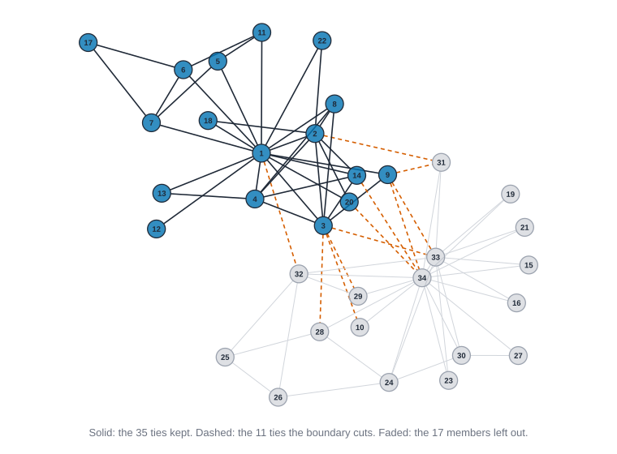
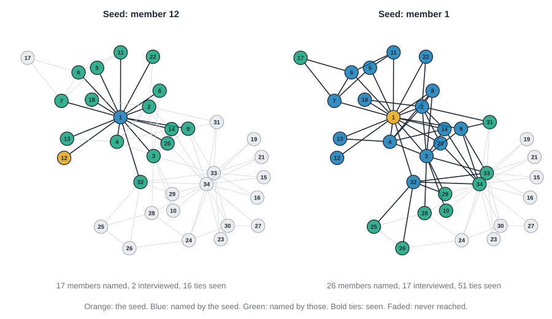

# Collecting network data {#sec-collecting-data}

::: {.callout-note appearance="simple"}
## Prerequisites
@sec-networks-as-data, and the ideas of degree and betweenness from @sec-centrality. @sec-ego-networks matters for the section on sampling people. We use Zachary's karate club and Krackhardt's 21 managers again, and two smaller data sets: Sampson's novices and the Southern women. All numbers are from the code in the chapter.
:::

::: {.callout-tip appearance="simple"}
## The short version
Before anyone measures a network, someone decided who counts, what a tie is, whom to ask, and how to handle people who didn't answer. Those quiet decisions change the numbers more than most choices of formula. This chapter shows, on real small networks, how each decision bends the results: where you draw the line around the group, how a question is worded, how you find people, what happens when some answers are missing or wrong, and what you owe the people in the data. The habit to take away is simple: write down how the data were made, then check which of your numbers would move if they'd been made a little differently.
:::

::: {.callout-tip appearance="simple"}
## Why you might care
If you ever trust a network picture someone hands you, or build one yourself from a survey, an email log or a membership list, this chapter tells you what to ask first. It can save you from a confident answer built on a boundary that happened to be convenient.
:::

## Introduction

Every measure in this book starts from a table somebody made. Before anyone computes a degree, someone decided who counted, what a tie was, whom to ask, how many names to allow, and what to do about the people who did not answer. Those decisions are quiet, and they move the numbers more than most choices of formula do.

This chapter is about those decisions. It asks questions you can answer before you collect anything, and checks you can run after. Where is the boundary, and what happens to people near it? How does the wording of a question define the network? What do snowball, respondent-driven and ego designs each do to degree and centrality? If some people don't answer, or some ties are missing or false, which measures move and which hold still? What do you owe the people in the data? And how do you turn a raw table into a network in a way someone else can check?

We answer with numbers on bundled data. One device makes that possible: a tiny shared random number generator, so that when a check says "drop 20% of the ties at random, 200 times", the Rust blocks drop the same ties and print the same numbers on every run. The R and Python tabs are blank where knappnet's packages do not expose the function yet; each one names the missing function.

::: {.callout-tip appearance="simple"}
## How to read the code
The blocks run top to bottom as one script per language. The first block defines helpers and loads the karate club; later blocks reuse them. The first block also holds every Rust `use` line.
:::

## Where the boundary is

A **boundary** is the rule that says who is in the data. Two kinds are usually distinguished: a *realist* boundary follows what the people themselves treat as the group (everyone who says they belong), and a *nominalist* boundary is set by the researcher to fit a question (everyone on this payroll, everyone who used this hashtag). @marsden1990network surveys the standard approaches. Either way, the rule cuts ties, and the people near the cut pay for it.

Think of it like cropping a photo: whoever stands at the new edge looks like they're at the edge of the world. Take six people in a line, a to f, where each knows the next. Person c sits between a and b on one side and d, e and f on the other, so c lies on 2 × 3 = 6 shortest routes between others. Now study only c to f. Person c is the end of a line and lies on none. The person didn't change. The boundary did.

For a real case, suppose we study only Mr. Hi's side of the karate club [@zachary1977information]. That is a nominalist boundary, and an awkward one, because the split is the thing the club is famous for. The block compares the club with that side alone.

::: {.panel-tabset group="language"}

## R

```r
library(knappnet)

ties <- read.csv("data/karate/edges.csv")[, c("source", "target")]
nodes <- read.csv("data/karate/nodes.csv")

# The boundary: only Mr. Hi's side is "in the study".
inside <- nodes$faction == "Mr. Hi"
ids <- nodes$id[inside]
whole <- net_frame(ties, nodes = nodes, directed = FALSE, quiet = TRUE)
part <- net_frame(ties[ties$source %in% ids & ties$target %in% ids, ],
                  nodes = nodes[inside, ], directed = FALSE, quiet = TRUE)

describe <- function(g) {
  c(members = nrow(g$nodes), ties = nrow(g$edges), mean_degree = mean(as.numeric(net_degree(g))),
    density = as.numeric(net_density(g)), clustering = as.numeric(net_transitivity(g)))
}
round(cbind(whole_club = describe(whole), mr_hi_side = describe(part)), 3)

before <- as.numeric(net_degree(whole))[inside]
after <- as.numeric(net_degree(part))
rho <- function(a, b) cor(a, b, method = "spearman")
round(c(
  ties_cut = sum((ties$source %in% ids) != (ties$target %in% ids)), of_ties = nrow(ties),
  lose_a_third = sum(3 * (before - after) >= before), of_members = sum(inside),
  degree_rho = rho(before, after),
  betweenness_rho = rho(as.numeric(net_betweenness(whole))[inside], as.numeric(net_betweenness(part)))
), 3)
```

::: {.code-output}
```text
# A tibble: 5 × 3
  measure     whole_club mr_hi_side
  <chr>            <dbl>      <dbl>
1 members         34         17    
2 ties            78         35    
3 mean degree      4.59       4.12 
4 density          0.139      0.257
5 clustering       0.256      0.392
# A tibble: 1 × 6
  ties_cut of_ties lose_a_third of_members degree_rho betweenness_rho
     <dbl>   <dbl>        <dbl>      <dbl>      <dbl>           <dbl>
1       11      78            3         17      0.885           0.587
```
:::

## Python

```python
import networkx as nx
import pandas as pd
from scipy.stats import spearmanr

ties = pd.read_csv("data/karate/edges.csv")
nodes = pd.read_csv("data/karate/nodes.csv")
club = nx.from_pandas_edgelist(ties, "source", "target")
members = sorted(nodes.id[nodes.faction == "Mr. Hi"])
part = club.subgraph(members).copy()   # the boundary: only Mr. Hi's side is "in the study"

def describe(g):
    return [g.number_of_nodes(), g.number_of_edges(), round(2 * g.number_of_edges() / g.number_of_nodes(), 3),
            round(nx.density(g), 3), round(nx.transitivity(g), 3)]

table = pd.DataFrame({"whole club": describe(club), "Mr. Hi side": describe(part)},
                     index=["members", "ties", "mean degree", "density", "clustering"], dtype=object)
print(table)

before, after = dict(club.degree()), dict(part.degree())
cut = sum((a in part) != (b in part) for a, b in club.edges())
third = sum(3 * (before[m] - after[m]) >= before[m] for m in members)
print(f"ties cut by the boundary: {cut} of {club.number_of_edges()}")
print(f"members who lose at least a third of their ties: {third} of {len(members)}")
b_club, b_part = nx.betweenness_centrality(club, normalized=False), nx.betweenness_centrality(part, normalized=False)
print(f"rank correlation with the whole-club value, Mr. Hi's side only: "
      f"degree {spearmanr([before[m] for m in members], [after[m] for m in members])[0]:.3f}, "
      f"betweenness {spearmanr([b_club[m] for m in members], [b_part[m] for m in members])[0]:.3f}")
```

::: {.code-output}
```text
            whole club Mr. Hi side
members             34          17
ties                78          35
mean degree      4.588       4.118
density          0.139       0.257
clustering       0.256       0.392
ties cut by the boundary: 11 of 78
members who lose at least a third of their ties: 3 of 17
rank correlation with the whole-club value, Mr. Hi's side only: degree 0.885, betweenness 0.587
```
:::

## Rust

```rust
use knappnet::metrics::descriptive::{compute_distances, compute_mean_distance, compute_transitivity, ClusteringOptions, PathOptions};
use knappnet::metrics::topography::{compute_density, find_components, ComponentKind};
use knappnet::{compute_betweenness, BetweennessOptions, Graph};

// The rows of a comma-separated file, without the header line.
let read = |path: &str| -> Vec<Vec<String>> {
    std::fs::read_to_string(path).unwrap().lines().skip(1)
        .map(|line| line.split(',').map(String::from).collect()).collect()
};
// Row i, column j is 1 when a row of the file says i -> j. Files number people from 1.
let table = |rows: &[Vec<String>], n: usize, keep: &dyn Fn(&Vec<String>) -> bool| -> Vec<Vec<f64>> {
    let mut m = vec![vec![0.0; n]; n];
    for r in rows.iter().filter(|r| keep(r)) {
        m[r[0].parse::<usize>().unwrap() - 1][r[1].parse::<usize>().unwrap() - 1] = 1.0;
    }
    m
};
let mean = |x: &[f64]| x.iter().sum::<f64>() / x.len() as f64;
let degrees = |m: &Vec<Vec<f64>>| -> Vec<f64> { m.iter().map(|row| row.iter().sum()).collect() };
// The rows and columns of a table that belong to some of the people.
let sub_table = |m: &Vec<Vec<f64>>, keep: &[usize]| -> Vec<Vec<f64>> {
    keep.iter().map(|&a| keep.iter().map(|&b| m[a][b]).collect()).collect()
};
// Positions that sort the values from smallest to largest, ties by position.
let order = |x: &[f64]| -> Vec<usize> {
    let mut o: Vec<usize> = (0..x.len()).collect();
    o.sort_by(|&a, &b| x[a].partial_cmp(&x[b]).unwrap().then(a.cmp(&b)));
    o
};
// Average ranks (tied values share the mean of their ranks) and the rank correlation.
let ranks = |x: &[f64]| -> Vec<f64> {
    x.iter().map(|&v| x.iter().filter(|&&u| u < v).count() as f64
        + (x.iter().filter(|&&u| u == v).count() as f64 + 1.0) / 2.0).collect()
};
let spearman = |x: &[f64], y: &[f64]| -> f64 {
    let (rx, ry) = (ranks(x), ranks(y));
    let (mx, my) = (mean(&rx), mean(&ry));
    let cov: f64 = rx.iter().zip(&ry).map(|(a, b)| (a - mx) * (b - my)).sum();
    cov / (rx.iter().map(|a| (a - mx).powi(2)).sum::<f64>() * ry.iter().map(|b| (b - my).powi(2)).sum::<f64>()).sqrt()
};
// Park and Miller's little generator, so every language draws the same "random" numbers.
let uniform = |count: usize, seed: u64| -> Vec<f64> {
    let mut state = seed;
    (0..count).map(|_| { state = state * 48271 % 2147483647; state as f64 / 2147483647.0 }).collect()
};
// A table in which i and j are tied if either one says so.
let symmetric = |m: &Vec<Vec<f64>>| -> Vec<Vec<f64>> {
    (0..m.len()).map(|i| (0..m.len()).map(|j| f64::max(m[i][j], m[j][i])).collect()).collect()
};
// A symmetric 0/1 table to an undirected network, and the betweenness of everyone in it.
let graph_of = |m: &Vec<Vec<f64>>| -> Result<Graph, knappnet::Error> {
    let n = m.len();
    let (from, to): (Vec<i64>, Vec<i64>) = (0..n).flat_map(|i| (0..n).map(move |j| (i, j)))
        .filter(|&(i, j)| i < j && m[i][j] > 0.0).map(|(i, j)| (i as i64, j as i64)).unzip();
    Graph::from_edges(n, &from, &to, None, false)
};
let between = |m: &Vec<Vec<f64>>| -> Result<Vec<f64>, knappnet::Error> {
    compute_betweenness(&graph_of(m)?, BetweennessOptions::default())
};

let club = symmetric(&table(&read("data/karate/edges.csv"), 34, &|_| true));
let faction: Vec<String> = read("data/karate/nodes.csv").iter().map(|r| r[1].clone()).collect();

// The boundary: only Mr. Hi's side is "in the study".
let inside: Vec<usize> = (0..34).filter(|&i| faction[i] == "Mr. Hi").collect();
let outside: Vec<usize> = (0..34).filter(|&i| faction[i] != "Mr. Hi").collect();
let kept = sub_table(&club, &inside);
let (whole, part) = (graph_of(&club)?, graph_of(&kept)?);
println!("{:<13}{:>11}{:>13}", "", "whole club", "Mr. Hi side");
let clustering = |g: &Graph| compute_transitivity(g, ClusteringOptions::default());
println!("{:<13}{:>11}{:>13}", "members", 34, kept.len());
println!("{:<13}{:>11}{:>13}", "ties", whole.edge_count(), part.edge_count());
println!("{:<13}{:>11.3}{:>13.3}", "mean degree", mean(&degrees(&club)), mean(&degrees(&kept)));
println!("{:<13}{:>11.3}{:>13.3}", "density", compute_density(&whole, false), compute_density(&part, false));
println!("{:<13}{:>11.3}{:>13.3}", "clustering", clustering(&whole), clustering(&part));

let club_degree = degrees(&club);
let before: Vec<f64> = inside.iter().map(|&i| club_degree[i]).collect();
let after = degrees(&kept);
let cut: f64 = inside.iter().map(|&i| outside.iter().map(|&j| club[i][j]).sum::<f64>()).sum();
let club_between = between(&club)?;
let between_inside: Vec<f64> = inside.iter().map(|&i| club_between[i]).collect();
println!("ties cut by the boundary: {} of {}", cut, whole.edge_count());
println!("members who lose at least a third of their ties: {} of {}",
         (0..inside.len()).filter(|&i| 3.0 * (before[i] - after[i]) >= before[i]).count(), inside.len());
println!("rank correlation with the whole-club value, Mr. Hi's side only: degree {:.3}, betweenness {:.3}",
         spearman(&before, &after), spearman(&between_inside, &between(&kept)?));
```

::: {.code-output}
```text
              whole club  Mr. Hi side
members               34           17
ties                  78           35
mean degree        4.588        4.118
density            0.139        0.257
clustering         0.256        0.392
ties cut by the boundary: 11 of 78
members who lose at least a third of their ties: 3 of 17
rank correlation with the whole-club value, Mr. Hi's side only: degree 0.885, betweenness 0.587
```
:::

:::

Read it by rows. Dropping the officer's side keeps 17 members and 35 of the 78 ties, and cuts 11 ties that led across. Mean degree barely moves (4.588 to 4.118), but density almost doubles (0.139 to 0.257) and clustering rises from 0.256 to 0.392. Those jumps come from the smaller size and from cutting the ties that join the two sides, not from the people. Three of the 17 members lose at least a third of their ties.

The rank correlations are the part to remember. Among Mr. Hi's side, degree keeps its order fairly well (0.885), and betweenness does not (0.587), because betweenness depends on routes through the other side. Whoever sits on the border looks like a dead end, and routes that ran through the other side disappear. @fig-boundary-cut shows the cut.

{#fig-boundary-cut fig-alt="A network of 34 numbered members. Seventeen members on Mr. Hi's side are blue circles joined by 35 solid black ties. Seventeen members on the officer's side are faded gray circles joined by faint gray ties. Eleven red dashed ties cross between the two sides."}

Four habits follow. Write the boundary rule down with the data. Count the ties that cross it (a survey item such as "how many of your contacts are outside the firm?" does this). Never compare densities, clustering or distances between data sets with different boundaries without saying so. And be suspicious of a boundary drawn around the very groups you then compare: it builds part of the answer into the data. The card `boundary-specification` lists the checks.

## Name generators and interpreters

If the boundary says who is in, the **name generator** says who is a tie. It is the question respondents answer by listing people: "Who do you go to for advice?", "Who do you consider a friend?", "Who did you talk to this week?". The follow-up questions about each named person (how close, how long, which group) are the **name interpreters**. @sec-ego-networks used both for ego networks; here we look at what the wording does to a whole network [@marsden1990network; @burt1984network].

Krackhardt asked 21 managers two questions and also took the formal reporting lines from company records [@krackhardt1987cognitive]. Same people, three relations. Do they agree? Then a second question, about how many names a respondent may give. Sampson's novices named at most three people each time, which is a **fixed-choice** design, and Krackhardt's managers named as many as they liked. The block ends by capping the managers' lists at 2, 3 and 5 names, keeping a random subset of each manager's arcs, averaged over 200 draws.

::: {.panel-tabset group="language"}

## R

```r
# TODO(code, R): needs net_compare_relations() (overlap and reciprocity of several relations among the same people) and net_cap_choices() (keep a random k of each person's arcs, averaged over draws). Use the Rust tab.
```

::: {.code-output}
```text
TODO(output)
```
:::

## Python

```python
# TODO(code, Python): needs net_compare_relations() (overlap and reciprocity of several relations among the same people) and net_cap_choices() (keep a random k of each person's arcs, averaged over draws). Use the Rust tab.
```

::: {.code-output}
```text
TODO(output)
```
:::

## Rust

```rust
// Krackhardt's three relations among the same 21 managers, one table each.
let kr_rows = read("data/krackhardt/edges.csv");
let relation = |name: &str| table(&kr_rows, 21, &|r| r[2] == name);
let (advice, friend, reports) = (relation("advice"), relation("friendship"), relation("reports_to"));
let column_sums = |m: &Vec<Vec<f64>>| -> Vec<f64> { (0..m.len()).map(|j| m.iter().map(|row| row[j]).sum()).collect() };
let total = |m: &Vec<Vec<f64>>| -> f64 { m.iter().map(|row| row.iter().sum::<f64>()).sum() };
let overlap = |a: &Vec<Vec<f64>>, b: &Vec<Vec<f64>>| -> f64 {
    (0..a.len()).map(|i| (0..a.len()).map(|j| a[i][j] * b[i][j]).sum::<f64>()).sum()
};
let transposed = |m: &Vec<Vec<f64>>| -> Vec<Vec<f64>> { (0..m.len()).map(|i| (0..m.len()).map(|j| m[j][i]).collect()).collect() };
let reciprocated = |m: &Vec<Vec<f64>>| overlap(m, &transposed(m)) / total(m);
let busiest = |m: &Vec<Vec<f64>>| -> Vec<usize> {
    order(&column_sums(m).iter().map(|c| -c).collect::<Vec<f64>>())[..3].iter().map(|i| i + 1).collect()
};
println!("{:<11}{:>5}{:>14}   busiest three", "", "arcs", "reciprocated");
for (name, m) in [("advice", &advice), ("friendship", &friend)] {
    println!("{:<11}{:>5}{:>14.3}   {:?}", name, total(m), reciprocated(m), busiest(m));
}

let both = overlap(&advice, &friend);
println!("advice arcs that are also friendship arcs: {} of {} ({:.3})", both, total(&advice), both / total(&advice));
println!("friendship arcs that are also advice arcs: {} of {} ({:.3})", both, total(&friend), both / total(&friend));
println!("rank correlation of in-degree, advice with friendship: {:.3}; of out-degree: {:.3}",
         spearman(&column_sums(&advice), &column_sums(&friend)), spearman(&degrees(&advice), &degrees(&friend)));
println!("reporting-line arcs also named as advice: {} of {}; as friendship: {} of {}",
         overlap(&reports, &advice), total(&reports), overlap(&reports, &friend), total(&reports));

// Sampson's novices named at most three people in each of three waves; Krackhardt's managers named anyone.
let liking: Vec<Vec<String>> = read("data/sampson/edges.csv").into_iter().filter(|r| r[2] == "liking").collect();
for wave in ["1", "2", "3"] {
    let mut named = std::collections::BTreeMap::new();
    for r in liking.iter().filter(|r| r[4] == wave) {
        *named.entry(r[0].clone()).or_insert(0) += 1;
    }
    println!("Sampson, liking, wave {wave}: {} choices, each novice names {} to {}", named.values().sum::<i32>(),
             named.values().min().unwrap(), named.values().max().unwrap());
}
let friend_out = degrees(&friend);
println!("Krackhardt, friendship: each manager names {} to {}", friend_out.iter().cloned().fold(f64::MAX, f64::min),
         friend_out.iter().cloned().fold(0.0, f64::max));

// A tie that must show up in one wave, in two, or in all three.
let mut per_pair = std::collections::BTreeMap::new();
for r in &liking {
    *per_pair.entry((r[0].clone(), r[1].clone())).or_insert(0) += 1;
}
let seen_in = |k: i32| per_pair.values().filter(|&&v| v == k).count();
println!("liking choices seen in 1, 2 and 3 waves: {}, {}, {}", seen_in(1), seen_in(2), seen_in(3));

// Cap the number of names at k, keeping a random k of each manager's arcs (200 draws).
let capped = |m: &Vec<Vec<f64>>, k: usize| -> [f64; 3] {
    let arcs: Vec<(usize, usize)> = (0..21).flat_map(|i| (0..21).map(move |j| (i, j))).filter(|&(i, j)| m[i][j] > 0.0).collect();
    let keys = uniform(200 * arcs.len(), 99);
    let mut sums = [0.0; 3];
    for key in keys.chunks(arcs.len()) {
        let mut smaller = vec![vec![0.0; 21]; 21];
        for i in 0..21 {
            let mine: Vec<usize> = (0..arcs.len()).filter(|&a| arcs[a].0 == i).collect();
            let by_key = order(&mine.iter().map(|&a| key[a]).collect::<Vec<f64>>());
            for &p in by_key.iter().take(k) {
                smaller[arcs[mine[p]].0][arcs[mine[p]].1] = 1.0;
            }
        }
        sums[0] += total(&smaller);
        sums[1] += reciprocated(&smaller);
        sums[2] += spearman(&column_sums(m), &column_sums(&smaller));
    }
    [sums[0] / 200.0, sums[1] / 200.0, sums[2] / 200.0]
};
println!("\n{:<11}{:>4}{:>10}{:>13}{:>14}", "", "cap", "arcs kept", "reciprocated", "in-degree rho");
for (name, m) in [("friendship", &friend), ("advice", &advice)] {
    for k in [2, 3, 5] {
        let [arcs_kept, recip, rho] = capped(m, k);
        println!("{:<11}{:>4}{:>10.1}{:>13.3}{:>14.3}", name, k, arcs_kept, recip, rho);
    }
}
```

::: {.code-output}
```text
            arcs  reciprocated   busiest three
advice       190         0.474   [2, 18, 21]
friendship   102         0.451   [2, 1, 12]
advice arcs that are also friendship arcs: 60 of 190 (0.316)
friendship arcs that are also advice arcs: 60 of 102 (0.588)
rank correlation of in-degree, advice with friendship: 0.139; of out-degree: -0.094
reporting-line arcs also named as advice: 19 of 20; as friendship: 12 of 20
Sampson, liking, wave 1: 55 choices, each novice names 3 to 4
Sampson, liking, wave 2: 57 choices, each novice names 3 to 4
Sampson, liking, wave 3: 56 choices, each novice names 3 to 4
Krackhardt, friendship: each manager names 0 to 18
liking choices seen in 1, 2 and 3 waves: 38, 20, 30

            cap arcs kept reciprocated in-degree rho
friendship    2      36.0        0.220         0.623
friendship    3      48.0        0.304         0.698
friendship    5      68.0        0.381         0.819
advice        2      41.0        0.137         0.702
advice        3      60.0        0.190         0.778
advice        5      92.0        0.278         0.849
```
:::

:::

The two questions give two different networks. Advice has 190 arcs and friendship 102. Only 60 arcs are in both: 31.6% of advice arcs are friendships, and 58.8% of friendship arcs are advice arcs. The people who are sought out differ: the three most-named managers for advice are 2, 18 and 21, and for friendship 2, 1 and 12, and the rank correlation of in-degree is 0.139, of out-degree -0.094. A manager who is popular for advice is not, on this evidence, popular as a friend. Neither question is the "real" network. Each is a different relation, and the sentence that describes your results has to name the question.

The archival relation behaves differently again. The org chart (collected from records, not asked) has 20 arcs, and 19 of them also appear as advice from subordinate to boss. Only 12 appear as friendship. A formal line is a good predictor of an advice tie in this firm, and a poor one of friendship.

For the cap, the survey wrote the limit into the data. Sampson's novices name 3 or 4 people per wave (a few gave tied ranks), against 0 to 18 for the managers' friendships. Capping costs in two ways. Arcs are lost, of course (friendship drops from 102 to 36, 48 or 68 as the cap rises from 2 to 5). More important, mutual ties vanish, because a mutual tie needs *both* people to name each other: the reciprocated share of friendship arcs falls from 0.451 to 0.220 at a cap of 2, 0.304 at 3 and 0.381 at 5. In-degree order is better preserved, with rank correlations of 0.623, 0.698 and 0.819. This was a random cap. If respondents list their closest people first, the lost arcs are the weaker ones, which is a different loss, and one you can't recover without the question order.

Fixed-choice data also settle how to read a repeated measure. Sampson's liking was collected in three waves. 38 choices appear in one wave, 20 in two and 30 in all three. The network is therefore 88 arcs if one wave is enough, 50 if two are needed and 30 if all three are. That is a decision, not a fact: say which you made.

## Where the data come from: survey, archive, trace

The same relation can come from three kinds of source, and each makes different mistakes.

| | Survey (people are asked) | Archive (records written for another purpose) | Digital trace (logs of what systems recorded) |
| --- | --- | --- | --- |
| **What a tie is** | What the person says it is, as worded | What the record happens to link: co-signers, co-authors, board seats | An event: a message, a call, a follow, a co-location |
| **Who is missing** | Non-respondents, and people named but never asked | Whoever the record did not cover; the unrecorded | Anyone off the platform; people who use other channels |
| **Typical errors** | Memory, social desirability, caps on names, fatigue | Recording gaps, clerical errors, one tie standing for a whole group | Shared accounts, bots, automatic messages, one click standing for a friendship |
| **Strength** | Can ask about meaning and about ties among alters | Often covers the whole population over a long time | Large, timed, no recall error |
| **Check first** | Response rate by group; the question wording | Why the record was kept and what it omits | What one event means, and whether it needs two people |

Two cautions apply to all of them. People's reports of the network differ from one another [@krackhardt1987cognitive], so a survey tie is a report, not a measurement of contact. And a log records events, so turning events into a tie is a modeling step with its own threshold ("at least one message", "at least three in a month"). The last section of the chapter shows that step.

## Sampling designs and what they do to degree and centrality

When you cannot list everyone, you sample. Three designs are common, and each distorts something different.

**Snowball sampling.** Pick seed people, ask them to name contacts, ask those contacts, and so on in waves [@goodman1961snowball]. It reaches people no list contains, and the sample is connected by construction. The price is that people with many ties are named often, so they are over-represented.

A tiny case: five people in a line, A to E, and a seed at A. After two waves A, B and C are named, and A and B are interviewed. The ties seen are A-B and B-C. C was named, not interviewed, so we see one tie of C's and its real degree of 2 looks like 1. The last wave always looks like the edge of the network.

The block below runs this on every possible seed, so the averages are exact, not random. A person is *named* if within `waves` steps of the seed, *interviewed* if within `waves - 1`, and a tie is *seen* if one of its ends was interviewed. Columns: the share of the network reached, the average true degree of those reached, their average degree as seen in the sample, the share whose seen degree is below their true degree, how many of the network's three highest-degree people were reached, and the rank correlation of betweenness inside the sample with the whole network's betweenness (averaged where it is defined).

::: {.panel-tabset group="language"}

## R

```r
# TODO(code, R): needs net_snowball(): sample from a seed in waves, interview some people, and keep only the ties seen. Use the Rust tab.
```

::: {.code-output}
```text
TODO(output)
```
:::

## Python

```python
# TODO(code, Python): needs net_snowball(): sample from a seed in waves, interview some people, and keep only the ties seen. Use the Rust tab.
```

::: {.code-output}
```text
TODO(output)
```
:::

## Rust

```rust
// Krackhardt's friendships as a mutual-or-not tie: a tie if either manager names the other.
let either = symmetric(&friend);

// Start a snowball from every possible seed, one at a time. Everyone within `waves` steps of the seed
// is named; everyone within `waves - 1` steps is interviewed, so a tie is seen when at least one of
// its ends was interviewed. One row per seed.
let snowball = |m: &Vec<Vec<f64>>, waves: f64| -> Result<Vec<Vec<f64>>, knappnet::Error> {
    let n = m.len();
    let dist = compute_distances(&graph_of(m)?, None, PathOptions::default())?;
    let degree = degrees(m);
    let full = between(m)?;
    let top3 = order(&degree.iter().map(|d| -d).collect::<Vec<f64>>())[..3].to_vec();
    let mut rows = Vec::new();
    for seed in 0..n {
        let named: Vec<usize> = (0..n).filter(|&v| dist.get(seed, v) <= waves).collect();
        let asked = |v: usize| dist.get(seed, v) <= waves - 1.0;
        let seen: Vec<Vec<f64>> = named.iter()
            .map(|&i| named.iter().map(|&j| if asked(i) || asked(j) { m[i][j] } else { 0.0 }).collect()).collect();
        let seen_degree = degrees(&seen);
        let true_degree: Vec<f64> = named.iter().map(|&v| degree[v]).collect();
        rows.push(vec![
            named.len() as f64,
            mean(&true_degree),
            mean(&seen_degree),
            seen_degree.iter().zip(&true_degree).filter(|(s, t)| s < t).count() as f64 / named.len() as f64,
            top3.iter().filter(|t| named.contains(t)).count() as f64 / 3.0,
            spearman(&named.iter().map(|&v| full[v]).collect::<Vec<f64>>(), &between(&seen)?),
        ]);
    }
    Ok(rows)
};
// The average of a column over the seeds where it is defined.
let column_mean = |rows: &[Vec<f64>], c: usize| -> f64 {
    mean(&rows.iter().map(|r| r[c]).filter(|x| !x.is_nan()).collect::<Vec<f64>>())
};

for (name, m) in [("karate club", &club), ("Krackhardt friendship", &either)] {
    println!("{name}: {} people, mean degree {:.3}", m.len(), mean(&degrees(m)));
    println!("{:>5}{:>9}{:>13}{:>13}{:>14}{:>11}{:>17}", "waves", "reached", "true degree", "seen degree", "undercounted", "busiest 3", "betweenness rho");
    for waves in [1.0, 2.0, 3.0] {
        let rows = snowball(m, waves)?;
        println!("{:>5}{:>9.3}{:>13.3}{:>13.3}{:>14.3}{:>11.3}{:>17.3}", waves, column_mean(&rows, 0) / m.len() as f64,
                 column_mean(&rows, 1), column_mean(&rows, 2), column_mean(&rows, 3), column_mean(&rows, 4), column_mean(&rows, 5));
    }
}

// The seed matters: how many people two waves reach from each possible start.
let reach: Vec<f64> = snowball(&club, 2.0)?.iter().map(|r| r[0]).collect();
let (fewest, most) = (order(&reach)[0], order(&reach.iter().map(|x| -x).collect::<Vec<f64>>())[0]);
println!("karate club, two waves: from {:.0} people (seed {}) to {:.0} (seed {})", reach[fewest], fewest + 1, reach[most], most + 1);
```

::: {.code-output}
```text
karate club: 34 people, mean degree 4.588
waves  reached  true degree  seen degree  undercounted  busiest 3  betweenness rho
    1    0.164        7.852        1.527         0.762      0.471           -0.422
    2    0.623        5.149        2.907         0.618      0.735            0.503
    3    0.860        4.932        4.167         0.219      0.980            0.881
Krackhardt friendship: 21 people, mean degree 7.524
waves  reached  true degree  seen degree  undercounted  busiest 3  betweenness rho
    1    0.406        9.096        1.722         0.861      0.714           -0.220
    2    0.977        7.616        5.294         0.568      1.000            0.630
    3    1.000        7.524        7.515         0.009      1.000            0.997
karate club, two waves: from 6 people (seed 17) to 33 (seed 32)
```
:::

:::

Start with the first column set. The karate club's mean degree is 4.588, and the people reached by one wave have an average true degree of 7.852. After two waves it is 5.149 and after three 4.932. The Krackhardt friendship network gives the same pattern from 9.096 down to 7.524, the population mean. Those who are named are the well connected, because well-connected people are on more lists. It is Feld's friendship paradox: your friends have more friends than you do [@feld1991friends]. The excess shrinks as the sample grows to cover everybody.

The *seen* degree is the opposite problem. After two waves in the karate club, 61.8% of the people reached have a seen degree below their true one, and the average seen degree is 2.907 against 5.149. Only after three waves, when 86% are reached, does the seen average (4.167) get near the truth. In the Krackhardt network three waves reach everyone and the seen degree is 7.515, almost exact.

Centrality is hit differently. The rank correlation of betweenness is negative after one wave (-0.422 for the club): the sample is a star, in which the seed has all the betweenness. It is 0.503 after two waves and 0.881 after three. Reaching the busiest three people helps too: 0.471 of them on average after one wave, 0.735 after two, 0.980 after three. A snowball from one seed will usually find the hubs only if it runs long enough to reach almost everyone, at which point it is not saving much.

The seed matters. Two waves reach from 6 people (seed 17) to 33 (seed 32). @fig-snowball-seeds shows the extremes of choice: starting from member 12, who has one contact, or member 1, who has sixteen.

{#fig-snowball-seeds fig-alt="Two drawings of the 34-member karate club. On the left the sample starts at member 12: 17 members are colored, 2 were interviewed, and 16 ties are drawn bold. On the right it starts at member 1: 26 members are colored, 17 were interviewed, and 51 ties are drawn bold. Members never reached are faded gray."}

What this does and does not show: it is two small networks, exact enumeration, one seed at a time. It says that the bias *exists* and which way it points. It does not give a size for your study, because the size depends on the network. The card `snowball-sampling` lists what to report.

**Respondent-driven sampling (RDS).** In RDS each respondent gets a few coupons to recruit peers, and each respondent reports their degree (how many people in the population they know) [@heckathorn1997respondent]. The design adds a correction: the chain of recruits tends to reach person $i$ with a probability proportional to their degree $d_i$, so weighting each respondent by $1/d_i$ should undo the lean toward well-connected people.

Why that works, on four people. A hub knows three others, who each know only the hub, so the degrees are 3, 1, 1, 1 and the mean degree is 1.5. A long random chain reaches the hub half the time (3 out of 6 ends of ties) and each other person a sixth of the time. The average degree of a respondent is $\tfrac12 \cdot 3 + \tfrac12 \cdot 1 = 2.0$, too high. With weights $1/d$, the hub counts $\tfrac12 \cdot \tfrac13 = \tfrac16$ and the three others $\tfrac16$ each, so the weighted average is $\tfrac{(1/6)\cdot 3 + 3\cdot(1/6)\cdot 1}{1/6 + 3\cdot 1/6} = 1.5$, the truth. In general, the question the next formula answers is: how do I turn a sample that leans toward popular people into an honest average? With $p_i = d_i / \sum_j d_j$ the long-run chance of reaching person $i$ and $y_i$ the quantity of interest,

$$
\hat\mu = \frac{\sum_i p_i\, y_i / d_i}{\sum_i p_i / d_i}
$$

::: {.callout-tip title="In plain words"}
The symbol $\hat\mu$ (read "mu hat") is our estimate of the true average. The letter $d_i$ is how many people person $i$ knows, $p_i$ is how likely the chain is to reach him, and $y_i$ is whatever we are averaging. The formula gives each person a weight of "chance of being reached, divided by how many people he knows", then takes a weighted average. Popular people get reached more, and dividing by their degree cancels that out. On the four-person example, take $y_i$ to be the degree itself. The hub has $p = 1/2$ and $d = 3$, each leaf has $p = 1/6$ and $d = 1$. The top is $(1/6)\cdot 3 + 3 \cdot (1/6) \cdot 1 = 1$, the bottom is $1/6 + 3 \cdot 1/6 = 2/3$, and $1 / (2/3) = 1.5$, the true mean degree.
:::

equals the population mean of $y$ exactly in this idealized limit. The assumptions in the limit are strong: ties are mutual, recruiting is random among contacts, the chain is long, sampling is nearly with replacement, and reported degree is right. Real studies break each of them to some degree.

Ego sampling is the third design: draw people at random and record each one's own ties (@sec-ego-networks). Here the sample *is* random, so the mean of an ego measure is unbiased and its standard error for $k$ people out of $n$ is $s\sqrt{(1 - k/n)/k}$, where $s$ is the standard deviation of the measure over everyone.

::: {.callout-tip title="In plain words"}
The standard error says how far a sample's average typically lands from the truth. It shrinks as the sample $k$ grows, and the piece $1 - k/n$ shrinks it a bit more when you've sampled a big share of a small population. Here $s$ is the usual spread of degree among everyone. With 5 of the 34 karate members, the shrink factor is $\sqrt{(1 - 5/34)/5} = 0.41$, so the 1.602 reported below means the spread of degree in the club is about 3.9 (a number I backed out by hand from the chapter's result).
:::

What an ego sample cannot see is paths: no betweenness, no distances, and constraint needs each alter's total degree.

The block computes the long-run values exactly, so there is no simulation noise. The attribute is "belongs to the officer's faction" for the karate club and "is a middle manager (level 3)" for the Krackhardt managers. The last weighted row shows what happens if respondents can report a degree of at most 6.

::: {.panel-tabset group="language"}

## R

```r
# TODO(code, R): needs net_chain_estimate(): long-run chain-referral estimates with and without degree weights, and the standard error of an ego sample. Use the Rust tab.
```

::: {.code-output}
```text
TODO(output)
```
:::

## Python

```python
# TODO(code, Python): needs net_chain_estimate(): long-run chain-referral estimates with and without degree weights, and the standard error of an ego sample. Use the Rust tab.
```

::: {.code-output}
```text
TODO(output)
```
:::

## Rust

```rust
let level: Vec<f64> = read("data/krackhardt/nodes.csv").iter().map(|r| r[3].parse().unwrap()).collect();
let officer: Vec<f64> = faction.iter().map(|f| if f == "Officer" { 1.0 } else { 0.0 }).collect();
let senior: Vec<f64> = level.iter().map(|&l| if l == 3.0 { 1.0 } else { 0.0 }).collect();

// What a long chain of respondents, each naming a random contact, settles into: person i is reached
// with probability proportional to their degree. Weighting each respondent by 1 / (reported degree)
// undoes that. Returns the truth, the unweighted average and the weighted one.
let chain = |m: &Vec<Vec<f64>>, y: &[f64], cap: f64| -> [f64; 3] {
    let d = degrees(m);
    let p: Vec<f64> = d.iter().map(|x| x / d.iter().sum::<f64>()).collect();
    let reported: Vec<f64> = d.iter().map(|&x| x.min(cap)).collect();
    let top: f64 = (0..d.len()).map(|i| p[i] * y[i] / reported[i]).sum();
    let bottom: f64 = (0..d.len()).map(|i| p[i] / reported[i]).sum();
    [mean(y), (0..d.len()).map(|i| p[i] * y[i]).sum(), top / bottom]
};
let rows = [("mean degree", "everyone", 0, "degree"), ("", "a chain, unweighted", 1, "degree"), ("", "a chain, weighted", 2, "degree"),
            ("share Officers / level 3", "everyone", 0, "share"), ("", "a chain, unweighted", 1, "share"),
            ("", "a chain, weighted", 2, "share"), ("", "weighted, degree reported at most 6", 2, "capped")];
println!("{:<26}{:<36}{:>8}{:>12}", "", "", "karate", "Krackhardt");
for (what, version, i, kind) in rows {
    let cap = if kind == "capped" { 6.0 } else { f64::INFINITY };
    let pick = |m: &Vec<Vec<f64>>, y: &[f64]| {
        let target = if kind == "degree" { degrees(m) } else { y.to_vec() };
        chain(m, &target, cap)[i]
    };
    println!("{:<26}{:<36}{:>8.3}{:>12.3}", what, version, pick(&club, &officer), pick(&either, &senior));
}

// Sampling people at random (ego sampling): the standard error of the mean degree for k people.
println!("\n{:<16}{:>8}{:>12}", "people sampled", "karate", "Krackhardt");
let standard_error = |m: &Vec<Vec<f64>>, k: f64| -> f64 {
    let d = degrees(m);
    let n = d.len() as f64;
    let sd = (d.iter().map(|x| (x - mean(&d)).powi(2)).sum::<f64>() / (n - 1.0)).sqrt();
    sd * ((1.0 - k / n) / k).sqrt()
};
for k in [5.0, 10.0, 15.0] {
    println!("{:<16}{:>8.3}{:>12.3}", k, standard_error(&club, k), standard_error(&either, k));
}
```

::: {.code-output}
```text
                                                                karate  Krackhardt
mean degree               everyone                               4.588       7.524
                          a chain, unweighted                    7.769       9.215
                          a chain, weighted                      4.588       7.524
share Officers / level 3  everyone                               0.500       0.762
                          a chain, unweighted                    0.481       0.816
                          a chain, weighted                      0.500       0.762
                          weighted, degree reported at most 6    0.500       0.800

people sampled    karate  Krackhardt
5                  1.602       1.427
10                 1.030       0.837
15                 0.748       0.504
```
:::

:::

For the mean degree the lean is large. A chain would report a mean degree of 7.769 in the karate club, against a truth of 4.588, and 9.215 against 7.524 in the firm. Weighting by $1/d$ gives back 4.588 and 7.524 exactly. For an attribute the effect depends on how the attribute lines up with degree. The officer's faction has the same share in the long-run chain (0.481) as in the club (0.500), because the two factions have similar total degree. The share of middle managers in the chain is 0.816, against 0.762 in the firm, because they are the better-connected people, and weighting repairs it. But if reported degree is cut off at 6, the weighted share is 0.800: most of the bias is back. RDS inherits whatever errors the degree reports carry.

For ego samples the standard errors on the mean degree are large for small samples: with 5 people, 1.602 in the club (mean 4.588) and 1.427 in the firm (mean 7.524). With 15 they are 0.748 and 0.504. Part of why the 21-person firm falls faster is the finite population correction. These are standard errors for a mean over people, and your sample size has to come from the question you ask, not from a rule.

::: {.callout-note appearance="simple"}
## Statistical models for sampled networks
These weights fix *means of attributes*. They do not make a sampled network into a whole network. If the design matters for a model of ties, the model has to include it [@frank1978sampling; @handcock2010modeling]; @sec-ergm and @sec-reporting say where this bites.
:::

## Missing data and nonresponse

Missing data are in every network study, and in network data they come in three kinds with different consequences.

- **Non-respondents.** People who were asked and did not answer. Their *own* choices are missing, but others may have named them, so half of each tie is often still there.
- **Missing ties.** Real ties nobody recorded: a cap on names, a forgotten contact, a missing log.
- **Missing people.** People left out of the list altogether, so nobody can be asked about them and nobody named them.

The effects depend on the measure and on how the data went missing [@kossinets2006effects; @borgatti2006robustness; @costenbader2003stability]. We check this in two ways. First, exactly, on Krackhardt's friendship network, where we can silence every possible set of one, two or three managers. Their own friendship choices vanish and what others said about them stays.

A three-person case shows the main effect. Ana, Ben and Chloe each name the other two: six arcs, all of them mutual. Now Ana doesn't answer. Ben's and Chloe's arcs to Ana remain, Ana's to them are gone, leaving four arcs. The Ana-Ben and Ana-Chloe pairs now look one-way, so only Ben-Chloe is mutual, and the share of arcs that are reciprocated drops from 1 to 2/4 = 0.5. As pairs, all three ties are still there, because the other side named them. That is why the block uses both: arcs seen, pairs seen (a pair counts if either person named the other), the reciprocated share, and rank correlations of in-degree and of betweenness in the pair network with the full data.

::: {.panel-tabset group="language"}

## R

```r
# TODO(code, R): needs net_drop_respondents(): remove the answers of silent respondents (every way, or chosen by degree) and compare what is left. Use the Rust tab.
```

::: {.code-output}
```text
TODO(output)
```
:::

## Python

```python
# TODO(code, Python): needs net_drop_respondents(): remove the answers of silent respondents (every way, or chosen by degree) and compare what is left. Use the Rust tab.
```

::: {.code-output}
```text
TODO(output)
```
:::

## Rust

```rust
// The friendship table when some managers never answered: their own choices are gone,
// but what others said about them remains.
let when_silent = |silent: &[usize]| -> Result<[f64; 5], knappnet::Error> {
    let seen: Vec<Vec<f64>> = (0..21).map(|i| if silent.contains(&i) { vec![0.0; 21] } else { friend[i].clone() }).collect();
    let pairs = symmetric(&seen);
    Ok([
        total(&seen) / total(&friend),
        total(&pairs) / total(&either),
        reciprocated(&seen),
        spearman(&column_sums(&friend), &column_sums(&seen)),
        spearman(&between(&either)?, &between(&pairs)?),
    ])
};
// Every way to choose k of the 21 managers.
let choose = |k: u32| -> Vec<Vec<usize>> {
    (0u32..(1 << 21)).filter(|mask| mask.count_ones() == k).map(|mask| (0..21).filter(|&i| mask >> i & 1 == 1).collect()).collect()
};

let named_by = degrees(&friend);
let most = order(&named_by.iter().map(|x| -x).collect::<Vec<f64>>())[..3].to_vec();
let fewest = order(&named_by)[..3].to_vec();
let cases = vec![("1 silent, every way", choose(1)), ("2 silent, every way", choose(2)), ("3 silent, every way", choose(3)),
                 ("the 3 who name most", vec![most]), ("the 3 who name fewest", vec![fewest])];
println!("{:<24}{:>6}{:>7}{:>7}{:>14}{:>15}{:>17}{:>7}", "", "ways", "arcs", "pairs", "reciprocated", "in-degree rho", "betweenness rho", "worst");
for (label, groups) in &cases {
    let r: Vec<[f64; 5]> = groups.iter().map(|g| when_silent(g)).collect::<Result<_, _>>()?;
    let column = |c: usize| -> Vec<f64> { r.iter().map(|row| row[c]).collect() };
    println!("{:<24}{:>6}{:>7.3}{:>7.3}{:>14.3}{:>15.3}{:>17.3}{:>7.3}", label, groups.len(), mean(&column(0)), mean(&column(1)),
             mean(&column(2)), mean(&column(3)), mean(&column(4)), column(4).iter().cloned().fold(f64::MAX, f64::min));
}
```

::: {.code-output}
```text
                          ways   arcs  pairs  reciprocated  in-degree rho  betweenness rho  worst
1 silent, every way         21  0.952  0.966         0.428          0.977            0.953  0.829
2 silent, every way        210  0.905  0.931         0.405          0.956            0.905  0.641
3 silent, every way       1330  0.857  0.895         0.382          0.935            0.859  0.558
the 3 who name most          1  0.608  0.658         0.323          0.912            0.683  0.683
the 3 who name fewest        1  0.990  1.000         0.436          0.988            1.000  1.000
```
:::

:::

With nobody missing, 45.1% of the friendship arcs are reciprocated. Lose one manager and the average share of arcs seen is 0.952, and of pairs 0.966, because a pair is lost only if both people are silent. Rank orders hold: in-degree 0.977, betweenness 0.953. The reciprocated share is already down to 0.428. With three silent (1,330 ways) the arcs seen average 0.857 and the pairs 0.895, in-degree order 0.935 and betweenness order 0.859, but the worst of the 1,330 ways gets betweenness down to 0.558. That is the figure to keep. An average hides the cases where the wrong people go quiet.

Who goes quiet matters more than how many. If the three managers who name the most are silent, only 0.608 of the arcs and 0.658 of the pairs are seen, and betweenness order falls to 0.683. If the three who name the fewest are silent, almost nothing changes (0.990 and 1.000). Heavy talkers are also the ones who carry the most ties, and nonresponse is not usually random with respect to that.

Reciprocity is the most fragile number: it drops with every silent person (0.428, 0.405, 0.382 for one, two and three silent, 0.323 if the heavy talkers are the silent ones). If you report reciprocity from a survey with nonresponse, say so and report it among respondent pairs only.

Second, a second look from the other side: not who is silent, but which ties or people are lost, at random, in the karate club, with 200 draws for each row. We also remove the three best-connected and the six least-connected members, to see lost people that are not random. Columns: rank correlation of degree and of betweenness with the full club (among the people left), then ratios to the full-club values of mean degree, density, clustering and mean distance, then the average number of separate pieces.


::: {.panel-tabset group="language"}

## R

```r
# TODO(code, R): needs net_perturb(): lose random people or ties, or the best or least connected, and compare measures with the full network. Use the Rust tab.
```

::: {.code-output}
```text
TODO(output)
```
:::

## Python

```python
# TODO(code, Python): needs net_perturb(): lose random people or ties, or the best or least connected, and compare measures with the full network. Use the Rust tab.
```

::: {.code-output}
```text
TODO(output)
```
:::

## Rust

```rust
let club_degree = degrees(&club);
let club_between = between(&club)?;
let (club_density, club_clustering) = (compute_density(&whole, false), clustering(&whole));
let club_distance = compute_mean_distance(&whole, PathOptions::default(), true)?;

// How the people in `keep` look in the table m, set against the whole club: rank correlations of their
// degree and betweenness, and ratios of mean degree, density, clustering and mean distance.
let compare = |m: &Vec<Vec<f64>>, keep: &[usize]| -> Result<[f64; 7], knappnet::Error> {
    let sub = sub_table(m, keep);
    let g = graph_of(&sub)?;
    let d = degrees(&sub);
    let pick = |x: &[f64]| -> Vec<f64> { keep.iter().map(|&i| x[i]).collect() };
    Ok([
        spearman(&pick(&club_degree), &d),
        spearman(&pick(&club_between), &between(&sub)?),
        mean(&d) / mean(&club_degree),
        compute_density(&g, false) / club_density,
        clustering(&g) / club_clustering,
        compute_mean_distance(&g, PathOptions::default(), true)? / club_distance,
        find_components(&g, ComponentKind::Weak).count() as f64,
    ])
};
let average = |rows: &[[f64; 7]]| -> [f64; 7] {
    let mut out = [0.0; 7];
    for c in 0..7 {
        out[c] = mean(&rows.iter().map(|r| r[c]).collect::<Vec<f64>>());
    }
    out
};

// The 78 ties, in order of (row, column).
let ties: Vec<(usize, usize)> = (0..34).flat_map(|i| (0..34).map(move |j| (i, j))).filter(|&(i, j)| i < j && club[i][j] > 0.0).collect();
let lose_people = |k: usize| -> Result<[f64; 7], knappnet::Error> {
    let keys = uniform(200 * 34, 12345);
    let rows: Vec<[f64; 7]> = keys.chunks(34).map(|key| {
        let mut keep = order(key)[k..].to_vec();
        keep.sort();
        compare(&club, &keep)
    }).collect::<Result<_, _>>()?;
    Ok(average(&rows))
};
let lose_ties = |k: usize| -> Result<[f64; 7], knappnet::Error> {
    let keys = uniform(200 * ties.len(), 777);
    let all: Vec<usize> = (0..34).collect();
    let rows: Vec<[f64; 7]> = keys.chunks(ties.len()).map(|key| {
        let mut m = club.clone();
        for &t in order(key).iter().take(k) {
            m[ties[t].0][ties[t].1] = 0.0;
            m[ties[t].1][ties[t].0] = 0.0;
        }
        compare(&m, &all)
    }).collect::<Result<_, _>>()?;
    Ok(average(&rows))
};

let widths = [11, 12, 10, 9, 11, 10, 8];
let heads = ["degree rho", "between rho", "mean deg", "density", "clustering", "distance", "pieces"];
let show = |label: &str, r: [f64; 7]| {
    println!("{:<31}{}", label, r.iter().zip(widths).map(|(x, w)| format!("{:>w$.3}", x, w = w)).collect::<String>());
};
println!("{:<31}{}", "", heads.iter().zip(widths).map(|(h, w)| format!("{:>w$}", h, w = w)).collect::<String>());
for k in [3, 7, 10] {
    show(&format!("{k} people missing"), lose_people(k)?);
}
for k in [8, 16, 23] {
    show(&format!("{k} ties missing"), lose_ties(k)?);
}
let without = |gone: &[usize]| -> Vec<usize> { (0..34).filter(|i| !gone.contains(i)).collect() };
let best = order(&club_degree.iter().map(|d| -d).collect::<Vec<f64>>())[..3].to_vec();
let least = order(&club_degree)[..6].to_vec();
show("the 3 best connected missing", compare(&club, &without(&best))?);
show("the 6 least connected missing", compare(&club, &without(&least))?);
```

::: {.code-output}
```text
                                degree rho between rho  mean deg  density clustering  distance  pieces
3 people missing                     0.960       0.955     0.902    0.992      0.988     1.008   1.265
7 people missing                     0.903       0.895     0.786    0.998      0.977     1.006   1.790
10 people missing                    0.872       0.848     0.699    1.002      0.954     1.011   2.155
8 ties missing                       0.947       0.925     0.897    0.897      0.909     1.048   1.200
16 ties missing                      0.893       0.860     0.795    0.795      0.800     1.104   1.765
23 ties missing                      0.845       0.802     0.705    0.705      0.712     1.164   2.470
the 3 best connected missing         0.877       0.722     0.478    0.526      1.056     1.136   8.000
the 6 least connected missing        0.981       0.938     1.043    1.275      1.179     0.936   1.000
```
:::

:::

Two things stand out. First, different measures fail in different ways. When people go missing at random, density stays at about 1 (0.992, 0.998 and 1.002 for 3, 7 and 10 people), but mean degree falls with the share lost (0.902, 0.786, 0.699), because the people left have lost ties to the people who left. When ties go missing at random, density and mean degree fall by the share lost (0.897 for 8 of 78, 0.795 for 16, 0.705 for 23), clustering falls with them (0.909, 0.800, 0.712), and mean distance rises (1.048, 1.104, 1.164). The same data loss shows up as a fall in one number or a rise in another.

Second, ranks hold up better than levels. With a fifth of the ties gone (16 of 78) the degree order still correlates 0.893 with the original, and betweenness 0.860. If you only report ranks, small random losses are tolerable. If you report levels, they aren't. Random loss is the mild case. Remove the three best-connected members (34, 1 and 33) and the club breaks into 8 pieces, density falls to 0.526 of its value, and the betweenness order falls to 0.722. Remove the six least-connected and the network gets denser (1.275 times its density) and nothing breaks.

Use a loss that resembles your own risk. Missing at random is a baseline, and the card `missing-data-checks` lists the damage to try.

## Measurement error: false ties and missed ties

A recorded tie can be wrong in two ways: a real tie is not recorded (a **false negative**, a miss) or a recorded tie isn't real (a **false positive**, an invention). Respondents forget, and also name the wrong person, and logs link accounts that belong to one person or to a bot. In a sparse network the two errors are not mirror images.

Why. Take the line of six people, a to f, again. The distance from a to f is 5. Invent one tie from a to d and it becomes a, d, e, f: 3. Miss the tie between c and d instead and the line is cut in two, and a to f has no route at all. Invented ties are *shortcuts*; missed ties are *breaks*. Shortcuts change who lies on the shortest routes, so path-based measures suffer.

The block misses and invents ties in the karate club at the same total error, 200 draws each. Invented ties are chosen from the 483 pairs without a tie.

::: {.panel-tabset group="language"}

## R

```r
# TODO(code, R): needs net_perturb() with both missed and invented ties at a set error rate. Use the Rust tab.
```

::: {.code-output}
```text
TODO(output)
```
:::

## Python

```python
# TODO(code, Python): needs net_perturb() with both missed and invented ties at a set error rate. Use the Rust tab.
```

::: {.code-output}
```text
TODO(output)
```
:::

## Rust

```rust
// The 483 pairs with no tie, in order of (row, column).
let non_ties: Vec<(usize, usize)> = (0..34).flat_map(|i| (0..34).map(move |j| (i, j))).filter(|&(i, j)| i < j && club[i][j] == 0.0).collect();

// Miss `missed` real ties and invent `invented` false ones, in 200 draws.
let with_errors = |missed: usize, invented: usize| -> Result<[f64; 7], knappnet::Error> {
    let real_keys = uniform(200 * ties.len(), 11);
    let false_keys = uniform(200 * non_ties.len(), 12);
    let all: Vec<usize> = (0..34).collect();
    let rows: Vec<[f64; 7]> = real_keys.chunks(ties.len()).zip(false_keys.chunks(non_ties.len())).map(|(real, false_)| {
        let mut m = club.clone();
        for &t in order(real).iter().take(missed) {
            m[ties[t].0][ties[t].1] = 0.0;
            m[ties[t].1][ties[t].0] = 0.0;
        }
        for &t in order(false_).iter().take(invented) {
            m[non_ties[t].0][non_ties[t].1] = 1.0;
            m[non_ties[t].1][non_ties[t].0] = 1.0;
        }
        compare(&m, &all)
    }).collect::<Result<_, _>>()?;
    Ok(average(&rows))
};
println!("{:>6}{:>9}{}", "missed", "invented", heads.iter().zip(widths).map(|(h, w)| format!("{:>w$}", h, w = w)).collect::<String>());
for (missed, invented) in [(8, 0), (0, 8), (4, 4), (16, 0), (0, 16), (8, 8)] {
    let r = with_errors(missed, invented)?;
    println!("{:>6}{:>9}{}", missed, invented, r.iter().zip(widths).map(|(x, w)| format!("{:>w$.3}", x, w = w)).collect::<String>());
}
```

::: {.code-output}
```text
missed invented degree rho between rho  mean deg  density clustering  distance  pieces
     8        0      0.948       0.930     0.897    0.897      0.907     1.050   1.225
     0        8      0.929       0.842     1.103    1.103      1.019     0.934   1.000
     4        4      0.937       0.882     1.000    1.000      0.966     0.985   1.045
    16        0      0.897       0.868     0.795    0.795      0.805     1.105   1.800
     0       16      0.876       0.754     1.205    1.205      1.044     0.892   1.000
     8        8      0.879       0.798     1.000    1.000      0.922     0.977   1.130
```
:::

:::

At the same number of wrong ties, the damage differs. With 8 wrong ties, missing 8 leaves the degree order at 0.948 and betweenness at 0.930, and inventing 8 gives 0.929 and 0.842. At 16 the betweenness order is 0.868 when 16 real ties are missed and 0.754 when 16 false ones are added. The two also push other numbers in opposite directions. Missed ties lower clustering (0.907 and 0.805 for 8 and 16) and lengthen distances (1.050 and 1.105), while invented ties leave clustering about the same (1.019 and 1.044) and shorten distances (0.934, 0.892). Mixing, 8 of each, falls between (betweenness 0.798, distance 0.977, clustering 0.922).

So, in *this* network, with these error counts: false ties damage betweenness more than missed ties, and missed ties damage clustering and distance more. A different network, with another density, could differ. What carries over is the question to ask of your own data: which kind of error is likelier, and which of your numbers does that kind move? Logs tend to invent (shared accounts, bots); surveys tend to miss (memory, caps). The two reports of one friendship often disagree: in Krackhardt's data only 23 of 79 friendship pairs are mutual (@sec-ego-networks), which is one view of how noisy a single report is.

## Ethics, consent and who can be found

Network data are data about relationships, so they are almost always about people who didn't agree to be there. A respondent who lists contacts has put them in your data. An archive of messages includes people who never knew a study was happening. Three rules for working with such data are short. Collect only what the question needs. Keep names apart from ties. Think, before release, about who could be picked out.

That last one is less obvious than it sounds, because **removing names does not make a network anonymous**. Structure alone can identify people: researchers have shown attacks that match an anonymized network with another source by structure, and that plant a pattern of ties to find chosen people [@backstrom2007wherefore; @narayanan2009deanonymizing]. A cousin of the problem in tables is k-anonymity, the idea that each record should look like at least k-1 others [@sweeney2002kanonymity].

A tiny case. Five people in a line, A to E, have degrees 1, 2, 2, 2, 1. Nobody is unique by degree. Add what the person's contacts have, their degrees sorted: C is the only one whose contacts both have degree 2, and is unique; A and E look alike, and so do B and D, because the line has a mirror. So one of five is picked out by their circle. The block does the same count on two real networks: people alone in their degree, people alone in their degree plus the degrees of their contacts, and the biggest group sharing a degree.

::: {.panel-tabset group="language"}

## R

```r
# TODO(code, R): needs net_reidentify(): count people who are unique by degree, or by degree plus their contacts' degrees. Use the Rust tab.
```

::: {.code-output}
```text
TODO(output)
```
:::

## Python

```python
# TODO(code, Python): needs net_reidentify(): count people who are unique by degree, or by degree plus their contacts' degrees. Use the Rust tab.
```

::: {.code-output}
```text
TODO(output)
```
:::

## Rust

```rust
// If every name is removed, can someone who knows a person's degree, or also their contacts' degrees,
// still pick that person out?
let lookalikes = |m: &Vec<Vec<f64>>| -> [usize; 4] {
    let d = degrees(m);
    let by_degree: Vec<String> = d.iter().map(|x| x.to_string()).collect();
    let by_circle: Vec<String> = (0..m.len()).map(|i| {
        let mut around: Vec<f64> = (0..m.len()).filter(|&j| m[i][j] > 0.0).map(|j| d[j]).collect();
        around.sort_by(|a, b| a.partial_cmp(b).unwrap());
        format!("{}|{}", d[i], around.iter().map(|x| x.to_string()).collect::<Vec<String>>().join("."))
    }).collect();
    let count = |keys: &Vec<String>, k: &String| keys.iter().filter(|x| *x == k).count();
    [m.len(),
     by_degree.iter().filter(|k| count(&by_degree, k) == 1).count(),
     by_circle.iter().filter(|k| count(&by_circle, k) == 1).count(),
     by_degree.iter().map(|k| count(&by_degree, k)).max().unwrap()]
};
println!("{:<24}{:>7}{:>17}{:>17}{:>27}", "", "people", "alone by degree", "alone by circle", "biggest same-degree group");
for (name, m) in [("karate club", &club), ("Krackhardt friendship", &either)] {
    let r = lookalikes(m);
    println!("{:<24}{:>7}{:>17}{:>17}{:>27}", name, r[0], r[1], r[2], r[3]);
}
```

::: {.code-output}
```text
                         people  alone by degree  alone by circle  biggest same-degree group
karate club                  34                6               23                         11
Krackhardt friendship        21                5               21                          4
```
:::

:::

In the karate club 6 of 34 members are unique by degree alone, and 23 are unique once you add their contacts' degrees. In the managers' friendship network 5 of 21 are unique by degree, and *all 21* by degree plus contacts' degrees. Someone who knows a manager's number of friends and how many friends each of them has can find that manager in a "name-free" edge list, every time. That is an attacker with exact knowledge, which is generous. It is still the right worry, because an attacker is often a colleague who knows who talks to whom.

What to do about it. Share the minimum. Publish aggregate numbers and groups, not people. Perturb or coarsen the released tie list if it must be released, and say so, because that changes the results. Where the data cannot be made safe to publish, share them under an access agreement instead. If the network is inside an organization, results about named individuals (a manager's "brokerage score") can affect careers, so decide in advance who sees them. Rules differ between places, institutions and data owners, so ask the relevant ethics board; this chapter can't replace them. The card `network-data-ethics` has the checklist.

## Turning raw tables into networks, with a record

Most network data start as a table that is not a network: an event log, an export from a system, a list of who attended what. The step from table to network holds more choices than it looks like, and each choice should leave a trace.

Three common raw forms:

- **An event log** (a time, a sender, a receiver). Choices: which rows count, whether a tie is directed, whether the weight is the number of messages or the number of days with a message, and over what window.
- **An edge list from a system** (two columns of IDs). Choices: whether IDs match across files, how to treat self-ties and repeats, and what to do with IDs that are on no roster.
- **An affiliation table** (person, event). It becomes a person-to-person network by counting shared events, and that is a projection with its own choices (@sec-two-mode).

The first part of the next block builds a network from twelve messages with the usual mess in them. Each cleaning rule is a step, kept in order, and the report says how many rows each step removed. The second part turns the Southern women's attendance table [@davis1941deep] into a count of shared events.

::: {.panel-tabset group="language"}

## R

```r
# TODO(code, R): needs net_clean_edges(): a step-by-step cleaning report for a message log (trim, drop self-ties, unknown names, repeats), then net_project() on an incidence table with the shared-event counts. Use the Rust tab.
```

::: {.code-output}
```text
TODO(output)
```
:::

## Python

```python
# TODO(code, Python): needs net_clean_edges(): a step-by-step cleaning report for a message log (trim, drop self-ties, unknown names, repeats), then net_project() on an incidence table with the shared-event counts. Use the Rust tab.
```

::: {.code-output}
```text
TODO(output)
```
:::

## Rust

```rust
// A small, messy message log, as it might arrive: odd capitals and spaces, a missing recipient, a message to
// oneself, two names that are not on the roster (a typo and a stranger), and repeats.
let messages: Vec<(&str, &str, &str)> = vec![
    ("2024-03-01", "Ana", "Ben"), ("2024-03-01", "ana ", "Ben"), ("2024-03-02", "Ben", "Chloe"),
    ("2024-03-02", "Chloe", "Chloe"), ("2024-03-03", "Ana", "Dev"), ("2024-03-03", "Ana", "Dev"),
    ("2024-03-04", "Dev", "Eli"), ("2024-03-05", "Eli", ""), ("2024-03-05", "Ben", "Chloe"),
    ("2024-03-06", "Cloe", "Dev"), ("2024-03-07", "Dev", "Ana"), ("2024-03-08", "Frank", "Ana"),
];
let roster = ["Ana", "Ben", "Chloe", "Dev", "Eli"];
let tidy = |x: &str| -> String {
    let x = x.trim().to_lowercase();
    x[..1].to_uppercase() + &x[1..]
};

// Each cleaning step is a rule, applied in order, so the report can say what each one removed.
let mut rows: Vec<(String, String, String)> = messages.iter().map(|r| (r.0.to_string(), r.1.to_string(), r.2.to_string())).collect();
let mut left = vec![("as received", rows.len())];
for step in 1..=5 {
    rows = match step {
        1 => rows.iter().map(|(d, a, b)| (d.clone(), tidy(a), if b.is_empty() { String::new() } else { tidy(b) })).collect(),
        2 => rows.into_iter().filter(|r| !r.2.is_empty()).collect(),
        3 => rows.into_iter().filter(|r| r.1 != r.2).collect(),
        4 => rows.into_iter().filter(|r| roster.contains(&r.1.as_str()) && roster.contains(&r.2.as_str())).collect(),
        _ => {
            let mut seen = std::collections::HashSet::new();
            rows.into_iter().filter(|r| seen.insert(r.clone())).collect()
        }
    };
    left.push((["", "names trimmed, case fixed", "no recipient", "sent to self", "not on the roster", "same message repeated on a day"][step], rows.len()));
}
println!("{:<33}{:>10}{:>9}", "step", "rows left", "dropped");
for k in 0..left.len() {
    println!("{:<33}{:>10}{:>9}", left[k].0, left[k].1, if k == 0 { 0 } else { left[k - 1].1 - left[k].1 });
}

// What is left is the network: one tie per pair, weighted by the number of days with a message.
let mut days = std::collections::BTreeMap::new();
for (_, a, b) in &rows {
    *days.entry((a.clone(), b.clone())).or_insert(0) += 1;
}
println!("{} people, {} ties; {}", roster.len(), days.len(),
         days.iter().map(|((a, b), n)| format!("{a}>{b} {n}")).collect::<Vec<String>>().join(", "));

// An affiliation table (who attended what) becomes a network of people by counting shared events.
let attend = read("data/southern_women/edges.csv");
let mut women: Vec<String> = attend.iter().map(|r| r[0].clone()).collect();
women.sort();
women.dedup();
let mut events: Vec<String> = attend.iter().map(|r| r[1].clone()).collect();
events.sort();
events.dedup();
let mut b = vec![vec![0.0; events.len()]; women.len()];
for r in &attend {
    b[women.iter().position(|w| *w == r[0]).unwrap()][events.iter().position(|e| *e == r[1]).unwrap()] = 1.0;
}
let shared = |i: usize, j: usize| -> f64 { (0..events.len()).map(|e| b[i][e] * b[j][e]).sum() };
let pairs: Vec<(usize, usize)> = (0..women.len()).flat_map(|i| ((i + 1)..women.len()).map(move |j| (i, j))).collect();
let sizes: Vec<f64> = (0..events.len()).map(|e| (0..women.len()).map(|i| b[i][e]).sum()).collect();
let largest = sizes.iter().cloned().fold(0.0, f64::max);
println!("{} women, {} events, {} attendances", women.len(), events.len(), total(&b));
println!("pairs of women who share at least one event: {} of {}; the most events shared by one pair: {}",
         pairs.iter().filter(|&&(i, j)| shared(i, j) > 0.0).count(), pairs.len(),
         pairs.iter().map(|&(i, j)| shared(i, j)).fold(0.0, f64::max));
println!("the largest event ({}) had {} women, so it alone ties {} pairs",
         events[sizes.iter().position(|&s| s == largest).unwrap()], largest, largest * (largest - 1.0) / 2.0);
```

::: {.code-output}
```text
step                              rows left  dropped
as received                              12        0
names trimmed, case fixed                12        0
no recipient                             11        1
sent to self                             10        1
not on the roster                         8        2
same message repeated on a day            6        2
5 people, 5 ties; Ana>Ben 1, Ana>Dev 1, Ben>Chloe 2, Dev>Ana 1, Dev>Eli 1
18 women, 14 events, 89 attendances
pairs of women who share at least one event: 139 of 153; the most events shared by one pair: 7
the largest event (E8) had 14 women, so it alone ties 91 pairs
```
:::

:::

The report is the provenance. 12 messages come in; the rules remove 1 with no recipient, 1 sent to self, 2 that name someone not on the roster (a typo, "Cloe", and a stranger) and 2 repeats, leaving 6 rows. They make 5 ties among 5 people, and Ben to Chloe is the only one with two days. Note the order. The case-fixing step comes first, so "ana " becomes "Ana" and the 1 March message turns out to be a repeat. Reverse the first and last rules and that repeat survives as a second "day" for Ana to Ben on the same date (Exercise 10). A rule list written next to the data, with counts, lets a reader see what you did and check it. Keep the raw table, the rules (as code) and the counts, and a hash or a date of the raw file. @sec-reproducibility covers the tools for this; @sec-reporting covers how to say it in a paper.

The affiliation table has 18 women, 14 events and 89 attendances. By the rule "tied if they shared at least one event", 139 of the 153 pairs of women are tied. One pair shared 7 events. The largest event, E8, had 14 women, so it alone ties 91 pairs. A projection hides the event sizes: a crowded event ties many people who may never have spoken. A weight (the number of shared events), or a rule that discounts large events, is a choice you should state; @sec-two-mode works through it.

Provenance for the *network* is the same idea as for the table. A short record, kept beside the results, is enough to start:

| Item | Example from this chapter |
| --- | --- |
| Source and date | "Message export of 8 March; 12 rows" |
| Boundary | The five people on the roster |
| Tie rule | A message sent, direction kept, weight = days with a message |
| Rules applied, in order, with counts | The five steps and their counts above |
| Who was asked, who answered | Not applicable to logs; response rate for a survey |
| Software and random seed | Versions; seed 99 for the cap, 12345 for dropped people |


## Several readings of the same decision

| Decision | Office survey | Online platform | Archive (records) |
| --- | --- | --- | --- |
| **Boundary** | Payroll list. Ties to clients and ex-staff are cut. | Everyone who used a tag. The quiet are out. | Whoever the files cover. |
| **Tie question** | "Whom do you ask for advice?" gives a work network; "Whom do you trust?" a different one. | A reply, a mention and a follow are three relations. | A signature, a co-authorship, a board seat. |
| **A cap on names** | Makes mutual ties rarer and caps out-degree. | A platform's own limits on follows or messages do the same. | A form with room for three names does too. |
| **Nonresponse or missing** | The busiest people may be the least likely to answer. | Deleted accounts and private profiles. | What was not written down. |
| **What the sample number does not show** | Whether the unseen are different. | Whether accounts are people. | Why the record was kept. |

None of these is a finding. Each is a reason a number could be off, and each says what to check.

## A checklist for the data section

Before analysis, write down (and, per @sec-reporting, publish with the results):

1. The boundary rule, its date, and the number of ties known to cross it.
2. The tie question, as asked, the response options, any cap, and the interpreters.
3. The design: whole network, snowball (seeds, waves), RDS (coupons, weights), or ego sample (how people were drawn).
4. Who responded, who did not, and what is known about the difference.
5. The raw-to-network rules, in order, with counts, kept as code (@sec-reproducibility).
6. Which stress checks you ran (people missing, ties missing, false ties, targeted loss) and which results moved.
7. What consent covered, how names are stored, and what was released.

## Exercises

1. **By hand.** Six people in a line, a to f. Compute the betweenness of c, then study only c to f and compute it again. What does the boundary do to c's degree?
2. **By hand.** Five people in a line, A to E. A snowball starts at A and runs two waves. Who is named, who is interviewed, which ties are seen, and what is C's seen degree against its true degree?
3. **By hand.** In a star with a hub and three leaves, compute the mean degree, the average degree of a person reached by a long random chain, and the $1/d$-weighted average.
4. **By hand.** Ana, Ben and Chloe each name the other two. Ben doesn't answer. What happens to the share of arcs that are reciprocated, and how many pairs are still visible?
5. **By hand.** In a line of five, which people are unique by degree, and which by degree plus the degrees of their contacts?
6. **Coding.** Change the cap in the name-generator block from 3 to 4 for friendship. Predict whether the arcs kept land between 48 and 68, then check.
7. **Coding.** Run the damage block with 3 people missing chosen by a different seed. Do the rank correlations change by much? What does that say about reporting one run?
8. **Interpretation.** A report says "our survey of 12 seeds and their friends shows the average employee has 9 friends". The survey is a one-wave snowball. Write a short, kind reply about what the number shows.
9. **Interpretation.** A team plans to publish the managers' friendship ties with names replaced by numbers. Use the fingerprint block to say what is wrong with that and what you would offer instead.
10. **Coding.** In the cleaning block, move the repeat-removal rule to the front of the list. How many rows does the report show at each step, and what happens to Ana to Ben?

::: {.callout-note collapse="true"}
## Worked answers

1. The routes between {a, b} and {d, e, f} all pass through c: 2 × 3 = 6. Restricted to c to f, c is an end, so its betweenness is 0, and its degree goes from 2 to 1. The person did not change; the cut did.
2. A and B are interviewed (within one step), A, B and C are named (within two). Ties seen: A-B and B-C. C's seen degree is 1; its true degree is 2.
3. Mean degree is (3 + 1 + 1 + 1)/4 = 1.5. A long chain reaches the hub half the time and each leaf a sixth of the time, so the average degree is 0.5 × 3 + 0.5 × 1 = 2.0. Weighted by $1/d$ it is 1.5 again.
4. Six arcs become four. Pairs Ana-Ben and Ana-Chloe have only one arc left, so only Ben-Chloe is mutual: 2 of 4 arcs, 0.5, down from 1. All three pairs are still visible because the other side named them.
5. By degree alone nobody is unique: the ends have degree 1 and the other three have degree 2. By degree plus contacts' degrees, only the middle person (contacts 2 and 2) is unique; the two ends match each other, and so do B and D.
6. The arcs kept for a cap of 4 must lie between 48 (cap 3) and 68 (cap 5), since a bigger cap keeps at least as many arcs. If the pattern continues, the reciprocated share should land between 0.304 and 0.381, and the rank correlation between 0.698 and 0.819.
7. The averages should move only in the second digit; the point is that the *spread* between draws and the worst case are part of the result, which is why the chapter also reports worst cases. A single run could happen to remove a hub.
8. A kind reply: "Thanks, this is a useful start. With one wave of a snowball the people we reach are the seeds' friends, and people with many friends are on more lists, so the average among them is higher than for employees in general. In the managers' data the figure is 9.096 for those reached after one wave, against 7.524 for everyone. I would say 'the people we reached have 9 friends on average' and not generalize until we have a design that reaches people at random or a weighting."
9. In the output, all 21 managers are unique by degree plus their contacts' degrees, so anyone who knows a manager's friend count and the counts of their friends can find that manager in a "numbered" list. Offer aggregates (by department), a coarsened or perturbed tie list with a statement of what changed, or access under an agreement.
10. With the repeat rule first, only the exact duplicate (Ana to Dev on 3 March) is removed at that step, so 11 rows remain. The case-fixing step then makes "ana " into "Ana" but nothing removes the second 1 March message, so Ana to Ben ends up with two rows, and a weight of 2 "days" on a single day. The order of the rules changes the network.
:::

## Summary

::: {.callout-tip appearance="simple"}
A network dataset is the result of decisions: the boundary, the question that defines a tie, the cap on names, the design that found people, and the rules that turned a table into a network. On the karate club, cutting at the faction line left 17 members and cut 11 of 78 ties, so betweenness for those members correlated only 0.587 with its value in the whole club. Different questions make different networks: advice and friendship share 60 of their arcs, and their in-degree order correlates 0.139. Snowball samples lean toward the well connected (mean true degree 7.852 against 4.588 after one wave) and undercount the degree of people in the last wave. When people go quiet at random, ranks hold up and levels such as reciprocity do not; when the busiest people go quiet, the damage is much larger. False ties hurt betweenness more than missed ties of the same number, and removing names does not anonymize a network. Keep the rules, the counts, and the stress checks next to the data.

The one-line takeaway: write down how the data were made, then check which of your numbers would move if they had been made a little differently.
:::

## Further reading

For how network data are collected and measured, @marsden1990network, and for personal-network data @perry2018egocentric; for the design of a whole-network study and its measures, @wasserman1994social and @kolaczyk2009statistical. For snowball and respondent-driven designs, @goodman1961snowball and @heckathorn1997respondent. For how missing data and errors affect network measures, @kossinets2006effects, @borgatti2006robustness and @costenbader2003stability, and for modeling with missing data in the exponential random graph framework, @robins2004missing. For the friendship paradox, @feld1991friends. For re-identification, @backstrom2007wherefore and @narayanan2009deanonymizing. For hidden networks, @everton2012disrupting. The shared random number generator is the one of @parkmiller1988random.
