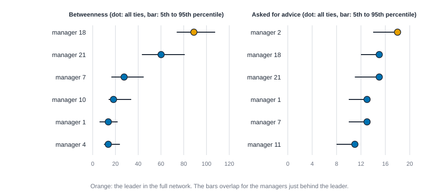

# Reporting a network analysis {#sec-reporting}

::: {.callout-note appearance="simple"}
## Prerequisites
@sec-centrality, @sec-tests-and-null-models and @sec-reproducibility. We reuse Krackhardt's 21 managers, the Florentine marriages and Zachary's karate club, and the habit of reading a number against a random baseline. The case studies (@sec-case-florentine) show the habits of this chapter on one network from start to finish.
:::

::: {.callout-tip appearance="simple"}
## The short version
A number from network software is a true statement about a calculation. A sentence like "this person is the power broker" is a claim about the world, and the number doesn't carry it there. This chapter gives you a four-part recipe for writing a result so it says what was computed, what it means here, how sure we are, and what it doesn't show. It also gives a short checklist to run before any number leaves your desk, three before-and-after rewrites of over-claiming paragraphs, and a look at the small guidance files that ship with this book.
:::

::: {.callout-tip appearance="simple"}
## Why you might care
The sentence people read is the result, and people act on sentences: they promote, fire, fund and ignore. Writing it carefully is cheap, and it protects the people in your data and your own credibility.
:::

## Introduction

You ran the analysis. The software printed a table, and one row is at the top. Now someone is going to read a sentence about it: your manager, a reviewer, a client, or a program that turns your numbers into a summary. The sentence they read is the result. The table was only the raw material.

This chapter is about the distance between the two. A number like "betweenness 88.9" is a true statement about a computation. A sentence like "manager 18 is the firm's power broker" is a claim about the world, and the number does not carry it there. Between them sit a convention you chose, a boundary somebody drew, ties somebody recorded, and a story you are tempted to tell. Most bad network results are not arithmetic errors. They are claims that outran their numbers.

By the end you should be able to:

- write a result as a claim with four parts, so a reader can see what was computed and what was inferred;
- run a short checklist before any number leaves your desk;
- choose measures from the question, and know when two measures are one measure in a costume;
- say how much a ranking moves when the data wobble, and why a bootstrap is a risky way to say it for networks;
- rewrite an over-claiming paragraph into one you can defend;
- record enough about a run that someone else, or you in a year, can reproduce it;
- read and use the machine-readable cards that ship with this book, and know what no program should do for you.

The method is not clever. It is a set of habits, and the habits are cheap compared with the cost of printing a wrong sentence.

## From output to claim

Start with the smallest possible example. Three managers: Ana asks Ben for advice, and Ben asks Cleo. Draw it as arrows, Ana to Ben to Cleo. Ben lies on the only route from Ana to Cleo, so Ben's betweenness is 1: one pair of other people has its only shortest route through him. (Cleo to Ana has no route at all, because the arrows only run one way, so that pair adds nothing.) Of the two ordered pairs of the other two people (Ana to Cleo and Cleo to Ana), Ben is on the route for one.

Now say it out loud in three ways.

1. "Ben has betweenness 1."
2. "Ben is on the only advice route from Ana to Cleo."
3. "Ben controls the advice that reaches Cleo."

The first is the output. The second is a reading of it in this setting. The third is a claim about what Ben does, and nothing in the network contains it: perhaps Ben forwards everything, perhaps he never answers, perhaps Ana also phones Cleo and the phone call is not in the data. The distance from the second sentence to the third is the distance this chapter is about.

### The anatomy of a claim

A defensible result has four parts, and a reader should be able to point to each.

| Part | The question it answers | For manager 18, below |
| --- | --- | --- |
| What was computed | Which measure, on which network, with which convention? | Directed betweenness, on 190 advice ties among 21 managers, each tie running from asker to person asked |
| What it means here | In this setting, with this kind of tie, what does the number say? | Manager 18 sits on more shortest advice chains between other managers than anyone else |
| How sure | What happens to the answer if the data or the choices change a little? | First in 92.5% of runs that drop a random tenth of the ties, and never lower than second |
| What it does not show | Which tempting conclusions does the number not support? | Not control, intent or influence; not that advice only follows shortest chains; not other firms or other years |

Write all four, even when the third and fourth are short. A claim missing its first part cannot be checked, one missing its second cannot be understood, one missing its third cannot be trusted, and one missing its fourth will be over-read by someone, probably the person who is in a hurry.

Here are the numbers behind that table. The code computes four measures for Krackhardt's advice network [@krackhardt1987cognitive], shows the managers with the most betweenness, and then repeats the computation after ignoring the arrows, which is a choice many people make without noticing they made it.

::: {.panel-tabset group="language"}

## R

```r
library(knappnet)

# Krackhardt's 21 managers: "To whom do you go for advice?" One row per tie, from asker to person asked.
managers <- read.csv("data/krackhardt/nodes.csv")
names(managers)[names(managers) == "name"] <- "id"
edges <- read.csv("data/krackhardt/edges.csv")
advice <- data.frame(source = edges$from[edges$relation == "advice"], target = edges$to[edges$relation == "advice"])
g <- net_frame(advice, nodes = managers, directed = TRUE, quiet = TRUE)

scores <- data.frame(
  manager = managers$id, level = managers$level,
  asked = as.numeric(net_degree(g, mode = "in")), asks = as.numeric(net_degree(g, mode = "out")),
  betweenness = as.numeric(net_betweenness(g)), eigenvector = as.numeric(net_eigen(g))
)
# The same ties with the arrows ignored: a pair counts once, whoever asked.
pairs <- unique(data.frame(source = pmin(advice$source, advice$target), target = pmax(advice$source, advice$target)))
by_pairs <- as.numeric(net_betweenness(net_frame(pairs, nodes = managers, directed = FALSE, quiet = TRUE)))

c(managers = nrow(managers), advice_ties = nrow(advice), density = round(nrow(advice) / (21 * 20), 3),
  ties_as_pairs = nrow(pairs))
top <- head(scores[order(-scores$betweenness), ], 4)
top$betweenness <- round(top$betweenness, 1)
top$eigenvector <- round(top$eigenvector, 3)
top

# Betweenness with the arrows and without, for the top three of each view and for manager 18.
views <- data.frame(manager = managers$id, with_arrows = scores$betweenness, ignoring_arrows = by_pairs)
views$rank_with <- rank(-views$with_arrows, ties.method = "min")
views$rank_ignoring <- rank(-views$ignoring_arrows, ties.method = "min")
shown <- views[views$rank_with <= 3 | views$rank_ignoring <= 3 | views$manager == 18, ]
shown <- shown[order(shown$rank_with), ]
shown$with_arrows <- round(shown$with_arrows, 1)
shown$ignoring_arrows <- round(shown$ignoring_arrows, 1)
shown
```

::: {.code-output}
```text
     managers   advice_ties       density ties_as_pairs 
       21.000       190.000         0.452       145.000 
   manager level asked asks betweenness eigenvector
18      18     2    15   17        88.9       0.780
21      21     2    15   11        60.1       0.920
7        7     1    13    8        27.6       0.767
10      10     3     9   14        18.3       0.410
   manager with_arrows ignoring_arrows rank_with rank_ignoring
18      18        88.9             4.3         1             7
21      21        60.1             3.1         2            11
7        7        27.6             3.5         3             9
15      15         6.1             9.1         9             1
2        2         5.9             6.4        10             3
9        9         4.0             6.5        13             2
```
:::

## Python

```python
import csv
import numpy as np
import networkx as nx

# Krackhardt's 21 managers: "To whom do you go for advice?" One row per tie, from asker to person asked.
with open("data/krackhardt/edges.csv") as f:
    arcs = list(csv.DictReader(f))
with open("data/krackhardt/nodes.csv") as f:
    level = {int(r["name"]): int(r["level"]) for r in csv.DictReader(f)}
advice = [(int(r["from"]), int(r["to"])) for r in arcs if r["relation"] == "advice"]

G = nx.DiGraph()
G.add_nodes_from(range(1, 22))
G.add_edges_from(advice)
between = nx.betweenness_centrality(G, normalized=False)
eigen = nx.eigenvector_centrality_numpy(G)
print(f"{G.number_of_nodes()} managers, {G.number_of_edges()} advice ties, density {nx.density(G):.3f}")
print(f"{'manager':<9}{'level':>6}{'asked':>7}{'asks':>6}{'betweenness':>13}{'eigenvector':>13}")
for v in sorted(G, key=lambda v: -between[v])[:4]:
    print(f"{v:<9}{level[v]:>6}{G.in_degree(v):>7}{G.out_degree(v):>6}{between[v]:>13.1f}{eigen[v] / max(eigen.values()):>13.3f}")

# The same ties with the arrows ignored: a pair counts once, whoever asked.
pairs = {tuple(sorted(a)) for a in advice}
U = nx.Graph()
U.add_nodes_from(range(1, 22))
U.add_edges_from(pairs)
between_u = nx.betweenness_centrality(U, normalized=False)
rank = lambda b, v: 1 + sum(x > b[v] for x in b.values())
print(f"{len(advice)} ties as arrows, {len(pairs)} ties as pairs")
for label, b in [("with arrows", between), ("ignoring arrows", between_u)]:
    top = sorted(b, key=lambda v: -b[v])[:3]
    print(f"{label:<16}" + ", ".join(f"manager {v} ({b[v]:.1f})" for v in top))
print(f"manager 18 ranks {rank(between, 18)} with arrows and {rank(between_u, 18)} ignoring them")
```

::: {.code-output}
```text
21 managers, 190 advice ties, density 0.452
manager   level  asked  asks  betweenness  eigenvector
18            2     15    17         88.9        0.780
21            2     15    11         60.1        0.920
7             1     13     8         27.6        0.767
10            3      9    14         18.3        0.410
190 ties as arrows, 145 ties as pairs
with arrows     manager 18 (88.9), manager 21 (60.1), manager 7 (27.6)
ignoring arrows manager 15 (9.1), manager 9 (6.5), manager 2 (6.4)
manager 18 ranks 1 with arrows and 7 ignoring them
```
:::

## Rust

```rust
use knappnet::metrics::eigenvector::{compute_eigenvector_centrality, EigenvectorOptions};
use knappnet::{compute_betweenness, compute_degree, BetweennessOptions, DegreeMode, Graph};
use std::collections::BTreeSet;

// Krackhardt's 21 managers: "To whom do you go for advice?" One row per tie, from asker to person asked.
// Managers are numbered 1 to 21; positions are 0 to 20.
let text = std::fs::read_to_string("data/krackhardt/edges.csv")?;
let level: Vec<i64> = std::fs::read_to_string("data/krackhardt/nodes.csv")?
    .lines().skip(1).map(|l| l.split(',').nth(3).unwrap().parse().unwrap()).collect();
let advice: Vec<(i64, i64)> = text.lines().skip(1)
    .map(|l| l.split(',').collect::<Vec<_>>())
    .filter(|c| c[2] == "advice")
    .map(|c| (c[0].parse::<i64>().unwrap() - 1, c[1].parse::<i64>().unwrap() - 1))
    .collect();
// One helper we will reuse: a network on n people from a list of ties.
let build = |n: usize, ties: &[(i64, i64)], directed: bool| -> Result<Graph, knappnet::Error> {
    let from: Vec<i64> = ties.iter().map(|t| t.0).collect();
    let to: Vec<i64> = ties.iter().map(|t| t.1).collect();
    Graph::from_edges(n, &from, &to, None, directed)
};

let g = build(21, &advice, true)?;
let asked = compute_degree(&g, DegreeMode::In, true);
let asks = compute_degree(&g, DegreeMode::Out, true);
let between = compute_betweenness(&g, BetweennessOptions::default())?;
let eigen = compute_eigenvector_centrality(&g, EigenvectorOptions::default())?;
println!("21 managers, {} advice ties, density {:.3}", advice.len(), advice.len() as f64 / 420.0);
println!("{:<9}{:>6}{:>7}{:>6}{:>13}{:>13}", "manager", "level", "asked", "asks", "betweenness", "eigenvector");
let mut order: Vec<usize> = (0..21).collect();
order.sort_by(|&a, &b| between[b].partial_cmp(&between[a]).unwrap());
for &v in &order[..4] {
    println!("{:<9}{:>6}{:>7}{:>6}{:>13.1}{:>13.3}", v + 1, level[v], asked[v], asks[v], between[v], eigen.values[v]);
}

// The same ties with the arrows ignored: a pair counts once, whoever asked.
let pairs: Vec<(i64, i64)> = advice.iter().map(|&(a, b)| (a.min(b), a.max(b))).collect::<BTreeSet<_>>().into_iter().collect();
let between_u = compute_betweenness(&build(21, &pairs, false)?, BetweennessOptions::default())?;
let rank = |b: &[f64], v: usize| 1 + b.iter().filter(|&&x| x > b[v]).count();
println!("{} ties as arrows, {} ties as pairs", advice.len(), pairs.len());
for (label, b) in [("with arrows", &between), ("ignoring arrows", &between_u)] {
    let mut top: Vec<usize> = (0..21).collect();
    top.sort_by(|&x, &y| b[y].partial_cmp(&b[x]).unwrap());
    let shown: Vec<String> = top[..3].iter().map(|&v| format!("manager {} ({:.1})", v + 1, b[v])).collect();
    println!("{label:<16}{}", shown.join(", "));
}
println!("manager 18 ranks {} with arrows and {} ignoring them", rank(&between, 17), rank(&between_u, 17));
```

::: {.code-output}
```text
21 managers, 190 advice ties, density 0.452
manager   level  asked  asks  betweenness  eigenvector
18            2     15    17         88.9        0.780
21            2     15    11         60.1        0.920
7             1     13     8         27.6        0.767
10            3      9    14         18.3        0.410
190 ties as arrows, 145 ties as pairs
with arrows     manager 18 (88.9), manager 21 (60.1), manager 7 (27.6)
ignoring arrows manager 15 (9.1), manager 9 (6.5), manager 2 (6.4)
manager 18 ranks 1 with arrows and 7 ignoring them
```
:::

:::

Read the first table across. Manager 18 and manager 21 are both vice presidents (level 2). Both were named by 15 colleagues, but manager 18 also asks 17 colleagues for advice while manager 21 asks 11, and manager 18 has far more betweenness (88.9 against 60.1). The CEO, manager 7, is third on betweenness, with 27.6. The density, 0.452, says nearly half of all possible advice arrows are present, so this is a crowded network where many routes are short and many are tied.

Now read the second half. With the arrows kept, 190 ties become 190 arrows. Ignoring them, 45 pairs of managers appear in both directions and collapse, leaving 145 ties. The ranking changes completely: manager 15 comes first and manager 18 drops to seventh. Neither answer is a mistake. They answer different questions: "who sits on chains of asking" and "who sits on chains of contact, however it started". A report that does not say which one it computed is not reporting.

## A reporting checklist

Run these seven questions before you write the sentence. Each has a way to answer it with code, and most of the answers are one line in the results paragraph.

1. **Network definition and boundary.** Who is in the network, who could have been, and who decided? Krackhardt's 21 managers are one firm's managers, not its staff, so a clerk who is a key advice source does not exist in these data. Anything at the edge of a boundary looks more peripheral than it is.
2. **Tie meaning and direction.** What does one tie stand for, and does it point? We saw above that ignoring the arrows moved manager 18 from first to seventh. State the tie in a phrase ("asks for advice"), say whether it is directed, and say whether you counted repeated ties.
3. **Missing data.** Which ties could be missing, and are they missing at random? A manager who is hard to interview loses ties in a way that is not random. Missing ties change which routes are shortest, so route-based measures (betweenness, closeness) are the most fragile. Research on how errors move centrality scores [@borgatti2006robustness; @kossinets2006effects] is why this item is on the list.
4. **Measure and convention.** Which measure answers your question (next section), and which of its conventions did you use? Directed or undirected, normalized or not, weights read as distances or as strengths, which neighbors count for eigenvector scores. Tools disagree, and the R functions in this book take a `convention` argument for exactly this reason. Write down the one you used.
5. **Null or comparison.** Compared with what? A number alone says nothing. Compare with a random network that keeps what you want to hold fixed (see @sec-tests-and-null-models), or with a plain alternative such as degree. In @sec-case-florentine the Medici's betweenness is about what their six marriages would give in random networks with the same degrees, which changes the sentence you can write.
6. **Stress checks.** Does the answer survive leaving out some ties, one actor, or a different but reasonable choice? Next sections.
7. **Uncertainty.** How wide is the range of answers across the checks, and have you reported the range, not just the middle? A claim without a range implies a precision you did not measure.

A short version of the same list, to keep beside the keyboard: *what, here, how sure, not.* It is the anatomy of a claim again, which is the point. The checklist is how you earn the third and fourth parts.

## Choosing what to report

Question first, measure second. It sounds obvious, and it is the step most often skipped. Software offers thirty centralities, and it is easy to report the one that came out most interesting. That is how a result gets chosen by its answer instead of by its question.

Borgatti's point [@borgatti2005centrality] is that a measure carries a story about how things move through a network: along shortest routes, along any route, by being passed on or by being broadcast. Choose the measure whose story matches the process you care about, and say so. The classic menu [@freeman1978centrality] is small:

| Your question | A measure that fits | Its story |
| --- | --- | --- |
| Who has the most direct contacts? | Degree (in or out, for directed ties) | Direct reach, no routes involved |
| Who can reach everyone in the fewest steps? | Closeness | Distance to the rest of the network |
| Who sits on the routes between others? | Betweenness | Shortest routes pass through you |
| Who is connected to well-connected people? | Eigenvector | Importance spreads along ties |

If your question does not name a process (for example "who matters?"), the right answer is to ask the question again before you compute anything.

### When two measures are one measure

A second reason to choose, not to dump: many of the measures say nearly the same thing on real networks. If two measures agree to within a hair, reporting both says one thing twice and makes the result look broader than it is. The way to know is to correlate them on the network you have, using ranks (Spearman's rank correlation, a score from $-1$ to $+1$ for how alike two lineups of the same people are, where 1 means the same order), because we care about who comes first, not by how much.

::: {.panel-tabset group="language"}

## R

```r
# Florentine marriages (undirected) and Krackhardt advice (directed), four measures each.
florence <- net_frame(read.csv("data/florentine/edges.csv"), directed = FALSE, quiet = TRUE)
round(cor(data.frame(
  degree = as.numeric(net_degree(florence)), closeness = as.numeric(net_closeness(florence, normalized = TRUE)),
  betweenness = as.numeric(net_betweenness(florence)), eigenvector = as.numeric(net_eigen(florence))
), method = "spearman"), 2)

round(cor(scores[, c("asked", "asks", "betweenness", "eigenvector")], method = "spearman"), 2)
```

::: {.code-output}
```text
            degree closeness betweenness eigenvector
degree        1.00      0.78        0.77        0.93
closeness     0.78      1.00        0.83        0.83
betweenness   0.77      0.83        1.00        0.68
eigenvector   0.93      0.83        0.68        1.00
            asked  asks betweenness eigenvector
asked        1.00 -0.34        0.39        0.97
asks        -0.34  1.00        0.64       -0.33
betweenness  0.39  0.64        1.00        0.40
eigenvector  0.97 -0.33        0.40        1.00
```
:::

## Python

```python
from scipy.stats import spearmanr

# Florentine marriages (undirected) and Krackhardt advice (directed), four measures each.
with open("data/florentine/edges.csv") as f:
    marriages = [tuple(r) for r in list(csv.reader(f))[1:]]
F = nx.Graph(marriages)
fam = list(F.nodes)
close, btw, eig = nx.closeness_centrality(F), nx.betweenness_centrality(F, normalized=False), nx.eigenvector_centrality_numpy(F)
florence = {"degree": [F.degree(v) for v in fam], "closeness": [close[v] for v in fam],
            "betweenness": [btw[v] for v in fam], "eigenvector": [eig[v] for v in fam]}
managers = list(range(1, 22))
krack = {"asked": [G.in_degree(v) for v in managers], "asks": [G.out_degree(v) for v in managers],
         "betweenness": [between[v] for v in managers], "eigenvector": [eigen[v] for v in managers]}
for label, table in [("Florentine marriages", florence), ("Krackhardt advice", krack)]:
    rho = spearmanr(np.array(list(table.values())).T)[0]
    print(label)
    print(" " * 12 + "".join(f"{k[:11]:>12}" for k in table))
    for k, row in zip(table, rho):
        print(f"{k[:11]:<12}" + "".join(f"{x:>12.2f}" for x in row))
```

::: {.code-output}
```text
Florentine marriages
                  degree   closeness betweenness eigenvector
degree              1.00        0.78        0.77        0.93
closeness           0.78        1.00        0.83        0.83
betweenness         0.77        0.83        1.00        0.68
eigenvector         0.93        0.83        0.68        1.00
Krackhardt advice
                   asked        asks betweenness eigenvector
asked               1.00       -0.34        0.39        0.97
asks               -0.34        1.00        0.64       -0.33
betweenness         0.39        0.64        1.00        0.40
eigenvector         0.97       -0.33        0.40        1.00
```
:::

## Rust

```rust
use knappnet::metrics::closeness::{compute_closeness, ClosenessOptions};

// Spearman's rho is the Pearson correlation of the ranks; tied scores share their average rank.
let ranks = |x: &[f64]| -> Vec<f64> {
    x.iter().map(|&a| {
        let below = x.iter().filter(|&&b| b < a - 1e-9).count() as f64;
        let same = x.iter().filter(|&&b| (b - a).abs() <= 1e-9).count() as f64;
        below + (same + 1.0) / 2.0
    }).collect()
};
let pearson = |x: &[f64], y: &[f64]| -> f64 {
    let (mx, my) = (x.iter().sum::<f64>() / x.len() as f64, y.iter().sum::<f64>() / y.len() as f64);
    let sxy: f64 = x.iter().zip(y).map(|(a, b)| (a - mx) * (b - my)).sum();
    let sxx: f64 = x.iter().map(|a| (a - mx).powi(2)).sum();
    let syy: f64 = y.iter().map(|b| (b - my).powi(2)).sum();
    sxy / (sxx * syy).sqrt()
};
let rho = |x: &[f64], y: &[f64]| pearson(&ranks(x), &ranks(y));
// A percentile by straight-line interpolation between neighboring values.
let percentile = |v: &[f64], p: f64| -> f64 {
    let mut s = v.to_vec();
    s.sort_by(|a, b| a.partial_cmp(b).unwrap());
    let pos = p / 100.0 * (s.len() - 1) as f64;
    let (lo, hi) = (pos.floor() as usize, pos.ceil() as usize);
    s[lo] + (s[hi] - s[lo]) * (pos - lo as f64)
};
let table = |label: &str, cols: &[(&str, Vec<f64>)]| {
    println!("{label}");
    println!("{:<12}{}", "", cols.iter().map(|c| format!("{:>12}", c.0)).collect::<String>());
    for a in cols {
        let row: String = cols.iter().map(|b| format!("{:>12.2}", rho(&a.1, &b.1))).collect();
        println!("{:<12}{row}", a.0);
    }
};

let marriage_text = std::fs::read_to_string("data/florentine/edges.csv")?;
let marriages: Vec<(&str, &str)> = marriage_text.lines().skip(1).map(|l| l.split_once(',').unwrap()).collect();
let mut families: Vec<&str> = Vec::new();
for &(a, b) in &marriages {
    for f in [a, b] {
        if !families.contains(&f) { families.push(f); }
    }
}
let at = |f: &str| families.iter().position(|x| *x == f).unwrap() as i64;
let ties: Vec<(i64, i64)> = marriages.iter().map(|&(a, b)| (at(a), at(b))).collect();
let florence = build(families.len(), &ties, false)?;
table("Florentine marriages", &[
    ("degree", compute_degree(&florence, DegreeMode::All, true)),
    ("closeness", compute_closeness(&florence, ClosenessOptions { normalized: true, ..Default::default() })?),
    ("betweenness", compute_betweenness(&florence, BetweennessOptions::default())?),
    ("eigenvector", compute_eigenvector_centrality(&florence, EigenvectorOptions::default())?.values),
]);
table("Krackhardt advice", &[
    ("asked", asked.clone()), ("asks", asks.clone()),
    ("betweenness", between.clone()), ("eigenvector", eigen.values.clone()),
]);
```

::: {.code-output}
```text
Florentine marriages
                  degree   closeness betweenness eigenvector
degree              1.00        0.78        0.77        0.93
closeness           0.78        1.00        0.83        0.83
betweenness         0.77        0.83        1.00        0.68
eigenvector         0.93        0.83        0.68        1.00
Krackhardt advice
                   asked        asks betweenness eigenvector
asked               1.00       -0.34        0.39        0.97
asks               -0.34        1.00        0.64       -0.33
betweenness         0.39        0.64        1.00        0.40
eigenvector         0.97       -0.33        0.40        1.00
```
:::

:::

On the Florentine marriages (undirected, 15 families), degree and eigenvector scores agree closely (0.93), while betweenness and eigenvector agree much less (0.68). On Krackhardt's advice network (directed, 21 managers) the agreement is even sharper in one place and absent in another. The number of colleagues who named a manager ("asked") and that manager's eigenvector score line up at 0.97, which is as near to the same ranking as you will see on real data. But "asked" and "asks" correlate at -0.34: being sought out and seeking out are different things in this firm, and if you reported one as "advice activity" you would be hiding the other. Betweenness is related more to "asks" (0.64) than to "asked" (0.39), a pattern consistent with a dense network where people who go to many colleagues sit on many chains, though correlation alone does not show why.

Three lessons for reporting:

- When a pair of measures correlates above about 0.9 on your network (here, asked and eigenvector), report one and say the other agrees, with the number. Do not present them as two findings.
- When two measures that sound alike do not agree ("asked" and "asks"), that is the finding. Report both and say they differ.
- A correlation between measures is a property of one network. The Florentine and Krackhardt tables are not the same table, and you cannot carry the 0.97 to your own data. Compute it on yours.

## Uncertainty and stability

Networks are one observation of one situation. There is no sample of 200 firms behind Krackhardt's 21 managers, so a classical standard error has nothing to stand on. What you can say is how much the answer moves if the data were a little different. That is a stability statement, and it is honest as long as you call it that.

### Resampling ties

The simplest check is the one the betweenness card asks for: drop a random fraction of the ties, recompute, and see whether the ranking holds. For each run, compute the scores again and record three things about the leader of the full network: how often it is still first, how often it is in the top three, and how closely the whole ranking tracks the original (Spearman's rank correlation between the run and the full-network scores). Do it two hundred times and look at the spread.

The Rust code uses a fixed scrambling recipe instead of a random number generator, so every run drops exactly the same ties and prints the same numbers. The R and Python tabs are blank here: knappnet's packages do not yet expose a function that drops ties over many replicates (`net_perturb()` and `net_stability()` are the missing pieces). With a real generator, record the seed (more below).

::: {.panel-tabset group="language"}

## R

```r
# TODO(code, R): needs net_perturb() (drop a random share of ties over many replicates) and net_stability() (how often the leader stays first, rank range, rank correlation with the original). Use the Rust tab.
```

::: {.code-output}
```text
TODO(output)
```
:::

## Python

```python
# TODO(code, Python): needs net_perturb() (drop a random share of ties over many replicates) and net_stability() (how often the leader stays first, rank range, rank correlation with the original). Use the Rust tab.
```

::: {.code-output}
```text
TODO(output)
```
:::

## Rust

```rust
// A fixed scrambling recipe, so that every language drops exactly the same ties: replicate r
// gives tie i the key frac(sin(12.9898 i + 78.233 r) * 43758.5453), and the 19 smallest keys are dropped.
let key = |i: usize, r: usize| {
    let x = (i as f64 * 12.9898 + r as f64 * 78.233).sin() * 43758.5453;
    x - x.floor()
};
let measure_runs = |ties: &[(i64, i64)]| -> Result<[Vec<f64>; 2], knappnet::Error> {
    let h = build(21, ties, true)?;
    Ok([compute_degree(&h, DegreeMode::In, true), compute_betweenness(&h, BetweennessOptions::default())?])
};
let original = [asked.clone(), between.clone()];
let mut runs = Vec::new();
for r in 1..=200 {
    let mut by_key: Vec<usize> = (0..190).collect();
    by_key.sort_by(|&a, &b| key(a + 1, r).partial_cmp(&key(b + 1, r)).unwrap());
    let kept: Vec<(i64, i64)> = advice.iter().enumerate()
        .filter(|(i, _)| !by_key[..19].contains(i)).map(|(_, &t)| t).collect();
    runs.push(measure_runs(&kept)?);
}

println!("{:<12}{:>7}{:>7}{:>7}{:>12}{:>10}{:>8}", "measure", "leader", "first", "top 3", "rank range", "mean rho", "5% rho");
for (j, name) in ["asked", "betweenness"].iter().enumerate() {
    let lead = (1..21).fold(0, |best, v| if original[j][v] > original[j][best] { v } else { best });
    let ranks: Vec<usize> = runs.iter().map(|s| 1 + s[j].iter().filter(|&&x| x > s[j][lead]).count()).collect();
    let rhos: Vec<f64> = runs.iter().map(|s| rho(&s[j], &original[j])).collect();
    let share = |ok: &dyn Fn(usize) -> bool| ranks.iter().filter(|&&k| ok(k)).count() as f64 / ranks.len() as f64;
    println!("{:<12}{:>7}{:>7.3}{:>7.3}{:>8} to {}{:>10.3}{:>8.3}", name, lead + 1, share(&|k| k == 1), share(&|k| k <= 3),
             ranks.iter().min().unwrap(), ranks.iter().max().unwrap(),
             rhos.iter().sum::<f64>() / rhos.len() as f64, percentile(&rhos, 5.0));
}
println!("if you resampled the 190 ties with replacement, about {:.0} distinct ties would survive", 190.0 * (1.0 - (1.0 - 1.0 / 190.0_f64).powi(190)));
```

::: {.code-output}
```text
measure      leader  first  top 3  rank range  mean rho  5% rho
asked             2  0.965  1.000       1 to 3     0.967   0.940
betweenness      18  0.925  1.000       1 to 2     0.945   0.888
if you resampled the 190 ties with replacement, about 120 distinct ties would survive
```
:::

:::

The leader on "asked" is manager 2 and the leader on betweenness is manager 18. Dropping 19 of 190 ties, manager 2 is first in 96.5% of the runs and manager 18 in 92.5%. In no run does manager 2 fall below third place, or manager 18 below second. The mean rank correlation with the full ranking is 0.967 for "asked" and 0.945 for betweenness, and 95% of runs are at 0.940 or above for "asked" and 0.888 or above for betweenness. Betweenness is the more fragile of the two, which fits a measure that depends on exact routes, but both rankings are sturdy at this level of noise. @fig-stability shows the six highest managers on each measure, with the middle 90% of the runs as a bar.

{#fig-stability fig-alt="Two panels, each listing six managers. Left, betweenness: manager 18 has the highest dot at 88.9 with a bar from 73.8 to 107.6; the next dot, manager 21, is at 60.1 with a bar from 43.3 to 80.9. Right, number of people who asked each manager for advice: manager 2 has the highest dot at 18 with a bar from 14.0 to 18.0."}

Look at what the bars say. Manager 18's bar and manager 21's bar overlap, between about 74 and 81. So "18 is first" holds in most runs, and "18 is far ahead of 21" does not: in some runs, 21 comes close. The defensible sentence says "first", not "far ahead". On the right, every bar ends at the dot, because dropping ties can only lower someone's in-degree. Always ask whether the perturbation you chose can move scores in only one direction.

Two limits to say out loud. First, the check removes ties and nothing else. It cannot tell you about managers outside the 21, about arrows that were recorded but never happened, or about ties missing in a systematic way. Second, 10% is a choice. Dropping 20% or 30% makes the claim weaker, and you should report the level you tested. Exercise 4 asks you to try more.

### Why a bootstrap is a risky way to say this for networks

In ordinary statistics you would resample the data with replacement (a bootstrap) and read off a confidence interval. For network data that is a trap, for three reasons.

- **Ties are not independent draws.** Resampling the 190 ties with replacement keeps only about 120 distinct ties (a tie is left out of a resample with probability $(1-1/190)^{190}$, about 0.37; in plain words, each of the 190 draws misses a given tie with chance 189 out of 190, and 190 misses in a row multiplies out to about 37 percent) and repeats the others. A repeated tie is not a stronger tie. The resample is a sparser, odder network than the one you observed, and its betweenness scores are not scores of any network anyone could have collected.
- **Actors are not independent either.** Resampling people instead of ties duplicates actors, creates ties between copies of the same person, and inflates their degree.
- **Resampling the data cannot show you what you did not collect.** A bootstrap of 21 managers has no way to ask about the 22nd, so it is silent about the boundary.

So report this kind of check as what it is: *how much the answer moves if about a tenth of the recorded ties were absent*. It is a robustness statement. A confidence interval is a different claim, about a population, and for one observed network you usually cannot make it. Model-based uncertainty exists for some questions (see @sec-ergm and the null models of @sec-tests-and-null-models), and the book of Kolaczyk [@kolaczyk2009statistical] is the place to go for statistical inference on network data when you need it.

## Figures that do not mislead

@sec-visualization has the full discussion of layouts and encodings. Here is the part that matters for claims.

- **A layout is a choice, not a measurement.** Spring and stress layouts [@fruchterman1991graph; @kamada1989algorithm] try to put close nodes close on the page, but left, right, up and down mean nothing. Two layouts of the same network can suggest different stories. Say which layout, and do not read distances on the page as findings.
- **Size encodes one measure, and the reader will believe it.** If node size shows in-degree, the biggest node looks like the leader of everything. In the advice network the biggest node by "asked" is manager 2, and by betweenness manager 18. A picture sized by one and discussed with the other misleads without a single false number. Put the encoded measure in the caption.
- **Do not label only the winners.** If you label only the top three, readers cannot see how much of a lead they have. Label a spread of nodes, or none.
- **A hairball hides what it contains.** Our advice network has only 21 managers and 190 arrows, a density of 0.452. Drawn as arrows it is a knot. A matrix (21 by 21, 420 cells) shows every tie and every non-tie, and can be sorted by department or level. As a rule of thumb, when more than about a third of all possible ties are present, prefer the matrix.
- **Show the uncertainty.** @fig-stability shows the bars as well as the dots. A ranking with its range tells the reader which gaps are real.
- **Say what the picture is not.** A diagram of formal reporting lines next to an advice network invites the reading that one explains the other. If that is not your claim, say so.

## Three rewrites

The best way to learn what a defensible sentence looks like is to take a bad one apart. Each of the three below is a paragraph you could read in a real report. For each we show the paragraph, find what is wrong with it using numbers we compute, and rewrite it.

### Rewrite 1: the broker

> Manager 18 is the real power broker at the firm. With a betweenness of 88.9, far above everyone else, 18 controls what advice reaches the rest of the company. The CEO scores only 27.6, so he has little say. The company should keep 18 happy.

What is wrong, using the numbers above:

- "Power" and "controls" are about behavior and intent. Betweenness counts shortest routes through a position. It does not know whether manager 18 forwards, filters or ignores.
- "Far above everyone else" is true of manager 18 against the CEO (27.6) but not of manager 21 (60.1), and the bars overlap in @fig-stability.
- "Little say" reads a low betweenness for the CEO as low influence. The CEO is named for advice by 13 people, and a formal role carries authority that advice chains do not record.
- The direction was not reported. Ignoring the arrows, manager 18 is seventh.
- Nothing was said about how sure, how the ties were collected, or what the network covers.

A defensible rewrite:

> In Krackhardt's advice network of 21 managers (190 ties, each from the manager who asks to the manager asked), manager 18 has the highest directed betweenness, 88.9; manager 21 is second at 60.1 and the CEO, manager 7, third at 27.6. This means manager 18 sits on more shortest advice chains between other managers than anyone else. The ranking is mostly stable: when a random tenth of the ties is dropped, 200 times, manager 18 is first in 92.5% of runs and never lower than second, but the bar for manager 21 overlaps, so the lead over 21 is not certain. It depends on direction: ignoring who asked, manager 18 ranks seventh. The data are one firm's managers, one question, one moment. They show position on advice chains. They do not show that manager 18 controls, filters or benefits from what passes, or anything about managers outside these 21.

### Rewrite 2: the rivals

> The two leaders of the karate club, Mr. Hi and the Officer, were the most central members and they were rivals. Their rivalry is why the club split into two groups.

The karate club [@zachary1977information] is a network of 34 members, where a tie means two members were seen together outside club meetings. Here is what the data can say.

::: {.panel-tabset group="language"}

## R

```r
# Karate club: two factions after the split; a tie means two members were seen together outside club meetings (how often is ignored here).
karate_nodes <- read.csv("data/karate/nodes.csv")
karate_edges <- read.csv("data/karate/edges.csv")[, c("source", "target")]
club <- net_frame(karate_edges, nodes = karate_nodes, directed = FALSE, quiet = TRUE)
club_scores <- data.frame(id = karate_nodes$id, faction = karate_nodes$faction,
                          degree = as.numeric(net_degree(club)), betweenness = round(as.numeric(net_betweenness(club)), 1))
leaders <- head(club_scores[order(-club_scores$betweenness), ], 2)
leaders

side <- setNames(karate_nodes$faction, karate_nodes$id)
crossing <- side[as.character(karate_edges$source)] != side[as.character(karate_edges$target)]
c(ties = nrow(karate_edges), crossing = sum(crossing),
  touching_leaders = sum(crossing & (karate_edges$source %in% leaders$id | karate_edges$target %in% leaders$id)))

# Without the two leaders: how big are the pieces?
keep <- !karate_edges$source %in% leaders$id & !karate_edges$target %in% leaders$id
rest <- net_frame(karate_edges[keep, ], nodes = karate_nodes[!karate_nodes$id %in% leaders$id, ], directed = FALSE, quiet = TRUE)
sort(table(net_components(rest)$membership), decreasing = TRUE)

# Leave out each tie in turn: is the top member still the same?
# TODO(code, R): needs net_stability() (re-run a measure with one tie left out at a time)
```

::: {.code-output}
```text
   id faction degree betweenness
1   1  Mr. Hi     16       231.1
34 34 Officer     17       160.6
            ties         crossing touching_leaders 
              78               11                4 

 1  2  3 
26  5  1 
```
:::

## Python

```python
# Karate club: two factions after the split, a tie means two members were seen together outside club meetings.
with open("data/karate/nodes.csv") as f:
    side = {int(r["id"]): r["faction"] for r in csv.DictReader(f)}
with open("data/karate/edges.csv") as f:
    club = [(int(r["source"]), int(r["target"])) for r in csv.DictReader(f)]
K = nx.Graph(club)
degree, btw_k = dict(K.degree()), nx.betweenness_centrality(K, normalized=False)
lead = sorted(K, key=lambda v: -btw_k[v])[:2]
print(f"{K.number_of_nodes()} members, {K.number_of_edges()} ties; top betweenness: " +
      ", ".join(f"member {v} ({btw_k[v]:.1f}, degree {degree[v]}, {side[v]})" for v in lead))
cross = [t for t in club if side[t[0]] != side[t[1]]]
print(f"{len(cross)} of {len(club)} ties cross the two factions; {sum(set(t) & set(lead) != set() for t in cross)} of them touch member {lead[0]} or {lead[1]}")
rest = K.copy()
rest.remove_nodes_from(lead)
print("without them the club falls into pieces of size " + ", ".join(str(len(c)) for c in sorted(nx.connected_components(rest), key=len, reverse=True)))
# Leave out each tie in turn: is the top member still the same?
# TODO(code, Python): needs a leave-one-tie-out stability check in the Python package
```

::: {.code-output}
```text
34 members, 78 ties; top betweenness: member 1 (231.1, degree 16, Mr. Hi), member 34 (160.6, degree 17, Officer)
11 of 78 ties cross the two factions; 4 of them touch member 1 or 34
without them the club falls into pieces of size 26, 5, 1
```
:::

## Rust

```rust
use knappnet::metrics::topography::{find_components, ComponentKind};

// Karate club: two factions after the split; a tie means two members were seen together outside club meetings (how often is ignored here).
let node_text = std::fs::read_to_string("data/karate/nodes.csv")?;
let side: Vec<&str> = node_text.lines().skip(1).map(|l| l.split(',').nth(1).unwrap()).collect();
let club_text = std::fs::read_to_string("data/karate/edges.csv")?;
let club: Vec<(i64, i64)> = club_text.lines().skip(1).map(|l| {
    let c: Vec<&str> = l.split(',').collect();
    (c[0].parse::<i64>().unwrap() - 1, c[1].parse::<i64>().unwrap() - 1)
}).collect();
let karate = build(34, &club, false)?;
let degree_k = compute_degree(&karate, DegreeMode::All, true);
let between_k = compute_betweenness(&karate, BetweennessOptions::default())?;
let mut top: Vec<usize> = (0..34).collect();
top.sort_by(|&a, &b| between_k[b].partial_cmp(&between_k[a]).unwrap());
let lead = [top[0], top[1]];
let shown: Vec<String> = lead.iter()
    .map(|&v| format!("member {} ({:.1}, degree {}, {})", v + 1, between_k[v], degree_k[v], side[v])).collect();
println!("34 members, {} ties; top betweenness: {}", club.len(), shown.join(", "));

let cross: Vec<&(i64, i64)> = club.iter().filter(|t| side[t.0 as usize] != side[t.1 as usize]).collect();
let touching = cross.iter().filter(|t| lead.contains(&(t.0 as usize)) || lead.contains(&(t.1 as usize))).count();
println!("{} of {} ties cross the two factions; {touching} of them touch member {} or {}", cross.len(), club.len(), lead[0] + 1, lead[1] + 1);

// Without the two leaders: how big are the pieces?
let keep: Vec<usize> = (0..34).filter(|v| !lead.contains(v)).collect();
let new_position = |v: i64| keep.iter().position(|&k| k as i64 == v);
let rest: Vec<(i64, i64)> = club.iter()
    .filter_map(|t| Some((new_position(t.0)? as i64, new_position(t.1)? as i64))).collect();
let mut sizes = find_components(&build(keep.len(), &rest, false)?, ComponentKind::Weak).sizes;
sizes.sort_by(|a, b| b.cmp(a));
println!("without them the club falls into pieces of size {}", sizes.iter().map(|s| s.to_string()).collect::<Vec<_>>().join(", "));

// Leave out each tie in turn: is the top member still the same?
let mut stays = 0;
for i in 0..club.len() {
    let kept: Vec<(i64, i64)> = club.iter().enumerate().filter(|(j, _)| *j != i).map(|(_, &t)| t).collect();
    let b = compute_betweenness(&build(34, &kept, false)?, BetweennessOptions::default())?;
    let best = (1..34).fold(0, |best, v| if b[v] > b[best] { v } else { best });
    if best == lead[0] { stays += 1; }
}
println!("member {} stays first on betweenness in {stays} of {} leave-one-tie-out runs", lead[0] + 1, club.len());
```

::: {.code-output}
```text
34 members, 78 ties; top betweenness: member 1 (231.1, degree 16, Mr. Hi), member 34 (160.6, degree 17, Officer)
11 of 78 ties cross the two factions; 4 of them touch member 1 or 34
without them the club falls into pieces of size 26, 5, 1
member 1 stays first on betweenness in 78 of 78 leave-one-tie-out runs
```
:::

:::

Members 1 (Mr. Hi's faction) and 34 (the Officer's faction) have the most betweenness, 231.1 and 160.6, with 16 and 17 ties. They sit on opposite sides. Without them, the club falls into pieces of 26, 5 and 1 members, and member 1 stays first in all 78 leave-one-tie-out runs, so the position of 1 is not an accident of one tie. Only 11 of the 78 ties cross the two factions, and just 4 of those touch the two leaders. What the network does not contain is rivalry: a tie means two members were seen together outside meetings, and nothing in that is a dispute. The faction labels record which side each member took, so using the faction to explain the ties is circular. Whatever caused the split, these data cannot be the evidence for it.

A defensible rewrite:

> In the karate club network of 34 members and 78 ties (a tie means two members were seen together outside club meetings; how often was ignored), members 1 and 34 have the highest betweenness (231.1 and 160.6; degrees 16 and 17) and belong to opposite factions. Without them the network breaks into pieces of 26, 5 and 1 members. Only 11 of 78 ties cross the factions, 4 of them through these two members, and member 1's lead holds when any one tie is left out. This shows that the two faction leaders are the main bridges in the observed ties and that most ties stay within a faction. It does not show why the club split, nor that the leaders' rivalry was the reason.

### Rewrite 3: the friendship effect

> Friendship drives advice-seeking at the firm: friends are much more likely to be asked for advice, so the company should build friendships to spread knowledge.

Here the claim is about the relation between two networks on the same 21 managers. The measure is the share of friendship ties that are also advice ties in the same direction. To judge whether 59% is a lot, we need a baseline, and the honest one for a network relation is to keep both networks as they are and scramble *who is who* (a relabeling test, the idea behind QAP [@krackhardt1987qap; @hubert1976quadratic] from @sec-tests-and-null-models).

::: {.panel-tabset group="language"}

## R

```r
# TODO(code, R): needs net_relabel_test() (share of ties of one relation that are also in another, against the same count after relabeling who is who). Use the Rust tab.
```

::: {.code-output}
```text
TODO(output)
```
:::

## Python

```python
# TODO(code, Python): needs net_relabel_test() (share of ties of one relation that are also in another, against the same count after relabeling who is who). Use the Rust tab.
```

::: {.code-output}
```text
TODO(output)
```
:::

## Rust

```rust
// Do friends tend to be the people you ask for advice? Friendship ties that are also advice ties,
// against the same count after relabeling who is who (1,000 scrambles by the same recipe).
let friend: Vec<(usize, usize)> = text.lines().skip(1)
    .map(|l| l.split(',').collect::<Vec<_>>())
    .filter(|c| c[2] == "friendship")
    .map(|c| (c[0].parse::<usize>().unwrap() - 1, c[1].parse::<usize>().unwrap() - 1))
    .collect();
let advice_set: std::collections::HashSet<(i64, i64)> = advice.iter().copied().collect();
let share = |p: &[usize]| {
    friend.iter().filter(|&&(a, b)| advice_set.contains(&(p[a] as i64, p[b] as i64))).count() as f64 / friend.len() as f64
};
let identity: Vec<usize> = (0..21).collect();
let observed = share(&identity);
let null: Vec<f64> = (1..=1000).map(|r| {
    let mut shuffled: Vec<usize> = (0..21).collect();
    shuffled.sort_by(|&a, &b| key(a + 1, r).partial_cmp(&key(b + 1, r)).unwrap());
    share(&shuffled)
}).collect();
println!("{} friendship ties; {:.0} are also advice ties ({:.3}); advice density {:.3}",
         friend.len(), observed * friend.len() as f64, observed, advice.len() as f64 / 420.0);
println!("after relabeling: mean {:.3}, middle 90% {:.3} to {:.3}, {:.3} of scrambles reach {:.3}",
         null.iter().sum::<f64>() / null.len() as f64, percentile(&null, 5.0), percentile(&null, 95.0),
         null.iter().filter(|&&x| x >= observed - 1e-9).count() as f64 / null.len() as f64, observed);
```

::: {.code-output}
```text
102 friendship ties; 60 are also advice ties (0.588); advice density 0.452
after relabeling: mean 0.451, middle 90% 0.343 to 0.559, 0.019 of scrambles reach 0.588
```
:::

:::

Of 102 friendship ties, 60 (58.8%) are also advice ties, against an advice density of 45.2%. After relabeling the managers 1,000 times, the share averages 0.451 and the middle 90% runs from 0.343 to 0.559. Only 1.9% of the scrambles reach 0.588. So the overlap is bigger than label-scrambling gives, and still, 42 of the 102 friendship ties (41%) have no advice tie in the same direction.

What stops this from supporting the original sentence:

- "Drives" is causal. An overlap does not show which comes first. People may befriend those they work with, or ask the friends they trust, or both follow from sitting in the same department.
- Both relations were reported by the same managers in the same study, so some overlap may come from the way a person answers two similar questions.
- "Should build friendships" is a recommendation, and nothing here tests an intervention.
- One firm, one moment: nothing licenses "friends in general".

A defensible rewrite:

> Among Krackhardt's 21 managers, 60 of 102 friendship ties (59%) coincide with an advice tie in the same direction, against 45% of all possible ordered pairs holding an advice tie. After relabeling the managers at random 1,000 times, 1.9% of the draws reach a share as high as 59%, so the overlap is larger than chance relabeling gives. This describes how two reported relations line up in one firm. It does not show that friendship leads people to seek advice (or the reverse), and 41% of friendship ties carry no advice tie in the same direction.

Look at the shape of all three rewrites. Each states the tie and the data, gives numbers, says what was tried, and ends with what the result does not show. That structure is the anatomy of a claim and the pattern in the cheat sheet at the end.

## Provenance: so the result can be reproduced

A result you cannot reproduce is an anecdote. Record, next to every number you report:

- **The data**, with a version or a hash. Names of files change and files get edited. A short hash of the file or of the network is cheap and settles arguments.
- **The network you built from it.** Which relation, which rows were dropped, what direction, whether repeated ties were merged.
- **The measure and its convention preset**, with every parameter that was not the default.
- **Random choices.** The seed for any generator, or the recipe, if you use a fixed scrambling like the one above. Also the number of draws.
- **The software and its version.** Different versions of a library compute the same measure differently sometimes.
- **The checks you ran**, and the ones you tried and did not report.

The knappnet engine keeps part of this for you. Each result from `net_run()` in R carries a provenance record: the measure and its revision, the parameters, a hash of the network it saw, the engine version and the seed for randomized measures. In Rust the graph carries a content hash that you can ask for. For libraries without that, such as NetworkX, you write the record by hand, which is also fine.

::: {.panel-tabset group="language"}

## R

```r
# What the engine itself records about one run: the measure and its revision, the network it saw, and a hash of that network.
prov <- net_provenance(net_run(g, "betweenness"))
data.frame(
  measure = prov$measure, revision = prov$revision, engine = prov$engine,
  nodes = prov$graph$n, ties = prov$graph$m, directed = prov$graph$directed,
  graph_hash = if (is.null(prov$graph$content)) NA else substr(prov$graph$content, 1, 16)
)
```

::: {.code-output}
```text
      measure revision engine nodes ties directed graph_hash
1 betweenness        2  0.0.1    21  190     TRUE         NA
```
:::

## Python

```python
import hashlib
import json

with open("data/krackhardt/edges.csv", "rb") as f:
    raw = f.read()
record = {"data": "krackhardt/edges.csv, relation advice", "file_sha256": hashlib.sha256(raw).hexdigest()[:16],
          "ties": len(advice), "directed": True, "measure": "betweenness, normalized=False",
          "library": f"networkx {nx.__version__}", "drops": "key(i, r), 19 of 190 ties, r = 1 to 200"}
print(json.dumps(record, indent=1))
```

::: {.code-output}
```text
{
 "data": "krackhardt/edges.csv, relation advice",
 "file_sha256": "42c02a3815b52628",
 "ties": 190,
 "directed": true,
 "measure": "betweenness, normalized=False",
 "library": "networkx 3.7",
 "drops": "key(i, r), 19 of 190 ties, r = 1 to 200"
}
```
:::

## Rust

```rust
// What the engine itself records about one run: the network it saw and a hash of that network.
let digest: String = g.content_hash().iter().take(8).map(|b| format!("{b:02x}")).collect();
println!("measure betweenness, engine {}", knappnet::provenance::ENGINE_VERSION);
println!("graph: {} nodes, {} ties, directed {}, content hash {digest}", g.node_count(), g.edge_count(), g.is_directed());
```

::: {.code-output}
```text
measure betweenness, engine 0.0.1
graph: 21 nodes, 190 ties, directed true, content hash ad4fe3bd37923e66
```
:::

:::

The Rust hash covers the network as the engine saw it (its ties in order, direction, node count), not the file it came from, while a record of the file hashes the file, so the two cannot be compared. In R the hash shows as missing here: the engine records it only once the hash has been computed, and nothing had asked for it by then, so do not count on it and record your own, as the Python tab does with the file's hash. A record in this shape, kept with the output, is the minimum. @sec-reproducibility goes further: how to pin versions, how to cache and when a cached result is valid, and how to rerun a whole analysis from scratch.

## Cards: guidance a program can use

Next to each principal measure and model this book keeps a short, checked guidance file called a card, one TOML file (a plain-text file of labeled lines) per measure in `books/sna/cards/`. They are written for two readers. A person reads one before reporting a number. A program that runs a measure, such as an MCP server that calls knappnet, reads the same file before it writes a sentence about the result. The README in that folder lists the fields, `tools/check_books.py` refuses a card with a missing field or a citation that is not in the bibliography, and `tools/export_machine.py` exports them all as `cards.json` with the book.

Here is the betweenness card, read line by line.

- `id`, `title`, `kind`, `chapter`: the name, whether it is a `measure` or a `model`, and the chapter that teaches it.
- `summary` and `answers`: one sentence on what it computes ("how many of the shortest routes between other pairs of nodes pass through this node") and the question in plain words ("who sits on the routes that connect everyone else"). Use `answers` to decide whether this is the right measure at all.
- `data_requirements`: what the network must look like. Betweenness needs ties that can carry something along a route, ideally one connected piece, and a stated direction. A program can test these: is the network directed, is it connected?
- `assumptions`: what must hold for the number to mean what it seems to: flow along shortest routes only, weights read as distances, a right boundary, few missing ties. These cannot be checked from the data. They go into the report as conditions.
- `readings`: a list of `{context, high, low}`. The same number reads differently in a marriage network, an office, a supply chain and a friendship group. A program picks the entry that matches the user's setting and says so.
- `pitfalls`: the common mistakes, such as "reading high betweenness as power or influence" and "treating tied scores as ordered".
- `checks`: the stress tests: recompute without the top node, drop 5 to 10 percent of the ties several times, compare with a degree-preserving null, compare with degree and closeness, look at the neighbors. A program should run what it can and list what it did not.
- `do_not_claim`: conclusions the number cannot support, including "that the node controls, influences or benefits from what flows through it, without evidence about behavior".
- `report_template`: a sentence with `{blanks}` in curly braces, each one something that has to be computed. For betweenness: tie meaning, number of nodes, node type, the node, its value, its share of routes, its rank, whether the ranking is stable and under what perturbation, whether the value is higher or lower than in a null, and a summary of the null.
- `related`, `sources`, `knappnet`: the neighbors in the guidance graph, the references (checked against the bibliography), and the call that computes it in each language.

Models differ in the guidance they need. The ERGM card has no number to read: its `readings` are per coefficient ("edges", "same-attribute", "shared-partner"), its `checks` are goodness of fit and convergence, and its template is not complete until it can report both. The E-I index card's first check is to compute the value you would expect if ties ignored the groups, because the raw index depends on group sizes. Same fields, different content: that is why the card is a table of fields, and not a paragraph.

### How a program uses a card

The loop has six steps, and the order matters.

1. Find the card for the measure that was asked for.
2. Check `data_requirements` against the network. Stop and say so when one fails.
3. Run the measure.
4. Run the `checks` that can be run, and record what each one gave, including those that came out badly.
5. Fill the `report_template`, but only if every blank has a computed value. If a blank is empty, report what is missing and do not write the sentence.
6. Append the relevant `do_not_claim` lines and the `assumptions` that cannot be tested.

The next block does steps 1 and 5 for the betweenness card, using what this chapter has computed. It reads the card without a TOML library, so you can see how little it takes, and finds the blanks the template needs. It knows the values for the first nine, from the runs above. It does not know the last two, because we have not compared manager 18 with a random network that keeps every manager's number of colleagues asked and asking. The program should therefore not write the sentence.

::: {.panel-tabset group="language"}

## R

```r
# TODO(code, R): needs net_card() (read a measure card: its checks, claims to avoid and report-template blanks, and list the blanks that the runs so far cannot fill). Use the Rust tab.
```

::: {.code-output}
```text
TODO(output)
```
:::

## Python

```python
# TODO(code, Python): needs a card reader in the Python package (read a measure card: its checks, claims to avoid and report-template blanks). Use the Rust tab.
```

::: {.code-output}
```text
TODO(output)
```
:::

## Rust

```rust
// Read a card the way a program would: no TOML library, just its own lines.
let card: Vec<String> = std::fs::read_to_string("data/../cards/betweenness.toml")?.lines().map(String::from).collect();
let entries = |key: &str| -> usize {
    let start = card.iter().position(|l| *l == format!("{key} = [")).unwrap();
    card[start + 1..].iter().position(|l| l == "]").unwrap() // lines of a list field, up to its closing bracket
};
let line = card.iter().find(|l| l.starts_with("report_template")).unwrap();
let template = line.split_once(" = ").unwrap().1.trim_matches('"');
let mut blanks: Vec<&str> = Vec::new();
for part in template.split('{').skip(1) {
    let name = part.split('}').next().unwrap();
    if !blanks.contains(&name) { blanks.push(name); }
}
println!("{} checks, {} claims to avoid, {} blanks in the report template", entries("checks"), entries("do_not_claim"), blanks.len());
println!("blanks: {}", blanks.join(", "));

// What the runs so far can fill in. Anything else stays blank, and the program does not write the sentence.
let have = ["tie_meaning", "n", "node_type", "node", "value", "share", "rank", "stable_or_not", "perturbation"];
let missing: Vec<&str> = blanks.iter().copied().filter(|b| !have.contains(b)).collect();
println!("not ready to report; still missing: {}", missing.join(", "));
```

::: {.code-output}
```text
5 checks, 4 claims to avoid, 11 blanks in the report template
blanks: tie_meaning, n, node_type, node, value, share, rank, stable_or_not, perturbation, higher_or_lower, null_summary
not ready to report; still missing: higher_or_lower, null_summary
```
:::

:::

The two missing blanks, `higher_or_lower` and `null_summary`, correspond to the card's check "compare with a null model that keeps the degree sequence". Our rewrite of the manager 18 paragraph did not make that comparison either, and we were careful not to say anything that depends on it. A program reading the card would flag it. A person writing quickly should too.

## What must never be automated

A program can run measures, repeat checks, fill blanks and print numbers faster and more consistently than a person. A few things should stay out of its reach, or at least out of its final say.

- **Interpretation without the checks.** A sentence written from a measure alone, with no stress test, no comparison and no statement of what the tie means, is a guess that looks like a result. If a check cannot be run, the report says "not checked".
- **Causal language.** "Because", "drives", "leads to", "controls", "caused" and "in order to" do not appear in a sentence that rests on one observed network. The ties are what was recorded, and the cards' `do_not_claim` lists say the same thing measure by measure. A program should refuse to produce these words from network output, and a person should delete them.
- **Statements of intent.** A network contains who is tied to whom. It does not contain why, nor what anyone meant to do. Words like "chooses", "prefers" and "wants" belong to a different kind of evidence.
- **Selecting the interesting measure.** A program that tries thirty measures and reports the one with the largest gap is doing the thing that makes p-values meaningless. The measures to report are chosen from the question before the numbers are seen.
- **Silent defaults.** The convention preset, the direction, the boundary and the seed all go in the report. A summary that omits them has hidden a choice.
- **Sensitive conclusions about people.** A high or low score about a named person is a statement about someone, and the person reading it may act on it. Check it twice, hedge it, and think about whether it should be written down at all.

None of this makes programs less useful. It makes the human step explicit: when the card says `do_not_claim`, a person decided what that meant.

## Exercises

1. **By hand.** Four managers: A asks B, B asks C, and C asks D (arrows run from the person who asks). Find the betweenness of B and of C. What share of the ordered pairs of other managers does each one sit on?
2. **By hand.** Write the four parts of a claim (computed, meaning, how sure, not shown) for the sentence "Bea has degree 4." What do you need to know before you can write each part?
3. **By hand.** A network has four ties. You resample four ties with replacement. On average, how many distinct ties survive? Why does that make the resample a different network from the one you observed?
4. **Coding.** Rerun the stability check with 38 ties dropped (20%) and then 57 (30%). How do the share of runs in which the leader stays first and the mean rank correlation change? Report which of the two leaders is more fragile.
5. **Coding.** The friendship rewrite measured the share of friendship ties that are also advice ties. Measure the share of advice ties that are also friendship ties, with the same relabeling null. Why is the share different from 59%, and is the conclusion the same?
6. **Interpretation.** On a network you analyzed, in-degree and eigenvector scores correlate at 0.97 and betweenness correlates with each at about 0.4. A colleague wants a table with all three. What do you suggest, and what do you say about each?
7. **Interpretation.** The Medici example (@sec-case-florentine) has the Medici first on betweenness at 47.5. Write a defensible two-sentence report for a newspaper, using only the numbers in that chapter.
8. **Interpretation.** In the advice network, ignoring the arrows puts manager 18 seventh. Give one reason to prefer the directed analysis and one reason to prefer the undirected one, and say what you would write in each case.
9. **Cards.** For the ERGM card, list the blanks in its `report_template` that a program could not fill without extra work, and say which `checks` supply them.
10. **Provenance.** You will give the stability table to a colleague who will rerun it on another computer in a year. List what you hand over, in order of what would hurt most to lose.

::: {.callout-note collapse="true"}
## Answers

1. B is on the routes A to C and A to D, so betweenness 2. C is on the routes A to D and B to D, so also 2. For each node there are 3 other managers and so 6 ordered pairs of other managers, of which only 2 have a route that passes through it: a share of 2/6 = 1/3. Most ordered pairs have no route at all, because the arrows only run one way. That is why the share says as much as the count.
2. *Computed:* which network (what is a tie, directed or not, repeated ties), and where "Bea" is in it, since degree 4 means different things if the network has 5 people or 500. *Meaning:* four direct contacts of the kind the tie records; in an advice network, four people she asks or is asked by (in or out must be stated). *How sure:* how many ties could be missing, and whether she would still have about four if one or two were absent. *Not shown:* that she is popular, powerful or important; those are claims about more than the count. Degree 4 compared with the average degree is the missing context.
3. On average about 2.7 of the 4 ties survive, so the resample is usually sparser than the original. Here is the count. A tie is left out of one draw with probability 3/4, so out of all four draws with probability $(3/4)^4 = 81/256$, about 0.316. The expected number of distinct ties is $4 \times (1 - 81/256) = 700/256$, about 2.73. A resample therefore usually has fewer than four ties and repeats some, so it is a sparser network than the one observed, and scores computed on it are scores of a network nobody observed.
4. Replace 19 by 38 and by 57 in the drop step (and in the checks, the range of ties). In my run the shares first with 38 dropped were 0.810 for the leader on "asked" and 0.850 for the leader on betweenness, with mean rank correlations of 0.935 and 0.894; with 57 dropped they were 0.735 and 0.750, with rank correlations of 0.898 and 0.835. At 10% the leader on "asked" was the steadier one, but as more ties are dropped the leader on betweenness holds first place a little better, while the whole betweenness ranking is less stable throughout. Your digits depend on the scrambling recipe, but the direction should be the same.
5. The same 60 ties overlap, but they are 60 of 190 advice ties, which is 31.6%, against a friendship density of 24.3% (102 of 420). After 1,000 relabelings in my run the share averages 0.243, the middle 90% runs from 0.189 to 0.300, and 1.4% of scrambles reach 0.316. The share differs because the base is different (the advice network has more ties than the friendship network), but the overlap and the conclusion are the same: more than relabeling gives, and nothing about cause.
6. Report one of in-degree and eigenvector and say the other agrees (rho 0.97), since they carry the same ranking. Report betweenness separately, because it correlates only about 0.4 with each and so measures something different, and say what question each answers. Listing all three as independent findings would make a single pattern look like three.
7. For example: "In the marriage network of 15 leading Florentine families, read as one snapshot, the Medici have the highest betweenness (47.5, first of 15), a lead that holds when any one marriage is left out and in 178 of 190 cases when any two are left out. This describes their position on marriage routes, and the network cannot show why they held it or what they did with it." The numbers are the ones in the case study.
8. Directed: advice has a direction, and "who asks whom" is the question, so routes should follow arrows; you would write "on chains of asking". Undirected: if the question is about who is in contact, with either side able to start, collapsing to 145 pairs may fit better; you would write "on chains of contact, whoever started". Either way, name the choice and the rank it produced (first with arrows, seventh without).
9. Blanks such as the terms, the fitting method, the standard error, `gof_summary` and `convergence_summary` can only be filled after the fit has run. The `checks` supply the last two: goodness of fit by simulation, and convergence diagnostics. The card says the sentence must not be written until both exist.
10. In order: the data file or its hash and the relation used; the direction and the rule for repeated ties; the measure and its convention; the recipe or seed and the number of drops; the software versions; the checks that were tried and not reported. Losing the data version or the seed makes the result unrepeatable, while losing the software versions makes it unrepeatable only sometimes.
:::

## A cheat sheet of defensible sentences

Fill the blanks from computed values, and delete any clause you cannot back.

| Purpose | Pattern |
| --- | --- |
| Define the network | "In this {tie meaning} network of {n} {node type} ({m} ties, {directed or not}, {how repeated ties were handled}), ..." |
| State a score | "... {node} has {measure} {value} ({convention}; rank {k} of {n})." |
| Say what it means | "This means {node} {plain reading in this setting}." |
| Compare | "In random networks that keep {what was held fixed}, the value averages {x} and the middle 90% runs from {a} to {b}, so this value is {higher, lower, or about what} we would expect." |
| Stability | "When a random {fraction} of ties is dropped {runs} times, {node} is first in {share} of runs and never below rank {k}." |
| Disagreement | "{Measure A} and {measure B} disagree about {node}: {A result}, {B result}. They answer different questions." |
| Boundary | "The data cover {who and when}; they say nothing about {who is outside}." |
| Limit | "This describes {position, pattern, overlap}. It does not show {why, intent, cause, other settings}." |
| Not checked | "{Check} was not run." |

Words to prefer: "is on", "sits between", "is tied to", "is larger than in", "is consistent with". Words to avoid unless you have other evidence: "controls", "drives", "causes", "prefers", "wants", "proves", "the key", "the real".

## Summary

::: {.callout-tip appearance="simple"}
A network result is a claim, and a claim has four parts: what was computed on what data with what convention, what it means in this setting, how sure we are, and what it does not show. Before reporting, run a seven-item check (boundary, tie meaning and direction, missing data, measure and convention, comparison, stress checks, uncertainty), choose measures from the question and not from the output, and keep one of any two measures that agree. Resample ties to show how far a ranking moves, and call it that, because a bootstrap of one observed network is a risky way to claim a confidence interval. Rewrite over-claims until they state the numbers, the checks and the limits. Record the data version, convention, seed and software so the result can be reproduced, and use the cards so a program and a person read the same guidance. No program should write causal or intent language from network output, or skip the checks. The one-line takeaway: write the sentence a skeptical reader can check.
:::

## Further reading

For why a measure must match the process you care about, @borgatti2005centrality, and for the classic ideas behind degree, closeness and betweenness, @freeman1978centrality. For how errors in the data move centrality scores, @borgatti2006robustness and @kossinets2006effects, and for missing data in model-based work, @robins2004missing. For a rigorous treatment of statistical inference for network data, @kolaczyk2009statistical, and for the textbooks that cover the whole field, @wasserman1994social and @newman2018networks. For a full worked analysis that uses this chapter's habits from start to finish, @sec-case-florentine, and for relabeling and degree-preserving null models, @sec-tests-and-null-models. The advice network comes from @krackhardt1987cognitive and the karate club from @zachary1977information.
