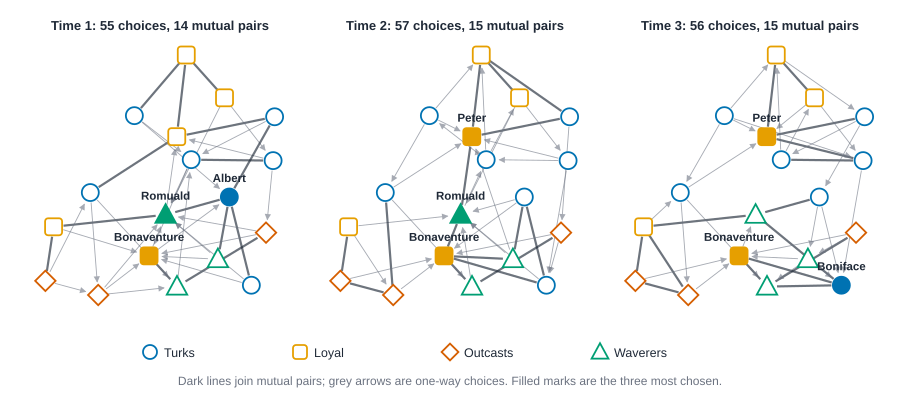

# Case study: the monastery, three waves of liking {#sec-case-sampson}

::: {.callout-note appearance="simple"}
## Prerequisites
@sec-subgroups, @sec-signed-and-valued and @sec-time. You will use communities and ways of comparing two partitions, signed ties, and the idea of describing waves of a network one at a time. @sec-homophily and @sec-tests-and-null-models are useful too.
:::

::: {.callout-tip appearance="simple"}
## The short version
Eighteen novices in a monastery were asked three times whom they liked best. This chapter asks whether their liking split into the factions a researcher had described. It didn't: the circles you find by looking only at who likes whom are not the researcher's groups, though they are fairly steady from one round to the next. The researcher's groups do line up with who the novices disliked, which mostly crossed group lines. Along the way you see how to compare against chance in a survey where everyone was told to name exactly three people.
:::

::: {.callout-tip appearance="simple"}
## Why you might care
Any time people are sorted into teams, departments or factions, someone will claim the teams are "real". This chapter shows how to check that claim against what people actually do, and how to avoid being fooled by the way the questions were asked.
:::

## The question

A small group, three snapshots, and a lot of ways to go wrong. That is the whole appeal of this data set. Samuel Sampson lived in a New England monastery as an experimenter and asked 18 novices, the men in training, whom they liked [@sampson1968novitiate]. The earlier chapters each used a slice of his data to teach one tool: the triad census over the three waves (@sec-triads-and-motifs), signed ties and balance at the third (@sec-signed-and-valued), group homophily at the third (@sec-homophily), and rank stability across the waves (@sec-time). This chapter takes the question that ties them together, and takes it all the way through.

The groups come from Sampson. He sorted the novices into the Young Turks, the Loyal Opposition, the Outcasts and a fourth, interstitial group that the data folder calls the Waverers. Several later analyses have used these data [@breiger1975algorithm; @white1976social], and the groups are part of how the monastery is usually described. So the natural question is this one:

> **Did the novices' liking sort into the factions Sampson described, and did any of that hold still across the three waves?**

Notice what the question leaves out. It doesn't ask why the groups formed, what caused the crisis the novices lived through, or who led whom. Liking choices by 18 men, three times, can describe who chose whom. They can't say what anyone wanted, or what anyone did next. We will come back to that at the end, in a list of what we can and can't say.

The plan has eight steps, and each is a habit worth keeping for any group you follow over time:

1. Look at the data and say what it can't show.
2. Describe each wave on its own, against a baseline that respects how the data were collected.
3. Ask who is popular, and whether that lasts.
4. Find the communities in each wave and compare them with the groups you were given.
5. Bring in the negative relation, and ask where the dislikes fall.
6. Ask how much changed between waves, and how much change chance alone would produce.
7. Stress-test: read the same data other ways, leave things out.
8. Write down what you found, with its limits, in a paragraph someone else could check.

## The data and its limits

The data are the ranked choices of 18 novices. For each relation Sampson asked every novice to name his top three. Liking was asked three times; the file calls them times 1, 2 and 3. The other relations (esteem, disliking, and so on) have a single wave each, collected with the third liking wave. Before any number, ask what that table is and isn't.

- **One small group.** Eighteen men in one monastery. Everything below is about them. Nothing here says how any other group of novices, or any other group of people, behaves.
- **The questionnaire fixes outdegree.** Everyone was asked for three names, so almost everyone made exactly three choices (a few named four when they gave tied ranks). That means the number of choices *made* is set by the instrument. Density, and the average number of ties a novice sends, can't move much by design. What *can* vary is who is chosen, and so who receives many choices.
- **Top three is not "likes".** A choice means "among the three I rank highest". A novice who is fond of eight others still names three, and a novice ranked fourth looks the same as one ranked seventeenth. The ranks are kept in the file (3 for a first choice, 1 for a third), and Step 7 uses them.
- **No clock.** The README of the data folder says that most of the data are retrospective, collected after the crisis in the cloister in which four novices were expelled and most of the others then left, and that liking was gathered at three times. The file has no dates. We don't know how far apart the waves were, or whether each was gathered as it happened or recalled afterward. We treat the waves as an order, not a clock.
- **Groups are a label, once.** Sampson's group is one tag per novice. The file can't show a novice changing groups, so any "movement" below is movement between the communities we compute, never between Sampson's groups. The folder also doesn't say which of Sampson's data he used to draw them, so we can't tell whether they describe the time of the first wave, the third, or the crisis itself.
- **Small groups, big gaps.** The Turks have 7 members, the Loyal 5, and the Outcasts and Waverers 3 each. A group of three is easy to over-read.
- **Disliking at one time only.** There is one wave of disliking, so we can say where dislikes fell at the third wave, and nothing about how they changed.

The code below runs the checks that matter for everything after: how many choices each wave holds and how many each novice made, whether anyone chose himself, and whether any pair was listed twice. Novices are numbered in the order of the data file.

::: {.panel-tabset group="language"}

## R

```r
library(knappnet)

# The 18 novices in the order of the data file, and the group Sampson put each in.
ids <- read.csv("data/sampson/nodes.csv")$name
novices <- data.frame(id = ids)
groups <- read.csv("data/sampson_groups/nodes.csv")
labels <- c("Turks", "Loyal", "Outcasts", "Waverers")
group <- match(groups$group[match(ids, groups$name)], labels)

# One row per ranked choice, with novices as numbers 1 to 18 in that order.
edges <- read.csv("data/sampson/edges.csv")
rows <- data.frame(a = match(edges$from, ids), b = match(edges$to, ids),
                   relation = edges$relation, wave = edges$time, rank = edges$rank)
pairs <- function(rel, w, min_rank = 1) {
  rows[rows$relation == rel & rows$wave == w & rows$rank >= min_rank, c("a", "b")]
}
lik <- lapply(1:3, function(w) pairs("liking", w))

# Checks on the liking waves: the questionnaire asked for three names.
do.call(rbind, lapply(1:3, function(w) {
  p <- lik[[w]]
  named <- tabulate(p$a, 18)
  data.frame(wave = w, choices = nrow(p), named_3 = sum(named == 3), named_4 = sum(named == 4),
             self_choices = sum(p$a == p$b), repeated_pairs = nrow(p) - nrow(unique(p)))
}))
table(sampson_group = labels[group])
```

::: {.code-output}
```text
  wave choices named_3 named_4 self_choices repeated_pairs
1    1      55      17       1            0              0
2    2      57      15       3            0              0
3    3      56      16       2            0              0
sampson_group
   Loyal Outcasts    Turks Waverers 
       5        3        7        3 
```
:::

## Python

```python
# TODO(code, Python): nothing to call yet: this tab only read the data and counted; it returns when the Python backend has a table reader for ranked-choice edge lists (net_read). Use the Rust tab.
```

::: {.code-output}
```text
TODO(output)
```
:::

## Rust

```rust
use knappnet::Graph;
use std::collections::{BTreeMap, BTreeSet};

// The 18 novices in the order of the data file, and the group Sampson put each in.
let name_text = std::fs::read_to_string("data/sampson/nodes.csv")?;
let names: Vec<&str> = name_text.lines().skip(1).map(|l| l.split(',').next().unwrap()).collect();
let group_text = std::fs::read_to_string("data/sampson_groups/nodes.csv")?;
let labels = ["Turks", "Loyal", "Outcasts", "Waverers"];
let group: Vec<i64> = names.iter().map(|n| {
    let line = group_text.lines().find(|l| l.starts_with(&format!("{n},"))).unwrap();
    labels.iter().position(|l| line.ends_with(l)).unwrap() as i64
}).collect();
let at = |name: &str| names.iter().position(|n| *n == name).unwrap();

// One row per ranked choice: (from, to, relation, wave, rank).
let edge_text = std::fs::read_to_string("data/sampson/edges.csv")?;
let rows: Vec<(usize, usize, &str, usize, i32)> = edge_text.lines().skip(1).map(|l| {
    let c: Vec<&str> = l.split(',').collect();
    (at(c[0]), at(c[1]), c[2], c[4].parse().unwrap(), c[5].parse().unwrap())
}).collect();
let pairs = |relation: &str, wave: usize, min_rank: i32| -> Vec<(usize, usize)> {
    rows.iter().filter(|r| r.2 == relation && r.3 == wave && r.4 >= min_rank).map(|r| (r.0, r.1)).collect()
};

// Checks on the liking waves: the questionnaire asked for three names.
for wave in 1..=3 {
    let p = pairs("liking", wave, 1);
    let mut named = vec![0usize; 18];
    for &(a, _) in &p { named[a] += 1; }
    let distinct: BTreeSet<&(usize, usize)> = p.iter().collect();
    println!("wave {wave}: {} choices; {} novices named 3 and {} named 4; self-choices {}; repeated pairs {}", p.len(),
        named.iter().filter(|&&d| d == 3).count(), named.iter().filter(|&&d| d == 4).count(),
        p.iter().filter(|t| t.0 == t.1).count(), p.len() - distinct.len());
}
let sizes: Vec<String> = (0..4).map(|g| format!("{} {}", labels[g], group.iter().filter(|&&x| x == g as i64).count())).collect();
println!("Sampson's groups: {}", sizes.join(", "));
```

::: {.code-output}
```text
wave 1: 55 choices; 17 novices named 3 and 1 named 4; self-choices 0; repeated pairs 0
wave 2: 57 choices; 15 novices named 3 and 3 named 4; self-choices 0; repeated pairs 0
wave 3: 56 choices; 16 novices named 3 and 2 named 4; self-choices 0; repeated pairs 0
Sampson's groups: Turks 7, Loyal 5, Outcasts 3, Waverers 3
```
:::

:::


The three liking waves hold 55, 57 and 56 choices. In wave 1, 17 novices named three people and one named four; in wave 2, 15 named three and 3 named four; in wave 3, 16 named three and 2 named four. Nobody chose himself, no pair is repeated, and the four groups have 7, 5, 3 and 3 members.

The small difference between 54 (18 times three) and 55 to 57 is the tied ranks. The point is the one in the list above: the count of choices is almost entirely the questionnaire. Keep it in mind for Step 1.

## Step 1: describe each wave

A description of a wave should say what is on the table and what it is compared with. Four things to look at: how many choices, how many pairs of novices chose each other, the share of choices that were returned, and how unequal popularity is.

The last two need a baseline. A returned share of 0.5 sounds like a lot, but we need to know what a monastery of 18 gets by luck. The right luck here keeps what the questionnaire fixed: **every novice makes his own number of choices, but picks the people at random.** That is the null model for this chapter. It differs from the configuration model of @sec-tests-and-null-models, which also fixes in-degree, because here in-degree is the very thing we want to ask about.

For each wave the code draws 2,000 random sets of choices this way, and reports the same two summaries as for the real wave: the share of choices that were returned, and the *spread* of popularity, which is the standard deviation of how many choices each novice received. The spread is large when a few novices collect most of the choices.

::: {.panel-tabset group="language"}

## R

```r
# TODO(code, R): needs a null model for directed choice data (net_random_choices(): every novice keeps his number of choices, picks others at random) and net_reciprocity compared against it; the Rust tab shows the numbers.
```

::: {.code-output}
```text
TODO(output)
```
:::

## Python

```python
# TODO(code, Python): the Python backend runs NetworkX only; this tab needs adjusted Rand and normalized mutual information (net_compare_partitions) and a random-choices or permutation null, which are not exposed yet. Use the Rust tab.
```

::: {.code-output}
```text
TODO(output)
```
:::

## Rust

```rust
use knappnet::metrics::descriptive::{compute_reciprocity, ReciprocityMode};
use knappnet::rng::Stream;
use knappnet::{compute_degree, DegreeMode};

let digraph = |p: &[(usize, usize)]| -> Result<Graph, knappnet::Error> {
    let from: Vec<i64> = p.iter().map(|t| t.0 as i64).collect();
    let to: Vec<i64> = p.iter().map(|t| t.1 as i64).collect();
    Graph::from_edges(18, &from, &to, None, true)
};
let lik: Vec<Vec<(usize, usize)>> = (1..=3).map(|w| pairs("liking", w, 1)).collect();
let named: Vec<Vec<usize>> = lik.iter().map(|p| (0..18).map(|i| p.iter().filter(|t| t.0 == i).count()).collect()).collect();
let sd = |x: &[f64]| {
    let m = x.iter().sum::<f64>() / x.len() as f64;
    (x.iter().map(|v| (v - m).powi(2)).sum::<f64>() / (x.len() as f64 - 1.0)).sqrt()
};
// Two summaries of a wave: the share of choices that were returned, and the spread of in-degree.
let summary = |g: &Graph| (compute_reciprocity(g, ReciprocityMode::Default), sd(&compute_degree(g, DegreeMode::In, true)));

// Random choices: every novice keeps his own number of choices, but picks others at random.
let random_choices = |named: &[usize], rng: &mut Stream| -> Vec<(usize, usize)> {
    let mut shuffle = vec![0usize; 17];
    let mut out = Vec::new();
    for (i, &d) in named.iter().enumerate() {
        rng.fill_permutation(&mut shuffle);
        out.extend(shuffle[..d].iter().map(|&k| (i, if k < i { k } else { k + 1 })));
    }
    out
};

let mut rng = Stream::new(1, 0);
println!("wave  ties  mutual  returned  chance  spread  chance  share as spread");
for w in 0..3 {
    let p = &lik[w];
    let (returned, spread) = summary(&digraph(p)?);
    let draws: Vec<(f64, f64)> = (0..2000).map(|_| summary(&digraph(&random_choices(&named[w], &mut rng)).unwrap())).collect();
    let mean = |f: &dyn Fn(&(f64, f64)) -> f64| draws.iter().map(f).sum::<f64>() / 2000.0;
    let as_wide = draws.iter().filter(|d| d.1 >= spread - 1e-9).count() as f64 / 2000.0;
    let mutual = p.iter().filter(|&&(a, b)| a < b && p.contains(&(b, a))).count();
    println!("{:<5} {:<5} {:<7} {:<9.3} {:<7.3} {:<7.2} {:<7.2} {:.3}", w + 1, p.len(), mutual, returned,
        mean(&|d| d.0), spread, mean(&|d| d.1), as_wide);
}
```

::: {.code-output}
```text
wave  ties  mutual  returned  chance  spread  chance  share as spread
1     55    14      0.509     0.180   2.34    1.60    0.007
2     57    15      0.526     0.184   2.31    1.64    0.012
3     56    15      0.536     0.183   1.78    1.62    0.289
```
:::

:::


In the real waves, between 51 and 54 percent of choices were returned (0.509, 0.526, 0.536), against about 0.18 for random choices. Mutual pairs are common: 14, 15 and 15. That is far beyond what luck gives with three choices each, and no reading of the questionnaire explains it, because it asks nobody to choose back.

Popularity is the interesting column. The spread of in-degree is 2.34 in wave 1 and 2.31 in wave 2, against about 1.6 for random choices; only 0.7 percent of random sets are as unequal in wave 1 and 1.2 percent in wave 2. In wave 3 the real spread is 1.78 against 1.62 by chance, and 29 percent of random sets are as unequal. So at the first two times a few novices stood out well beyond luck, and by the third time they stood out much less. @fig-sampson-case-waves draws the three waves with the same layout, with Sampson's groups marked.

{#fig-sampson-case-waves fig-alt="Three copies of the same 18 marks, one per time, joined by lines and arrows. The marks are circles for the Turks, squares for the Loyal, diamonds for the Outcasts and triangles for the Waverers. Time 1 shows 55 choices with 14 mutual pairs, time 2 shows 57 with 15, time 3 shows 56 with 15. Filled marks are the three most chosen: Romuald, Bonaventure, Albert at time 1, Romuald, Bonaventure, Peter at time 2 and Bonaventure, Peter, Boniface at time 3."}

Look at the picture before reading further. The three most chosen novices at time 1 are from three different groups, and at times 2 and 3 they come from two. If liking followed Sampson's groups you might expect the popular novices to sit inside their own group's tangle of ties, and the picture doesn't say so one way or the other. We will test it properly in Step 3.

## Step 2: who is popular, and does it last?

*In-degree*, the number of choices a novice receives, is the simplest popularity measure there is (@sec-centrality). Here it is the number of the other 17 who put him in their top three. Two questions: who is on top, and is the order the same from one wave to the next?

For the second we use the **Spearman correlation**, which compares two rankings and runs from $-1$ (reversed) through 0 (unrelated) to $+1$ (identical). In plain words: line the novices up from most to least chosen in wave 1, then again in wave 2. If the two lineups look alike, the number is near 1; if they look like two shuffled decks, it is near 0. To judge a correlation we need to know what two *unrelated* waves would give, so the code compares it with pairs of random waves built the same way as in Step 1. The "95th percentile" column is the correlation that only one random pair in twenty beats.

::: {.panel-tabset group="language"}

## R

```r
# TODO(code, R): needs the same random-choices null model, and a rank-correlation helper for in-degree across waves (net_rank_cor()); the Rust tab shows the numbers.
```

::: {.code-output}
```text
TODO(output)
```
:::

## Python

```python
# TODO(code, Python): the Python backend runs NetworkX only; this tab needs adjusted Rand and normalized mutual information (net_compare_partitions) and a random-choices or permutation null, which are not exposed yet. Use the Rust tab.
```

::: {.code-output}
```text
TODO(output)
```
:::

## Rust

```rust
let indegree = |p: &[(usize, usize)]| -> Vec<f64> {
    let mut v = vec![0.0; 18];
    for &(_, b) in p { v[b] += 1.0; }
    v
};
let received: Vec<Vec<f64>> = lik.iter().map(|p| indegree(p)).collect();

// The six novices chosen most often over the three waves.
let total = |i: usize| received.iter().map(|r| r[i]).sum::<f64>();
let mut order: Vec<usize> = (0..18).collect();
order.sort_by(|&a, &b| total(b).partial_cmp(&total(a)).unwrap().then(a.cmp(&b)));
println!("{:<12}{:<10}{:>5}{:>5}{:>5}", "novice", "group", "t1", "t2", "t3");
for &i in &order[..6] {
    println!("{:<12}{:<10}{:>5}{:>5}{:>5}", names[i], labels[group[i] as usize], received[0][i], received[1][i], received[2][i]);
}

// Spearman correlation of in-degree: rank each wave (ties share their average rank), then correlate.
let ranks = |x: &[f64]| -> Vec<f64> {
    x.iter().map(|&v| {
        let below = x.iter().filter(|&&w| w < v).count() as f64;
        let same = x.iter().filter(|&&w| w == v).count() as f64;
        below + (same + 1.0) / 2.0
    }).collect()
};
let spearman = |a: &[f64], b: &[f64]| -> f64 {
    let (ra, rb) = (ranks(a), ranks(b));
    let (ma, mb) = (ra.iter().sum::<f64>() / 18.0, rb.iter().sum::<f64>() / 18.0);
    let cross: f64 = ra.iter().zip(&rb).map(|(x, y)| (x - ma) * (y - mb)).sum();
    let (sa, sb): (f64, f64) = (ra.iter().map(|x| (x - ma).powi(2)).sum(), rb.iter().map(|y| (y - mb).powi(2)).sum());
    cross / (sa * sb).sqrt()
};
// If each wave were random choices with the same numbers of choices, how correlated would two waves be?
let random_waves: Vec<Vec<Vec<f64>>> = (0..2000)
    .map(|_| (0..3).map(|w| indegree(&random_choices(&named[w], &mut rng))).collect()).collect();
println!("waves  rank correlation  random: average  95th percentile  share as high");
for (a, b) in [(0, 1), (1, 2), (0, 2)] {
    let observed = spearman(&received[a], &received[b]);
    let mut null: Vec<f64> = random_waves.iter().map(|r| spearman(&r[a], &r[b])).collect();
    null.sort_by(|x, y| x.partial_cmp(y).unwrap());
    println!("{} vs {}  {:<17.2} {:<16.2} {:<16.2} {:.3}", a + 1, b + 1, observed, null.iter().sum::<f64>() / 2000.0,
        null[1899], null.iter().filter(|&&x| x >= observed - 1e-9).count() as f64 / 2000.0);
}
```

::: {.code-output}
```text
novice      group        t1   t2   t3
Romuald     Waverers      9    8    4
Bonaventure Loyal         7    8    6
Peter       Loyal         5    7    6
Berthold    Loyal         3    5    4
Victor      Waverers      4    3    5
Boniface    Turks         1    4    6
waves  rank correlation  random: average  95th percentile  share as high
1 vs 2  0.55              0.01             0.41             0.011
2 vs 3  0.68              0.00             0.41             0.002
1 vs 3  0.45              -0.01            0.39             0.026
```
:::

:::


Three novices lead the table: Romuald (9, 8, 4), Bonaventure (7, 8, 6) and Peter (5, 7, 6). But the order moves. Romuald is chosen by 9 novices at time 1 and 4 at time 3, and Boniface goes the other way, from 1 to 6. Rank correlations are 0.55 between times 1 and 2, 0.68 between 2 and 3, and 0.45 between 1 and 3. Random waves average about 0 and only one pair in twenty exceeds about 0.4, so the persistence is real; fewer than 3 percent of random pairs reach any of the three values. It is also moderate, and the further apart the waves the weaker it is.

Here is how to read in-degree in different settings, because the word "popular" carries a lot of unearned meaning.

- **A monastery or a school class**, as here. High in-degree says many peers put him in their top few. Low in-degree says few did, which in a top-three design is a weak signal: a novice is not "unliked" because nobody named him.
- **An office**, if the question were "whom do you go to for advice". High in-degree would describe where requests land. It may measure workload or seniority more than liking.
- **An online platform**, where in-degree is followers. Followers can be bought, inherited or auto-suggested, so the number can be high with little choosing behind it.

What the number does *not* show, in any of these settings: why the person is chosen, whether the choosers agree with each other (see Step 5), or that popularity does anything.

## Step 3: the factions

Now the main question. Sampson's groups are four labels. A network method can propose its own groups, and we can then ask how well the two agree.

The method is **Louvain** [@blondel2008fast], which moves people between groups to raise *modularity*, the share of ties inside groups minus what random ties with the same degrees would put there (@sec-subgroups). It needs an undirected network, so we count a pair as tied if either novice chose the other. We fix the seed and the resolution so the answer can be reproduced.

To compare two partitions we use the **adjusted Rand index** [@hubert1985comparing], from the Rand index [@rand1971objective]. Take every pair of novices and ask whether the two partitions agree about the pair: both put them together, or both put them apart. The adjusted index corrects for the agreement chance would give. Think of two people who each sort the same 18 novices into teams: the index asks how often they'd put the same two novices together, beyond what coin tosses would give. A small example you can check by hand: four novices A, B, C, D, with partition X = {A, B | C, D} and partition Y = {A, B, C | D}. Of the 6 pairs, X keeps 2 together (AB and CD), Y keeps 3 together (AB, AC and BC), and exactly 1 pair (AB) is together in both. Chance would give $2 \times 3 / 6 = 1$ pair together in both. With $a$ = pairs together in $X$, $b$ = pairs together in $Y$, $m$ = pairs together in both, and $N$ = all pairs,

$$\text{ARI} = \frac{m - ab/N}{(a + b)/2 - ab/N} = \frac{1 - 1}{2.5 - 1} = 0.$$

::: {.callout-tip title="In plain words"}
This answers: do two ways of sorting people into groups agree more than luck would? Read the symbols aloud. The letter $a$ is how many pairs of people the first sorting keeps together (2). The letter $b$ is the same for the second sorting (3). The letter $m$ is how many pairs both keep together (1). The letter $N$ is the number of pairs in all (6). Luck would give $ab/N = 2 \times 3 / 6 = 1$ shared pair, and the top of the fraction is "what we got minus what luck gives". The bottom is "the most we could have got minus what luck gives", with the average of $a$ and $b$, 2.5, as that most. So here $(1-1)/(2.5-1) = 0$: exactly as much agreement as luck. A score of 1 means identical groupings, and a negative score means the two disagree more than luck would.
:::

Zero means no more agreement than chance, and 1 means the same partition. We also report **normalized mutual information**, which asks how much knowing one partition tells you about the other, on a scale from 0 to 1 [@vinh2010information].

Two baselines come with every number. *Modularity of Sampson's groups* on the same network says whether his groups hold more ties inside than chance. And the *ARI by luck* is the ARI we'd see between the communities and the groups with the novices shuffled among the labels.

::: {.panel-tabset group="language"}

## R

```r
# Either direction counts as a tie, and each pair counts once.
undirected <- function(p) {
  both <- unique(data.frame(a = pmin(p$a, p$b), b = pmax(p$a, p$b)))
  net_frame(data.frame(source = ids[both$a], target = ids[both$b]), nodes = novices,
            directed = FALSE, quiet = TRUE)
}
# Louvain, resolution 1, unweighted: the community of each novice.
communities <- function(p, seed = 1) as.integer(net_louvain(undirected(p), resolution = 1, seed = seed))
ari <- function(a, b) net_compare_partitions(a, b, method = "adjusted_rand")
nmi <- function(a, b) net_compare_partitions(a, b, method = "nmi")

found <- lapply(lik, communities)
set.seed(1)
do.call(rbind, lapply(1:3, function(w) {
  g <- undirected(lik[[w]])
  here <- ari(found[[w]], group)
  # The groups with the novices shuffled: what agreement with Sampson's groups looks like by luck.
  by_luck <- sapply(1:2000, function(i) ari(found[[w]], sample(group)))
  round(data.frame(
    wave = w, communities = length(unique(found[[w]])),
    modularity = net_modularity(g, found[[w]]), groups_modularity = net_modularity(g, group),
    ari = here, nmi = nmi(found[[w]], group),
    luck_95th = quantile(by_luck, 0.95), share_as_high = mean(by_luck >= here - 1e-9),
    row.names = NULL
  ), 3)
}))

# Who is in which community? (T Turks, L Loyal, O Outcasts, W Waverers)
who <- data.frame(wave_1 = found[[1]], wave_2 = found[[2]], wave_3 = found[[3]],
                  row.names = paste0(ids, " (", substr(labels[group], 1, 1), ")"))
who[order(who$wave_3, who$wave_2, who$wave_1), ]
```

::: {.code-output}
```text
  wave communities modularity groups_modularity   ari   nmi luck_95th
1    1           3      0.276            -0.005 0.037 0.244     0.165
2    2           3      0.336            -0.043 0.170 0.361     0.139
3    3           3      0.443            -0.004 0.077 0.274     0.142
  share_as_high
1         0.352
2         0.037
3         0.194
                wave_1 wave_2 wave_3
Romuald (W)          1      1      1
Bonaventure (L)      1      1      1
Boniface (T)         1      1      1
Albert (T)           1      1      1
Amand (W)            1      1      1
Basil (O)            2      1      1
Victor (W)           3      1      1
Ambrose (L)          1      2      2
Elias (O)            3      2      2
Simplicius (O)       3      2      2
Mark (T)             3      3      2
Berthold (L)         2      3      3
Peter (L)            2      3      3
Louis (L)            2      3      3
Winfrid (T)          2      3      3
John Bosco (T)       2      3      3
Gregory (T)          2      3      3
Hugh (T)             2      3      3
```
:::

## Python

```python
# TODO(code, Python): the Python backend runs NetworkX only; this tab needs adjusted Rand and normalized mutual information (net_compare_partitions) and a random-choices or permutation null, which are not exposed yet. Use the Rust tab.
```

::: {.code-output}
```text
TODO(output)
```
:::

## Rust

```rust
use knappnet::metrics::community::{compute_modularity, find_louvain_communities};
use knappnet::metrics::partition::compare::{compare_partitions, CompareMethod};

// Either direction counts as a tie, and each pair counts once.
let undirected = |p: &[(usize, usize)]| -> Result<Graph, knappnet::Error> {
    let set: BTreeSet<(usize, usize)> = p.iter().map(|&(a, b)| (a.min(b), a.max(b))).collect();
    let from: Vec<i64> = set.iter().map(|t| t.0 as i64).collect();
    let to: Vec<i64> = set.iter().map(|t| t.1 as i64).collect();
    Graph::from_edges(18, &from, &to, None, false)
};
// Louvain, resolution 1, unweighted: the community of each novice.
let communities = |p: &[(usize, usize)], seed: u64| -> Result<Vec<i64>, knappnet::Error> {
    let found = find_louvain_communities(&undirected(p)?, 1.0, false, seed)?;
    Ok(found.membership.iter().map(|&m| m as i64).collect())
};
let ari = |a: &[i64], b: &[i64]| compare_partitions(a, b, CompareMethod::AdjustedRand).unwrap();
let nmi = |a: &[i64], b: &[i64]| compare_partitions(a, b, CompareMethod::NormalizedMutualInformation).unwrap();
// The groups with the novices shuffled: what agreement with Sampson's groups looks like by luck.
let shuffled_groups = |rng: &mut Stream| -> Vec<i64> {
    let mut order = vec![0usize; 18];
    rng.fill_permutation(&mut order);
    order.iter().map(|&i| group[i]).collect()
};

let found: Vec<Vec<i64>> = lik.iter().map(|p| communities(p, 1).unwrap()).collect();
println!("wave  communities  modularity  groups' modularity  ARI   NMI   ARI by luck: 95th pct  share as high");
for w in 0..3 {
    let graph = undirected(&lik[w])?;
    let k = found[w].iter().max().unwrap() + 1;
    let by_luck: Vec<f64> = (0..2000).map(|_| ari(&found[w], &shuffled_groups(&mut rng))).collect();
    let mut sorted = by_luck.clone();
    sorted.sort_by(|a, b| a.partial_cmp(b).unwrap());
    let here = ari(&found[w], &group);
    println!("{:<5} {:<12} {:<11.3} {:<19.3} {:<5.3} {:<5.3} {:<23.3} {:.3}", w + 1, k,
        compute_modularity(&graph, &found[w], 1.0, false)?, compute_modularity(&graph, &group, 1.0, false)?,
        here, nmi(&found[w], &group), sorted[1899], by_luck.iter().filter(|&&x| x >= here - 1e-9).count() as f64 / 2000.0);
}
// Who is in which community? (T Turks, L Loyal, O Outcasts, W Waverers)
for w in 0..3 {
    for c in 0..=*found[w].iter().max().unwrap() {
        let who: Vec<String> = (0..18).filter(|&i| found[w][i] == c)
            .map(|i| format!("{} ({})", names[i], &labels[group[i] as usize][..1])).collect();
        println!("wave {} community {}: {}", w + 1, c + 1, who.join(", "));
    }
}
```

::: {.code-output}
```text
wave  communities  modularity  groups' modularity  ARI   NMI   ARI by luck: 95th pct  share as high
1     3            0.276       -0.005              0.037 0.244 0.133                   0.355
2     3            0.336       -0.043              0.170 0.361 0.139                   0.046
3     3            0.443       -0.004              0.077 0.274 0.142                   0.180
wave 1 community 1: Romuald (W), Bonaventure (L), Ambrose (L), Boniface (T), Albert (T), Amand (W)
wave 1 community 2: Berthold (L), Peter (L), Louis (L), Winfrid (T), John Bosco (T), Gregory (T), Hugh (T), Basil (O)
wave 1 community 3: Victor (W), Mark (T), Elias (O), Simplicius (O)
wave 2 community 1: Romuald (W), Bonaventure (L), Victor (W), Boniface (T), Albert (T), Amand (W), Basil (O)
wave 2 community 2: Ambrose (L), Elias (O), Simplicius (O)
wave 2 community 3: Berthold (L), Peter (L), Louis (L), Winfrid (T), John Bosco (T), Gregory (T), Hugh (T), Mark (T)
wave 3 community 1: Romuald (W), Bonaventure (L), Victor (W), Boniface (T), Albert (T), Amand (W), Basil (O)
wave 3 community 2: Ambrose (L), Mark (T), Elias (O), Simplicius (O)
wave 3 community 3: Berthold (L), Peter (L), Louis (L), Winfrid (T), John Bosco (T), Gregory (T), Hugh (T)
```
:::

:::


Start with the first table. Louvain finds three communities in every wave, with modularity 0.276, 0.336 and 0.443. The modularity of Sampson's groups on the same networks is $-0.005$, $-0.043$ and $-0.004$: about zero, so Sampson's four groups hold no more liking ties inside them than random groupings of the same sizes would. The agreement between our communities and Sampson's groups is low: ARI 0.037, 0.170 and 0.077, NMI 0.244, 0.361 and 0.274. The 95th percentile of the luck column is about 0.13 to 0.14, so the wave 1 and wave 3 values are indistinguishable from luck (share as high 0.355 and 0.180), and wave 2 is borderline (0.046).

In plain words, the communities aren't Sampson's groups. @fig-sampson-agreement shows it.

{#fig-sampson-agreement fig-alt="A four by four grid of numbers with rows and columns Liking time 1, Liking time 2, Liking time 3 and Sampson's groups. The diagonal is 1.00. Liking time 1 and time 2 score 0.45, time 2 and time 3 score 0.85, and time 1 and time 3 score 0.56. Against Sampson's groups the three times score 0.04, 0.17 and 0.08. Cells with higher values are darker blue."}

The second table lists who is where. At time 3, one community holds Berthold, Peter and Louis (all Loyal) with four Turks (Winfrid, John Bosco, Gregory and Hugh). A second holds Romuald, Victor and Amand (Waverers), Bonaventure (Loyal), Boniface and Albert (Turks) and Basil (an Outcast). A third holds Elias and Simplicius (Outcasts), Ambrose (Loyal) and Mark (a Turk). The Loyal Opposition is split across all three, and the Turks across all three. Peter and Bonaventure, the two Loyal novices who are chosen most, sit in different communities. We list them as what the algorithm found, not as a claim that these were the monastery's real circles.

The next block asks how stable all this is.

::: {.panel-tabset group="language"}

## R

```r
# How much do the waves' communities agree with each other?
wave_pairs <- list(c(1, 2), c(2, 3), c(1, 3))
do.call(rbind, lapply(wave_pairs, function(w) {
  data.frame(waves = paste(w, collapse = " and "),
             adjusted_rand = round(ari(found[[w[1]]], found[[w[2]]]), 3),
             nmi = round(nmi(found[[w[1]]], found[[w[2]]]), 3))
}))

# Is the answer an accident of the seed? Louvain with seeds 1 to 20.
data.frame(wave = 1:3, seeds_giving_the_same = sapply(1:3, function(w) {
  sum(sapply(1:20, function(s) ari(communities(lik[[w]], s), found[[w]]) > 1 - 1e-9))
}))

# How well do Sampson's groups fit as communities of other relations? Modularity of the groups on each graph.
relations <- c("liking", "esteem", "disliking")
data.frame(relation = relations, groups_modularity = round(
  sapply(relations, function(r) net_modularity(undirected(pairs(r, 3)), group)), 3), row.names = NULL)
```

::: {.code-output}
```text
    waves adjusted_rand   nmi
1 1 and 2         0.453 0.458
2 2 and 3         0.852 0.860
3 1 and 3         0.562 0.588
  wave seeds_giving_the_same
1    1                    17
2    2                    12
3    3                    19
   relation groups_modularity
1    liking            -0.004
2    esteem             0.276
3 disliking            -0.215
```
:::

## Python

```python
# TODO(code, Python): the Python backend runs NetworkX only; this tab needs adjusted Rand and normalized mutual information (net_compare_partitions) and a random-choices or permutation null, which are not exposed yet. Use the Rust tab.
```

::: {.code-output}
```text
TODO(output)
```
:::

## Rust

```rust
// How much do the waves' communities agree with each other?
for (a, b) in [(0, 1), (1, 2), (0, 2)] {
    println!("waves {} and {}: adjusted Rand {:.3}, NMI {:.3}", a + 1, b + 1, ari(&found[a], &found[b]), nmi(&found[a], &found[b]));
}
// Is the answer an accident of the seed? Louvain with seeds 1 to 20.
for w in 0..3 {
    let same = (1..=20u64).filter(|&s| communities(&lik[w], s).unwrap() == found[w]).count();
    println!("wave {}: {same} of 20 seeds give the seed-1 communities", w + 1);
}

// How well do Sampson's groups fit as communities of other relations? Modularity of the groups on each graph.
for (relation, wave) in [("liking", 3), ("esteem", 3), ("disliking", 3)] {
    println!("{relation:<10} modularity of Sampson's groups: {:.3}",
        compute_modularity(&undirected(&pairs(relation, wave, 1))?, &group, 1.0, false)?);
}
```

::: {.code-output}
```text
waves 1 and 2: adjusted Rand 0.453, NMI 0.458
waves 2 and 3: adjusted Rand 0.852, NMI 0.860
waves 1 and 3: adjusted Rand 0.562, NMI 0.588
wave 1: 17 of 20 seeds give the seed-1 communities
wave 2: 12 of 20 seeds give the seed-1 communities
wave 3: 19 of 20 seeds give the seed-1 communities
liking     modularity of Sampson's groups: -0.004
esteem     modularity of Sampson's groups: 0.276
disliking  modularity of Sampson's groups: -0.215
```
:::

:::


The communities agree with each other much more than with Sampson's groups. Between times 2 and 3 the adjusted Rand index is 0.852, between 1 and 2 it is 0.453, and between 1 and 3 it is 0.562. So there is structure in who likes whom, it is fairly steady from the second wave to the third, and it isn't Sampson's. But the communities are not equally firm. Run with seeds 1 to 20, wave 3 gives the seed-1 partition in 19 runs, wave 1 in 17, and wave 2 in only 12. Wave 2 is the shaky one, and we'll see it again in Step 7.

The last block says where Sampson's groups *do* show up. As communities of liking at time 3, their modularity is $-0.004$. As communities of esteem, which was asked at the third wave, it is 0.276, and as communities of disliking it is $-0.215$: far *below* zero, which says that dislikes mostly cross group lines. @sec-homophily found the same thing from another side: at time 3, 36 of 54 esteem choices and only 16 of 56 liking choices stayed inside a group.

So the groups line up with esteem and with who dislikes whom, and not with who the novices said they liked. Why, the data can't say. The folder doesn't tell us which relations Sampson used to draw his groups, so a likely reading is that his groups were drawn from other evidence. That's a hypothesis about Sampson's work, not a finding about the monastery.

One caution about the numbers above. Louvain on 18 novices and about 40 pairs of ties will find communities with positive modularity even in a random network. We didn't compare 0.28 to 0.44 with random networks, so don't read them as evidence that three real circles exist. We use the communities only to ask whether they match the groups.

## Step 4: liking and disliking

@sec-signed-and-valued built a signed network from the liking and disliking choices at the third wave and found that it isn't balanced, and that it can't be cut into clusters with positive ties inside and negative ties between. Here we ask a narrower question about the groups: **do the dislikes fall between Sampson's groups, and do the likes fall inside them?**

First the raw table: who dislikes whom, by group (rows choose, columns are chosen), with the number of dislikes that stay inside a group set against shuffled groups. Then the signed network, built as before: one tie per pair of novices, kept only when every choice about the pair has the same sign. For any partition of the novices we can count how many ties it contradicts: negative ties *inside* a group plus positive ties *between* groups [@doreian1996partitioning]. Call that the **cost** of the partition. In everyday terms, the cost is a count of "mistakes", ties that don't fit the idea that friends stick together and rivals stay apart. Everyone in one group costs every negative tie, everyone alone costs every positive tie, and a good partition costs less than both. Last, popularity: how many likes and dislikes did the most disliked novices receive?

::: {.panel-tabset group="language"}

## R

```r
# TODO(code, R): needs net_as_signed() on liking (+) and disliking (-) choices plus a signed-balance cost for a partition (net_signed_balance()), and a shuffle test of dislikes inside groups; the Rust tab shows the numbers.
```

::: {.code-output}
```text
TODO(output)
```
:::

## Python

```python
# TODO(code, Python): the Python backend runs NetworkX only; this tab needs adjusted Rand and normalized mutual information (net_compare_partitions) and a random-choices or permutation null, which are not exposed yet. Use the Rust tab.
```

::: {.code-output}
```text
TODO(output)
```
:::

## Rust

```rust
// Dislikes at the third wave: who dislikes whom, by group (rows choose, columns are chosen).
let dislikes = pairs("disliking", 3, 1);
let mut matrix = [[0usize; 4]; 4];
for &(a, b) in &dislikes { matrix[group[a] as usize][group[b] as usize] += 1; }
println!("{:<10}{:>7}{:>7}{:>10}{:>10}", "", labels[0], labels[1], labels[2], labels[3]);
for g in 0..4 { println!("{:<10}{:>7}{:>7}{:>10}{:>10}", labels[g], matrix[g][0], matrix[g][1], matrix[g][2], matrix[g][3]); }
let inside = |g: &[i64]| dislikes.iter().filter(|t| g[t.0] == g[t.1]).count();
let by_luck: Vec<usize> = (0..2000).map(|_| inside(&shuffled_groups(&mut rng))).collect();
println!("dislikes inside a group: {} of {}; with shuffled groups {:.1} on average, {} of 2000 shuffles as low",
    inside(&group), dislikes.len(), by_luck.iter().sum::<usize>() as f64 / 2000.0, by_luck.iter().filter(|&&x| x <= inside(&group)).count());

// One signed tie per pair (liking +, disliking -), kept only when every choice about the pair has one sign.
let mut seen: BTreeMap<(usize, usize), (bool, bool)> = BTreeMap::new();
for (relation, p) in [("liking", &lik[2]), ("disliking", &dislikes)] {
    for &(a, b) in p.iter() {
        let e = seen.entry((a.min(b), a.max(b))).or_insert((false, false));
        if relation == "liking" { e.0 = true } else { e.1 = true }
    }
}
let signed: Vec<(usize, usize, bool)> = seen.iter().filter(|(_, v)| v.0 != v.1).map(|(&(a, b), v)| (a, b, v.0)).collect();
let tally = |same: bool, plus: bool| signed.iter().filter(|t| (group[t.0] == group[t.1]) == same && t.2 == plus).count();
println!("signed ties {}: positive inside {}, positive between {}, negative inside {}, negative between {}",
    signed.len(), tally(true, true), tally(false, true), tally(true, false), tally(false, false));
// A partition's cost: negative ties inside groups plus positive ties between groups.
let cost = |g: &[i64]| signed.iter().filter(|t| (g[t.0] == g[t.1]) != t.2).count();
let costs: Vec<usize> = (0..2000).map(|_| cost(&shuffled_groups(&mut rng))).collect();
println!("cost: one group {}, everyone alone {}, Sampson's groups {}; shuffled groups {:.1} on average, lowest {}, {} of 2000 as low",
    cost(&[0; 18]), cost(&(0..18).collect::<Vec<i64>>()), cost(&group), costs.iter().sum::<usize>() as f64 / 2000.0,
    costs.iter().min().unwrap(), costs.iter().filter(|&&c| c <= cost(&group)).count());

// Popular is not the same as agreed on: likes and dislikes received at the third wave.
let disliked = indegree(&dislikes);
let mut by_dislikes: Vec<usize> = (0..18).collect();
by_dislikes.sort_by(|&a, &b| disliked[b].partial_cmp(&disliked[a]).unwrap().then(a.cmp(&b)));
println!("{:<12}{:<10}{:>6}{:>10}", "novice", "group", "liked", "disliked");
for &i in &by_dislikes[..4] { println!("{:<12}{:<10}{:>6}{:>10}", names[i], labels[group[i] as usize], received[2][i], disliked[i]); }
println!("rank correlation of likes and dislikes received: {:.2}", spearman(&received[2], &disliked));
```

::: {.code-output}
```text
            Turks  Loyal  Outcasts  Waverers
Turks           2      6         4         6
Loyal           7      0         6         0
Outcasts        2      5         0         3
Waverers        4      1         1         0
dislikes inside a group: 2 of 47; with shuffled groups 11.3 on average, 3 of 2000 shuffles as low
signed ties 55: positive inside 11, positive between 18, negative inside 1, negative between 25
cost: one group 26, everyone alone 29, Sampson's groups 19; shuffled groups 28.2 on average, lowest 17, 9 of 2000 as low
novice      group      liked  disliked
Peter       Loyal          6         8
Gregory     Turks          0         7
Basil       Outcasts       1         6
Victor      Waverers       5         5
rank correlation of likes and dislikes received: -0.19
```
:::

:::


The table has the shape of a feud. The two largest groups aim many dislikes at each other: Turks to Loyal 6, and Loyal to Turks 7. The Loyal also send 6 to the Outcasts and none to the Waverers, and no Loyal novice dislikes another. Only 2 of 47 dislikes stay inside a group, against 11.3 by luck, and only 3 of 2,000 shuffles came out that low. Dislikes cross group lines.

The likes do not fall inside the groups. Of 55 signed ties, 26 are negative and 25 of those lie between groups, with only 1 inside. But of 29 positive ties, only 11 are inside a group and 18 cross. So the groups explain the dislikes much better than the likes. The cost shows it: Sampson's groups contradict 19 ties, against 26 for one big group and 29 for everyone alone. Shuffled groups of the same sizes cost 28.2 on average, and 9 of 2,000 do as well as Sampson's. For comparison, the best two camps in @sec-signed-and-valued leave 11 ties contradicted. That is a lower cost than Sampson's four groups, and it's not surprising: those two camps were *chosen* to minimize cost, and Sampson's weren't.

The last table is a warning about "popular". Peter received 6 likes and 8 dislikes at the third wave, the most dislikes of anyone; Gregory 0 and 7; Basil 1 and 6; Victor 5 and 5. The correlation between likes and dislikes received is $-0.19$, which for 18 novices is no relationship at all. Popular is not the same as agreed on: one of the most chosen novices was also the most disliked.

## Step 5: change across the waves

Change is where the questionnaire most easily fools you, so decide what chance looks like first. Between two waves, how many of the choices made at the first would appear again at the second if the novices simply chose again at random? Two baselines. The exact one: a novice who made $d_1$ choices in the first wave and $d_2$ in the second would repeat $d_1 d_2 / 17$ of them on average, summed over novices.

::: {.callout-tip title="In plain words"}
This is the number of repeated choices luck alone would give. A novice names $d_1$ people the first time and $d_2$ the second time, and each of his $d_2$ new picks lands on one of the 17 others. For a novice who names 3 and then 3, that's $3 \times 3 / 17$, about 0.53 repeats. Add that up over all 18 novices and you get the roughly 10 repeats that chance gives in the results below.
:::
 The second keeps the later wave as it is, *including* its pattern of popularity and mutual choices, and shuffles which novice is which, which is the idea behind the QAP tests of @sec-network-regression.

Then two follow-ups. Do mutual choices last longer than one-way ones? And who moves? For each novice, the **stay score** is the share of the other 17 novices whom he sits with (or apart from) in the same way in both waves' communities. A score of 1 means his company didn't change, and a low score means it did.

::: {.panel-tabset group="language"}

## R

```r
# TODO(code, R): needs a carry-over test for ranked choices across waves (net_persistence(): choices kept, against shuffled-novice and fixed-degree baselines) and a per-novice stability score between two partitions (net_partition_stability()); the Rust tab shows the numbers.
```

::: {.code-output}
```text
TODO(output)
```
:::

## Python

```python
# TODO(code, Python): the Python backend runs NetworkX only; this tab needs adjusted Rand and normalized mutual information (net_compare_partitions) and a random-choices or permutation null, which are not exposed yet. Use the Rust tab.
```

::: {.code-output}
```text
TODO(output)
```
:::

## Rust

```rust
// How many choices carry over, and how many would by chance? Two chance baselines:
// (1) every novice keeps his number of choices but picks at random, exactly: sum of named_a * named_b / 17;
// (2) the later wave is kept as it is but the novices are shuffled (who is who is lost, the shape stays).
println!("waves  carried  of  expected (1)  shuffled (2): average  95th pct  share as high");
for (a, b) in [(0, 1), (1, 2), (0, 2)] {
    let carried = lik[a].iter().filter(|t| lik[b].contains(t)).count();
    let expected: f64 = (0..18).map(|i| (named[a][i] * named[b][i]) as f64 / 17.0).sum();
    let mut by_shuffle: Vec<usize> = (0..2000).map(|_| {
        let mut who = vec![0usize; 18];
        rng.fill_permutation(&mut who);
        lik[b].iter().filter(|t| lik[a].contains(&(who[t.0], who[t.1]))).count()
    }).collect();
    by_shuffle.sort();
    println!("{} {}   {:<8} {:<3} {:<12.1} {:<22.1} {:<9} {:.3}", a + 1, b + 1, carried, lik[a].len(), expected,
        by_shuffle.iter().sum::<usize>() as f64 / 2000.0, by_shuffle[1899],
        by_shuffle.iter().filter(|&&x| x >= carried).count() as f64 / 2000.0);
}
// Do mutual choices last longer than one-way choices?
for (a, b) in [(0, 1), (1, 2)] {
    let mutual: Vec<&(usize, usize)> = lik[a].iter().filter(|t| lik[a].contains(&(t.1, t.0))).collect();
    let one_way: Vec<&(usize, usize)> = lik[a].iter().filter(|t| !lik[a].contains(&(t.1, t.0))).collect();
    println!("wave {} to {}: mutual choices kept {} of {}, one-way choices kept {} of {}", a + 1, b + 1,
        mutual.iter().filter(|t| lik[b].contains(t)).count(), mutual.len(),
        one_way.iter().filter(|t| lik[b].contains(t)).count(), one_way.len());
}

// Who moves? For each novice: of the other 17, the share he sits with (or apart from) in the same way
// in both waves' communities. A low score means his company changed.
let stays = |a: &[i64], b: &[i64]| -> Vec<f64> {
    (0..18).map(|i| (0..18).filter(|&j| j != i && (a[i] == a[j]) == (b[i] == b[j])).count() as f64 / 17.0).collect()
};
for (a, b) in [(0, 1), (1, 2), (0, 2)] {
    let s = stays(&found[a], &found[b]);
    let mut low: Vec<usize> = (0..18).collect();
    low.sort_by(|&x, &y| s[x].partial_cmp(&s[y]).unwrap().then(x.cmp(&y)));
    let moved: Vec<String> = low[..4].iter().map(|&i| format!("{} ({}) {:.2}", names[i], &labels[group[i] as usize][..1], s[i])).collect();
    println!("waves {} and {}: average {:.2}; lowest: {}", a + 1, b + 1, s.iter().sum::<f64>() / 18.0, moved.join(", "));
}
```

::: {.code-output}
```text
waves  carried  of  expected (1)  shuffled (2): average  95th pct  share as high
1 2   35       55  10.3         10.2                   15        0.000
2 3   40       57  10.4         10.4                   15        0.000
1 3   35       55  10.1         10.1                   15        0.000
wave 1 to 2: mutual choices kept 21 of 28, one-way choices kept 14 of 27
wave 2 to 3: mutual choices kept 22 of 30, one-way choices kept 18 of 27
waves 1 and 2: average 0.76; lowest: Basil (O) 0.24, Mark (T) 0.41, Victor (W) 0.47, Ambrose (L) 0.59
waves 2 and 3: average 0.93; lowest: Mark (T) 0.41, Ambrose (L) 0.94, Berthold (L) 0.94, Peter (L) 0.94
waves 1 and 3: average 0.81; lowest: Basil (O) 0.24, Victor (W) 0.47, Ambrose (L) 0.53, Romuald (W) 0.82
```
:::

:::


Most choices carry over, far more than chance would give. From wave 1 to wave 2, 35 of the 55 choices are made again, from wave 2 to wave 3, 40 of 57, and from wave 1 to wave 3, 35 of 55. Chance gives about 10 (10.3, 10.4 and 10.1), and the 95th percentile of the shuffles is 15. None of the 2,000 shuffles reaches the real counts. So about a third of choices change between adjacent waves (20 of 55 and 17 of 57), and that is much less change than random choosing would give, which would replace about four in five.

Mutual choices last longer: 21 of 28 mutual choices from wave 1 are repeated in wave 2, against 14 of 27 one-way choices, and from wave 2 to wave 3 it is 22 of 30 against 18 of 27. The gap is clear in the first transition and small in the second.

Movement is concentrated in a few novices. Between waves 1 and 2 the lowest stay scores are Basil (0.24), Mark (0.41) and Victor (0.47); between waves 2 and 3 only Mark (0.41) moves, and everyone else scores 0.94 or more. Basil is placed with Berthold, Peter, Louis and four Turks at time 1, and with Romuald, Bonaventure and others from time 2 on. Mark sits with Victor, Elias and Simplicius at time 1, with the Berthold and Peter community at time 2, and with Elias and Simplicius (and Ambrose) at time 3. These are movements between communities, and "moved" may mean no more than "named a different third choice".

What counts as change here is partly built in. A novice whose third choice swaps with his fourth appears to drop a tie, which is the cutoff of the questionnaire talking and not a change of heart. @sec-dynamics models that sort of change properly.

## Step 6: stress tests

A result you haven't tried to break is a result you don't know yet. Four ways to read the same data differently, and one to leave things out.

1. **First and second choices only.** Keep ranks 3 and 2 and drop each novice's third choice, which is the choice most likely to be a coin toss.
2. **Mutual choices only.** Keep a choice only when it was returned, the strongest evidence of liking the data hold. Popularity is then the number of mutual ties.
3. **Drop a fifth of the choices at random**, 200 times, and average, to imitate noise or a few missing answers.
4. **Leave each novice out in turn** and see whether the others keep their communities.

For the first three, the table reports the average number of choices per wave, the rank correlation of popularity between waves 1 and 2 and between 2 and 3, and the adjusted Rand index between the communities and Sampson's groups at each time.

::: {.panel-tabset group="language"}

## R

```r
# TODO(code, R): needs a robustness harness (net_robustness(): rerun a measure after dropping a share of ties, keeping only mutual or top-ranked choices, or leaving each node out); the Rust tab shows the numbers.
```

::: {.code-output}
```text
TODO(output)
```
:::

## Python

```python
# TODO(code, Python): the Python backend runs NetworkX only; this tab needs adjusted Rand and normalized mutual information (net_compare_partitions) and a random-choices or permutation null, which are not exposed yet. Use the Rust tab.
```

::: {.code-output}
```text
TODO(output)
```
:::

## Rust

```rust
// Re-run the main results under different ways of reading the same data.
// For a choice of which ties to keep, per wave: the rank correlation of popularity between waves and
// the agreement of the communities with Sampson's groups.
let measure = |p: &[Vec<(usize, usize)>]| -> (f64, f64, Vec<f64>) {
    let got: Vec<Vec<f64>> = p.iter().map(|w| indegree(w)).collect();
    let agree: Vec<f64> = p.iter().map(|w| ari(&communities(w, 1).unwrap(), &group)).collect();
    (spearman(&got[0], &got[1]), spearman(&got[1], &got[2]), agree)
};
let show = |label: &str, ties: f64, m: &(f64, f64, Vec<f64>)| {
    println!("{label:<40}{ties:>14.1}{:>8.2}{:>6.2}{:>8.3}{:>7.3}{:>7.3}", m.0, m.1, m.2[0], m.2[1], m.2[2]);
};
println!("{:<40}{:>14}{:>8}{:>6}{:>8}{:>7}{:>7}", "reading", "ties per wave", "pop 1-2", "2-3", "ARI t1", "t2", "t3");
let all = lik.clone();
show("all choices", all.iter().map(|w| w.len()).sum::<usize>() as f64 / 3.0, &measure(&all));
let first_two: Vec<Vec<(usize, usize)>> = (1..=3).map(|w| pairs("liking", w, 2)).collect();
show("first and second choices only", first_two.iter().map(|w| w.len()).sum::<usize>() as f64 / 3.0, &measure(&first_two));
let mutual: Vec<Vec<(usize, usize)>> = lik.iter().map(|w| w.iter().filter(|t| w.contains(&(t.1, t.0))).copied().collect()).collect();
show("mutual choices only", mutual.iter().map(|w| w.len()).sum::<usize>() as f64 / 3.0, &measure(&mutual));
// Drop a fifth of the choices at random, 200 times, and average.
let runs: Vec<(f64, f64, Vec<f64>)> = (0..200).map(|_| {
    let kept: Vec<Vec<(usize, usize)>> = lik.iter().map(|w| w.iter().filter(|_| rng.draw_uniform() < 0.8).copied().collect()).collect();
    measure(&kept)
}).collect();
let avg = |f: &dyn Fn(&(f64, f64, Vec<f64>)) -> f64| runs.iter().map(f).sum::<f64>() / 200.0;
show("a fifth dropped at random (mean of 200)", 0.8 * all.iter().map(|w| w.len()).sum::<usize>() as f64 / 3.0,
    &(avg(&|r| r.0), avg(&|r| r.1), (0..3).map(|w| avg(&|r| r.2[w])).collect()));

// Leave each novice out in turn: do the others keep their communities?
for w in 0..3 {
    let scores: Vec<f64> = (0..18).map(|out| {
        let rest: Vec<(usize, usize)> = lik[w].iter().filter(|t| t.0 != out && t.1 != out).copied().collect();
        let again = communities(&rest, 1).unwrap();
        let keep: Vec<usize> = (0..18).filter(|&i| i != out).collect();
        ari(&keep.iter().map(|&i| found[w][i]).collect::<Vec<_>>(), &keep.iter().map(|&i| again[i]).collect::<Vec<_>>())
    }).collect();
    let worst = (0..18).min_by(|&a, &b| scores[a].partial_cmp(&scores[b]).unwrap()).unwrap();
    println!("wave {}: leaving out one novice, adjusted Rand with the full-data communities averages {:.2}, lowest {:.2} (without {})",
        w + 1, scores.iter().sum::<f64>() / 18.0, scores[worst], names[worst]);
}
```

::: {.code-output}
```text
reading                                  ties per wave pop 1-2   2-3  ARI t1     t2     t3
all choices                                       56.0    0.55  0.68   0.037  0.170  0.077
first and second choices only                     36.7    0.56  0.79   0.119  0.170  0.077
mutual choices only                               29.3    0.40  0.42   0.006  0.018 -0.019
a fifth dropped at random (mean of 200)           44.8    0.48  0.55   0.046  0.081  0.091
wave 1: leaving out one novice, adjusted Rand with the full-data communities averages 0.85, lowest 0.27 (without Berthold)
wave 2: leaving out one novice, adjusted Rand with the full-data communities averages 0.88, lowest 0.46 (without Berthold)
wave 3: leaving out one novice, adjusted Rand with the full-data communities averages 1.00, lowest 1.00 (without Romuald)
```
:::

:::


The finding about popularity survives. Rank correlations stay between 0.40 and 0.79 under every reading, and are strongest for the first two choices (0.56 and 0.79). The finding about the groups survives too: the ARI between communities and groups never gets above 0.17, whichever way we read the choices. Mutual choices alone give nothing like Sampson's groups (0.006, 0.018 and $-0.019$). With a fifth of choices dropped, the ARI averages 0.046, 0.081 and 0.091.

Leaving one novice out is less kind to wave 1 and wave 2. In wave 3 the communities of the other 17 are the same every time (the average and the lowest adjusted Rand are both 1.00). In wave 1 the average is 0.85 but drops to 0.27 without Berthold, and in wave 2 the average is 0.88 and the lowest is 0.46, again without Berthold. A wave whose communities depend on one person is a wave whose communities are fragile.

Tools disagree, a little, and it's worth knowing where. A run with NetworkX's Louvain (the Python tab for this step is a stub, waiting on adjusted Rand in the Python backend) and one with knappnet's draw different random numbers. On waves 1 and 3 they find the same three communities. On wave 2, NetworkX places Hugh with Romuald and Bonaventure and knappnet places him with Berthold and Peter. The adjusted Rand index with Sampson's groups for wave 2 is 0.107 for NetworkX and 0.170 for knappnet, and the seeds that reproduce the partition fall from 12 of 20 to 6. That's the instability above showing up as a disagreement between tools.

## Step 7: what we can say, what we cannot

Now put the findings in two lists. Writing both is the discipline, and the second list is the one most reports leave out.

::: {.callout-tip appearance="simple"}
## What we can say
- In all three waves about half of the choices were returned (0.51, 0.53, 0.54), against about 0.18 for random choices with the same number of choices per novice.
- Popularity was more concentrated than chance at times 1 and 2, and not clearly at time 3. Its order persisted moderately: rank correlations of 0.55, 0.68 and 0.45 against about 0 for random waves.
- Between 64 and 70 percent of choices were repeated from one wave to the next (35 of 55, 40 of 57), where chance gives about 10.
- The communities found in liking are not Sampson's groups: adjusted Rand 0.04 to 0.17, and Sampson's groups hold no more liking ties than random groups (modularity about 0). This holds when we keep only first and second choices, only mutual choices, or drop a fifth of the choices.
- Dislikes fall between Sampson's groups: 2 of 47 stay inside, and 25 of the 26 negative signed ties cross groups. Positive ties do not stay inside: 18 of 29 cross.
:::

::: {.callout-warning appearance="simple"}
## What we cannot say
- *Why* the groups formed, or that liking didn't matter. The groups line up with esteem and dislike, and we don't know what they were drawn from.
- That the groups are wrong, or that the communities are right. The communities are a summary of ties, not a finding about social circles, and their modularity was not compared with random networks.
- Anything about how fast the monastery changed. There are no dates and no spacing, and with three waves "a trend" is out of reach.
- That popularity did anything: led, protected, or exposed a novice to the crisis. Nothing here links position to what happened.
- Anything about change in disliking, because it was asked once.
- Anything about other monasteries, or about novices who weren't asked.
:::

Several rival explanations fit the same tables, and each is something to check with other data, not with this network:

- **Different data behind the groups.** Sampson may have drawn his groups from observation and from relations other than liking. If so, liking and the groups simply measure different things.
- **The top-three design.** Naming only three can hide whole friendships. A liking network of three choices each is mostly close friendships and pairs, and close friendships can run across factions.
- **Recall and the crisis.** If the waves were gathered or recalled around the crisis, the later waves may reflect it.
- **Small numbers.** With groups of three, and wave communities that move with one novice, differences in the middle of these tables are noise.
- **The method.** Louvain's answer depends on seed and tool. We saw wave 2 change with the tool.

## Step 8: write the result

The last step is to say what you found in a form that carries its own limits. Here is a paragraph filled in from the numbers above.

> Among 18 novices in one monastery, liking choices (top three, asked at three times with no recorded dates) were returned about half the time (0.51 to 0.54, against about 0.18 for random choices with the same number of choices per novice). Popularity was more unequal than chance at times 1 and 2 and persisted moderately between waves (rank correlations 0.55, 0.68 and 0.45 against about 0 for random waves). Three communities, found by Louvain in each wave, agree with each other (adjusted Rand 0.45 to 0.85) but barely with Sampson's four groups (0.04 to 0.17, no better than chance at times 1 and 3), and this holds when only first and second choices, or only mutual choices, are kept. Dislikes at the third wave fall between the groups (2 of 47 stay inside). Between adjacent waves about two thirds of choices are repeated, where about one fifth would be by chance. The data cover one group, one relation over time, and one wave of dislikes, and they do not show why the groups formed or what popularity did.

Read it against the checklist. Does it say what a tie is (a top-three choice), what it was compared with (random choices with the same outdegrees, shuffled groups), what was perturbed (choices kept and dropped), and what the numbers don't show? A reader who disagrees with a sentence should be able to find the number it came from.

## Exercises

1. **By hand.** Four novices A, B, C, D are split as X = {A, B | C, D} and Y = {A, C | B, D}. Count the pairs together in X, in Y and in both, and compute the adjusted Rand index. Check your answer against the formula in Step 3.
2. **By hand.** Every novice names three others. How many choices are made in total, and what is the average in-degree? Why can't the average in-degree differ between two waves in which everybody named three?
3. **By hand.** A novice makes 3 choices in wave 1 and 3 in wave 2, each among the other 17 at random. How many choices do you expect to repeat? Multiply by 18 novices and compare with the 10.3 of Step 5.
4. **Coding.** Rerun Step 3 with Louvain at resolution 0.5 and at resolution 2. Do the communities get closer to Sampson's groups at either setting? What does a higher resolution do to the number of communities?
5. **Coding.** For wave 1, how many first choices (rank 3) are named again at wave 2 at any rank, and how many are named again as a first choice? Repeat for waves 2 and 3. Do first choices last longer than later ones?
6. **Coding.** Repeat Step 4 with esteem as the positive relation and disesteem as the negative one. Does the cost of Sampson's groups, compared with shuffled groups, tell the same story as it does for liking and disliking?
7. **Interpretation.** A summary says: "Sampson's groups are not real, because liking at three times doesn't recover them." Write two sentences on what the analysis supports and two on what it doesn't.
8. **Interpretation.** A colleague reports "popularity was stable, with a rank correlation of 0.68". List three things you would ask before agreeing.
9. **Design.** You want to know whether the groups predicted who was expelled in the crisis. Name the data you would need, and say what result would make you believe that position in the network mattered more than group membership.

::: {.callout-note collapse="true"}
## Worked answers

1. The two sortings agree less than luck would, and the score is $-0.5$. Here is the count. Together in X: AB and CD, 2 pairs. Together in Y: AC and BD, 2 pairs. Together in both: none, so $m = 0$. With $N = 6$ pairs, $ab/N = 2 \times 2 / 6 = 2/3$, and $\text{ARI} = (0 - 2/3)/(2 - 2/3) = -0.5$. The partitions agree less than chance: every pair X keeps together, Y splits.
2. $18 \times 3 = 54$ choices and an average in-degree of $54/18 = 3$. Every choice lands on somebody, so the total received equals the total made. When everyone names exactly three, the average is fixed at 3 whatever the novices do, which is why in-degree *spread*, not in-degree average, carries the information. Wave sizes of 55, 57 and 56 (averages 3.06, 3.17 and 3.11) are the tied ranks.
3. Each of the 3 choices repeats with chance $3/17$, so you expect $3 \times 3/17 = 0.53$ repeats per novice and $18 \times 0.53 = 9.5$ in all. The 10.3 of Step 5 is a little higher because a few novices named four.
4. Resolution is the dial from @sec-subgroups. Smaller values give fewer, larger communities, larger values more and smaller ones. Compare the adjusted Rand index with the groups at each setting, and check that none is far above the 95th percentile of the luck column; if one is, ask whether you tried many settings and kept the best.
5. Of the 18 first choices at wave 1, 16 are named again at wave 2 and 12 are first choices again. At wave 2, 17 of 18 are named again at wave 3, and 14 are first choices again. So first choices are named again almost every time, and about two thirds to four fifths keep their rank.
6. Build the signed network as in @sec-signed-and-valued with esteem as positive and disesteem as negative, find the cost of Sampson's groups, and compare with the cost of 2,000 shuffles. You should find 86 ties (41 positive), of which 26 positive ties lie inside a group and 15 between, and 1 negative tie inside and 44 between. Sampson's groups then cost 16, against 45 for one group, 41 for everyone alone and about 42 for shuffled groups (the lowest of 2,000 shuffles is 26). Unlike liking, esteem and disesteem line up with the groups on both sides.
7. Supports: the communities found in liking choices don't match the groups, and the groups hold no more liking ties than random groups. Doesn't support: that the groups are not real. They line up with esteem and dislike, they come from Sampson's other evidence, and liking top-threes can miss exactly what separates factions.
8. How many waves, and over what time? A comparison with random waves, because top-three data fix much of the structure. Whether it holds for a different popularity measure, or when a fifth of choices are dropped. What 0.68 means for the novices at the top, who might change places even when the overall order is similar (Romuald goes from 9 to 4).
9. You need who was expelled and who left, and when, with the network measured *before* it. You would believe position mattered more if novices at similar positions in different groups met similar fates, while novices in one group met different fates depending on position. With four expulsions the evidence will be thin either way.
:::

## Summary

::: {.callout-tip appearance="simple"}
We took one question, whether the novices' liking sorted into Sampson's factions and whether that held across the three waves, through eight steps: check the data and its limits, describe each wave against random choices that keep the questionnaire's three choices each, compare popularity across waves, compare communities with the groups, ask where dislikes fall, measure change against chance, stress-test, and write the result with its caveats. Liking was often returned, a few novices stood out in the first two waves, and most choices carried over. The communities found in liking agree with each other much more than with Sampson's groups, which are better matched by esteem and by dislikes, and that result holds under every reading we tried. Wave 2's communities are fragile, and the data hold one group, one wave of dislikes, and no dates. A good analysis says what the numbers show and what they can't.
:::

## Further reading

For the data and the original study, read @sampson1968novitiate. For two classic analyses of the same data with several relations at once, see @breiger1975algorithm and @white1976social. For the signed-network ideas behind Step 4, see @cartwright1956structural, @davis1967clustering and @doreian1996partitioning, and @sec-signed-and-valued. For communities and how to compare them, see @blondel2008fast for Louvain, @fortunato2007resolution for what modularity can miss, and @hubert1985comparing, @meila2007comparing and @vinh2010information for comparing partitions. For shuffling who is who as a null, see @hubert1976quadratic and @krackhardt1988predicting, and @sec-tests-and-null-models. For the textbook treatments, see @wasserman1994social and @newman2018networks.
