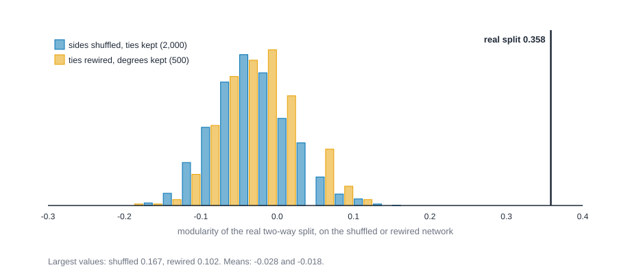
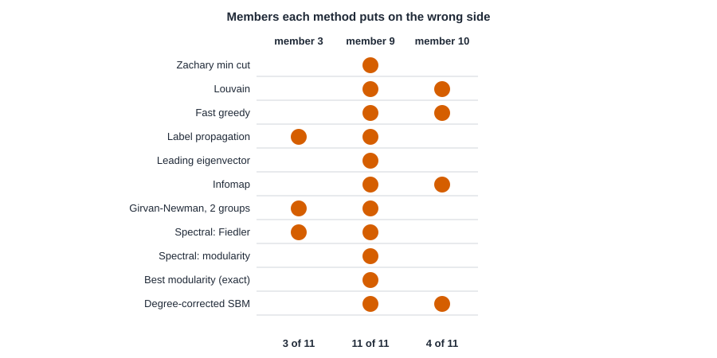

# Case study: the karate club that split {#sec-case-karate}

::: {.callout-note appearance="simple"}
## Prerequisites
@sec-subgroups, @sec-latent-space, @sec-homophily and @sec-centrality. You will use communities and modularity, block models, and the idea of comparing a network with random ones.
:::

::: {.callout-tip appearance="simple"}
## The short version
A karate club of 34 people split into two camps after a dispute between its instructor and its administrator. Researchers have been using the club's friendship network ever since as a test: can a method that sees only who spends time with whom work out which camp each person joined? This chapter tries several methods. They get close, and always miss the same one or two people, but we also learn that this is an easy test, and a good score on it doesn't show a method is good.
:::

::: {.callout-tip appearance="simple"}
## Why you might care
"Find the groups in a network" is one of the most common jobs in network analysis, from customer segments to online communities. This chapter shows what a good answer looks like, and how to tell when a famous benchmark is flattering a method.
:::

## The question

In the early 1970s the anthropologist Wayne Zachary spent about three years with a university karate club of 34 members [@zachary1977information]. He recorded who spent time with whom outside the club's activities. Then a dispute between the club's part-time instructor and its administrator split the club in two, and each member took a side.

That club is one of the most reused networks in the field. Girvan and Newman tested their community method on it [@girvan2002community], and since then "does the method recover the karate club's two factions?" has become a stock check for community detection. This chapter asks that question as carefully as we can, and then asks the harder one: **what does a good score on this check actually tell you?**

> **How well do communities, centrality and a statistical model recover the two factions of the karate club, which members do they get wrong, and what can we conclude from that?**

Notice what the question leaves out. It doesn't ask *why* members chose their sides, or whether the friendship ties *caused* the split. One split is one event, and a network of friendships can describe who stood where, not who decided what.

The plan has six steps, the same habits as in @sec-case-florentine:

1. Look at the data and say what it can't show.
2. Describe the network, and check Zachary's own prediction.
3. Look at the two leaders with centrality.
4. Find communities with several methods and compare them with the real sides.
5. Fit a statistical model.
6. Stress-test, then write down what we can and can't say.

A note on numbering before we start. The files number the members 1 to 34, and so does the text: the instructor ("Mr. Hi") is member 1 and the administrator (the "officer") is member 34. Tools that count from zero, such as NetworkX's built-in copy of this network, call them nodes 0 and 33. So the "node 9" you will see in some forums is our member 10, and our member 9 is their node 8. We will see below that both numbers matter.

## The data and its limits

The data are 34 members and 78 ties. A tie means two members were seen together outside the club's activities. Each tie also carries a count, from 1 to 7, in a column called `contexts`: as @sec-signed-and-valued reads it, the number of kinds of situation in which Zachary saw the two members interact. Each member has one more attribute: the side they took at the split.

Before any number, ask what the table is and isn't.

- **One observer, one relation.** The ties are what one researcher saw, over about three years. They are not what each member would say about their friends, and there are no other relations (no money, no rank, no teaching).
- **One outcome.** The sides record where each member stood after the split. The file doesn't say when each tie was recorded, so we can't see whether friendships came before the dispute or followed it.
- **Contexts are a judgment.** A count of 5 says the observer saw the pair together in five kinds of situation. It doesn't say how warm the tie was.
- **Small.** 34 members and 78 ties. A single member is almost 3% of the data.
- **What isn't in the table.** No ages, no grades of belt, no stated reasons. Every one of those is a rival explanation for why someone sided as they did, and none can be checked with this file.

The checks we always run first are the same as for the marriage network: count members and ties, look for pairs listed twice, find the connected pieces, and look at who has no tie at all. We also keep two versions of the network: the plain one, and one that carries the contexts. Zachary's own method uses the contexts. Most of the rest of this chapter doesn't, so that we can compare the methods on equal terms.


::: {.panel-tabset group="language"}

## R

```r
library(knappnet)

# One row per tie: two members and the number of contexts in which they were seen together.
edges <- read.csv("data/karate/edges.csv")
nodes <- read.csv("data/karate/nodes.csv")
# Which side each member took: 0 = Mr. Hi, 1 = the officer. Position i is member i.
side <- as.integer(nodes$faction != "Mr. Hi")

# Two networks: the plain one, and the same ties carrying their contexts as strengths.
club <- net_frame(edges[, c("source", "target")], nodes = nodes, directed = FALSE)
club_valued <- net_frame(edges, nodes = nodes, directed = FALSE, weight = "contexts", weight_type = "strength")

# Checks before any measure: pieces, isolates, pairs listed twice.
data.frame(
  members = nrow(nodes), ties = nrow(edges),
  distinct_pairs = nrow(unique(data.frame(pmin(edges$source, edges$target), pmax(edges$source, edges$target)))),
  pieces = max(net_components(club)$membership), isolated = sum(net_degree(club) == 0)
)
table(contexts = edges$contexts)
table(faction = nodes$faction)
```

::: {.code-output}
```text
# A tibble: 1 × 5
  members  ties distinct_pairs pieces isolated
    <int> <int>          <int>  <int>    <int>
1      34    78             78      1        0
# A tibble: 7 × 2
  contexts  ties
     <int> <int>
1        1     6
2        2    24
3        3    27
4        4    12
5        5     7
6        6     1
7        7     1
# A tibble: 2 × 2
  faction members
  <chr>     <int>
1 Mr. Hi       17
2 Officer      17
```
:::

## Python

```python
import csv
from collections import Counter
from math import comb

import networkx as nx
import numpy as np

# One row per tie: two members and the number of contexts in which they were seen together.
with open("data/karate/edges.csv") as f:
    ties = [(int(r["source"]), int(r["target"]), int(r["contexts"])) for r in csv.DictReader(f)]
with open("data/karate/nodes.csv") as f:
    faction = {int(r["id"]): r["faction"] for r in csv.DictReader(f)}
members = sorted(faction)
# Which side each member took: 0 = Mr. Hi, 1 = the officer. Position i is member i + 1.
side = [int(faction[m] != "Mr. Hi") for m in members]

club = nx.Graph()
club.add_nodes_from(members)
club.add_edges_from((a, b) for a, b, _ in ties)

# Checks before any measure: pieces, isolates, pairs listed twice.
print(f"members {club.number_of_nodes()}, ties {len(ties)}, distinct pairs {len({tuple(sorted(t[:2])) for t in ties})}")
print(f"pieces {nx.number_connected_components(club)}, isolated {sum(d == 0 for _, d in club.degree())}")
by_contexts = Counter(t[2] for t in ties)
print("ties by contexts: " + ", ".join(f"{k}: {by_contexts[k]}" for k in sorted(by_contexts)))
print(f"Mr. Hi {side.count(0)} members, officer {side.count(1)} members")
```

::: {.code-output}
```text
members 34, ties 78, distinct pairs 78
pieces 1, isolated 0
ties by contexts: 1: 6, 2: 24, 3: 27, 4: 12, 5: 7, 6: 1, 7: 1
Mr. Hi 17 members, officer 17 members
```
:::

## Rust

```rust
use knappnet::metrics::topography::{find_components, ComponentKind};
use knappnet::{compute_degree, compute_strength, DegreeMode, Graph};

// One row per tie: two members and the number of contexts in which they were seen together.
// The code numbers members from 0 to 33; the text and the files number them from 1.
let text = std::fs::read_to_string("data/karate/edges.csv")?;
let ties: Vec<(usize, usize, f64)> = text.lines().skip(1).map(|line| {
    let p: Vec<&str> = line.split(',').collect();
    (p[0].parse::<usize>().unwrap() - 1, p[1].parse::<usize>().unwrap() - 1, p[2].parse().unwrap())
}).collect();
// Which side each member took: 0 = Mr. Hi, 1 = the officer.
let side: Vec<usize> = std::fs::read_to_string("data/karate/nodes.csv")?.lines().skip(1)
    .map(|line| usize::from(!line.ends_with("Mr. Hi"))).collect();

// A network from a list of ties, with or without the contexts as tie weights. All 34 members exist.
let build = |kept: &[(usize, usize, f64)], valued: bool| -> Result<Graph, knappnet::Error> {
    let from: Vec<i64> = kept.iter().map(|t| t.0 as i64).collect();
    let to: Vec<i64> = kept.iter().map(|t| t.1 as i64).collect();
    let weight: Vec<f64> = kept.iter().map(|t| t.2).collect();
    Graph::from_edges(34, &from, &to, if valued { Some(&weight) } else { None }, false)
};
let club = build(&ties, false)?;
let names: Vec<String> = (1..=34).map(|m| m.to_string()).collect();
println!("{}", club.describe().with_labels(&names));

// Checks before any measure: pieces, isolates, pairs listed twice.
let mut pairs: Vec<(usize, usize)> = ties.iter().map(|t| (t.0.min(t.1), t.0.max(t.1))).collect();
pairs.sort();
pairs.dedup();
let degree = compute_degree(&club, DegreeMode::All, true);
println!("members {}, ties {}, distinct pairs {}", club.node_count(), ties.len(), pairs.len());
println!("pieces {}, isolated {}", find_components(&club, ComponentKind::Weak).count(),
         degree.iter().filter(|&&d| d == 0.0).count());
let by_contexts: Vec<String> = (1..=7)
    .map(|k| format!("{k}: {}", ties.iter().filter(|t| t.2 == k as f64).count())).collect();
println!("ties by contexts: {}", by_contexts.join(", "));
println!("Mr. Hi {} members, officer {} members", side.iter().filter(|&&s| s == 0).count(),
         side.iter().filter(|&&s| s == 1).count());
```

::: {.code-output}
```text
Undirected network: 34 nodes, 78 ties
  Density           0.139
  Degree            1 to 17, mean 4.59
  Connected pieces  1
  Isolated nodes    0
  Loops, repeats    none
  Busiest           34 (17), 1 (16), 33 (12)

members 34, ties 78, distinct pairs 78
pieces 1, isolated 0
ties by contexts: 1: 6, 2: 24, 3: 27, 4: 12, 5: 7, 6: 1, 7: 1
Mr. Hi 17 members, officer 17 members
```
:::

:::

Thirty-four members, 78 ties, 78 distinct pairs, one connected piece and nobody left out. The two sides have 17 members each, which is an unusually tidy fact about a real split. Most ties are seen in 2 or 3 contexts (24 and 27 of the 78), and only one tie each reaches 6 or 7.

## Step 1: describe the network

Where do the ties run? Every tie is inside Mr. Hi's side, inside the officer's side, or across the line between them.


::: {.panel-tabset group="language"}

## R

```r
# TODO(code, R): needs ties counted inside and across two sides of an attribute, with their contexts (net_mixing() on the valued network, or net_ei_index()), and the strongest crossing ties; the Rust tab shows the numbers.
```

::: {.code-output}
```text
TODO(output)
```
:::

## Python

```python
# TODO(code, Python): needs ties counted inside and across two sides of an attribute, with their contexts (net_mixing()); NetworkX has no such cross-tab. Use the Rust tab.
```

::: {.code-output}
```text
TODO(output)
```
:::

## Rust

```rust
// Every tie is inside Mr. Hi's side, inside the officer's side, or across.
let mut parts = [(0usize, 0.0_f64); 3];
for t in &ties {
    let k = if side[t.0] == side[t.1] { side[t.0] } else { 2 };
    parts[k].0 += 1;
    parts[k].1 += t.2;
}
for (name, (n, total)) in ["inside Mr. Hi", "inside officer", "across"].iter().zip(parts) {
    println!("{name:<15}{n:>3} ties {total:>4} contexts {:>5.2} per tie", total / n as f64);
}

// The ties that cross the line, strongest first.
let mut across: Vec<&(usize, usize, f64)> = ties.iter().filter(|t| side[t.0] != side[t.1]).collect();
across.sort_by(|a, b| b.2.partial_cmp(&a.2).unwrap().then(a.0.cmp(&b.0)).then(a.1.cmp(&b.1)));
let listed: Vec<String> = across.iter().map(|t| format!("{}-{} ({})", t.0 + 1, t.1 + 1, t.2)).collect();
println!("{}", listed.join(", "));
```

::: {.code-output}
```text
inside Mr. Hi   35 ties  106 contexts  3.03 per tie
inside officer  32 ties  100 contexts  3.12 per tie
across          11 ties   25 contexts  2.27 per tie
9-34 (4), 9-31 (3), 9-33 (3), 14-34 (3), 1-32 (2), 2-31 (2), 3-28 (2), 3-29 (2), 3-33 (2), 3-10 (1), 20-34 (1)
```
:::

:::

Of the 78 ties, 35 are inside Mr. Hi's side, 32 inside the officer's side and only 11 cross. The crossing ties are also thinner: 2.27 contexts per tie, against about 3 inside each side. That is why the split looks recoverable at all. The line between the factions runs through the sparse seams of the network.

Look at who owns the crossing ties. Member 9 owns three of the 11 (to 31, 33 and 34), and also has ties to members 1 and 3 on the other side (the edge list gives 2 and 5 contexts). Added up, member 9 has 7 contexts pointing to Mr. Hi's side and 10 pointing to the officer's, yet they ended up with Mr. Hi. Member 10 is the other near miss: their two ties go to member 3 (1 context) and to the officer (2 contexts). Keep these two in mind. They will come back.

## Step 2: Zachary's own prediction

Zachary didn't use a community method. He asked a question from the study of pipes: if each tie were a pipe, with a width equal to its contexts, how much could flow from Mr. Hi to the officer? The most that can flow equals the capacity of the cheapest set of ties whose removal would cut the two apart. That is the *maximum flow, minimum cut* result of @ford1956maximal and @ford1962flows, and Zachary used it to predict each member's side [@zachary1977information].

Here is a six-member club you can do by hand. Members A, B and C are on one side, D, E and F on the other. The ties, with their contexts, are A-B 3, A-C 2, B-C 2, D-E 3, D-F 2, E-F 2, and two ties across: C-D 1 and B-E 1. Take A as the source and F as the sink. Cutting off A alone costs $3 + 2 = 5$. Cutting off F alone costs $2 + 2 = 4$. Cutting the two crossing ties costs $1 + 1 = 2$, and no cheaper cut exists, so the minimum cut is 2 and its two sides are $\{A, B, C\}$ and $\{D, E, F\}$. Flow agrees: one unit can run A-B-E-F, another A-C-D-F, and both bridges are then full.

The question the next formula answers is: how much would it cost to separate one side of the club from the other? In symbols, for a source $s$ and a sink $t$, a **cut** is a set $S$ of members that contains $s$ and not $t$. Its **capacity** adds up the weights $w_{ij}$ of the ties that leave the set,

$$ c(S) = \sum_{i \in S,\; j \notin S} w_{ij}, $$

and the minimum cut is the set with the smallest capacity.

::: {.callout-tip title="In plain words"}
Think of cutting the ties like snipping pipes, and you want the cheapest snip that leaves Mr. Hi on one side and the officer on the other. The letter $c(S)$ is the price of cutting off the group $S$. The big sigma says "add up". The small letters under it say which ties to add: those with one end $i$ inside the group and the other end $j$ outside. And $w_{ij}$ is the width of that tie, its number of contexts. In the six-member example, the group $\{A, B, C\}$ is joined to the rest by C-D (1) and B-E (1), so $c(S) = 1 + 1 = 2$.
:::

Members inside $S$ are predicted to join the source, everyone else the sink. Here the source is Mr. Hi (member 1), the sink is the officer (member 34), and $w_{ij}$ is the number of contexts. A minimum cut isn't always unique (sometimes two different snips cost the same), so we report the smallest and the largest source side.


::: {.panel-tabset group="language"}

## R

```r
# TODO(code, R): needs a maximum-flow / minimum-cut function (net_max_flow(), net_min_cut() returning the smallest and largest source side); the Rust tab shows the numbers.
```

::: {.code-output}
```text
TODO(output)
```
:::

## Python

```python
# TODO(code, Python): needs a function returning the smallest and largest minimum-cut source side (net_min_cut()); NetworkX returns one cut only. Use the Rust tab.
```

::: {.code-output}
```text
TODO(output)
```
:::

## Rust

```rust
use knappnet::flow::maxflow::{find_minimum_cut, CutSide};

// Zachary's capacities: the contexts of each tie. Source: Mr. Hi (member 1). Sink: the officer (member 34).
let capacity: Vec<f64> = ties.iter().map(|t| t.2).collect();
let unit = vec![1.0; ties.len()];
let mut zachary = Vec::new();
for (label, caps) in [("contexts", &capacity), ("unweighted", &unit)] {
    // A minimum cut is not always unique, so report the smallest and the largest source side.
    for (which_side, kind) in [("smallest", CutSide::Smallest), ("largest", CutSide::Largest)] {
        let cut = find_minimum_cut(&club, &[0], &[33], Some(caps), kind)?;
        let labels: Vec<usize> = cut.source_side.iter().map(|&near_hi| usize::from(!near_hi)).collect();
        let wrong: Vec<usize> = (0..34).filter(|&i| labels[i] != side[i]).map(|i| i + 1).collect();
        println!("{label:<11}{which_side:<9} value {:>3}, {:>2} members on Mr. Hi's side, wrong: {wrong:?}",
                 cut.value, cut.source_side.iter().filter(|&&s| s).count());
        if label == "contexts" && which_side == "smallest" { zachary = labels; }
    }
}
```

::: {.code-output}
```text
contexts   smallest  value  22, 16 members on Mr. Hi's side, wrong: [9]
contexts   largest   value  22, 16 members on Mr. Hi's side, wrong: [9]
unweighted smallest  value  10, 15 members on Mr. Hi's side, wrong: [3, 9]
unweighted largest   value  10, 17 members on Mr. Hi's side, wrong: [9, 10]
```
:::

:::

Using the contexts, the minimum cut has capacity 22 and puts 16 members on Mr. Hi's side. The smallest and largest minimum cuts are the same, so there is only one. It gets 33 of 34 members right. The one it gets wrong is member 9, which agrees with the single error that Zachary reported for his method [@zachary1977information].

The real split is not the minimum cut. It cuts 11 ties worth 25 contexts, and the minimum cut is cheaper at 22. The difference is member 9. Put with Mr. Hi, member 9 costs the cut their ties to 31, 33 and 34 (10 contexts). Put with the officer, they cost only the ties to 1 and 3 (7 contexts). That saves 3, and $25 - 3 = 22$.

Two things to say plainly about this "prediction".

- **It is not a blind test.** The method is told who the two leaders are, since they are the source and the sink. That is two labels out of 34, and it is a classification given those labels, not a discovery of the factions.
- **The contexts matter.** Without them (every tie weighs 1) the minimum cut is 10 ties, it isn't unique, and the two extreme cuts get members 3 and 9, or 9 and 10, wrong. The valued network is what makes the answer sharp.

We can also say what we can't check. This file doesn't date the contexts, so we can reproduce Zachary's calculation but we can't tell from the file whether those counts were all recorded before the split.

## Step 3: the two leaders

The split was a dispute between two people, so look at those two in the network. Member 1 is the instructor and member 34 the administrator. Here are the four measures of @sec-centrality plus strength (degree weighted by contexts), for the two leaders and the next three busiest members.


::: {.panel-tabset group="language"}

## R

```r
scores <- data.frame(
  degree = net_degree(club),
  strength = net_strength(club_valued),
  betweenness = net_betweenness(club),
  closeness = net_closeness(club, normalized = TRUE),
  eigenvector = net_eigen(club),
  row.names = nodes$id
)

# The two leaders and the next three busiest members. Eigenvector is scaled so the top score is 1.
round(scores[c(34, 1, 33, 3, 2), ], 3)

# Rank of each leader on each measure (1 = highest; tied scores share a rank).
sapply(scores, function(x) rank(-x, ties.method = "min"))[c(1, 34), ]
```

::: {.code-output}
```text
# A tibble: 5 × 6
  member degree strength betweenness closeness eigenvector
   <int>  <dbl>    <dbl>       <dbl>     <dbl>       <dbl>
1     34     17       48       161.      0.55        1    
2      1     16       42       231.      0.569       0.952
3     33     12       38        76.7     0.516       0.827
4      3     10       33        75.9     0.559       0.85 
5      2      9       29        28.5     0.485       0.712
# A tibble: 2 × 6
  member degree strength betweenness closeness eigenvector
   <int>  <int>    <int>       <int>     <int>       <int>
1      1      2        2           1         1           2
2     34      1        1           2         3           1
```
:::

## Python

```python
degree = dict(club.degree())
strength = dict(nx.Graph([(a, b, {"weight": c}) for a, b, c in ties]).degree(weight="weight"))
between = nx.betweenness_centrality(club, normalized=False)
close = nx.closeness_centrality(club)
eigen = nx.eigenvector_centrality_numpy(club)
top = max(eigen.values())
# Eigenvector is scaled so the top score is 1.
eigen = {m: v / top for m, v in eigen.items()}

# The two leaders and the next three busiest members.
print(f"{'member':>6}{'degree':>8}{'strength':>9}{'betweenness':>12}{'closeness':>10}{'eigenvector':>12}")
for m in (34, 1, 33, 3, 2):
    print(f"{m:>6}{degree[m]:>8}{strength[m]:>9}{between[m]:>12.3f}{close[m]:>10.3f}{eigen[m]:>12.3f}")
```

::: {.code-output}
```text
member  degree strength betweenness closeness eigenvector
    34      17       48     160.552     0.550       1.000
     1      16       42     231.071     0.569       0.952
    33      12       38      76.690     0.516       0.827
     3      10       33      75.851     0.559       0.850
     2       9       29      28.479     0.485       0.712
```
:::

## Rust

```rust
use knappnet::metrics::closeness::{compute_closeness, ClosenessOptions};
use knappnet::metrics::eigenvector::{compute_eigenvector_centrality, EigenvectorOptions};
use knappnet::{compute_betweenness, BetweennessOptions};

let strength = compute_strength(&build(&ties, true)?, DegreeMode::All, true)?;
let between = compute_betweenness(&club, BetweennessOptions::default())?;
let close = compute_closeness(&club, ClosenessOptions { normalized: true, ..Default::default() })?;
let eigen = compute_eigenvector_centrality(&club, EigenvectorOptions::default())?;

// The two leaders and the next three busiest members. Eigenvector is scaled so the top score is 1.
println!("{:>6}{:>8}{:>9}{:>12}{:>10}{:>12}", "member", "degree", "strength", "betweenness", "closeness", "eigenvector");
for m in [34, 1, 33, 3, 2] {
    let i = m - 1;
    println!("{m:>6}{:>8}{:>9}{:>12.3}{:>10.3}{:>12.3}", degree[i], strength[i], between[i], close[i], eigen.values[i]);
}

// Rank of each leader on each measure (1 = highest; tied scores share a rank).
let rank = |scores: &[f64], i: usize| 1 + scores.iter().filter(|&&v| v > scores[i] + 1e-9).count();
for m in [1, 34] {
    let i = m - 1;
    println!("member {m} ranks: degree {}, strength {}, betweenness {}, closeness {}, eigenvector {}",
             rank(&degree, i), rank(&strength, i), rank(&between, i), rank(&close, i), rank(&eigen.values, i));
}
```

::: {.code-output}
```text
member  degree strength betweenness closeness eigenvector
    34      17       48     160.552     0.550       1.000
     1      16       42     231.071     0.569       0.952
    33      12       38      76.690     0.516       0.827
     3      10       33      75.851     0.559       0.850
     2       9       29      28.479     0.485       0.712
member 1 ranks: degree 2, strength 2, betweenness 1, closeness 1, eigenvector 2
member 34 ranks: degree 1, strength 1, betweenness 2, closeness 3, eigenvector 1
```
:::

:::

The leaders sit at the top, and they split the honors. Member 34 has the most ties (17) and the most contexts (strength 48), and the top eigenvector score. Member 1 has 16 ties and strength 42, but the highest betweenness (231.1) and closeness (0.569). Betweenness of 231.1 means about 44% of the 528 shortest routes between other pairs of members pass through the instructor, against about 30% (160.6) for the administrator.

How to read this, in a club? Zachary framed the club as a place where information flows along ties [@zachary1977information], and betweenness fits that frame: a high score means many routes between other members go through you. It doesn't tell you who people liked. Degree and strength say who had the most company, and eigenvector says whose company was well connected. For two people leading rival camps, you would expect them to top all four, and they do.

Here is a rule with no cleverness at all. Count steps along ties from each member to Mr. Hi and to the officer, and have each member join whichever leader is nearer. If the two are equally near, the rule abstains.


::: {.panel-tabset group="language"}

## R

```r
steps <- net_distances(club)
nearer_officer <- as.integer(steps[, 34] < steps[, 1])
abstain <- which(steps[, 1] == steps[, 34])

data.frame(
  decided = 34 - length(abstain),
  right = sum(nearer_officer[-abstain] == side[-abstain]),
  abstains_for = paste(abstain, collapse = ", ")
)
```

::: {.code-output}
```text
# A tibble: 1 × 4
  decided right wrong abstains_for         
    <dbl> <int> <dbl> <chr>                
1      28    28     0 9, 14, 20, 25, 26, 32
```
:::

## Python

```python
from_hi = nx.single_source_shortest_path_length(club, 1)
from_officer = nx.single_source_shortest_path_length(club, 34)
abstain = [m for m in members if from_hi[m] == from_officer[m]]
decided = [m for m in members if m not in abstain]
right = [m for m in decided if int(from_officer[m] < from_hi[m]) == side[m - 1]]
print(f"decided {len(decided)}, right {len(right)}, wrong {len(decided) - len(right)}")
print(f"abstains for {abstain}")
```

::: {.code-output}
```text
decided 28, right 28, wrong 0
abstains for [9, 14, 20, 25, 26, 32]
```
:::

## Rust

```rust
// Steps along ties from one member to every other, by breadth-first search.
let neighbors: Vec<Vec<usize>> = (0..34).map(|i| {
    ties.iter().filter_map(|t| if t.0 == i { Some(t.1) } else if t.1 == i { Some(t.0) } else { None }).collect()
}).collect();
let steps_from = |start: usize| -> Vec<usize> {
    let mut steps = vec![usize::MAX; 34];
    steps[start] = 0;
    let mut queue = vec![start];
    let mut head = 0;
    while head < queue.len() {
        let u = queue[head];
        head += 1;
        for &v in &neighbors[u] {
            if steps[v] == usize::MAX {
                steps[v] = steps[u] + 1;
                queue.push(v);
            }
        }
    }
    steps
};
let (from_hi, from_officer) = (steps_from(0), steps_from(33));
let abstain: Vec<usize> = (0..34).filter(|&i| from_hi[i] == from_officer[i]).map(|i| i + 1).collect();
let decided: Vec<usize> = (0..34).filter(|&i| from_hi[i] != from_officer[i]).collect();
let right = decided.iter().filter(|&&i| usize::from(from_officer[i] < from_hi[i]) == side[i]).count();
println!("decided {}, right {right}, wrong {}", decided.len(), decided.len() - right);
println!("abstains for {abstain:?}");
```

::: {.code-output}
```text
decided 28, right 28, wrong 0
abstains for [9, 14, 20, 25, 26, 32]
```
:::

:::

For 28 of the 34 members one leader is strictly nearer, and all 28 are on the right side: no errors. The six members where the rule abstains (9, 14, 20, 25, 26 and 32) are equally near to both leaders. Member 9 is among them, which is the same story told by a different measure.

Take a moment with that result, because it matters later. A rule that needs no algorithm, only the two leaders' names, sorts everyone it can decide. The factions are, to a large extent, the two leaders' circles.

## Step 4: communities against the factions

Now forget the leaders and ask what community methods find from the ties alone. The table below shows nine of them, next to the real split and Zachary's minimum cut. Louvain [@blondel2008fast] and fast greedy [@clauset2004finding] climb modularity (@sec-subgroups). Label propagation [@raghavan2007near] lets neighbors vote. The leading eigenvector method [@newman2006modularity] splits by the sign of the top eigenvector of the modularity matrix. Infomap [@rosvall2008maps] follows a random walker. Girvan and Newman [@girvan2002community] cut the busiest ties, here until two groups remain. The exact optimum maximizes modularity with no shortcuts [@brandes2008modularity]. Two spectral rows split by the sign of one eigenvector: the second-smallest of the graph Laplacian (the *Fiedler* vector [@fiedler1973algebraic]) and the top eigenvector of the modularity matrix.

*Reassurance:* you don't need to know how any of these work to read the results. Each one is a different recipe for drawing circles around people, and what matters is how closely its circles match the real sides.

We score each partition in three ways. **Modularity** is how many more ties fall inside groups than a degree-matched random network would put there. The **adjusted Rand index** [@hubert1985comparing] is 1 for identical partitions and about 0 for chance agreement. And a member is **misclassified** when most of their community took the other side. That rule is generous to methods that find more than two groups. It lets a method off for splitting a side into two or three pieces, and it only blames members who sit with the wrong crowd.


::: {.panel-tabset group="language"}

## R

```r
# A member counts as misclassified when the majority of their community took the other side.
wrong_members <- function(labels, members = 1:34) {
  members[as.integer(ave(side[members], labels, FUN = mean) > 0.5) != side[members]]
}
agree <- function(labels, members = 1:34) {
  net_compare_partitions(labels, side[members], method = "adjusted_rand")
}

partitions <- list(
  "Real split" = side,
  "Louvain" = net_louvain(club, seed = 1),
  "Fast greedy" = net_fast_greedy(club),
  "Label propagation" = net_label_prop(club, seed = 1),
  "Leading eigenvector" = net_leading_eigen(club),
  "Infomap" = net_infomap(club, seed = 1),
  "Girvan-Newman, 2 groups" = cutree(attr(net_girvan_newman(club), "tree"), k = 2),
  "Best modularity (exact)" = net_optimal(club)
)
partitions <- lapply(partitions, as.integer)

# TODO(code, R): needs Zachary's minimum cut (net_min_cut()), spectral splits (net_spectral_partition(),
# Fiedler vector and modularity matrix) and a degree-corrected block model fit (net_sbm()).
data.frame(
  groups = sapply(partitions, function(l) length(unique(l))),
  modularity = sapply(partitions, function(l) net_modularity(club, l)),
  adjusted_rand = sapply(partitions, agree),
  wrong = sapply(partitions, function(l) paste(wrong_members(l), collapse = ", "))
) |> transform(modularity = round(modularity, 3), adjusted_rand = round(adjusted_rand, 3))
```

::: {.code-output}
```text
# A tibble: 11 × 5
   method                  groups modularity adjusted_rand wrong  
   <chr>                    <int>      <dbl>         <dbl> <chr>  
 1 Real split                   2      0.358         1     ""     
 2 Zachary min cut              2      0.371         0.882 "9"    
 3 Louvain                      4      0.419         0.392 "9, 10"
 4 Fast greedy                  3      0.381         0.568 "9, 10"
 5 Label propagation            3      0.374         0.591 "3, 9" 
 6 Leading eigenvector          4      0.393         0.435 "9"    
 7 Infomap                      3      0.402         0.591 "9, 10"
 8 Girvan-Newman, 2 groups      2      0.36          0.772 "3, 9" 
 9 Spectral: Fiedler            2      0.36          0.772 "3, 9" 
10 Spectral: modularity         2      0.371         0.882 "9"    
11 Best modularity (exact)      4      0.42          0.465 "9"    
```
:::

## Python

```python
methods = {
    "Louvain": nx.community.louvain_communities(club, seed=1),
    "Fast greedy": nx.community.greedy_modularity_communities(club),
    "Label propagation": list(nx.community.asyn_lpa_communities(club, seed=1)),
    "Girvan-Newman, 2 groups": next(nx.community.girvan_newman(club)),
}

# TODO(code, Python): adjusted Rand against the real split and the misclassified members need
# net_compare_partitions(); spectral splits need net_spectral_partition(); degree-corrected block model needs net_sbm().
print(f"{'method':<25}{'groups':>7}{'modularity':>11}")
for method, groups in methods.items():
    print(f"{method:<25}{len(groups):>7}{nx.community.modularity(club, groups):>11.3f}")
```

::: {.code-output}
```text
method                    groups modularity
Louvain                        4      0.419
Fast greedy                    3      0.381
Label propagation              3      0.385
Girvan-Newman, 2 groups        2      0.360
```
:::

## Rust

```rust
use knappnet::linalg::symmetric_eigen;
use knappnet::matrix::Dense;
use knappnet::metrics::community::{compute_modularity, find_louvain_communities};
use knappnet::metrics::community_nx::find_edge_betweenness_partition;
use knappnet::metrics::partition::{
    compare_partitions, find_fast_greedy_communities, find_infomap_communities,
    find_label_propagation_communities, find_leading_eigen_communities,
    find_optimal_modularity_communities, CompareMethod, LabelPropagationOptions, LpaMode, LpaVariant,
};

// Split by the sign of one eigenvector. Fiedler: the second-smallest of the graph Laplacian.
// Spectral modularity: the largest of Newman's modularity matrix. The eigenvalues come out smallest first.
let adjacency = |kept: &[(usize, usize, f64)]| -> Vec<f64> {
    let mut a = vec![0.0; 34 * 34];
    for t in kept { a[t.0 * 34 + t.1] = 1.0; a[t.1 * 34 + t.0] = 1.0; }
    a
};
let sign_of = |a: &[f64], modularity: bool| -> Result<Vec<usize>, knappnet::Error> {
    let k: Vec<f64> = (0..34).map(|i| a[i * 34..(i + 1) * 34].iter().sum()).collect();
    let total: f64 = k.iter().sum();
    let matrix: Vec<f64> = (0..34 * 34).map(|p| {
        let (i, j) = (p / 34, p % 34);
        if modularity { a[p] - k[i] * k[j] / total } else { (if i == j { k[i] } else { 0.0 }) - a[p] }
    }).collect();
    let (_, vectors) = symmetric_eigen(&Dense::from_row_major(34, 34, matrix)?)?;
    let column = if modularity { 33 } else { 1 };
    Ok((0..34).map(|i| usize::from(vectors.get(i, column) > 0.0)).collect())
};

// A member counts as misclassified when the majority of their community took the other side.
let wrong_members = |labels: &[usize], who: &[usize]| -> Vec<usize> {
    let mean = |g: usize| {
        let on: Vec<usize> = who.iter().filter(|&&i| labels[i] == g).map(|&i| side[i]).collect();
        on.iter().sum::<usize>() as f64 / on.len() as f64
    };
    who.iter().filter(|&&i| usize::from(mean(labels[i]) > 0.5) != side[i]).map(|&i| i + 1).collect()
};
let as_i64 = |labels: &[usize]| -> Vec<i64> { labels.iter().map(|&l| l as i64).collect() };
let agree = |labels: &[usize], who: &[usize]| -> Result<f64, knappnet::Error> {
    let own: Vec<usize> = who.iter().map(|&i| side[i]).collect();
    let theirs: Vec<usize> = who.iter().map(|&i| labels[i]).collect();
    compare_partitions(&as_i64(&theirs), &as_i64(&own), CompareMethod::AdjustedRand)
};
let everyone: Vec<usize> = (0..34).collect();
let to_usize = |labels: &[u32]| -> Vec<usize> { labels.iter().map(|&l| l as usize).collect() };

let a = adjacency(&ties);
let lpa = LabelPropagationOptions {
    variant: LpaVariant::Dominance, mode: LpaMode::All, weighted: false, initial: None, fixed: None, seed: 1,
};
let mut partitions: Vec<(String, Vec<usize>)> = vec![
    ("Real split".to_string(), side.clone()),
    ("Zachary min cut".to_string(), zachary.clone()),
    ("Louvain".to_string(), find_louvain_communities(&club, 1.0, false, 1)?.membership.iter().map(|&m| m as usize).collect()),
    ("Fast greedy".to_string(), find_fast_greedy_communities(&club, 1.0, false)?.membership),
    ("Label propagation".to_string(), find_label_propagation_communities(&club, &lpa)?),
    ("Leading eigenvector".to_string(), find_leading_eigen_communities(&club, false)?.membership),
    ("Infomap".to_string(), find_infomap_communities(&club, false, None, 10, 1)?.membership),
    ("Girvan-Newman, 2 groups".to_string(), to_usize(&find_edge_betweenness_partition(&club, 2))),
    ("Spectral: Fiedler".to_string(), sign_of(&a, false)?),
    ("Spectral: modularity".to_string(), sign_of(&a, true)?),
    ("Best modularity (exact)".to_string(), find_optimal_modularity_communities(&club, 1.0, false)?.membership),
];

println!("{:<25}{:>7}{:>11}{:>10}  wrong", "method", "groups", "modularity", "adj. Rand");
for (method, labels) in &partitions {
    let groups = labels.iter().collect::<std::collections::BTreeSet<_>>().len();
    let q = compute_modularity(&club, &as_i64(labels), 1.0, false)?;
    let wrong: Vec<String> = wrong_members(labels, &everyone).iter().map(|m| m.to_string()).collect();
    println!("{method:<25}{groups:>7}{q:>11.3}{:>10.3}  {}", agree(labels, &everyone)?, wrong.join(", "));
}
```

::: {.code-output}
```text
method                    groups modularity adj. Rand  wrong
Real split                     2      0.358     1.000  
Zachary min cut                2      0.371     0.882  9
Louvain                        4      0.419     0.392  9, 10
Fast greedy                    3      0.381     0.568  9, 10
Label propagation              3      0.374     0.591  3, 9
Leading eigenvector            4      0.393     0.435  9
Infomap                        3      0.402     0.591  9, 10
Girvan-Newman, 2 groups        2      0.360     0.772  3, 9
Spectral: Fiedler              2      0.360     0.772  3, 9
Spectral: modularity           2      0.371     0.882  9
Best modularity (exact)        4      0.420     0.465  9
```
:::

:::

No method returns the real split. The best agreement, 0.882, comes from two methods that both miss only member 9: Zachary's minimum cut and the spectral split of the modularity matrix. The Louvain row is the one in @sec-subgroups: four groups and a modularity of 0.419, higher than the real split's 0.358. Three things stand out.

- **Modularity prefers a different answer.** The real split scores 0.358, lower than every other partition in the table. The exact optimum is four groups with modularity 0.420. If modularity were the truth, the club would have split in four.
- **Member 9 is wrong for every method.** Member 10 is wrong for three of the methods in this table, and member 3 for three (different ones).
- **Methods that find more groups are not worse, only different.** Splitting each side in two is a legitimate description of friendship circles, and it is the reason the adjusted Rand index is low.

@fig-karate-case-partitions shows four of these side by side.

{#fig-karate-case-partitions fig-alt="Four network pictures of 34 members. Top left, the real split: circles for Mr. Hi's 17 supporters in blue and squares for the officer's 17 in orange, with 11 dashed ties crossing between them. Top right, Louvain finds four colour groups and heavy black outlines mark members 9 and 10. Bottom left, a Fiedler spectral cut finds two groups and heavy black outlines mark members 3 and 9. Bottom right, Zachary's minimum cut finds two groups and a heavy black outline marks only member 9."}

The Python tab has fewer rows than the R and Rust tabs, because NetworkX has no Infomap, leading eigenvector or exact optimizer, and it does not score against the real split yet. The R tab leaves out Zachary's minimum cut, the spectral splits and the degree-corrected block model, which knappnet does not expose yet (see the engine gaps); the Rust tab has them all.

### How stable is each answer?

A community method is not a single answer, it is an answer for a given seed and a given setting. Run Louvain and label propagation with 200 seeds each, and turn Louvain's resolution knob (the yardstick that makes groups coarser or finer, from @sec-subgroups).


::: {.panel-tabset group="language"}

## R

```r
# Louvain and label propagation with 200 different seeds each.
louvain_runs <- lapply(1:200, function(s) as.integer(net_louvain(club, seed = s)))
lpa_runs <- lapply(1:200, function(s) as.integer(net_label_prop(club, seed = s)))

# How many groups, and how close to the real split, for Louvain.
groups <- sapply(louvain_runs, function(l) length(unique(l)))
louvain <- data.frame(
  groups, ari = sapply(louvain_runs, agree),
  wrong_9 = sapply(louvain_runs, function(l) 9 %in% wrong_members(l)),
  wrong_10 = sapply(louvain_runs, function(l) 10 %in% wrong_members(l))
)
aggregate(ari ~ groups, louvain, range)
aggregate(cbind(wrong_9, wrong_10) ~ groups, louvain, mean)
table(groups)

# The same for label propagation.
lpa <- data.frame(groups = sapply(lpa_runs, function(l) length(unique(l))), ari = sapply(lpa_runs, agree))
aggregate(ari ~ groups, lpa, range)
table(lpa$groups)

# Louvain with a coarser or finer yardstick (resolution), seed 1.
resolution <- c(0.3, 0.5, 0.7, 1, 1.5, 2)
found <- lapply(resolution, function(r) as.integer(net_louvain(club, resolution = r, seed = 1)))
data.frame(
  resolution,
  groups = sapply(found, function(l) length(unique(l))),
  ari = round(sapply(found, agree), 3),
  wrong = sapply(found, function(l) paste(wrong_members(l), collapse = ", "))
)
```

::: {.code-output}
```text
# A tibble: 2 × 6
  groups seeds ari_lowest ari_highest share_9_wrong share_10_wrong
   <int> <int>      <dbl>       <dbl>         <dbl>          <dbl>
1      3     1      0.591       0.591             1          1    
2      4   199      0.37        0.509             1          0.518
# A tibble: 4 × 4
  groups seeds ari_lowest ari_highest
   <int> <int>      <dbl>       <dbl>
1      1     2      0           0    
2      2   105      0.072       0.882
3      3    79      0.231       0.742
4      4    14      0.344       0.662
# A tibble: 6 × 4
  resolution groups   ari wrong
       <dbl>  <int> <dbl> <chr>
1        0.3      2 0.772 9, 10
2        0.5      2 0.772 9, 10
3        0.7      3 0.591 9, 10
4        1        4 0.392 9, 10
5        1.5      5 0.314 9, 10
6        2        8 0.23  3, 31
```
:::

## Python

```python
# Louvain and label propagation with 200 different seeds each: how many groups do they find?
louvain_sizes = Counter(len(nx.community.louvain_communities(club, seed=s)) for s in range(1, 201))
lpa_sizes = Counter(len(list(nx.community.asyn_lpa_communities(club, seed=s))) for s in range(1, 201))
print("Louvain, groups: seeds ", dict(sorted(louvain_sizes.items())))
print("label propagation, groups: seeds ", dict(sorted(lpa_sizes.items())))

# Louvain with a coarser or finer yardstick (resolution), seed 1.
for r in (0.3, 0.5, 0.7, 1, 1.5, 2):
    print(f"resolution {r:>3}: {len(nx.community.louvain_communities(club, resolution=r, seed=1))} groups")

# TODO(code, Python): adjusted Rand against the real split, and who is misclassified, need net_compare_partitions().
```

::: {.code-output}
```text
Louvain, groups: seeds  {3: 1, 4: 199}
label propagation, groups: seeds  {1: 1, 2: 43, 3: 72, 4: 66, 5: 17, 6: 1}
resolution 0.3: 2 groups
resolution 0.5: 2 groups
resolution 0.7: 3 groups
resolution   1: 4 groups
resolution 1.5: 5 groups
resolution   2: 7 groups
```
:::

## Rust

```rust
let louvain_with = |resolution: f64, seed: u64| -> Result<Vec<usize>, knappnet::Error> {
    Ok(find_louvain_communities(&club, resolution, false, seed)?.membership.iter().map(|&m| m as usize).collect())
};
let lpa_with = |seed: u64| find_label_propagation_communities(&club, &LabelPropagationOptions { seed, ..lpa });
let share = |hits: usize, of: usize| hits as f64 / of as f64;

// Louvain and label propagation with 200 different seeds each.
let louvain_runs: Vec<Vec<usize>> = (1..=200).map(|s| louvain_with(1.0, s)).collect::<Result<_, _>>()?;
let lpa_runs: Vec<Vec<usize>> = (1..=200).map(lpa_with).collect::<Result<_, _>>()?;
let group_count = |l: &Vec<usize>| l.iter().collect::<std::collections::BTreeSet<_>>().len();

// How many groups, and how close to the real split, for Louvain.
println!("groups seeds ari_lowest ari_highest share_9_wrong share_10_wrong");
for g in louvain_runs.iter().map(group_count).collect::<std::collections::BTreeSet<_>>() {
    let some: Vec<&Vec<usize>> = louvain_runs.iter().filter(|l| group_count(l) == g).collect();
    let aris: Vec<f64> = some.iter().map(|l| agree(l, &everyone)).collect::<Result<_, _>>()?;
    println!("{g:>6}{:>6}{:>11.3}{:>12.3}{:>15.3}{:>16.3}", some.len(),
             aris.iter().cloned().fold(f64::INFINITY, f64::min), aris.iter().cloned().fold(f64::NEG_INFINITY, f64::max),
             share(some.iter().filter(|l| wrong_members(l, &everyone).contains(&9)).count(), some.len()),
             share(some.iter().filter(|l| wrong_members(l, &everyone).contains(&10)).count(), some.len()));
}

// The same for label propagation.
println!("label propagation");
for g in lpa_runs.iter().map(group_count).collect::<std::collections::BTreeSet<_>>() {
    let some: Vec<&Vec<usize>> = lpa_runs.iter().filter(|l| group_count(l) == g).collect();
    let aris: Vec<f64> = some.iter().map(|l| agree(l, &everyone)).collect::<Result<_, _>>()?;
    println!("{g:>6}{:>6}{:>11.3}{:>12.3}", some.len(),
             aris.iter().cloned().fold(f64::INFINITY, f64::min), aris.iter().cloned().fold(f64::NEG_INFINITY, f64::max));
}

// Louvain with a coarser or finer yardstick (resolution), seed 1.
println!("resolution groups  ari  wrong");
for r in [0.3, 0.5, 0.7, 1.0, 1.5, 2.0] {
    let found = louvain_with(r, 1)?;
    println!("{r:>10}{:>7}{:>6.3}  {:?}", group_count(&found), agree(&found, &everyone)?, wrong_members(&found, &everyone));
}
```

::: {.code-output}
```text
groups seeds ari_lowest ari_highest share_9_wrong share_10_wrong
     3     1      0.591       0.591          1.000           1.000
     4   199      0.370       0.509          1.000           0.518
label propagation
     1     2      0.000       0.000
     2   105      0.072       0.882
     3    79      0.231       0.742
     4    14      0.344       0.662
resolution groups  ari  wrong
       0.3      2 0.772  [9, 10]
       0.5      2 0.772  [9, 10]
       0.7      3 0.591  [9, 10]
         1      4 0.392  [9, 10]
       1.5      5 0.314  [9, 10]
         2      8 0.230  [3, 31]
```
:::

:::

Louvain is nearly stable: 199 of 200 seeds find four groups (agreement from 0.370 to 0.509), and one finds three. Member 9 is wrong in every run. Member 10 is wrong in about half of the four-group runs. That is a coin flip that depends on the seed, so a report that says "Louvain misclassifies member 10" depends on which seed it ran.

Label propagation is much less stable. Across 200 seeds it returns anywhere from one group to four, with agreement from 0 (everyone in one group) to 0.882, and never 1. In the sweep of resolution, the closest to the real split is the two-group answer at 0.3 and 0.5, with agreement 0.772 and members 9 and 10 on the wrong side. Between those settings and the standard one, the number of groups climbs 2, 3, 4, and no setting here returns the real split.

## Step 5: a statistical model

A community method gives a partition. A model says more: it says how likely each tie is, and a partition is only one of its parameters. The simplest model of groups is the **stochastic block model** [@holland1983stochastic]. Each member belongs to one of two groups, and the chance that two members are tied depends only on their two groups: one rate inside the first group, one inside the second and one across. @sec-latent-space introduces it; here we fit the two-group version by hand and ask whether the fitted groups are the factions.

For a partition, set each rate to the share of possible pairs that are tied, and compute the log-likelihood, a score for how well the model explains the network (closer to zero is better, and it is usually a negative number). *This is the hardest formula in the chapter. On a first read you can skip to the next heading and still keep the findings below.* With $m_{rs}$ ties and $n_{rs}$ possible pairs between (or inside) groups $r$ and $s$, the **profile log-likelihood** is

$$ \ell = \sum_{r \le s} \Big[ m_{rs} \log \frac{m_{rs}}{n_{rs}} + (n_{rs} - m_{rs}) \log\Big(1 - \frac{m_{rs}}{n_{rs}}\Big) \Big]. $$

::: {.callout-tip title="In plain words"}
This scores a proposed sorting into groups by asking how probable the real ties are if each pair of groups has its own tie rate. For each pair of groups (a group with itself counts too), $n_{rs}$ is how many pairs of people could be tied, $m_{rs}$ is how many actually are, and $m_{rs}/n_{rs}$ is the tie rate. The first term rewards the ties that exist and the second rewards the ties that are absent, each weighted by how likely the rate says it was. Take the six-member club split into $\{A, B, C\}$ and $\{D, E, F\}$. Inside each group all 3 possible pairs are tied, a rate of 1, and those contribute 0. Across the groups, 2 of 9 possible pairs are tied, so that part is $2 \log(2/9) + 7 \log(7/9) = -4.77$. So $\ell = -4.77$ for this split. (I worked this out by hand from the example.) A better split would score closer to zero.
:::


We then look for the partition with the highest $\ell$ by starting from 200 random partitions and flipping the single best member at a time until no flip helps. The **degree-corrected** version [@karrer2011stochastic] lets a member's number of ties depend on the member, so a busy member doesn't need a group of their own. Its profile log-likelihood is $\ell = \sum_{r,s} m_{rs} \log \big(m_{rs} / (\kappa_r \kappa_s)\big)$, where $m_{rs}$ counts ties between groups $r$ and $s$ (ties inside a group count twice) and $\kappa_r$ adds up the degrees in group $r$.

::: {.callout-tip title="In plain words"}
The degree-corrected score asks the same question but compares the ties you see against what the busyness of each group would predict, so a group is not rewarded just for having popular members. The Greek letter $\kappa$ (kappa) is the total number of ties its members have. In the six-member example, each group has degrees adding up to 8 (A 2, B 3, C 3), inside ties count twice so $m_{11} = m_{22} = 6$, and $m_{12} = m_{21} = 2$. That gives $\ell = 12\log(6/64) + 4\log(2/64) = -42.3$, working it out by hand.
:::


::: {.panel-tabset group="language"}

## R

```r
# TODO(code, R): needs a stochastic block model fit, plain and degree-corrected, with a profile log-likelihood and restarts (net_sbm(k = 2, degree_corrected = TRUE)); net_random_sbm() only generates. The Rust tab shows the numbers.
```

::: {.code-output}
```text
TODO(output)
```
:::

## Python

```python
# TODO(code, Python): needs a stochastic block model fit, plain and degree-corrected (net_sbm()); NetworkX has none. Use the Rust tab.
```

::: {.code-output}
```text
TODO(output)
```
:::

## Rust

```rust
use knappnet::rng::Stream;

// Two models of who ties to whom given two groups, each scored by its profile log-likelihood:
// the likelihood with every tie rate set to the value that fits best.
let xlogx = |x: f64, y: f64| if x > 0.0 { x * y.ln() } else { 0.0 };
let tie_counts = |z: &[usize]| -> [[f64; 2]; 2] {
    let mut m = [[0.0; 2]; 2];
    for t in &ties { m[z[t.0]][z[t.1]] += 1.0; m[z[t.1]][z[t.0]] += 1.0; }   // ties inside a group count twice
    m
};
let group_sizes = |z: &[usize]| [z.iter().filter(|&&g| g == 0).count() as f64, z.iter().filter(|&&g| g == 1).count() as f64];

// Plain two-block model: one tie probability inside each group and one across.
let sbm_loglik = |z: &[usize]| -> f64 {
    let n = group_sizes(z);
    if n[0] == 0.0 || n[1] == 0.0 { return f64::NEG_INFINITY; }
    let m = tie_counts(z);
    [(m[0][0] / 2.0, n[0] * (n[0] - 1.0) / 2.0), (m[0][1], n[0] * n[1]), (m[1][1] / 2.0, n[1] * (n[1] - 1.0) / 2.0)]
        .iter().filter(|p| p.1 > 0.0).map(|&(made, possible)| xlogx(made, made / possible) + xlogx(possible - made, 1.0 - made / possible)).sum()
};
// Degree-corrected two-block model (Karrer and Newman): ties are counts whose mean depends on both
// members' degrees and on the pair of groups.
let dc_loglik = |z: &[usize]| -> f64 {
    let n = group_sizes(z);
    if n[0] == 0.0 || n[1] == 0.0 { return f64::NEG_INFINITY; }
    let m = tie_counts(z);
    let k = [m[0][0] + m[0][1], m[1][0] + m[1][1]];
    (0..4).map(|p| (p / 2, p % 2)).map(|(r, s)| xlogx(m[r][s], m[r][s] / (k[r] * k[s]))).sum()
};

// Climb: flip the one member whose move helps most, until no flip helps.
let climb = |mut z: Vec<usize>, loglik: &dyn Fn(&[usize]) -> f64| -> (Vec<usize>, f64) {
    let mut now = loglik(&z);
    loop {
        let gains: Vec<f64> = (0..34).map(|i| { let mut w = z.clone(); w[i] = 1 - w[i]; loglik(&w) - now }).collect();
        let best = (0..34).max_by(|&i, &j| gains[i].partial_cmp(&gains[j]).unwrap()).unwrap();
        if gains[best] <= 1e-9 { return (z, now); }
        z[best] = 1 - z[best];
        now += gains[best];
    }
};
let mut rng = Stream::new(1, 0);
let mut fit_blocks = |loglik: &dyn Fn(&[usize]) -> f64, starts: usize| -> (Vec<usize>, f64, usize) {
    let fits: Vec<(Vec<usize>, f64)> = (0..starts).map(|_| {
        let z: Vec<usize> = (0..34).map(|_| rng.draw_below(2) as usize).collect();
        let (z, v) = climb(z, loglik);
        (z, (v * 1e4).round() / 1e4)
    }).collect();
    let top = fits.iter().map(|f| f.1).fold(f64::NEG_INFINITY, f64::max);
    let z = fits.iter().find(|f| f.1 == top).unwrap().0.clone();
    (if z[0] == 1 { z.iter().map(|&g| 1 - g).collect() } else { z }, top, fits.iter().filter(|f| f.1 == top).count())
};
let plain = fit_blocks(&sbm_loglik, 200);
let corrected = fit_blocks(&dc_loglik, 200);

println!("{:<17}{:>11}{:>11}{:>9}  sizes     adj. Rand", "model", "real split", "best found", "reaching");
for (name, loglik, fit) in [("two-block", &sbm_loglik as &dyn Fn(&[usize]) -> f64, &plain), ("degree-corrected", &dc_loglik, &corrected)] {
    let n = group_sizes(&fit.0);
    println!("{name:<17}{:>11.3}{:>11.3}{:>9}  {:<10}{:>8.3}", loglik(&side), fit.1, fit.2,
             format!("{} and {}", n[0], n[1]), agree(&fit.0, &everyone)?);
}

// Who is in the small group of the plain model, and who does the corrected model get wrong?
let small = usize::from(plain.0.iter().sum::<usize>() < 17);
let small_group: Vec<usize> = (0..34).filter(|&i| plain.0[i] == small).map(|i| i + 1).collect();
println!("small group of the two-block model: {small_group:?}");
println!("degree-corrected model wrong: {:?}", wrong_members(&corrected.0, &everyone));
partitions.push(("Degree-corrected SBM".to_string(), corrected.0.clone()));
```

::: {.code-output}
```text
model             real split best found reaching  sizes     adj. Rand
two-block           -198.499   -179.389      172  5 and 29    -0.012
degree-corrected    -743.207   -739.388       32  17 and 17    0.772
small group of the two-block model: [1, 2, 3, 33, 34]
degree-corrected model wrong: [9, 10]
```
:::

:::

The two models give very different answers.

The plain two-block model prefers a partition of 5 and 29 members, with a log-likelihood of $-179.4$ against $-198.5$ for the real split, and an agreement of about 0, slightly negative. The five are members 1, 2, 3, 33 and 34, the busiest members of the club. The model has found a *core and a periphery*, which is a real feature of this network, but it isn't the factions. A model that ignores degree spends its two groups on the hubs.

The degree-corrected model finds two groups of 17, with agreement 0.772. It is much closer, and it still moves members 9 and 10 to the other side. Its best log-likelihood is $-739.4$, and the real split scores $-743.2$. So by this model, the real split is not the best two-group story, and the model prefers the one that moves 9 and 10. That is a difference of 3.8 log-likelihood units. It isn't a test, but it shows the same two members in a third method.

Note too how many random starts reach the best answer: 172 of 200 for the plain model, but only 32 of 200 for the degree-corrected one (Rust tab). A fit from a single start can land on a worse partition, so restart.

## Step 6: stress tests

An agreement score of 0.88 is a number. Whether it holds when the data wobble is a second question. Three checks follow, in the spirit of @sec-case-florentine: leave out ties, leave out the leaders, and compare with random networks.

### Leave out a tenth of the ties

Leave out 8 of the 78 ties at random, 200 times, and rerun two methods each time. A missing tie stands in for a friendship the observer didn't see.


::: {.panel-tabset group="language"}

## R

```r
# Leave out 8 of the 78 ties (about a tenth), 200 times. Each time, rerun Louvain.
# TODO(code, R): the spectral modularity split needs net_spectral_partition().
set.seed(1)
louvain_dropped <- lapply(1:200, function(d) {
  kept <- edges[sort(sample.int(nrow(edges), nrow(edges) - 8)), c("source", "target")]
  thinned <- net_frame(kept, nodes = data.frame(id = 1:34), directed = FALSE, quiet = TRUE)
  as.integer(net_louvain(thinned, seed = d))
})

round(data.frame(
  mean_ari = mean(sapply(louvain_dropped, agree)),
  lowest_ari = min(sapply(louvain_dropped, agree)),
  share_9_wrong = mean(sapply(louvain_dropped, function(l) 9 %in% wrong_members(l))),
  share_10_wrong = mean(sapply(louvain_dropped, function(l) 10 %in% wrong_members(l))),
  share_3_wrong = mean(sapply(louvain_dropped, function(l) 3 %in% wrong_members(l)))
), 3)
```

::: {.code-output}
```text
# A tibble: 2 × 6
  method          mean_ari lowest_ari share_9_wrong share_10_wrong share_3_wrong
  <chr>              <dbl>      <dbl>         <dbl>          <dbl>         <dbl>
1 Spectral: modu…    0.842      0.483         0.845           0.13         0.025
2 Louvain            0.438      0.277         0.935           0.59         0.065
```
:::

## Python

```python
# TODO(code, Python): needs a robustness helper (net_robustness(): drop a share of ties, rerun a community method) and net_compare_partitions() for scoring; use the Rust tab.
```

::: {.code-output}
```text
TODO(output)
```
:::

## Rust

```rust
// Leave out 8 of the 78 ties (about a tenth), 200 times. Each time, rerun two methods.
let mut rng = Stream::new(2, 0);
let mut spectral_runs: Vec<Vec<usize>> = Vec::new();
let mut louvain_dropped: Vec<Vec<usize>> = Vec::new();
for draw in 1..=200u64 {
    let mut order: Vec<usize> = (0..ties.len()).collect();
    rng.fill_permutation(&mut order);
    let kept: Vec<(usize, usize, f64)> = order[..ties.len() - 8].iter().map(|&i| ties[i]).collect();
    spectral_runs.push(sign_of(&adjacency(&kept), true)?);
    louvain_dropped.push(find_louvain_communities(&build(&kept, false)?, 1.0, false, draw)?.membership.iter().map(|&m| m as usize).collect());
}

println!("{:<22}{:>9}{:>8}{:>9}{:>9}{:>9}", "method", "mean ARI", "lowest", "9 wrong", "10 wrong", "3 wrong");
for (method, runs) in [("Spectral: modularity", &spectral_runs), ("Louvain", &louvain_dropped)] {
    let aris: Vec<f64> = runs.iter().map(|l| agree(l, &everyone)).collect::<Result<_, _>>()?;
    let wrong: Vec<Vec<usize>> = runs.iter().map(|l| wrong_members(l, &everyone)).collect();
    let share = |m: usize| wrong.iter().filter(|w| w.contains(&m)).count() as f64 / runs.len() as f64;
    println!("{method:<22}{:>9.3}{:>8.3}{:>9.3}{:>9.3}{:>9.3}", aris.iter().sum::<f64>() / aris.len() as f64,
             aris.iter().cloned().fold(f64::INFINITY, f64::min), share(9), share(10), share(3));
}
```

::: {.code-output}
```text
method                 mean ARI  lowest  9 wrong 10 wrong  3 wrong
Spectral: modularity      0.854   0.668    0.810    0.085    0.020
Louvain                   0.440   0.296    0.865    0.500    0.075
```
:::

:::

The overall picture is sturdy. The spectral split keeps a mean agreement of 0.854 and never goes below 0.668. Louvain's agreement stays near 0.44, because it keeps finding four groups.

The per-member picture is not. Member 9 is on the wrong side in 81% of the spectral draws, and in about 87% of the Louvain draws, which means that in about one draw in five the spectral split gets member 9 *right*. Whether member 9 lands on the right side depends on which eight ties happened to go missing. Members 10 and 3 flip much less. The Rust draws differ from the R and Python draws, so these percentages move a little between tabs. A statement about a single member from a method like this is only as good as 8 missing ties allow.

### Leave out both leaders

The thought experiment from the newspaper version of this story: what's left when the instructor and the administrator are gone?


::: {.panel-tabset group="language"}

## R

```r
# Take both leaders out and look at the other 32 members.
others <- setdiff(1:34, c(1, 34))
kept <- edges[!edges$source %in% c(1, 34) & !edges$target %in% c(1, 34), c("source", "target")]
rest <- net_frame(kept, nodes = data.frame(id = others), directed = FALSE, quiet = TRUE)

# The pieces the club falls into without them.
piece <- net_components(rest)$membership
pieces <- data.frame(size = as.vector(table(piece)), members = tapply(others, piece, paste, collapse = ", "))
pieces[order(-pieces$size), ]

# Louvain on the 32 members, scored against the real sides of those 32.
# TODO(code, R): the spectral modularity split needs net_spectral_partition().
labels <- as.integer(net_louvain(rest, seed = 1))
data.frame(groups = length(unique(labels)), adjusted_rand = round(agree(labels, others), 3),
           wrong = paste(wrong_members(labels, others), collapse = ", "))
```

::: {.code-output}
```text
# A tibble: 3 × 3
  piece  size members                                                           
  <int> <int> <chr>                                                             
1     1    26 2, 3, 4, 8, 9, 10, 13, 14, 15, 16, 18, 19, 20, 21, 22, 23, 24, 25…
2     2     5 5, 6, 7, 11, 17                                                   
3     3     1 12                                                                
# A tibble: 2 × 4
  method               groups adjusted_rand wrong                         
  <chr>                 <int>         <dbl> <chr>                         
1 Louvain                   5         0.339 9, 10                         
2 Spectral: modularity      2         0.165 5, 6, 7, 9, 10, 11, 17, 29, 31
```
:::

## Python

```python
# Take both leaders out and look at the other 32 members.
others = [m for m in members if m not in (1, 34)]
rest = club.subgraph(others).copy()
pieces = sorted(nx.connected_components(rest), key=len, reverse=True)
print("pieces: " + "; ".join(f"{len(p)} ({', '.join(map(str, sorted(p)))})" for p in pieces))

# TODO(code, Python): scoring Louvain and a spectral split on the 32 members needs net_compare_partitions()
# and net_spectral_partition().
```

::: {.code-output}
```text
pieces: 26 (2, 3, 4, 8, 9, 10, 13, 14, 15, 16, 18, 19, 20, 21, 22, 23, 24, 25, 26, 27, 28, 29, 30, 31, 32, 33); 5 (5, 6, 7, 11, 17); 1 (12)
```
:::

## Rust

```rust
// Take both leaders out and look at the other 32 members.
let others: Vec<usize> = (1..33).collect();
let kept: Vec<(usize, usize, f64)> = ties.iter().filter(|t| ![0, 33].contains(&t.0) && ![0, 33].contains(&t.1)).cloned().collect();
let rest = build(&kept, false)?;

// The pieces the club falls into without them (the two leaders are left out of the list).
let parts = find_components(&rest, ComponentKind::Weak);
let mut pieces: Vec<Vec<usize>> = vec![Vec::new(); parts.count()];
for &i in &others { pieces[parts.membership[i] as usize].push(i + 1); }
pieces.retain(|p| !p.is_empty());
pieces.sort_by(|a, b| b.len().cmp(&a.len()).then(a.cmp(b)));
let listed: Vec<String> = pieces.iter().map(|p| format!("{} ({})", p.len(), p.iter().map(|m| m.to_string()).collect::<Vec<_>>().join(", "))).collect();
println!("pieces: {}", listed.join("; "));

// Two methods on the 32 members, scored against the real sides of those 32.
let louvain_rest: Vec<usize> = find_louvain_communities(&rest, 1.0, false, 1)?.membership.iter().map(|&m| m as usize).collect();
let spectral_rest = sign_of(&adjacency(&kept), true)?;
for (method, labels) in [("Louvain", &louvain_rest), ("Spectral: modularity", &spectral_rest)] {
    let groups = others.iter().map(|&i| labels[i]).collect::<std::collections::BTreeSet<_>>().len();
    println!("{method:<22}groups {groups}, adjusted Rand {:.3}, wrong {:?}", agree(labels, &others)?, wrong_members(labels, &others));
}
```

::: {.code-output}
```text
pieces: 26 (2, 3, 4, 8, 9, 10, 13, 14, 15, 16, 18, 19, 20, 21, 22, 23, 24, 25, 26, 27, 28, 29, 30, 31, 32, 33); 5 (5, 6, 7, 11, 17); 1 (12)
Louvain               groups 5, adjusted Rand 0.339, wrong [9, 10]
Spectral: modularity  groups 2, adjusted Rand 0.114, wrong [5, 6, 7, 9, 10, 11, 12, 17, 29, 31]
```
:::

:::

Without the leaders the club doesn't fall into two camps. It falls into a large piece of 26 members, a piece of five (5, 6, 7, 11 and 17) and one member alone (12). Those six are connected to the rest of the club only through member 1: remove the instructor and they are cut loose. Nothing similar happens when the administrator leaves.

Louvain on the remaining 32 finds five groups, with agreement 0.339. The spectral split of the modularity matrix no longer follows the sides at all (agreement 0.114 in Rust and Python, 0.165 in R, because member 12 has no ties left and its side is arbitrary). It sets apart twelve members, nine from Mr. Hi's side and three from the officer's (10, 29 and 31), from everyone else. So the factions were not a pattern the ties would produce without the two leaders. The recovery in Step 4 leaned heavily on them.

### Compare with random networks

Is a modularity of 0.358 for the real split unusual? Two null models answer different questions. In the first we keep the ties and shuffle which member has which side (17 and 17 stay 17 and 17). In the second we keep every member's number of ties, rewire who is tied to whom by swapping pairs of ties, and score the real sides on the rewired network [@maslov2002specificity]. The second also lets us ask how much modularity an algorithm can find in networks with these degrees, which is the right yardstick for Louvain's 0.419. Plain pairing of stubs would be the textbook choice, but with a member of degree 17 and 16 others no pairing in 100,000 tries came out without loops or repeated ties (@sec-small-worlds), so we swap ties instead.


::: {.panel-tabset group="language"}

## R

```r
# Null 1: keep the ties, shuffle who is on which side (17 and 17 stay 17 and 17).
set.seed(1)
real_q <- net_modularity(club, side)
shuffled <- sapply(1:2000, function(i) net_modularity(club, sample(side)))

round(data.frame(
  observed = real_q, null_mean = mean(shuffled), null_highest = max(shuffled),
  share_as_high = mean(shuffled >= real_q - 1e-9), row.names = "shuffle sides"
), 3)

# TODO(code, R): null 2 (keep every member's number of ties, rewire who is tied to whom) needs a
# tie-swapping function, net_swap_edges(). net_random_config() cannot do it here: with a hub of 17 ties
# in a network of 78, it finds no simple graph in 100,000 tries.
```

::: {.code-output}
```text
# A tibble: 3 × 5
  null                      observed null_mean null_highest share_as_high
  <chr>                        <dbl>     <dbl>        <dbl>         <dbl>
1 shuffle sides                0.358    -0.026        0.218             0
2 rewire ties                  0.358    -0.018        0.102             0
3 rewire ties, best Louvain    0.419     0.294        0.348             0
```
:::

## Python

```python
# Null 1: keep the ties, shuffle who is on which side (17 and 17 stay 17 and 17).
def modularity_of(graph, labels):
    groups = [{m for m, l in zip(members, labels) if l == k} for k in sorted(set(labels))]
    return nx.community.modularity(graph, groups)

rng = np.random.default_rng(1)
real_q = modularity_of(club, side)
shuffled = [modularity_of(club, list(rng.permutation(side))) for _ in range(2000)]

# Null 2: keep every member's number of ties, rewire who is tied to whom (10 swaps per tie).
rewired = []
for s in range(200):
    h = club.copy()
    nx.double_edge_swap(h, nswap=10 * len(ties), max_tries=1_000_000, seed=s)
    rewired.append(h)
rewired_q = [modularity_of(h, side) for h in rewired]
louvain_q = lambda h, s: nx.community.modularity(h, nx.community.louvain_communities(h, seed=s))
rewired_best = [louvain_q(h, s) for s, h in enumerate(rewired)]
observed_best = louvain_q(club, 1)

print(f"{'null':<27}{'observed':>9}{'null mean':>10}{'highest':>9}{'share as high':>14}")
for name, obs, draws in (("shuffle sides", real_q, shuffled), ("rewire ties", real_q, rewired_q),
                         ("rewire ties, best Louvain", observed_best, rewired_best)):
    print(f"{name:<27}{obs:>9.3f}{np.mean(draws):>10.3f}{max(draws):>9.3f}{np.mean(np.array(draws) >= obs - 1e-9):>14.3f}")
```

::: {.code-output}
```text
null                        observed null mean  highest share as high
shuffle sides                  0.358    -0.025    0.203         0.000
rewire ties                    0.358    -0.008    0.153         0.000
rewire ties, best Louvain      0.419     0.294    0.344         0.000
```
:::

## Rust

```rust
use knappnet::metrics::rewiring::run_double_edge_swap;

// Null 1: keep the ties, shuffle who is on which side (17 and 17 stay 17 and 17).
let side_q = |g: &Graph, labels: &[usize]| compute_modularity(g, &as_i64(labels), 1.0, false);
let mut rng = Stream::new(3, 0);
let real_q = side_q(&club, &side)?;
let mut shuffled = Vec::new();
for _ in 0..2000 {
    let mut order: Vec<usize> = (0..34).collect();
    rng.fill_permutation(&mut order);
    shuffled.push(side_q(&club, &order.iter().map(|&i| side[i]).collect::<Vec<_>>())?);
}

// Null 2: keep every member's number of ties, rewire who is tied to whom (10 swaps per tie).
let (mut rewired_q, mut rewired_best) = (Vec::new(), Vec::new());
for seed in 0..200u64 {
    let swapped: Vec<(usize, usize, f64)> = run_double_edge_swap(&club, 10 * ties.len() as u64, 1_000_000, seed)?
        .iter().map(|t| (t.0 as usize, t.1 as usize, 1.0)).collect();
    let g = build(&swapped, false)?;
    rewired_q.push(side_q(&g, &side)?);
    rewired_best.push(find_louvain_communities(&g, 1.0, false, 1)?.modularity);
}
let observed_best = find_louvain_communities(&club, 1.0, false, 1)?.modularity;

println!("{:<27}{:>9}{:>10}{:>9}{:>14}", "null", "observed", "null mean", "highest", "share as high");
for (name, observed, draws) in [("shuffle sides", real_q, &shuffled), ("rewire ties", real_q, &rewired_q),
                                ("rewire ties, best Louvain", observed_best, &rewired_best)] {
    let share = draws.iter().filter(|&&d| d >= observed - 1e-9).count() as f64 / draws.len() as f64;
    println!("{name:<27}{observed:>9.3}{:>10.3}{:>9.3}{share:>14.3}", draws.iter().sum::<f64>() / draws.len() as f64,
             draws.iter().cloned().fold(f64::NEG_INFINITY, f64::max));
}
```

::: {.code-output}
```text
null                        observed null mean  highest share as high
shuffle sides                  0.358    -0.027    0.179         0.000
rewire ties                    0.358    -0.025    0.127         0.000
rewire ties, best Louvain      0.419     0.293    0.349         0.000
```
:::

:::

The real split is far from either null. Shuffling the sides gives an average modularity near $-0.03$ and a highest value of 0.179 in 2,000 draws (0.218 in R's draws); none reaches 0.358. Rewiring the ties gives a similar picture, with a highest value of 0.127 in 200 draws. So the sides are strongly aligned with the ties, much more than degrees alone would produce.

The last row is a warning for anyone who reads a modularity value as a verdict. In random networks with these degrees, Louvain still finds a partition with an average modularity of 0.293 and up to 0.349 in 200 draws. Against that yardstick the club's 0.419 stands out, but a modularity of 0.3 on its own is not evidence of anything.

@fig-karate-case-null shows the first two null models. The draws behind the picture are not the ones in the code, so the numbers differ slightly.

{#fig-karate-case-null fig-alt="Two overlapping histograms of modularity, both centred a little below zero and running from about -0.2 to 0.2. A black vertical line at 0.358 lies to the right of every bar. The largest shuffled value is 0.167 and the largest rewired value is 0.102."}

## Who gets misclassified

Now pool what we have. For every method in Step 4 plus the degree-corrected model, which members does it put on the wrong side?


::: {.panel-tabset group="language"}

## R

```r
# TODO(code, R): needs a per-member misclassification table across partitions (net_partition_errors(): which members each method puts on the wrong side of a reference split); the Rust tab shows the numbers.
```

::: {.code-output}
```text
TODO(output)
```
:::

## Python

```python
# TODO(code, Python): needs a per-member misclassification table across partitions (net_partition_errors()); use the Rust tab.
```

::: {.code-output}
```text
TODO(output)
```
:::

## Rust

```rust
// Which members does each method put on the wrong side? Drop the real split itself, count the rest.
let wrong_by_method: Vec<(&String, Vec<usize>)> = partitions.iter().skip(1)
    .map(|(method, labels)| (method, wrong_members(labels, &everyone))).collect();
let mut counts = std::collections::BTreeMap::new();
for (_, wrong) in &wrong_by_method {
    for &m in wrong { *counts.entry(m).or_insert(0usize) += 1; }
}
let mut order: Vec<(usize, usize)> = counts.into_iter().collect();
order.sort_by(|a, b| b.1.cmp(&a.1).then(a.0.cmp(&b.0)));
println!("{:>6}{:>14}   of {}", "member", "methods wrong", wrong_by_method.len());
for (m, n) in order {
    let names: Vec<&str> = wrong_by_method.iter().filter(|(_, w)| w.contains(&m)).map(|(name, _)| name.as_str()).collect();
    println!("{m:>6}{n:>14}   {}", names.join("; "));
}
```

::: {.code-output}
```text
member methods wrong   of 11
     9            11   Zachary min cut; Louvain; Fast greedy; Label propagation; Leading eigenvector; Infomap; Girvan-Newman, 2 groups; Spectral: Fiedler; Spectral: modularity; Best modularity (exact); Degree-corrected SBM
    10             4   Louvain; Fast greedy; Infomap; Degree-corrected SBM
     3             3   Label propagation; Girvan-Newman, 2 groups; Spectral: Fiedler
```
:::

:::

Member 9 is wrong for all eleven methods in the Rust table, member 10 for four, member 3 for three, and no other member is ever wrong. (Rust tab; the R and Python tabs for this step are stubs until knappnet can list misclassified members.) @fig-karate-case-wrong draws it.

{#fig-karate-case-wrong fig-alt="A grid of eleven methods by three members (3, 9 and 10). A dot means the method misclassifies that member. Member 9 has a dot in every row, 11 of 11. Member 10 has 4 dots and member 3 has 3."}

Is that a failing of the methods, or of the sides? Look at the ties, not at the methods. Member 9 has more contexts with the officer's side (10) than with Mr. Hi's (7), and three of its five ties go that way. Every method here reads the same ties and arrives at the same place. The network points to the officer, and member 9 went the other way. The ties can't say why, because the file has no column that could explain it. Member 10 has just two ties, one to each side (1 context to member 3, 2 to the officer), and the methods differ in which way they send them. Member 3 has four ties across the line (to 10, 28, 29 and 33) and sits on the seam. These are not errors to tidy. They are the members whose position the ties leave open, and they are the most interesting people in the club.

## What we can say and what we cannot

::: {.callout-tip appearance="simple"}
## What we can say
- The club's ties follow the factions closely. Only 11 of 78 ties cross, and they carry fewer contexts (2.27 per tie) than ties inside a side (about 3).
- With the contexts and the two leaders' names, a minimum cut puts 33 of 34 members on the right side. The one exception is member 9.
- Without being told the leaders, community methods get close but not exact. The best agreement is 0.882, and no method here returns the real split.
- The same three members, 9, 10 and 3, are the only ones any method misclassifies, and member 9 is misclassified by all of them.
- The real split is far more modular than random networks with the same degrees: none of 2,000 shuffles or 200 rewirings reaches 0.358.
:::

::: {.callout-warning appearance="simple"}
## What we cannot say
- That the ties *caused* the split, or that the split was *predicted*. The file doesn't date the ties, so we can reproduce Zachary's calculation but not its timing.
- Why any member chose a side. Member 9's ties lean one way and they went the other.
- That a method which recovers the factions is a good community detector. The check is too small and too easy (next section).
- That the factions are *the* communities of the club. Modularity prefers four groups, and the finer groups are real features of the ties.
- A precise statement about any one member. Whether member 9 lands on the right side changes with eight missing ties.
:::

## Why "recovering the factions" is a weak test

The karate club became a benchmark because it is small, real and has a known answer. Those same properties make it a poor judge of a method.

- **It is tiny and nearly clean.** 34 members, 11 crossing ties out of 78. A method that finds the sparse seam gets nearly everything right, and many different methods find it.
- **The leaders make it easy.** Nearest leader sorts every member it can decide with no errors, so almost any method that finds the leaders' circles will do well.
- **One outcome.** The ground truth is a single event. A method that matches it has matched one decision by 34 people, for reasons we can't see.
- **The test is reused.** Over decades, methods have been chosen, tuned and published partly because they score well here. In the sweep above, changing the resolution alone moves Louvain from 0.77 to 0.23 in agreement. With enough methods and settings, some will match the split by luck or by design, and a good score cannot tell you which.
- **Different goals.** Community methods look for groups denser inside than outside. The fission was a choice between two people. Those aren't the same thing, and the table shows how they come apart: modularity prefers four groups, the plain block model prefers hubs against the rest.

A better test uses many networks with planted groups at different sizes and mixing, as in @lancichinetti2008benchmark, and several real networks with independent ground truth [@fortunato2010community]. What a good score on the karate club does show is narrow but real: the sparse seam between the factions is visible in the ties, and the method can find it.

## Write the result

> In a network of 34 members of a university karate club (78 ties, each carrying a count of contexts, one observer, no dates), the two factions that formed at the split are separated by a sparse seam: 11 of 78 ties cross, with 2.27 contexts per tie against about 3 inside. A minimum cut between the two leaders using the contexts puts 33 of 34 members on the right side, and the exception is member 9, who has 10 contexts toward the officer's side and 7 toward Mr. Hi's. Without being told the leaders, nine community methods and a degree-corrected block model reach adjusted Rand agreement between 0.39 and 0.88 (the best, 0.88, is a spectral split of the modularity matrix that misses only member 9); the same members, 9, 10 and 3, are the only ones misclassified, and member 9 by every method. Modularity prefers four groups (0.420) to the two real ones (0.358). Leaving out 8 random ties keeps the overall agreement (mean 0.85 for the spectral split) but flips member 9 in about one draw in five, and removing the two leaders destroys the pattern. The real split is far more modular than 2,000 shuffles of the sides or 200 degree-preserving rewirings (none reaches 0.358). These data cannot show why members chose sides, and agreement on this one small network is weak evidence about a method.

Read that paragraph against the checklist. Does it say what a tie means, what was compared with what, what was perturbed, and what the numbers don't show? A reader who disagrees with it should be able to find the sentence where they disagree.

## Exercises

1. **By hand.** In the six-member club of Step 2 (A-B 3, A-C 2, B-C 2, D-E 3, D-F 2, E-F 2, C-D 1, B-E 1), add a seventh member G with ties G-C 1, G-D 2 and G-E 2. Which side does the minimum cut between A and F put G on, and what is its capacity now?
2. **By hand.** Using only the counts in the first table of Step 1 (35 ties inside Mr. Hi's side, 32 inside the officer's, 11 across), compute the modularity of the real split with $Q = \sum_c [L_c/m - (d_c/2m)^2]$. Check that you get 0.358.
3. **By hand.** Member 9 has ties to members 1 (2 contexts), 3 (5), 31 (3), 33 (3) and 34 (4). Show that putting member 9 on the officer's side lowers the cut capacity by 3.
4. **By hand.** How many pairs of other members are there when we compute betweenness for one member of the 34? What share of them do the 231.1 shortest routes through the instructor make?
5. **Coding.** Rerun the Louvain row of Step 4 with the contexts as tie weights. How does the modularity of the real split change, and which members are misclassified now?
6. **Coding.** Choose a different pair of terminals for the minimum cut (members 2 and 33, for example) and rerun Step 2 with the contexts. Does member 9 stay wrong?
7. **Coding.** Rerun the stability check with 1,000 seeds. How often is member 10 misclassified by Louvain, and how much does that share move from one set of 200 seeds to the next?
8. **Interpretation.** A colleague's NetworkX script says "node 9 is always misclassified". Which member do they mean, and does this chapter agree?
9. **Interpretation.** A paper reports that a new community method "recovers the karate club factions with 100% accuracy" and concludes it is the best method. Write two reasons this is weak evidence and one check you would ask for.
10. **Interpretation.** A manager reads Step 3 and says "remove the administrator and the faction dissolves". What do Steps 3 and 6 say about that?

::: {.callout-note collapse="true"}
## Worked answers

1. Cutting the two crossing ties costs 2, and G adds ties of 1 toward $\{A, B, C\}$ and 4 toward $\{D, E, F\}$. If G joins the A side, the cut grows by 4 and costs 6; if G joins the F side, it grows by 1 and costs 3. So G goes with D, E and F, and the capacity is 3. A single weak tie to the other side is the cost of G's choice, which is what happened to member 9.
2. The score is 0.358, the modularity formula applied to the counts in the table: for each side, the share of all ties that are inside it, minus the share you'd expect by chance given how busy its members are. $Q = 35/78 - (81/156)^2 + 32/78 - (75/156)^2$. The degree sum of Mr. Hi's side is $2 \cdot 35 + 11 = 81$ and of the officer's side $2 \cdot 32 + 11 = 75$. So $Q = 0.4487 - 0.2696 + 0.4103 - 0.2311 = 0.358$.
3. Of member 9's ties, the ones to 1 and 3 weigh $2 + 5 = 7$ and the ones to 31, 33 and 34 weigh $3 + 3 + 4 = 10$. With 9 on Mr. Hi's side the cut pays the 10. On the officer's side it pays the 7. The difference is 3, and $25 - 3 = 22$.
4. There are $\binom{33}{2} = 528$ pairs of other members, and $231.1/528 = 0.438$, so about 44%.
5. With the contexts as weights the modularity of the real split is 0.391 (the 0.39 mentioned in @sec-subgroups). Louvain still finds more than two groups, but in a check with the Rust engine (seeds 1 to 5) the only misclassified member under the majority rule was 9. The contexts help.
6. With the contexts, the minimum cut between members 2 and 33, or 1 and 33, or 2 and 34 has capacity 22 and gets only member 9 wrong (checked with NetworkX). So the answer does not hinge on the exact two leaders chosen as terminals, as long as one is on each side.
7. In the Rust run with 200 seeds, member 10 was misclassified in 52% of the four-group runs. Your share from 1,000 seeds will be close to that, and two sets of 200 seeds will differ by several percentage points. That spread is the reason to report a share rather than a yes or no.
8. NetworkX counts from zero, so its node 9 is member 10 here, and member 9 is its node 8. This chapter finds member 10 misclassified by four of eleven methods, so "always" is wrong for node 9, and "always" is right for member 9 (their node 8).
9. Two reasons: the network has 34 members and 11 crossing ties, so many methods find the seam, and the test has been reused for decades so methods and settings drift toward it. A better check: planted-partition benchmarks with known groups at several sizes and mixing levels, run with many seeds, with spread reported.
10. Step 3 shows member 34 has the most ties, but Step 6 shows that without both leaders the club does not fall into two camps. It falls into a piece of 26, a piece of five and one member alone, and those six hang on member 1, not on member 34. So the structure depends on the leaders, but the claim that removing one leader dissolves a faction isn't tested here: we removed both, and one snapshot of friendships can't say what members would do.
:::

## Summary

::: {.callout-tip appearance="simple"}
We took the most famous split in network analysis through six steps. The factions are separated by a sparse seam of ties, and Zachary's minimum cut with the contexts puts 33 of 34 members on the right side, missing member 9. Community methods, centrality and a block model get close but not exact, and the members they miss are always the same: 9, then 10 and 3. Modularity prefers four groups, the plain block model prefers hubs against the rest, and removing the two leaders destroys the pattern. Against random networks with the same degrees the split is clearly real, but recovering it is a weak test of a method, because the club is tiny, the leaders make it easy, and the answer is one event. Report what the ties show, and what they cannot.
:::

## Further reading

The study is @zachary1977information, and its title says what it modeled: information flow, conflict and fission in a small group. For maximum flow and minimum cut, see @ford1956maximal and @ford1962flows. For the community methods, see @blondel2008fast, @newman2006modularity, @raghavan2007near, @rosvall2008maps and the survey @fortunato2010community, and @sec-subgroups. For block models, see @holland1983stochastic and @karrer2011stochastic, and @sec-latent-space. For why a benchmark should plant the answer at scale, see @lancichinetti2008benchmark. For the null model of tie swapping, see @maslov2002specificity and @sec-tests-and-null-models.
